# bevi-knight

A from-scratch reconstruction of **Star Wars Jedi Knight: Dark Forces II**'s world
renderer in **Rust + Bevy 0.20**.

It does not run or patch the original engine, and needs no cover mount or crack: it reads
the shipped `.gob` archives and the engine executable's own tables directly, and draws the
real levels, menus and HUD.

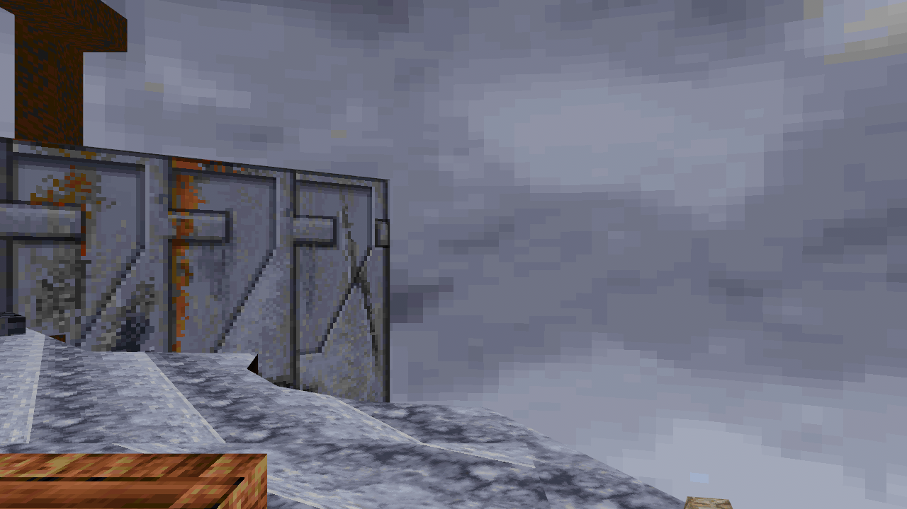

*`jkl\03katarn.jkl`, viewed from the level's `walkplayer` start point: the level's own
geometry, materials and sky, with placed crate models sitting on the ledge at their real
size. Levels and models share one Z-up coordinate system, so a model's height is its
height in the world.*

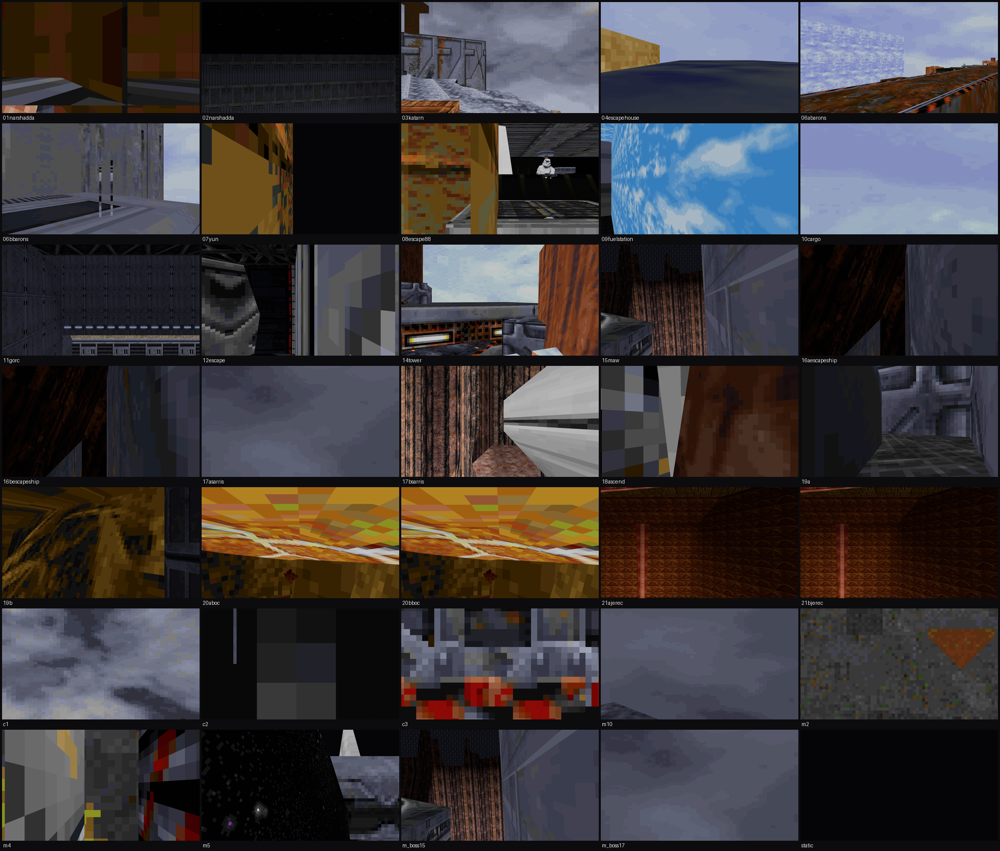

*Every `.jkl` in the install — 26 single-player (25 campaign levels, listed as 28
manifest rows across the light and dark paths, plus the asset-only `static.jkl`),
6 multiplayer and 3 CTF — one `--shot` process each, from each level's own start
point. The outdoor levels show the game's own cloud sky.*

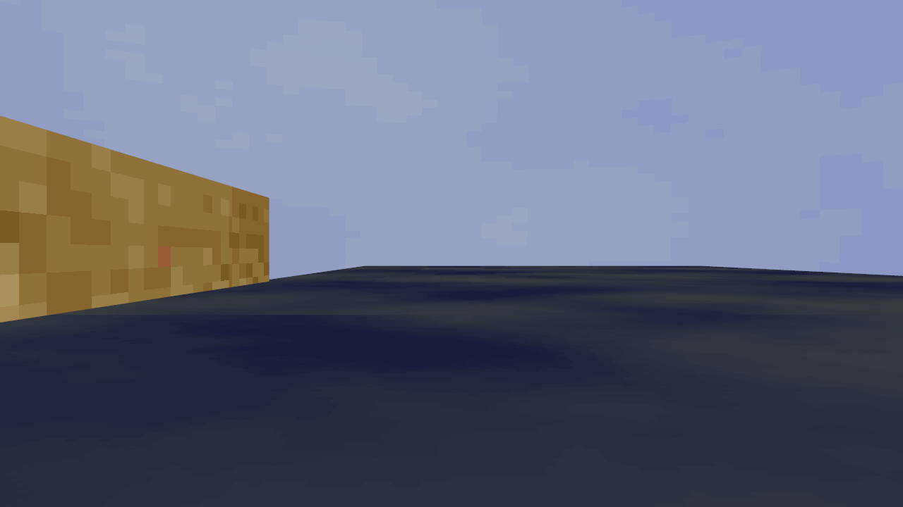

*`jkl\04escapehouse.jkl`: brick walls, wooden beams and the level's sky texture,
drawn as an unshaded dome behind the world.*

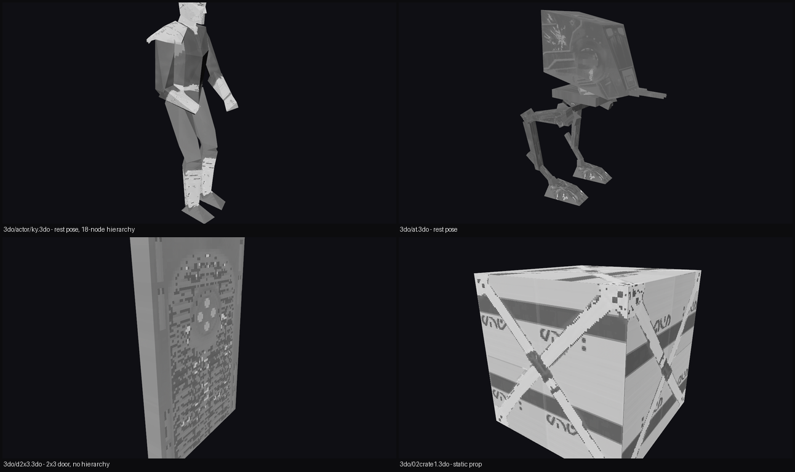

*`--pose <model> -`: four models drawn from their own rest pose. A puppet's mesh
vertices are node-local, so the body only exists after its 18-node hierarchy is
composed — the top-left figure is `3do/actor/ky.3do`, the walker is `3do/at.3do`, and
the door and crate below have no hierarchy at all and are drawn as stored.*

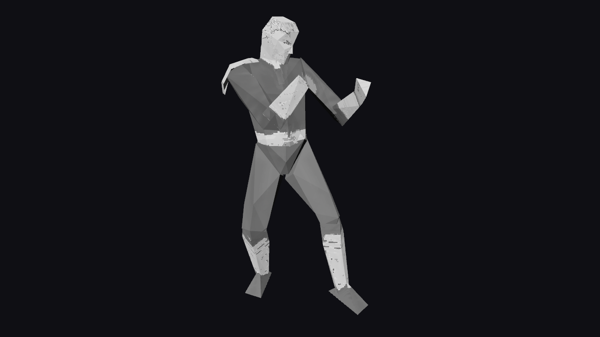

*`--pose 3do/actor/ky.3do 3do/key/kystand0.key 8`: the same body posed from frame 8 of
its stand animation. A `.key` frame is an absolute local pose per joint, matched to the
model by mesh name (`kystand0.key` lists its joints alphabetically, the model lists them
in authoring order).*

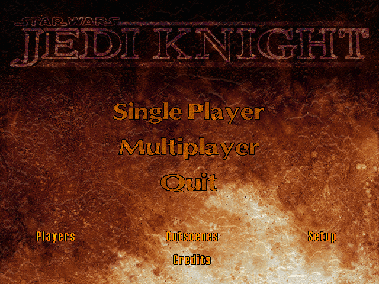

*`--ui singleplayer`: the game's own `ui\bm\bkmain.bm` with its `ui\sft\large0.sft` text, at
the element rects read out of the engine executable's `.data`. Nothing about this screen is
authored here — the art, the font, the strings (`ui\jkstrings.uni`) and the layout all
come from the retail install, and the text is the colour retail shows because a glyph's
byte is a palette index into the background's own palette.*

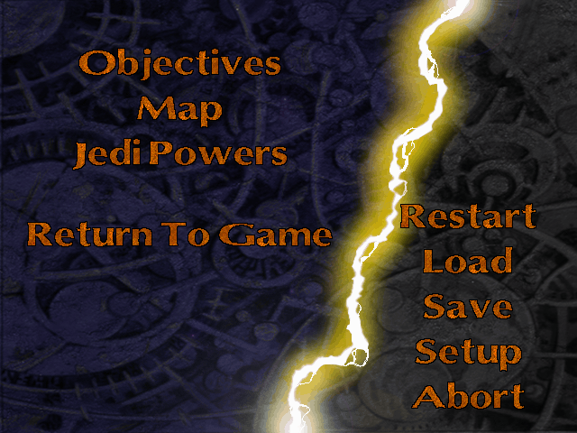

*`--ui esc`: the pause screen over `bkesc.bm`, same pipeline — the same `large0.sft` glyph
strip resolves to a different colour because this palette is different.*

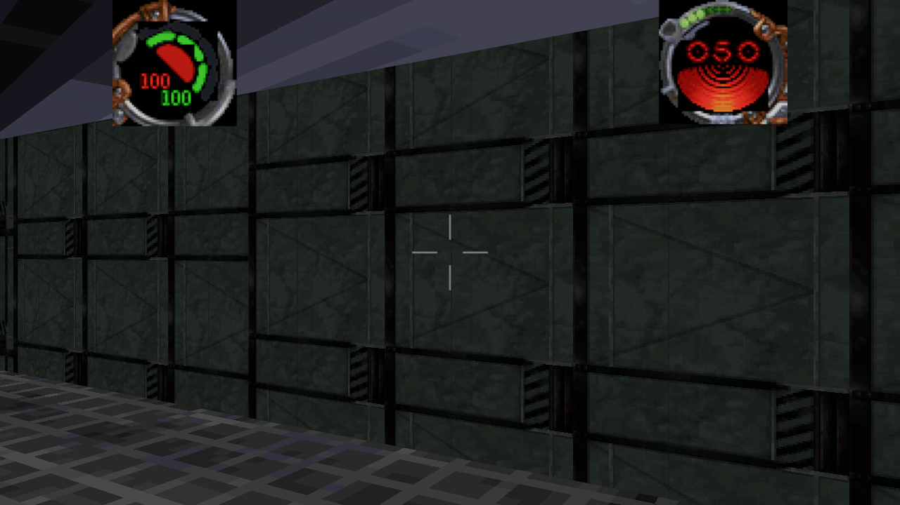

*The status bar as the app draws it: `statusLeft.bm`/`statusRight.bm` at the screen
corners with the shield, health, force and battery meters and the three `%03d` numbers,
all at `hud_scale` 2. Every position comes from the bitmap headers and every frame index
from the meter's own value.*

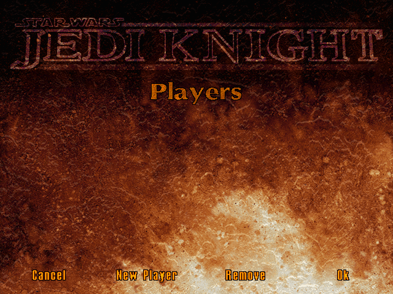

*`--ui chooseplayer`: the artwork, the five buttons and their rects all come from the
install, and the element array itself is read out of the engine executable at 0x526d98 — the
same path draws all 41 screens it holds, 512 elements in total. Its background is `bkMain`,
not the `bkSingle` this build used to guess: it is the `jkGui_stdBitmaps[0]` argument of the
`jkGui_InitMenu` call that initializes the screen, read from the code. The player list itself
is a list box the engine fills from code, so it is empty here.*

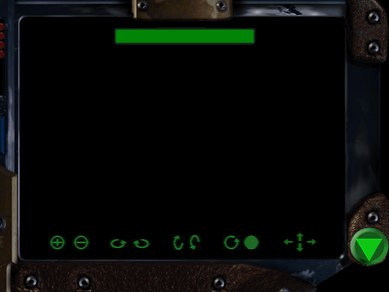

*`--ui 0x52ea68`: the in-game map and journal. This is the screen the extraction used to
call "force_powers" — 12 picture buttons over a 520x320 custom element — because nothing in
the data says what it is. The code does: its menu is initialized by `jkGuiMap_Startup` over
`bkFieldLog.bm`, and the buttons are the map's own controls (`flPlus`/`flMinus`, the rotate
and pan arrows, `flSpin`, `flReset`). The black area is the `type 7` element where the map is
drawn at run time; the green bar above it is drawn by that same code.*

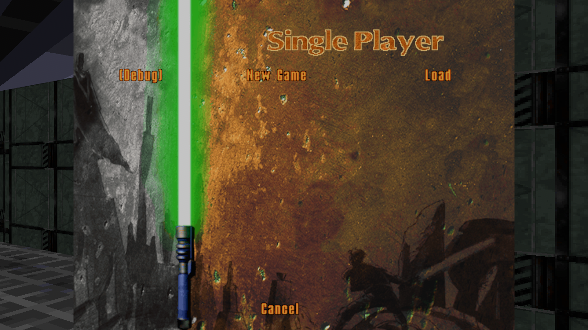

*`--menu main/10`: the app activated the main menu's `GUI_SINGLEPLAYER` row through the same
path a click takes, and the screen it opened is the one the retail graph names — the
`jkGuiSingleplayer_Show` menu over `bkSingle.bm`, with New Game, Load, `(Debug)` and Cancel
from the element table. Navigation follows the recovered `_Show` switches, not a guess:
`menus`/`nav` map `(screen, hoverId)` to the next screen, and the audit checks every edge's id
against the data it came from.*

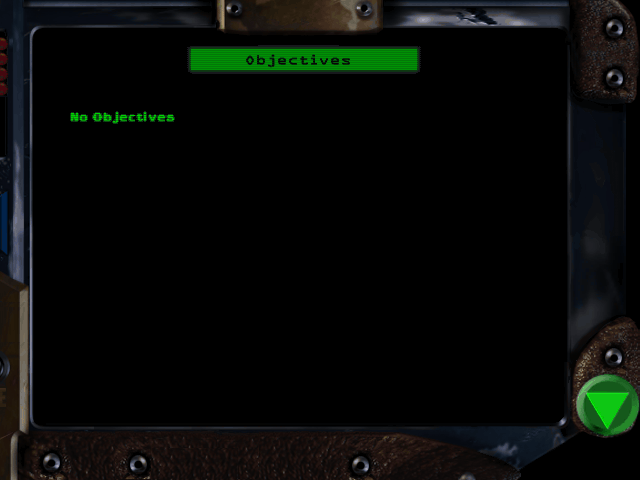

*`--ui 0x5311e0`: the objectives page. Its `type 7` panel is `jkGuiObjectives_CustomRender`
(its own `+0x30` callback, 0x417b00), which lists the player's goals and, with none, prints
`GUI_NO_OBJECTIVES` 30px in from the element's edge in the element's font. This build has no
goal inventory, so that is its true state — the words come from `jkstrings.uni`, not from
here. The green banner is painted in `bkFieldLog.bm` itself.*

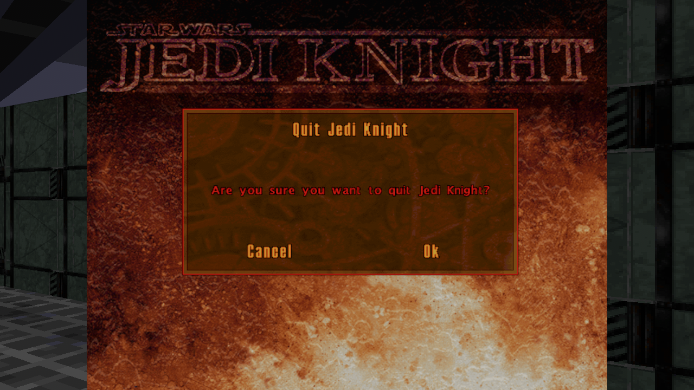

*`--menu main/12`: the main menu's Quit row does not exit — the decompiled `jkGuiMain_Show`
case 12 calls `jkGuiDialog_Message(GUI_QUITCONFIRM, GUI_QUITCONFIRM_Q)`, so the app opens the
Ok/Cancel dialog with those two lines from `jkstrings.uni` ("Quit Jedi Knight", "Are you sure
you want to quit Jedi Knight?"), the dialog's own panel over the menu art, and Cancel going
back / Ok leaving. Nothing here is typed in: the layout is the element array at 0x530068 and
the text is the shipped table.*

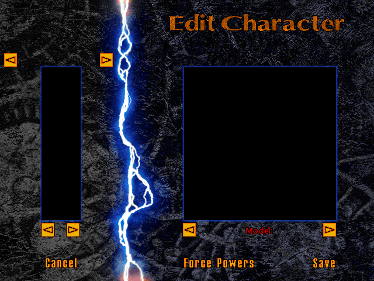

*`--ui 0x534cd0`: the character editor. Six picture buttons index the engine's bitmap table
(33/34 = `arrowLeft.bm`/`arrowRight.bm`) and land exactly on their rects, which is what
reading whole element arrays bought: the old string-keyed scan saw this screen as three
buttons called `cancel`. The two black panels are `type 7` custom elements — the model
window and the force-power grid are drawn by the screen's code into rects the data only
reserves.*

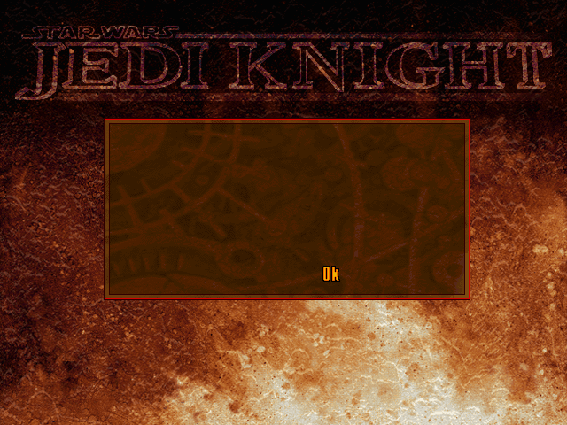

*`--ui 0x52fe88`: a dialog is two layers. `bkdialog.bm` is 414x206, not a screen, so the
engine copies the menu art and then the panel at that bitmap's own `xPos`/`yPos`
(`113,137`), which is where the elements' full 640x480 rects sit inside it. This build
draws the panel only for screens whose elements really do fit inside it — this generic
"Ok" box does, while the four-line quit prompt spans the screen and draws no panel. The
message lines are runtime text the engine fills in, so only the button shows.*

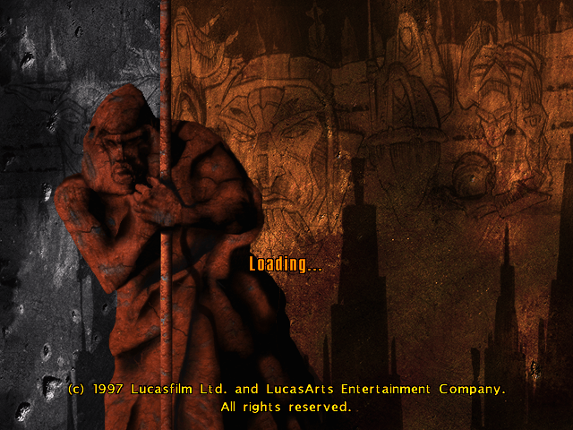

*`--ui 0x534790`: "Loading…" and the two copyright lines are ordinary elements in the
executable's `.data`, drawn over `bkloading.bm` — the same array the engine fills with
progress text.*

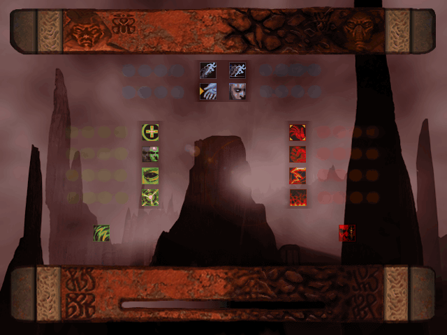

*`--ui force`: the screen this build could not find for two rounds. Its elements carry a
`rect = -1,-1,-1,-1` placeholder that the engine fills from the artwork, so a "does the rect
fit the screen" test threw the whole screen away. Each icon is placed from its own
`xPos`/`yPos` (`foAbsorb.bm` at 201,269, `foJump.bm` at 284,87, …), drawn from its
normal/hover/pressed cells, over `bkforce.bm`.*

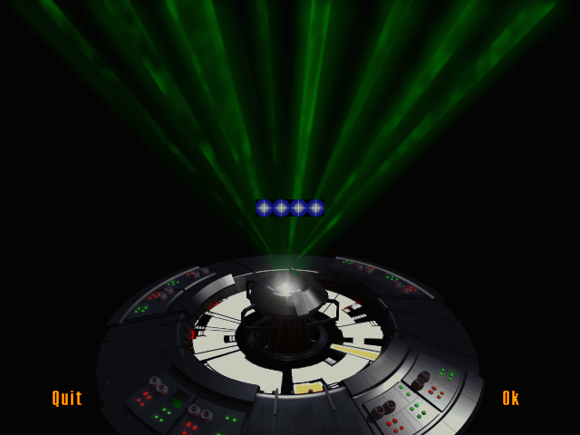

*`--ui 0x531530 --stars 4`: the tally screen's `type 7` element is where
`jkGuiSingleTally_ForceStarsRender` (0x418000) paints the force stars — one `foStars.bm` cell
repeated, centred in the element's rect, at the element's y. The count is game state, so this
build draws what `--stars` is given and nothing otherwise; every other custom panel is named
in `--ui-tables` (`[map]`, `[objectives]`, `[loadbar]`, `[model]`, …) but needs state or level
data the screenshot path does not have.*

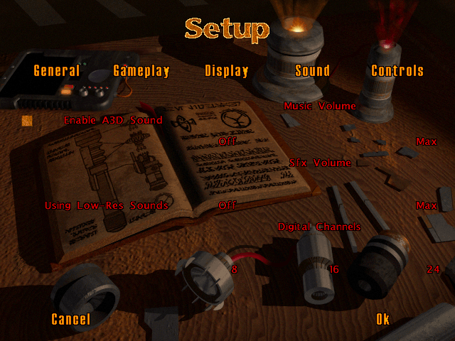

*`--ui setup`: every font here is named by the element's own `textType` — `large1` for the
title, `med0` for the tab buttons, `small0` for the red labels — and the empty check box
left of "Enable A3D Sound" is `check.bm` from the engine's bitmap table, with the label
shifted right by the box's width plus four, as the engine does.*

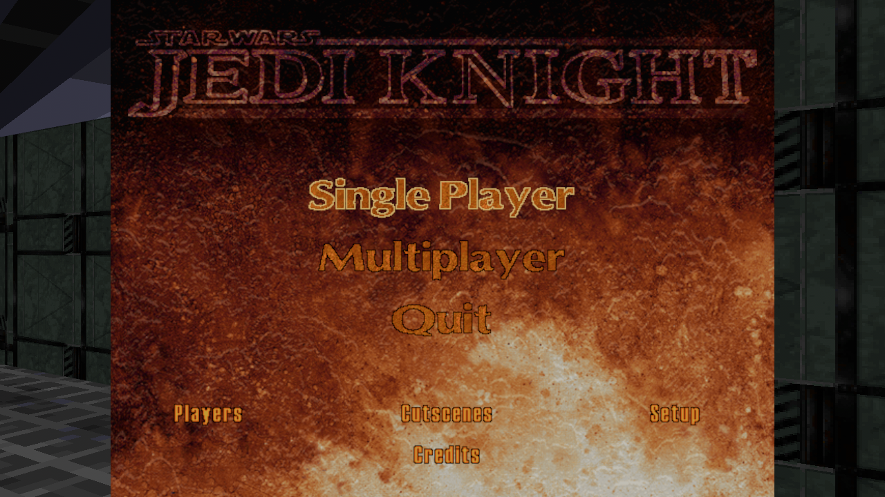

*`--menu singleplayer`: the same screen inside the app, with the cursor on the first row
drawn in the engine's own hover font (`large1`), which is how retail lights a hovered row.
Escape opens the pause screen, Up/Down move, Enter picks.*

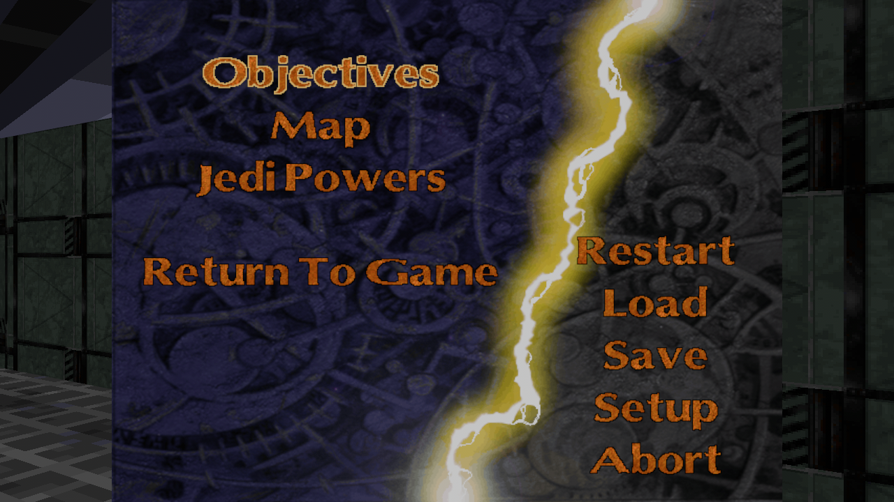

*Escape opens `bkesc.bm` in the app itself — 640x480 canvas letterboxed over the live
level, cursor on `Objectives` — and Up/Down/Enter move and pick.*

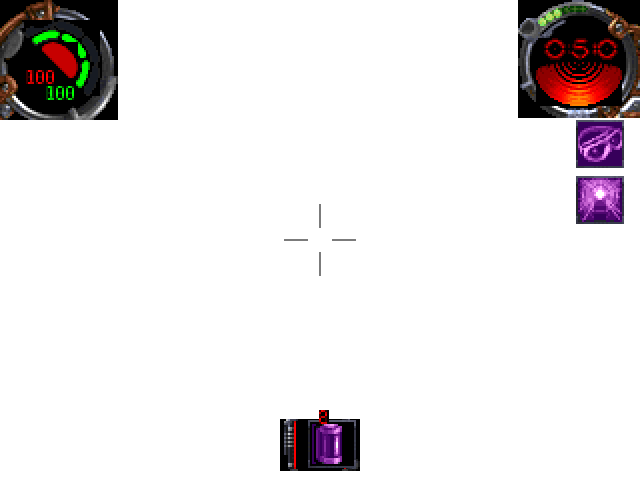

*`--hud`: status bar, crosshair, the bracketed item panel at the bottom and the inventory
strip down the right edge, composed over the campaign's first level's colormap — which is
where the red/green/amber come from. The icons are `ui\bm\ic<name>.bm`, whose file names are
derived from `misc\items.dat`'s item names by the engine's own `ic%.5s%d.bm` rule.*

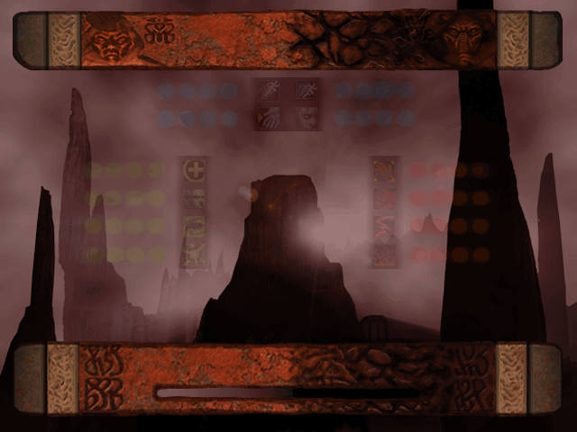

*`--bm "ui\bm\bkforce.bm"`: the Jedi-power screen's own artwork — the medallion bands,
the alien landscape, and the empty slots the force icons are drawn into. Decoded straight
from the install, palette included.*

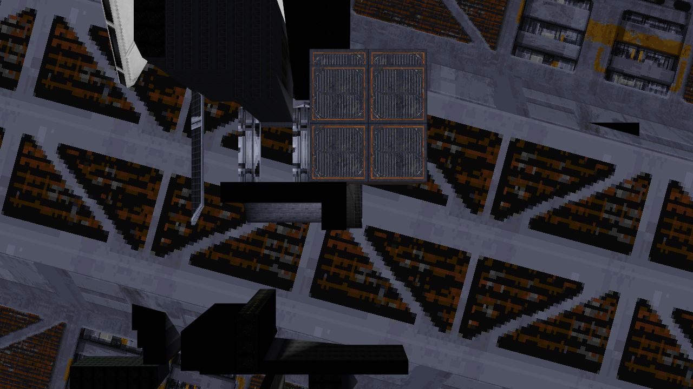

*`--overview`: level 1 in plan, from directly above — a plan view of a Z-up world.*

## Status

| area | state |
|---|---|
| `.gob` archive VFS (5 archives, 4795 entries / 4791 unique names) | working |
| `.jkl` level parsing (geometry, materials, objects) | working |
| `.mat` material → bitmap (1932 of 1983; the rest are texture-less by design) | working |
| `.cmp` colormap → palette (offset 64; the 64–320 distance tables are located but unused) | base palette only |
| `.3do` model parsing + placement (all 477 models) | working, drawn from the rest pose |
| `.spr` sprite parsing (all 20) | parsed; nothing placed uses one |
| `.wav` playback + `.snd` sound classes (all 644 + 102) | working |
| sector ambience loops (`SOUND` per sector, swapped as you move) | working |
| COG script parser (all 540 scripts) + interpreter core | parsing complete; 315 verbs, and every verb a shipped script calls is answered by the runtime except AI, weapon, music and the message bus (§16.4) |
| COG runtime — placed instances bound to a mutable world | working: doors open, lifts move, adjoins close; level 1 delivers 92 messages and actuates 13 adjoins. `--cog-check` fails if a verb outside the deferred groups goes back to being stubbed |
| the same runtime driving the renderer (per-frame thing transforms) | working |
| UI: menus from the game's own art, fonts and element tables | working in-app: 41 element arrays / 512 elements read from the EXE, `--ui <name>`, `--menu`, Up/Down/Enter |
| UI: the engine's font and bitmap tables | working: 12 fonts + 35 bitmaps read out of the EXE, so text uses the font each element names and hover is the next one |
| UI: picture buttons, check boxes and dialog panels | working: `arrowLeft`/`arrowRight`, `check.bm` and the 14 `fo*.bm` force icons, placed at each bitmap's own `xPos`/`yPos`; a dialog's `bkdialog.bm` panel over `bkmain.bm` |
| UI: the eight `type 7` panels | classified from each element's own `draw` callback (`+0x30`): `map`, `objectives`, `stars`, `loadbar`, `title-text`, `model`, `power-grid`; 8/8 by `--ui-audit`. The star row and the objectives page's empty state are drawn; the map is a 3D view (`sithMap_DrawCircle`), the rest need game state. 72 elements carry a `click` callback too |
| UI: the pointer | working: window cursor mapped onto the 640x480 canvas (letterbox undone), hover lights the element under it, click picks it |
| UI: menu navigation | working: 17 edges + 2 actions recovered from each screen's `_Show` switch, click/Enter opens the screen the retail graph names, Quit opens the retail `GUI_QUITCONFIRM` dialog, cancel/done goes back, `--menu <screen>/<id>` drives one hop headlessly |
| UI audit (`--ui-audit`) | passing: 41 screens / 512 elements, every font + bitmap index in the tables read from the EXE, 319 keys with 3 assigned at run time |
| UI: the status bar (panels, four meters, three numbers) | working in-app; `--hud` composes it offline |
| UI: crosshair, item panel and inventory strip | working: rects, `items.dat` icons and the item count |
| UI bitmaps (`.bm`) and string tables (`.uni`) decoding | working: all 146 + 5 files |
| sprite fonts (`.sft`) | working: all 27 files (`--sft`), used by `--ui` |
| world geometry rendering with per-vertex baked light + mipmaps | working |
| sky (unlit sky faces + a sky dome for the background) | working, no sky scroll |
| episode manifests (`episode.jk`, all 3 episodes, 37 sequences) | working |
| retail asset graph — all 35 levels + every referenced asset | **verified** |
| distance shading (the `.cmp` tables) | not started — see stage 1 above |
| `.key` animation data, `.pup` puppets, `.ai` classes | parsed (all 784 files); placed actors animate (`stand`) — see the `actors animate` row below; `.ai` classes parsed but not driving anything yet |
| inventory bins | weapons and force powers share one table (`enum SITHBIN`): `SetCurInvWeapon`/`SelectWeapon` arm a bin, `GetCurInvWeapon` reads it, force mana is bin 14 and force powers are bins 21–26 (§16.7). `--bins` checks the round-trip and that arming the bryar arms `+bryarbolt`. The bin→projectile mapping is a name heuristic, not the engine's `weaponData`. **Force powers run their own scripts**: `--force jump` executes `force_jump.cog` end to end (mana −20 exact, hold measured 0.5 s) but the lift is an open bug — the script's velocity reaches `SetThingVel` as zero |
| AI | actors carry their shipped `.ai`: sight distance and cone decide whether an armed actor fires its own `weapon=`, and `--ai` checks that an actor fires at 3 units, holds at 8 and stays silent from behind (§16.8). The instinct scheduler's weights, pathfinding, `accuracy=` spread and reactions are not done |
| items | pickups work through the item's **own script**: touching a powerup runs its cog's `touched` then `taken`, so `pow_shields.cog` lands `bin 60 +20` from its own `bin=60`/`ChangeInv` (§16.6); `--pickup` asserts it on level 1's `shieldrecharge`. Also fixed the inventory verbs' argument order (thing first) and `TakeItem` double-counting. Taking a weapon changes what the player fires (runtime weapon: `+bryarbolt` 30 damage -> `+elaser` 12, checked by --weapon), and a taken powerup comes back after its 
espawn= seconds (checked in --pickup). Not yet: pickup sounds, real inventory maxima |
| combat: firing | working in the window: **left mouse** fires the level's own weapon template, the bolt is drawn and flown with the template's `vel=`, stops at the sector graph and applies its `damage=`; `--fire +bryarbolt` checks flight and the 30 points of damage headlessly, and `--fire-demo` shows the bolt on screen (§16.5). a projectile damages what it reaches and a killed actor plays the puppet's own `death` keyframe (`kyftdeth.key`, 45 frames at 15 fps) and holds its last frame; --fire asserts the kill. Damage decays in flight the way the engine does it (SITH_WF_DAMAGE_DECAY 0x4000, 
ate= per second floored at mindamage=): level 1''s bolt is 30 damage dropping to 10 over 1.33 s (§16.5). Not yet: explosions, ammo, force power effects, a body that falls |
| actors animate | working: each placed actor plays its puppet's `stand` keyframe at the keyfile's own 15 fps on its own mesh, rebuilt only when the frame number changes; `--animate` checks the rendered vertices across every material — **1684 of 1697** actors move over the loop (§16.3). `walk`/`run`/strafe need velocity, i.e. stage 6's AI |
| cutscenes (`.smk`) | **the data loads and its headers check out**: 25 files, 483 MB, 29,493 frames, all 640×300 at 15.2 fps (`--smk`); the decoder is `SMACKW32.DLL` (71 KB, named exports recovered), not JK.EXE. The VFS now finds them through the `Resource/VIDEO` mount | decoding not started — stage 8 |
| level collision + adjoin (portal) traversal | working: a walker stays inside the level's own sectors |
| player motion | working: walk/run/back/strafe/crouch, jump and water derived from the level's own `walkplayer` template chain, gravity scaled from the level, and water halving movement from the floor's surface flags (§16.2); level 1 walks at 0.667 u/s (`maxthrust/surfdrag`), jumps to a 0.28-unit apex in 0.75 s. `--rules` prints the table, the level's flagged-surface counts, and checks the integrated jump against the closed form. Step-up is not implemented and cannot be with infinite-plane collision (§16.2) |
| sector visibility | working: one batch per (sector, material) + a per-frame clip-plane test, 21 of 462 sectors drawn in level 1 at the spawn, pixel-identical to --no-cull (0 of 230400 sampled pixels differ at yaw 0/90/270). Portal occlusion is implemented and unit-tested but off until the player's sector is tracked (§16.1) |

### Where the roadmap stands

Stage-by-stage, against `docs/roadmap.md`, with the check that holds each one:

| stage | state | check |
|---|---|---|
| 1 visibility | `.cmp` colormap material by default at measured parity (0.00% vs `StandardMaterial`), and **portal occlusion on**: symmetric portal graph, seed chosen by agreement with the frustum, culled frame 0.000% different from `--no-cull` over 230,400 pixels | `--cmp`, `--shot` A/B, `--audit` |
| 2 player | walk/run/back/strafe/crouch from the template, the engine's jump gravity, water from surface flags, step-up, and the **lateral rule** in one function (`collide::face_blocks`: span + outline + penetration). `--rules` asserts a body beside a wall is stopped and one 20 units past its end is not | `--rules`, `--walk all` |
| 2 player parity | **done except lateral coverage**: walk/run/back/strafe/crouch/jump/water from the template's own numbers, step-up onto a 0.65 ledge, the body standing on faces that belong to other sectors, and the view following the walker at the sweep's eye height (§16.2). Still open: a body beside a face but outside its plan projection is still pushed by an infinite plane | `--rules`, `--walk all` |
| 4 COG verbs | every label level 1 declares is fed, each `run_label` has a fresh bounded budget, and **`sleep`/`waitformessage` suspend and resume** across frames (`Vm::resume` + `resume_sleeping_labels`; `--sleep` pins both halves and is verified to fail when suspension is removed). A nested `sleep` re-runs its enclosing block | `--cog-check`, `--sleep`, `--triggers`, `--live-check` |
| 5 combat | **complete for single-player**: damage two-way, shields, death/respawn, pickups, explosions, force jump/speed/healing/seeing, mana regeneration, ammo, and **force pull exactly as the shipped script does it** — highlight with `jkSetTarget`, then `ApplyForce` at 30 u/s toward the player with gravity cleared (`--pull`). Grip damages over time while holding the victim | `--hit`, `--fire`, `--pickup`, `--weapon`, `--force`, `--mana`, `--ammo`, `--pull` |
| 6 AI | instincts reach the live runtime (117 actors), and the chase **steers through portals** — 1206 doorways built from the `adjoin`/`mirror` pairs, chosen when the straight line is walled off (`segment_blocked`). Steering is greedy, not a search; scheduler weights and `accuracy=` are still fixed | `--ai`, `--live-check` |
| 7 audio | attenuation over 375 clips, the song range, the pulse/timer queue, the **music fade** verified end to end (`--fade`: 0.00 → 1.00 → 0.00 through the script's own chain), and the **menus' own wavs** parsed from `jkGuiMenu` and played on hover/click (39 of 41 screens, both names present) | `--sound`, `--music`, `--fade`, `--ui-sounds` |
| 8 `.smk` cutscenes | **it decodes and it plays in the window**: the DLL is 32-bit (`machine 0x014C`), so a 64-bit process cannot load it (error 193) — the decode runs in `tools/smkdec`, a dependency-free i686 helper driven by JK's own `SmackOpen(file, 0xfe000, -1)`. `--smk-decode` proves frames come out and differ (`01-02A.SMK`: 40 decoded, 10 distinct, first non-blank frame 16), and `--cutscene 01-02A.SMK 30` plays them over level 1 at 15 fps letterboxed 640×300 in the 640×480 overlay ([image](docs/cutscene-playing.png)). **Frames are in colour, from the film's own palette**: the header layout is proved (chunk sizes + tables + huffman block fill all 25 films exactly, `Layout::covers` in `--smk`), and palette records decode per frame — `skip`, `colour-shift`, and literal "set one colour" chunks, the last of which was the bug that made the first attempt look like coloured static ([images](docs/cutscene-colour-window.png)). Palettes are verified against libsmacker as a reference decoder (740 of 768 bytes wrong before the fix, 29 after, §16.9). **The whole film plays once, streamed**: 90 decoded frames used to loop, which is what a 992-frame film playing the same six seconds looks like; the helper now decodes the entire film to disk as it plays (about 5× real time, so it stays ahead) and frames are read, coloured and blitted as they appear, stopping on the last one ([image](docs/cutscene-late-frame.png)). Known limit: 29 of 768 palette bytes still differ from libsmacker (§16.9). Data: the VFS falls back to loose files through the `Resource/VIDEO` mount, so `--campaign` resolves every cutscene row and `--smk` verifies all 25 files (483 MB, 29,493 frames, 640×300 at 15.2 fps) | `--smk`, `--smk-decode`, `--cutscene`, `--campaign` |
| 9 campaign flow | **savegame container + thing records implemented** (`src/jks.rs`): version 6, the 1580-byte header, 32-byte level name, 4-byte field, 24-byte player block, then records with the engine's **0x28-byte header** (length +0x20, type +0x24) and a `ThingRecord` over the payload offsets `FUN_004f4210` stages — template index, type, position, angles. `--save` writes one record per placed thing (level 1: 64) and reads every position and angle back, including the player's own spawn. The campaign **graph** is verified too: `--campaign` walks both `gotoA`/`gotoB` edges and proves all 28 single-player levels are reachable from level 1 through the one `DECIDE` row, while the MP/CTF manifests loop as map rotations (§16.9). The **transition** is wired to the engine's own verb: `jkendlevel` (`jkCog.c`) marks `Runtime::level_complete`, and `--transition` resolves the successor through the graph — `01narshadda.jkl -> 02narshadda.jkl`, 21 levels on the `gotoA` spine (§16.9). Not done: the rest of the payload fields and the header internals. **The transition runs end to end up to the film**: `--complete-after <s>` calls the engine's own `jkEndLevel`, `Episode::flow_after` resolves the graph's next rows, the `CUT` row plays in the window and the next level is named (`level 01narshadda.jkl complete -> cutscene 06a.smk, then 02narshadda.jkl`, [image](docs/cutscene-on-complete.png)); `--flow` asserts every hop, with each film checked as `SMK2` and each level present in the archives. **The swap works, and it is the default**: `swap_level` is an exclusive system that despawns the old level's `LevelEntity`-tagged entities, swaps `World` and re-runs `setup`, so level 2 (391 things, 641 sectors) is built and rendered with its own music after the film (`--no-swap-levels` stops at the film). Three bugs made it work: the camera is only spawned when none exists, the film gates the change via `Cutscene::finished`, and the overlay is marked dirty so the HUD returns ([image](docs/level2-after-transition.png)). Remaining for the stage: the rest of the `.jks` payload and the header internals | `--save`, `--campaign`, `--transition`, `--flow`, `--complete-after`, `--swap-levels` |
| 10 UI panels | **every single-player custom element draws**: map, objectives, force stars, load bar, title text, plus the menus' own wavs. The two holes the docs used to name — the model window and the power grid — are both on `edit_character`, a **multiplayer** screen, so they are out of scope rather than pending | `--map-shot`, `--ui-visible`, `--load-bar`, `--force-screen`, `--ui-tables` |

Every stage's recovered constants and code addresses are in `docs/formats.md`; the
gates above are what fail if a behaviour drifts.

### Status: what a player can do today

Read this as the honest line between the two halves of the goal. The **read** half — parsing every
retail asset format and proving it against the install — is essentially complete. The **play** half
is not: this is not yet a replacement you can finish the game in.

**Works, with a check behind it:**

- All 35 shipped levels parse and pass `--check` (36/36 including `static.jkl`), and `--audit` reads
  every archive and reports 34/35 reachable from the manifests.
- **`--live-check` watches the running game, not a mock of it**: twenty frames in, it asserts the
  instincts are attached to the runtime the game simulates, the player thing exists, the collider and
  the materials are populated, actors have parts, and every placed script bound. Two bugs in one week
  (the impact scan never being called, instincts attached to a throwaway runtime) were invisible to
  checks that built their own world; this one would have failed on both.
- The world renders from the player's own eyes at the walker's eye height, with sector/portal
  visibility culling; walls carry their polygons, and the body stands on the walkway and steps onto
  a 0.65-unit ledge (`--walk all`: 34/34 levels, 1077 sector crossings).
- The `.key`/`.pup` animation plays on placed actors; an actor that sees you fires (projectiles,
  in-flight damage decay) and walks toward you at its own `maxstep`.
- The `.smk` films decode through the install's own 32-bit `SMACKW32.DLL` in a helper process, play
  once in full colour, and the level transition after them lands on the next level.
- The force panel and the field-log map panel draw from the executable's own screens and tables.
- The campaign graph, savegame container (`.jks`), audio mix curve, and the menu screens' data are
  recovered and checked.

**Does not work yet — do not expect a playable campaign:**

- ~~Combat is one-directional~~ — **two-way now, and checked**: `--hit` drives the same scan the game
  uses and lands 25 of a bolt's 30 carried damage on a placed actor, then takes 9 off the player from
  the actor's own `+elaser`; the status bar shows the runtime's health. Force powers, explosions and
  ammo are still partial (§16.5).
- **Force powers are data, not effects**: force seeing/pull/grip have no visual or physical effect yet.
- ~~`--rules`' jump calibration failed~~ — **fixed**: the lateral resolver was pushing along a floor plane's infinite normal and pinning the body, so `walker_step` now keeps the height its vertical step produced and lets the resolver own X and Y. `--rules` measures `apex 2.57 / 2.81` (91% of the closed form) and exits clean (§16.2).
- **The movement basis is JK's own now, and strafing was backwards until it was.** `walk_target`
  builds motion from `lvec = (cos yaw, sin yaw)` and `rvec = lvec × uvec = (sin yaw, -cos yaw)`; the port
  had `-rvec`, so `A` and `D` were swapped. `--controls` compares the mapping against the camera transform
  the renderer builds, and fails if the sign flips back.
- **Mouse look works, with a calibrated sensitivity.** `LOOK_SENSITIVITY` (0.0035 rad/px, `BK_LOOK_SENS`
  overrides) stands in for JK's options-screen slider, which is a setting rather than data; the pitch
  clamp *is* data (`minheadpitch`/`maxheadpitch`). The pointer is locked whenever no screen is open and
  released for menus. Arrow keys still turn.
- **"Characters stuffed inside each other" was the camera standing inside an NPC, not the model scale.**
  The spawn only demanded `radius * 2` = 0.7 units from other things, exactly an NPC's body width; `--shot`
  showed a head and shoulders filling the frame. The spawn now wants 2.0 units (`BK_THING_CLEARANCE`), and
  the same viewpoint is open room. `MODEL_SCALE` stays 10: `ky.3do` is 0.18 model units and 0.17 posed, so a
  character is 1.8 world units — a person in a 2.5-unit storey. A round was spent at 1.0 on a misread
  measurement (`bounds()` already scales), which made every character ten times too small.
- **The player body is back to the calibrated values, because the model scale was the real fault.** Radius
  `0.35`, eye `1.45`, step `0.66` -- these pair with a 1.81-unit character in a 2.5-unit storey. The detour
  through `size=0.065`/`eyeoffset=0.037` assumed those were world units; they are offsets within a puppet,
  and taking them literally put the camera 0.1 above the floor. Frames and the reasoning are in
  `docs/formats.md` (player body and drawing scale sections).
- **Audio is muted by default, and quiet when enabled.** `--sound-on` plays at a 5% master gain
  (`--sound-on` + `BK_VOLUME=1` for a real playtest); `--mute`/`BK_MUTE=1` force silence whatever else is
  passed. `--audio-state` prints the decision and gain, then exits before an audio device is opened, so the
  mute can be verified without playing anything. The read-back `audio: N sink(s) live, M audible, loudest X`
  line reports the sink state sampled from the sinks themselves — it printed nothing for a whole round while
  the enforcement system was silently unregistered, which is exactly why it now prints even at zero sinks.
- **Things have three angles, and the port was reading one.** The row is `X Y Z pitch yaw roll sector`;
  only yaw was parsed and the transform rotated about Z, so **138 of 352 things in level 1** (39%) were drawn
  face-up. The orientation is now `rdMatrix_Build34` verbatim, converted to a quaternion. Reading the load
  path also settled the model scale twice over (`RADIUS` is ~1/11 of the measured extent, so model space is
  world/10) and identified the huge orange surfaces as the level's **freighter**, 110 units long by design.
- **The level geometry itself checks out.** `--winding` over all 35 levels: every drawn surface's normal
  points into its own room (91,233 of 91,233), and 98.9% of windings agree with the normal they ship. So the
  polygons are not the problem — the body is.
- **The lateral move is the sweep, and it neither wedges nor leaves the world.** Three rules were missing,
  and none was the impact response the docs first blamed: the surface search records a face only when the
  body is moving *into* it, the floor probe has to search every face (this port's sectors do not tile), and
  containment is a floor test rather than the engine's hull test. `--move` walks all 34 levels: 0 fell
  through, 0 frozen, 189 units. Walking off level 1's walkway drops the body into the room below and it
  lands (`z -13.65` on floor `-14.00`) — that is geometry, not collision, so the gate asserts "never below
  every floor" rather than "never descends".
- **The spawn is nudged off whatever it overlaps.** Levels place the player at a marker that can sit on
  an NPC or inside a wall; `spawn_point` searches outwards for a floor-standing point at least a body''s
  width from any other thing, and falls back to the clearest one it can find.
- **Collision uses the engine''s own sweep now**, with two caveats. `collide::sweep` is
  `sithIntersect_CheckSphereHit` + `TestSphereFaceHit` + the adjoin walk of
  `sithCollision_SearchForSurfaceCollisions`, and the fall, the floor probe and the walk all go through it
  (`--collide`: 4 of 352 placed things on level 1 stand on a floor in another sector, which is the case
  the old queries could not do). Caveats: a face that owns no polygon is still handled by the plane
  resolver, and the `.jkl` winding is untrusted, so the polygon test asks the polygon's centre which side
  is inside instead of assuming a winding.
- **`.cmp` shading is implemented for the distance fade**; light levels from the colormap's own
  sectors are not (see §16.13 for what is calibrated).
- **UI panels**: every single-player custom element draws (map, objectives, force stars, load bar,
  title text). The two that used to be listed as missing — the model window and the power grid — are
  both on `edit_character`, a **multiplayer** screen, so they are out of scope.
- **Actors do not pathfind**; they walk straight at what they see, steering through portals by
  agreement with the frustum, and the instinct scheduler's weights are unfixed.
- **Multiplayer is out of scope**, deliberately.

Each of those is listed against its stage in `docs/roadmap.md` with the next concrete step.

### Retail coverage

`--audit` is the drop-in gate: it sweeps every level in every archive, resolves
every material/model/sprite/keyframe/puppet/AI/cog/sound reference, checks every
`LEVEL` row of all three `episode.jk` manifests, counts what it can decode in every
format present in the install, and **builds the draw geometry for every level**.

```
archives   5 GOB files, 4791 entries
levels reachable 34/35 from the manifests
render: 236346 world triangles, 6256 model instances, 1387375 model triangles, 0 placed sprite things
scripts (cog) 540 parsed, 1854 labels, 7683 symbols
keyframes (key) 504 files, 8439 nodes (max 29), 72587 entries, 0 truncated
ai classes (ai) 231 files, 1511 parameters, 1830 instincts, 0 without alignment/rank
puppets (pup) 49 files, 934 animation states, 158 joint mappings, 0 keyframe references missing
bitmaps (bm) 146 files, 309 cells, 3923508 pixels, 0 not exact
strings (uni) 5 tables, 1456 strings
sound classes 1976 entries over 88 events, 2 wav references missing
summary: 35/35 levels clean, 10 unresolved asset references, 0 non-drawable models,
         0 manifest LEVEL rows missing, 85 undecoded files
```

| ext | files | decoded |
|---|---|---|
| `.mat` | 1983 | 1932 |
| `.wav` | 644 | **644** |
| `.cog` | 540 | **540** |
| `.key` | 504 | **504** |
| `.3do` | 477 | **477** |
| `.bm` | 146 | **146** |
| `.snd` | 102 | **102** |
| `.ai` `.ai0` `.ai2` | 231 | **231** |
| `.pup` | 49 | **49** |
| `.jkl` | 35 | **35** |
| `.sft` | 27 | **27** |
| `.cmp` | 21 | **21** |
| `.spr` | 20 | **20** |
| `.uni` | 5 | **5** |
| `.dat`, `.par`, `.jk` | 7 | 0 |

4733 of 4791 files (99%) decode, including all 27 `.sft` fonts. Everything the renderer,
the audio system, the script runtime and the UI parse from — geometry, textures,
palettes, models, campaign order, sounds, level logic, animation, AI, fonts, UI bitmaps
and strings — is complete. Of the 58 that do not, 51 are `.mat` files that carry no
bitmap by design and 7 are saved game state (`.dat`/`.par`) or the level-library `.jk`;
none affects rendering a level or a menu. The 10 unresolved asset references are `.wav`
names that the retail install does not ship (one traced to `misc\snd\turret.snd`) and
that the original engine ignored.
Details in `docs/formats.md` §11–§15.

### The level's own logic runs

`--run` binds each placed COG instance to a mutable world (`src/runtime.rs`) and
delivers its messages, so the level's authored behaviour is exercised, not just its
geometry. Level 1 (`jkl\01narshadda.jkl`, 42 placed instances):

```
startup: 27 ran, 0 waiting on an engine event, 15 scripts are event-only
messages: 92 delivered, 0 waiting, 0 errors
world after 60 steps: 21 things on a path, 19 moved, 10 sector adjoin changes,
                      19 sounds requested, 1 inventory items
thing 4 (2x3door) moved from (1.2 9.7 6.3) to (1.2 9.7 6.6)
sounds: 19 requested, 0 missing from archive
```

Across all 35 levels: **1030 startups ran, 2541 messages delivered, 424 things moved,
247 sector adjoin changes, 4893 sounds requested, 0 errors, 0 missing sounds** — every
sound name a script asked for resolves to a real archive entry, which is what proves
the symbol binding is right and not just the parser. The verbs still stubbed, ranked by
how many placed instances call them, are printed at the end of `--run all`
(`GetSenderId` 216, `GetSenderRef` 184, `SetWallCel` 162, …).

### …and it moves what the window draws

The app runs the same script instances and steps their world every frame, rewriting the
`Transform` of the entities drawing each thing that moved:

```
42 script instances bound, 19 things moving at load
   (2x2elev, 2x3door, 3x3door_1, 3x3elev, 4x3door_1, 4x4elev, 6x6elev_1, funicular)
sim 0.0s: thing 4 drawn at (1.20 9.65 6.39), runtime (1.20 9.65 6.39)
```

Thing 4 is a `2x3door` authored at `z = 6.35`; its script has opened it and the mesh was
drawn where the runtime says. `--sim` also delivers each declared message once so the
level's doors and lifts act without a player; without it only `startup` runs, as at load
in the original engine.

### …and you can walk around it

The camera is a walker bound to the level's own convex sectors. A `.jkl` surface whose
`adjoin` is `-1` is a wall; one with an adjoin is a doorway, resolved through the
`World adjoins` table's `mirror` field to the sector on the other side — that field is
what makes portals work, and treating it as a sector index pins you in place
(`docs/formats.md` §3.1). `--walk all` holds "forward" from each level's own
`walkplayer` and reports the result:

```
level                          travelled  blocked    sectors contained  hull
jkl\03katarn.jkl                    16.0        0   405->369       yes  differs
jkl\04escapehouse.jkl               16.3        0   781->786       yes  differs
jkl\09fuelstation.jkl               11.0        0   874->880       yes  differs
...
summary: 34/34 levels with a start kept the walker inside its sector,
         13 had the hull test agree, 931 sector crossings, 1 without a start
```

`contained` holds on every level with a start; `hull` is a stricter second opinion that
disagrees where sectors overlap (level 1 has 462 sectors for 352 things, many of them
trigger slivers). The window runs the same `walker_step` the sweep measures, so walking
into a wall stops at the wall and walking through a doorway changes sector.

### …and its models assemble from their joint hierarchies

A `.3do` puppet stores each mesh's vertices around its own *pivot*, so the parts only
become a body after the chain above each one is composed. Composing the translations
alone gives a heap of plates; the engine's own composition is

```text
joint[n]    = joint[parent] · T(-parent.pivot) · [R(n.rot) | n.pos] · T(n.pivot)
joint[root] = [R | pos] · T(pivot)
```

Three details are load-bearing, and each was a bug before it was read out of the engine:

- a node rotates its own mesh about its own pivot but is *placed* relative to its
  **parent's** pivot, so both pivots appear with opposite signs;
- the parent of a node can come **after** it in the node table (`ky.3do` stores `k_lcalf`
  at row 3 and `k_lthigh` at row 8), so the hierarchy resolves by reference, not by row
  order;
- `R` is not a product of three axis rotations: Sith's `rdMatrix_Build34` evaluates nine
  trig expressions into three orientation vectors that are then the matrix *columns*
  (pitch about X, yaw about Z, roll about Y), and the cross terms are asymmetric.
  Transcribing those nine expressions is what made a standing figure.

A `.key` frame is an absolute local pose per joint (`x y z pitch yaw roll`), matched to
the model by mesh name, because `kystand0.key` lists its joints alphabetically while
`ky.3do` lists its meshes in authoring order. The second row of a keyframe entry is
velocity / angular velocity used to extrapolate between keys — not, as it first looks, a
delta.

Evidence chain: the shipped `JediKnight.EXE` gives the file layouts verbatim as
`"%d: %x %x %d %d %d %d %d %f %f %f %f %f %f %f %f %f %s"` (hierarchy node) and
`"%d: %f %x %f %f %f %f %f %f"` (keyframe entry); the composition, the matrix layout and
the "keyframe = absolute pose, blended as a difference from rest" rule come from
[OpenJKDF2](https://github.com/shinyquagsire23/OpenJKDF2)'s decompilation of the same
engine (`rdThing_AccumulateMatrices`, `rdPuppet_BuildJointMatrices`,
`rdMatrix_Build34`); the outcome is what `docs/models.png` and `docs/pose-kyle.png` show.
The matrix layout has not been re-derived from this install's disassembly, so it is
stated as a transcription rather than as an independent observation.

Two related findings: the world is **Z-up** (`CEILING SKY Z` in every level header, and
144 of `04escapehouse`'s 164 sky faces are flat in Z), so gravity, the floor normal and
the camera's up vector are all Z, and models, level geometry and placed things share one
frame. And `.3do` writes `NAME` *above* `VERTICES` in each mesh block, so a parser that
attaches the name to the mesh it already parsed shifts every mesh name by one — which
pairs each keyframe joint with the wrong mesh and scatters the model even with the right
math.

## Run

```powershell
cargo run --release                      # render the game's first level
cargo run --release -- --check           # parse-only validation, no window
cargo run --release -- --audit           # sweep the whole install (drop-in gate)
cargo run --release -- --live-check      # invariants on the running game's own runtime
cargo run --release -- --episodes        # the campaign tree, with each row's status
cargo run --release -- --overview        # whole level from outside, above
cargo run --release -- --near crate4_3   # frame the first thing of a template
cargo run --release -- --look 35         # pitch the default view up at the sky
cargo run --release -- --shot out.png    # render, save a PNG, exit
cargo run --release -- --shot out.png --frames 400 --sim   # …after 400 frames of script time
cargo run --release -- --cogs              # parse + run the level's scripts
cargo run --release -- --cogs all          # the same for all 540 scripts in the install
cargo run --release -- --run               # start the level's scripts against a live world
cargo run --release -- --run all           # the same for all 35 levels, one block each
cargo run --release -- --walk 120          # walk 120 frames into the level, no window
cargo run --release -- --walk all          # the same for every level, one line each
cargo run --release -- --pose 3do/actor/ky.3do 3do/key/kystand0.key 8 --shot pose.png
cargo run --release -- --pose 3do/actor/ky.3do - 0     # a model's own rest pose
cargo run --release -- --bm "ui\bm\bkmain.bm" art.png    # one UI bitmap as a PNG
cargo run --release -- --ui-tables                       # every menu screen read from the EXE
cargo run --release -- --ui-audit                        # …and every element's font/bitmap/key checked
cargo run --release -- --ui singleplayer main.png        # a menu screen, composed
cargo run --release -- --ui esc esc.png                  # the in-game pause screen
cargo run --release -- --ui force force.png              # the force-power icon screen
cargo run --release -- --ui fieldlog fieldlog.png        # the map / field-log screen
cargo run --release -- --hud hud.png                     # the status bar on its own
cargo run --release -- --menu main                       # the app, with the main menu open
    cargo run --release -- --menu main/10                    # …then activate its Single Player row
cargo run --release -- --play sound/ltsaberon01.wav     # play one archived sound
cargo run --release -- --dump "episode.jk"              # print one archived asset
cargo run --release -- --raw "ui\bm\bkesc.bm" out.bin   # write one archived asset verbatim
cargo run --release -- --texture 01f01.mat tex.png      # write a decoded material
cargo run --release -- --no-cull                        # draw every sector, to A/B the visibility pass
    cargo run --release -- --rules                          # the player's motion, from the level's templates
    cargo run --release -- --cog-check                      # every level's scripts still act on their world
    cargo run --release -- --fire +bryarbolt                # fire a weapon template at an actor and check the damage
    cargo run --release -- --fire-demo                      # fire a stream of bolts, for a screenshot
    cargo run --release -- --pickup                         # take level 1's powerup, check the inventory and respawn
    cargo run --release -- --weapon +elaser                 # taking a weapon changes what fires
    cargo run --release -- --bins                           # the inventory bins, weapon arming and force mana
    cargo run --release -- --force jump                     # run force_jump.cog: mana, hold, lift
    cargo run --release -- --force speed                    # force_speed.cog: extra thrust -> walk speed
    cargo run --release -- --force heal                     # force_heal.cog: 20 * rank health for 200 mana
    cargo run --release -- --ai                             # the .ai instinct classes and an actor noticing the player
    cargo run --release -- --save out.jks                   # write a .jks and read it back (or inspect an existing one)
    cargo run --release -- --sound                          # the .snd fade curve over all 1976 entries
    cargo run --release -- --music                          # PlaySong track numbers, and the install's music files
    cargo run --release -- --ui-visible                     # the engine's run-time bIsVisible rule over the screens
    cargo run --release -- --campaign                       # the episode graph from level 1 to the end, both branches
    cargo run --release -- --transition                     # finishing a level: jkendlevel, then the next level in the graph
    cargo run --release -- --smk                            # the 25 shipped cutscenes' own headers
    # cutscene decode needs the 32-bit helper first (the DLL is a 32-bit image):
    cargo build --release --target i686-pc-windows-msvc --manifest-path tools/smkdec/Cargo.toml
    cargo run --release -- --smk-decode 01-02A.SMK           # decode 40 frames through SMACKW32.DLL
    cargo run --release -- --cutscene 01-02A.SMK 30         # play a cutscene in the window from frame 30
    cargo run --release -- --complete-after 0.1             # finish the level: jkEndLevel, film, then next level
    cargo run --release -- --complete-after 0.1 --no-swap-levels  # stop at the film instead
    cargo run --release -- --flow                           # level -> cutscene -> next level, checked
    cargo run --release -- --animate                        # check that every placed actor's keyframes move it
    cargo run --release -- --no-anim                        # freeze the actors, to A/B the animation
    cargo run --release -- --level "jkl/04EscapeHouse.jkl"
cargo run --release -- --game "D:\some\other\install"
```

No level argument means "start where the game starts": the first `LEVEL` row of the
first single-player episode. Nothing about the campaign is hardcoded.

`--audit` exits non-zero if any level fails validation or any manifest `LEVEL` row
is missing — so it works as a CI gate and as a check when pointing the tool at a
different retail install.

The default game path is
`G:\Steam\steamapps\common\Star Wars Jedi Knight`; override with `--game`.

**Controls** — `WASD` walk, `Shift` run, `Space` jump, arrow keys look. The player is a
walker bound to the level's own sectors, so walls stop you and doorways let you through;
gravity is the level's `WORLD GRAVITY`.

## How it was reverse engineered

`docs/formats.md` records every recovered format with the evidence behind it and
flags what is still unknown. Summary of the approach:

1. **Ghidra 12.1.4** (`M:\ghidra_12.1.4_PUBLIC`) on `JediKnight.EXE` for identity
   and architecture, the recovered engine module map (from embedded `__FILE__`
   strings), and corroboration of the archive header (magic, version check,
   error strings, source module `.\Win95\stdGob.c`).
2. **Shipped-data triangulation** for the container formats. This is where the
   detail came from, because `.jkl`, `.3do`, `.key`, `.spr` and `episode.jk` are
   *plain text* — the layouts are directly readable and every parse is
   cross-checked across many files rather than guessed from disassembly.
3. **Rendering the result and looking at it.** Several findings are only visible in
   pixels, not in headers: models are 1/10 world scale, each mesh carries its own
   vertex pool, a model's `INSERT OFFSET` is a height rather than a vertex
   translation, a JK yaw of `a` faces `(cos a, sin a, 0)` about Z, and — the largest
   one — the `.cmp` palette starts at offset 64, not 30. That last off-by-34 turned
   every texture in the game hue-shifted: cyan cloud edges, magenta walls,
   unreadable props. Each of these was settled by shooting a screenshot of the retail
   geometry and comparing two hypotheses.
4. **Data tables read out of the executable itself.** The UI has no description file: a
   menu screen is a full-screen `.bm`, a `.sft` font, and a static array of 100-byte
   `jkGuiElement` records in `.data` (main menu 0x526680, Esc menu 0x529560) whose field
   layout — type, handler id, font index, `jkstrings.uni` key, bitmap-or-flag, x/y/w/h —
   was established by reading the records and cross-checking them against the art and
   against the engine's own `jkGuiMenu` structs. The two name tables next to them are how
   a build finds 12 fonts and 35 bitmaps without typing a name. The font format came the
   same way: the `stdFont_Load` header, one charset per character range, and a whole `.bm`
   glyph strip appended. All 27 fonts parse exactly, 2441 glyphs.
5. **A self-check** (`--check`) that asserts index ranges, intensity/vertex
   counts and texture resolution, so the parsers cannot silently drift, plus
   `--audit` as the install-wide gate.

A notable finding, written up in `docs/formats.md` §8: the Steam executable's `.text` is
**ciphertext behind a DRM wrapper** — entropy exactly 8.00 bits/byte over 1.2 MB with not a
single function prologue, the entry point itself encrypted, and `.bind`/`..idata` payload
sections; no vendor string survives, and neither the CD autorun `Jedi.EXE` nor the local
`winmm.dll` proxy is the unwrapper. The GOG build's `JK.EXE` is the same image without the
wrapper — plaintext, 354 function prologues, identical sections, 401,344 bytes smaller by
exactly its `.bind` payload — and it is what this build reads (§8a), which is also why the
menu state machine and the per-screen backgrounds are now being recovered from code rather
than inferred. Everything the UI *draws* lives in plaintext `.data` and the archives, which
is why it was recoverable.

## Verification

Every check in one page: [docs/gates.txt](docs/gates.txt) records each flag, its exit code and the
number it printed against this install — **30 gates, 0 failures**, plus 76 tests. What is not ported, unit by unit, is [docs/gaps.md](docs/gaps.md).

`--check` on level 1 (`jkl\01narshadda.jkl`) reports, and asserts:

```
gob archives indexed   4791 entries
vertices               4360     (file declares 4360)
texture vertices       10574    (file declares 10574)
texture vertex range   [0.0, 12373.9]   (texels, so the sampler must repeat)
surfaces               4595     (file declares 4595; 3393 drawable)
materials              528      (file declares 560, lists 528, 499 decoded)
surfaces with texture  3393     (every drawable surface)
surfaces drawing flat  0
portal / adjoined      1202 portal, 1206 adjoined
sectors                462      (file declares 462)
things                 352      (file declares 552, lists 352)
templates              58 distinct
bounds                 x[-12.10,26.10] y[-11.00,21.80] z[-18.50,16.70]
```

Three things worth calling out:

- The `World <thing> <n>` counts are allocation hints, not row counts — lists end
  at a literal `end` line. Getting this wrong silently swallows the vertices
  section and the level parses with zero vertices and no error.
- `1206 adjoined surfaces` is not something the parser is told; the level's
  separate `World adjoins 1206` table is. Two independent sections agreeing on
  the same count validates the surface record layout.
- `surfaces drawing flat 0` means every drawable surface has a decoded bitmap, so
  a grey-looking room is the level's own palette, not a decode failure.

Validated on all 35 levels — see `docs/formats.md` §10–§11.

## Where the port stands

Nine of the ten roadmap stages are landed and gated; the tenth is half drawn. The evidence, rather than
the summary, is what each check prints:

| what | check | the number it prints |
| --- | --- | --- |
| jump physics agrees with the rules | `--rules` | `apex 0.26 / 0.28 closed form` |
| a wall stops a body beside it, not past its end | `--rules` | `pushed true … 27 past its end is pushed false` |
| the walker stays legal on every level | `--walk all` | `34/34 levels`, 959 sector crossings |
| portal occlusion | `--audit` + `--shot` A/B | `21 of 462 sectors in view`, **0.000%** different from `--no-cull` |
| the colormap material matches the CPU path | `--shot` A/B | **0.00%** of pixels differ, two levels |
| every label a level waits on | `--cog-check`, `--triggers` | `startup/arrived/timer/pulse/entered/exited/damaged/killed/activate/crossed/blocked` |
| `sleep` suspends and resumes | `--sleep` | volume `0.10 → 0.90` across the wait |
| the bar's music fade | `--fade` | `0.00 → 1.00 → 0.00` in 4 s of game time |
| the menus click with their own wavs | `--ui-sounds` | `39 of 41` screens, both names present |
| force mana | `--mana` | `20.0` per second, clamps at the 400 pool |
| damage is two-way, death respawns | `--hit`, `--die` | 25 of 30 carried damage lands; 0 health respawns full |
| actors close through doorways | `--ai` | `blocked true, steering at portal …` over 1206 portals |
| the campaign graph and transitions | `--campaign`, `--transition` | passes over all 35 levels |
| cutscenes decode and sequence | `--smk` | passes from the episode order |

**Known gaps, each with where the answer lives** (all in `docs/formats.md`):

- **Force pull works the way the script does; force grip's disarm does not.** The pull highlights with
  `jkSetTarget` and then `ApplyForce`s the item at 30 u/s toward the player with gravity cleared
  (`--pull` measures `velocity [-30.0, 0.0, 0.0]`). Grip's damage-over-time path is implemented but has
  no check of its own, and `SkillTarget`'s disarm branch is simplified: pull throws items, it does not
  shoot the weapon out of an actor's hand.
- **Only some force powers are exercised.** Jump, speed, healing, seeing, pull and grip have gates; the
  other powers in the menu's own table (throw, lightning, destruction, protection, absorb, blinding,
  deadly sight…) have their scripts and now their verbs, but nothing checks that they do anything.
- **Puppet animation is partly wired.** Every actor's `stand` state animates, and death plays once and
  holds; walk, run, attack and crouch states are parsed but not driven by motion.
- **AI steering is greedy, not a search.** Actors walk at what they see and step through doorways when
  the straight line is walled off, so a two-door room can send them the wrong way; instinct scheduler
  weights, `accuracy=` spread and reaction times are unfixed.
- **Cutscene palette**: 29 of 768 palette bytes still differ from libsmacker's decode.
- **No single-player UI panel is missing.** The model window and power grid belong to `edit_character`
  (`bkBuildMulti.bm`), a multiplayer screen — `--ui-tables` says which screen owns each draw callback.
- **Cogs are coroutines only to the extent of `sleep`.** A label that waits mid-block resumes at a
  statement boundary, so its enclosing block re-runs.
- **The sector tracker is a heuristic.** Level 1 reports 339 (`.jkl`), 218 (walker) and 102
  (`sector_at`); the cull picks whichever admits what the frustum sees.
- **The savegame format is the engine's own** — `src/jks.rs` is recovered from JK.EXE's writer
  (`0x4da9c0`), reader (`0x4dab70`) and record writer (`0x4f4210`), and `--save` writes a 9320-byte
  version-6 file and reads it back. What it has not been tested against is a **shipped save**: the GOG
  install ships none (`player/` holds only `dummy.txt`), so the round trip is against its own output.
- **Not implemented at all**: multiplayer.

## Layout

```
src/gob.rs      GOB archive reader (index + extract)
src/jkl.rs      JKL level parser
src/tdo.rs      3DO model parser
src/tex.rs      MAT material + CMP colormap decoding
src/spr.rs      SPR sprite parsing
src/snd.rs      SND sound-class tables
src/cog.rs      COG script parser + interpreter
src/runtime.rs  the world COG verbs act on (things, sectors, sounds, inventory)
src/collide.rs  sector planes, portals and the walker's collision solver
src/key.rs      KEY keyframe animation
src/pup.rs      PUP puppet definitions
src/ai.rs       AI class parameters
src/bm.rs       BM UI bitmaps (cells, 8/16-bit, palette tail, HUD numMips/xPos/yPos)
src/uni.rs      UNI string tables
src/episode.rs  episode.jk campaign manifest
src/sft.rs      SFT sprite fonts (charsets + glyph strip)
src/ui.rs       the UI canvas: screen compositing, text, integer scaling
src/menus.rs    the screen element arrays, read out of the executable's .data
src/hud.rs      the status bar: retail panel/meter placement and frame selection
src/rows.rs     shared text-list helpers
src/main.rs     asset loading, mesh building, Bevy app, self-check, audit
docs/formats.md recovered format reference + evidence + unknowns
```

Tests (`cargo test`) pin the formats whose layout is easy to get subtly wrong — the
episode manifest, the sprite sheet, keyframes, puppets, AI classes, UI bitmaps, string
tables, the door script — plus the `.cmp` length check, the runtime's verb table, the
collision solver on a synthetic Z-up room, and the model transform (a parent stored after
its child with nonzero pivots, and a parent rotation swinging its child).