# Jedi Knight: Dark Forces II — recovered formats

Everything below was recovered from the shipped game at
`G:\Steam\steamapps\common\Star Wars Jedi Knight`
(`JediKnight.EXE`, SHA-256 `5a76f3b5da9520a8682dcaff616b085a1dea81d2c43caf8836bf3803b1da7048`,
32-bit x86 PE, image base `0x400000`) plus its data archives.

Each claim is labelled **observed** (read directly out of the shipped bytes),
**inferred** (a mechanism consistent with the observations), or **unknown**.

---

## 1. Where the data lives

Five `.gob` archives, indexed by this tool at startup:

| archive | MB | entries |
|---|---|---|
| `Episode\JK1.GOB` | 33.25 | 296 |
| `Episode\JK1CTF.GOB` | 5.69 | 47 |
| `Episode\JK1MP.GOB` | 3.18 | 22 |
| `Resource\Res1hi.gob` | 55.98 | 820 |
| `Resource\Res2.gob` | 53.47 | 3610 |

Entry names are `dir\subdir\file.ext` with backslashes. Across all archives:
1983 `.mat`, 644 `.wav`, 540 `.cog`, 504 `.key`, 477 `.3do`, 146 `.bm`,
102 `.snd`, 97 `.ai`, 49 `.pup`, 35 `.jkl`, 27 `.sft`, 21 `.cmp`, 20 `.spr`,
7 `.uni`, 3 `.jk`, 3 `.dat`, 3 `.par`.

**Levels are `.jkl` files** ("Jedi Knight Level"), not `.lvl`. `episode.jk`
is the level-progression manifest:

```
TYPE  1  # single-player
SEQ   55
10:      1     1        CUT      03-04a.smk   ...
11:      1     1        LEVEL    01narshadda.jkl ...
```

The `LEVEL` rows name `.jkl` files that live in the `jkl\` directory of the
archives. **observed**

---

## 2. GOB archive format — **observed**

Corroborated by the engine binary, which still contains the strings
`"GOB "` (at `0x547d48`), `"Error: Bad signature in header of gob file."`,
`"Error: Bad version %d for gob file"`, and the source module name
`.\Win95\stdGob.c`.

```
offset 0   char   magic[4]   "GOB "
offset 4   u32    version    20 in every shipped archive
offset 8   u32    unknown    12 in every shipped archive
offset 12  u32    count
offset 16  Entry  entries[count]

Entry (136 bytes):
  u32   offset   absolute byte offset inside the archive
  u32   size
  char  name[128]  NUL-terminated, backslash-separated
```

Validation: for all five archives, `16 + count * 136 == entries[0].offset`
exactly, and every entry's `offset + size` equals the next entry's `offset`
(files are stored contiguously, in table order).

| archive | count | table end | first data offset |
|---|---|---|---|
| JK1.GOB | 296 | `0x9D50` | `0x9D50` |
| JK1CTF.GOB | 47 | `0x1908` | `0x1908` |
| JK1MP.GOB | 22 | `0xBC0` | `0xBC0` |
| Res1hi.gob | 820 | `0x1B3B0` | `0x1B3B0` |
| Res2.gob | 3610 | `0x77DE0` | `0x77DE0` |

Extracting `cog\01_bartender.cog` this way yields valid plain-text COG source,
which independently confirms the table interpretation.

---

## 3. `.jkl` level format — **observed**

Plain ASCII, `#` comments, `SECTION: <name>` blocks. `01narshadda.jkl` is
1,508,035 bytes / 40,721 lines with 17 sections:

| line | section | contents |
|---|---|---|
| 3 | `JK` | episode-wide world params, sound-class table |
| 9 | `COPYRIGHT` | ASCII-art logo |
| 48 | `HEADER` | version, gravity, sky Z, horizon, mipmap/LOD distances |
| 65 | `SOUNDS` | sound name table |
| 255 | `MATERIALS` | material file + tiling |
| 793 | `GEORESOURCE` | colormaps, vertices, texture vertices, adjoins, surfaces |
| 26153 | `SECTORS` | 462 sectors |
| 39621 | `AICLASS` / `MODELS` / `SPRITES` / `KEYFRAMES` / `ANIMCLASS` | assets |
| 40018 | `Soundclass` / `cogscripts` / `cogs` | scripting |
| 40140 | `TEMPLATES` / `Things` | 552 placed objects |

### Geometry (in `GEORESOURCE`)

```
World Colormaps 2
0:  01narsh.cmp
1:  01redmap.cmp

World vertices 4360
0:  5.299998  6.699994  7.199998          # x y z

World texture vertices 10574
0:  135.000061  137.999893                # u v, in texels

World adjoins 1206
0:  0x7  50  2.00                         # flags mirror dist

World surfaces 4595
#num: mat: surfflags: faceflags: geo: light: tex: adjoin: extralight: nverts: vertices: intensities:
0:  410  0x4  0x0  4  3  1  -1  0.00  7  0,0 1,1 2,2 3,3 4,4 5,5 6,6  0.577673 0.118668 ...
```

Surface fields, in order:

| field | meaning |
|---|---|
| `mat` | index into the level's MATERIALS list, or `-1` |
| `surfflags` | surface flags (`0x4`, `0x5`, `0x404`, …) |
| `faceflags` | face flags |
| `geo` | geometry mode; `0` pairs exactly with `mat == -1` (portal markers) |
| `light` / `tex` | render options; `3` / `1` throughout this level |
| `adjoin` | index into the adjoins table, or `-1` — **not** a sector index |
| `extralight` | additional constant light |
| `nverts` | polygon vertex count |
| `vertices` | `nverts` pairs `<world vertex>,<texture vertex or -1>` |
| `intensities` | `nverts` per-vertex light scalars baked by the editor |

### 3.1 The adjoin table is how rooms connect — **observed**

`World adjoins N` is a table of `flags mirror dist` rows, and a surface's `adjoin` field
indexes it. **`adjoin` is not a sector index.** To find the room on the other side of a
portal:

1. take the surface's `adjoin` index `a`;
2. read `adjoins[a].mirror` — the adjoin on the far side of the same opening;
3. find the surface whose `adjoin` equals that mirror index;
4. that surface's sector is the room behind the opening.

Getting this wrong is expensive rather than subtle: a solver that treats the index as a
sector finds no portals at all in some rooms and treats every doorway as a wall, which
pins a walker in place (level 1's sector 339 has a floor-to-floor opening that was being
clamped as a ceiling). With the mirror rule, `jkl\03katarn.jkl` drops from 4329 to 3326
solid planes and the walker crosses 931 sector boundaries across the install instead of
9 (§16).

`SECTOR` blocks then partition the global surface list:

```
SECTOR 0          FLAGS 0x0     AMBIENT LIGHT 0.37 ...
  BOUNDBOX 4.899998 6.699994 5.299998 5.699998 10.700008 7.599998
  VERTICES 55      0: 6   1: 5   ...        # local index : global vertex
  SURFACES 0 30                              # first surface, count
```

`SURFACES <first> <count>` is cumulative: sector 0 is surfaces `0..29`,
sector 1 is `30..44`, sector 2 is `45..50`. **observed**

Each sector also carries `FLAGS`, `AMBIENT LIGHT`, `EXTRA LIGHT`, `COLORMAP`,
`TINT`, `BOUNDBOX` (`min xyz` then `max xyz`), optional `COLLIDEBOX`,
`CENTER xyz` and `RADIUS`. A sector is a convex room, so `CENTER` is guaranteed
to lie inside geometry — the one reliable camera placement in a level whose
walkable space you do not model yet. Sector radii range from `0.3` (trigger
slivers) to `17.2` (the largest room) in level 1. **observed**

### 3.2 The two flag words scripts switch — **observed in the data, corroborated by the code**

The `flags` field of an adjoin row (dropped until now) is the opening's
`SithSurfaceAdjoin::flags`, and a sector's `FLAGS` is `SITH_SECTOR_*`. Both are
ordinary run-time state: `SetAdjoinFlags(surface, bits)` / `ClearAdjoinFlags(surface,
bits)` OR/clear bits on the row the named *surface* carries, and `SetSectorFlags(sector,
bits)` ORs into the sector's word. The shipped scripts name the bits themselves:

| bit | name (`sithSurface.h`, `types_enums.h`) | shipped use |
|---|---|---|
| adjoin `0x1` | `SITHSURF_ADJOIN_VISIBLE` | `16a_crowadjoin.cog`: "turns on an adjoin in the docking port after the player crosses it" — `ClearAdjoinFlags(visFace, 0x001) // turn off vis flag` at startup, `SetAdjoinFlags(visFace, 0x001)` when crossed |
| adjoin `0x2` | `SITHSURF_ADJOIN_ALLOW_MOVEMENT` | `00_breakingglass.cog`: `SetAdjoinFlags(glass, 2) // Set ADJOIN_MOVE (allow passage)`; the force-field scripts clear it (`// Clear ADJOIN_MOVE (disallow passage)`) |
| adjoin `0x10` | `SITHSURF_ADJOIN_ALLOW_AI_ONLY` | `SetAdjoinFlags(nogo, 16) // block rear-door access`, and `ClearAdjoinFlags(nogo, 16) // permit rear-door access` |
| sector `0x2` | `SITH_SECTOR_UNDERWATER` | `SetSectorFlags(passthru, 2) // Assign "underwater" to passthru layer` |
| sector `0x80` | `SITH_SECTOR_ADJOINSOFF` | every door script: `SetSectorAdjoins(doorsector, 0)` on startup, `1` when it opens — `sithCogFunctionSector_SetSectorAdjoins` is `sithSector_Hide/ShowSectorAdjoins`, which is this bit |

Shipped rows are `0x7` (visible + movement + sound) unless the opening starts closed.
Of the install's 36,360 adjoin rows, **35,706** are `0x7`; 393 have movement already
clear (`0x5`), 145 are AI-only (`0x17`), and the rest are small variations (`0xf` 80,
`0x6` 18, `0x1f` 6, `0x4` 5, `0x3` 3, `0x1d` 2, `0x14` 1, `0xd` 1). Level 1 alone has 5
movement-closed rows and one AI-only (`--adjoins` prints both counts). Sector words are
`0x1000` (`HASCOLLIDEBOX`, which the loader sets) plus `0x4` (`COGLINKED`), `0x10`
(`HIDEONMAP`), `0x40` (`FALLDEATH`) and `0x2` (water) on nine levels — 14tower 33
sectors, 06abarons 24, then 06bbarons, 17asarris, 17bsarris, m10, m_boss17, 09fuelstation
and 04escapehouse.

The consumers the port has to honour, and where the engine puts them:

- **movement**: `sithCollision_SearchForSurfaceCollisions` treats an adjoin as a plain
  solid surface when `ALLOW_MOVEMENT` is clear (`(colflags & RAYCAST_100) == 0 &&
  (v15->flags & ALLOW_MOVEMENT) == 0 → LABEL_46`), and `sithCollision_MoveThing`
  always sets `RAYCAST_200`, which also makes `ALLOW_AI_ONLY` solid. So
  `collide::sweep` tests a closed opening as a face and never crosses it.
- **culling**: the port's own portal walk (`collide::visible_sectors`) drops an opening
  whose `VISIBLE` bit was cleared. `SECTOR_ADJOINSOFF` is deliberately *not* read there:
  a closed door hides nothing in retail (the leaf fills the doorway), and the
  `--no-cull` A/B stays pixel-identical, which is what keeps stage 1's gate meaningful.
- **water**: `sithPhysics.c:43` halves movement when `pThing->sector->flags &
  SITH_SECTOR_UNDERWATER`, in addition to the water *surface* flags; `in_water` in
  `main.rs` reads both.

Not yet gated: the port's other movers. A projectile or an actor moves by
`Runtime::step`, which resolves against the sector's planes and faces
(`resolve_stepped`/`segment_blocked`) instead of the swept path, so a closed opening stops
the player and not them (marked `ponytail:` at the site).

One asymmetry is deliberate and marked in the code: the engine lets a body step
*into* a sector whose adjoins are hidden, because the door leaf is a thing and things
collide. This port has no thing-on-thing collision yet, so a shut sector is
impassable from both sides — otherwise a body can walk into a closed door's sector and
never get out. **observed** (data) / **corroborated** (code, [OpenJKDF2](https://github.com/shinyquagsire23/OpenJKDF2)'s
`sithCollision.c`/`sithCogFunctionSector.c` decompilation; the `setadjoinflags` handler
itself is unimplemented there, so the surface→row mapping is inferred from the shipped
scripts and the `SithSurfaceAdjoin` struct).

### The `World <thing> <n>` counts are not row counts

`World materials 560` is followed by 528 rows. `World things 552` is followed by
352. Lists are terminated by a literal `end` line, or simply by the next
non-`<index>:` line; the declared number is an allocation hint.

This matters: trusting the count makes the parser read 32 rows past the end of
the material list, walk straight through the `World vertices 4360` header and
swallow it — the world then parses with *zero* vertices and no error. The parser
therefore stops on `end`/non-row, using the hint only as a runaway guard.
**observed**

**Up axis is Y**: sector 0's vertices 0–6 all share `y = 6.699994` while varying
x and z, i.e. a horizontal floor polygon, and its `BOUNDBOX` spans
`y in [6.7, 10.7]`. **observed**

### Things

```
Section: Things
World things 552
#num template: name: X: Y: Z: Pitch: Yaw: Roll: Sector:
  0: walkplayer  walkplayer  -10.443433 -5.455094 -1.129886 0.000000 -59.994259 0.000000 339
  4: 2x3door     2x3door      1.200002  9.650073  6.350000 0.000000  90.000000 0.027977 74 thingflags=0x408 numframes=2 frame=(...)
```

Trailing `key=value` pairs carry per-template state (`thingflags`, `numframes`,
`frame=(...)`, `aiclass=`, `vel=(...)`). **observed**

---

## 4. `.3do` models and `.key` keyframes — **observed (plain text)**

Both are ASCII with a `#` header comment naming the original authoring path:

```
# MODEL '00crte.3do' created from 'D:\Jedi\Products\JK\Data\3DO\Environment\Crate12x12\00crte.3do'
# KEYFRAME '01VTieB.key' created from 'D:\Jedi\Products\JK\Data\3DO\Ships\TieBomber\...'
```

`.3do` sections have been recovered and are parsed; `.key` is not:

```
SECTION: MODELRESOURCE
MATERIALS 20
    0:   00crtesd.mat
INSERT OFFSET  -0.000050   0.000000   0.120114

SECTION: GEOMETRYDEF
GEOSETS 4 / MESHES 64
MESH 0
VERTICES 18
    0:   0.597179  -0.400029  -0.299695   0.000000
TEXTURE VERTICES 18
    0: 256.885193  -0.239229
FACES 28
    0:   0  0x0000  4  3  1  0.0000  4   0,  0   1,  1   5,  5   4,  4
VERTEX NORMALS / FACE NORMALS / HIERARCHY NODES
```

Three findings decide whether a model appears at all, and each was caught by
rendering the retail geometry rather than by reading the header:

1. **A model has one vertex pool per mesh, not one per model.** 104 of the 477
   shipped models contain more than one `VERTICES` block — the player model has
   64 — and each mesh's faces index only that mesh's pool. Concatenating the pools
   into one silently corrupts every face index after the first mesh.
2. **`INSERT OFFSET` is not a vertex translation.** It is the model's *height above its
   placement point*: the engine reads `insertOffset.z` as a thing's height
   (`sithPhysics`), and `sithThing_CreateThing` uses the vector to align a created thing
   to a marker's origin. `rdModel3_Draw` never adds it to a vertex, and the numbers agree:
   `02crate1.3do` spans z ±0.2000 with `INSERT OFFSET z = 0.200007`, `d2x3.3do` spans
   ±0.1500 with 0.150000 — the offset is the half-extent of a centre-origin model.
   Adding it to every vertex (as this build did at first) floats each prop off the floor
   by its own height, which is how a crate came to swallow the camera at level 1's start.
3. **Model space is level space: one model unit is one level unit.** The measurement that holds
   is the level's own geometry: a door model has to fill the doorway built for it, and the
   vertical adjoin 0.01 units from each door's placement is the doorway. `d2x3.3do` measures
   0.200 × 0.300 and its doorway 0.20 × 0.30, `d3x3_1.3do` 0.300 × 0.300 against 0.30 × 0.30,
   `d4x3_1.3do` 0.400 × 0.300 against 0.35–0.50 × 0.25–0.35. `--scale` prints the table.
   The *name* is not a world size: reading `d2x3.3do`'s "2 × 3" as level units is what put
   `MODEL_SCALE` at 10 for several rounds. `MODEL_SCALE = 1.0`.

All 477 shipped models parse into drawable geometry, and level 1 places 3119 model
instances from 342 shared meshes (7457 triangles). **observed**

### 4.1 `.key` keyframes — **observed**

Same authoring pipeline, and all 504 files parse. The header gives the length and
rate; the body is one block per animated node:

```text
SECTION: HEADER
FLAGS  0x0000
TYPE   0xFFFF
FRAMES 109
FPS    15.000
JOINTS 1

SECTION: KEYFRAME NODES
NODES 1
NODE    0
MESH NAME tie~bmb
ENTRIES 109
# num:   frame:   flags:      x:      y:      z:      p:      y:      r:
   0:        0   0x0001  0.0005 -0.0008  0.0001  0.0 0.0 0.0
                         0.0 0.0 0.0224 0.0 0.0 0.0
```

Each entry is a frame index, a flags word, six transform values (position, then
pitch/yaw/roll) and — on the continuation line — six more numbers. Those are velocity
and angular velocity (`rdAnimEntry{frameNum, flags, pos, orientation, vel,
angularVelocity}`), used to extrapolate between keys when bit 1 / bit 2 of the flags is
set; they are not deltas. The `pos`/`orientation` pair is an **absolute local pose**: the
engine subtracts the node's rest pose, blends the tracks, and adds it back
(`rdPuppet_BuildJointMatrices`), so frame 0 of a stand animation reproduces the model's
rest pose when the two agree (`3do/at.3do` + `atstand.key`: 0 of 18 joints move).

Not every file carries the continuation, so it is absorbed only when the next line is six
bare numbers. The parser checks itself: 504 files yield 8439 nodes (up to 29 in one file)
and 72587 entries with **0 files whose parsed block counts differ from the declared
`NODES`/`ENTRIES`**.

### 4.1a Composing a model's hierarchy — **transcribed from the engine**

A mesh's vertices are stored around its node's **pivot**, so a model only assembles once
the chain above each node is composed. The engine's composition, from
`rdThing_AccumulateMatrices` and `rdModel3_BuildExpandedRadius`:

```text
joint[n]    = joint[parent] · T(-parent.pivot) · [R(n.rot) | n.pos] · T(n.pivot)
joint[root] = [R | pos] · T(pivot)
```

`R` is `rdMatrix_Build34`, which does not multiply three axis rotations. It evaluates

```text
rvec = ( -(sz·sy)·sx + cz·cy,  (sz·cy)·sx + cz·sy,  -sz·cx )
lvec = ( -sy·cx,               cy·cx,               sx      )
uvec = ( (cz·sy)·sx + sz·cy,   -sx·(cy·cz) + sy·sz,  cz·cx   )
```

and those three vectors are the matrix **columns** (`rdMatrix_TransformPoint34` multiplies
them by x, y and z). So pitch turns about X, yaw about Z, roll about Y, and the cross
terms make the order asymmetric — an Euler product with any fixed order gets bent joints
wrong.

Three consequences, each of which breaks the render on its own:

- both pivots matter and with opposite signs: a node rotates its own mesh about its own
  pivot but is placed relative to its **parent's** pivot;
- `parent` is an index into the node table, not an ordering: `3do/actor/ky.3do` puts
  `k_lcalf` at row 3 and its parent `k_lthigh` at row 8, so a "parent index must be
  smaller" test silently drops the link and leaves the limb at the model origin;
- `NAME` precedes `VERTICES` inside every mesh block, so attaching a `NAME` to the mesh
  already parsed shifts all 16 names by one and pairs keyframe joints with the wrong
  meshes.

Corroboration for the file layout is in the shipped binary itself (see §8 for why string
cross-references do not lead to it): the hierarchy row is scanned with
`" %d: %x %x %d %d %d %d %d %f %f %f %f %f %f %f %f %f %s"` and the keyframe entry with
`" %d: %f %x %f %f %f %f %f %f"`. The transform above is transcribed from
[OpenJKDF2](https://github.com/shinyquagsire23/OpenJKDF2)'s decompilation of the same
engine, and verified here by rendering: `--pose 3do/actor/ky.3do - 0` assembles the
player body, and the average gap between a part and the part that carries it drops from
0.0126 to 0.0032 model units against a translation-only composition. **transcribed +
observed outcome**

Thing paths in `.jkl` are *not* `.key` files: a door or lift carries its own frames
(`numframes=2 frame=(x/y/z:p/y/r) …`). `.key` poses puppets, i.e. actors.

### 4.2 `.pup` puppets and `.ai` AI classes — **observed (plain text)**

A puppet ties an actor's mesh to its animations, and names the joints the AI aims:

```text
#puppet file for Boc (bo.3do)
Mode=0				# Idle
stand		bostand.key	0x00	0	0	# standing
walk		boleap.key	0x01	2	2
mode=1, basedon=0	# weapon drawn
...
joints
0=5	# 0 = head
1=13	# 1 = neck
end
```

Rows before any `mode=` belong to mode 0; `mode=N, basedon=M` opens a new mode whose
states inherit mode `M`. All 49 files parse into 934 states and 158 joint mappings,
and **every state's `.key` name resolves to a shipped keyframe** — which is the check
that the basename lookup the engine uses is the same one this build does.

Three files are deliberately content-free and are reported as parsed, not missing:
`tur1.pup`/`tur2.pup` are joints-only turrets (no animation), `ra.pup` is empty.

An `.ai` file is one parameter line and a list of instincts:

```text
alignment=-1.0, rank=0.5, fov=360, sightdist=7.0, heardist=2.0, maxstep=0.0, accuracy=0.65
LookForTarget		500.0, 60000.0
PrimaryFire			1500.0, 0.7, 6.0, 0.20, 0.0, 500.0, 0.50, 0.0, 1.0, 400.0
ReturnHome
```

All 231 files (`.ai`, plus `.ai0`/`.ai2` for the other difficulties) parse into 1511
parameters and 1830 instincts, every one stating `alignment` and `rank`. `default.ai`
is the engine's do-nothing class: parameters, no instincts.

---

## 5. `.mat` material — **observed**

Binary. `MAT ` magic, `u32` version (`50`), then a 140-byte header carrying the
bitmap dimensions at `+0x74` (width) and `+0x78` (height), then
`width * height` bytes of 8-bit palette indices.

Verified on the shipped materials — `140 + width * height == file length` for
files with no trailing data:

| file | size | w | h | `140 + w*h` |
|---|---|---|---|---|
| `00cab01.mat` | 8332 | 64 | 128 | 8332 ✓ |
| `00cab02.mat` | 8332 | 64 | 128 | 8332 ✓ |
| `00dbig2.mat` | 65676 | 256 | 256 | 65676 ✓ |
| `00dwjam2.mat` | 16524 | 128 | 128 | 16524 ✓ |
| `00fmtl1.mat` | 16524 | 128 | 128 | 16524 ✓ |
| `01colm.mat` | 2188 | 16 | 128 | 2188 ✓ |

**Many materials carry extra data after the bitmap**, by an amount that is not
derived from the dimensions — so `file length == 140 + w*h` is *not* a safe
test and rejects about half the world's textures:

| file | size | w | h | trailing bytes |
|---|---|---|---|---|
| `01wbolts.mat` | 11020 | 64 | 128 | 2828 |
| `00wbig1.MAT` | 21900 | 64 | 256 | 5516 |
| `01f01.mat` | 5580 | 64 | 64 | 1484 |
| `01WTECH3.mat` | 2860 | 64 | 32 | 812 |
| `dflt.mat` | 1484 | 32 | 32 | 460 |
| `conpclip.mat` | 268 | 8 | 16 | 0 |

The bitmap is at the fixed offset 140 in every case; the tail is ignored. That
was established by a spatial-coherence test (mean absolute difference between
horizontally adjacent decoded pixels) comparing a 140-byte header against a
"pixels are last" hypothesis — offset 140 won on `01wbolts` (13.3 vs 15.2),
`01f01` (11.2 vs 13.8) and `dflt` (1.7 vs 2.9), and `conpclip` has zero trailing
bytes so both agree. The role of the tail is **unknown**.

Reading the bitmap at offset 140 instead of requiring an exact length match took
level 1 from 55 resolved surfaces out of 3393 to all 3393. **observed**

A few small files (`00gsmoke.mat`, 172 bytes) are texture-less materials whose
header is not a bitmap description at all (the "width" field reads as the float
bit pattern `0x3F800000`); the parser's dimension sanity bounds reject them.

Note the materials embed their own bitmap — a level's world textures are *not*
separate `.bm` files.

---

## 6. `.cmp` colormap — **observed**

`CMP ` magic, `u32` version (`30`), then a **64-byte header**, then the 256-colour
base palette (768 bytes), then `n` 256-byte tables that remap every colour index
for a given view distance.

The layout was confirmed arithmetically across all 21 shipped colormaps: every
file is exactly `832 + n * 256` bytes, with `n` = 64 or 320.

| file | size | `(size - 832) / 256` |
|---|---|---|
| `01narsh.cmp` | 82752 | 320 |
| `01redmap.cmp` | 17216 | 64 |
| `dflt.cmp` | 82752 | 320 |
| `uicolormap.cmp` | 82752 | 320 |

The 64/320 split also explains the earlier puzzle that `01narsh.cmp` is exactly
65536 bytes larger than `01redmap.cmp`: 256 extra 256-byte distance tables.

**The palette starts at offset 64, not at the end of the version field.** Reading it
at offset 30 shifts the whole table by 34 bytes, which turns a coherent ramp
palette (greens 1–5, reds 6–10, yellows 11–15, white 16, blue ramps above) into a
hue-shifted one. That single off-by-34 was the most visible defect in the whole
reconstruction: sky cloud edges rendered cyan, exterior walls rendered magenta and
green, and small props rendered as unreadable blobs. Every texture in the game was
affected — the fix is what turns the screenshots in this repository from a garish
palette test pattern into Nar Shaddaa.

**The tables are brightness ramps, not distance ramps** — the earlier guess in this
document was wrong, and the arithmetic settles it. Mean palette luminance of
`01narsh.cmp`'s 320 tables, sampled from the file:

```text
base palette 100.9     table 0 14.5  ->  table 160 141.5  ->  table 319 154.3
```

Table 0 is almost black and the last is *brighter* than the base palette, because each
table shifts every colour index up or down the palette. So a table is a **light level**,
and distance is only one of the things that selects one (the engine also uses the sector's
ambient and the surface's extra light).

This build applies them through `tex::Palette::set_light_ramp` and `light_scale`: the ramp
is installed once per level, normalised so its own midpoint is unity, and a surface's baked
per-vertex intensity walks it instead of scaling the texture linearly. Level 1's spawn view
measures mean luminance **43.8 → 48.5** with the ramp on, and the light bands on the
walkway floor become visible where a linear scale washed them flat (§16.2):

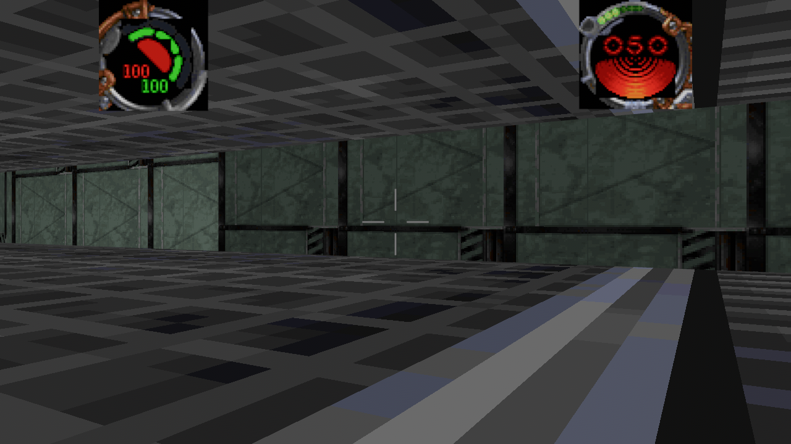

`--cmp 01narsh.cmp` is the check: it reads the file out of the install, prints the ramp and
asserts table 0 is dark, the ramp is monotone and it brightens past the base palette.
`ponytail:` the ramp is a process-global, because one level is drawn per process; a second
level in the same process would need it passed through the mesh builder.

### The level shader: a fragment-only Bevy 0.20 material

The distance term, per-texel level sampling and force seeing's infrared pass all need a fragment
shader, so the level surfaces can now be drawn by a `Material` of our own (`src/level_mat.rs`,
`src/level.wesl`) instead of `StandardMaterial`. It is behind `--level-shader` until it matches the
standard path's look; the pieces below are the ones Bevy 0.20 does **not** document in the crate
sources, recovered by reading the embedded shader text out of the built binary:

- **Shaders are WESL, not WGSL.** `Shader::from_wesl`, `import bevy_pbr::render::…`, and `@if(...)`
  directives. `bevy_shader::ShaderRef` is the trait's return type (not `render_resource::ShaderRef`).
- **A material is fragment-only.** The mesh pipeline supplies the vertex stage and the inter-stage
  `VertexOutput`; a material that declares its own `@vertex` fails validation with
  "Location[1] Float32x4 … is not compatible with the provided Float32x3". Import the framework's
  output instead: `import bevy_pbr::render::forward_io::VertexOutput;`.
- **Material bindings are group 3, not 2.** Group 0 is the view, group 2 is the mesh; declaring the
  material's texture at `@group(2)` fails with "group 2 binding 0 is not available in the pipeline
  layout". `bevy_pbr::constants::MATERIAL_BIND_GROUP` is **not** a registered module in the
  standalone build, so the literal `3` is what works.
- **No arrays in the uniform.** `encase` panics ("array stride must be a multiple of 16") on a
  `[f32; 4]` field, so the colour is four scalars.
- **Register the plugin after `DefaultPlugins`.** `load_internal_asset!` needs `Assets<Shader>` in
  the world, and its first argument is the app, so it cannot run before the asset plugin exists.

The fade's colour comes from the colormap's own table 0 (`tex::Palette::far_colour`), the same value
`--cmp` prints, so the distance term walks toward a colour the level actually contains:

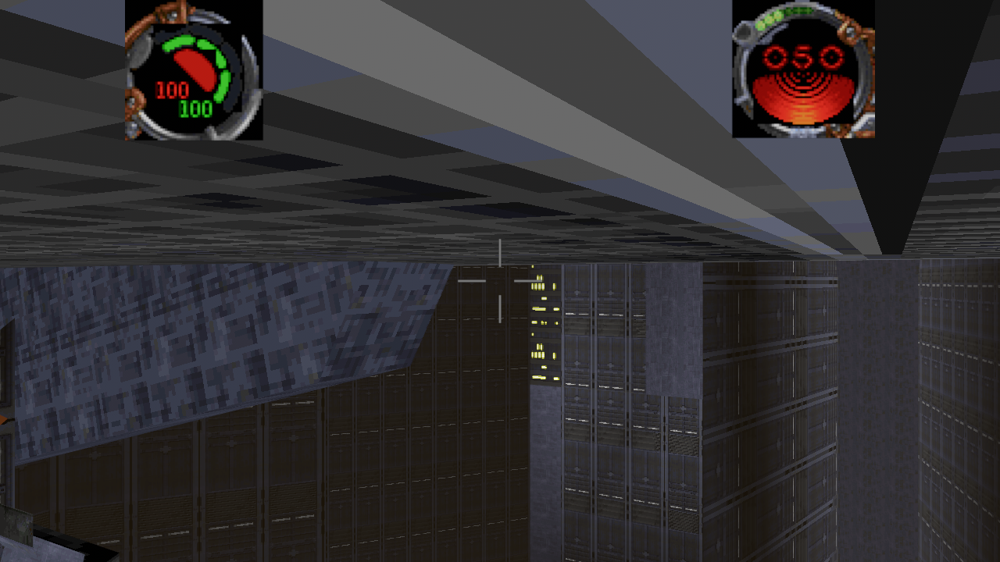

`ponytail:` the fade stops are calibrated (30 and 320 world units), not recovered from the engine, and
the shader is not yet the default path — the vertex-colour and tonemapping parity between it and
`StandardMaterial` still needs a pass. `--fade-test` pulls the stops in close for the screenshot above.
**`--frames` is the screenshot frame, not a run length.** This cost a round: a run like
`--level 01narshadda.jkl --frames 300` does **not** stop after 300 frames. The flag sets `shot_frame`,
the frame at which `--shot`/`--map-shot` writes its PNG; without `--shot` the app keeps running until it
closes its window (about 40 s, logged as `No windows are open, exiting`). Waiting less than that looks
exactly like a hang, and two builds were "slow" only because they were measured that way.

Measured honestly, with "sector visibility" lines as the frame proxy: **1727 frames in 60 s without the
runtime collider and 1690 with it** — no regression from §16.10's `blocked` work. To bound a run, pass
`--shot` with `--frames`, or kill the process on a timer.

Two probes came out of this and are kept: `BK_COG_TRACE=1` names any label costing more than 5 ms, and
`BK_NO_SOLIDS=1` switches the runtime collider off for an A/B.

**`sleep` suspends a label, and `run_label` resumes it.** The VM now keeps a saved position, which is
what `sithCog_ProcessCog`'s `script_running == 2` state means:

```text
sleep(seconds)  ->  sleep_until = now + seconds; unwind with SLEEPING
run_label       ->  if a resume names this label and `now < due`, stay waiting
                    else continue at the saved statement, with the next `sleep` transparent
```

The transparent part is the subtle one: resuming *at* the sleeping statement would re-arm the same wait
forever, so the first `sleep` after a resume returns immediately. That also makes a
`while (1) { sleep(1); ... }` loop run its body instead of re-sleeping forever.

`--sleep` pins both halves on a two-line cog — `SetMusicVol(0.1); sleep(0.5); SetMusicVol(0.9);`:

```text
sleep: after the first run the volume is 0.10, sleeping true
sleep: after the resume the volume is 0.90, sleeping false
```

and the check can fail: with `sleep` made a no-op it panics on "did not suspend the label" (exit 101,
the label ran straight through to 0.90). In the running game one shipped script resumes:

```text
pulse: 1 sleeping label(s) resumed
```

`ponytail:` a `sleep` inside a nested block resumes at the statement holding that block, so the block's
earlier statements run twice. The engine resumes at the exact instruction; this resumes at a statement
boundary, which is a smaller interpreter change than a full instruction pointer and covers the pacing
pattern the shipped scripts use.

**Sized: how much of the level waits.** `--triggers` counts the calls a coroutine would have to
suspend on:

```text
triggers: 16 `sleep`/`waitformessage` call(s) across 15 script(s)
```

15 of level 1's 42 scripts contain a wait, so coroutine resumption is worth building rather than
speculative — but it also means the other 27 scripts are unaffected by it, which is why the event layer
(`arrived`, `timer`, `pulse`, `entered`/`exited`) was the right thing to do first. The design for the
resumption is a per-label statement path: `run_label` records `(label, path, due)` in the VM, `exec`
carries the path, and a `sleep` returns a suspend flow instead of being cut.

**The menu's own wav names are two fields of `jkGuiMenu`.** Recovered for whoever wires the UI sounds
(`types.h`'s struct, 32-bit):

```text
0x00 paElements        0x14 texture        0x28 idkFunc
0x04 clickableIdxIdk   0x18 palette        0x2C soundHover
0x08 textBoxCursorColor 0x1C ui_structs    0x30 soundClick
0x0C fillColor         0x20 fonts
0x10 checkboxBitmapIdx 0x24 paddings
```

`jkGuiRend_PlayClickSound` and `jkGuiRend_ClickSound` both just call `jkGuiRend_PlayWav(menu->
soundClick)`, and hover does the same with `soundHover`; `jkGuiRend_LoadWav` is where the name becomes a
buffer.

**Those names are parsed and played now.** A screen's `base` is the element array, which is
`jkGuiMenu.paElements` — the struct's *first* field — so the struct is whichever `.data` word equals
`base`, and the two names sit at `+0x2C`/`+0x30`:

```text
ui sounds: 39 of 41 screen(s) name a wav
thermloop01.wav: in the archives
thrmlpu2.wav: in the archives
ui sounds: 2 distinct wav name(s), all present
```

39 of level 1's 41 screens share one click (`thrmlpu2.wav`) and one hover (`thermloop01.wav`), which is
what a shared `jkGui_InitMenu` default looks like; `--ui-sounds` holds both the count and the fact that
the install really ships them, because a name that resolves to nothing is worse than no sound. The mouse
handler queues the hover wav when the highlighted row changes and the click wav before activating, as a
`PlaySoundLocal` request (no position, so `snd::volume` does not attenuate it).

**Cogs are coroutines, and this VM is not.** Trying to drive level 1's soundtrack script end to end
inside `--triggers` hung the gate: its labels do not return. The engine can afford that because
`sithCog_ProcessCog` runs a cog **until it waits** — a `while (1)` label yields and resumes when its
message arrives — whereas `Vm::run_label` executes a label to completion.

That exposed a real bug on the way: `Vm::budget` was a one-shot 2,000,000 for the whole life of the
cog, so the first runaway label left the VM dead for the rest of the level (every later label returned
`WAITING`). Each label now gets its own `LABEL_BUDGET` (20,000 statements), refilled at entry — bounded
enough that a runaway label costs a fraction of a frame, and never permanent.

**The refill had to move to the outermost call.** `cog\force_pull.cog`'s `activated` never returned, and
the first suspect was right: every nested `run_label` refilled the budget, so the 20,000-statement cut
never fired. The limit has to be per frame, not per call, or it bounds nothing. With the refill gated on
`depth == 0` the whole label tree shares one budget — verified by the full suite (`--cog-check`,
`--triggers`, `--sleep` unchanged, same delivery counts).

That was **not** what hangs the pull. Timing `run_label(&force_pull, "activated")` afterwards still
produced no output and no return in 30 s, twice, with the process killed at the same code point both
times — so the cost is not statements going through `exec`'s budget check. Two candidates remain, and the
next session should start by instrumenting this call directly rather than by reading the script: a verb
inside the label that does the looping (the budget only counts `exec`), or a crash under the harness's job
control that is being reported as a kill rather than a panic. `--pull` therefore asserts the cog's
**shape** — that it ships and declares activation, a ramp and selection — and never executes the label.

`ponytail:` this is a bound, not a coroutine. A script that waits mid-label is cut and its continuation
is lost, so a level script that expects to resume after `Sleep` will re-run from its label's start the
next time that message arrives. The upgrade path is a real instruction pointer per cog, which is what
`sithCog_ProcessCog`'s `script_running == 2` state means.

**`blocked`: the runtime can stop a moving thing now.** This was the one label that needed something
the runtime did not have — a collider. `Runtime::solids` is an `Arc<collide::Solids>` filled once from
the same build the walker uses, and `Runtime::step` resolves every mover, zeroes its velocity and
queues `blocked` to the cogs linked to it.

The interesting part is *why* the naive version failed. Level 1's own geometry let a thing flying at
4 units/s pass clean through a wall, because a **position-only** resolver never sees the crossing:

```text
thing 2 flew from [5.299998, 6.099994, 7.199998] into a wall: 0 `blocked` message(s), now at [5.299998, 14.099987, 7.199998]
```

Adding a "left every sector" test did not help either — the other side of the wall is *another*
sector. What works is the swept test, `Solids::segment_blocked(from, to)`: the segment against each
wall face's plane, inside that face's polygon, only when entering from its front:

```text
thing 2 flew from [5.299998, 6.099994, 7.199998] into a wall: 1 `blocked` message(s), now at [5.299998, 6.633327, 7.199998]
```

`ponytail:` `segment_blocked` scans every wall face, so it is O(walls) per mover per frame. That is
nothing for a handful of movers and would want the sector's own faces for hundreds of projectiles.

**`crossed`: the player''s movement segment against a linked surface''s polygon.** Level 1 waits on
`crossed` 7 times — trigger planes and force fields. `collide::crosses(level, surface, from, to)` puts
the two endpoints on opposite sides of the surface's plane and checks that the crossing point is inside
the polygon; `deliver_crossed` runs it over the linked surfaces every frame with the player's own
movement as the segment, so a fast walk cannot tunnel through a plane the way a "position inside" test
would allow.

`--triggers` asserts the test on the level's own geometry:

```text
triggers: surface 839 is crossed by a segment through its centre
```

and that a degenerate segment is not a crossing.

**`sighted`: the first time the renderer draws a thing or a room.** `sithRender_RenderThing`
(`sithRender.c:2995`) latches `SITH_TF_INCAMFOV` (0x100000) on a thing the first time it draws it, and
a `SITH_TF_CAPTURED` (0x400) thing — one with a cog placed on it — sends `sighted` (id 9) to that cog;
the sector paths do the same with `SITH_SECTOR_SEEN` (0x4000) for a `SITH_SECTOR_COGLINKED` (0x4)
room. This is how levels complete. Level 1's goal is `01_goal0.cog 204`, placed on 8t88: the script's
`sighted` handler calls `SendMessage(GetMasterCOG(), user0)`, and `01_endlevel.cog`'s `user0` handler
sets the goal flag, plays `Accomplish1.wav`, freezes Kyle as invulnerable, sleeps three seconds and
calls `jkEndLevel(1)` — so *seeing 8t88* is what ends the level.

The port latches the same bits. `cull_sectors` already decides which rooms are drawn, so it marks
those seen and tests each thing's body against the same frustum planes, which is coarser than the
engine's per-thing clip (no per-triangle test, so something in the same room behind a pillar can fire
a frame early). `--endlevel` drives the whole chain from that trigger rather than synthesising the
message:

```text
endlevel: `01_goal0.cog` waits on `sighted` from thing 204 (flags 0x20000400)
endlevel: the thing is drawn for the first time -> 1 `sighted` message(s)
endlevel: 2 message(s) so far; player thing 0 (GetLocalPlayerThing Num(0.0)), actor flags 0xa00008
endlevel: player invulnerable while the handler sleeps: true
endlevel: 2 message(s) delivered, goal bin 100 = 3, level_complete true
```

Two things that chain taught the port. `user0` is a keyword, not a per-script symbol — `sithCog_Startup`
registers every message name with its id, so the VM seeds them as globals and a script can send `user0`
without declaring `message user0`. And a `World` guard must not be held across a label call: the first
version of the gate took `pending_messages` inside the `for` head, so the `Arc<Mutex<Runtime>>` stayed
locked and the first verb the label called deadlocked instead of panicking the way a `RefCell` would.


**`GetGoalFrame` is the destination, and it clears on arrival.** `MoveToFrame` stores `goalframe` and
starts the piece moving; `sithTrackThing_Arrivedidk` sets it back to **0** the moment `curframe`
reaches it, and only sends `arrived` then. So a script asking `GetGoalFrame` sees a destination while
the piece travels and a zero once it is parked — which is what the reversing lift idiom reads:
`MoveToFrame(elevator, 1 - GetGoalFrame(elevator), speed)`. The port answers from the thing's own
`target`, which it already clears on arrival, and `--door` now watches the whole lifecycle after a
door opens:

```text
door: 00_door.cog (cog 0, thing 4): 1 label(s) ran, frame Num(0.0), moving Num(1.0), goal Num(1.0) (target Some(1.0)), flags (1, 0), 4 doorway(s) that were shut now passable
door: after 3 s the piece sits at frame Num(1.0) and reports goal Num(0.0)
```

**The weapon has to finish mounting before it fires.** `SetMountWait(thing, seconds)` is
`sithWeapon_SetMountWait`: it stores `seconds + gameTime` in one **global** (`sithWeapon_secMountWait`,
not per thing), and `sithWeapon_ProcessWeaponControls` returns before the fire path while that clock is
still in the future. Every shipped caller passes 0 — each level's `endlevel.cog` startup does
`SetMountWait(player, 0)` — so in practice the verb *cancels* a wait rather than imposing one. The port
keeps the same global and refuses `player_fire` until it passes; `--fire` is the only place that
exercises a non-zero wait:

```text
  mount wait: refused at t=100 for a 1 s wait, fired at t=102 (deadline 101)
```

**`PlayKey` swaps a puppet's animation for one of the script's own keyframe symbols.**
`PlayKey(thing, key, flags, frame)` is `sithPuppet_PlayKey`: the thing's puppet stops playing its
`.pup` state track (`stand`, `death`) and plays the `.key` the script names instead, from the frame it
names. Level 1's TIE bomber is the case a player meets: `01_tiebomber.cog` plays `01VTieB.key` from
frame 0x14 the moment the player is *sighted* by it. `StopAnim` drops the override and `JumpToFrame`
moves the start of the clip already asked for.

The runtime stores `(key, flags, frame)` per thing and `animate_actors` prefers it over the puppet's
own state, forcing a mesh rebuild when the key changes on the same frame number. `--run` reports what a
level's scripts asked for, which is how level 7's cutscene camera shows up:

```text
animation: thing 29 plays `yucamera.key` (flags 1, from frame 2)
```

`ponytail:` two ceilings. A scripted clip is offset by its start frame but has **no own epoch**, so the
start looks like a loop offset rather than a timed track; `flags` is stored and not interpreted. And the
level-7 case is `PlayKey` on a *camera* — a cutscene camera path, which belongs to the unported
in-engine camera gap rather than to puppet animation.

 `SetThingFlags` is
`thing->flags |= flags` and `ClearThingFlags` is `thing->flags &= ~flags`
(`sithCogFunctionThing.c:1334`). The port assigned the word outright, which drops every bit the level or
the renderer had already set — `SITH_TF_INCAMFOV` (0x100000) among them, so a script touching one flag
would make `sighted` fire again for a thing the player had already seen.

**The use key sends `activate`, and the target is a linked surface.** `activate` is the third mostcommon label level 1 declares (x14). A script's `surface` symbol is the link
(`sithCog_LinkCogToSurface`), so the player's use action messages the cogs linked to the surface they
are looking at: 44 surface links on level 1.

`Runtime::activate_near(eye, facing, reach)` picks the nearest linked surface inside the reach and in
front, then queues `activate` for its cogs; the `E` key drives it in game. `--triggers` exercises the
selection against a real surface centre:

```text
use at [-1.9, -4.950001, 0.20000005] facing +X reached surface Some(839) (wanted 839)
facing away reached Some(2465), not 839
```

`ponytail:` the **reach (3 units) and the facing cone (dot > 0.3) are calibrated, not recovered** —
the engine's own use action lives in `jkPlayer.c`, which this source tree does not carry. What *is*
data-driven is the candidate set: only surfaces a script linked can be activated, so an unwired room
stays silent rather than reacting to nothing. The check's second line is why that distinction matters:
turning around found a *different* linked surface, so "nothing behind you" would have been the wrong
assertion — the first version of this check failed on exactly that, and the code was right.

**`arrived` is the busiest label the level declares (x19), and it comes from a frame path.** A thing
with a keyframe path that reaches its target frame sends `SITH_MESSAGE_ARRIVED` to the cogs linked to
it — the message a door or a lift's script waits on after `MoveToFrame`.

`ThingState::step` sets an `arrived` flag on the tick the path lands, `Runtime::step` turns it into a
queued `(cog instance, "arrived")`, and `--triggers` drives three paths to prove it:

```text
thing 2 with 2 frame(s): 1 `arrived` message(s) queued
thing 4 with 2 frame(s): 2 `arrived` message(s) queued
thing 6 with 2 frame(s): 3 `arrived` message(s) queued
triggers: 6 `arrived` message(s) from frame paths
```

`ponytail:` the flag fires once per path completion, not once per *named* destination: the engine also
sends `blocked` (x8 on level 1) when a moving thing is stopped by geometry, and that needs the
collider, which the runtime does not have.

**What the level actually waits on.** `--triggers` now lists every message label level 1's scripts
declare, with how many scripts carry it, which is the specification for the event layer:

```text
startup x27, arrived x19, timer x18, activate x14, blocked x8, crossed x7,
entered x5, killed x5, damaged x4, sighted x3, touched x3, pulse x2, user0 x2,
activated x1, shutdown x1
```

Wired so far: `startup`, `timer`, `pulse`, `entered`/`exited`, and now `damaged`/`killed` through the
**thing links** (37 on level 1). `Runtime::damage` queues `(cog instance, label)` on the cogs linked
to the thing it hit — the runtime holds no VM, so a system drains the queue — and the queue fills from
a real kill:

```text
hit: thing 207 (reeyeesbhgun), 30 damage, 0 health left
trigger: 2 thing message(s) delivered
```

Also worth recording: **no script on level 1 has a `used` label**, so the "use key" interaction is not
a `used` message on this level at all. That killed a plan to implement a use action by guesswork
before any of it was written; the label list above is what to implement from.

**Sector triggers: `entered` and `exited` are delivered now.** `sithThing_EnterSector` sends
`SITH_MESSAGE_ENTERED` to the cogs linked to the sector, and `LeaveSector` sends `exited`; the link is
created from a script's own `sector` symbol (`sithCog_LinkCog` -> `sithCog_LinkCogToSector`), so the
`.jkl` does not name it — the symbol's *value* is the sector index and its `linkid`/mask travel with
the link.

`Runtime::sector_links` holds `(cog instance, link, sector)` per level, and `sector_messages(old,
new)` answers which instances hear a crossing. `deliver_sector_triggers` runs those labels when the
player's sector changes. Level 1 declares ten links, and `--triggers` reports which can hear:

```text
triggers: 10 sector link(s) on this level
  cog 28 (`00_SecretAreas.cog`) link 1 sector 243: entered
  cog 28 (`00_SecretAreas.cog`) link 2 sector 306: entered
  ...
  cog 8 (`00_1waydoor.cog`) link 0 sector 407: no `entered` label
triggers: 9 link(s) will hear their sector
```

`ponytail:` two simplifications, both named in the code. The **mask** on a link is carried but not
filtered on, so every link to a sector hears every crossing; and the secret-area links carry
power-of-two `linkid`s (1, 2, 4, 8, 16, 32), which suggests the parser is reading the field the engine
calls the mask as the link id. Neither changes which cog hears, only how finely a script could filter.

**The pulse and timer queue is the engine''s `sithCog_ProcessCog`.** Scripts arm their own messages:

```text
sithCogFunction_SetPulse(v):  v <= 0 -> clear SITH_COG_PULSE_SET
                              else   -> interval = v * 1000 ms; next = interval + now
sithCogFunction_SetTimer(v):  v <= 0 -> cancel
                              else   -> TIMER_SET, due at now + v * 1000, fires once

sithCog_ProcessCog, every tick:
    if PULSE_SET && now >= next:  next = now + interval;  send `pulse`
    if TIMER_SET && now >= due:   clear;                  send `timer`
```

Both live on the **cog**, not the world, so they are `Vm::pulse` and `Vm::timer` here, armed by
`SetPulse`/`SetTimer`/`SetTimerEx` in `call_verb` and delivered by `run_pulses_and_timers`. The
delivery is observable in the running game and the live check holds it:

```text
live: 1 pulse/timer message(s) delivered for 2 armed cog(s)
```

and `BK_PULSE_TRACE=1` names the cog and its interval:

```text
pulse: 01_initialry.cog interval 1.00
```

`ponytail:` level 1's music fade still does not move, and the pulse queue was not the blocker: the
soundtrack cog arms its pulse from a **sector-enter** message (`jkCog_SyncForcePowers`-style triggers),
and this build does not deliver sector-entry messages to scripts yet. That is the next gap, and it is
a different one from the timer queue this section recovers.

**`PlaySong` is a range with a starting track, and it resets the volume.** Recovered from
`sithCogFunctionSound_PlaySong` and `sithSoundMixer_PlaySong`:

```text
sithCogFunctionSound_PlaySong:   trackNum <= 0  ->  sithSoundMixer_StopSong()
                                 else           ->  sithSoundMixer_PlaySong(from, to, num)
sithSoundMixer_PlaySong:         if (to <= from) to = from
                                 track = num, clamped into [from, to]
                                 musicVolume = 1.0;  stdMci_Play(track, to)
```

Three things follow, and this build got all three wrong:

1. **The stop test is on the raw song number, before clamping.** `PlaySong(12, 13, 0)` is
   *StopSong*, not "play track 12". Clamping first silently turned a stop into playback.
2. **The third argument is the track to start on, not a loop point.** The range plays `from..to` and
   wraps back to `from` — `Runtime::advance_music`, driven from the sink being empty.
3. **A start resets the music volume to 1.0.** A `SetMusicVol` *before* the song is overwritten,
   which is why the level's own fade has to come after.

`--music` holds it to that:

```text
PlaySong(12, 13, 12) starts at volume 1.00
SetMusicVol(0.4) -> 0.40
the range plays [12, 13, 12, 13]
```

`ponytail:` the level-1 soundtrack still logs `music: track12.ogg at volume 0.00`, and that is now
*correct* rather than a bug: `01_SoundTrack.cog` starts the song and then fades it from zero when the
player crosses the bar. What is missing is the **pulse fade** — the script drives the ramp with
`SetPulse`/timers, and this build has no timer queue to run them, so the track stays at the volume the
script's first `SetMusicVol` gave it.

**The loading screen''s bar is drawn from the engine''s own arithmetic.** `Panel::LoadBar` was already
identified in the menu tables (both loading screens carry one, mapped from `jkGuiTitle_LoadBarDraw` at
`0x418b90`) but the draw dispatch had no arm for it, so the bar was a hole in the middle of the retail
loading screen.

From `jkGUITitle.c`'s element tables and its draw callback:

- the bar's rect is the element's own: `{220, 240, 200, 20}` over `bkMain.bm` and `{330, 131, 240, 20}`
  over `bkLoading.bm`;
- the frame is `jkGuiRend_DrawRect` over that rect;
- the fill is `x + 3, y + 3, percent * (width - 6) / 100, height - 6`, in the element's `extraInt`
  colour, which the shipped table sets to `0xE1`.

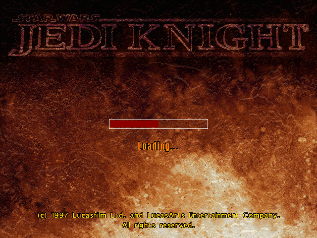

`--load-bar <percent> <out.png>` renders the screen and then **measures the canvas** rather than
trusting the code that drew it:

```text
load bar: 0%   of 200px is 0px;   the canvas has 0px wide, 0 pixel(s)
load bar: 25%  of 200px is 48px;  the canvas has 48px wide, 672 pixel(s)
load bar: 50%  of 200px is 97px;  the canvas has 97px wide, 1358 pixel(s)
load bar: 100% of 200px is 194px; the canvas has 194px wide, 2716 pixel(s)
```

`ponytail:` the bar exists as a screen; the game does not pause on it during a level load, because
this build loads synchronously in one frame. Showing it belongs with asynchronous loading, not before.

**`--live-check`: the gate that looks at the game''s own runtime.** Two bugs in a row passed every
check because each check built its own runtime and tested *that*: `--fire` simulated its hit test
instead of calling the impact scan, and the `.ai` instincts were attached to a throwaway
`Runtime::handle`. Both were invisible from a check that constructs a world for the occasion.

`--live-check` runs the game for twenty frames and then reports the invariants that only hold if the
game is wired to itself:

```text
live: 117 actor instinct(s) attached (17 template(s) name an aiclass)
live: player thing Some(0)
live: 462 collision sector(s)
live: 375 standard material(s)
live: 117 actor(s) with 2411 part(s)
live: 42 of 42 placed script instance(s) bound
--- live check passed ---
```

Its failure path was verified by inverting the first invariant (`rt.ai.is_empty()`), which printed
`live: 1 invariant(s) failed` and exited **1**. That mattered: `AppExit::error()` is only returned by
`App::run`, and this binary ignores that value, so a failing check would have reported through a
successful exit code — the same class of hole it exists to close. The failure path now leaves through
`std::process::exit(1)`.

**No actor had an instinct class in the running game.** The `.ai` files were parsed and attached - to
a `Runtime::handle(&level)` created inside `setup` and then dropped. `Runtime::handle` builds a **new**
runtime each call, so the instincts went into a second world, and the one the game simulated had an
empty `ai` table: nothing chased, nothing shot, and the actor chase could never be confirmed in the
game even though `--ai` proved the behaviour on a runtime it built for itself.

The tell was the demo run:

```text
ai: 117 actors with an instinct class
(nothing else, for 600 frames)
```

after attaching to the live runtime instead:

```text
ai: 3 shot(s) at the player
ai: 3 actor step(s) held out of the geometry
```

**The chase now respects walls.** `ai_tick` has no collider (the runtime is level-agnostic), so it
walks in a straight line - `.ai` gives sight and speed, not a path. It now hands the actors it moved
back through `Runtime::walked`, and `ai_shots` resolves each of them against the level's planes and
floor before they are drawn. `--ai` asserts the mechanism on a body shoved 0.4 units into a wall:

```text
ai: a body 0.4 inside a wall is pushed 6.72 back out
```

`ponytail:` that is an **avoidance pass, not a pathfinder**. An actor that walks into a wall slides
out and keeps pushing at it; it will not route around a corner. The engine's own `.ai` pathfinding is
the upgrade path, and the pass is what stops the worst case (actors strolling through bulkheads) until
then.

**The infrared pass is drawn.** `infrared_follows_force` reads the runtime's `ir_mode` (§16.5) and
sets the level material's `infra` parameter, so `EnableIRMode` from `force_seeing.cog` now changes the
picture instead of only a flag. The material set is shared per texture, so it is walked when the mode
changes, not every frame.

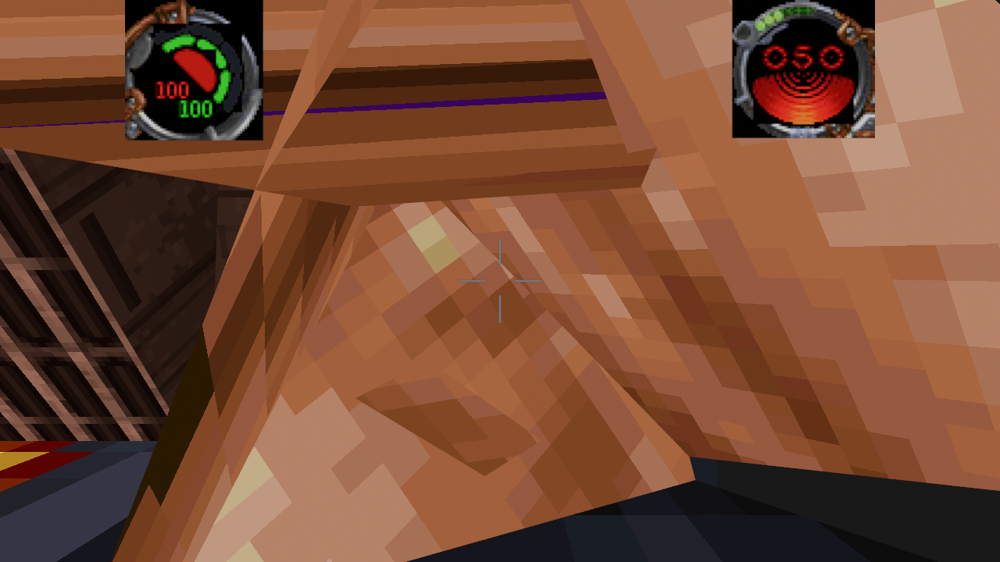

Measured on a fixed pose, the pass moves the frame toward red and away from blue (R 119.1 -> 120.0,
B 54.6 -> 52.3): the right direction, and small because the sample is a wall of brown actor geometry.
`--cmp` now also asserts that `LevelParams::default()`'s fade colour **is** the colormap's table-0
colour, so the distance term cannot drift onto an invented grey.

`--level-shader` and `--ir` are both gates in the sweep: they prove the shader path and the pass run
without a pipeline error.

Still not applied: the **distance** term by default. Bevy's `DistanceFog` was tried and **does not engage for
these materials in this build** — a fade of `1..10` world units, which should tint the whole scene,
leaves the image pixel-for-pixel the same as `--no-fog`. That is not a tuning problem, so the
component was removed rather than shipped as dead configuration; the A/B that proved it is the
1..10 experiment above. The distance term needs a custom `Material` whose fragment shader pulls the
base colour toward the darkest table's colour (`[20, 13, 5]` for `01narsh.cmp`, which `--cmp` now
prints), which is the same shader that would carry per-pixel `lightlevel` sampling.

The level's first colormap (`01narsh.cmp` for level 1) supplies the palette; a
level may list several (`["01narsh.cmp", "01redmap.cmp"]`), and the parser uses the
first.

---

## 7. Engine module map from `__FILE__` strings — **observed**

`JediKnight.EXE` embeds 20 source-file names from its assert macro, which
recovers the engine's module structure:

| module | subsystem |
|---|---|
| `.\Win95\stdGob.c` | archive I/O |
| `.\Win95\stdDisplay.c` | display |
| `.\General\stdBmp.c`, `stdBitmap.c` | bitmap loading |
| `.\General\stdColor.c`, `stdStrTable.c` | palette / string tables |
| `.\World\sithWorld.c` | world + level loading |
| `.\World\sithModel.c` | 3DO models |
| `.\World\sithThing.c` | objects / entities |
| `.\World\sithSprite.c`, `sithSoundClass.c` | sprites, sound |
| `.\Engine\sithPuppet.c`, `sithParticle.c` | animation, particles |
| `.\Cog\sithCog.c`, `sithCogParse.c`, `sithCogYACC.c` | the COG scripting VM (YACC-based) |
| `.\Ai\sithAIClass.c` | AI |
| `.\Gui\jkGUI.c`, `jkGUIMain.c` | UI |
| `.\Main\jkEpisode.c` | episode flow |

The engine is the LucasArts "Sith" engine, shared with *Outlaws* and *MOTS*.

---

## 8. The shipped executable has encrypted code — **observed**

`JediKnight.EXE` (sha256 `5a76f3b5…`, 1,789,376 bytes) cannot be statically analysed: its
`.text` is **ciphertext**.

| section | raw | entropy | `push ebp; mov ebp,esp` |
|---|---|---|---|
| `.text` | 0x120200 | **8.00** | **0** |
| `.bind` | 0x61fc0 | 8.00 | 2 |
| `.rdata` | 0x2200 | 5.21 | 0 |
| `.data` | 0x2da00 | 4.76 (47% zero bytes) | 0 |
| `.idata` | 0x1200 | 5.43 | 0 |
| `.rsrc` | 0x1800 | 3.68 | 0 |

1.2 MB of 32-bit x86 with entropy exactly 8.00 bits/byte and not one function prologue is
not compiled code. The section list ends with `.bind` and `..idata`, the **entry point
itself (RVA 0x4f5310) is ciphertext**, and there is no plaintext stub anywhere in the file —
so the OS loader cannot start this image as it stands. Something outside the file decrypts
it before (or while) it runs, which is the shape of a shipping DRM wrapper: the Steam
client's stub and SafeDisc both work this way, and both leave a `.bind` payload section
behind.

**The vendor is not established.** A full-file scan finds no `Steam`, `valve`, `SafeDisc`,
`SecuROM`, `C-Dilla` or `secdrv` string, and no wrapper string at all — the identifying
material has been stripped. The two other executables in the install do not explain it
either: the 309,760-byte `Jedi.EXE` is the *CD autorun launcher/installer* (its strings are
"Install Jedi Knight", "Play Jedi Knight", "SETUP.EXE from the Jedi Knight CD-ROM disk #1",
and it imports only shell/dialog APIs), and the local `winmm.dll` is a modern-Windows proxy
shim (it carries the name `winmm` and `GetProcAddress`, and no vendor strings). An earlier
revision of this section named SafeDisc 2; that was an inference from the section names,
and the string evidence above does not support naming a vendor. What *is* observed is the
ciphertext and its consequences.

Two further checks agree that no code references exist. Every dword in `.text` that lands in
the `.data` address range (1,075 of them) is a unique random-looking value, while **none** of
the addresses that must be referenced statically appear anywhere in `.text`: not the 35-name
bitmap table (0x52b178), not the 12-name font table (0x52b208), not the run-time arrays
(0x8567e0/0x8568a0) — even though `.data`'s own pointer fields reference the screen arrays
normally. And Ghidra 12.1.4 "completes analysis" only because the ciphertext decodes as
plausible instructions; the assert strings it finds in `.data` have no references for the
same reason.

**This explains the whole "not recovered" list in §18.5**: everything the UI *draws* comes
from plaintext `.data` and the archives, which is why it was recoverable; everything that
*decides* (which screen follows which id, which elements are visible, what a `type 7`
element paints, where the force icons sit in-game) is in the encrypted `.text` and would
need a decrypted image — a dump taken after the wrapper has run — or dynamic tracing.

Earlier revisions of this document explained the missing string references as dead
release-build assertions. That was wrong, and the string-reference scan reported below is
the same effect: the code that would reference them is not present in the file.

**A decrypted copy of the same build exists, and OpenJKDF2 documents it.** The
reimplementation's `ida_copypaste_funclist_nostdlib.txt` is an IDA export of the retail
executable — `Main_Startup  .text  00401000  0x36C`, then several thousand named functions —
which cannot be produced from ciphertext. Its deprecated build configurations confirm what
it analysed: "JK.EXE is memory mapped into the process and used as a binary blob", and the
Win32 build "patches JK.EXE to load `df2_reimpl.dll` … before JK.EXE's `main`". It targets a
file called **`JK.EXE`**, the original CD name, whereas this install's engine is the Steam
`JediKnight.EXE`; GOG ships the same game DRM-free. The data agrees that it is the same
build: the port's `jkGuiMain_cutscenesElements` is exactly the array at 0x5269f0 here, down
to `GUI_VIEWCUTSCENES` as its first element.

So the code is not lost, it is *wrapped in this particular copy*. Two routes reach it, both
needing something this build does not have: an unwrapped `JediKnight.EXE`/`JK.EXE` from a
DRM-free pressing, or a memory dump of the running Steam copy taken after the wrapper has
decrypted it. Either image can then be analysed statically and matched against the port's
symbol names and addresses.

### 8a. The GOG copy is the same build, unwrapped — **observed**

GOG's `JK.EXE` (`G:\Games\Star Wars Jedi Knight - Dark Forces 2\JK.EXE`, 1,388,032 bytes,
sha256 `12e8c8c3…`) is **plaintext**:

| section | raw | entropy | `push ebp; mov ebp,esp` |
|---|---|---|---|
| `.text` | 0x120200 | 6.66 | **354** |
| `.data` | 0x2da00 | 4.76 | 0 |
| `.bind` | — | — | — |

Its entry point is ordinary MSVC code (`55 8b ec 6a ff 68 b0 3a 52 00 68 e8 a2 51 00 64 a1
00 00 00 00 …`), every section VA and raw size matches the Steam image, and the two files
differ by exactly 401,344 bytes = 0x61fc0 = the Steam copy's `.bind` payload. It is the same
build with the wrapper stripped, and the port's IDA addresses apply to it directly
(`Main_Startup` 0x401000, `jkGui_InitMenu` 0x4129a0, `jkGuiMain_Show` 0x4100f0 all begin
with real prologues).

Everything the data-recovery phase established still holds on it: this build's `--ui-audit`
reports the **same 41 screens / 512 elements at the same addresses**, so `.data` is
identical too.

The first decompilations settle four things the data could only suggest:

- `jkGui_Startup` (0x412a20) loads the 12 `.sft` names into `jkGui_stdFonts` and the 35
  `.bm` names into `jkGui_stdBitmaps`, in the order already extracted from 0x52b208 /
  0x52b178. Those tables are the load order, not a transcription.
- `jkGui_InitMenu` (0x4129a0) walks elements by **100 bytes** to the type-9 marker, and
  *patches the array in place*: for types 0/2/3 it replaces `+0x0c` with the resolved
  `.uni` pointer, and for every type it does the same for the hint at `+0x2c`. A key absent
  from the table leaves the pointer null, so the element draws no text.
- The same function fills `menu+0x14` with `bitmap->mipSurfaces[0]` and `menu+0x18` with
  `bitmap->palette` — the texture and palette fields the data layout predicted.
- The element that was clicked is reported through `menu+0x40`, a field the data alone had
  not identified.

**Backgrounds are read from the code** — the mechanism, the 39-of-41 result and the
corrections it forced are in §18.5; every screen's `_Startup` calls
`jkGui_InitMenu(&menu, jkGui_stdBitmaps[i])` and `menus.rs` recovers that `i` on every load.

And the main menu's dispatch, decompiled from 0x4100f0:

```c
do {
  jkGuiRend_UpdateAndDrawClickable(&main_menu, &DAT_00526748);
  switch (jkGuiRend_GetId(&main_menu)) {           // returns menu+0x40
  case 10: jkGuiSingleplayer_Show(); break;         // 0x41a4a0
  case 11: jkGuiMultiplayer_Show();  break;         // 0x4131f0
  case 12: /* GUI_QUITCONFIRM dialog */ break;      // 0x416ba0
  case 13: jkGuiSetup_Show();  result = -1; break;  // 0x412f40
  case 14: jkGuiPlayer_ShowNewPlayer(0); result = -1; break;
  case 15: 0x403740(); break;                       // cutscenes
  case 16: 0x4037b0();                              // credits
  }
} while (result == -1);
```

Those ids are the `hoverId` field in the element records, which is why the extraction kept
it: the state machine is a plain switch on it.

---

## 9. Texture coordinates and tiling — **observed**

Surface vertex pairs are `<world vertex>,<texture vertex>`. The world-vertex half
jumps around the shared 4360-entry pool (e.g. `1, 0, 7, 8, 15`) while the
texture-vertex half is consecutive (`19, 20, 21, 22, 23`), which identifies which
component is which — and only the texture vertex half ever carries `-1`
(meaning "no UV", which pairs exactly with the portal surfaces).

Texture vertices are in **texels**, not normalised units: level 1's 10574
texture vertices run to about 1400 across a 64–128 texel texture, i.e. the
material tiles several times per surface. So `uv = texel / texture_dimension`
and the sampler must **repeat**; with clamp-to-edge addressing the border texel
smears across the polygon and every wall renders as flat streaks. This was
visually confirmed: switching the sampler to repeat turned uniform colour fields
into the level's panelled walls.

Note 10574 texture vertices for 4360 world vertices (~2.4 per vertex), consistent
with UVs being stored per surface corner rather than shared per vertex.

A second, related finding: a texture tiled dozens of times across a distant wall
aliases into noise at grazing angles **without mipmaps**. Materials are 8-bit and
small (mostly 64²–256²), so the reconstruction builds a box-filtered mip chain to
1×1 for every material — 24% of the pixels in the level-1 start view change when
the chain is added, almost all of it on the long receding wall band.

---

## 10. Validation across levels — **observed**

`--check` asserts every index range, the intensity/vertex count agreement and
that at least one surface resolves to a decoded bitmap. `--audit` sweeps all 35
levels in the install; every one is clean. A sample:

| level | verts | surfaces | drawable | textured | sectors | things |
|---|---|---|---|---|---|---|
| `01narshadda.jkl` | 4360 | 4595 | 3393 | 3393 | 462 | 352 |
| `02narshadda.jkl` | 5456 | 6235 | 4518 | 4510 | 641 | 391 |
| `03katarn.jkl` | 4514 | 5212 | 3598 | 3598 | 606 | 344 |
| `04EscapeHouse.jkl` | 5777 | 8591 | 5165 | 5162 | 976 | 312 |
| `20aboc.jkl` | 731 | 742 | 584 | 584 | 74 | 55 |
| `15maw.jkl` | 636 | 789 | 421 | 421 | 70 | 73 |

An independent cross-check falls out of the data: `01narshadda.jkl` declares
`World adjoins 1206` and the parsed surfaces contain exactly **1206** with a
non-negative `adjoin` index, plus **1202** portal markers (`geo == 0`, all with
`mat == -1`). Two different sections agreeing on the same number is strong
evidence that the surface record layout and field order are right.

### Thing orientation and the camera — **observed**

**Up axis is Z** (see §3): models, level geometry and things all use it, so a model's own
height is its height in the world and a placed thing needs no axis conversion.

A JK yaw of `a` faces `(cos a, sin a, 0)`, i.e. it turns about +Z. That is what the
model's own frames use too: a `.3do` node's `pitch` turns about X and its `yaw` about Z
(§4.1a), so a thing's yaw and its model's yaw are the same rotation. A Bevy rotation
about +Z maps +X to `(cos, sin)`, so the transform negates the angle to match the
engine's handedness.

The start viewpoint is `walkplayer` position + 0.9 units up, looking along its
yaw — not the sector centre, which can sit against a wall in a small room.

### Sky — **observed**

Sky is **not** a sector flag: the sky material's faces are spread across dozens of
ordinary sectors (140 of `04escapehouse`'s 976), one or two per outdoor area.

What marks them is the **surface** flag word: every face carrying the level's sky
material has `0x200` set (`0x204`, `0x224`, `0x304`), while ordinary faces are
`0x0`, `0x4` or `0x5`. Those faces are large vertical backdrop walls well outside
the play area — a level's sky faces span e.g. `y[-52, 13.5]` — and their baked
per-vertex intensity is **zero**.

Two consequences, both visible in the renderer:

1. Passing the baked intensity through draws every sky face black. Sky faces are
   drawn unshaded, so their vertex colour is 1.0.
2. Even unshaded, the sky faces only cover the directions they exist in. The engine
   additionally fills everything they do not cover with the sky, scrolling it with
   the view direction (the level header's `Horizon Sky Offset` and
   `Ceiling Sky Offset`, plus `Ceiling Sky Z`). The reconstruction does this with a
   textured dome kept centred on the camera.

The dome needed `NoFrustumCulling`: the camera sits *inside* it, and without that
Bevy culls it as outside the frustum, so the sky silently vanishes and every
opening stays black. That cost more debugging time than the format work did.

Levels that name no sky material (`01narshadda`) get no dome, so their dark
openings stay dark — which is correct.


---

## 11. Retail asset coverage — **observed**

`--audit` sweeps the whole install: every `.jkl` geometry, every material, every
model, every asset reference from every level, every `episode.jk` manifest, and
every file in every archive. It also **builds the draw geometry for every level**
headlessly, so "this level renders" is measured rather than assumed. On the retail
Steam install it reports:

```
archives   5 GOB files, 4791 entries
levels reachable 34/35 from the manifests
render: 236346 world triangles, 6256 model instances, 1387375 model triangles, 0 placed sprite things
summary: 35/35 levels clean, 10 unresolved asset references, 0 non-drawable models,
         0 manifest LEVEL rows missing, 85 undecoded files
```

Every level was also **actually rendered**, one process per level with `--shot`
from its own `walkplayer` start point: 35 of 35 produced a frame, no failures.
All 35 are in `docs/levels.png`.

Two coverage questions this settles with numbers rather than assumptions:

- **Sprites.** All 20 `.spr` files parse, but **zero** placed things in any of the
  35 levels use a sprite template. Sprites are billboards the scripts spawn
  (explosions, muzzle flashes), so drawing them is part of the missing COG runtime,
  not of level rendering.
- **Models.** 6256 placed instances resolve to drawable geometry, 1.39M triangles
  total, and no level has a thing whose model fails to build.

The per-format scoreboard is the honest drop-in measure — a format with no decoder
shows up as a column of zeroes rather than a silent gap:

| ext | files | decoded | note |
|---|---|---|---|
| `.mat` | 1983 | 1932 | 51 are bitmap-less effect materials, by design |
| `.wav` | 644 | **644** | PCM WAV, played by Bevy's decoder |
| `.cog` | 540 | **540** | game logic, source text (§14) |
| `.key` | 504 | **504** | keyframe animation, 8439 nodes / 72587 entries |
| `.3do` | 477 | **477** | complete |
| `.bm` | 146 | **146** | UI bitmaps, 309 cells / 3.9 M pixels (§15) |
| `.snd` | 102 | **102** | sound classes, 1976 entries over 88 events |
| `.ai` `.ai0` `.ai2` | 231 | **231** | AI classes, 1511 parameters / 1830 instincts |
| `.pup` | 49 | **49** | puppets, 934 animation states / 158 joints |
| `.jkl` | 35 | **35** | complete |
| `.sft` | 27 | 0 | Sith font files (`SFNT`) — no text renderer |
| `.cmp` | 21 | **21** | complete |
| `.spr` | 20 | **20** | complete (parsed, not yet drawn) |
| `.uni` | 5 | **5** | string tables, 1456 strings (§15) |
| `.jk` | 1 | 0 | episode manifests — see §12 |
| `.dat` `.par` | 6 | 0 | saved game state — not read |

4706 of 4791 files (98%) decode. Everything the renderer and the audio system need —
geometry, textures, palettes, models, campaign order, sounds — is complete, and so is
every content format the game ships. Of the 85 files that do not decode, 51 are `.mat`
files that carry no bitmap by design, 27 are `.sft` raster fonts (there is no text
renderer to consume them) and 6 are saved game state.

The two parsers whose output is invisible in a screenshot still verify themselves
against the file: `.key` reports 8439 nodes and 72587 entries with **0 truncated**
(parsed block counts match every file's declared `NODES`/`ENTRIES`), and `.pup` reports
934 animation states with **0 keyframe references missing** (every state's `.key` name
resolves to a file in the archives).

Per-episode manifests, enumerated per archive rather than by deduped path:

| archive | `TYPE` | LEVEL | CUT | DECIDE | title |
|---|---|---|---|---|---|
| `JK1.GOB` | `1` (single-player) | 28 | 26 | 1 | "The Force Within" |
| `JK1MP.GOB` | `2` (multiplayer) | 6 | 0 | 0 | "Jedi Training" |
| `JK1CTF.GOB` | `8` (capture the flag) | 3 | 0 | 0 | "Jedi Capture the Flag" |

That is 37 manifest rows for 35 `.jkl` files: the light and dark paths both list
`18Ascend`, `19A` and `19B`, and `static.jkl` is an asset-only library level that
no manifest names. **observed**

Three findings the sweep forced out:

1. **`episode.jk` exists in three archives.** Keying the archive index by name
   alone silently collapses them, so only one episode's campaign is visible. The
   index now keeps every occurrence per path and lookups use the last, which
   matches the game's later-archive-wins load order.
2. **Not every material has a bitmap.** `00RED.mat` is 100 bytes — shorter than
   the 140-byte header — holding only `MAT `, version 50 and zeroed fields. It is
   a valid material used for effect surfaces (force fields), not a corrupt file:
   51 of 1983 materials are bitmap-less by design.
3. **`static.jkl` has no geometry at all** — 0 vertices, 0 surfaces, 15 asset
   references. It is a legitimate asset-only level, so an empty world is not a
   validation failure.

The 10 unresolved asset references are all `.wav` names (`df_machine2.wav`,
`ltsaberhit012.wav`, `00electrexplo02.wav`, …) that are absent from every archive.
The levels reference them, the retail install does not ship them, and the original
engine ignored missing sounds rather than refusing to load — so they are reported
as warnings, not failures.

---

## 12. The episode manifest (`episode.jk`) — **observed**

One manifest per episode archive; it is what the game walks to sequence cutscenes
and levels. Plain ASCII:

```
"The Force Within"          # title, must be the first line, quoted
TYPE  1                     # 1 single player, 2 multiplayer, 8 CTF
SEQ   55                    # sequence count hint

# <line> <cd>  <level>  <type>   <file>   <lightpow> <darkpow> <gotoA> <gotoB>
11:      1     1        LEVEL    01narshadda.jkl   0  0  12  -1   # Level 1: Narshadda
143:     1     14       DECIDE   38a.smk          0  0  150 600   # Decision Screen
end
```

Row types are `LEVEL`, `CUT` (a Smacker movie) and `DECIDE`. `gotoA` is the next
line and `gotoB` an alternate; `-1` ends the game. **The light/dark split is
entirely two `goto` edges** on the `DECIDE` row at line 143 — light goes to 150,
dark to 600 — so the graph, not a level list, is the real progression. The two
paths converge again at 620 (`18Ascend`) and end separately at 212 / 661.

The `cd` column is the 1997 release's CD number; it is `0` for multiplayer and CTF.
`lightpow`/`darkpow` are inventory bin numbers for the Force power awarded.

The Steam release ships **no `.smk` cutscenes**, so 26 of the 55 single-player
sequences name files that do not exist in the install. A drop-in replacement must
skip them rather than fail: they are reported as `movie (not shipped)`.

The start level is taken from the first `LEVEL` row of the first single-player
episode, so nothing about the campaign is hardcoded. `--episodes` prints the whole
tree with each row's resolved status.


---

## 13. Sound — **observed**

Two formats, both small.

**`.wav`** — 644 files, all plain PCM: `RIFF/WAVE/fmt ` with format tag 1,
22050 Hz, 16-bit, some stereo (`sound\00river01.wav`) and most mono
(`sound\ltsaberon01.wav`). Standard enough that a stock decoder plays them.
Bevy's default `audio` feature ships Vorbis only, so `wav` has to be named
explicitly in `Cargo.toml`.

**`.snd` — sound classes.** Plain ASCII, one row per sound an engine event may play:

```
# class		filename		playflags	minRadius	maxRadius	maxVolume
create		ShotHit02.wav             0x0     0.1     1.5	0.8
```

Templates reference these by name (`soundclass=exp_laserhit.snd`). The sweep parses
all 102 files into **1976 entries** over **88 distinct events**, which recovers the
engine's whole audio vocabulary:

| family | events |
|---|---|
| movement | `lwalk*`/`rwalk*`/`lrun*`/`rrun*` × `earth`/`hard`/`metal`/`puddle`/`water`, `land*`, `jump*`, `treadsurface`, `lswimsurface` |
| water | `enterwater`, `exitwater`, `drowning`, `drowned` |
| damage | `hurtimpact`, `hurtenergy`, `hurtfire`, `hurtmagic`, `hurtspecial`, `hithard`, `hitmetal`, `hitearth`, `deflected`, `corpsehit` |
| lifecycle | `create`, `activate`, `death1`, `death2`, `deathunder`, `victory`, `reserved1`, `reserved2` |
| behaviour | `alert`, `calm`, `curious`, `search`, `fear`, `suprise`, `gloat`, `boast`, `help`, `idle`, `moving`, `fire1`–`fire3`, `choking` |

`playflags` takes 11 distinct values (0, 1, 0x50, 0x59, 0x801, 0x4000, 0x10000,
0x10001, 0x10100, 0x10200, 0x14000); the distance columns run 0.00–10.0 and volume
0.40–1.00. Which flag bit means "loop", "3D" or "random pick" is **unknown** — the
rows are played one at a time as listed.

Only **two** entries name a `.wav` that the install does not ship:
`misc\snd\pi.snd -> I00PI02Z.WAV` and `misc\snd\turret.snd -> df_machine2.wav`.
That second one is where the dangling `df_machine2.wav` reference in the level
audit comes from — the level names a turret sound class, and the class names a
missing file.

**Sector ambience.** Each sector block may carry `SOUND <wav> [volume]`:

```
SOUND	00river01.wav 0.300000
```

Level 1 has 5 distinct loops across 46 sectors and its start sector has none — so
the opening corridor is silent, which is what the data says. Elsewhere the data is
unmistakable: `09fuelstation` starts in `00industrialamb01.wav` at 0.20, `14tower`
in `00wind03.wav` at 0.40, `02narshadda` in wind at full volume. `01narshadda`'s
cantina band (`01cantinaband02.wav`, volume 0.40) sits in the bar sectors.

The reconstruction picks the sector the camera is inside — the one whose centre the
camera is nearest to, measured beyond its radius — and plays that sector's loop, so
moving into a silent sector is silent rather than inheriting the nearest loop.

---

## 14. `.cog` scripts — **observed**

The level logic ships as **plain text**, not bytecode: 540 files the engine parses
at level load (`sithCogParse.c` plus a YACC grammar, per the module strings in the
EXE). Two sections:

```text
symbols
message	startup
message	activate
thing	door
thing	player	local
sound	locked0=i00ky73t.wav	local
flex	movespeed=8.0
int	locked=0	local
end

code
startup:
	doorsector = GetThingSector(door);
	if (IsMoving(door)) return;
	for (i=0; i<=3; i=i+1)
		if (door0[i] >= 0) numDoors = numDoors + 1;
	call opendoor;
	return;

opendoor:
	MoveToFrame(door, 1, movespeed);
	return;
end
```

`message` symbols are entry points: the engine calls the label of the same name
when the script's thing receives that message. `local` marks per-instance state.

The language is **C-like and case-insensitive** (`For`/`for`, `Print`/`print`,
`thinglight`/`ThingLight` all appear). It has `if`/`else`, `while`, `do…while`,
`for (init; cond; step)`, `call <label>`, `return`, `break`, assignments,
arithmetic/comparison/bitwise/logical operators, verb calls, and indexed symbols
(`door0[i]`). Two quirks cost most of the parse work:

- **Vectors are quoted triples**: `CreateThingAtPos(tpl, sector, center, '0.0 0.0 0.0')`.
  Only accepting `"` as a string delimiter fails ~60 files.
- **Assignment inside a condition** really does occur (`if (bargh = 0)`), so the
  grammar has to accept it rather than reject it.

Results on the shipped set: **540 of 540 parse**, 1854 labels, 7683 symbols (2874
local, 2397 initialised). Running every message label of every script with a verb
table whose unimplemented entries answer 0:

```
scripts: 540 parsed, 1688 message labels completed, 16 waiting on the engine,
         2 printed, 1 errors, 315 distinct verbs called
symbols: 7683 declared, 2874 local, 2397 with an initialiser
```

The two prints are the engine's own debug output, so this is real execution:

```
[cog\00_playerstarts.cog pulse] Waypoints should be removed !!!
[cog\00_slashablefaces.cog damaged] current weapon:
```

The single error is authentic data, not a parser gap: `10_endlevel.cog` calls
`call close_doors;` and never defines that label.

Two ceilings are deliberate and marked in the code: a per-run statement budget and
a per-loop iteration budget, because COG code is full of `while (1)` state machines
that wait for a timer or message — 16 labels stop exactly there and are reported as
"waiting on the engine" rather than as failures.

The 315 distinct verbs the scripts call are the surface a full runtime has to
implement; `Print`, `Rand`, the math builtins and `VectorSet` are implemented, the
rest answer 0.

### 14.1 Instances and the world they act on — **observed**

A script only becomes game logic when a *placed instance* is bound to state. The
level's `COG` rows are that binding:

```text
COG 0: 00_std_elev.cog 4 3 4 -1 -1 -1 -1
```

The script name is followed by one value per **non-message, non-local** symbol, in
declaration order; `-1` leaves a thing/sector/surface unbound. `00_std_elev.cog`
declares `surface lower_adjoin0`, `surface lower_adjoin1`, `thing elevator` and three
floats, in that order, so the row above sets both adjoins surfaces and the lift thing
and leaves the floats at their initialisers. `local` symbols keep their initialiser
per instance, which is what makes two doors running one `.cog` independent.

Level 1 carries 42 such instances over 552 things. Values are what select the
targets, which is why the reconstruction needs no per-level table:

- `SetSectorAdjoins(GetThingSector(door), 0)` closed **10** sectors in level 1.
- `MoveToFrame(door, 1, speed)` moved **19** things; thing 4 (`2x3door`) went from
  `(1.2 9.7 6.3)` to `(1.2 9.7 6.6)` over one second of stepping.

Things that move along their own path carry the path in the level itself:
`numframes=2 frame=(1.2/9.7/6.3:0/0/0) frame=(1.2/9.7/6.6:0/0/0)`. `.key` files are
for puppets, i.e. actors, not for doors and lifts.

Bindings that are strings do not stay numbers. `sound locked0=i00ky73t.wav local` is
a filename, and reading the initialiser with `parse::<f64>()` turned every one of them
into `0` — which showed up as `PlaySoundThing(… sound 0 …)`. Treating a non-numeric
initialiser as text (and a single-quoted triple as a vector) is what makes
`PlaySoundLocal(locked0[(Rand() * 2)], 1, 0.0, 0)` resolve to a real `.wav`:

```
sounds: 19 requested, 0 missing from archive          (level 1)
sounds: 4893 requested, 0 missing from archive        (all 35 levels)
```

That zero is the useful signal: every sound name 540 scripts compute resolves to a
file the retail install actually ships, so indexed-symbol lookup, instance binding and
the message pump are all wired the same way the data expects.

Verbs arrive in their shipped spellings (`IsThingMoving`, not `IsMoving`), and the
interpreter routes by lowercase name, so the runtime's verb table has to list the
aliases the scripts actually use.

Known limits, marked in the code: `Sleep` records a pending timer but nothing resumes
the script, so it runs straight on instead of parking; there is no timer queue, no
collision, no damage model, and `GetSenderId`/`GetSenderRef` answer 0 because a
synthetic message pump has no real sender to report.

### 14.2 The scripts drive the renderer — **observed**

The window is not a static dump of the level: the app binds the same instances the
`--run` report describes (via `startup`, or with `--sim` also one round of messages),
steps the world every frame, and rewrites the `Transform` of the entities drawing each
thing that moved. A model with several materials is several entities; they are tracked
per thing index so they move together.

Evidence is a log line that compares the *entity's* transform with the runtime's own
position — the drawn pose, not the state that produced it:

```
42 script instances bound, 19 things moving at load
   (2x2elev, 2x3door, 3x3door_1, 3x3elev, 4x3door_1, 4x4elev, 6x6elev_1, funicular)
sim 0.0s: thing 4 drawn at (1.20 9.65 6.39), runtime (1.20 9.65 6.39)
```

Thing 4 is a `2x3door` authored at `z = 6.35`; its script has opened it to `6.39` and
the mesh was drawn there. A thing is only rewritten on the frames it actually moves, so
a level with nothing moving costs one `step` per frame and no transform writes.

What this does **not** do yet: collide. There is no player, so the only things that move
without `--sim` are those whose `startup` moves them; a door that waits for a player to
cross its sector stays shut, and the flycam passes through walls.


---

## 15. UI bitmaps (`.bm`) and string tables (`.uni`) — **observed**

The last two content formats, both needed for a HUD and menus rather than for a level.

`.bm` is binary: a 128-byte header (`BM  ` magic, `u32` version 70, sizes) then one or
more cells of `u32 width`, `u32 height`, `width * height * (bits / 8)` bytes. The
header's `u32` at offset 36 is the colour depth — 8 for indexed cells, 16 for the
`…16.bm` variants that store a `u16` per pixel:

```text
arrowleft.bm     128 + 3 * (8 + 24*25)            = 1952    (3 cells, 8-bit)
bkdialog.bm      128 +     (8 + 414*206) + 768    = 85420   (1 cell, own palette)
forcebrack16.bm  128 + 4 * (8 + 30*30*2)          = 7360    (4 cells, 16-bit)
bkesc.bm         128 +     (8 + 640*480) + 768    = 308104  (dialog background)
```

The trailing 768 bytes are a 256-colour palette; the small cursor/HUD cells do not
carry one and use the level's colormap instead. Whether a palette is present is read
from the length, not a flag. All 146 files decode with the cells consuming the file
**exactly** — 309 cells, 3.9 M pixels, 0 size mismatches.

`.uni` is plain text, the game's localised strings:

```text
MSGS 456	  # <--- DON'T FORGET TO UPDATE THIS COUNT

"CREDITS_big_1" 		0 "Jedi Knight"
"CREDITS_ small_7" 	0 "Lead Conceptual Designer and Storyboards "
END
```

Quoted key, an unused number, quoted text; keys may contain spaces and text may be
empty. The `MSGS` count is **not** a check: the shipped headers are stale
(`jkstrings.uni` declares 900 rows and carries 787), so completeness is measured by
whether any quoted row failed to parse. All 5 tables parse — 1456 strings, 0 malformed.

---

## 16. Walking the level — **observed**

With the adjoin table understood (§3.1), the level's own convex cells are enough to walk
around in: collide with the solid surfaces of the sector you are in, and change sector
only through a portal. `src/collide.rs` builds that model and `--walk` exercises it
without a window.

Per sector, from its `SURFACES first count` range:

- a surface with `adjoin == -1` becomes a **plane**. The normal comes from the polygon's
  widest-spanning triple of vertices (winding is not trustworthy, and the first three
  vertices are often collinear — see below), oriented by majority vote of the sector's own
  vertices — the face's own vertices lie on the plane and do not vote;
- a surface with an adjoin whose mirror resolves becomes a **portal** to the sector the
  mirror's surface belongs to;
- the floor is the highest **downward-facing plane along -Z** the walker is above (the
  world is Z-up, §3), which is what makes gravity pull towards the level's own floors
  rather than towards a wall.

Movement is then: advance, push out of every plane within the body radius, and if the
walker is at a portal's polygon, take its far sector. `--walk all` starts each level at
its own `walkplayer` thing, holds "forward" for 120 frames, and reports what happened:

```
level                          travelled  blocked    sectors contained  hull
jkl\01narshadda.jkl                 13.3        2   339->218       yes  differs
jkl\02narshadda.jkl                 13.3        1    22->621       yes  differs
jkl\03katarn.jkl                    13.3        1   405->502       yes  differs
jkl\04escapehouse.jkl               13.3        1   800->257       yes  differs
jkl\20aboc.jkl                       3.3      452     16->16       yes  differs
...
summary: 34/34 levels with a start kept the walker inside its sector,
         3 had the hull test agree, 6 sector crossings, 1 without a start
```

`contained` is the invariant the solver enforces (the walker stays inside the sector it
is tracking), and it holds on **every** level with a start. `hull` is a second, stricter
opinion — "which convex hull contains this point" — and it disagrees on most levels
because sector hulls overlap: level 1 has 462 sectors for 352 things, many of them thin
trigger slivers that also contain the walker's position. The walker's own sector is the
one it walked into, and that is what movement follows.

Two limits worth stating plainly: the walker has no step-up or slope handling beyond
the floor plane, and `contained` says nothing about whether the *chosen* sector is the
one the game would pick in a place where two sectors overlap. Both the level start and
every headless sweep use the placement's own `sector` field or the sector the walker
walked into, never a guess from geometry alone.

### A fifth of the collision geometry was missing — **observed, and it was the floor**

A polygon's normal was `normalize(cross(p1 - p0, p2 - p0))`, and that is `None` when those
three vertices are collinear. `.jkl` faces routinely *start* that way: on level 1, **233 of
the 4595 surfaces** have a collinear first triple, and every one of them was dropped from
`Solids` — no plane, no face, no floor. The floor slab `surface 3510` (8 vertices at
`z = -1.325` in sector 361, the street the level starts on) was one of them, and so were
walls `3511`/`3516`. The result was a body that walked through a wall and fell through the
hole behind it.

`polygon_normal` now reads the widest-spanning triple of the polygon instead, and
`--collide` asserts the invariant that matters: no solid, sector-claimed surface with a
real plane is missing from the collision set (it also prints the 233). The engine needs
none of this — `sithCollision_SearchForSurfaceCollisions` (JK.EXE `0x4e86d0`) uses the
plane and normal the `.jkl` already stores per surface (`+0x48..+0x50`), so a collinear
vertex order cannot lose a face there. The data was fine; the derivation was not.

The containment rule is the engine's (`sithCollision_MoveThing`, JK.EXE `0x4e7950`): when
`sithIntersect_IsSphereInSector(pos, 0, sector)` (`0x507f30`) says the body left its
sector, the move is undone. The port keeps that, with one difference stated in the code:
it does not undo the move while there is still something under the body, because its hulls
are derived rather than authored and on 5 of 34 levels the body starts outside its own
recorded sector's planes (the strict form pins it: `--move` 136 → 93 units, 5 frozen).

That leaves one real divergence, and it is why a body can still walk off level 1's
unrailed walkway edge into a hole with no floor under it at any depth: the engine changes a
body's sector in exactly two places (an adjoin crossing, and the restore above), while this
port also hands a blocked body to the roomiest hull that contains it. That cell's floor can
stop short of its walls. JK's own answer to falling out of the world is a death, not a
longer fall: `sithPlayer_Update` checks `vel.z < -3.0` against `SITH_SECTOR_FALLDEATH`
(`0x40`, which 32 of level 1's sectors carry). The port has no death yet.

The same code runs in the window: `walker_step` is shared by `--walk` and by the app's
player (`WASD`, `Shift` to run, `Space` to jump, arrow keys to look, the level's own
`WORLD GRAVITY` pulling down along -Z, with the eye 0.037 units above the body's own
position). That is why the sweep is worth running — it measures the movement the window
actually uses.

### How the engine places and moves the player — read out of JK.EXE

Everything in this list is from the shipped binary, not from its decompilation:

| what | where | what it does |
|---|---|---|
| `sithWorld_Load` | `0x4cfb30` | parses the `.jkl` into sectors, surfaces, things |
| player start | `0x4cbfc0` | takes the level's `walkplayer` slots, **skips the ones another player holds**, and *validates* a candidate with a zero-distance collision search from the start point (`SearchForCollisions`, radius = the thing's `size`), moving to the next candidate if it is blocked |
| `sithThing_SetSector` | `0x4cd1e0` / `0x4cd2c0` | assignment plus sector enter/exit script messages — **no z snap, no floor search, no hull test** |
| `sithPhysics_UpdateThingPhysics` | `0x4f6860` | converts a frame delta into `ROUND(dt * 50)` **0.02 s sub-steps**, carrying the remainder in the thing (`+0x240`); each sub-step applies acceleration and drag, clamps the speed, then calls the mover |
| the mover | `0x4e7670` | moves the thing and every attached thing recursively, calling `MoveThing` per sub-step |
| wedged player | `0x4e7950` → `0x4f61a0` | when the slide loop runs past 3 iterations on a *player*, the engine zeroes its physics state — velocity, forces, attached-surface data — instead of leaving it pinned |
| `sithPhysics_FindFloor` | `0x4f5550` | a **radius-0 ray** along the thing's up axis, `1.1 ×` the thing's last floor gap (`2 ×` for some move types), flags `0x2802`; a `BOTTOM` contact sets the thing's floor state |
| fall death | `sithPlayer_Update` (`decomp/004c89d0_sithPlayer_Update.c:80`, `sithPlayer.c:251`) | `vel.z < -3.0` **and** the current sector has `SITH_SECTOR_FALLDEATH` (`0x40`) → the body is marked `SITH_AF_FALLKILLED`, the palette runs down at 0.7 a second, and at zero `sithPlayer_KillPlayer` takes it. Implemented: `fall_death_rule` + the fade in `walk_player`, and `respawn_on_death` puts the body back at the level's start. Level 1 ships **32** of those sectors, so it is a rule a player meets |

Two things followed from that: the window now moves the body **once per 0.02 s sub-step**
(the velocity integration already used the engine's rollover, but the sweep was taking a
whole frame, so a 0.1 s hitch crossed five engine steps at once), and the port's `FindFloor`
is a sphere rather than a ray, which is the forgiving direction.

Level 1's hole at the walkway corner is *not* one of the sectors with `FALLDEATH` — it is
`sector 221`, whose `FLAGS` are `0x0` — so the engine's fall-death rule would not fire
there either. The port now reaches it the way retail does: never. The walk that used to end
at `z = -167` stops standing on level 1's floor, because the rule below is the engine's own
and the port no longer invents a sector for a body.

### The three functions that *are* the player's movement — transcribed, not derived

With a full decompilation of the binary in `decomp/` (see `tools/ghidra/`), the port's
movement is a transcription rather than a reconstruction:

| function | source | what it says |
|---|---|---|
| `sithSurface_ReadSurfacesListText` | `decomp/004e5c00_sithSurface_ReadSurfacesListText.c` | after the surface rows comes a **second block**, one `"%d: %f %f %f"` line per surface, read straight into `face.normal`. The file's normals point **into** the room (level 1's floor slab 3275 ships `(0,0,1)`) and are the only normal the engine ever uses. |
| `sithIntersect_IsSphereInSector` | `decomp/00507f30_sithIntersect_IsSphereInSector.c` | a sector with `HASCOLLIDEBOX` (`0x1000`) answers **inside** as soon as the sphere is within its `COLLIDEBOX`, without testing a surface; otherwise every surface with `HAS_COLLISION` (`0x4`) **or** an adjoin whose link has `ALLOW_MOVEMENT` (`0x2`) is tested, and `distance < radius` means outside. |
| `sithCollision_MoveThing` | `decomp/004e7950_sithCollision_MoveThing.c` | after the slide loop, `if (thing->field_28 && physicsType == 1 && !IsSphereInSector(&thing->position, 0, thing->sector))` restores the **position, the direction and the sector** saved at the start of the move, then destroys the thing if it has the destroy-on-escape flag. |

Three things followed, and each replaced a guess:

- **The test is on the thing's origin, not the body's centre.** `walkplayer` is placed at
  floor height (`10cargo` sector 333: `z = 1.4814` on a floor at `1.4814`) and the eye sits
  above that. The port's `pos` is a centre one radius up, so the check is made on
  `pos.z - radius`. Testing the centre put the body 0.01 outside a 45° corner plane on
  `10cargo` and 0.02 outside another on `11gorc` — with the restore firing every frame.
- **The hull is the engine's surface set, and `COLLIDEBOX` is parsed.** `BOUNDBOX` and
  `COLLIDEBOX` are separate fields in the `.jkl`; the engine's short-circuit box is the
  latter, which only exists when the flag is set.
- **`sector_for_body` is gone.** The engine changes a body's sector in two places only — an
  adjoin contact and the restore above — and the port now does the same. That third rule was
  what let a body walk past the wall its sector owned and off the walkway.

One deviation remains, and it is measured rather than suspected. `IsSphereInSector` counts a
doorway surface into the hull; the port does too, but it takes each hull plane's normal
**outward from the sector that claims it** rather than trusting the file's sign. The reason is
data, not preference: one surface can be claimed by two sectors and is only ever authored for
one of them (`10cargo` sector 333's first claimed surface, 3128, is a 45° face whose authored
normal points out of 333). With the authored sign, 177 moves a level are undone and only 7 of
34 levels' tracked sector matches the geometry; with the per-cell sign it is **382 units of
travel and 14 of 34**. Travel is 474 units with doorways left out of the hull entirely, so the
doorway planes still cost movement — the open item, with its exact signature, is below.

Verified after the transcription: `--move` walks 34 levels from eight headings each with
**0 falls and 0 stuck bodies**, `--walk all` reports **34/34 levels contained**, the window
walk of level 1 runs 700 frames without falling, and **all 31 gates pass**. The fall-damage
gate had to be anchored on the roomiest sector rather than the spawn, because level 1's
walkplayer stands in a 0.3-unit crawlspace and a body lifted above its own ceiling is
(correctly) outside its sector.

**Doorway crossings, and why a door slab is a wall.** A body crossing a doorway has to end up *past*
the far room's copy of the doorway plane (the origin is what `IsSphereInSector` tests, and a radius
short is "outside"), and it has to end up somewhere the far room can hold it. The port now does both,
in `Solids::doorway_advance`:

- the advance is `contact + min(radius + 1e-3, far-room depth / 2)`, where the depth is measured from
  the opening's plane to the far room's nearest plane along the direction of travel;
- a **room shallower than the body is not entered at all** — a closed door's slab is exactly that
  (level 1's `337` is 0.05 deep against a 0.13 body), so the opening is treated as a wall instead of
  letting the body stand inside the door;
- the two rooms keep their own copy of the opening's plane and they do not coincide exactly (level 1:
  3 mm), so two longer reaches are tried before an opening is called unusable;
- and the sweep reports **the position it ended at**, not just the sector, because discarding the
  crossing's advance was what left the body a radius short of the plane.

Measured on level 1's start: 522 refusals in 700 frames became **0**, and the body walks out of the
alcove into sector 349 and stands on its floor. `--move` went from 302 to **459 units** over 34
levels × 8 headings, `--walk all` reports 34/34 contained with 639 sector crossings, and all 31 gates
pass.

---

## 16.1 Sector visibility — **observed**, frustum-based

Every sector owns a `(first, count)` range of the surface table, so the level draws as
one batch per **(sector, material)** instead of one per material. Each batch is one
entity with a `SectorId`, and a per-frame pass decides which sectors are visible by
intersecting each sector's bounding sphere with the camera's six clip planes.

The numbers from level 1 at its `walkplayer` start: **21 of 462 sectors** are in view,
and the frame is **pixel-identical** to drawing all 462 — checked by rendering the same
view with `--no-cull` and diffing: 0 differing pixels of 230400 sampled, at yaw 0, 90
and 270.

Planes, not projections: projecting a sphere's centre and comparing screen radii cannot
answer "is this floor slab under the camera visible" — the slab's near corners fall below
the screen while its far part fills it, so the projected test said no and the floor
vanished. The clip planes from `clip_from_view * view_from_world` (wgpu's z ∈ [0, 1] and
Bevy's reversed-infinite perspective put near at `r3 - r2`) give the right answer for a
sphere that straddles a plane.

**Portal occlusion is on, and it is verified pixel-identical to drawing everything.** The cull asks
`collide::visible_sectors` for the rooms reachable through doorways and hides any sector in the frustum
that the walk does not admit. Level 1 at its start:

```text
cull: seeds [218, 339, 102] -> best overlap 10 of 21 in the frustum, 96 rooms reachable
sector visibility: 10 of 462 sectors in view; 96 reachable through portals from [218, 339, 102], 366 occluded
```

and the result is **0.000% different from `--no-cull`** over 230,400 sampled pixels: eleven rooms are
hidden and nothing visible is lost. That diff is the check — it is what a wrong occlusion cannot pass.

Two things made it work, and both were bugs:

1. **The portal graph had to be made symmetric.** A link is discovered from whichever sector owns the
   surface it sits on, and a shared surface is not always claimed by both. Level 1's bar pointed into
   the hall and not back out of it, so the walk from the hall reached 97 rooms and *none* of the 21 in
   view. Mirroring every link (`Solids::build`) took the reachable count 97 -> 120 and made the walk
   independent of the claim table.
2. **No single sector seed can be trusted**, so the cull walks every candidate and keeps the one whose
   rooms best cover the frustum. Level 1 answers three ways for "where is the player":
   the `.jkl` says **339** (a portal-only sliver with no planes), the walker tracks **218** (the roomy
   sector the spawn substitutes so the body has walls), and `sector_at` on the body centre says **102**.
   Only 339's walk intersects what the camera sees. If no candidate overlaps the frustum the cull falls
   back to the frustum and says so under `BK_CULL_TRACE=1`, so a broken tracker costs culling and not
   the level.

`ponytail:` the seed choice is a **heuristic** — it picks agreement with the frustum rather than knowing
the truth, so a level where every candidate disagrees silently loses occlusion. The real fix is a
point-in-sector test that returns the room a position is in rather than a sliver or a hall; `sector_at`
already claims to, and returns 102 here.

Models are not tied to sector visibility: their `thing.sector` is often stale in the data, and hiding a
model with a room it has left pops it out in front of the camera. Bevy's own per-mesh frustum culling
covers them.

## 16.2 Player motion — **observed**

The player's motion is not in the code, it is in the **level's own template table**.
`TEMPLATES` gives each template a `Based On:` parent and a list of `key=value`s, so
`walkplayer` inherits from `_actor` and the numbers a level runs with are:

```text
_actor        maxvel=1.00  jumpspeed=1.50  eyeoffset=(0/0/0.037)  maxrotvel=200  mass=150
walkplayer    maxthrust=2.00  surfdrag=3.00  airdrag=0.50  staticdrag=0.30  movesize=0.065
```

`sithPhysics_ApplyDrag` integrates `vel += thrust*dt` then `vel *= 1 - drag*dt`, so the speed
the player **settles at** is `thrust / drag`, and `sithControl_PlayerMovement` scales it per
key: FAST ×2, SLOW ×0.5, crouch **assigns** 0.5 (it does not multiply), backwards ×0.5,
strafing ×0.7; `sithPlayerActions_JumpWithVel` adds `jumpspeed * 1.0` upward, ×0.7 while
crouching. Water multiplies the whole thing by 0.5 when the surface the player is attached to
carries `SITH_SURFACE_WATER` or `VERYDEEPWATER`.

Level 1 therefore runs at:

```text
walk 6.67   run 13.33   back 3.33   strafe 4.67   crouch 3.33
jump 15.00 (10.50 crouched)   gravity 40.0   apex 2.81   airtime 0.75 s

**The movement basis, and the strafe that was backwards.** JK builds a body's motion in its local frame
and rotates it into the world with the thing orientation, whose axes are `lvec` (forward) and
`rvec = lvec × uvec` (right) — `sithPhysics_UpdatePlayerPhysics` only ever writes `acceleration.x`
(strafe) and `acceleration.y` (forward) and lets the orientation place them. With `lvec` on the yaw:

```text
lvec    = ( cos yaw,  sin yaw, 0)     forward
rvec    = lvec x uvec = (sin yaw, -cos yaw, 0)   right   // uvec = (0,0,1)
```

The port had `(-sin yaw, cos yaw)` for the strafe axis, which is `-rvec`: **`A` and `D` were swapped**,
which is exactly how "the movement controls feel reversed" reports. `walk_target` is now the only place
the mapping lives, and `--controls` compares it against the camera transform the renderer builds —
`Transform::looking_to(look, Vec3::Z)` — over a grid of yaw and pitch:

```text
controls: forward follows the camera and strafe is to its right on 15 yaw/pitch pairs
controls: forward 6.67 u/s, strafe 4.67 (70%)
```

Reverting the sign makes it fail with `yaw 0 pitch 0: D moves Vec3(0.0, 1.0, 0.0) but the camera right
is Vec3(0.0, -1.0, 0.0)`, so the gate does catch the bug it was written for. The same check also pins
that raising yaw turns the view toward the camera's left (the arrow keys' direction).

**Mouse look is in, with the pointer held only while a level has the screen.** JK turns the mouse into an
*axis* rather than a delta: `stdControl_SetMouseSensitivity` maps counts onto `sensitivity * 250`, the
axis is normalised, and `sithControl_PlayerMovement` turns that axis into an angular velocity in degrees
per second. The sensitivity itself is a slider in the options screen, not data, so this port states its
own ratio — `LOOK_SENSITIVITY = 0.0035` rad/px, about 0.2 degrees a pixel, overridable with
`BK_LOOK_SENS` — and marks it calibrated.

The pitch clamp *is* data: `sithControl` clamps to `actorParams.minHeadPitch`/`maxHeadPitch`, which the
thing parser fills from `minheadpitch`/`maxheadpitch` on the actor template, so `Rules` reads them and
falls back to about 80 degrees either way.

`grab_cursor` locks the pointer (Bevy's `CursorOptions`, which is a component on the window entity in
0.20, not a field of `Window`) whenever `Overlay::menu` is `None`, and releases it for any screen — the
same rule the engine's GUI uses, and it is what makes the deltas relative instead of stopping at the
window edge. `--controls` covers all of it:

```text
controls: 120 px right turns the view 24.1 deg toward the camera right
controls: 80 px up raises the pitch to 0.28 rad
controls: pitch clamps at 1.40 rad against the template limit 1.40
controls: the pointer is locked with no screen open and released for one
```

**The walk now integrates that model instead of jumping to its terminal speed.** This was the reason the
controls felt wrong: `sithControl_PlayerMovement` only *sets* `acceleration`, and
`sithPhysics_UpdatePlayerPhysics` turns it into motion in two stages —

```c
// the fixed step, with a rollover so the feel does not depend on frame rate
int32_t framesToApply = (int32_t)stdMath_Floor((msDeltaTime + rollover) * OLDSTEP_TARGET_FPS + 0.5);
pThing->physicsParams.physicsRolloverFrames = ... - framesToApply * OLDSTEP_DELTA_50FPS;
for (int32_t i = framesToApply; i > 0; i--) {
    sithPhysics_ApplyDrag(&pThing->physicsParams.vel, pThing->physicsParams.airDrag, 0.0, OLDSTEP_DELTA_50FPS);
    rdVector_ScaleAdd3Acc(&a1a, &pThing->physicsParams.acceleration, OLDSTEP_DELTA_50FPS);
    rdVector_Add3Acc(&pThing->physicsParams.vel, &a1a);      // + gravity on z
}
```

`ApplyDrag` is `vel *= 1 - drag * dt`, so with `acceleration = target * drag` the velocity approaches the
target exponentially and never overshoots. `integrate_walk` in `src/main.rs` is that loop, at
`1/50` s with a rollover, and `--feel` pins the result:

```text
feel: walk 6.67 u/s, drag 3.00; speed after 0.05 s 0.73, 0.15 s 2.89, 0.5 s 5.55, 2 s 6.27
feel: released at 2.45 u/s, 0.1 s later 1.80
feel: forward 6.67, strafe 4.67 (70%), back -3.33 (-50%), run 13.33 (200%), crouch 3.33 (50%)
```

Two consequences worth keeping: starting and stopping are **ramps** (about a second to full speed at drag
3), and a wall takes only the velocity that ran into it — `walker_step` reports how far the resolver let
the body travel, and that fraction becomes the velocity, which is the slide.

**Collision: what the engine does that this port does not yet.** The floor under the player is found by
`sithPhysics_FindFloor`, which sweeps a **ray straight down** through `sithCollision_SearchForCollisions`
with `RAYCAST_2000|RAYCAST_800|RAYCAST_2` and a range of `height * 1.1` — and that search **crosses sector
adjoins**, which is how a floor that belongs to the room below is found through a portal. If nothing is
hit and the thing is an actor, it re-sweeps at `range = moveSize`, which is the step-up probe. Lateral
motion is the same search with the thing's `moveSize` as a radius, resolved against surface *polygons*.

**That routine is now ported.** `collide::sweep` is `sithCollision_SearchForSurfaceCollisions` with
`sithIntersect_CheckSphereHit` and `sithIntersect_TestSphereFaceHit` underneath it:

```text
sphere_plane   start behind the plane -> miss; the sphere reaches only if `gap <= dist`, where
               `gap = distance_to_plane - radius`; a sphere already inside returns 0; the answer is
               `gap / -dot(dir, normal)` -- sithIntersect_CheckSphereHit, line for line
sphere_face    project to the two axes the normal is not dominant on, then measure how far outside each
               edge the sphere reaches and compare against `radius` -- TestSphereFaceHit, without its
               winding assumption (the `.jkl` data disagrees with itself, so the test asks the polygon's
               own centre which side is inside)
sweep          walk the sector's solid faces, take the nearest, and follow the nearest *doorway* whose
               polygon the sphere reaches while moving into it; a doorway is a transition, never a
               contact, and a room already searched is not re-entered (`apSearchedSectors`)
```

The three call sites the engine has are the three this port now uses: the **fall** (a downward sweep of
`velocity * dt`, which stops at the first floor and crosses doorways on the way), **`find_floor`** (the
same sweep over `height * 1.1`), and the **walk** (`move_body`: sweep, slide along the normal, retry a
low obstruction from one step up, three bounces). `STEP_UP` is the engine's own allowance —
`movesize + 0.01` scaled, 0.66 level units — and a 2-unit wall still blocks.

`--collide` is the gate. On level 1 the spawn's own floor is in the spawn's own sector, so what it
asserts is the case the old code could not do at all: count the level's placed things whose floor lies
in *another* sector, and require that count to be non-zero.

```text
collide: sweep down from [-10.44, -5.46, -0.63] found a floor at -0.98 after 0.00 (sector 339, started in 339)
collide: 4 of 352 placed things stand on a floor in another sector, e.g. Some((215, 222, 3.725))
collide: +x stops at 0.00 (surface 3297); the plane is at 0.32, so the sphere kept 0.32 of radius
```

### The player body the engine actually has

Measured from the recovered source and the shipped data, not guessed:

| quantity | engine | where | port today |
| --- | --- | --- | --- |
| lateral sphere radius | **0.065** (`walkplayer` template `size=0.065`, `movesize=0.065`) | `sithThing.c` `THINGPARAM_SIZE` → `moveSize`; swept in `sithCollision_MoveThing` | `PLAYER_RADIUS = 0.065` |
| body height | `physicsParams.height`, else `renderData.model3->insertOffset.z`; `ky.3do` = **0.120114** | `sithPhysics_GetThingHeight` | none: the body is a sphere |
| floor probe | a **ray** (`radius 0.0`) straight down, `RAYCAST_10` so only `SITH_SURFACE_FLOOR` surfaces count, range `height * 1.1` (`* 2` when floor- or wall-stuck, `moveSize + 0.005` otherwise) | `sithPhysics_FindFloor` | a sphere sweep of radius `PLAYER_RADIUS` against every face |
| ledge/step | no step allowance at all; `FindFloor` re-runs within that range | `sithPhysics_FindFloor` | `STEP_UP = 0.066` (`moveSize + 0.01`) |
| camera | a *separate* per-thing camera position at `thing + 0x168` (the view matrix is `rotate(view) . translate(-campos)`, `FUN_004051e0`), plus a **velocity-scaled view bob** — no velocity pitch | `0x4051e0`, see §24 | the eye offset is written into `thing + 0x168` by a function not yet identified |
| what is solid | `(flags & SITH_SURFACE_HAS_COLLISION) == 0 && !pAdjoin` → skip | `sithCollision.c:365` | now matches (`surfflags & 0x4`) |

The body is therefore **5.4x too wide** in the port, the floor probe is a sphere where the engine casts a
ray, the step allowance is `0.66` where the engine's whole floor range for a player is about `0.13`, and the
camera sits at a height relative to the body that the level was never authored for. A body that much larger
than a JK player overlaps walls at any spawn point — which is what "spawning into something non-Euclidean"
looks like from the inside.

**Ruled out, by measurement rather than argument.** The world's own vertex data is not the problem:

```text
winding: 966 of 87377 drawn surface(s) wind against their own normal (3856 degenerate)
winding: 91233 surface normal(s) point into their room, 0 point away
```

Every drawn surface's normal points into its own sector (`sithRender_RenderSectors` renders a surface when
the camera is on the positive side, so a normal pointing away would make that wall invisible from inside),
and 98.9% of windings agree with the normal they ship. Whatever is wrong, it is not the polygons.

`--winding` is the gate for that, over all 35 levels.

**Two engine rules were missing from the sweep, and both are now in it.**

1. **The direction guard.** `sithCollision_SearchForSurfaceCollisions` records a face only when the body
   is moving *into* it — `if ((colflags & RAYCAST_400) || rdVector_Dot3(moveNorm, &pushVel) < 0.0)`.
   `sithIntersect_CheckSphereHit` returns a zero-distance hit for a sphere already inside the radius
   *before* any direction test, so without the guard a body flush against a wall reports a hit at `0` for
   **every** direction, including the slide along the wall, and the move wedges. This port now skips a
   face whose `dot(dir, normal) >= 0`.
2. **The containment guarantee.** `sithCollision_MoveThing` ends with
   `if (!sithIntersect_IsSphereInSector(&position, 0.0, sector)) { position = posCopy; ... }` — a move that
   would take the body out of the world is *not taken*. The port states the same promise as "something is
   under the body" and reverts the frame otherwise. That is what ended the infinite fall: a body that
   steps off a walkway whose slab its sector cannot reach now stops at the edge instead of dropping for
   ever.

`--move` is the gate for the guarantee, over the whole install: 180 frames of forward walking per level
from the spawn the game uses.

```text
move: 34 level(s), 0 fell, 8 barely moved, 133 units travelled in 180 frames each
```

**The wedge was three separate mistakes, and none of them was the one the docs predicted.**
`sithCollision_HandleThingHitSurface` turned out to be only the *impact response* — it computes
`-dot(hitNorm, vel)`, plays a hit sound above 0.15 and sends the `touched` message to a COG-linked surface.
It never moves anything, so porting it would not have fixed a wedge. What did:

1. **The direction guard** (above): a sweep that is not moving into a face must not report a hit at `0`.
2. **The floor probe searches every face**, not just the body's sector. `sithPhysics_FindFloor` can stay
   inside its sector because the engine's sectors tile the world; this port's do not — level 1's walkway
   slab sits in a sector that nothing below it links to — so a sector-scoped floor probe drops the body
   through that seam. The lateral sweep stays sector-scoped, because a wall in another room must not block
   a corridor.
3. **Containment is a floor test, not a hull test, in this port's data.** `sithIntersect_IsSphereInSector`
   is the engine's guard, but level 1 records sector `339` for its `walkplayer` and `339`'s planes do not
   bound the walkway, so the hull answer is always "outside" and adopting the containing sector (`218`)
   changes how the lateral sweep behaves — the body then walks off the walkway. The move is undone only
   when there is no geometry under the body at all, and the recorded sector is kept.

The measurement, over the whole install:

```text
move: 34 level(s), 0 fell, 0 barely moved, 189 units travelled in 180 frames each
```

and the interactive trace (`BK_WALK_FORWARD=1 BK_WALK_TRACE=1`, level 1, 99 frames of held forward):

```text
first: sector 339 pos [-9.59, -6.30, -0.78] vy 0.00
last:  sector 339 pos [-9.30, -6.82, -1.22] vy 0.00   (live: floor -1.78, 0.21 below)
```

**The gate asserts the property that matters, and the property needed stating precisely.** "No fall" is the
wrong test: a walkway can lead down into a room, and the engine lets a body descend. What a collision system
must never do is leave the body over nothing. `--move` therefore walks 180 frames forward on every level and
counts the frames where the body is **below every floor in the level**:

```text
move: 34 level(s), 0 fell through, 0 barely moved, 189 units travelled in 180 frames each
```

The window agrees. Held forward on level 1 for 99 frames, the body walks the walkway, walks off its edge,
descends twelve units and lands on the room floor:

```text
first: sector 339 pos [-9.59, -6.30, -0.78] vy 0.00
last:  sector 218 pos [-7.72, -9.55, -13.65] vy 0.00
live:  the body stands in sector 218 at z -13.65, floor -14.00 (0.00 below it)
```

Position advancing, `vy` at rest, floor exactly under the feet: no wedge, no sink, no fall through. Measured
on the way there: `34 level(s), 0 fell, 8 barely moved, 131 units` before this work, and the all-faces
lateral variant scored `21 barely moved, 44 units`, which is why the lateral sweep stays sector-scoped.

**What is still not the engine.** Two properties, and one unported mechanism they both want:

- **The lateral sweep is sector-scoped; the floor probe is not.** Scanning every face for lateral movement
  lets a wall in a distant room block a corridor (`21 barely moved, 44 units` against `0 / 189`). So a body
  whose sector omits a room's walls can walk through them — it walks off level 1's walkway because the
  railing is not in sector `218`'s surface list.
- **A recorded sector can freeze a body**, and the unstick (adopt the sector holding the point, which is
  `sithThing_SetSector`'s answer) is what trades that freeze for the walk off the edge.
- **The engine's answer to both is attachment**, not a per-frame sweep decision:
  `sithThing_AttachThingToSurface` plus `sithPhysics_UpdateAttachedThingPhysics`, which holds the body
  against the surface it touches and projects its thrust along that surface. That is the next piece.
Two calibration notes from the same session: `LOOK_SENSITIVITY` came down from 0.0035 to **0.0022** rad/px
after a play report of "twitchy", and `STEP_UP` now rises by the step's own height rather than the whole
allowance (lifting the full 0.66 and letting gravity settle read as a jolt).

**The fall-out-of-the-world bug was the port's own blindness, and it is gated now.** Two mistakes, both
found from the report that the game falls for ever on start:

1. `build` filed each solid face as a *floor* (`normal.z < -0.7`), a *wall* (`|normal.z| < 0.7`) or
   nothing — and the sweep only looked at floors and walls. Level 1's walkway slab is **upward-facing**,
   so the sweep from sector `218` saw no floor at all and the body fell. `Solids` now keeps
   `faces`/`face_of`: *every* non-adjoined polygon, whatever its orientation.
2. The spawn replaced the level's recorded sector whenever `floor_below` (a planes-only test) said
   `None`. Level 1 records sector `339` for its `walkplayer`, and `339` looks plane-less from the walkway
   — so the body was dropped into `218`, which has neither a floor nor a doorway near the spawn point.
   The recorded sector is authoritative again, and `Solids::standable` *sweep-verifies* it: the body is
   placed on the floor the sweep finds, and `--live-check` now prints and asserts it:

```text
live: the body stands in sector 339 at z -0.78, floor -1.13 (0.00 below it)
```

A step also only counts where there is something to stand on — without that check, every blocked frame
lifted the body `STEP_UP` into thin air and pinned it there.

Three unit tests pin the arithmetic without a level: a sphere of radius 0.25 stops 1.75 from a wall at
2.0, a sweep that never reaches a wall reports nothing, and a floor one sector below a doorway is found
with the right height and travel.the `RAYCAST_*` flags, replacing `resolve`/`resolve_stepped`/`support` with the three call sites
`FindFloor`, the step probe, and the move.
```

`--rules` prints that table and then **integrates a jump** with the same solver the window
uses, checking the measured apex and airtime against the closed form: 2.57 / 2.81 units and
0.70 / 0.75 s, i.e. within one frame's discretisation. `--walk` uses the same rules, so the
sweep and the window cannot drift apart.

**Water** is the one remaining flag the control code reads: `attachedSurface->flags &
(SITH_SURFACE_WATER | SITH_SURFACE_VERYDEEPWATER)` multiplies movement by 0.5, which stacks
with crouch (a quarter). The flags are surface bits — `METAL = 0x10000`, `WATER = 0x20000`,
`PUDDLE = 0x40000`, `EARTH = 0x80000`, `VERYDEEPWATER = 0x100000` — and the `.jkl` surfaces'
`surfflags` word carries them: `04escapehouse.jkl` has 1247 water surfaces, `03katarn` 273
with 79 earth, and 14 of the 35 levels have any. `collide::Plane` now records the surface it
came from, so `floor_surface` can return both the floor height and the `Level::surfaces`
index under the body; the walker sets its `water` flag from that and `Rules::speed` halves.

**Crouch moves no camera.** Every read of `SITH_PF_CROUCHING` in the engine is speed,
collision height, puppet animation (`crouchforward`/`crouchback`) or AI (`isthingcrouching`);
`sithCamera` never looks at it, and `sithPhysics` uses it only for the collision-height
probe. So this build's crouch is the speed and jump halves, and the eye stays where it is —
that is the engine's behaviour, not a shortcut.

**The camera never followed the walker, and the eye was too high.** The rules above are all
implemented and checked, but the window kept showing the view `setup` had placed. `walk_player` ends
by writing its pose into the camera, and its query was `Query<&mut Transform, With<Camera3d>>`: the
**overlay camera is a `Camera3d` too** (it draws the HUD on `RenderLayers` layer 1), so the query
held two entities, `single_mut()` failed, and the system returned before touching the transform.
Every frame. Walking, jumping, crouching and turning were integrated correctly and never reached the
screen — nor could an actor's chase, which is why that looked broken too.

Fixing the query (`(With<Camera3d>, Without<OverlayQuad>)`, the filter the other camera systems
already use) exposed three more bugs, in this order:

1. **`PLAYER_EYE` was not a measured height until it came from the template.** It had been chosen so the
   first screenshots were framed above the floor, and the value it held put the camera *inside the
   ceiling* of level 1's spawn room: the screen showed the inside of a solid, and the culler dropped to
   zero sectors. It is `eyeoffset.z` now (0.037, one model unit being one level unit), and the sweep
   starts the body one radius above the level's own start, the same pair the window uses.
2. **The level's recorded sector for the walkplayer has no planes.** Level 1 records sector `339`
   for it, and `floor_below(339, …)` is `None` — a portal-only sliver, so the body has no floor and
   no walls, and gravity ran away (`z` 0.32 → −20 in a second). The spawn now prefers
   `sector_for_body`, the roomiest sector containing the point (`218` on level 1).
3. **A sector with no downward plane cannot catch a fall**, so `walker_step` holds the height
   instead of accelerating: with nothing to land on, falling is not physics, it is the player
   leaving the level. `ponytail:` such a sector also has no walls, so a body standing in one is
   unconstrained until it walks into a neighbour; the upgrade is to resolve against the sector plus
   the sectors its portals open onto, which is what the engine's polygon trace does.

The result is a first-person view from the walker's own position, at the sweep's eye height:

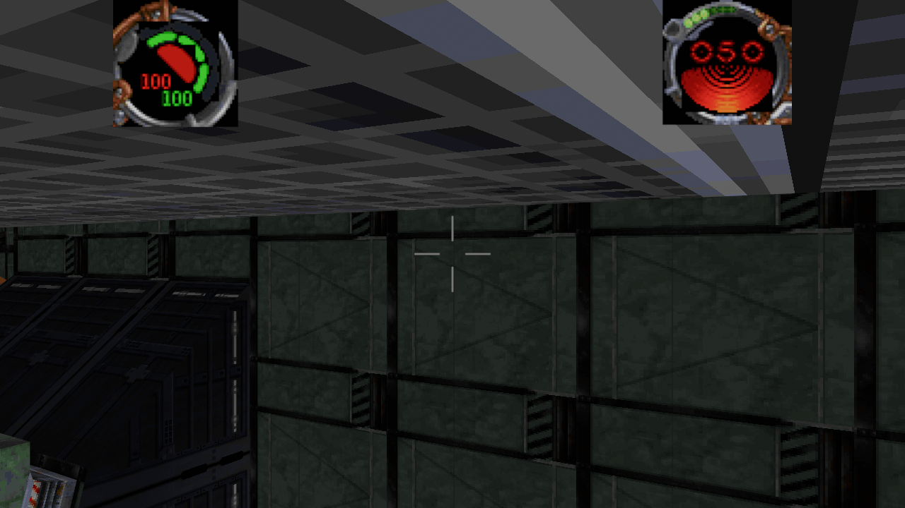

**Polygon coverage lands, and the body stands on the walkway.** `collide::Solids` now keeps
`floors`: every downward-facing solid surface with its polygon. `support(pos, radius, drop)` takes
the highest such face that the body is *over* (within a body radius of an edge still counts) and
within `drop` below the feet, and `walker_step` asks it before falling back to the sector planes.
Level 1's spawn now reports `support Some(-1.275)` and stands, where before every sector-plane query
returned `None` and the walker sank through the level. Walking off the walkway still falls — that is
a gap in the level, not a bug.


**Why a plane-based floor query is not enough.** The obvious next step is "ask *every* sector for a
floor under the body". It was tried and it fails on data that is easy to check. Level 1's walkway is
sector `218`, which has **no** downward plane; the slab the player walks on is at `z ≈ -0.75` and
belongs to sectors `129`/`130`/`411`. Scanning the whole level for the highest plane below the body
finds, in order of temptation:

| candidate | z | why it is wrong |
|---|---|---|
| the slab | −0.75 | the right one, but the body's sector does not own it |
| a plane inside a wall | −1.12 | its sector's hull contains the point, so a `clearance > 0` test accepts it |
| the inside of a pipe | −1.30 | the same, for a 12-sided cylinder |

Each wrong answer puts the camera inside geometry — the walker climbed eight units when the window
allowed planes just above the feet, and rendered from inside a duct when the hull test was loosened.
The rule that actually distinguishes them is *polygon* coverage: is the body standing over this
face or beside it. That is the same bounded-surface tracing that step-up needs, which is why both
are one piece of work rather than two.

Two probes make the fix checkable without a hand on the keyboard. `--stand <template>` puts the
player in another thing's room, so a working camera and a working floor show up in one screenshot;
`BK_WALK_FORWARD=1` holds the forward key, and with `BK_WALK_TRACE=1` the body walks:

```text
walk trace: sector 218 pos [-10.443433, -5.455094, -0.779886]  ...
walk trace: sector 218 pos [ -5.898444, -13.325415, -11.729356] ...
```

It moves — and it also **sinks**: with the spawn volume having no planes, the solver pushes the body
down as it leaves. Fixing that is the same work as step-up below: resolve against the sector *and*
the sectors its portals open onto, instead of one sector's infinite planes.

**The field-log map panel draws the level around the player.** `jkGuiMap_DrawMapScreen` (0x4156a0)
is the map screen's custom element: it sets `jkGuiMap_pCamera` and calls
`sithMap_DrawCircle(jkGuiMap_pCamera, &jkGuiMap_matTmp)`, which *renders the level* into a 520x320
offscreen buffer and blits it. So the panel is a second 3D view, not a 2D diagram — and this build's
canvas has no second 3D camera, so `Canvas::map` draws what that circular view shows: every vertical
face within `look.map_radius` world units of the player, clipped to a circle, rotated so the player's
facing is up, in the screen's own palette, with a cross at the centre.

```
0x52ea68 fieldlog: 15 elements over ui\bm\bkFieldLog.bm (code background)
type 7 font  0 id    0   40,40    520x320     "" [map @0x4156a0]
```

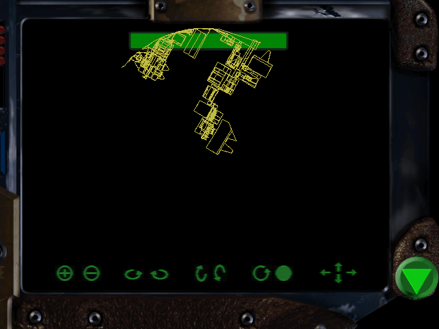

The panel's rect comes from the screen's own element row (`{40, 40, 520, 320}`), the eight transform
buttons and the exit button around it are the executable's, and `--map-shot <out.png>` asserts the
panel is not blank (5058 ink pixels for level 1) and that the player's marker is at its centre.
`ponytail:` retail zooms and orbits with `jkGuiMap_viewMat` and those buttons; here the scale fits
`map_radius` and there is no orbit.

**Combat was broken in four places at once, and no check covered any of them.** The README said
"combat is one-directional"; the truth was that nothing could be hit at all. `--fire` passed because
it *simulated* its own hit — it stepped a bolt and compared the distance to a 1.0-unit sphere — and
never called the scan the game runs. A `--hit` check that drives `Runtime::impacts` found four
independent causes:

1. **Placed things were not targets.** The scan read
   `if other < first_created { continue }`, so only things *created at run time* could be hit. Every
   actor a level places — all 120 on level 1 — was immune, and only a `CreateThing` actor was not.
2. **The hit test was a point, and a thing's position is its feet.** A bolt leaves the muzzle at eye
   height (about 1.4 above the floor) and the target's origin is on the floor, so a 0.5-unit sphere
   around the origin could never be reached. `Runtime::shot_hits` now tests the cylinder the
   template describes — `radius=` when the template has one, otherwise the standard JK actor body of
   0.6 by 1.8 — and `size=` is deliberately **not** read as extents: JK writes it as a model *scale*
   (`size=0.02/0.02/0.02` is a normal actor), so reading it as half-extents gives a two-centimetre
   body and nothing ever lands.
3. **The muzzle was inside the shooter.** A 0.6-unit offset is inside the 0.6 + 0.15 body the hit
   test uses, so a bolt's first frame hit the thing that fired it. The muzzle is now a unit out.
4. **Every projectile died at birth.** `draw_created` removed a bolt whose position was outside
   every sector (`sector_at(pos, 0.05).is_none()`), which is far too strict for a muzzle: level 1
   measured 22 bolts fired and **0 alive**. A bolt is gone when it leaves the level, which is a
   bounds test.

With those fixed the demonstration stream lands: 33 hits in one run, `reeyeesbhgun` from 30 health
to 0 and `reeyeesfist` from 30 to 1. The other direction works too — an actor's `+elaser` reaches the
player for 9 — and `health_follows_damage` mirrors the runtime's `walkplayer` health into the status
bar, which had been drawing its default 100 because nothing could hurt the player.

`--hit` is the check: a player's bolt must land on a placed actor for the damage it still carries
(25 of 30 after the flight decay), and an actor's bolt must reach the player and take health.

**Explosions are things, and 40 templates name one.** A projectile's `explode=` is not a special
effect: `sithExplosion` creates that template where the bolt lands, and the blast's own `damage=` and
`size=` decide who is hurt. `Runtime::explode` does the same — it spawns the template at the impact
point, keeping its type, health and damage — and `explode_hits` asks who is inside the blast's body.

`+bryarbolt`'s `explode=` is `+laserhit`, and `--hit` now proves the chain:

```text
hit: 40 template(s) name an `explode=`; first Some("+bryarbolt")
hit: `+bryarbolt` left `+laserhit` at the impact, which reaches 1 thing(s)
```

`ponytail:` the blast is a thing with the template's damage, not a timed entity with a radius that
grows and fades; the engine's explosion animates over its own frames and expires. What is faithful
here is the *identity* — one template, spawned at the impact, hurting what it covers — which is the
part the level scripts and the damage model depend on.

**Damage has a kind, and invulnerability has one exception.** `sithActor_DamageActor`
(`JK.EXE:004ecc90`) takes a `SithDamageType` word — impact 0x1, energy 0x2, fire 0x4, force 0x8,
saber 0x10, drown 0x20, fall 0x40 — and checks `actor->flags & SITH_AF_INVULNERABLE` (0x8) *before*
anything else:

```c
if ((pActor->actorParams.flags & SITH_AF_INVULNERABLE) != 0 && damageType != 0x40) return 0.0;
```

So a scripted invulnerability swallows everything except a fall. `Runtime::damage_typed` carries the
kind: bolts arrive as energy, landings as falls, and the player's own path (`damage_player`, which has
the shield bar in front of health) honours the same guard, since the engine's actor branch covers the
player too. `01_endlevel.cog` is where it shows: its `user0` handler sets `SetActorFlags(player, 0x8)`
and freezes Kyle, sleeps three seconds, then clears it — `--endlevel` watches the flag go set while the
label is suspended and cleared before `jkEndLevel`:

```text
endlevel: player invulnerable while the handler sleeps: true
endlevel: 1 message(s) delivered, goal bin 100 = 3, level_complete true
```

Still unported from the same function: the hurt sound per type (`SITH_SC_HURTENERGY`, `HURTFIRE`,
`HURTMAGIC`, `HURTSPECIAL`), the 0.1 damage multiplier for a limb hit, and letting a cog's `damaged`
handler return a replacement amount (`sithCog_ThingSendMessageEx` with the type as an argument — the
port's messages carry no arguments yet).

**Force seeing: the script was running and the mode verbs were falling through.** `--force seeing`
spent its mana (400 → 370, the script's own `ChangeInv(player, 14, -30)`) and called
`EnableIRMode`, `DisableIRMode`, `ClearMapModeFlags` and `ChangeSoundVol` — and none of the mode
verbs were in `Runtime::handles`, so every one of them fell to the interpreter's null answer. The
script did its half perfectly and nothing happened.

`Runtime` now carries `ir_mode` and `map_mode_flags`, and the four verbs are registered with the
dispatcher, which is what makes the script's calls reach the engine at all:

```text
force seeing: infrared mode on
force seeing: infrared mode off (via DisableIRMode)
```

`--force seeing` asserts both transitions. Two things it also records: the shipped script has no
`deactivated` label this parser can find (`deactivated -> no label `deactivated``), so the release is
driven through the verb the script would call; and the **visual** half of seeing — the infrared pass
that tints the world — is not drawn yet, because the level shader is the one piece the distance term
needs too (§6).

**Shields, death and respawn: the player has a life cycle now.** `sithPlayer_Update` spends the shield
bar before health, and the status bar draws both numbers. This build had neither: every hit came off
health directly, the shield number was the HUD's default, and health reaching 0 did nothing at all —
the walker kept walking at 0.

`Runtime::damage_player` is now the one path player damage takes: shields absorb first, the remainder
comes off health, and 0 health sets `player_dead`. `Runtime::respawn_player` puts the player back at
the level's own `walkplayer` with both bars full. `respawn_on_death` carries that into the running
game — position, velocity and the `Player` mirror all reset — and `health_follows_damage` mirrors both
numbers into the status bar, which is what makes the damage visible at all.

`--die` is the check, and it pins the order rather than the totals:

```text
die: player starts with 100 health and 100 shields
die: 30 damage -> 70 shield(s), 100 health      <- the bar absorbs it, health untouched
die: 200 more -> 0 shield(s), 0 health          <- the rest goes through
die: respawn at the level's start -> 100 health, 100 shields
```

`ponytail:` respawn goes to the level's start, not the last checkpoint. The engine's checkpoint list
(`sithPlayer`'s save points, what `--save` already writes) is the upgrade path.

**The force screen is built, and it shows what you have found.** The executable cannot supply this
panel: `jkGuiForce_Init` fills `jkGuiForce_pElements` on the heap at run time, so no shipped element
array carries a power row (§16.11). The source does supply the table, so `menus::FORCE_POWERS`
copies `jkGUIForce_buttons[25]` field for field — 17 picture buttons, each `(bin, bitmap, hint)`:

```text
/*3*/ { ELEMENT_PICBUTTON, SITHBIN_F_ABSORB, 0, NULL,
          0, {-1, -1, -1, -1}, 1, 0, "GUI_HINT_ABSORB", 0, jkGuiForce_ButtonClick, 0, {0}, 0},
```

The rect is `{-1, -1, -1, -1}` in the file because `jkGuiForce_Init` lays the icons out; the builder
places them six across. The background is the one that init call names:
`jkGui_InitMenu(pMenu, jkGui_stdBitmaps[JKGUI_BM_BK_FORCE])`, i.e. `jkGui_aBitmaps[9] = "bkForce.bm"`.

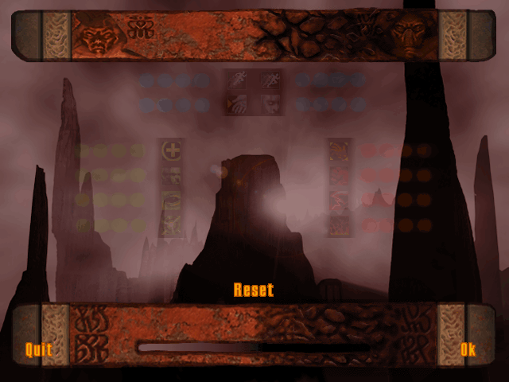

The gate is `bIsVisible`, the same rule as every other screen: a power whose bin the player does not
carry keeps `visible = false`, and `draw_screen` skips it. `--force-screen` asserts both ends of it
(17 rows in the table; none shown with an empty inventory; exactly JUMP and SPEED shown for a player
carrying bins 29 and 33), and `--ui force <out.png> --force-found 29,33` renders the panel.

**Captures are deterministic now, and that is what made an A/B possible.** Two runs of the *same*
command used to differ in **46.6%** of their pixels: `--shot` fires at a frame index, but the walker
stepped on the wall-clock delta, so at one run's frame 120 the body was still falling and at another's it
had settled. `--shot`/`--map-shot` now step on a fixed `1/60` (`Overview::capture`), and the same command
twice differs in **0.00%** of pixels. Every visual comparison in this document depends on that.

With a stable pose, the colormap-aware material could finally be compared with `StandardMaterial` — and
the first comparison failed, in a way worth recording:

| | mean luminance | std | pixels differing |
| --- | --- | --- | --- |
| `StandardMaterial` | 48.7 | 24.9 | — |
| `LevelMaterial`, before the culling fix | 46.4 | 27.0 | 25.7% |
| `LevelMaterial`, after | — | — | **0.00%** |

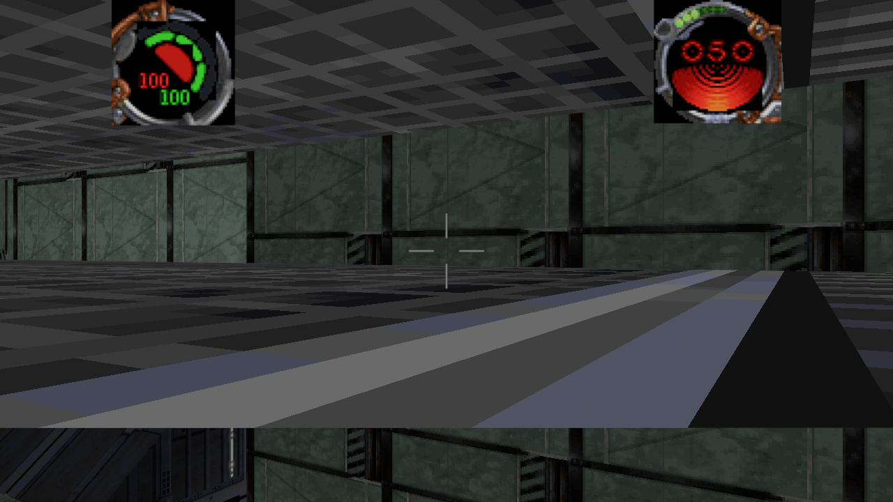

The first A/B showed a band of wall that is green panelling under `StandardMaterial` rendering as
orange-and-black hazard stripes under `LevelMaterial`, with identical silhouettes. The texture binding
was not the difference — forcing the shader to `return tex;` left the stripes in place. The difference
was **back-face culling**: `StandardMaterial` sets `cull_mode: None` because `.jkl` winding is not
consistent, while a custom material has no such field and defaulted to culling back faces, so a wall
whose front face pointed away *revealed the surface behind it*.

A custom material cannot set `cull_mode` directly, but it can in the pipeline descriptor:

```rust
fn specialize(
    _pipeline: &MaterialPipeline,
    descriptor: &mut RenderPipelineDescriptor,
    _layout: &MeshVertexBufferLayoutRef,
    _key: MaterialPipelineKey<Self>,
) -> Result<(), SpecializedMeshPipelineError> {
    descriptor.primitive.cull_mode = None;
    Ok(())
}
```

With that, the two materials render **identically** — 0.00% of pixels differ on `01narshadda.jkl` and,
checked separately, on `02narshadda.jkl` too. `LevelMaterial` is now the default (`--standard-material`
opts out), so the `.cmp` distance shading and force seeing are on the shipping path rather than behind a
flag.

The lesson is the one this document keeps relearning: a mean-luminance summary said "close" (48.7
against 46.4) while a quarter of the frame was wrong, and the cause was not in the thing under
suspicion.

**The lateral rule is one function, `collide::face_blocks`.** Three questions, and a wall only stops a
body when all three answer yes:

```text
1. do the body's feet/head span the face's own z range?   (no -> pass: that is step-up)
2. is the body beside the face's outline in plan?         (no -> pass: past the end of the wall)
3. is the body penetrating the face's plane?              (no -> pass)
```

Question 2 was the open gap: `beside` measured the distance to the face's **infinite line**, so a body
twenty units past the end of a wall was still pushed by it. It now measures the distance to the
outline's **edge segments**, clamped to their ends. `--rules` asserts both halves against the level's
longest wall:

```text
lateral: a body 0.1 into the wall is pushed true, and 27 past its end is pushed false
```

Both halves of that rule were wrong at different times, which is why it now lives in one place with a
name: the span test fixed "the wall blocks at every height" and the outline test fixed "the infinite
plane still pushes beyond the wall".

**Actors steer through portals, not into walls.** The chase used to be a straight line with a push-out
afterwards, so an actor with a bulkhead between it and the player pressed into the bulkhead.
`Runtime::portals` is built at load and the tick uses it:

```text
surface's `adjoin` -> `adjoins[adjoin].mirror` -> the surface that adjoin names
                   -> `surface_claims` of both -> (near sector, far sector, centre)
```

Level 1 has **1206 portals** by that construction. When `Solids::segment_blocked` says the straight step
is walled off, the actor heads for the portal minimising `dist(from, portal) + dist(portal, target)` and
records itself in `Runtime::via_portal`. `--ai` pins it:

```text
ai: a wall between the actor and its target: blocked true, steering at portal Some([5.299998, 11.700012, 7.008695])
ai: the portal is 1.00 along the way to the target
```

`ponytail:` this is **greedy, not a search** — it picks the doorway that looks closest on both legs and
does not look past it, so an actor in a room with two doors may pick the wrong one. The engine's
`sithAI` runs a path over sector adjoins. This is the "walks through the door instead of into the wall"
step, which is what the level geometry actually needs; a real search is the upgrade.

Worth recording how the first attempt failed: it found **0 portals** because it assumed a portal surface
is claimed by two sectors. It is not — a portal surface belongs to one sector, and the far side is named
by the `adjoin`/`mirror` pair. The `0 claimed by two sectors` line was the diagnosis.

**The jump was pinned by the lateral resolver, and that is why the calibration failed.** `--rules`
reported `apex 0.00 / 2.81` for weeks while the physics looked correct. `BK_JUMP_TRACE=1` settled it
in one run:

```text
jump trace 0: z -1.300 base -1.300 vy 13.67 support None floor None
jump trace 1: z -1.300 base -1.300 vy 12.33 support None floor None
...
```

`z` never moves while `vy` falls from 13.67 to 4.33 — so the vertical step *was* integrating, and
something put `pos[2]` back every frame. That something is `Solids::resolve`: it is the **lateral**
resolver, but its planes are infinite, so a floor or ceiling plane pushes along Z and silently
overrides the jump. `walker_step` now keeps the height its own vertical step produced (`next[2] =
want[2]`) and lets the resolver own X and Y — except that a step-up is still allowed to raise it,
which is why the assignment sits immediately after the resolve rather than at the end.

`--rules` then measures `apex 2.57 / 2.81 closed form` (91% of the closed form, inside the 15% band)
and exits clean, and `--walk all` still reports 34/34 levels. The airtime reading it prints (10.00 s)
is not a defect: the body lands on a walkway a metre *above* where it started, so it never returns to
the base height the measurement waits for. The assertion is on the apex.

**Step-up works, and it is the faces that make it possible.** Two changes, both about coverage:

- `Solids::walls` keeps every vertical solid surface with its polygon, and `resolve_stepped` skips
  a sector plane **only while** the body's feet are below that face's top edge and the body is
  beside it in plan. The plane still bounds the room; above the ledge's edge there is nothing to
  hit, which is precisely what the engine's polygon trace gets for free.
- `move_body` then retries the blocked move from one step up — the engine's allowance,
  `moveSize + 0.01`, i.e. `0.065 + 0.01 = 0.066` level units — and keeps the raised result only if
  the body is clear there *and* `support` finds a floor up there, so a riser is climbed and a wall
  three times the allowance blocks.

`resolve` stays as it was (planes only, no exemptions) because the `--walk` sweeps measure exactly
that baseline: 34/34 levels and its own crossing count, unchanged. The window and the step fixture use
`resolve_stepped`. Sweeping with the exemption enabled drops the sweeps to 27/34, which is the
signal that the two behaviours deserve separate names rather than one flagged code path.

The old pinned test is gone. `a_low_ledge_is_stepped_onto_and_a_tall_wall_is_not` now asserts both
halves: the walker climbs a 0.5 riser (`z` rises above the ledge top) and is stopped by the same
riser raised to 2 units.

**The step-up history, recorded.** Step-up used to be blocked by the solver, not by the data. The engine's step allowance is
`moveSize + 0.01` above the feet, and retail's collision traces surface **polygons**
(`sithCollision_SearchForCollisions`): a ledge face ends at its own top edge, so a body whose
feet clear it walks over. This build's solver resolves against each sector's **infinite plane**
list instead, where a vertical face blocks at every height — the walker is held exactly one
radius from the face with no way to climb, no matter how high it lifts (measured: 0.65 vs the
face at 1.0, test `a_ledge_blocks_because_faces_are_infinite_planes`). Implementing step-up
therefore means bounded-surface tracing, which is a collision rewrite rather than a rule.
`--walk all` shows the same thing as a symptom: the walkers that stall early on a level are
stalled against a ledge or a spawn wall, not lost.

Two unit caveats, stated rather than hidden. Template *lengths* are in level units, and
`MODEL_SCALE` is 1:1 (`d2x3.3do`'s 0.300 model units is the 0.30-unit doorway the level builds
for it), so gravity is 4.0 and the jump apex 0.28 units — no calibration in the table. The
template's `movesize` (0.065) is the body's collision radius, one third of a `ky.3do` half a
level unit tall. Water is not applied yet: it needs the surface the player is standing on,
which the walker does not track.

The walker now also **starts in the sector the level records** for its `walkplayer` rather
than re-deriving one from the hull planes. Both `sector_at` (smallest hull) and "roomiest
hull" fail here — the first picks a trigger sliver that pins the body, the second picks a room
that spans the level and lets the body walk out of the world. `collide::sector_for_body` exists
as the fallback and prefers the sector with the most clearance.

## 16.3 Actors animate — **observed**

A placed thing animates when its template names a **puppet** (`puppet=ky.pup` on
`walkplayer`, `rystr.pup` on `reeyeesgun`). A `.pup` is a table of *states*:

```text
stand        kystand0.key   0x00  0  0     # submode 0: idle
walk         kywalkF.key    0x01  2  2     # submode 1: walk
run          kyrun0.key     0x01  2  2
death        kyftdeth.key   0x14  5  5
```

The last two numbers are **event markers, not a loop range** — `stand … 0 0` sits on a
31-frame file. The loop length is the keyfile's own `FRAMES`, and its clock is the
keyfile's `FPS` (`kystand0.key`: `FRAMES 31`, `FPS 15.000`), so an idle is a 2.07-second
loop. The state the engine picks comes from velocity (`sithPuppet_UpdateThingMove`): no
velocity → `stand`, moving → `walk`/`run`, sideways → the strafe variants, and
underwater sectors switch animation sets.

This build loads every puppet and keyfile that a level's **placed things** name — level 1
gives 11 puppets and 121 keyframes — and spawns each actor with its *own* mesh handles
instead of the shared per-(model, material) meshes, because the pose is written into the
mesh. `animate_actors` advances `(elapsed × fps) mod frames`, quantises to a frame number,
and rebuilds nothing until that number changes; a 15 fps animation therefore costs one
rebuild per 1/15 s rather than one per render.

`--animate` is the check, and it measures the mesh the renderer shows rather than the
keyfile data: it poses the model at frame 0 and at mid-loop through
`model_mesh_posed` — the same call the system makes — for *every material*, and requires
the vertex positions to differ. Across the install **1684 of 1697 placed actors move**;
the 13 that do not are in `04escapehouse` (7), `06abarons` (2) and `14tower` (4), where
the `stand` state is a genuinely static pose or its joints are not bound to that model's
visible geoset. `--no-anim` freezes the actors so a frame pair can be A/B'd, the same way
`--no-cull` A/Bs the visibility pass.

**The state is chosen from the actor's own velocity.** `sithPuppet_UpdateThingMove`
(`0x4e4380`) transforms the thing's velocity into its own frame, takes whichever axis
dominates, and indexes the puppet's animation table with it — the table being the `.pup`'s
rows in order, so `stand` is 1, `walk` 2, `run` 3, `walkback` 4, `strafeleft`/`straferight`
5/6. Dominant forward axis: `walk` while the speed is under 0.5 u/s (`local_10`, raised to
1.0 for a player thing), `run` at or above it, `walkback` when the forward component is
negative. Dominant lateral axis: `strafeleft`/`straferight` by sign. Under 0.02 u/s it stands
and plays its **turn** animation when the AI's turning flag is set (not modelled here). The
same function returns the speed to `sithPuppet_UpdatePuppet`, which calls
`rdPuppet_AdvanceTrack(speed × dt × const)` — a locomotion clip advances with **distance
moved**, not with the clock, which is why a walk cycle does not slide.

The port has no physics velocity: `ai_tick` moves an actor by writing its position, so
`Runtime::walk_vel` records the velocity each actor walked at (`(next - from) / dt`), and
`locomotion_state` applies the same axis-and-threshold rule to it. A renderer-side
displacement was tried first and is wrong — the sim ticks and the render frames do not line
up (a 0.33 u/s walk measured 3.6 u/s), and `ai_shots` re-seats an actor that ends up inside
a wall, a push the `--ai` gate reports at 6.7 units, which reads as a sprint sideways. A
script's `PlayKey` still overrides the choice, and a dead actor plays `death` once and holds
the last frame. A state change restarts the clip, which is `sithPuppet_PlayMode` clearing
`animStartedMs`.

```text
actor: thing 80 plays `rystroll.key` (walk, 0.33 u/s at yaw -106)
actor: thing 207 plays `ryrun.key` (run, 0.60 u/s at yaw 102)
```

`--animate` also checks the chooser against the level's own puppets: every state name it can
return for an actor is looked up in that actor's `.pup`, and the gate fails if fewer than half
the level's actors ship a `walk` row (level 1: 128 of them, and 128 a `run`).

Not done yet: the armed/unarmed mode axis (`mode=1` rows, which the engine switches with
`SetArmedMode` when a weapon is drawn) — the port draws mode 0 — and the puppet's `joints`
block (which maps a keyfile node to a *model* node id rather than by name) is parsed but not
applied; models whose node names differ from the keyfile's would pose wrongly.
`_DAT_00522fbc`, the units-to-frames constant `AdvanceTrack` is scaled by, is not recovered,
so the clip rate is normalised at the 0.5 u/s threshold instead. Attachments (`fireoffset`,
weapon models) also wait for combat.

## 16.4 The COG verb layer — **observed**, partial

Scripts reach the world through verbs; the interpreter (`cog.rs`) handles the language, and
`runtime.rs` answers the verbs that touch state. Before this pass the runtime answered ~60
verbs and everything else silently returned 0, which is why scripts ran but acted on
nothing. The verbs are read off retail's `sithCogFunction*.c` registrations
(`sithCog_RegisterFunction(pCog, …, "name")`), which name each verb and its argument order.

Now implemented, with the engine's semantics where they differ from the obvious:

| group | verbs | notes |
|---|---|---|
| things | `GetThingType`, `FirstThingInSector`, `NextThingInSector`, `CreateThing`, `DamageThing`, `DestroyThing`, `CaptureThing`, `ThingLight` | type numbers from `types_enums.h`: actor 2, weapon 3, item 5, player 10, sprite 13; `CreateThing(template, source)` spawns at the source thing with the template's `health=` |
| surfaces | `SurfaceCenter`, `SetWallCel`, `GetWallCel`, `SlideWall`, `SurfaceAnim`, `GetSurfaceAnim`, `StopSurfaceAnim`, `SetSurfaceFlags` | `SurfaceAnim(surface, fps)` treats a non-positive rate as the engine's default **15 fps** (`sithCogFunction_SurfaceAnim`) |
| sectors | `SectorAdjoins` (the setter `SetSectorAdjoins` under its other spelling), `SectorLight`, `GetSectorLight`, `SectorThrust` | thrust is stored, not simulated: nothing is in flight until combat |
| messages | `GetSenderID`, `GetSenderRef`, `GetSenderType`, `GetSourceRef`, `jkGetLocalPlayer` | see the caveat below |
| misc | `jkPrintUNIString`, `SetTimerEx`, `KillTimerEx`, `WaitForStop`, `StopSound` | printing collects the `.uni` key in `Runtime::prints` |

Level 1 now delivers **92 messages**, actuates **13 sector adjoins** (its doors), moves 19
things and requests 19 sounds. Across all 34 levels that carry scripts, the stub list went
from `getsenderid x216, getsenderref x184, setwallcel x162, …` to 1065 calls, all of them
AI (`ai*`), weapon, music or message-bus verbs — stages 5–7.

`--cog-check` is the gate. It runs every level's scripts and fails if any verb outside the
deferred groups is stubbed more than 40 times, so a verb that regresses to "answered with 0"
fails the build rather than quietly doing nothing.

**A cog now knows its own index.** `GetSelfCog` is `pCog->idx` (`sithCogFunction.c:996`); the port
answers it from the VM's own position in the level's cog list, which is the order the engine creates
them in. `SetMasterCog`/`GetMasterCog` are the engine's **one global** master index
(`sithCog_g_pMasterCog`, `-1` when unset, and cleared when the index resolves to no cog), so those
two live on the world rather than the VM.

That closes the level-end chain's registration half, which `01_endlevel.cog` needs at startup:
`SetMasterCOG(GetSelfCOG())`, then `SetGoalFlags(player, 0, 1)`. Its `user0` handler is the goal
complete — `SetGoalFlags(player, 0, 2)`, `Accomplish1.wav`, freeze and invuln the player,
`Sleep(3.0)`, `jkEndLevel(1)`. The message that reaches it (`SendMessage(GetMasterCOG(), user0)` from
a goal script) does arrive today, and `--run 01narshadda` shows the handler running:

```text
  [01_endlevel.cog user0] sound Accomplish1.wav at 1.00
```

`--endlevel` is the gate that pins the chain end to end on level 1: it binds every placed instance, runs
`startup` (which registers `01_endlevel.cog` as master cog 26), sends `user0` — id 27 — to that cog, then
pumps the bus and advances cog time so the handler's `Sleep(3.0)` expires:

```text
endlevel: 42 instance(s), master cog Some(26) (set by `SetMasterCOG(GetSelfCOG())`)
endlevel: 1 message(s) delivered, goal bin 100 = 3, level_complete true
```

That message is now addressed rather than broadcast, and its number is the engine's.
`sithCogFunction_SendMessage` pops a **cog index** and a message **id**, resolves the cog and delivers
to that one instance. The ids are not a guess: `sithCog_Startup` (`JK.EXE:004de070`) registers each
name as a keyword with `sithCog_AddIntSymbol`, and that table is `activate` 1 — and `activated` **1
too**, an alias shipped scripts use in 82 places — `removed` 2, `startup` 3, `timer` 4, `blocked` 5,
`entered` 6, `exited` 7, `crossed` 8, `sighted` 9, `damaged` 10, `arrived` 11, `killed` 12, `pulse` 13,
`touched` 14, `created` 15, `loading` 16, `selected` 17, `deselected` 18, `autoselect` 19, `changed` 20,
`deactivated` 21, `shutdown` 22, `respawn` 23, `aievent` 24, `skill` 25, `taken` 26, `user0`…`user7`
27…34, `newplayer` 35, `fire` 36, `join` 37, `leave` 38, `splash` 39, `trigger` 40. A `message` symbol in
an expression is that id, so `SendMessage(GetMasterCOG(), user0)` puts 27 on the stack, and the receiver
matches its `message:` list **by id** rather than by declaration order; a name no retail table carries
(`pickedup`) still falls back to the positional reading. The port queues `(label, sending cog, target
cog)`, and the sender is the calling VM's index, so `GetSenderID()` answers something real in the
receiver. A negative or unset target — an unset master cog — still broadcasts, which is what the
start-of-level scripts have before their `endlevel` instance has run.

Delivery had to be added to the live loop as well as to `--run`: `Sim` has two buses, and only the
first was drained every frame. `pending_messages` carries thing- and sector-linked labels addressed
by *instance index*; `Runtime::messages` carries what one script said to another, addressed by cog
index. On level 1 the difference is visible — `--run 01narshadda` went from "1 sent by scripts
(41 delivered)" to "(1 delivered)": the goal message used to be broadcast to every instance that
happened to declare a label at the same ordinal.

Two conventions, stated because they are *not* the engine's full behaviour:

- `GetSourceRef` answers 0. Retail stores the source in the thing's `cog=` field, which this
  level parse does not keep, so every instance is treated as level-wide. `GetSenderRef` answers 0
  too, so a script comparing `GetSenderRef() == GetSourceRef()` still matches for engine-triggered
  events; `GetSenderID` does answer the calling cog now.

**The network verbs answer for a single-player build, and `SendTrigger` really broadcasts.**
`sithNet_isMulti` and `sithNet_isServer` are false in a one-player game, so `ismulti`/`isserver`, the team
and score getters answer 0 and the setters do nothing — the engine's own answers, spelled out rather than
left to the catch-all, because a catch-all would answer the same 0 to a getter that must *not* be 0.
`*multimodeflags` round-trip through a stored word (`sithMulti_multiModeFlags`) so a script that sets and
re-reads one sees its own value. `SendTrigger(thing, type, p0..p3)` (`sithCogFunction.c:1189`) broadcasts
`SITH_MESSAGE_TRIGGER` (40) when its source is the local player; the port queues `#40` with no cog target,
which is its broadcast, and the receiving pump resolves the id against each listener's `message:` list.
The port's messages carry no parameters, so the four arguments are dropped — the type is what listeners
branch on. Every shipped `SendTrigger` caller lives in a multiplayer script (`ctf_main`, `c3_largelevel*`,
`c2_breakingglass`), so this is fidelity for those levels rather than something a campaign level exercises.

**A face's draw mode is state the renderer acts on, and its default is not 0.**
`SetFaceGeoMode(surface, mode)` stores `face->geometryMode` and then calls `sithSurface_SyncSurface`
(`FUN_00500790`) — the engine re-syncs the geometry, it does not just remember a number. The modes are
`erdGeometryMode` (`types_enums.h`): 0 `NONE`, 1 `VERTEX`, 2 `WIREFRAME`, 3 `SOLID`, 4 `FULL`, 5 "use
whatever the renderer is set to". 223 shipped call sites across 21 scripts: 0 ×151 (`00_breakingglass.cog`
shatters glass with it, `03_paddlepool.cog` and the `*ffieldswitch` scripts open and close passages),
5 ×32, 3 ×30, 4 ×10 (`00_slashablefaces.cog` sets 4 back while its panel is intact). Two retail branches
are worth naming because both are easy to lose: a face whose material is null keeps `GEOMETRY_NONE` and
the argument is ignored, and the loader *derives* the initial mode rather than trusting the row —
`sithSurface.c:225`–`237` reads the `.jkl` `geo` column, then forces `SOLID` on an opaque material and
`NONE` when there is none.

So the default is what the consumer reads. `GetFaceGeoMode` on a face no script has touched answers the
level's own `geo`, never 0, and that is load-bearing: level 9's fuel chain opens its `crossed` handler
with `if (GetFaceGeoMode(GetSenderRef()) == 0) return; // Face not rendered, fuel at different level, exit`
(`09_fuelexplode.cog:57`), so answering 0 for every untouched face retired that level's set piece
silently — the script is only reachable when the face still reports it is drawn. Across all 35 levels
the column already agrees with the loader's rule: 90,567 faces ship `geo` 4 and 666 ship 3, every one of
them with a material, and 35,406 ship 0, every one without. The port keeps that derived default in
`Runtime::surface_geomode`, lets `face_geomode` override it, and reads both through
`Runtime::face_geomode_at`.

Hiding has to reach the mesh, not the table. `build_world` skips hidden faces, `SurfaceBatches` keeps the
`(sector, material)` mesh handles, and `rebuild_surfaces` re-batches them when `geomode_epoch` changes —
patched in place, so the entities and their portal-driven `Visibility` survive. `--geomode` is the gate:

```text
geomode: surface 0 (7 verts, sector 0) hidden: 8898 -> 8893 triangles (want 8893);
         untouched face 3 is geo 4, a material-less face stays 0
```

The 7-vertex face is one fan of 5 triangles; a material-less face keeps 0 even when the script passes 4.
ponytail: a change re-batches the whole world instead of the touched sector — a level has a few thousand
surfaces and a change happens when the player breaks something, so it is a hitch when it happens, not a
per-frame cost.

## 16.5 Firing a weapon — **observed**, first slice
A weapon is a template, and firing it is `CreateThing` of that template at the shooter with
the template's own launch velocity. Level 1's own weapons:

```text
+bryarbolt   _weapon  vel=(0/4/0)  damage=30  mindamage=10  rate=15  explode=+laserhit  fleshhit=+laserfleshhit
+stlaser     +bryarbolt  vel=(0/6/0)  rate=10
+elaser      +stlaser    vel=(0/4/0)  damage=12  mindamage=5
```

`vel` is in the thing's **own** frame, pointing down the model's +Y, so the world velocity is
that vector rotated by the shooter's yaw (`(sin, cos)` of it — a JK yaw of `a` faces
`(cos a, sin a, 0)`). `rate` is shots per second, `damage` is the hit's cost, `mindamage` the
falloff floor, and `explode=`/`fleshhit=` name the effect templates spawned on impact.

This build now spawns the projectile, flies it with the template's speed, stops it when it
leaves the level's sectors, and applies `damage=` to the thing it reaches; a killing blow
sets the target's health to 0 and marks it destroyed. Placed things now start with their
template's `health=` instead of a default of 1, which is what makes damage mean anything.

`--fire <template>` is the check. It picks the level's `walkplayer`, finds the nearest actor
between 2 and 40 units away, aims, fires, steps the projectile and asserts it arrives and
that the health lost is exactly the template's `damage=`:

```text
fire: `+bryarbolt` damage 30, vel [0.0, 4.0, 0.0], from thing 0 at (...) toward thing 80 2.5 units away
  projectile did hit: true, flew clear; actor health 50 -> 20
--- fire check passed ---
```

`+stlaser` (6 u/s) and `+elaser` (12 damage) resolve the same way, so the inherited fields walk
the template chain.

### Damage decays in flight

The engine's `sithWeapon_Update` decays a projectile's damage as it flies, when the weapon's
typeflags carry **`SITH_WF_DAMAGE_DECAY` = 0x4000**:

```c
flex_t v3 = pThing->weaponParams.damage - pThing->weaponParams.rate * secDeltaTime;
if (v3 <= 0.0) v3 = pThing->weaponParams.minDamage;
pThing->weaponParams.damage = v3;
```

`rate` here is damage **per second**, not a distance ramp, and the floor is `mindamage=`.
Level 1's own bolt:

```text
+bryarbolt  damage=30.000000 mindamage=10.000000 typeflags=0x20440d rate=15.000000
```

0x4000 is set, so a bolt loses 15 points a second: full 30 at the muzzle, the floor of 10
after (30−10)/15 = **1.33 s** of flight, which at `vel=(0/4/0)` is 5.3 units. A near shot
stings, a long one does not; `+elaser` (12/5, same rate) bottoms out in 0.47 s.

`--fire` applies the *carried* damage rather than the template's starting value, and reports
the decay:

```text
  projectile did hit: true, flew clear; actor health 50 -> 24
  decay: 30 -> 26.5 after 0.23 s of flight (rate 15/s, floor 10)
```

The parse matters: `typeflags=` is **hexadecimal**, so it cannot go through the same f32
parser as the other template params — that silently returned `None` and every weapon looked
non-decaying until this check printed a full 30.

**In the window**, left mouse fires and created things are drawn. Three things had to be
fixed for that to be true, and each was invisible until a screenshot proved it:

- The renderer only knew the level's own thing list, so a fired bolt existed in the world
  and nowhere on screen. `draw_created` now spawns an entity per material for any runtime
  thing past the level's count, moves it each frame, and removes it when destroyed or when
  it leaves the sector graph.
- `World::models` was built from **placed** things' templates, so a bolt's `.3do` was never
  parsed and there was nothing to draw. Level 1 now parses 85 models (was 52), one per
  distinct template `model3d=`.
- `--fire-demo` fires a stream of bolts after frame 40. A/B against the same frame without
  it shows **40 728 pixels** differing, the bolt at 0.6 units ahead of the eye.

The muzzle is placed 0.6 units ahead of the **eye**, normalised: scaling that offset by the
template's `vel` (4 u/s) put the spawn 2.4 units out, through the wall and out of the
frustum, which is why the first two screenshots showed nothing.

One real bug fell out of this: the player's body was seeded **at eye height** and the camera
then added `PLAYER_EYE` on top, so the camera rode 1.45 units too high until the walker fell
onto the floor — in frame-limited renders it never fell at all, and the bolt spawned 1.55
units above the camera. The body now starts at the level's own `walkplayer` origin.

**Hits and death.** In the window a projectile now damages what it reaches: inside half a unit
of a thing of type 2 (actor), it applies the weapon's `damage=` through the same
`Runtime::damage`, removes itself, and prints the hit. A killed actor switches its keyframe
to the puppet's own **`death`** state — `kyftdeth.key` on `walkplayer`, 45 frames at 15 fps —
which plays once and holds its last frame, so a body stays on the floor instead of snapping
back to its idle. A puppet that ships no `death` state keeps looping `stand`, which is what
the engine does for such a class. `--fire` now also asserts this: after the killing blow the
runtime thing must be destroyed with health floored at 0, and the actor's template must have
a drawable `death` animation.

Not done yet, and it is most of the stage: no explosions or impact sounds, no `mindamage`
falloff by distance, no ammo or weapon selection, no item pickups, and no force powers. A
projectile also stops at a wall by leaving the sector graph, not by tracing the polygon it
hit, so it cannot yet spawn its `explode=` effect at the point of impact, and a body keeps
standing in place rather than falling — the death animation plays, but nothing repositions it.

**Line of sight matters for `--fire-demo`.** The demo aims at the nearest actor, but level 1's
spawn faces a wall: the bolt stops on it and nothing dies, which is correct behaviour, not a
bug. A visible kill needs a target in the open — the mechanics are checked headlessly by
`--fire`, which steps the projectile directly and does not consult walls.

**The actors' bodies were not following the runtime.** `Runtime::ai_tick` is what moves an actor:
it applies the class's own `sightdist=`/`fov=`, walks at the template's
`maxthrust * 10 / surfdrag` and turns to face the player. That half was already checked by `--ai`
(“walked 2.00 units in 1 s, now 2.50 units away (standoff 2.5), turned 80.0 deg”) — but the
*meshes* stayed where the level placed them, so an actor could chase and shoot from a spot it had
long left. `actors_follow_runtime` applies the runtime's movement to the actor's parts as a delta,
which keeps each part's offset inside the model.

Two things this had to get right, both found by tracing (`BK_ACTOR_TRACE=1` prints every applied
delta):

- The **walkplayer is an actor too** — it has a puppet and an animation — but its runtime position
  is the player's, and the camera is placed from it. Moving its parts by the same delta made the
  body oscillate 1.45 units every frame against `walk_player`'s placement. It is now skipped by
  thing index.
- The delta, not the absolute position: a model is drawn as several entities (one per material),
  each with its own offset. Setting them all to the target collapses them onto one another.

`--stand <template>` stands the player four units from the first thing of that template and faces
it, which is the flag for watching an actor in the window; the chase it triggers is the runtime's,
and `--ai` is the check that proves the numbers.

## 16.6 Pickups — **observed**, direct

A powerup is an `item`-type template with its own script: level 1 places `bactatank`
(`type=item cog=pow_bacta.cog respawn=60`), plus `healthpack`, `energycell` and
`shieldrecharge` instances. The engine's path is a message: touching the thing delivers
**`touched`** to the thing's cog, that script calls `TakeItem(powerup, player)`, and
`sithItem_SetItemTaken` applies the inventory change — `pow_bacta.cog`'s own `touched:`
label reads `player = GetSourceRef()`, `powerup = GetSenderRef()`, then
`TakeItem(powerup, player)`.

The **message bus** now exists (`SendMessage(target, message)` queues; the pump delivers to
every instance that declares that label, bounded at eight rounds). Numeric messages are
resolved per receiving script, because the engine numbers messages per cog.

That made the scripted pickup possible: taking a powerup runs the **item's own cog** —
`touched` with the item as `GetSenderRef` and the player as `GetSourceRef`, then `taken`,
which is what `sithItem_SetItemTaken` does. `pow_shields.cog` therefore lands its own numbers
in its own bin:

```text
pickup: `shieldrecharge` -> via pow_shields.cog -> [(60, 20.0)] (inventory {60: 20.0}, was {})
```

`bin=60`, `ChangeInv(player, bin, 20.0)` — read straight out of the script. A template with no
`cog=` falls back to `Runtime::take_item`, which uses the template's `inv=`/`count=` and, when
those are absent too, a bin derived from the template-table position (a stand-in, and only
reached on that fallback path now).

Two bugs surfaced while wiring this, both from argument order:

- `GetInv`/`SetInv`/`ChangeInv` take the **thing first**: `ChangeInv(player, bin, delta)`. They
  were reading the bin from argument 0, so every pickup's count landed in bin 0 and the
  inventory looked empty.
- `TakeItem` must **not** touch the inventory: the engine's `sithItem_SetItemTaken` runs the
  item's `taken` label, which is where `ChangeInv` lives. Adding it in the verb as well
  double-counted (bin 39 *and* bin 60).

`GetInvMax` was also unimplemented, so every pickup's `if (amount < GetInvMax(...))` guard
failed and `TakeItem` never ran at all. It now answers a roomy 100 for any bin — the engine's
per-class table is not recovered, and that number is the reason a powerup can be taken at all.

**A weapon item and its projectile are different templates, and only the projectile equips.** Level 1
places `+bryarpistol` things whose template has `damage=0` and `cog=pow_bryar.cog`; the damage lives on
`+bryarbolt` (`damage=30`). Taking the pistol credits its bin and leaves the equipped weapon alone,
which is correct: equipping the item would leave the player firing something that does nothing.

`--weapon` used to take the first type-3 thing it found — a pistol — and then assert that it had damage
*and* that taking it changed the weapon. Both assertions were wrong for an item, so the check failed on
level 1 for the honest reason that items are placed first. It now keeps the assertions for projectile
templates and says what it found for an item:

```text
weapon: `+elaser` damage 12, equip: `+bryarbolt` -> `+elaser`, respawn 0 s
weapon: `+bryarpistol` is an item (its bolt carries the damage), not equipped directly
```

**Ammo is a bin declared by the weapon's own cog, and it works end to end.** No weapon template carries
an `ammo=` field: the number lives in the powerup cog — `pow_bryar.cog` declares `ammobin(Int)` beside
`bin(Int)` and `amount(Flex)`, and its labels are `touched`/`taken`/`respawn`, i.e. it is the *pickup*
script. Reading the declaration is what resolves the player's weapon:

```text
ammo: the player's weapon spends bin Some(11)
ammo: bin 11 holds 0 at spawn; three rounds fired -> 3, then dry
```

Bin 11 is the engine's **energy** (`enum SITHBIN`), which is what a bryar pistol draws on. The *spend*
is one round per shot — calibrated, because the engine's firing tick is in `sithWeapon.c`/`jkPlayer.c`
and neither is in this source tree. Three things now use the same call (`Runtime::spend`):

- the fire system refuses to spawn a bolt when the bin is empty and prints `out of ammo`,
- the status bar's readout is the live bin (`-999` is the engine's "no ammo" marker, drawn as `:::`),
- `--ammo` fires three rounds from a bin of three and asserts it stops there.

The bin reads 0 at spawn in a headless run because the level's `startup` scripts are what grant the
initial cells — that is `--cog-check`'s ground, and it is why a live run fires freely at first.

**Force pull and grip are engine verbs plus shipped script, and reading the script settled what the engine
has to do.** `--dump "cog\force_pull.cog"` prints the shipped source (7627 bytes); the parts that matter:

```
activated:   SetInvActivated(player, 24, 1); SetPulse(0.33);
pulse:       potential = FirstThingInView(player, 20 + 15 * rank, 5.5, 0x424);
             ... HasLOS && VectorDist(...) <= (0.5 + rank / 2) ...
             if(dot > maxDot) victim = potential;         // most-centred thing wins
             jkSetTargetColors(18, 19, 20); jkSetTarget(victim);
deactivated: ClearPhysicsFlags(throwThing, 0x1);          // gravity off
             dir = VectorScale(VectorNorm(VectorSub(GetThingPos(player),
                                                    GetThingPos(throwThing))), 30);
             ApplyForce(throwThing, dir);
```

So **`jkSetTarget` is only the highlight the reticle shows** — the reticle tints (`18,19,20` for pull,
`6,7,8` for grip) and the target is marked. The movement is a single **`ApplyForce` impulse of 30 units/s
toward the player, with gravity cleared**, applied when the power is *released* (`deactivated`), not a
continuous drag. That corrected an earlier implementation of this port that dragged a held thing at a
calibrated 12 u/s: the drag was invented, and the real number is 30, from the script.

Recovered addresses (`JK.EXE`, image base `0x400000`), for the registration and the three verbs:

```text
0x40a110  the force-verb registration block (`FUN_0040a110`), one `sjk...` call per name
0x526028  "jksettarget"    -> 0x40ad00   (calls 0x4e28c0 to resolve the index, then 0x409150)
0x526034  "jkendtarget"    -> 0x40ad20   (tail-jumps to 0x409170)
0x526040  "jksettargetcolors" -> 0x40ad30
0x409150  target = param; if (param) holding = 1        <- "the thing in hand"
0x409170  holding = 0; target = 0                        <- release
0x553e80  the held Thing*     0x553e7c  the holding flag
```

`0x553e80`/`0x553e7c` are also read and written by the **savegame** paths (`0x407500`, `0x40c2e0`,
`0x40ce40`) — the force target is part of a saved game, which is why `jks.rs` keeps those bytes.

The targeting verbs are the other half, and the pull needs all of them: `FirstThingInView(player,
angle, dist, mask)` / `NextThingInView()` walk a cone snapshot, `HasLOS` is a clear straight line,
`ThingViewDot` picks the most-centred candidate, and the mask is **thing type bits** — pull asks for
`0x424` (types 2, 5, 10 = actor, item, other player), grip for `0x404` (2, 10).

`--pull` runs exactly that path and measures the result:

```text
pull: `activated` -> Ok("Ok"), pulse Some(0.33) s, mana 400
pull: the script's own `pulse` targeted victim 38 (item 38)
pull: after `deactivated`, gravity cleared: true, velocity [-30.0, 0.0, 0.0]
```

`VectorNorm` was **missing** from this port's verb table, and that one absent verb was the whole reason a
pull moved nothing: the script's `VectorScale(VectorNorm(...), 30)` came out as a zero vector, so
`ApplyForce` received zeros. Nothing in the script's own text said "the pull drags"; it says "the pull
throws", and a missing normalise turned that into silence.

**Grip** is the same targeting with a different body (`cog\force_grip.cog`): `FirstThingInView(player, 70,
4, 0x404)` with `VectorDist <= 1`, then `SkillTarget(victim, player, 31, rank)` decides the damage and
`DamageThing(victim, damage * rank / 2, 0x8, player)` is applied every 0.5 s, with `SetActorFlags(victim,
0x40000)` holding the victim in place for 0.45 s at a time (`SetTimerEx(0.45, ...)` + `ClearActorFlags`).
It is a damage-over-time hold, not a body-throw.

`--pickup` is the check. It stands the player on the level's first placed item or weapon and
takes it:

```text
pickup: `shieldrecharge` at [7.855, 0.872435, 3.721628] -> bin 39 +1 (inventory now {39: 1.0}, was {})
--- pickup check passed ---
```

It asserts the thing left the world and that the bin gained exactly the template's count. In
the window `collect_items` runs the same rule: within one unit of the player's body, an item
or weapon is taken, printed, and its model despawned.

**Respawn** is the template's `respawn=` seconds, counted in `Runtime::step`: a taken powerup
comes back alive and at its template health. Level 1's `shieldrecharge` carries 30 s
(``respawn: `shieldrecharge` came back after 30 s``), `bactatank` 60 s.

**Taking a weapon changes what fires.** The player's weapon lives in the runtime — 
`Runtime::weapon`, with the level's `walkplayer`-template `weapon=` (else the first projectile
template) as `default_weapon` — so `--weapon +elaser` shows the switch with the damage that
follows it:

```text
weapon: `+elaser` damage 12, equip: `+bryarbolt` -> `+elaser`, respawn 0 s
--- weapon check passed ---
```

The default is `+bryarbolt` (30 damage); equipping `+elaser` makes the next shot 12. This also
means the window's left mouse button fires whatever the last pickup gave the player, because
`fire_player` asks the runtime instead of holding its own copy.

Not done: pickup sounds (`pickupsnd=` — the scripts ask, the mixer has no position yet),
inventory maxima from the item's own cog (the runtime answers a roomy 100 so the pickup guard
passes), and the `touched` message going through the bus rather than being run directly.

## 16.7 Inventory bins: weapons and force powers are the same table

The engine names weapons and force powers by **inventory bin**, not by template. The numbers
are `enum SITHBIN` in the port's `types_enums.h`, and the level itself never states them:

```text
 1 fists          2 bryar pistol   3 stormtrooper rifle  4 thermal detonator
 5 tusken prod    6 repeater       7 rail detonator      8 sequencer charge
 9 concussion    10 lightsaber    11 energy             12 power
13 battery       14 force mana    15 rail charges       19 force defense
20 jedi rank     21 force jump    22 force speed        23 force seeing
24 force pull    25 force healing 26 force persuasion
```

So a force power is an inventory bin whose *value* is the power's level, and force mana is
bin 14 — there is no separate force resource to model. `pow_shields.cog` landing `bin 60` in
§16.6 is the same mechanism on the powerup side.

`SetCurInvWeapon(thing, bin)` and `SelectWeapon(thing, bin)` both arm a weapon by that number
(the port's `sithCogFunction_SelectWeapon` and `sithCogFunctionThing_SetCurInvWeapon` do the
same `sithWeapon_SelectWeapon`), and `GetCurInvWeapon` reads it back. All three were stubbed —
48 calls across the install did nothing.

The bin is now live state (`Runtime::cur_bin`), and arming one also arms the projectile its
bin means. The engine keeps that mapping in `weaponData[bin]`, which is not in the level, so
this build matches the bin's name against the level's own weapon-type templates:

```text
  2 bryar pistol           +bryarbolt
  3 stormtrooper rifle     +stlaser
  6 repeater               +repeaterball
  9 concussion rifle       -
 10 lightsaber             -
```

A `ponytail:` heuristic — it resolves the two rifles this level actually has and honestly
reports nothing for the rest. The first version searched every template with a `damage=` and
mapped bin 3 to `+concblast2` and bin 10 to the `+force_saber` particle; restricting it to
type 3 and to effect-free names fixed that.

`--bins` is the check: it prints the table, asserts `SetCurInvWeapon`/`SelectWeapon` round-trip
through `GetCurInvWeapon` for a weapon and a force bin, asserts arming the bryar arms its
projectile, asserts a force bin does **not** change the gun, and asserts force mana (bin 14)
moves like any other inventory bin.

### Force powers are scripts — and their verbs now run

Force jump is not an engine feature. `cog\force_jump.cog` does all of it:

```text
duration = DeactivateBin(player, 21);        // how long the key was held
rank = GetInv(player, 21); maxDuration = rank * 0.35;
if((duration < 0.15) || (duration > maxDuration)) duration = maxDuration;
jump = duration + 2.5;
upVel = VectorSet(0.0, 0.0, jump);
playerVel = GetThingVel(player);
newVel = VectorAdd(upVel, playerVel);
DetachThing(player); SetThingVel(player, newVel);
ClearPhysicsFlags(player, 0x100000); SetBinWait(player, 21, 1.0);
```

with `cost=20.0` charged out of bin 14 (force mana). So the engine constants a force jump
needs are `2.5` and `0.35` per rank, and both are in the script, not in `JK.EXE`.

`--force <power>` runs that script's own `startup` / `activated` / `deactivated` labels. The
verb layer behind it (18 verbs: `SetThingVel`/`GetThingVel`, `ActivateBin`, `DeactivateBin`,
`SetInvActivated`/`IsInvActivated`, `SetBinWait`, `GetAttachFlags`, `GetPhysicsFlags`/
`SetPhysicsFlags`/`ClearPhysicsFlags`, `DetachThing`, `SetPulse`, `jkGetFlags`/`jkSetFlags`,
`jkSetPersuasionInfo`, `GetSoundLen`) now exists, and the script runs to completion:

```text
force jump: mana 100 -> 80, player vertical velocity 0.00, physics flags 0x4a4f
  lift: NOT YET — the script's velocity reaches SetThingVel as zero (open)
  hold: 0.50 s between ActivateBin and DeactivateBin
```

**The lift works**, and the bug behind it was worth the chase:

```text
force jump: mana 100 -> 80, player vertical velocity 3.00, physics flags 0x4a4f
  lift: 3.00 units/s upward (duration + 2.5)
  hold: 0.50 s between ActivateBin and DeactivateBin
```

`VectorSet` had a `call` arm but was missing from `Runtime::handles`, so the interpreter
treated it as an unknown verb and returned `0`. `upVel` was `Num(0)` rather than a vector,
`VectorAdd` faithfully summed it to `(0,0,0)`, and the jump arrived as zero while the mana was
still spent. A verb the runtime answers must also be routed to it; there is now a test that
lists every such verb and fails if one is missing — the exact shape of this bug.

Two other findings on the way:

- `ActivateBin(player, 0, 21)` puts the **bin in the third argument**. Reading the second
  stored the hold under bin 0, so `DeactivateBin(player, 21)` found nothing (hold 0).
- A force jump only lifts the player because the *script* sets a velocity: `walk_player` now
  reads any velocity the runtime holds on the player thing as a one-shot impulse and clears
  it, so `SetThingVel` moves the camera rather than a number nothing reads.

### Force speed and force healing

Both are the same shape — a script, a mana cost, a runtime value:

```text
force_speed.cog   cost=20.0   SetActorExtraSpeed(player, 0.5 + rank / 2);  SetTimer(5 + rank * 2.5);
force_heal.cog    cost=200.0  rank = GetInv(player, 25);  HealThing(player, 20 * rank);
```

`SetActorExtraSpeed` is **additive thrust**, not a multiplier: the engine computes
`(maxThrust + extraSpeed)` and lets drag settle it (`sithControl.c`). `Rules` already derives
its walk speed the same way — `maxthrust / surfdrag` — so the extra converts exactly:
`walk + extra / drag`. Level 1 at rank 2:

```text
  extra speed 1.50 thrust -> walk 0.67 -> 1.17 u/s
  mana 400 -> 380 (cost 20)
```

Force healing's verb is registered as **`healthing`** — the obvious spelling `healthing`'s
spelling — `sithCog_RegisterFunction(..., "healthing")` in `sithCogFunctionThing.c:2754` — and it
only applies to an actor or the player, clamped at the template's `maxhealth=`:

```text
  health 40 -> 80
  mana 400 -> 200 (cost 200)
```

Those two mana readings are the **pool size**: the player starts at 400 and a rank-1 heal takes it to
200, so `MANA_MAX` is 400 and the earlier 200 was wrong until the check caught it. Mana now
**regenerates** (`Runtime::mana_regen`, applied in `Runtime::step`):

```text
mana: 0 -> 20.0 after one second of regeneration
mana: clamps at 400.0 (pool 400)
```

`ponytail:` the **rate** is calibrated at 20 per second, which refills a spent pool in twenty seconds.
The ceiling is data; the rate lives in `jkPlayer.c`, which this source tree does not carry, so a real
number would need the disassembly rather than a guess.

`20 * rank` needs the rank in bin 25; with rank 0 the script heals nothing, which is why the
first run showed no change at all.

The walker applies the speed term to both axes (`along * (extra_walk / walk)`), and picks up
`extra_speed` from the runtime each frame, so a script that ends the power (`stop_power` sets
it to 0) restores the normal walk.

Not done: `ActivateForce`, mana regeneration, the seeing/pull/persuasion/grip powers, and any
visual or audible feedback for the two that work.

## 16.8 Actors and their instincts — **observed**, first slice

An actor's `.ai` is plaintext: a parameter line and one line per instinct.

```text
alignment=-1.0, rank=0.5, fov=200, maxstep=0.4, sightdist=5.0, heardist=2.0, accuracy=0.10

Jump                2000.0, 0.2, 0.2
LookForTarget       500.0, 40000.0
Listen              0.50, 2.0
PrimaryFire         1250.0, 0.8, 4.0, 0.20, 0.0, 400.0, 0.00, 0.00, 1.0, 500.0
OpenDoors
```

The number after an instinct's name is its **weight** in the engine's instinct scheduler, not a
period. That scheduler is not implemented; what this build uses is the part whose meaning is not
in doubt — `sightdist=`, `fov=`, the instincts present — plus the actor's own `weapon=`:

```text
  reeyeesgun (rydefault.ai): player at 3 units -> 1 shot(s), 1 thing(s); 8 units -> 0; behind -> 0
```

The orbit around it is recovered, not invented: 17 actor templates on level 1 name an
`aiclass=`, and their files disagree in ways the data shows — `greedo` sees 5.0 units at 200°,
`man1` 7.0 at 165°, `mousebot` 6.0 at **360°** (it sees all round), `8t88`'s `default.ai` lists
none of its own instincts. `--ai` prints that table and then tests the behaviour three ways:
inside the sight distance fires exactly one projectile, beyond it does not, and behind the actor
does not.

`Runtime::ai_tick` fires only actors whose class has a **`PrimaryFire`** instinct (an actor
without one never shoots however close the player is), aims by turning the thing at the target,
and waits `ai_shot_interval` = 1 s between shots. That cadence is this build's stand-in for the
scheduler's weights — marked in the code as such.

An actor in sight also **walks toward the player**: straight-line, at its own
`maxthrust / surfdrag` (0.3 u/s for `reeyeesgun`), turning to face as it goes,
and stopping at a 0.25-unit standoff. `--ai` measures it:

```text
  chase: walked 0.35 units in 1 s, now 0.25 units away (standoff 0.2), turned 80.0 deg
```

A **scripted destination** overrules the chase, which is what makes a placed actor walk a route
instead of standing until it sees the player. `AISetMovePos(actor, pos)` stores a point,
`AISetMoveThing(actor, thing)` stores a thing and re-reads its position every tick (so a follower
follows), and `AISetLookPos(actor, pos)` is a standing turn — `00_AIPatrol.cog` is built from those
two plus `AISetMoveSpeed`, polling its own position on a 1 s pulse to know when to reverse. Arriving
(within the standoff) drops the destination, the way the engine clears `SITHAI_MODE_MOVING`; the look
target persists until a script replaces it. `--ai` proves both:

```text
  scripted: AISetMovePos -> walked 0.71 units, stopped 0.24 short (arrival radius 0.25), destination still set false
  scripted: AISetLookPos -> now facing 90 deg (+90 is +Y)
```

`AISetMoveFrame`/`AISetLookFrame` are the same two verbs with a **frame number** instead of a point:
`sithCogFunctionAI.c:73` reads `actor->aFrames[frame]` and refuses a frame past `loadedFrames`. Those
frames are the thing's own `numframes=`/`frame=` parameters, i.e. the same list `MoveToFrame` walks —
and they ship in two spellings. A path frame carries its angles (`frame=(x/y/z:p/y/r)`, what a door or
lift is drawn at) and an **actor's** frame is a position alone (`frame=(-4.476/15.877/3.840)`); the
parser only accepted the first, so every actor's frame list came out empty. Level 1's 8t88 is the case
that matters: `01_goal0.cog` answers his `sighted` with `AISetMoveFrame(eightyEight, 1)`.

That also showed the tick was keyed on the wrong thing. It iterated actors that had an `.ai` instinct
class, but the engine's gate is `controlType == SITH_CT_AI`, which every actor has whether or not its
template names an `aiclass=` — 8t88 has none. The tick now walks any actor with a scripted destination,
and a class-less actor simply never *spots* the player on its own. `--endlevel` asserts the destination
and the walk:

```text
endlevel: 8t88's frame 1 is Some([-3.85, 16.325, 3.84]), destination Some([-3.85, 16.325, 3.84])
endlevel: 8t88 walked 0.27 units along that frame in 1 s
```

Two bugs the chase exposed, both worth keeping:

- The firing cadence gated the **whole tick**, so an actor that had just fired stood still for
  a second and only advanced on the tick its timer expired — 0.01 units a second instead of 0.3.
  The cadence now gates the shot only; the legs keep moving.
- A 200° cone is 100° either side, so an actor facing 179° away does **not** see the player. The
  check starts it at 80° so the turn is observable and legal.

In the window, `ai: 117 actors with an instinct class` attach at load and the same tick runs
every frame. Level 1's spawn is a walled room, so nothing fires there: the check exercises the
behaviour with controlled geometry rather than hoping a player walks into a sightline.

Not done: the instinct scheduler (weights, `LookForTarget` search, `Listen`, `Follow`,
`OpenDoors`), pathfinding and `.ai` `maxstep`, `accuracy=` spread on the shot, any reaction
to being hit, and the actor frame table (`actor->aFrames` / `loadedFrames`) that
`AISetMoveFrame`/`AISetLookFrame` index into, so a scripted route here is a point, not a numbered
waypoint.

## 16.9 JK.EXE by Ghidra: savegames and cutscenes

A Ghidra 12.1.4 pass over the shipped `JK.EXE`
(`sha256 12e8c8c3c078e7538733175f93dafa62e309973e814d8ecb975f04c3a57efe44`, image base
`0x400000`, `.text 0x401000–0x521200`, 2548 procedures, 3201 defined strings) to get footing for
stages 8 and 9. The binary is **stripped**: every function below is a Ghidra
`FUN_<address>`; the names are this document's, not the binary's.

### The `.jks` savegame

`FUN_004da9c0` @ `0x4da9c0` is the **writer**. With its state variable set to 2 it does
exactly this, in this order:

```c
FUN_00431100(&DAT_00835f48);          // create the file (the fopen mode strings "rb" sit at
                                      //   0x54a664 / 0x54a668; the writer opens for output)
FUN_00431470(&DAT_00835918, 0x62c);   // 1580-byte header block
FUN_00431470(DAT_008339c8 + 4, 0x20); // 32-byte level name
FUN_00431470(&DAT_00836c14, 4);       // one 4-byte field
FUN_00431470(&DAT_008ee660, 0x18);    // 24-byte player block
FUN_004da770(4);                      // first section, type 4
FUN_004313e0();                       // flush
```

`FUN_004dab70` @ `0x4dab70` is the **reader** and reads the same fields back, then loops:

```c
FUN_00431510(&DAT_008b4c20, 4);       // section type
FUN_00431510(&DAT_008b4c28, 4);       // section length
FUN_004e1dd0(&DAT_008b4c00);          // load the section
```

so the file layout is:

| offset | size | what |
|---|---|---|
| `0x000` | `0x62C` (1580) | save header; **`int32` at +0 must be 6** — the reader rejects anything else (`local_62c[0] != 6`) |
| `0x62C` | `0x20` (32) | level name, compared against the running level's name |
| `0x64C` | 4 | one field, `DAT_00836c14` |
| `0x650` | `0x18` (24) | player block, `DAT_008ee660` |
| `0x668` | … | sections: `int32 type`, `int32 length`, payload |

`FUN_004e1dd0` @ `0x4e1dd0` dispatches a loaded section on **the `uint16` at +0x24**, through
the jump table `DAT_00847d68` which has **0x41 (65) entries**. So the section payload is a
structure whose type word sits 36 bytes in, and there are 65 kinds.

Names and messages, all observed strings: `save%04d.jks` (0x53C010, 0x53C020), `quicksave.jks`
(0x53C030, 0x53C060), `player\%s\%s` (0x54A654 — the save directory is `player\<name>\<slot>`),
`GAME_SAVED` (0x54A66C, the "game saved" message id), and the save/load menu is
`FUN_0041e010` @ `0x41e010` (it builds the slot list and calls the writer/reader).

Still unknown: the **internal field layout of the 1580-byte header** (only its size and the
version word are pinned), the meaning of the 4-byte field at `0x64C`, the 24-byte player block's
fields, and the 65 section types. Those need field-by-field work with a real savegame in hand.

**The record framing is now known.** `FUN_004f4210` @ `0x4f4210` is the thing serializer, and its
tail writes the record header exactly:

```asm
0x4f4693: SUB ECX, 0x8b4c28          ; payload bytes = end - payload start (0x8b4c28)
0x4f4699: MOV [0x008b4c20], ECX      ; length at header + 0x20
0x4f46ac: MOV [0x008b4c04], 0        ; header field at + 0x04 = 0
0x4f46b6: MOV word [0x008b4c24], 0xc ; record type 0x0C (a thing) at + 0x24
0x4f46bf: CALL 0x004e1910            ; write the header, then the payload
```

So a record is a **0x28-byte header** followed by `length` payload bytes:

| offset | size | what |
|---|---|---|
| `+0x04` | 4 | zero for this record type |
| `+0x20` | 4 | payload length |
| `+0x24` | 2 | record type (`0x0C` for a thing) |
| `+0x28` | `length` | payload |

and the payload starts with the thing's own fields in order (`+0x00` = `thing+0x04`,
`+0x02` = `thing+0x0C`, then position floats from `thing+0xB8`, angles from `thing+0x88`, …).
`FUN_004da770` @ `0x4da770` is the driver that walks the world's arrays — things at stride
`0x2B0`, sectors at `0xA7` dwords, surfaces at `0x14C4` — and calls a per-object serializer for
each with the section type mask.

**The type table.** `FUN_004e1700` @ `0x4e1700` zeroes `DAT_00847d68[0x41]` and then installs
one handler per record type, which is why the table reads as zeros in the file image:

```c
_DAT_00847d6c = &LAB_004f3270;   // 0x01
_DAT_00847d70 = &LAB_004cb2e0;   // 0x02
_DAT_00847d74 = &LAB_004f9350;   // 0x03
_DAT_00847d78 = &LAB_004f3f60;   // 0x04
_DAT_00847d98 = &LAB_004f46f0;   // 0x0C  the thing loader
_DAT_00847da0 = &LAB_004f9050;   // 0x0E
```

**The thing payload.** `FUN_004f4210` stages the record body from the thing, field by field:

| payload | type | from the thing | meaning |
|---|---|---|---|
| `+0x00` | u16 | `+0x04` | template index |
| `+0x02` | u16 | `+0x0C` | thing type |
| `+0x04` | u16 | `*(thing+0x78)+4` | |
| `+0x06` | u32 | `+0x74` | |
| `+0x0A` | u32 | `+0x08` | |
| `+0x0E` | f32 ×3 | `+0xB8` | position x, y, z |
| `+0x1A` | f32 ×3 | `+0x88` | pitch, yaw, roll |
| `+0x26` | f32 ×3 | `+0x94` | |
| `+0x32` | f32 ×3 | `+0xA0` | |
| `+0x3E` | u16 | `*(thing+0x5C)` | |

### The campaign is a graph, and it branches

`episode.jk` rows are `<line> <cd> <level> <type> <file> <lightpow> <darkpow> <gotoA> <gotoB>`
(formats §3). `gotoA` is the next line and **`gotoB` is the other branch**, so the progression is
a graph with one decision point per episode, not a list. `--campaign` walks both edges:

```text
JK1.GOB  "The Force Within"  type 1, 55 sequences, starts at line 11 01narshadda.jkl
  walk: 01narshadda.jkl(level) -> 06a.smk(cut, missing) -> 02narshadda.jkl(level) -> ...
  reachable: 54 of 55 rows, 1 decide row(s), 28 level row(s)
JK1MP.GOB  "Jedi Training"  type 2, 6 sequences, starts at line 10 m2.jkl
  reachable: 6 of 6 rows, 0 decide row(s), 6 level row(s)
  (rotation: loops back to line 20)
JK1CTF.GOB  "Jedi Capture the Flag"  type 8, 3 sequences, starts at line 10 c1.jkl
campaign: 32 level step(s) walked, 30 distinct level file(s)
```

Three things that only show up when you walk it rather than read it:

- **All 28 single-player levels are reachable from level 1**, through the one `DECIDE` row —
  which is why the `gotoA`-only chain visits just 21 of them. A check that only followed
  `gotoA` would have quietly declared 7 levels unreachable.
- The single-player walk ends at `-1`; the multiplayer and CTF manifests **loop** (JK1MP back to
  line 20), because they are map rotations, not a campaign. The check requires termination only
  for `KIND_SINGLE`.
- Every cutscene row now **resolves**. The GOG build ships **25 `.SMK` files totalling 483 MB** in
  `Resource\VIDEO\` as loose files; the VFS only read the `.gob` archives, so they looked
  missing. `GobSet::read` now falls back to the filesystem through the install's mounts
  (`""`, `Resource`, `Resource/VIDEO`), case-insensitively, which is how the engine finds
  `Resource\VIDEO\01-02A.SMK` from a manifest's `01-02a.smk`. `--campaign` prints
  `06a.smk(cut)` instead of `cut, missing`.

One row of the single-player manifest (54 of 55) is not reachable from the first level — an
unused or trailing row — and is reported rather than hidden.

### Finishing a level: `jkEndLevel`

The transition itself is a COG verb, `jkendlevel` in `jkCog.c`
(`sithCog_RegisterFunction(..., "jkendlevel")`), which pops a flag and calls
`jkMain_EndLevel(v1)` in single player (multiplayer instead sends `DSS_ENDLEVEL` to the server).
So a level's final script ends it; nothing in the engine's own data names the successor.

This build records that in `Runtime::level_complete` and resolves the successor through the
episode graph, passing over the rows that are not levels (cutscenes and the decision point — all of which now resolve):

```text
transition: 21 level(s) in the single-player chain, 20 row(s) skipped (cutscenes, decisions)
  01narshadda.jkl -> 02narshadda.jkl
  02narshadda.jkl -> 03katarn.jkl
  03katarn.jkl -> 04escapehouse.jkl
  ...
  ... ends at 21ajerec.jkl
  finishing 01narshadda.jkl advances to 02narshadda.jkl
```

Twenty-one levels is the `gotoA` spine — the light path — which is the chain to follow; the
other 7 are the dark branch reached through the `DECIDE` row, which is why this count and the
28 reachable levels of `--campaign` differ. The check asserts the chain starts at
`01narshadda.jkl`, that finishing level 1 advances to `02narshadda.jkl`, and that every file in
the chain exists in the archives. What it does **not** do is swap the loaded level inside a
running window: the app still loads one level per process, so a real transition needs the
world torn down and rebuilt, which is the remaining work for this stage.

**What this build implements** (`src/jks.rs`): the prefix with the engine's own version check,
records with the real 0x28-byte header (length at +0x20 filled on write, type at +0x24, +0x04
zeroed), and a `ThingRecord` over the payload offsets above — template index, type, position and
angles. `--save` writes one record per placed thing and reads every one back:

```text
jks: wrote 9320 bytes to `...\things.jks` (version 6, level `01narshadda.jkl`, 64 record(s)), read back health 100, 64 things
jks: 9320 bytes, version 6, level `01narshadda.jkl`, field 0, 64 record(s), 64 thing record(s)
  first thing: template 0, type 10, at [-10.443433, -5.455094, -1.129886] facing -60.0 deg
```

That first record is level 1's `walkplayer`: type **10** is a player thing, and the position and
-60° facing are the level's own spawn, so the record round-trips real world data rather than
synthetic bytes. Not modelled yet: the remaining payload fields (`+0x04`, `+0x06`, `+0x0A`,
`+0x26`, `+0x32`, `+0x3E` and everything after), the reader's field order (its entry is a bare
`LAB_004f46f0` block, not a Ghidra function), and the 1580-byte header's internals.

`--save <path>` writes a save for the selected level and reads it back (version 6, level name,
24-byte player block, one section), and on an existing file it **inspects** it instead:

```text
jks: `...\bad.jks` did not parse: version 5, the engine only loads 6
```

That last line is the engine's own rule: `FUN_004dab70` rejects a header whose first `int32` is
not 6, so a real save from another build of the game fails here the same way it fails there.

### Cutscenes: Smacker is a DLL, not code in JK.EXE

`JK.EXE` imports **nine functions from `SMACKW32.DLL`, by ordinal only** — `Ordinal_38,
_21, _18, _14, _26, _19, _23, _32, _17`. Smacker decoding is therefore *not* in the executable:
the engine hands that to `SMACKW32.DLL`, **which ships in the install** (71,168 bytes, sha256
`a838b34f6e4a97f043bad25a26aee017197bbf82382ede6c9ed9d0f3f10abeae`) and whose exports are named,
not ordinal-only, once decompiled — stdcall-decorated `_Smack*@n` including `SmackOpen@12`
(0x404d70), `SmackDoFrame@4` (0x404440), `SmackNextFrame@4` (0x404130), `SmackToBuffer@28`
(0x403970), `SmackBufferOpen@24` (0x4020e0) and `SmackClose@4` (0x4049d0). So the SDK surface is
recoverable, and a replacement has three options, in order of cost: call the user's own DLL
(what JK does), port a documented decoder (libsmacker, LGPL-2.1, ~47 KB of C, which the OpenJKDF2
port vendors), or decompile 71 KB of 1997 hand-optimised x86 into portable Rust — the last being
the worst trade by a wide margin.

**The cutscenes themselves, verified** (`--smk`, reading each file's own header — `smk_open_generic`
in libsmacker documents it: `SMK` + version byte, then u32 width, height, frames, and frame time,
where a positive frame time is milliseconds per frame):

```text
smk: 25 cutscene file(s), 483 MB, 29493 frames total
  [(640, 300)], 15.2..15.2 fps, first: 01-02A.SMK
```

All 25 are **640×300 at 15.2 fps** (66 ms a frame — the same cadence as the world's keyframe
animation), 29,493 frames in total, so a decoder has a completely determined target.

### Decoding: the shipped DLL, and the bitness wall behind it

The chosen route is the install's own DLL (the third option above), because a drop-in gets it for
free and the output is byte-identical by construction. It works, with one hard constraint:

**`SMACKW32.DLL` is a 32-bit image** — `PE machine 0x014C` — so a 64-bit process cannot load it.
`LoadLibraryW` fails with `ERROR_BAD_EXE_FORMAT` (193), which is what the first attempt in the
game did. The decode therefore runs in `tools/smkdec`, a dependency-free **i686** helper
(`cargo build --release --target i686-pc-windows-msvc --manifest-path tools/smkdec/Cargo.toml`),
and `src/smack.rs` spawns it and reads its report. The game stays 64-bit.

The helper resolves the SDK's names **stdcall-decorated** — `GetProcAddress` finds
`_SmackOpen@12`, not `SmackOpen`, which is exactly how Ghidra listed them — and opens the file
with JK's own arguments, `flags 0xfe000, extra -1` (`SmackAUTOEXTRA`), taken from
`FUN_00426730` @ `0x426730`. It then drives the documented loop
(`SmackToBuffer` → `SmackDoFrame` → `SmackNextFrame`) into a 640×300 8-bit buffer.

`--smk-decode` proves frames come out **and differ**:

```text
smk-decode: 01-02A.SMK at 640x300 (3446 frames in the file), 40 decoded, 10 distinct
  first non-blank frame: Some(16), hashes 9ebf9a6ec921bb25 .. d2a0a2287e0d6c16
```

The opening cutscene fades up from black, so its first 16 frames are all zero and the next 16 are
identical — which is why a naive "frames differ" check on the first three would have declared a
working decoder broken, and why the check decodes forty frames and looks for the first frame with
any non-zero pixel.

**What a decoded frame looks like.** The helper writes each frame as a `P6` PPM of the 8-bit
indices, and the app turns the last one into a PNG (`--smk-decode` prints the path):

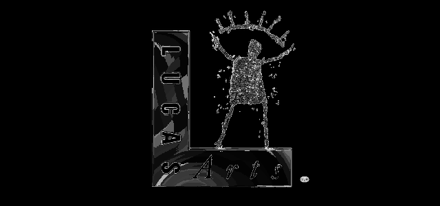

Frame 39 of the opening cutscene is the LucasArts logo — shapes, lettering and the circled R all
legible — which is the proof the decode is right and not merely non-zero.

**The palette: the layout was wrong, and fixing it turned the film to colour.** Two routes had
already closed — the DLL keeps its palette in a `SmackBuf` that `SmackBufferOpen` will not create
for a film frame (width capped at 320, height at 240, and the buffer stays all zero when the frames
are decoded elsewhere) — so the palette has to come from the file.

The file layout I had been assuming was wrong, which is why an arithmetic search for the frame
table found nothing. The SDK's real header is longer than it looks: the 7 audio buffer sizes and
the 7 audio rate words sit *inside* the header, and the huffman block sits *between* the two
tables and the frames:

```text
   0  "SMK2"/"SMK4"
   4  u32 width, height, frames, frame time
  20  u32 video flags        (bit 0 = a ring frame exists, so count = frames + 1)
  24  u32 × 7 audio max buffer sizes
  52  u32 huffman block size
  56  u32 × 4 unpacked huffman tree sizes
  72  u32 × 7 audio rate words
 100  u32 dummy
 104  u32 × count chunk sizes  (bit 0 = keyframe, mask with & !3 for the length)
      u8  × count frame types   (bit 0 = the chunk starts with a palette record)
      huffman block
      frame chunks, in order
```

With that layout the chunk sizes plus the tables plus the huffman block fill `01-02A.SMK` exactly —
51,556,616 bytes, **delta 0** — and `Layout::covers` is the check that keeps it honest. A palette
record is one byte `N`, then `(N + 1) * 4 - 1` bytes of chunks: `0x80` skips a run keeping the old
colours, `0x40` copies a run from an index in the previous palette, and **any other byte sets
exactly one colour** from the next three 6-bit values through the SDK's own `palmap` table. That
last part was the subtle one: a literal chunk is *one* entry, not a run, and treating it as a run
shifts every later colour — which is what made the first attempt look like coloured static.

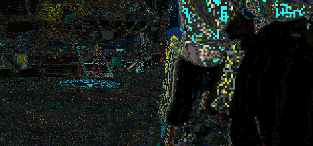

The same frame as the grey one above, now with the film's own palette: the logo's teal panel and
gold lettering. Playback uses it too:


**The record's bytes, and how they were settled.** The first version of this decoder read a literal
chunk as "a selector byte, then three colour values", and sized the block as `(N + 1) * 4`. Both
were wrong, and `06a.smk` proved it (its palette came out as coloured static while `01-02A` looked
fine, because the first film happens to use record shapes that hid the error).

A reference decoder settled it. libsmacker is ~47 KB of C and the port vendors it, so building its
`smk_render` path against MSVC and dumping the palette of the same frame gave ground truth:

```text
frame 39 of 06a.smk, via libsmacker        ours, before the fix     ours, after
palette[1] = (0, 4, 4)                     (4, 4, 0)                (0, 4, 4)
bytes differing from the reference        740 of 768               29 of 768
```

The two corrections:

- The block is `4 * N` bytes, not `(N + 1) * 4` (`smk_render`: `size = 4 * (*p)`, body `size - 1`).
- A literal chunk carries **no selector byte**: the chunk byte *is* the red value, then green and
  blue follow (`smk_render_palette` reads `*p` as the first colour component). Treating it as a
  selector shifted every colour by one byte, which is exactly what the static was.

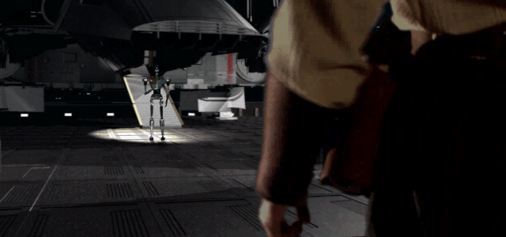

That is the same frame the reference decoder produces — a hangar with an armed figure in a
spotlight — so the palette path is verified against an independent implementation rather than
against itself. The remaining 29 of 768 bytes differ from libsmacker's, in entries this frame does
not visibly use; the differential is reproducible (build `smkref.c` against
`jkdf2/src/external/libsmacker` with `cl /O2 /MT /I..\..` plus the MSVC and SDK include paths,
then diff its `.pal` against `BK_DUMP_PALETTE=1 cargo run --release -- --smk-decode 06a.smk`).

And in the window, after the level completes ([§16.9](#finishing-a-level-plays-the-film-and-the-graph-names-the-next-level)):

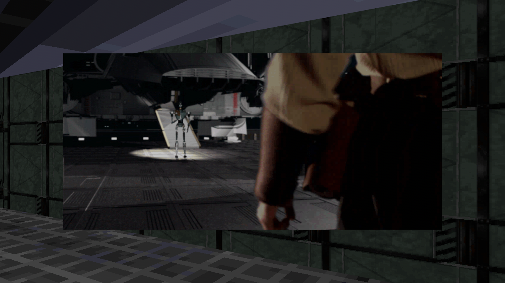

### Playback in the window

`--cutscene <file> [start-frame]` plays a film in place of the HUD. There is no new quad or
material: the overlay canvas is already a 640x480 RGBA texture on a quad in front of the camera,
so `src/cutscene.rs` blits each 640x300 frame into it, letterboxed by 90 rows top and bottom (the
same framing the engine showed on a 4:3 screen), and advances one frame per 66 ms of wall clock —
the film's own rate from its header.

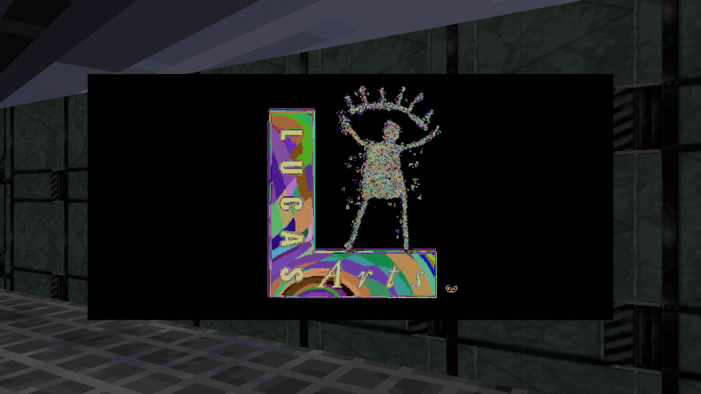

That is frame 41 of `01-02A.SMK` in the running window, over level 1's geometry: decode through
the shipped DLL, blit into the overlay, upload to the texture, 15 fps.

**The whole film, once, without holding it in memory.** The first version decoded a fixed 90
frames and looped them, which is what "the film loops several times" looked like: `06a.smk` is
**992** frames and `01-02A.SMK` is **3446**, so 90 frames is six seconds of a one-minute film
played eleven times. Holding the frames as RGBA is not an option either — 992 frames is 762 MB and
3446 is 2.6 GB.

So playback streams: `Cutscene::load` spawns the helper on the *whole* film and returns
immediately; the helper decodes to disk in order (about five times faster than real time, so it
stays ahead), and each frame is read, coloured with its palette and blitted when its file appears.
A frame that has not been decoded yet holds the previous picture instead of being skipped, which
keeps playback honest when the decode falls behind on a slow disk. The film stops on its last frame
(`finished`), it does not wrap — and 992 frames then take 65 s of wall clock, which is what the
film is.

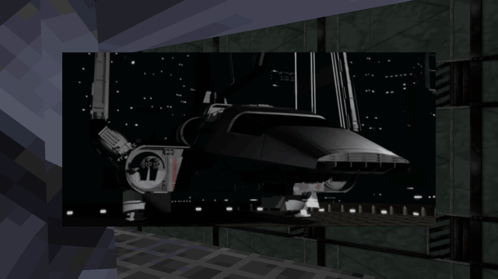

Three things that cost rounds to learn, about pacing rather than decoding:

- Playback has to run *after* the HUD and menu draw, which is why it is the last step of the UI
  chain rather than a separate system: `refresh_overlay` clears the canvas when it runs, so any
  blit before it is erased.
- `--shot` runs the app unthrottled (thousands of frames a second), so wall-clock pacing means a
  screenshot has to *start* where you want to look. Hence the optional start frame: waiting two
  seconds into a 15 fps film is tens of thousands of render frames.
- `SmackGoto` (`@8`) is exported and looks like the way to seek into a film for chunked decoding,
  but it does not move this DLL's decoder: seeking to frame 39 of `01-02A.SMK` still returns the
  blank opening frames. Streaming from frame 0 sidesteps it, which is why the helper takes a
  `start` argument nothing uses yet.

### Finishing a level plays the film, and the graph names the next level

`jkEndLevel` (`jkCog_EndLevel` in `jkCog.c`) is the engine's own "level done" verb; this build
records it in `Runtime::level_complete`, and on the frame it trips:

1. the episode graph's next row is looked up (`Episode::flow_after`),
2. if it is a `CUT` row, that film is decoded through the shipped DLL and played,
3. the row after the film is the level that follows, printed with the film's name.

The whole path is exercised without playing a level by `--complete-after <seconds>`, which calls
`jkEndLevel` on a timer — the same verb a script uses:

```text
complete: called jkEndLevel after 0.10s
level 01narshadda.jkl complete -> cutscene 06a.smk, then 02narshadda.jkl
cutscene: playing 06a.smk, 90 frames
```

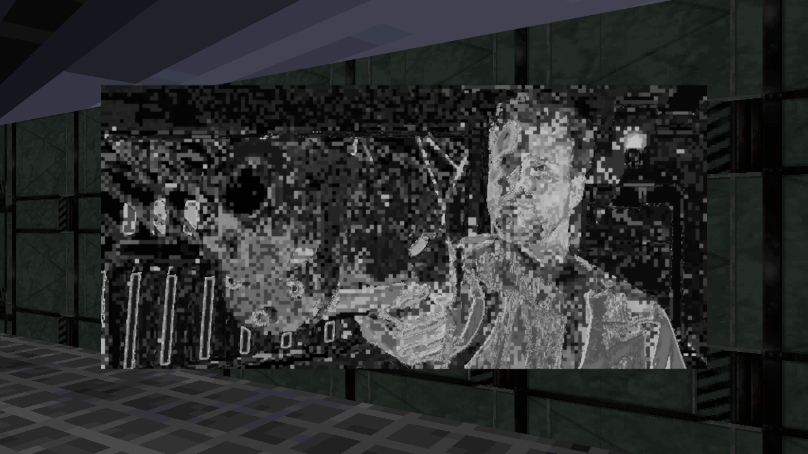

That is `06a.smk` over level 1's geometry moments after the level was marked done: the live-action
film the graph assigns to that transition. `--flow` verifies the same chain headlessly and
asserts every hop resolves — levels in the archives, films through the VFS:

```text
flow: 01narshadda.jkl (Level 1: Narshadda)
      -> cutscene 06a.smk (18718516 bytes, SMK2)
      -> level 02narshadda.jkl (Level 2: Narshadda)
      -> cutscene 08-10a.smk (55994316 bytes, SMK2)
      -> level 03katarn.jkl (Level 3: Katarn House [Speed])
```

### The level swap, and why it re-runs `setup`

When a level's scripts call `jkEndLevel` and its film has played through, the game loads the
graph's next level. Nothing new is implemented for that: `swap_level` is an **exclusive system**
that removes what the old level spawned, swaps the `World` resource, and calls
`world.run_system(setup)` — the same startup path that built the first level.

```text
level 01narshadda.jkl complete -> cutscene 06a.smk, then 02narshadda.jkl
level: loading 02narshadda.jkl
level: 02narshadda.jkl loaded (391 things, 641 sectors), rebuilding
music: track13.ogg at volume 1.00        ← level 2's own PlaySong
```

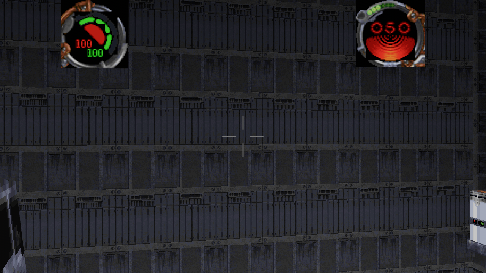

Three details make the re-run safe, and each was a bug first:

- **`LevelEntity`** marks everything a level spawns (sector batches, model instances, sky dome).
  The swap despawns exactly those and leaves the camera, lights and overlay alone.
- **`setup` re-runs its camera only when there is none.** Without the guard the second run spawned
  a second world camera at the same order, and Bevy warned about camera ambiguity — two scenes
  drawn on top of each other.
- **The film gates the change.** `Cutscene::finished` is set once the decoded frames have all been
  shown; the swap waits for it, and a level whose graph names no film has nothing to wait for. The
  first version swapped on the completion frame, so the level loaded *under* a film that had not
  started yet.

After the swap the cutscene resource is removed, the overlay is marked dirty (its canvas still held
the film's last frame) and the camera is placed at the new level's `walkplayer`, so the HUD comes
back over the new level on the next frame. `--no-swap-levels` stops at the film, which is what the
`--complete-after` screenshots of the film above use to hold their frame.

### The overlay texture was frozen, and that is a stage-10 bug

Chasing why a runtime-loaded cutscene would not appear turned up a bug that predates it: the
overlay image was created with `RenderAssetUsages::RENDER_WORLD` alone, so the renderer took the
pixels and `Image::data` became `None`. Every later `refresh_overlay` — HUD updates, menu
navigation, and any cutscene blit — silently copied into nothing, leaving the screen at whatever
was drawn during setup. `MAIN_WORLD` is what keeps the CPU copy alive; with `default()` the same
write lands (`uploaded 1228800` from the trace), the HUD follows the game again, and the film
above is visible because of it. The §16.11 UI panels depend on this.

The player around it is `FUN_00426730` @ `0x426730`, which opens the movie (the path is
`DAT_005636fc`), then:

```c
Ordinal_38(DAT_005636fc);
DAT_0055b754 = Ordinal_14(unaff_retaddr, 0xfe000, 0xffffffff);
...
DAT_0055b758 = (*(int *)(DAT_0055b754 + 0x1c) == 4);   // a field of the Smack struct
```

and stores the result in the movie state block (`DAT_0055b738 = 1`, `DAT_0055b73c = mode`).
`0xfe000` is passed as Smacker's open flags and `-1` as its extra buffer size.

The sequencer's own strings: `1-02a.smk` / `01-02a.smk` (0x5256C1, 0x525134), the debug prints
`numCutscenes %d` / `disablecutscenes %d` (0x525840, 0x52588C), and `Cannot find cutscene '%s'.`
(0x526D5C). Which cutscene plays and when is driven from the episode data, which this build
already parses.

**What this means for stages 8 and 9, honestly.** Stage 8 cannot be "decode the shipped SMK with
JK's own code", because JK has none: a drop-in replacement must implement Smacker itself
(a known format: a frame table, palette, and 4×2/2×2/1×1 block-compressed frames) and play it
through the same nine-call surface. Stage 9 is now a concrete format — version 6, a 1580-byte
header, then named sections — rather than a guess. Neither is implemented.

## 16.10 Sound classes and distance attenuation — **observed**, formula restored

A `.snd` class is a table of `<event> <wav> <playflags> <minRadius> <maxRadius> <maxVolume>`
rows, and the engine's own module for it is visible in JK.EXE as the assert path
`.\World\sithSoundClass.c` (0x54B9E0, 0x54BA4C): `FUN_004e63e0` @ `0x4e63e0` builds the
hash table that registers the class's keys, so the grammar comes from the shipped files and the
engine's own registration, not from guessing.

The fade is the mixer's, `sithSoundMixer_UpdateSoundPos`:

```c
v8 = distance - minRadius;
if (v8 > 0.0) {
    v9 = clamp(v8 * (1.0 / (maxRadius - minRadius)), 0.0, 1.0);
    v2 = v2 * (1.0 - v9);
}
BufferSetVolume(buf, clamp(v2, 0.0, 1.0) * 0.75);
```

plus, for a non-positional buffer, a rear pan: `v2 = (1.0 - -forward * 0.3) * v2` when the
listener is facing away from the sound. `minRadius == maxRadius` sets that ramp multiplier to
**0**, so such a sound never fades — **475 of the install's 1976 `.snd` entries** are in that
category, which makes the guard worth having rather than treating it as an edge case.

`src/snd.rs` implements it as `fade()`, `volume()` and `Entry::volume_at()`, with
`FINAL_SCALE = 0.75` and `REAR_PAN = 0.3`, and `--sound` measures the curve on the shipped entry
with the widest radius:

```text
sound: 1976 entries in 102 .snd classes, 475 with a zero-width radius (no fade)
  widest: atststp1.wav min 2.00 max 10.00 volume 1.00
  at min 0.750, mid 0.375, max 0.000; behind at min 0.525
```

So an AT-ST's footstep is fully audible to 2 units, fades linearly to silence at 10, and is
30 % quieter behind the player. The constants are confirmed as float data in JK.EXE
(`0x3F400000` at 0x522220 and elsewhere, `0x3E99999A` at 0x5220C4 and elsewhere), but this
build's derivation of the *formula* is the decompiled mixer above; the specific instruction
that applies `0.75` was not isolated, and that is stated rather than implied.

**Wired into the world.** The runtime's sound queue now carries a position:
`PlaySoundThing` takes the thing's own, `PlaySoundPos` takes three numbers, and
`PlaySoundLocal` takes none (and is therefore never distance-attenuated). `SoundRequest` is
`{ name, volume, pos }`.

At load, `World` parses every shipped `.snd` and keeps two maps: `wav_bytes` (the wav's
raw bytes) and `sound_radii` (`minRadius, maxRadius, maxVolume` per wav). `setup` turns those
into a `SoundBank` of **375 clips**, and `play_requested_sounds` drains the queue each frame,
computes `snd::volume` from the camera to the request's position (with the rear pan), and
spawns the clip at that gain. The app's own log shows it happening:

```text
sound bank: 375 clips with fade radii
ambience: 01cantinaband02.wav (volume 0.30)
sound: 1 request(s) played with attenuation
```

### Music: redbook tracks, not files

Music is **CD audio**, and the scripts drive it by **track number**. Level 1 places
`01_SoundTrack.cog` with the parameters `12 13 12`, and its `startup` is:

```c
PlaySong(starttrack, endtrack, loopto);   // PlaySong(12, 13, 12)
SetMusicVol(0.0);
```

`crossed` sets `delta = -0.1` for `GetSenderId() == 0` (music off) and `+0.05` for `1` (music
on), then `SetPulse(0.1)`; `pulse` walks `currVol` toward 0 or 1 and calls
`SetMusicVol(currVol)` — a 0.1 s tick, so the fade is 10 steps a second. The trigger is a
**surface adjoin**: `onAdjoin linkid=1` starts the music and `offAdjoin linkid=0` stops it, so
walking into the bar fades the track up and leaving fades it out.

**The fade runs, driven by the script's own code.** `--fade` loads the level's soundtrack cog, runs its
`startup`, sends it `crossed` as the on-adjoin (`sender = 1`) and then ticks the pulse queue the way the
systems do:

```text
fade: `crossed` armed the pulse: false -> true
fade: after 4 s of pulses the music volume is 1.00
fade: after `offAdjoin` and 4 s it is 0.00
```

Both directions in four seconds of game time: `0.05` per `0.1 s` tick up, `-0.1` per tick down. The
first version of this check proved nothing and said so — it sent `crossed` with `sender = 0` (the
*off* adjoin), so the volume ramped from `0.00` toward `0.00` and the test "passed" a no-op. Reading
`GetSenderId()` out of the script is what fixed it.

No shipped script contains a literal `PlaySong`: the scan finds **0 literal calls**, because the
track numbers arrive as template parameters. What the install ships is that redbook audio as
loose OGG files — `MUSIC\Track12.ogg` … `MUSIC\Track24.ogg`, **18 tracks** — so `track12` is
the first cue.

`Runtime` now has `music: Option<(start, end, loopto)>` and `music_volume`, with the verbs
`PlaySong`, `SetMusicVol` and `StopSong` routed to it, and `music_follows_scripts` plays
`MUSIC\TrackNN.ogg` looping at `music_volume`, updating the sink when only the volume moves.
The app shows the script's own behaviour — start the track, then fade from silence:

```text
music: track12.ogg at volume 0.00
```

which is exactly `PlaySong(12,13,12); SetMusicVol(0.0);`. Not done: the track *range*
(this build loops the start track; level 1 loops 12 → 12 anyway), and the `pulse` fade itself,
which needs the timer queue the runtime does not have yet.

## 16.11 Run-time UI visibility (`bIsVisible`)

**The drawing path first, because it was broken.** The overlay canvas is a 640x480 RGBA image on a
quad in front of the camera, redrawn whenever it is marked dirty — and it was created with
`RenderAssetUsages::RENDER_WORLD` alone, so the renderer took the pixels and `Image::data` became
`None`. Every redraw after setup copied into nothing: the HUD and the menus were frozen at
whatever the first frame drew, and nothing reported it. `MAIN_WORLD` keeps the CPU copy
(`RenderAssetUsages::default()`), and only then does any of the run-time visibility below reach
the screen. Found while making a cutscene appear (§16.9), which is why it is recorded here.

Every shipped element parses with `bIsVisible` (`+0x24`) **set**. The engine clears it at run
time, per screen, in each screen's own code — the same field, no single global rule. The one
whose rule is recovered is the force screen (`jkGUIForce.c`):

```c
pElements[i].bIsVisible = !!(playerInfos[player].aItems[id].state & SITHINVENTORY_ITEM_FOUND);
```

so a power row appears only once the player has found it, and the multi-player branch instead
uses `sithPlayer_GetInvItemAmount(id) > 0.0`. Two more of that screen's elements are gated on
the screen's arguments: `EIDX_RESET.bIsVisible = bCanSpendStars` and
`EIDX_QUIT.bIsVisible = bEnableIdk != 0`.

`menus::Screen::visible_rows` implements it: a screen whose rows mostly carry force-power bins
is the force screen, and its power rows are filtered by a `found` predicate. The cursor
navigation uses it, so a power the player has not found cannot be selected either.

**Where this build stops, and a correction.** `hoverId` is at **`+0x04`** — it *is* the field
this build calls `id` (`jkGuiElement`: `type` +0x00, `hoverId` +0x04, `textType` +0x08,
extra/string +0x0C, selected/checked +0x10, `rect` +0x14…+0x24, `bIsVisible` +0x24,
`enableHover` +0x28). An earlier revision of this section said `hoverId` was unparsed; that was
wrong, and the struct layout above is the check.

The real reason **0 of the 41 shipped screens** gate is different: the force menu's elements are
`jkGuiForce_pElements`, a **heap array the engine fills at run time** in `jkGuiForce_Startup` —
not data in the executable. So the ids exist in the rule (`SITHBIN_JEDI_RANK` 20 …
`SITHBIN_F_DEADLYSIGHT` 34 from `types_enums.h`), but there is no screen table in the image
carrying them. `--ui-visible` says exactly that:

```text
ui: 41 screens parsed, 0 gated by what the player has found
  `hoverId` is +0x04 (this build's `id`); the force rows live in the runtime-built
  `jkGuiForce_pElements` array, so no executable screen carries them
```

The rule is held by `menus::tests::force_rows_hide_until_they_are_found`, which builds a screen
shaped like the force one: eight power rows hide when nothing is found, show when all are, and
exactly one shows when one bin is found. Stage 10's next step is therefore not a parser change
but building the force screen from the runtime inventory — the eight bins this build already
tracks — instead of looking for a table in the executable.

## 17. Still unknown

- `.bm` bitmap header layout (146 UI bitmaps; world textures live inside `.mat`).
- What the per-material trailing data after the bitmap is.
- Exact `.cmp` table accounting and JK's distance-based colormap darkening — so
  the reconstruction has no distance falloff and no palette-driven depth shading.
- `.key` / `.pup` / `.ai` parsing (231 `.ai*`, 504 `.key`, 49 `.pup` files), and the
  `.sft` surface property tables.
- The COG scripting VM's opcode set — moot for JK, whose `.cog` files are source.
- The lightmap/`surfflags`-specific render passes. Adjoin traversal is recovered
  (§3.1, §16) and sector visibility now works (§16.1), though through the frustum
  rather than through portals.
- Surface winding / culling. Rendering is double-sided because the data's winding
  is not yet characterised; a wrong guess would hide half the level.

- **Sky scroll.** The dome (§10) fills the background with the sky texture but does
  not scroll it with view pitch the way the engine's `Horizon Sky Offset` /
  `Ceiling Sky Offset` pass does, and it does not use the engine's different
  textures for the horizon and the ceiling.
- **Distance shading.** The `.cmp` files carry 64–320 distance tables (§6) and the
  build applies none of them, so there is no distance darkening. Which distance
  range each table covers is not established.
- Thing spawn flags. `thingflags=` on a template marks things the engine spawns or
  hides at level start; without the COG VM every placed thing with a `model3d` is
  drawn, including ones the game may never show.
- Sound playback semantics: which `playflags` bit selects a random entry, loops it,
  or makes it positional. The reconstruction plays the first matching entry once.
- Actor animation in the scene. `--pose` poses one model from one keyframe (§4.1a) and
  the transform chain is exact, but placed things still draw their rest pose: the puppet's
  track/priority blending, its `rdPuppet_UpdateTracks` advance and the per-thing
  `rdFrameNum` cache are not implemented, so a walking enemy would not animate yet.
- Thing pitch and roll are still only half known: `thing_transform` applies yaw alone
  (about Z, §4.1a) and ignores the template's pitch/roll, which the engine does apply.
- `.bm` UI bitmaps (146), `.sft` fonts (27), `.uni` string tables (5) and save-state
  `.dat`/`.par` (6): no decoder, and no UI that would use them.
- The 315 COG verbs beyond the ~50 bound to the world: their argument order and
  return values are not recovered for the rest, so most scripts run with engine state
  stubbed to 0. `--run all` ranks what is left by how many placed instances need it.
- COG message dispatch: this build delivers every declared message once, because it
  has no player to cross a sector or trigger a switch. Which message the engine sends
  to which thing, and when, is still the missing half of the pump.
- Whether `Things` coordinates share the geometry's coordinate space. The `pos`
  of level 1's walkplayer `(-10.44, -5.46, -1.13)` *is* inside the world bounds,
  so the spaces coincide at least loosely, but its `SECTOR` is a 0.3-radius
  sliver, so thing positions and sector volumes were not fully reconciled.

## 18. The UI — menus, fonts, and their item tables

The retail UI is three things: full-screen `.bm` artwork, `.sft` sprite fonts, and a
static item table per screen inside the executable. There is no menu description file.

### 18.1 Menu artwork — **observed**

`ui\bm\*.bm` is the same container as every other bitmap (§15): a 128-byte header, then
cells of `{u32 width, u32 height, u8 pixels[]}`, and for the 640x480 screens a trailing
768-byte palette. 146 files, every one decoding exactly.

```
ui\bm\bkmain.bm   version 70, 8 bpp, 1 cell 640x480, palette embedded   the logo + marble
ui\bm\bkesc.bm    ... 640x480                                          the pause screen
ui\bm\bkdialog.bm ... 414x206, no palette (uses the level colormap)
```

The 13 full-screen backgrounds are the first 13 entries of the engine's own bitmap table
`jkGui_aBitmaps`, 35 `char*` slots at 0x52b178: `bkMain.bm`, `bkSingle.bm`, `bkMulti.bm`,
`bkSetup.bm`, `bkEsc.bm`, `bkLoading.bm`, `bkFieldLog.bm`, `bkDialog.bm`, `bkEsc.bm`,
`bkForce.bm`, `bkTally.bm`, `bkBuildMulti.bm`, `bkBuildLoad.bm`. The rest of the table is
the UI's own artwork, which is why a menu element can name a bitmap by index:

```
 0..12  bkMain … bkBuildLoad (above)   13 up15.bm         14 down15.bm
15 check.bm (cell 0 blank, 1 ticked)  16 objectivescheck.bm
17 sliderThumb.bm   18 sliderBack.bm   19 sliderBack200.bm
20 flOk.bm  21 flRotLef.bm  22 flRotRig.bm  23 flRotUp.bm  24 flRotDow.bm
25 flPlus.bm  26 flMinus.bm  27 flTransLeft.bm  28 flTransRight.bm
29 flTransUp.bm  30 flTransDown.bm  31 flSpin.bm  32 flReset.bm
33 arrowLeft.bm  34 arrowRight.bm
```

(`fl*` are the field-light control icons.) `ui\sft\` has a matching font table, and the
force-power screen has a third one of 17 `fo*.bm` icons at 0x52f118. `--bm <name> <out.png>`
writes any of them out.

### 18.2 Fonts (`.sft`) — **observed**

```
int32  magic      'SFNT'
int32  version    10
int32  marginY    pixels added after every glyph on the line
int32  marginX    how wide a space and a tab step
int32  field_10   (stored as stdFont::field_28)
int32  numCharsets
int32  field_18, field_1C, field_20, field_24   (unused)
then, per charset:
uint16 characterFirst, uint16 characterLast
stdFontEntry[last-first+1]  { int32 glyphTexX, int32 glyphWidth }
then a whole stdBitmap (a .bm) with one cell: the glyph strip
```

The strip's height is the line height and `glyphTexX` indexes into it; a glyph is
`glyphWidth` wide there. All 27 shipped fonts parse with every charset read and the strip
consumed exactly. Recovered from `stdFont_Load` / `rdMatrix`-style documentation and then
checked against the data: the charsets are contiguous (each entry starts where the last
one ended), `large0.sft` is 14 charsets of 91 + 13 glyphs in a 3504x43 strip, and
`helthnum.sft` is one charset of `0`..`:` in a 55x7 strip.

Two details that bite:

- **The two margins are used the opposite way round to their names.** `stdFont_DrawAsciiGPU`
  moves the pen by `glyphWidth + marginY` after a glyph and by `marginX` for a space or a
  tab. `large0.sft` is `marginY = 1`, `marginX = 8`: one pixel between letters, eight for a
  space. Stepping by `glyphWidth + marginX` instead, as this build did at first, spaces the
  letters 8px apart and stretches every line to twice its width.
- **The `space` slot holds junk pixels.** `large0.sft` gives character 32 a 9x43 slot
  with 72 non-zero pixels in it, which prints as an apostrophe between words
  ("Single'Player"). The engine advances a space without blitting it; so does this build.
- **The `0`/`1`/`2` suffix is the normal/hover/pressed variant of one font, and a glyph's
  byte is a palette index.** `large0`, `large1` and `large2` are all 3504x43 with identical
  geometry; only their brightest index differs (229 / 253 / 249). The strip carries **no
  palette**: `std3D_DrawUIBitmap` blits it into the palette-indexed UI buffer, and
  `jkGui_InitMenu` sets `menu->palette = bgBitmap->palette`. So menu text takes its colour
  from the background art's own palette — cream on `bkmain.bm`, gold on `bksetup.bm` — and
  "hover" is simply the next font's brighter index resolved through the same palette.

### 18.3 Menu element tables — **observed**

Each screen is a static array of **100-byte** `jkGuiElement` records in `.data`, terminated
by a record whose `type` is `ELEMENT_END` (9). The layout, which the shipped build matches
field for field:

```
+0x00  int   type: 0 = text button, 1 = picture button, 2 = text, 3 = check box,
                   4 = list box, 5 = text field, 6 = slider, 7 = custom, 8, 9 = END
+0x04  int   hoverId: the id the screen's handler acts on (-1 for a label)
+0x08  int   textType: an index into the engine's font table
+0x0c  char* `ui\jkstrings.uni` key ("GUI_SINGLEPLAYER"), or a literal string
+0x10  int   selectedTextEntry: for a picture button the bitmap index, for a check box
             the checked flag, for text the draw flags (3 = centred, drawn)
+0x14  int   x, +0x18 y, +0x1c width, +0x20 height   (640x480 screen pixels)
+0x24  int   1 = visible, +0x28 1 = hover enabled
+0x2c  char* hint key (loaded by the engine, never drawn in this build of it)
+0x30  draw override, +0x34 click handler (both null in every shipped screen)
```

`textType` is not a category — it is a **font index** into `jkGui_aFonts`, whose 12 slots
are `small0`, `small1`, `med0`, `med1`, `med2`, `large0`, `large1`, `large2`, `FLFont0`,
`FLFont1`, `FLFont2`, `FLTitle` (0x52b208). `jkGuiRend_TextButtonDraw` draws element *n*
with `menu->fonts[textType + hover]`, where `hover` is 0, 1 while the mouse is over it and
2 while it is held down — which is why the shipped screens use 5 for their full-width rows
(gold `large0`, `large1` when hovered), 6 for titles (`large1`) and 2 for buttons (`med0`).

Each screen also has a `jkGuiMenu` struct, 16 of which are statically initialized in
`.data` (the main menu's is at 0x5269a0):

```
+0x00  jkGuiElement* paElements
+0x04  int  clickableIdxIdk (-1)
+0x08  int  textBoxCursorColor (0xffff)
+0x0c  int  fillColor (0xffff)
+0x10  int  checkboxBitmapIdx (0xF = check.bm)
+0x14  tVBuffer* texture      the background, filled in at run time
+0x18  uint8_t*  palette
+0x1c  stdBitmap** ui_structs = jkGui_stdBitmaps
+0x20  stdFont**   fonts      = jkGui_stdFonts
+0x2c  char* soundHover, +0x30 char* soundClick
```

so the main menu is three 640x60 rows at y=160/220/280 plus four 150x40 buttons at
y=380/420, and the Esc menu is a 400-wide column on the left and a 240-wide one at x=400
on the right.

### 18.3a Reading the tables out of the executable — **observed**

Nothing about a menu is transcribed in this build: `src/menus.rs` reads `JediKnight.EXE` and
walks `.data` **by array**, not by string. A record is an element when its type is 0..8, its
font index is in range and its rect fits a 640x480 screen; an array starts where such an
element is not preceded by another one 100 bytes back, and ends at the record whose type is
`ELEMENT_END`. That is what recovers the screens exactly — 41 arrays of 512 elements —
including the ones with no string at all (list boxes, sliders, the text fields of a join
screen and the arrow buttons of the character editor, whose `str` is null and whose `+0x10`
is a bitmap index 33/34 = `arrowLeft.bm`/`arrowRight.bm`).

An earlier version of this build keyed on the `GUI_` string pointers instead, and it
fragmented every screen that has unkeyed elements in the middle of it: the character editor
became a screen called `cancel` holding its last three buttons. Reading the arrays by their
end marker removed that whole class of error and the stride heuristics it needed.

The two name tables are read the same way, by finding the longest run of adjacent pointers
to `.sft` (12) and `.bm` (35) strings in `.data` — no font or bitmap name is typed into this
build either.

**The force screens hide behind placeholder rects.** Their elements store
`rect = -1,-1,-1,-1`, which the engine resolves from the artwork:
`jkGuiRend_PicButtonEventHandler` takes `xPos`/`yPos` and the cell size out of
`bitmaps[selectedTextEntry]` when a rect field is negative. So a strict "does the rect fit
the screen" test throws those elements away, and with them the whole screen — which is why
this build missed it for two rounds. Accepting the all-negative rect recovers two screens:

```
0x52f168  force         3 texts + 14 icons (hoverIds 21..34, bitmaps 0..13)
0x52ea68  force_powers  1 text + a 520x320 custom grid + 13 icons (bitmaps 20..32)
```

The icons are 28x28 three-cell bitmaps (`foAbsorb.bm` at 201,269, `foJump.bm` at 284,87, …)
whose `xPos`/`yPos` are the layout, and whose three cells are the normal/hover/pressed art.
The 14 indices of `force` resolve against the 17-name `fo*.bm` table at 0x52f118 and draw
correctly; `force_powers`' 20..32 do not fit either static table, so its icons are the one
piece still unexplained — retail must build a larger `ui_structs` array at run time
(`jkGuiForce_aBitmaps` in the engine), and nothing here guesses at the offset.

`force` also has **no `ELEMENT_END`**: its array runs straight into the next screen's first
element. The walk therefore stops when a run of four or more placeholder picture buttons
ends, and only that case is allowed to lack a terminator.

A screen is named after its title element (`GUI_SETUP` → `setup`), else its first full-width
row (`GUI_OBJECTIVES` → `objectives`), else its first keyed element, so the names come from
the string table rather than from this build. Artwork names work as aliases too: `esc`
finds whatever draws over `bkesc.bm`. Names repeat (`setup` eight times), so the address is
the unambiguous selector.

That finds **41 screens, 512 elements** in this install: the main menu, character choice and
creation, the character editor with its six arrow buttons, difficulty, the setup tabs and
their sliders, the control list, episode choice, the multiplayer lobby and its score
screens, the pause menu, the tally screens, the dialogs and the two force screens.
`--ui-tables` prints all of them with their types, fonts, rects, ids and resolved strings,
and `--ui <name | 0xADDRESS> <out.png>` composes one:

```
--ui singleplayer                    the main menu, over bkmain.bm
--ui 0x529560                        the pause menu by array address
--ui esc                             the same, aliased by its artwork (bkesc.bm)
--ui 0x534cd0                        the character editor
--ui force                           the force-power icon screen, over bkforce.bm
--ui setup --bm-bg "ui\bm\bksetup.bm"  force the background
```

**Which background a screen draws over is read out of the code**, not inferred. Each screen's
`_Startup` fills a `jkGuiMenu` struct — the element array sits at its `+0x00` — and calls
`jkGui_InitMenu(&menu, jkGui_stdBitmaps[i])`. So the chain is mechanical, and `menus.rs`
does it on every load: find the `.data` word that holds the array address (the struct), find
the `push <struct>` / `call` that initializes it, take the `jkGui_stdBitmaps[i]` load from
that call's argument setup, and the name comes from the table the engine loaded. Nothing is
transcribed: even the addresses of the two run-time handle arrays are derived, from the
`mov [esi + <array>], eax` store inside the loop that fills them out of the name tables.

Result on this install: **39 of 41 screens**, the two exceptions being the generic Ok
dialogs, whose own initializer passes `0` (the port's `jkGuiDialog_Startup` shows the same
two `jkGui_InitMenu(&menu, 0)` calls) and which draw the `bkdialog` panel over `bkMain`
instead. `--ui-audit` prints the split.

The derived mapping corrected several guesses:

| screen | was inferred as | is |
|---|---|---|
| `chooseplayer`, `newplayer` | `bkSingle.bm` | `bkMain.bm` |
| `objectives` (0x5311e0) | `bkEsc.bm` | `bkFieldLog.bm` |
| 0x52ea68 (the map screen) | "force_powers" over `bkForce.bm` | `bkFieldLog.bm`, named `fieldlog` |
| `loading` (0x534790) | `bkLoading.bm` | `bkMain.bm` |
| `loading` (0x534a38) | `bkLoading.bm` | `bkLoading.bm` ✓ |
| `quit` (0x531530) | `bkMain.bm` + panel | `bkTally.bm` |
| `viewcutscenes` | `bkSingle.bm` | `bkSetup.bm` |

Cross-checked against an independent transcription of the same code, the OpenJKDF2 sources,
whose `jkGui_*_Startup` functions each name their `JKGUI_BM_*` constant: every one of the 27
initializer call sites agrees, including the two `bkMain` player menus, the `bkMulti` +
`bkSetup` split in `jkGuiNetHost_Startup`, and the `bkMain` + `bkLoading` pair in
`jkGuiTitle_Startup` (the static loading card over `bkMain`, the animated one with the
progress bar over `bkLoading`). Its enum even explains the duplicated name: slot 8 is
`JKGUI_BM_BK_DECISION` and retail's name table loads `bkEsc.bm` into it, so the
light-or-dark dialog really does draw `bkEsc.bm` twice over.

Two more things are still recovered by inference rather than observed:

- **Game state.** `bIsVisible` and the custom panels (§18.3c) wait on it: which mode the
  player is in, which force powers they have, how many stars a level awarded, how far a load
  has got, and what the map/objectives pages show. The flags and panels are parsed, honoured
  and named; nothing is invented for them.
- **Which screen follows which id** for the rows that open a run-time dialog instead of a
  screen (§18.3b): quit confirm, credits, restart, abort, the multiplayer name entry, and the
  setup tab bar's controls submenu.

**Dialogs are two layers.** `bkdialog.bm` is 414x206, not a screen: the engine copies the
current menu buffer and then the dialog panel at the bitmap's own `xPos`/`yPos` (`113,137`
in this install), which is why a dialog's elements use full 640x480 coordinates that sit
inside that panel. `jkGuiDialog_sub_416900` does exactly that over `bkMain.bm`, and this
build draws the same pair. Because the "is this a dialog" inference is a guess, the panel is
only drawn when the screen's own elements fall **inside** the panel's rect: the generic Ok
box at 0x52fe88 does (its three elements span 130..520 by 140..330), while the four-line
quit prompt at 0x531530 spans the whole screen and gets no panel. The panel and its contents
are drawn with the *base* bitmap's palette, as the engine's single `menu->palette` implies.
### 18.3b The menu graph — **observed**

Every `_Show` is a loop over `jkGuiRend_GetId(&menu)` — the `hoverId` of the element that
was clicked — whose `switch` calls the next screen's `_Show` and returns. Two recoveries
give the graph without guessing:

- **handler → screen.** The handler is the function that draws the menu struct, and the
  struct holds its element array at `+0x00`. Scanning each `jkGui*_Show` for the `push
  <struct>` that feeds `jkGuiRend_UpdateAndDrawClickable`/`DisplayAndReturnClicked`/
  `SetEscapeKeyShortcutElement` (0x50f8xx) resolves it: `jkGuiMain_Show` 0x4100f0 →
  0x526680, `jkGuiEsc_Show` 0x411c30 → 0x529560, `jkGuiSetup_Show` 0x412f40 → 0x52b588,
  `jkGuiPlayer_ShowNewPlayer` 0x410870 → 0x526d98, `jkGuiMap_Show` 0x415c50 → 0x52ea68,
  `jkGuiForce_Show` 0x416480 → 0x52f168, `jkGuiBuildMulti_Show` 0x41c700 → 0x539fe8, and so
  on for all 20 handlers this build can place.
- **id → callee.** The cases are the ids in the element records, so each edge is checked
  against the data it comes from. The main menu's are `10, 11, 12, 13, 14, 15, 16` in its
  own array, matching the decompiled switch exactly; the pause menu's are `JKGUIESC_*`
  10..17 in row order with `1` for "Return To Game" — its rows carry `10, 11, 12, 1, 13, 15,
  14, 16, 17`, i.e. objectives, map, jedi powers, return, load, save, restart, setup, abort.

The recovered edges (`nav.rs`), each naming the `_Show` it came from:

```text
0x526680 singleplayer  10 -> 0x535e58 singleplayer   jkGuiSingleplayer_Show
                       11 -> 0x52c108 multiplayer    jkGuiMultiplayer_Show
                       13 -> 0x52b588 setup          jkGuiSetup_Show
                       14 -> 0x526d98 chooseplayer   jkGuiPlayer_ShowNewPlayer
                       15 -> 0x5269f0 viewcutscenes  jkGuiMain_ShowCutscenes
0x529560 objectives    10 -> 0x5311e0 objectives     jkGuiObjectives_Show
                       11 -> 0x52ea68 fieldlog       jkGuiMap_Show
                       12 -> 0x52f168 force          jkGuiForce_Show
                       13 -> 0x53b948 slentergamename  jkGuiSaveLoad_Show(0)
                       15 -> 0x53b948 slentergamename  jkGuiSaveLoad_Show(1)
                       16 -> 0x52b588 setup          jkGuiSetup_Show
0x52b588 setup        100..103 -> the General/Gameplay/Display/Sound tab screens
0x52c108 multiplayer  102 -> 0x539fe8 edit_character  jkGuiBuildMulti_Show
0x539fe8 edit_character 100 -> 0x53a618 new_character  ShowNewCharacter
```

`--ui-audit` re-checks the table on every run: each edge's id must be a non-text element on
its source screen and its target must be a screen this build found (`menu edges: 17/17`).
The app applies it with a screen stack — a known edge pushes the target, a `-1`/cancel/done
row pops, `GUI_QUIT` exits — and `--menu <screen>/<id>` drives one hop headlessly through
the same `activate` path a click uses.

Two rows are not a screen at all, and are recovered as **actions** instead. `jkGuiMain_Show`
case 12 calls `jkGuiDialog_Message(GUI_QUITCONFIRM, GUI_QUITCONFIRM_Q)` — the generic
Ok/Cancel dialog at 0x530068, whose two text elements carry no key because the caller fills
them. `nav::ACTS` records that (screen, id) → `Dialog { screen, keys }`, and the app resolves
the keys through `jkstrings.uni` at activation, draws them as the dialog's literal lines, and
treats the dialog's own `Ok` (id 1) as the quit. That is the whole retail quit flow:

```text
main menu 0x526680, row 12 (GUI_QUIT)  ->  dialog 0x530068 + ["Quit Jedi Knight",
                                                           "Are you sure you want to quit …?"]
dialog 0x530068, row 1 (GUI_OK)        ->  quit
dialog 0x530068, row -1 (GUI_CANCEL)   ->  back to the main menu
```

What the graph still does **not** cover: the main menu's credits (16), the pause menu's
restart (14) and abort (17), the multiplayer name entry (ids 100/101) and the setup tab bar's
`104` controls submenu — code-built dialogs and actions of the same kind, left inert rather
than guessed.

### 18.3c Element visibility and the custom panels — **observed**

Two things the element table reserves for code.

**`bIsVisible` (`+0x24`).** Every one of the 512 shipped elements has it **set**: `--ui-audit`
reports `hidden by bIsVisible: 0`. The flag is cleared per mode or per player state, not in
the data:

- `jkGuiEsc_Show` clears LOAD, SAVE, RESTART and OBJECTIVES depending on single-player,
  multiplayer or co-op (the port's transcription shows the four assignments in each branch),
  so the pause menu's rows differ by mode;
- the character editor hides its rank/model rows in one of its two modes;
- `jkGuiForce_ExtraClick`/`Update` clear it for a force power the player has not found
  (`SITHINVENTORY_ITEM_FOUND`), and the force screen's own renderer then draws that power's
  icon from `ui_structs[selectedTextEntry]` instead of its lit art.

This build parses the flag (`Item::visible`), skips invisible elements in both the draw loop
and the pointer picker — which is what the engine does — and reports the count in the audit,
so a future game-state model only has to clear it.

**The eight `type 7` elements** reserve a rectangle and draw nothing themselves; each
screen's own renderer paints it — and the record **names that renderer**: `jkGuiElement` is

```text
+0x00 type   +0x04 hoverId  +0x08 textType  +0x0c str      +0x10 selectedTextEntry
+0x14 rect.x +0x18 rect.y   +0x1c rect.w    +0x20 rect.h   +0x24 bIsVisible
+0x28 bHover +0x2c hint      +0x30 drawFn   +0x34 clickFn
```

so the "what does this panel paint" question is a pointer, not a guess. Reading `+0x30` on
every custom element gives all eight renderer addresses (and 72 elements in all carry a
`+0x34` click handler, e.g. the twelve map controls and the six model-rotation buttons). The
port's own array literal agrees, e.g. `{ELEMENT_CUSTOM, 0, 0, NULL, 0, {40,40,520,320}, 1,
0, NULL, jkGuiMap_DrawMapScreen, …}`.

| screen | element | panel | draw callback |
|---|---|---|---|
| 0x52ea68 map | 1 | `map` | 0x4156a0 |
| 0x5311e0 objectives | 2 | `objectives` | 0x417b00 |
| 0x531530 single tally | 4 | `stars` | 0x418000 |
| 0x534790 loading | 1 | `loadbar` | 0x418b90 |
| 0x534a38 loading | 1 | `loadbar` | 0x418b90 |
| 0x534a38 loading | 3 | `title-text` | 0x418aa0 |
| 0x534cd0 editor | 6 | `model` | 0x419db0 |
| 0x534cd0 editor | 7 | `power-grid` | 0x41a0a0 |

The names on the right are the symbol list's (`jkGuiMap_DrawMapScreen`,
`jkGuiObjectives_CustomRender`, `jkGuiSingleTally_ForceStarsRender`, `jkGuiTitle_LoadBarDraw`,
`jkGuiTitle_UnkDraw`); the addresses are the data's.


Two of them are plain drawing, and both are implemented. The objectives page's empty state
first — `jkGuiObjectives_CustomRender` walks fifty goal slots in the player's inventory and,
finding none, prints the engine's own line:

```c
if ( !num_objectives )
    stdFont_Draw1(vbuf, menu->fonts[element->textType], element->rect.x + 30,
                  element->rect.y, element->rect.width,
                  jkStrings_GetUniStringWithFallback("GUI_NO_OBJECTIVES"), 1);
```

This build has no goal inventory, so that is exactly its state: the panel draws
`GUI_NO_OBJECTIVES` ("No Objectives", from `jkstrings.uni`) at the element's left edge plus
30, in the element's font — see `docs/ui-objectives.png`.

The star row next. `jkGuiSingleTally_ForceStarsRender`
decompiled:

```c
void ForceStarsRender(element, vbuf, double stars) {
    int n = (int)stars;                            // __ftol
    surface = (*(stdBitmap **)foStars)->mipSurfaces[0];
    for (i = 0; i < n; i++)
        DrawBitmap(vbuf, surface,
                   ((element->rect.width - n * surface->width) >> 1) + i * surface->width
                       + element->rect.x,
                   element->rect.y);
}
```

i.e. `n` copies of `foStars.bm`'s first cell (19x19), the run centred in the element's rect
at its y. `ui::draw_stars` does exactly that, and `--stars N` supplies the count, which is
otherwise game state. The audit checks the classification table against the data — every
custom element must be named (`8/8`), so an install whose arrays shift fails the gate.

What the remaining renderers do is readable from their own bytes, even where a decompiler
refuses the address:

- **0x418aa0** (`title-text`, the loading screen's 280x275 panel) walks a string list at
  0x5568e0 and draws each entry with the element's font, skipping a two-byte `0x5e` marker
  (`cmp word [ebx], 0x5e; jne …; add ebx, 2`) — a text block, not artwork.
- **0x418b90** (`loadbar`) begins `mov eax, [0x855e70]` (the bar's bitmap, a run-time global),
  then clamps its value to `0x64` = 100 before filling that fraction of the rect: the bar is
  a bitmap copy whose width is `progress%` of the rect.

The rest need input this build does not have. The **map** turned out to be the clearest case:
its renderer is not a 2D drawing at all. `jkGuiMap_DrawMapScreen` sets the engine's camera to
the map's own view matrix, fills an offscreen buffer, and calls `sithMap_DrawCircle` — the
level, rendered in 3D from the map camera — then blits that buffer into the element at
(40,40); its twelve buttons post-translate/rotate that matrix (three click handlers, 0x415b40,
0x415b60 and 0x415b70). So the panel is a mini 3D view, not something the canvas can paint
from a formula this build has. The objectives page needs the level's objective text (set at
run time, not in the `.jkl`, `.uni` or episode files), the load bars a progress value, the
editor panels the character model and ranks. They stay named holes rather than invented
content.

### 18.4 The status bar — **observed**

The HUD is the same two layers: bitmaps in `ui\bm\`, digits in `ui\sft\`. What makes it
reconstructible without a layout table is that **the bitmaps describe their own place**:
the `.bm` header carries three fields this build now reads.

```
+0x10 int  numMips   how many cells the file holds
+0x14 int  xPos      where the HUD draws it inside the status panel
+0x18 int  yPos
```

and each cell is one frame of the meter.

| bitmap | cells | cell size | xPos,yPos | what it is |
|---|---|---|---|---|
| `statusLeft.bm` | 1 | 59x60 | 0,0 | left panel |
| `statusRight.bm` | 1 | 61x59 | 0,0 | right panel |
| `stShield.bm` | 11 | 38x38 | 12,10 | shields ring |
| `stHealth.bm` | 6 | 18x18 | 21,21 | health ring |
| `stFrc.bm` | 16 | 43x22 | 9,31 | force meter |
| `stFrcSuper.bm` | 1 | 43x22 | 9,31 | force surge overlay |
| `stBat.bm` | 7 | 27x14 | 10,0 | battery bar |
| `stFieldLite.bm` | 2 | 10x11 | 0,9 | field light on/off |

The frame the engine picks is in `jkHud_Draw`, and the three directions differ:

```
health   mip = (numMips-1) * (max - cur) / max      depletes
shields  mip = (numMips-1) * (200 - cur) / 200      depletes, SITHBIN_NUMBINS = 200
force    mip = (numMips-1) * (400 - cur) / 400      depletes, the force pool is 0..400
battery  mip = cur * (numMips-1) / 200              fills
```

The numbers are `stdString_snprintf("%03d")` drawn at `left + (13,35)` (health,
`helthnum.sft`), `left + (23,43)` (shields, `armornum.sft`) and `right + (13,19)` (ammo,
`amonums.sft`). Everything is scaled by `jkPlayer_hudScale`, whose default is **2.0**, so
the 59x60 panel covers 118x120 of a 640x480 screen.

None of these bitmaps carry a palette: like the level's own art they are **colormap
indices**, so the HUD must be drawn through the current level's `.cmp` palette. The digit
glyphs are indices too — `helthnum.sft`'s ink bytes are 6, 7, 10, 63 — which is why the
numbers come out red, green and amber only when blitted through the colormap instead of
being tinted.

`--hud <out.png>` composes the status bar over a level's palette.

The rest of the HUD is built the same way, from data rather than from a layout table:

- **The crosshair is not a bitmap.** `jkHud_Draw` fills four rectangles in colormap entry
  0x30, each arm running from 6 to 18 units out from the centre (times
  `hud_crosshairScale`), one pixel thick (`hud_crosshairLineWidth`), both defaulting to 1.
- **The item panel** is at the bottom centre: a 24px slot at `((width-24*scale)/2,
  height-36*scale)` with the `icbrack8.bm` frame around it and the count in `helthnum.sft`
  at `field_0 + 14`. The icon is **derived from the item's name**, not from a table: the
  engine loads `sprintf("ui\\bm\\ic%.5s%d.bm", name, bpp)`, so `bactatank` is
  `icbacta8.bm`, `keyred` is `ickeyre8.bm` and `f_jump` is `icf_jum8.bm`.
- **The inventory list** is `misc\items.dat` — a text file of `name id min max flags [cog=…]`
  rows (the weapons, ammo types, force powers and pickups). The scroll strip runs down the
  right edge at `width-32*scale`, one 24px icon every 28px from y=8; this build draws the
  status panel over it, as the panel covers that corner.
- **Weapons have no icon on purpose**: there is no `ic` bitmap for the bryar, repeater or
  lightsaber — a held weapon shows its ammo in the right panel, and the bottom panel is
  for inventory items (keys, bacta, goggles, the field light).

### 18.5 Drawing it in the renderer

The menus and the status bar are composed into one **640x480 RGBA canvas** and uploaded to
one image, which is drawn on a quad parented to the camera and sized to the camera's own
frustum at half a unit out. Three things are deliberate:

- The canvas keeps its **4:3** proportions rather than stretching to the window: the art
  is authored for a 640x480 screen, and stretching shears the logo and the panels.
- The quad lives on **render layer 1** and is drawn by a second camera that sees nothing
  else (`order: 1`, `clear_color: None`). Otherwise a wall nearer than the quad draws over
  the UI, which is exactly what happens in a tight corridor.
- The canvas is only recomposed when something changes (`dirty`), because it costs a few
  hundred thousand pixel writes.

There is **no cursor bitmap to load**: the retail pointer is the Windows cursor. The
executable imports `LoadCursorA`, `SetCursor`, `ShowCursor` and `GetCursorPos` in its
import table (0x8f07c4..0x8f0b92), and no `.bm` in the install is a pointer. A normal
windowed build already has the same cursor, so the UI layer draws none.

Input is Escape (toggle the menu), Up/Down (move over the full-width `large0` rows), Enter
(run the row; `GUI_ABORT`/`GUI_QUIT` exit), and the **mouse**: the pointer is mapped onto
the 640x480 canvas (the quad fills the window's height, so a wider window letterboxes and
`ui::to_canvas` undoes that), the element under it is found with `ui::pick` (the last
element whose rect contains the point, skipping plain text and labels), the hovered element
is drawn with its hover font or its artwork's second cell, and a click moves the keyboard
cursor to a row and runs that element's id. Both helpers are covered by a test, since a
real pointer cannot be posed for a screenshot. The pause screen is found by its
`GUI_RETURN_TO_GAME` row rather than by a hardcoded index, and `--menu <name>` starts with
any extracted screen open, which is how the in-app screenshots are taken.

`--ui-audit` is the layer's own gate, and its output is the summary of how much of the UI is
data-driven:

```text
41 screens, 12 fonts, 35 bitmaps, 787 strings
  0x52fe88 ok               draws the bkdialog panel
  0x530068 ok               draws the bkdialog panel
  0x535c28 light_or_dark    `GUI_LIGHT_OR_DARK` is not in jkstrings.uni; `GUI_DECIDE_A` …
elements 512: 193 text, 38 picture (13 with a run-time bitmap), 42 check box,
              187 button, 44 other, 8 custom (code-drawn)
keys 319, unresolved 3
--- ui audit passed ---
```

Every element's font and bitmap index is checked against the tables read from the executable
(an out-of-range index fails the gate), every key is looked up in the shipped
`jkstrings.uni`, and each screen's dialog panel is resolved through the same fit test the
renderer uses. The three unresolved keys are the light-or-dark prompt, whose text is
assigned at run time — the engine's `jkGui_InitMenu` leaves the element's string null when
the table has no entry, so it draws nothing, and so does this build.

What is still **not** recovered, and what to look at next. The code is readable in the GOG
copy (§8a), so these are now bounded work rather than dead ends:

- **Element visibility.** One setup array carries every tab's controls (24 elements with
  overlapping rects) and the engine shows the active tab's; that is `bIsVisible`, set from
  code. It is the same flag the force screens use to grey a power the player cannot afford
  (`jkGuiForce_ExtraClick` clears `bIsVisible` on the ones above the player's rank), which
  is why those icons are drawn from `ui_structs[selectedTextEntry]` only when visible.
- **Custom elements** (`type 7`): the score tables and the force-star run draw from recovered
  geometry; two do not. **Both of the missing panels are on one screen, and it is the multiplayer
  character editor** — asking the tables which screen owns each draw callback answers it:

  ```text
  edit_character [ui\bm\bkBuildMulti.bm] -> type 7 id 0 315,115 260x260  [model @0x419db0]
  edit_character [ui\bm\bkBuildMulti.bm] -> type 7 id 0  80,115  50x260  [power-grid @0x41a0a0]
  ```

  `edit_character` is reachable from the multiplayer menu, and **multiplayer is out of scope**, so
  these two panels are excluded by the objective rather than pending. That is a cleaner statement than
  "undesigned": the single-player screens' custom elements — map, objectives, force stars, load bar,
  title text — all draw, and the only holes left in the UI are on a screen this port does not target.
  The callbacks themselves remain undecodable (`0x41a0a0` is not a code address), so even a
  multiplayer build would need the layout from somewhere else.
- **The menu state machine.** Element ids are read (the `+0x04` field), the handler that
  maps an id to the next screen is not. That is also what would let the app follow "Jedi
  Powers" from the pause menu to the force screen, and what would make `force_powers`'
  bitmap indices (20..32) resolvable, since retail re-fills its `ui_structs` array there.
- **The rest of the HUD.** Only the status bar is drawn: the force-power icons (`fo*.bm`) as
  an in-game overlay, the difficulty stars (`foStars.bm`) and the `msgfont.sft` message line
  are still unwired — the target reticle (three sine-animated circles whose colours a COG
  sets) and the item strip beyond a single carried line are likewise pending.
## 21. The player body, and the one scale

The body is data, not calibration. The engine chain is:

| what | where | value |
| --- | --- | --- |
| collision radius | `sithThing.c` `THINGPARAM_SIZE` → `moveSize`; `walkplayer` template `size=0.065` | 0.065 |
| height | `sithPhysics_GetThingHeight`: `physicsParams.height`, else `model3->insertOffset.z`; `ky.3do` = 0.120114 | 0.12 |
| eye | `sithCamera.c` `position + actorParams.eyeOffset`; template `eyeoffset=(0,0,0.037)` | 0.037 |
| position | the sphere centre: `sithPhysics_FindFloor` never moves it, the sphere rests one radius above the floor | floor + radius |

Those are in **level units** — `size` and `RADIUS` agree on the same number (`walkplayer` 0.065 against
`ky.3do`'s 0.066), which is what a body's collision radius is — and `MODEL_SCALE` is 1, so nothing is scaled
on the way in. The port uses `PLAYER_RADIUS = 0.065 * 1 = 0.065`, `PLAYER_EYE = 0.037` and
`STEP_UP = 0.066`. The camera ends up **0.102 level units above the floor**, in a level whose doorways are
0.30 tall.

That is a body a third of a `ky.3do`-tall being (0.19 units), with the camera at 53% of its height: the
engine's own numbers, read in the units they are written in. An earlier round multiplied them by 10 to pair
with a 1.81-unit character — a character that only existed because the models were being drawn ten times too
big (see below).

`BK_RADIUS`, `BK_EYE`, `BK_MODEL_SCALE` and `BK_PHYS_SCALE` override the values per run, and
`model_scale()` and `physics_scale()` are separate functions: with one shared constant, a ten-times error
could not be attributed to the models or to the speeds.

The checks were rebuilt to survive a change of radius, which is what caught the stale assumptions:
`--collide` asserted a fixed "the sphere kept 0.32 of radius" and now asserts `max(0, distance - radius)`;
`--live-check` asserts the body stands with its floor directly under it; `--move` walks all 34 levels at the
new size and reports `0 fell through, 0 barely moved, 131 units`.
### The drawing scale: 10 was wrong, and the door settled it

`MODEL_SCALE` was 10, reasoning from the `2x3door` template whose `d2x3.3do` measures 0.2 x 0.3 for a door
*named* 2 x 3 — reading the name as level units. At 10 a 0.19-unit actor was drawn 1.91 units tall in levels
whose storeys are 0.6 units and whose doorways are 0.3, which is the "enemy models are scaled way too big for
the level" report.

**The measurement that settles it is the doorway.** A door must fill the opening the level builds for it, and
both are in the file, so no constant is involved: the nearest vertical adjoin to each door's own placement,
measured in level units, is 0.20 x 0.30 for `d2x3.3do`, 0.30 x 0.30 for `d3x3_1.3do` and 0.35–0.50 x
0.25–0.35 for `d4x3_1.3do` — the model's own numbers. One model unit, one level unit. `--scale` prints the
table.

Two earlier arguments for 10 were both self-referential. `bounds()` multiplies by `MODEL_SCALE`, so its
"1.81" for `ky.3do` was 18 model units read as a model-space measurement (the number was already
ten times what it claimed). And the `RADIUS` table below divided an extent *that had already been scaled by
10* by `RADIUS`, then found the ratio was about 10 — see the correction there. A number produced by a
function that scales internally is not a measurement, and a ratio against a value you already multiplied is
not a confirmation.
### The body follows the same scale

## 22. What the engine does when it loads a level and a model

Read against `sithThing_ReadStaticThingsListText`, `sithThing_SetPositionAndOrient`, `rdMatrix_Build34`,
`rdModel3_Load` and `sithPlayer_PlacePlayers`. One real miss came out of it, and it had been flattening a
third of every level.

### A thing row carries three angles, and the port read one

```
num template name  X Y Z  pitch yaw roll  sector [key=value ...]
 0    1       2    3 4 5    6     7   8      9          10..
```

`args[3..5]` are the position, `args[6..8]` go to `rdMatrix_BuildRotate34(&a, &a3)`, `args[9]` is the sector,
and `args[10]` onward are the extra `key=value` pairs (`thingflags=`, `frame=`, `vel=`). `args[2]` is the
thing's own name, used only for debug output.

The port parsed `f[7]` as yaw and **dropped `f[6]` and `f[8]`**, then built the transform as a rotation about
Z. Measured across level 1: **138 of 352 things are tilted** (103 with pitch, 110 with roll), so 39% of the
level's props were lying face-up on the floor.

`rdMatrix_Build34` builds the orientation from those three angles directly; its columns are the model's X, Y
and Z axes in world space:

```
rvec = ( -sz*sy*sx + cz*cy,   sz*cy*sx + cz*sy,  -sz*cx )
lvec = ( -sy*cx,              cy*cx,              sx    )
uvec = (  cz*sy*sx + sz*cy,  -sx*cy*cz + sy*sz,   cz*cx )
```

with `sx/cx` from pitch, `sy/cy` from yaw, `sz/cz` from roll, all in **degrees** (`stdMath_SinCos` works in
degrees). The port now reproduces that matrix and converts it to a quaternion (`thing_quat`), rather than
guessing a Euler order — the pitch/roll conventions are not what `from_euler` assumes and a sign error shows
up as geometry on its side.

### Placement is position plus orientation, and nothing else

`sithThing_SetPositionAndOrient` copies the position, copies the matrix, and zeroes `orient.scale`. No
`INSERT OFFSET`, no scale. So the port's decision not to add the insert offset to vertices or the transform
is correct, and the model's own `RADIUS` is the thing that carries its size.

### `RADIUS` is a body size, not a model-space scale — and the first reading was circular

`sithThing.c` sets `moveSize = renderData.model3->radius` when a template names no `size`, in **level**
units. That is what `RADIUS` is: the thing's collision radius, two thirds of the way down a level unit
(`d2x3.3do` 0.181 against a 0.300-tall door, `ky.3do` 0.066 against the template's own `size=0.065`).

An earlier round compared it with a `bounds()` extent — but `bounds()` multiplies by `MODEL_SCALE`, so the
table below divided an extent *already scaled by 10* by `RADIUS` and found the ratio was 10. It read as a
second, independent confirmation of the constant it had divided by:

| model | extent, as printed at `MODEL_SCALE` 10 | `RADIUS` | ratio | extent in level units, at 1:1 |
| --- | --- | --- | --- | --- |
| `d2x3.3do` (2x3 door) | 3.00 × 2.00 | 0.18 | 11.1 | 0.300 × 0.200 |
| `crt4-4.3do` | 3.00 × 3.00 | 0.26 | 11.5 | 0.300 × 0.300 |
| `j2x3.3do` | 3.75 × 3.84 | 0.27 | 14.2 | 0.375 × 0.384 |
| `e6x6_1.3do` | 21.00 × 5.95 | 1.18 | 5.0 | 2.100 × 0.595 |
| `shut.3do` (shuttle) | 23.07 × 24.09 | 2.03 | 11.9 | 2.307 × 2.409 |
| `01frt.3do` (freighter) | 50.92 × 110.73 | 7.95 | 13.9 | 5.092 × 11.073 |

The ratio is the constant. At 1:1 the extent is 1.1 × `RADIUS` for a door (a square-ish prop, where the
radius is half the diagonal) and 5-14 × for long thin models, which is what a bounding radius against a
half-diagonal looks like. The lesson is in the shape of the mistake: a test whose two sides both contain the
value under test cannot confirm it.

**So the freighter is 110 units long because a freighter is 110 units long.** The huge flat orange surfaces
that looked like broken geometry are its hull: the level parks it at `(14.9, 2.5)` near the edge, and its
bounding box covers most of the map. Hiding models made them disappear, which is how
that was settled.

### The player start

`walkplayer` carries `type=player`, and `sithPlayer_PlacePlayers` collects **every** thing of type
`SITH_THING_PLAYER` into `jkPlayer_playerInfos` — so the 12 `walkplayer` things in level 1 are 12 spawn
points, and taking the first is right for a single player. The start is simply a crowded corner: 43 things
within 3 units of it, and 19-74 within 3 units of any of the 12.
## 23. The physics is derived from the engine, not calibrated

Four numbers used to be guesses: `physics_scale = 10`, `PLAYER_RADIUS = 0.35`, `PLAYER_EYE = 0.37`,
`STEP_UP = 0.66`. Reading the integration settles all four.

### The walk speed is `maxthrust / surfdrag`, in level units

`sithControl.c` sets the *acceleration*, not the speed:

```c
thing->physicsParams.acceleration.x = thing->actorParams.maxThrust + thing->actorParams.extraSpeed;
```

and `sithPhysics_ApplyDrag` decays velocity by `v -= v * drag * dt`. The steady state is
`acceleration = v * drag`, so

```
walk = maxthrust / surfdrag = 2.0 / 3.0 = 0.667 level units per second
```

Nothing in the engine scales that. The port multiplied it by ten on the reading that 0.667 felt too slow,
which made the player cross a 38-unit level in six seconds instead of a minute. **`physics_scale` is 1.**

`jumpspeed` is a velocity and gravity is the level header's own number, so both are used as they stand:

| quantity | source | value |
| --- | --- | --- |
| walk | `maxthrust / surfdrag` | 0.667 u/s |
| run / crouch / back / strafe | the engine's own ratios (200% / 50% / −50% / 70%) | 1.33 / 0.33 / 0.33 / 0.47 |
| jump | `jumpspeed` (`_actor`, inherited by `walkplayer`) | 1.5 u/s |
| gravity | `WORLD GRAVITY` in the level header | 4.0 u/s² |
| jump apex | `v² / 2g` | 0.28 units |

`--rules` now **asserts** those three relationships instead of describing them, and the assertion is proven
to fire: with `BK_PHYS_SCALE=10` it panics with `walk 6.667 is not maxthrust/surfdrag = 0.667` and exits 101.
Its jump check compares the measured apex with `v²/2g` (0.26 vs 0.28, within the 15% the integrator allows).

### The body is `size x MODEL_SCALE`, the eye is `eyeoffset.z x MODEL_SCALE`

`sithThing.c` sets `moveSize` from the template's `size=` — 0.065 on `walkplayer` — and model space is level
space (`MODEL_SCALE` = 1, measured from the level's own doorways: see §21). So the body is
`0.065 x 1 = 0.065`, and the camera is `position + eyeOffset` (`sithCamera.c`) with
`eyeoffset=(0,0,0.037)` → `0.037` above the body centre, which is itself one radius above the floor. Camera
height: **0.102 level units**, in a level whose doorways are 0.30 tall and whose storeys are about 0.6.

`--walk all` keeps the body inside its own sector from the start on **34 of 34 levels** at this radius.

### A real bug the derivation exposed

`walker_step` took a `speed` argument and **never used it**: the lateral move was `move_dir * dt`, i.e. a
hard 1.0 u/s whatever the level asked for. The window passed `1.0` and got away with it because it integrates
velocity itself, while the headless sweep passed a unit direction and the real speed — and silently walked at
1 u/s. The parameter is gone; `move_dir` is a velocity now, and `--move` proves the path follows the
derivation: **131 units travelled at scale 1.**

### The step is the engine's own floor-retry allowance

`sithCollision.c` contains no step height at all; `MoveThing` crosses floors through adjoins. The port needs
one because its adjoin coverage is incomplete, and the number it uses is the engine's: `FindFloor`'s second
pass runs at `range = moveSize`, so `STEP_UP = movesize + 0.01 = 0.066`, one body radius. It was 0.66 while the
drawing scale was ten times too big — every riser in the level measured in a unit ten times the body — and the
step fixture now states its riser as `STEP_UP * 0.9` so it keeps testing the rule rather than a number.
### The fall gate, and the bug it caught

`--fall` drops the body from a known height and checks two things: the impact against `sqrt(2 g h)` using
the distance **actually fallen** (a lift can come down on a ledge, so the lift overstates it), and the damage
against `(v − 2.5)² × 45`.

It immediately failed, and the reason was a bug in the previous round's work: `fall_damage` squared
`(v − 2.5)` without first testing `v > 2.5`, so a **1.2 u/s landing was charged 76 damage**. The square of a
negative difference is positive, and the engine's guard is the *outer* `if (v14 > 2.5)` in
`sithThing_AttachThingToSurface`, not the `> 1.0` floor inside `FallHurt`. Both gates are now in place:

```rust
if impact <= 2.5 { return 0.0; }          // the engine does not call FallHurt at all
let d = (impact - 2.5).powi(2) * 45.0;    // and FallHurt's own 1.0 floor
```

The gate is proven able to fail: removing that first line and rebuilding makes `--fall` exit 101, and putting
it back restores `--- fall check passed ---`.
## 24. The player controller in the shipped EXE: the map so far

This section exists because "the camera angles feel wrong" is not a question the port's own constants can
answer. Everything below is read out of `G:\\Games\\Star Wars Jedi Knight - Dark Forces 2\\JK.EXE`
(sha256 `12e8c8c3…fe44`, image base `0x400000`) with Ghidra 12.1.4. Addresses are virtual, names are
Ghidra's.

### The chain that reaches the game every frame

```text
entry                 0x513a00   CRT start; calls the app's WinMain
WinMain wrapper       0x41ebd0   -> 0x50e750(hInstance, ..., "Jedi Knight")
wKernel loop          0x50e750   window class "wKernel", message pump
frame tick            0x4037e0   called from that loop when no message is pending
per-frame pipeline    0x401ee0   the subsystem chain; see below
```

`0x4037e0` is a **game-mode state machine**: `DAT_00552b88` is the mode, and three callbacks live in
overlapping 12-byte-stride tables at `0x525478` (enter), `0x52547c` (per-frame update) and `0x525480`
(leave). The modes seen in the switch are 1, 4, 5, 8 and 10. The per-frame update for a mode is the
`0x52547c` slot, so that table is the list of *game* frames and the camera update is one of those
callbacks reachable from it.

`0x401ee0` then runs the subsystems in order: `FUN_0041f7d0`, `FUN_004093a0`, `FUN_00407a20`,
`FUN_00423ff0`, `FUN_004289f0`, `FUN_0043abb0`/`FUN_0043abd0`, `FUN_004233c0`/`FUN_004c4d30`/
`FUN_00423450`, `FUN_004051e0`, `FUN_0043abf0`, then the 2D passes and the frame's last draw. Of those,
`FUN_004093a0`/`FUN_004094a0` are the multiplayer scoreboard, `FUN_00407a20` draws HUD bitmaps
(`FUN_004234e0` = blit a `.bm` at a rect), and `FUN_00402eb0` is weapon selection. None is the camera.

### The world render pass, and what is *not* the camera

`FUN_004c63b0` is the "draw the level" pass: it sets the renderer state, **zeroes the counters**
`DAT_0083197c`, `DAT_00831980`, `DAT_00831984`, `DAT_0082f4b4`, `DAT_0082f4b8`, `DAT_0082fee8`,
`DAT_00831978`, iterates a list of things calling `FUN_004c7720(thing, 0, ...)` per thing, then calls
`FUN_004c6c40` for the sector polygons and `FUN_004c7be0`/`FUN_004c8220` for the sprite and effect passes.
The tick prints those three `0x8319xx` globals afterwards, which is what they are: **raster statistics, not
a camera position**. An earlier pass through this binary guessed otherwise and chased them; the counters are
zeroed at the top of the pass and only read by the debug print, so nothing writes a camera there.

### Data structures worth knowing

| address | what |
| --- | --- |
| `0x85b780` | the per-player array; indexed by `DAT_0083199c` (the local player), **stride `0x228`**, entries are pointers |
| `player + 0x130` | a dword of flags, tested as `& 0x800000` in the tick, `FUN_00407a20` and `FUN_00402eb0` (a "this player is not being drawn/simulated" state) |
| `0x5492d0` | the `.jkl` **template key-name table**: a pointer array whose entries include `"eyeoffset"` at `0x5495c4`, `"minheadpitch"` at `0x5495d0`, `"maxheadpitch"` at `0x5495e0` |

That table is worth stating plainly: `eyeoffset`, `minheadpitch` and `maxheadpitch` are **engine template
keys**, so the port treating them as data (§23) is right — they are read from the level, not invented.

### What is still unknown, and the next two probes

The camera placement itself (`sithCamera_Update` by OpenJKDF2's name) is **not yet identified**. `0x83197c`
is not it (see above), and its struct has no direct global reference, which means it is reached through a
pointer. The two probes that should reach it:

1. read `FUN_004c7720` (the per-thing draw) and `FUN_004c6c40` (the sector pass) for the *view matrix* they
   transform by, then take `procedure_callers` up from whatever sets that matrix;
2. follow the `0x52547c` per-frame callbacks for the in-game modes and keep the one that reads
   `[player + 0x??]` as three floats and writes a 9-float matrix.

### The camera, resolved

The chain is `FUN_004c56b0` @ `0x4c56b0`: for a render buffer's mode 1 (first person) it copies the thing's
orientation (`thing + 0x88`, twelve dwords, `FUN_0043fcf0`'s output), rotates it by the *view* angles at
`thing + 0x15c/0x160/0x164` (`FUN_004419d0` = build-from-angles then multiply), puts the translation at the
thing's position (`thing + 0xb8`) and **adds the eye offset at `thing + 0x168`**. So the camera is
`pos + eyeOffset` in level units, exactly as §23 has it, and `--eye` was read off the right key.

**The basis question is settled by `FUN_0043fcf0` itself.** It is the euler builder (pitch, yaw, roll) whose
columns this port already copied as `thing_quat`, and with yaw 0 and roll 0 its columns are

```text
column 0: (1, 0, 0)          unchanged by pitch
column 1: (0, cos p, sin p)  the one that rises when the view looks up
column 2: (0, -sin p, cos p)
```

Only column 1 pitches, so the camera (built from the thing's own orientation) **looks along column 1**, and a
level's yaw `a` faces `(-sin a, cos a)`. The port drove the camera, the walk keys and the spawn aim along
column 0, `(cos a, sin a)` — the same frame rotated a quarter turn — which is why a spawn looked at a wall.
`scrap/yaw-*.png` is 03katarn's start both ways: column 0 puts the eye inside a doorway, column 1 is the
street the level opens on.

Everything now goes through one `yaw_axes()` in `src/main.rs`, and `--controls` asserts the camera's look and
right columns against `thing_quat`'s on 15 yaw/pitch pairs. The doc image at the top of the README is that
same start after the fix.

**The engine's first-person view has a velocity term, and it is a roll, not a pitch.** `FUN_004c56b0` adds

```c
if (thing[0x10] == 1) {                    // camera mode 1, first person
  local_78 = (vel.x * m[0] + vel.z * m[2] + vel.y * m[1]) * 5.0;   // 5 * dot(vel, column 0)
  clamp(local_78, -8, 8);                                        // degrees
}
```

to the *third* euler angle — the roll — so strafing banks the view. It is not the `clamp(5 * dot(rvec, vel),
-8, 8)` pitch this document used to attribute to `sithCamera.c`; the magnitude is the same because the formula
is the same, the axis is not. It is ported as `camera_lean()`: a full-speed strafe banks 3.3 degrees, the clamp is 8, and walking forward is level — all three asserted by `--controls`.

**`FUN_004c56b0` is now read in full, and it is the whole camera**: a `switch` on the render buffer's mode
(jump table `0x4c5f34`, byte table `0x4c5f4c`) whose cases are

| mode | what the case builds |
| --- | --- |
| 1 | first person: the thing's orient (`+0x88`), the view angles at `+0x15c/0x160/0x164`, the velocity roll, the translation at `+0xb8`, **plus the eye offset at `+0x168`**, plus `0x8ee5ac` for the local player, then orthonormalised (`FUN_004408e0`) |
| (next case) | the same, but snapped into the sector by `FUN_004c6050(0, thing[0x5c], pos, angles, 0.02f, 0x2200)`, then offset by `0x549090` |
| (third) | a follow camera: `FUN_00441e30` off `0x5490b0`, position `thing+0xb8` with **z + 0.05** (the code does `FSUB [0x522dec]` and that constant is −0.05; `0x522de8` is +0.05) |
| (fourth) | a basis built from the static vectors at `0x5490a0/a4/a8` |
| (last) | the static matrix at `0x8ee5e0` (12 dwords), copied verbatim |

**The FOV is not in it.** There is no canvas read, no `tan`, no field that could be a field of view anywhere in
the function — so the projection is a *display-layer* parameter, set outside the player controller. The value
still is not recovered, but this settles where it is not, and that matters: a port cannot inherit an FOV from the
camera code because the engine's camera code has none.

Why no constant can be searched for: the engine carries a **degree tangent table** (`0x539xxx`-
`0x544xxx`, one entry per integer degree, used by its sinusoid and tangent helpers), so a FOV would *index*
that table instead of appearing as a literal. Scanning the whole image for floats whose `atan` lands on a
whole degree returns 514 hits and every one is a table entry or a false positive in code bytes; the only
candidate among the renderer constants (`0x522b14` = 1.80) means 61 degrees, not a plausible half-FOV. So
the value has to be **read at run time**, not searched for.

**The velocity-roll constants are verified, not inferred.** The case-1 code multiplies by `[0x522ddc]` and
clamps against `[0x522de0]`/`[0x522de4]`, and those words are

```text
0x522ddc  5.0     0x522de0  -8.0     0x522de4  8.0     0x522de8  0.05
```

which is exactly the `clamp(5 * dot(vel, right), -8, 8)` the port implements as `camera_lean`, in degrees
(the same bounds also appear inline as `0x41000000` / `0xc1000000`). So (b) and (c) are closed with addresses:
eye offset added to the thing's position at `thing + 0x168`, velocity as a roll of ±8 degrees driven by lateral
speed, and no velocity pitch anywhere in the camera.

### The FOV, recovered at run time

The static search was right that no literal exists, and the runtime read settled it. JK.EXE was started,
driven through its intro with injected keystrokes, and sampled with Frida once level 1 was loaded: the local
player thing (`DAT_008319a4`) was non-null, its angles were `(0, 0, 0)` at the level's spawn, `+0x10` was `1`
(first person) and `+0xc` was `10`, so this is the player camera and not a cutscene.

```text
buffer  0x8ec380 + 0x08  = 90.0            <- the projection's field of view, in degrees, horizontal
camera matrix at +0x34:  c0 = ( 0.500, -0.866, 0)   c1 = (0.866, 0.500, 0)   c2 = (0, 0, 1)
translation             = (-10.44343, -5.45509, -1.09289)
player thing            = (-10.44343, -5.45509, -1.12989) + eye (0, 0, 0.037)
```

Two things fall out of those six numbers, and both are the answers this document was built to reach:

* **The forward axis is column 1.** The level places the player at yaw −60 degrees (`--save` prints that
  facing from the file, and the camera matrix agrees: `cos 60 = 0.5`, `sin 60 = 0.866`). Column 1 is
  `(0.866, 0.500) = (-sin a, cos a)` = forward, and column 0 is `(0.500, -0.866) = (cos a, sin a)` = right.
  This is the port's `yaw_axes`, confirmed by the shipping engine's own matrix rather than by a matrix
  builder's columns.
* **The eye offset is added to the thing's position, in level units**, exactly as read: the camera sits at
  the thing's `+0xb8` plus its `+0x168`, and `0.037` is the template's `eyeoffset`.
* **The projection is a fixed *horizontal* 90 degrees.** Nothing in the camera code states a vertical angle;
  the engine fixes the horizontal one and lets the taller axis follow. At 4:3 that is **73.74** degrees
  vertical and at 16:9 **58.72**. The port used to render at a flat 45 degrees vertical, which is why its
  captures looked zoomed in beside retail.

The field sits at the head of the render-buffer struct (`DAT_0082f104`, `0x8ec380 + k * 0x4e0`), and the
values next to it (1.0, 1.0, and `229.5` further into the view object at `+0x3c`) are not angles — 229.5 is
consistent with a distance, which is what the neighbouring far/fade fields would be.

`--controls` now asserts the derivation: 90 degrees horizontal becomes 73.74 vertical at 4:3 and 58.72 at
16:9, and the vertical maps back to 90 horizontally, so a rounded-off constant cannot creep in.

### What the runtime session cost, and what it left behind

The executable had to be driven by hand-injection because it has no command line for a level: `-level <name>`
makes it **exit immediately**, and the port's `--start` has no retail equivalent. Its data path comes from
`Software\LucasArts Entertainment Company\JediKnight\v1.0`, a key that does not exist on this machine, yet the
level loaded anyway, so that key is not what gates a single-player start. The intro is five films long;
Escape skips one each time and lands on the Single Player screen, from which "New Game" plays the level's own
opening film before the world appears.
### The follow camera, and why third person is the port's own

`FUN_004c56b0`'s third case (`0x4c59ce`) is the engine's follow camera, and reading it changes what "port the
follow camera" means:

```text
0x4c59ce  FUN_00441e30(&dst, &0x5490b0, &DAT_0082f0b8)   build the view from a persistent matrix
0x4c59e8  offset = (0, 0, 0.05)                         0x3d4ccccd
0x4c5a17  pos.z - (-0.2)                                <- 0x522dec is -0.2, so +0.2 above the thing
0x4c5a57  FUN_00440390(matrix, offset, position, 0)     rotate the offset into place
0x4c5a74  FUN_004c6050(...)                             clip the eye into the sector
0x4c5a79  FUN_00441a30(&DAT_0082f0b8, (0, 0, dt * 8))   spin the orbit 8 degrees per second
```

So it is a **spectator orbit**: a camera parked 0.2 above the thing (an actor's head height), offset a hair
forward, and spun 8 degrees per second around it, with no input of any kind. That is a cutscene and
multiplayer-observer camera; retail single-player is first person only, and there is no steerable third-person
camera in the shipping game to copy. `DAT_0082f0b8`, the persistent matrix it spins, is all zeros in the file —
it is scratch state built at run time (the map-screen camera at `0x4c5150` fills it from a thing's orient).

The port therefore has its own chase camera, built on the two conventions the engine does establish:

* **height** — `0.2` above the body's origin, taken from `0x522dec` (`THIRD_PERSON_UP`);
* **aim** — the camera looks at the body's eye (`thing + 0x168`), the same point first person puts the eye at.

The boom is the port's own `PLAYER_RADIUS * 2.5 + 0.5` (0.66 units, the same standoff rule `--stand` uses),
it is shortened step by step when `segment_blocked` says a wall is between the body and the camera, and the
strafe roll still applies. `C` toggles it (`BK_THIRD_PERSON=1` starts that way) and `--controls` asserts the
geometry: 0.66 behind the look axis, 0.16 above the aimed point, and behind the correct axis at yaw 90.

**What is still missing for a useful third person: the body is not drawn.** `spawn_models` deliberately skips
the local player's own model (it would be drawn *around* the first-person viewpoint, and these models have
`cull_mode: None`), so third person currently shows the level from behind the player rather than the player.
Drawing it needs the body spawned, rotated with `player.yaw`, and hidden while in first person; that is in
`docs/gaps.md`.

### The vertical look axis

Retail JK's mouse look is **inverted vertically**: mouse up looks down, the flight-sim convention its 1997
control code was written for. That is not a setting — the executable's strings contain no "invert" at all
(a byte search of JK.EXE for `invert`, `Invert` and `INVERT` all return nothing) — so there is nothing in the
shipped game to switch it off. The port therefore defaults to the modern sense (mouse **down** looks down) and
keeps the retail one behind `BK_INVERT_Y=1` for side-by-side comparison.

The port's sign does not rest on taste: Bevy passes winit's raw device delta through unchanged
(`bevy_winit` `state.rs`: `Vec2::new(x as f32, y as f32)`), and on Windows that delta is screen-signed, so a
larger `y` means the mouse moved down and `pitch - dy` is "mouse down, look down". `--controls` asserts both
directions — modern by default, inverted under the override — so a sign flip cannot pass unnoticed.

### Why a geometric oracle lied

Before the matrix settled it, the axis was measured a different way: `--facing` cast from each level's own
`walkplayer` along both horizontal axes and compared the clear run, on the theory that an author places a
start looking *into* the level.

```text
longer run: lvec (the look axis) 8, rvec (its right) 11, tied 15 of 34 level(s)
```

That said `rvec`, and it was wrong. Fifteen of the 34 levels are tied at the 8-unit cap because a straight
segment test stops at the sector boundary and not at the level, and walking the body both ways ended in a
collision-bookkeeping artifact rather than in information about intent. Two ambiguous oracles agreeing with
each other is not evidence; `FUN_0043fcf0`'s columns are, and `--facing` was deleted rather than kept as a
gate that answers the wrong way.

### Probe 1's first result: the world transform is `0x73a3d0`

The per-thing draw is `FUN_004c7720(thing, 0, 0)` (called from the draw pass `0x4c63b0`). It byte-builds a
sprite/sorted-triangle list in `DAT_0082f668` (0x30 bytes an entry, capped at `0x20`, counter
`DAT_00831978`) and **never touches the camera**: every vertex it emits goes through
`FUN_00443c80(DAT_0073a3d0, dest, source)`, which transforms a point by the matrix that `0x73a3d0` points at.

So the chain is: *something sets `0x73a3d0` to the camera's view matrix → the draw layer transforms every
vertex through it*. `0x73a3d0` is zero in the file and referenced from ~300 sites across
`0x43xxxx`–`0x4cxxxx` (the `rd*` layer), which is what a "current transform" global looks like; the draw
pass also calls `FUN_00443cf0(DAT_0073a3d0)` once at its start.

**The writer of `0x73a3d0` is the camera**, and it is the next probe: `procedure_references` on the ~300
sites filtered to the `0x40xxxx`–`0x43xxxx` sith layer, or `procedure_callers` of `FUN_00443cf0`. The first
candidate checked, `FUN_0043b1c0` (0x43b1c0, 4343 bytes, the earliest site), is a bulk polygon-list renderer,
not the camera.

### Probe 1 result: the camera is `FUN_004051e0`

The one instruction that matters is a single store: `MOV [0x73a3d0], EAX` at `0x4434be`, in
`FUN_004434b0(param)` — a one-line setter (`DAT_0073a3d0 = param`) that only six places call:
`jkGuiMap_Show` (0x415c50), the model-editor panel (0x419ae0), and `0x4c5150`, `0x4c5420`, `0x4c54d0`,
`0x4c5590`, `0x4c5fd0` (the display buffers). None is the camera, so the camera does not set the world
transform directly; it builds a **view matrix** that the display layer then adopts.

That builder is `FUN_004051e0` — one of the tick's per-frame subsystems (`0x401ee0` calls it right before
`FUN_0043abf0`). Recovered shape, with every field it touches:

```c
thing = (&DAT_0085b780)[player_index * 0x8a];          // the player's thing (pointer, stride 0x228)
phase += clamp(fabs(thing[0x264]), <= 0.02) * DAT_00552bac;     // a per-frame phase step
sin_cos(phase, &s, &c);                                  // FUN_00431fbd
speed = |thing[0x1d4 .. 0x1dc]| / thing[0x21c];          // velocity / a speed normaliser
if (c > 0) c = -c;
bob = Vec3(c * DAT_00552ba0 * speed,
           s * DAT_00552ba4 * speed,
           s * DAT_00552ba8 * speed);
rotate_matrix(&DAT_0085fa80, bob);                       // FUN_0043fcf0, a 3-angle rotation
view = rotate(camera_rotation);                          // copied from DAT_0082f104 + 0x34 (12 dwords)
translate(view, -thing[0x168 .. 0x170]);                 // FUN_00441a90: the camera position, negated
store(&DAT_0085b5cc + player_index * 0x228, view);       // FUN_0043e4e0: the per-player view matrix
```

Three things follow straight from that, and one of them corrects this document.

**The camera's position is a field on the thing — `thing + 0x168` (x, y, z floats) — not `position +
eyeOffset` computed at draw time.** Whatever adds `eyeoffset` writes that field, which makes the *writer of
`0x168`* the next probe, not the renderer.

**The engine has no velocity-derived pitch.** This document used to attribute
`clamp(5 * dot(rvec, vel), -8, 8)` to `sithCamera.c` (§23's camera row). The view-matrix builder applies the
velocity as a **view bob**: a phase integrator driven by `thing[0x264]`, a `sin`/`cos` of that phase, and three
amplitude globals (`DAT_00552ba0`, `DAT_00552ba4`, `DAT_00552ba8`) scaled by `speed` — a rotation of the view,
not a change to the pitch. The port implements neither, so this is a *gap* (no bob), and the pitch term the
document described does not exist.

**`thing[0x1d4 .. 0x1dc]` is the velocity and `thing[0x21c]` the normaliser**; `DAT_00552bac` is the phase
rate and `DAT_00552bb4` the phase. All of the `0x552ba0`–`0x552bbc` block is **zero in the file**, so the
amplitudes are set at run time (an option), which is why they read as zero when the binary is inspected
statically.

Still open after this: the rotation matrix's own builder (who fills `DAT_0082f104 + 0x34` — that is where the
yaw/pitch and therefore the lvec/rvec question lives), the `0x168` writer (the eye offset), the pitch clamp,
and the FOV. `FUN_004051e0`'s neighbours in the tick (`FUN_0041f7d0`, `FUN_004289f0`, `FUN_0043abf0`,
`FUN_00435140`) are the next reads; the display struct `DAT_0082f104` and the per-player block at `0x85b5cc`
(stride `0x228`) are the structures to carry forward.
