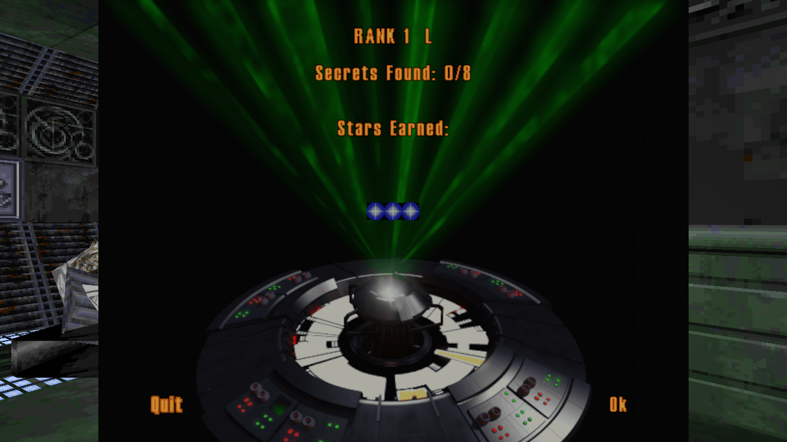
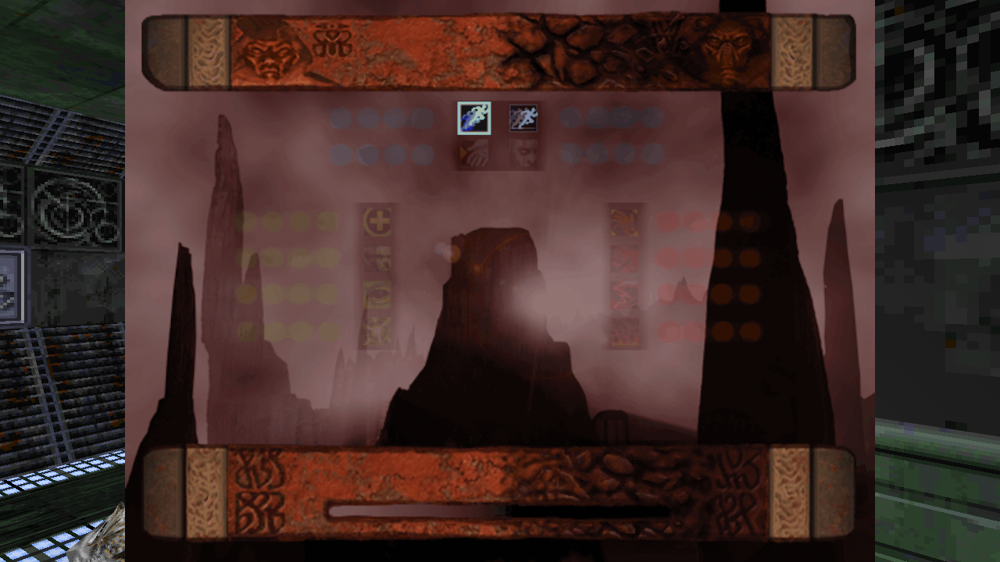

# What is left to port

A map of the engine's own source units (`sith*`, `jk*`) against this port, so the remaining work is a list
rather than a feeling. Every row names its evidence: the gate that runs it, or the file that holds it.

The port's checks at the time of writing: **57 gates, 122 tests, 0 failures.** Stubbed script surface:
**0 verbs, 0 call sites across the 34 shipped levels** (706 script verb calls, all answered).

Two rules for reading this file:

* **Absent** means a grep for the engine's identifiers in `src/` finds nothing. It is a statement about this
  port's source, not a claim about the shipped product.
* **Data-driven** means the engine implements the feature in a `.cog` that ships with the game, so the port's
  job is the *verbs*, not the feature. Force powers are the clearest case: `force_*.cog` exists in the
  install, and what the port owes them is `setinvactivated`, `setthingvel`, `setactorflags`.

Regenerate the numbers:

```
bevi-knight --run all                 # the 67 stubbed verbs, verbatim, aggregated over the install
bevi-knight --cog-check               # the same count with an assertion
bevi-knight --collide --level X.jkl   # collision and spawn facts
bevi-knight --walk all                # hull agreement across 34 levels
bevi-knight --rules / --feel / --fall # the player physics
```

---

## 1. Absent subsystems

Nothing in `src/` answers these. Ordered by how much shipped content they gate.

| subsystem | engine units | what is missing | evidence |
| --- | --- | --- | --- |
| Networking and multiplayer | `sithDSS.c`, `sithDSSThing.c`, `sithDSSCog.c`, `sithMulti.c`, `sithComm.c`, `stdComm.c`, `jkGUIMultiplayer.c`, `jkGUINetHost.c`, `jkGUIMultiTally.c` | the whole thing: message streaming, thing replication, cog RPCs, host/join, tally screens. Zero socket code exists. | no `socket`/`UdpSocket`/`TcpStream` in `src/`. The single-player **answers** are now explicit (`ismulti`/`isserver` 0, no team, no score, `*multimodeflags` stored) and `sendtrigger` really broadcasts `trigger`, but only `sendmessageex` is left stubbed — it needs message *return values* |
| Console and cvars | `sithConsole.c`, `sithCvar.c`, `sithCommand.c`, `jkQuakeConsole.c` | the `~` console, the cvar store, and the command dispatcher (`bind`, `set`, `map`, `quit`) | no matches for `cvar`, `sithCommand`, `sithConsole` |
| Particles and effects | `sithParticle.c`, `rdParticle.c`, `sithExplosion.c` (visual half) | effect and particle spawning. **Sprites draw, with their real artwork and animation**: every template's `sprite=` is parsed (`spr.rs`), its `.mat` loads through the cel-table reader in `tex.rs` with palette entry 0 keyed transparent, `draw_created` spawns one billboarded quad per row and `billboard_sprites` faces it at the camera. The frames walk with the thing's life (`Runtime::sprite_cel`: `typeflags & 0x1` arms it, frame *k* holds for the *k*-th `life / cels` slice), which is what `sithExplosion_CreateThing` does through `sithSurface_sub_4F00A0`. | no particle type (`sithParticle`'s own things — smoke, embers and dust are separate things the engine spawns); `explosion` matches are class numbers and the damage path |
| In-engine cutscene cameras | `jkCutscene.c`, `sithCamera.c` focus modes | **The focus models work**: seven camera slots, `SetCameraFocus(slot, thing)` + `SetCurrentCamera(slot)` move the view onto that thing (aimed by its own own yaw/pitch), `GetCameraMode`/`GetPrimaryFocus`/`GetSecondaryFocus` read back, and `SetPOVShake` adds the recoil offset that decays at its own rate. Level 17b's `17b_Camera.cog` cutscene runs end to end: the view cuts to `ghostCam`, and after the script's `Sleep(6.0)` it hands the view back to the player. | `CycleCamera`, `SetCameraZoom`, path-driven camera dollies beyond `PlayKey` (a camera on a `.key` track follows its thing but has no path timing of its own), and the secondary-focus framing |
| Saber | `jkSaber.c` | `jkSetSaberInfo` stores the blade the scripts describe (two materials, hilt and tip radii, length, three spark templates) with the argument order pinned by a gate (`--pickup`); **and the player can use it**: `saber_swing` traces the blade `length * 10` level units along the player's facing with the hilt radius, damages what it reaches with `DAMAGE_SABER` (0x10), has a 0.45 s cooldown, and spends no ammo — `--hit` proves a hit at 0.8 units, no hit at 4, and the cooldown. The blade is also drawn as an emissive rod from the eye (`saber_blade`), and `jkDisableSaber`/`jkEnableSaber` switch it off and on (`saber_shown`, asserted by `--hit`) | the **swing animation**: `jkSaber.c` runs arcs, parries and the saber lock through `JKFLAG_SABEREXTEND`/`SABERRETRACT` and `cog_weap_saber.cog`'s `SetPuppet` calls, and this build neither plays those keyframes nor draws a hand to hold the hilt. The blade length is read as model units (x10, the `.3do` node scale) because the scripts pass 0.100 for a blade that must reach a body |
| Arch lighting | `sithArchLighting.c` | **not reachable from the text format, checked:** `.jkl`'s THINGS section has no archlight column and SECTORS carries only `AMBIENT LIGHT`/`EXTRA LIGHT`/`COLORMAP`/`TINT`. The engine *computes* arch lights at load from the geometry (`sithArchLighting.c`), so porting this means re-deriving them, not reading a field | the computation itself: per-surface colour contribution accumulated into each thing's `light`, which is what gives Jedi levels their coloured bounce. The sector ambient/extra light and the thing-light sum are already there to build on |
| Track things | `sithTrackThing.c` | things that ride a `.key` track (free paths, camera dollies). The port interpolates `frame=` lists, which covers doors and lifts but not a path with its own timing. **`PathMovePause`/`PathMoveResume` work**: the thing keeps its destination, stops advancing (`paused`, the engine's `flags \| 0x80`) and reports `IsMoving` 1 throughout, which is exactly what level 9's pipe doors need to stop in the doorway (`09_stoppipedoors.cog`, `--things`) | a path with per-frame timings of its own (`trackParams` interpolation); the port walks frames linearly at `MoveToFrame`'s speed |
| Event queue | `sithEvent.c` | the engine's timed event list. Pulses and timers live in `cog.rs` and cover the scripts; a non-cog timed event (thing expiry, AI tick) has nowhere to live. | no matches for `SithEvent` |
| Overlay map and 3D map screen | `sithOverlayMap.c`, `sithMap.c`, `jkGUIMap.c`, `ui.rs` | the **field-log map panel draws the live level**: `M` opens the screen, `live_map_for` gives it `World` + `Player`, and `ui::map` projects the level around the player's pose (`--map-shot` checks both the ink and that moving the player changes the drawing). Still missing: zoom and orbit, and the 3D map view | `ponytail:` in `ui.rs` — no zoom/orbit transforms |
| Scope | `jkHudScope.c` | the sniper/binos overlay | 2 incidental HUD-flag matches, no rendering |
| Level change | `jkMain.c` (`jkPlayer_Initialize`), `swap_level` | the **player's own state carries over** a level change: inventory (weapons, force powers, mana, the ending choice), the armed bin, the selected weapon, the saber and the `jkFlags` the force scripts set (`Runtime::carry`/`adopt`, `cargo test` covers the round trip) | health and shields do **not** carry — each level starts the player at the template's own values, which is not what the engine does |
| Ending choice | `jkPlayer.c` (`jkPlayer_SetChoice`/`GetChoice`) | `jkGetChoice()` reads the real value: it is inventory bin 18 (`SITHBIN_CHOICE`), which the endgame scripts branch on and `jkPlayer_CalcAlignment` maps to +100/-100 (`--pickup`) | the **menu** that writes bin 18. There is no ending screen, so the value is always neutral (0) in this build |
| Thing parenting | `sithThing.c` (`pParent`, `attachedThings`) | **`AttachThingToThing` works**: the child keeps the offset it had at the call, in the parent's own frame (`field_4C`), so a moving parent carries it and a turning one swings it around — a crate on a lift (`00_elev_doors5.cog`), a catwalk on a ship (`09_donefueling.cog`), the sphere `force_absorb.cog` hangs on the player, the orbiting camera of `00_cameratricks.cog`. `DetachThing` and `GetThingParent` round-trip, `SetThingAttachFlags` is stored (`--attach`) | the engine's child *list* (a thing may carry several children, and chains resolve in list order) — this build resolves one level in index order, `ponytail:`-marked. A gun in a hand needs the puppet's joint, which is the puppet work, not this |

Multiplayer is a project of its own and is deliberately out of scope: the UI holes the docs used to list are
both multiplayer-only screens.

---

## 2. Partial subsystems

| subsystem | what works | what is missing |
| --- | --- | --- |
| Thing attachment | the impact half of `sithThing_AttachThingToSurface`: `(v-2.5)^2*45` above a 2.5 threshold, applied to the runtime's player (`--fall`) | the *record*: `attach_flags`, `attachedSurface`, the surface-info snapshot, scroll-velocity transfer on a scrolling surface, and the `entered`/`exited` cog messages on a `COG_LINKED` surface |
| Physics | velocity integration with `ApplyDrag`, gravity, jump, fall, step, spawn clearance — for the player | `physicsRolloverFrames`/`OLDSTEP_DELTA_50FPS` accumulation (the port uses the frame's `dt`), angular velocity, `SITH_PF_USEANGULARTHRUST`, rotation of things (`sithCollision_RotateThing`), scripted movement of things, and every non-player thing: placed props are static |
| Walk sweep | the walker runs the window's own `walker_step` on all 34 levels (`--walk all`), 20 s each: **34/34 stayed inside the tracked sector** over 639 doorway crossings, and on 14 levels the level's own hull test agreed | the tracked sector can still lag where sector hulls overlap, so `inside_sector` is the arbiter rather than the file's own hull |
| Puppets and animation | `stand`, `death`, and the locomotion set — `walk`, `run`, `walkback`, `strafeleft`, `straferight` chosen from the velocity the AI walked at, by the rule in `sithPuppet_UpdateThingMove` (dominant axis, 0.5 u/s walk/run threshold), with the clip advancing on distance moved rather than the clock. Plus `.key` interpolation with parent chains and pivots, `frame=` paths for doors and lifts, and `PlayKey`/`StopAnim`/`JumpToFrame` — a script can replace the puppet's state track with one of its own `keyframe` symbols (level 1's TIE bomber plays `01VTieB.key` from frame 0x14 when the player sees it) | an actor that just **fired** plays its `fire` track (the engine prefers the action track to the stride, and `--ai`'s shooter now animates the shot instead of sliding), and the armed/unarmed **mode** axis (**done**: the state key is `(name, mode)`, `SetArmedMode` selects it, and 113 of level 1's 128 actors ship a mode-1 set), a **hit** flinch (`just_hit`, below death and above `fire`; 127 of 128 actors ship the track), the **turn** states (a body pivoting in place plays `turnleft`/`turnright`, 226 actors ship them, with locomotion winning while moving), and the rest: the airborne set (`rising`/`jump`/`fall`/`land`/`drop`, ~220 actors), `death2`, `choke`, alt-fire `fire2`, `toss`/`windup`/`magic*`, and the **draw/holster** rows — **done** for `drawgun`/`holster` (`draw_row` plays the puppet's own row for its clip length when `SetArmedMode` flips; 24 actors ship each). `drawsaber`/`drawfists` are not selected yet, and `mount`/`dismount` — the *cog* symbol names, which animate the viewmodel — are a separate path, `turnleft`/`turnright`, `victim`, plus `sithAnimClass` layering. A scripted clip has no own epoch and its `flags` are not interpreted |
| AI | the `.ai` parser (instincts, flags, moves), actor spawning, `sightdist`/`fov` deciding whether an armed actor fires its own `weapon=`, `PrimaryFire`'s own arguments from the `.ai` (shot delay, range, aim cone, aim error, burst), scripted destinations, three-dimensional aim (an actor's pitch follows the elevation to its target, so it can shoot at a ledge; `--ai` checks it) over a 3D sight ray — `sightdist` is measured over the whole vector like `sithAI_CheckSightThing`, and the segment to the target must be clear, `AISetMovePos`/`AISetMoveThing`/`AISetLookPos`/`AISetMoveSpeed` make a placed actor patrol or follow, and a blocked destination is **routed** through the adjoin graph with the waypoints popped on arrival (`ai_route`; `--ai` walks one order to the end and asserts the list drains) — and the **frame list** verbs (`AISetMoveFrame`/`AISetLookFrame` index the thing's own `numframes=`/`frame=` entries, which class-less actors like level 1's 8t88 use). `--ai` fires a level-1 actor at 3 units, not at 8, not from behind, then walks one onto a scripted point and turns it; `--endlevel` shows 8t88 walking to his frame | the runtime: instinct **scheduler** (weights, priority, interruption), **awareness** (no hearing, no alert propagation), **pathfinding is in place**: `Collision::route` searches the adjoin graph breadth-first and `ai_tick` follows the doorway centres it answers, popping each on arrival (`ai_route`), so an actor told to reach a thing across a wall walks through the doorway instead of into the wall. Sight now needs a cleared line too, so an actor no longer sees — or shoots — through a wall. Losing sight now means walking to the last place the target was seen (`ai_last_seen`), and standing there forgets it. What is still missing is the retail *scheduler* below that: no hearing, no alert propagation, no instinct weights or interruption, `accuracy=` spread, aim-joint tracking |
| Actors | placement, health, shields, death, `--ai` | aim joints (`sithActor_UpdateAimJoints`), head pitch as a separate channel, force-power state, mount waits |
| Camera | position `thing + 0xb8 + thing[0x168]` (eye offset, level units), orientation from the view angles at `thing + 0x15c/0x160/0x164`, the engine's yaw basis (column 1 = forward, confirmed at run time), the first-person velocity roll (`clamp(5 * dot(vel, right), -8, 8)`, constants at `0x522ddc`/`0x522de0`/`0x522de4`), the projection (**90 deg horizontal** from `buffer + 0x08`, vertical derived: 73.74 at 4:3, 58.72 at 16:9), and a third-person chase camera at the engine's follow height (0.2 above the body, `0x522dec`), toggled with `C` | the **player's own body is not drawn**, so third person shows the level from behind the player rather than the player: `spawn_models` skips the local model on purpose (`cull_mode: None` would wrap it around the first-person eye). Drawing it needs spawn + yaw rotation + hiding in first person. Also the engine's own follow case (`0x4c59ce`) is a spectator orbit spun at 8 deg/s and is not reproduced; view bob (`0x4051e0`) and screen shake (`DAT_008ee5b8/bc/c0`) are unported |
| `use` and the link tables | `Runtime::wire_links` fills all three tables from a level's `cogs` section plus each script's `symbols` (level 1: **37 thing, 44 surface, 10 sector** links), so a script now hears `used`, `activate`, `entered` and `exited`. The E key sends `used` to the nearest linked thing in front of the eye (`Runtime::use_thing`) and falls back to the nearest linked surface (`activate_near`) | was: nothing ever filled a link table, so `use` reached nothing and no message left the world. **Closed:** `--door` runs the whole chain in one process — use action, `activate` message, the level's own script, the flag — and `00_door.cog` on thing 4 clears its sector's ADJOINS bit and starts the piece moving. What it took: `activate` not `used`, a `startup` pass before any message (a door's `doorSector` is set there), and **one kept VM per instance** (locals live in the VM; a fresh one per label lost `doorSector`). Was: `cog_00_door.cog`'s `activate` reaches `CheckStatus`/`OpenDoors` and something there takes the do-nothing branch. The probe now runs every instance's `startup` first (a door's `doorSector` and `numDoors` are set there, and skipping it measured a door with an empty symbol) and prints the script, the frame and `IsThingMoving` per candidate: `00_door.cog` on thing 4 answers `frame 0, moving 1`, so `activate`'s `if (moveStatus) return;` is what stops it — the door thinks a piece is already moving. `01_*` lifts report moving 0 and still change no flag, and one `00_door.cog` (cog 13) runs **0 labels**, so its `activate` call fails outright. Next: why `IsThingMoving` is 1 for a door at frame 0 (is the piece on a path, or is `door0[i]` binding the wrong thing?) and why one label does not run. Note the message label too — no shipped cog declares `used` (0 of 540), 82 declare `activate`, so `use` must send `activate`. Level 1's doors are wired the *thing* way — `cog_00_door.cog` declares `thing door0..door3 linkid=0..3 mask=0x405` and answers with `setsectoradjoins` — so the door chain is: populate the link tables from the COG `symbols` section, then send `SITH_MESSAGE_USED`/`ENTERED` to the linked instances. 32 shipped cogs call the adjoin/sector verbs and every one of them is waiting on a message nothing sends |
| Items and inventory | bins, maxima, activated/available flags, pickups through each item's own script, respawn | item *use* — `UseBin(bin)` sends `activated` to the bin's own cog and the script does the rest (`--use-item`: the bacta heals 30 and spends one); and the **inventory strip is selectable**: `I` opens it, the arrows move, Enter uses the item through `UseBin` (`--use-item` also counts the highlight's pixels, since `ui::Canvas` is software pixels). What is missing is retail's own screen art — `jkHudInv` code this tree does not carry, respawn masks (`setrespawnmask`); the **held-bin loop** is real (`sithInventory_SendFire`: an active bin with a delay sends its own cog `fire` every delay until `DeactivateBin`, asserted by `--items`), which is what a held force power runs on, pickup sounds (`setmountwait` is in §3) |
| Weapons | a fired bolt flies with the template's `vel=` **along the shooter's whole orientation** (yaw and pitch; aiming up or down used to leave the barrel level),, stops at the sector graph, applies `damage=` with `SITH_WF_DAMAGE_DECAY`, a kill plays `death`; ammo bins; the player's `setfirewait` cooldown; `--hit` two-way damage | **inventory cogs**: `misc\items.dat` names a script per bin — 40 of the 82, all shipped (`weap_fists.cog`, `weap_bryar.cog`, …) and all now parsed (`--items`) — the handoff works — a bin going from empty to held names its script (`Runtime::set_bin`, `load_item_cogs` starts the VM and runs `startup`) — and the item scripts themselves now **run clean** (`--weapons`: 106 labels, 0 errors, 0 unimplemented verbs after 21 were implemented). The **routing works**: `fire_player` now sends the armed cog `fire` instead of firing directly, and `load_item_cogs` runs `activated:` when the player acquires the weapon (which is what arms it). `--weapons` proves the script end of it — the bryar's `fire:` spawns 2 things through `FireProjectile` and spends 1 of 50 rounds. The live path is wired but unobserved in this environment (no window). the POV half now draws: `selected:` names the weapon's `povModel` (`bryv.3do`), and `draw_viewmodel` builds that `.3do` and holds it off the view, following `jkSetWaggle`'s sway. the viewmodel also plays the clip the cog asks for (`jkPlayPOVKey`: `bryvpst1.key`, 13 frames, advanced at the key's fps). `jkSetWeaponMesh` stores the weapon's **body** mesh and nothing draws it yet: the first-person half reads `pov_model`, so the third-person weapon mesh is the remaining half of the viewmodel work The muzzle is the **shooter's** own `fireoffset=` (parsed into `template_fire_offset`, model units, rotated into its facing), in the shooter's own frame with the engine's handedness (`sithWeapon_FireProjectile` transforms it by the shooter's orientation; the lateral sign was wrong until `--muzzle` pinned all three axes), and a projectile carries its `owner` so `impacts` skips the body that fired it — which is why the real in-body offsets are usable (`--muzzle`). The trigger obeys the weapon's own rate (`try_fire_weapon`, the engine's `binWait`); alt fire (`weapon2`) is still absent, as is autofire-on-hold, muzzle flashes, per-weapon animation, and ammo as `weaponData` describes it (the bin→projectile mapping is a name heuristic, §4) |
| Damage | health, shields, two-way, death and respawn, `DAMAGE_DECAY`, the engine's damage **kind** — a `SithDamageType` bitmask — with `SITH_AF_INVULNERABLE` honoured and its fall exemption (`--endlevel` watches the flag go set and clear around the level-end sleep), and **message parameters plus `ReturnEx`**: a `damaged` handler reads the amount from `GetParam(0)` and answers with `ReturnEx`, which the runtime applies instead of the amount it passed in (`--damage-return`; 115 shipped scripts have a `damaged` label, 54 answer with `ReturnEx`, and level 17b's `darkjedi_yun2.cog` is one) | the kinds are carried but unused elsewhere: the engine picks a hurt sound per type (`SITH_SC_HURTENERGY`/`HURTFIRE`/`HURTMAGIC`/`HURTSPECIAL`) and scales limb hits by 0.1 when the sender has an actor parent. Neither is ported. A handler can only *reduce* a hit (a settled hit is amended, not replayed), so a script asking for more damage than was applied is ignored |
| Force powers | the bins and the verbs the shipped `force_*.cog` scripts call; jump, speed, healing, seeing, pull and grip run, and **the powers are acquired the way the engine acquires them**: `misc\items.dat`'s `cog=` column names a script per bin, and a bin that goes from empty to held queues its own script (`Runtime::set_bin` -> `item_cog` -> `load_item_cogs` starts it out of the `.gob` when the level's script table does not carry it). That path was dead for every force row: their `max` column is a decimal (`4.0`) and an integer parse dropped all eight rows, so the map answered `bin 21 -> None`. `--items` now reads **40 of the 82 bins**, `21 f_jump` .. `28` among them, and `cargo test` pins the decimal parse (`the_force_rows_survive_a_decimal_maximum`); **the economy's arithmetic is in** (`src/force.rs`: the bin map, the rank ladder `jkPlayer_SetAccessiblePowers` walks, `CalcAlignment`'s weighted sum and clamp, the rank-8 mastery choice and the rank-7 side lockout, all against the constants read out of `JK.EXE` at `0x52206c`/`0x522074`/`0x522078` — `--force-economy` prints the model, `cargo test` pins it both ways) | the *effects* are unverified beyond jump and speed: nothing drives `force_pull.cog`'s grip in a test, and `setpovshake`/`setthingrotvel` are stubs those scripts would want. `force jump`'s velocity once reached `SetThingVel` as zero — fixed, but the path has no assertion of its own |
| Sound | 2D playback of `.wav`/`.snd`, one music track, `--audio-state`, per-sink mute, `create`-class sounds, and the **channel verbs**: `PlaySound*` answers a channel, `ChangeSoundVol` ramps it (clamped to 1.5, only for a positive fade, as `sithCogFunctionSound_ChangeVolume` does), `ChangeSoundPitch` sets the rate, and `SectorSound` replaces a sector's ambient with the script's own (`--sound`) | 3D positional and velocity mixing (`sithSoundMixer.c`) and sound classes with mode ranges. The channel is applied when a request *starts* — a one-shot mixer cannot re-tune a sink that is already playing, so `ChangeSoundVol` on a long ambient does not sweep it (`ponytail:`) |
| Surfaces and sectors | the flags, `SURFFLAG_SKY`/`SURFFLAG_CEILING_SKY`, adjoin state, `sithPhysics_FindFloor`, thrust values, and the script-side switches — `setsectorflags`/`setadjoinflags`/`clearadjoinflags`/`setsectoradjoins` now reach collision and the cull (§6). **Texture cels, material cels, scripted light and scroll reach the renderer**: `SetWallCel`/`SurfaceAnim`, `MaterialAnim`, `SetSectorLight`/`SurfaceLightAnim` and `SlideWall` are baked into the mesh (`Runtime::surface_epoch` -> `rebuild_surfaces` -> the vertex colour and UVs -> `level.wesl`). A scrolling surface also **carries the body standing on it** (§6), which is what a conveyor is; level 1's neon sign and its five 5 fps surfaces step, `09fuelstation`'s two `00_matanim.cog` calls walk `09sign.mat`, and level 2's seven force fields ramp their light | a sector's `thrust` vector now pushes bodies (`SetSectorThrust`, `--things`) |
| Sky | unlit sky faces plus a dome, and the camera's clear colour; `SlideHorizonSky`/`SlideCeilingSky` scroll the sky **faces** | the sky's own parallax and rotation (`sithRenderSky.c`), and the dome is a port stand-in that does not scroll |

| Models and materials | `.3do` parse, geosets, materials, `RADIUS`, `insertOffset`, mipmaps, the light ramp, `--winding` | `setthingmodel` (swap a model at runtime), per-surface material animation, the geometric-mode verbs (`*geomode`), and no back-face culling for models (§4 — model interiors render when the camera clips in) |
| Rendering | opaque pass, portal-aware sector culling, the light ramp, HUD, **placed and created sprites** (billboarded quads, one cel of the `.mat` strip, `billboard_sprites`), and projectile impacts (a bolt's `explode=` template is spawned by `projectile_hits` → `Runtime::explode`) | no transparency sorting, and a changed animation frame rebuilds the whole mesh asset instead of writing into it (§4) |
| Colormap and lighting | the palette, and each `.cmp` ramp sampled at **32 steps** (`LIGHT_STEPS`) to build the surface light ramp; a single far colour for distance shading; sector light animation, surface light animation, and **`ThingLight`/`SetThingLight`/`ThingLightAnim`**: a thing's own light, ramped the way `sithSurface_SetThingLight` ramps it (`from`, `rate = delta / time`, `to`), summed per sector so a lamp brightens its room and a broken one stops (`--cel`) | the engine's per-distance table **selection** — a surface picks the 256-entry table matching its distance from the light — and the *dynamic* pass that gives a thing's light a radius: this build adds the whole thing-light sum to its sector's baked light, so a lamp lights the room flatly rather than in a pool (`ponytail:` per-surface falloff). 256 tables are located per ramp (`(len - CMP_HEADER - CMP_PALETTE) / 256` in `tex.rs`) and the ramp uses 32 of them |
| Savegames | the container and thing records: version 6, the 1580-byte header, the `0x28` record header, template/type/position/angles round-trip — **and live state**: `Runtime::snapshot`/`restore` capture every thing (position, angles, sector, health, flags, `jkFlags`, destroyed, path frame), the inventory, weapon, armed bin, saber, the sector-adjoin word and each sector's light, into a `SAVE_SECTION` payload inside a real `.jks` (`--save` proves the round trip: health 37, +1.25 along x, inventory bin 2 = 3 and the clock all come back) | the **save-slot picker**: the pause menu's own `GUI_SAVE`/`GUI_LOAD` rows work (`jkGuiEsc_Show` case 15 and 13, checked by `--quicksave`), and the keys do work (`F5` writes `saves/quicksave.jks`, `F9` loads it, in place or by loading the level the save names first — `--quicksave`), and the automatic one does work (`AutosaveGame` writes a checkpoint at the story beats levels 7, 11, 15, 17a, 17b and 20 ask for), and the format plus the runtime round trip are checked. **Eight slots** now (`slot0.jks`..`slot7.jks`, slot 0 the historical `quicksave.jks`; `,`/`.` choose one and `--quicksave` proves two slots keep separate games); retail's slot *picker* screen is not in this tree. And the rest of `sithGamesave.c`: cog VM state (a loaded save restarts its scripts), AI state, item respawn masks, the event queue, multiplayer sections |
| Cog | the VM, 34 levels of scripts, pulses and timers, every verb the scripts call except none | no stubbed verbs in section 3 |
| HUD and UI | the HUD, most screens, menus built from `jkGUIRend` tables, and the status bar's carried strip (`hud::carried`, fed by `health_follows_damage` from the runtime's bins — it was blank before) | the screens still placeholders (`--ui-tables`), the scope, the map screen, and the tally screens (blocked on multiplayer) |
| Cutscenes | `.smk` decoding of all 25 shipped films (483 MB, 29,493 frames) with their own palette records, seeded from the level | in-engine camera cutscenes (section 1) |

---

## 3. The stubbed cog verbs — none left

Every verb the shipped scripts call now gets an answer: **0 stubbed, 0 errors** across the 34 levels
(`--cog-check`).

The check runs **every label each script declares**, not just `startup` and its declared `message:`
labels. That deep pass is the point: the startup-only count said "zero" for rounds while
`AutosaveGame`, the whole `jkString*` buffer (`jkStringClear`/`Concat*`/`Output`), `StopKey`,
`LoadSound` and `SyncScores` were silently returning 0 — verbs that sit behind cutscene and gameplay
labels nothing had fired. A number that measures what a pass reaches is only as good as the pass.

That was worth driving to zero rather than leaving as "harmless". An unhandled verb returns `0`, the
catch-all arm of `Runtime::handle` — the right answer for `ismulti` and `isserver` in a
single-player game, and the wrong one for a getter, where a script that branches on the zero takes
the wrong branch with no error anywhere.

Three ceilings came with the last of them, and they are marked in the code:

| verb | what is real | what is a stand-in |
| --- | --- | --- |
| `SetThingRotVel` | the angular velocity is integrated every step and the angles wrap | nothing |
| `jkStringOutput` / `jkPrintUNIString` | the line is composed (`jkString*`), resolved through `ui\jkstrings.uni` and **drawn**: `hud::draw_message` puts it across the top of the canvas for 4 s, in the live HUD and in `--hud` (`BK_HUD_MESSAGE` is the capture aid) | the engine draws it in its own message slot with per-type timing and a separate chat log; this build has one slot and one duration |
| `NewColorEffect` / `Modify` / `Free` | the handle, the three channels, the fade, and the create/modify/free round trip; **and the draw**: the effect is blended over the HUD canvas each frame (`ui::Canvas::apply_screen_effect`, unit-tested against `stdPalEffects_GatherEffects`' filter = quarter-channel and zero-tint rules) | **the world is tinted too**: `scene_wash` draws a full-screen quad on its own layer, under the HUD, so a force-seeing view washes the 3D scene (`scene_tint`, unit-tested). ponytail: a blended quad cannot *dim* a channel, so a filtered channel is drawn as absent rather than quartered — the HUD canvas keeps the exact engine rule |
| `SetThingModel` | the override is stored and a *created* thing is drawn with it | a thing the level **placed** keeps the mesh built at load |

---

## 4. Debt already marked in the code

14 `ponytail:` comments name a deliberate ceiling and its upgrade path. Line numbers are left out because they
rot; grep `ponytail:` in the file named.

| where | the shortcut | the ceiling |
| --- | --- | --- |
| `main.rs` | no back-face culling for model triangles | model interiors render when the camera clips into them |
| `main.rs` | a changed animation frame rebuilds the mesh asset | a 60 fps puppet rebuilds its mesh sixty times a second |
| `main.rs` | the cancel-row test is a unit test, not data | parsing `hoverId` would make it real data |
| `collide.rs` | the sweep's depth limit and "already searched" rule | a chain of more than 24 adjoins in a line reports no hit; no shipped level has one |
| `collide.rs` | the four-way clearance test rejects a body touching the riser it was blocked by | a step only succeeds if the lift clears the riser's polygon top; `STEP_UP = 0.066` compensates |
| `collide.rs` | the floor probe scans every wall face | O(walls) per moving body per frame |
| `runtime.rs` | insert offsets live in one process-global table | two worlds loaded at once (level plus cutscene) share it |
| `runtime.rs` | the bin → projectile mapping is a name heuristic | not the engine's `weaponData` |
| `runtime.rs` | steering picks the doorway that looks closest on both legs | no path search, so an actor can pick a longer route or lose the chase |
| `runtime.rs` | `sleep`/`settimer`/`setpulse` run straight on, with no timer queue | a script that only works across resumed sleeps runs its later statements early |
| `level_mat.rs` | the shader adds no light level | the mesh carries baked vertex colour only |
| `tex.rs` | one process-global light ramp | a second level in the same process needs the ramp passed through the mesh builder |
| `tex.rs` | a length check rejects non-bitmap headers | no header version dispatch |
| `ui.rs` | the map screen has no zoom/orbit transforms | see section 1, overlay map |

The `runtime.rs` sleep row is the one that bites: it changes script behaviour, not just speed.

---

## 5. Where to start

Ordered by risk per hour, using the call counts in section 3 rather than subsystem size.

1. **Fix the wrong-by-default getters.** ~~`getselfcog`, `getmastercog`~~ — **done**: the VM answers
   `getselfcog` with its own index in the level's cog list, and `setmastercog`/`getmastercog` are the
   world's one global master (`-1` unset), which is what `01_endlevel.cog` registers at startup
   (`SetMasterCOG(GetSelfCOG())`). `getgoalframe` answers the destination a piece is moving to and 0 once
   it has arrived — the engine zeroes `goalframe` on arrival, and that is what a reversing lift reads.
   Still open: `loadtemplate` (1). (Also done earlier: `getleveltime`, `gethealth`, `isthingvisible`,
   `get/setthingmass`, `setthinguserdata`, `setthingtimer`.)
   **Level-end chain: closed.** A level's `goal*.cog` reports a finished objective with
   `SendMessage(GetMasterCOG(), user0)`, and `SendMessage` now takes the engine's two arguments — a
   **cog index** and a message **id** (`sithCogFunction_SendMessage`) — carrying the calling cog as
   the sender so `GetSenderID()` answers in the receiver. The ids come from the retail binary's own
   keyword table in `sithCog_Startup` (`activate` 1, `activated` 1 as an alias, `startup` 3,
   `timer` 4, … `user0`…`user7` 27…34, `trigger` 40), so a `message` symbol evaluates to its id and a
   receiver matches its `message:` list by id rather than by declaration order. The queue is drained
   in play as well as in `--run`; before this, `Runtime::messages` (script→script, addressed by cog)
   was only pumped by `--run`, while the live loop drained `pending_messages` (thing/sector, addressed
   by instance). Level 1 delivers the goal message to exactly one cog instead of broadcasting it to
   41, and `[01_endlevel.cog user0]` runs — goal flag, `Accomplish1.wav`, `Sleep(3.0)`, `jkEndLevel(1)`.
   Across the 34 levels the id routing is visible on three: level 2 sends 5 → 7 script messages, and
   11 and 17 change how many doorway pieces and sounds their scripts drive. `--endlevel` is the gate
   that pins the whole thing end to end on level 1: master cog 26 registered by startup, `user0`
   (id 27) delivered to it, goal bin 100 = 3, and `level_complete` true after the handler's 3 s sleep
   — i.e. **a level can be finished by its own scripts**.
2. **Timer queue for `sleep`/`settimer`/`setpulse`** (section 4). It is the one ceiling that changes what
   scripts do, and it sits under every verb that waits.
3. ~~**Sector and adjoin flags**~~ — **done** (section 6): `setadjoinflags`/`clearadjoinflags`/
   `setsectorflags` now reach collision and the cull, `setsectoradjoins` closes a sector's doorways
   for real, and **`setsectorthrust`** makes the sector accelerate what stands in it — `sithPhysics.c`
   adds `sector->thrust * dt` to a body exactly like gravity, so level 21's core tube is a real
   updraft and level 10's power core pushes the player out (`--things`; `walk_player` folds it into
   the body's horizontal velocity and its vertical speed).
4. ~~**Damage types.**~~ — **done as far as the engine's rules go:** `Runtime::damage_typed` carries the
   `SithDamageType` word (impact 0x1, energy 0x2, fall 0x40, …), bolts arrive as energy and landings as
   falls, `SITH_AF_INVULNERABLE` (`actor->flags & 0x8`) is honoured with the engine's fall exemption
   (`sithActor_DamageActor`), **and a `damaged` handler's `ReturnEx` replaces the amount**: the message
   now carries its params (`GetParam(0)` = amount, `GetParam(1)` = kind), the label's answer comes back
   as its return value, and `Runtime::amend_damage` gives the difference back — which is what
   `force_absorb.cog` (turn part of a hit into mana) and the dark Jedi handlers need. What is still
   unported from the same function: the per-type hurt sounds and the 0.1 limb-hit scaling.
5. **AI verbs.** 240 calls across 11 verbs. **Mostly done:** `aisetmode`/`aiclearmode` are the actor-flag
   arms, `aisetmovespeed` stores a clamped 0..2 multiplier the AI step applies to the template's walking
   speed, `aisetmovepos`/`aisetmovething`/`aisetlookpos` are the scripted destination, follower and
   standing turn that `ai_tick` now walks and faces — which is what makes `00_AIPatrol.cog` walk its
   puppet, and `--ai` asserts the walk, the arrival and the turn. `setfirewait` (a weapon verb, kept here
   because it was the same shape) arms the player's cooldown, `fire_player` reads it, and
   `setgoalflags`/`cleargoalflags` OR and mask the goal counters (`SITHBIN_GOAL00` = 100) that
   `endlevel.cog` records objectives in, and `aisetmoveframe`/`aisetlookframe` walk an actor to one of
   the level's own `frame=` entries — which exposed a parser bug: an **actor's** frame is a position
   alone (`frame=(-4.476/15.877/3.840)`), and only the `pos:angles` spelling was accepted, so every
   actor's frame list was silently empty. `ai_tick` also had to stop keying on the instinct class:
   `SITH_CT_AI` comes from the actor block, and level 1's 8t88 has no `aiclass=` yet its goal script
   walks it to frame 1 (314 calls gone; 392 stubbed, down from 706). **The group is now closed**:
   `aisetfiretarget` (8) stores what an actor shoots at, and the fire-target is what made the
   out-of-sight early return bite — it had to be computed *before* that return, or an actor told to
   shoot a thing it can see stands still because it cannot see the player; `aiflee` (3) is the flee
   state (walk away from the named thing, do not shoot); `aisetclass` (2) swaps an actor's `.ai`
   wholesale from the name the cog binds, which is level 11's endlevel changing Pic's and Gorc's class
   between fight phases. `--ai` asserts all three: the actor turns to the named target and fires with
   the player behind it, a fleeing actor's gap grows 3.00 -> 3.30 over a second with no shots, and
   `AISetClass(actor, "pednarsh.ai")` moves its sightdist 5.0 -> 7.0. (`setmountwait` (25) is done: the
   engine's fire path refuses until `sithWeapon_secMountWait` passes, and every shipped caller passes 0.)
6. ~~**Puppet locomotion states.**~~ — **done** (section 6): the state is chosen from the velocity
   `ai_tick` walked the actor at, by `sithPuppet_UpdateThingMove`'s own rule, and the clip advances on
   distance moved instead of the clock. What is left of the state machine is the armed-mode axis and
   the reactions (`crouch`, `jump`, `fire`, `hit`, turns).
7. ~~**Attachments and parenting.**~~ — **done for the scripted case** (`--attach`): `AttachThingToThing`
   stores the child's offset in the parent's own frame and re-places it every step, so the twenty
   shipped calls that make a crate ride a lift, a catwalk ride a ship, or an effect ride the player
   all work. What is left of the group is the engine's *child list* (several children, chains) and
   the puppet-side version — a gun in a hand is a joint, not an attachment.
8. ~~**Camera focus and shake.**~~ — **done**: seven camera slots with `SetCameraFocus`/`SetCurrentCamera`
   and their getters, and `SetPOVShake` as an offset that decays at its own rate. Level 17b's cutscene is the
   end-to-end case: `17b_Camera.cog` startup cuts the view to `ghostCam`, and `Sleep(6.0)` later hands it
   back to the player (`--camera`, and `BK_CAMERA_TRACE=1` on a live run prints both). What is left of the
   group is `CycleCamera`, `SetCameraZoom` and the secondary-focus framing, which no shipped single-player
   script uses.
9. **Level 1's first frame is a wall of polygons, and it is the level's own start.** The walker spawns at
   the first thing of type PLAYER (thing 0, `(-10.44, -5.45, -1.13)`, sector 339) — the engine's own rule
   (`sithPlayer_Initialize` takes the first `SITH_THING_PLAYER` in list order), so this is not a wrong
   pick: the level's other 11 `walkplayer` rows carry `thingflags=0x20080501` (multiplayer starts) and
   thing 0 carries none. But a `00table` sits **0.16** units away, a `tuskensoused` patron 0.15, a
   `reyeesbhgun` 0.27, columns either side, and the eye is at `pos + PLAYER_EYE`, so the view is inside a
   cantina table with a body at arm's length. `BK_MODEL_SCALE=0.01` renders the room cleanly and the
   geometry is right, so the blocker is a thing model drawn at the eye, not the world. Unproven whether
   retail draws the same frame (nothing here says the start point is wrong); the way to settle it is a
   retail reference frame at level start, then either the port's draw offset follows or the start stays.

---

## 6. Recently closed, so it is not mistaken for missing

* **Sprites render, and the two "renderer bugs" that hid it were both in the probe.** `--sprite
  <template>` keeps one effect thing in front of the camera so a frame can show it. Two rounds of
  byte-identical frames turned out to be false alarms: the probe placed the thing with
  `(cos yaw, sin yaw)` while a JK yaw faces `(-sin yaw, cos yaw)` (§24), putting it exactly 90 degrees
  to the side — `BK_SPRITE_TRACE`'s camera-space print showed `Vec3(1.526, -0.037, 0.015)` against
  `Vec3(0.026, -0.037, -1.485)` once fixed — and the capture sat inside level 1's spawn prop (§5.9), so
  anything 1.5 units ahead was legitimately occluded. Walking into the open first and comparing frames
  with and without the effect shows it: `17EAC891…` with, `7881579F…` without. **`draw_created` was
  never broken, and projectiles have been drawing all along.** The last fault was the *bitmap*: the
  port read the material with a flat 140-byte header, which is only the first cel's texture header.
  `tex::parse_mat` now walks the whole table `rdMaterial_LoadEntry` (`0x44a260`) defines — 76-byte
  header, a 24-byte `rdTexinfo` per cel (+16 when `texture_type & 8`), then one 24-byte texture record
  **followed by that bitmap's mip chain** — and the cels turn out to be separate bitmaps, not a strip:
  `bryx.mat` is 8780 bytes = `76 + 8*40 + 8*(24 + 1024)`, i.e. eight **32 x 32** frames. World
  textures are untouched by the rewrite (one cel puts its bitmap at 140, exactly where the flat read
  had it). `docs/formats.md` §5 has the layout and the walk that lands on the length of all 1983
  shipped materials.

* **Effects are sprites, and sprites are loaded and drawn.** A template's `sprite=` (`+laserhit` is
  `bryx.spr`) is now parsed for every template a level names and its materials are loaded through the
  same `.mat` path as model textures — with palette entry **0 keyed transparent**, because an effect
  bitmap is painted on black and that key is the whole transparency of a spark (a world texture keeps
  entry 0 opaque, so the two conversions are separate functions, `keyed_rgba` and `to_image`).
  `draw_created` spawns one quad per `.spr` row at the thing's position plus the row's model-space
  offset, and `billboard_sprites` turns them to the camera each frame, which is what
  `rdSprite_Draw`'s camera-space vertices do. Level 1 resolves **35 sprite files for 35 templates**
  (13 distinct materials), and an impact logs `drawing sprite thing 363 (+laserhit, 1 face(s))`.

* **A sprite walks its frames over the thing's life.** `sithExplosion_CreateThing` arms the animation
  with `num_texinfo / msecLifeLeft * 1000` cels per second when the template's `typeflags` carry
  `SITHEXPLOSION_FLAG_ANIMATED_SPRITE` (0x1) — one cel per `life / cels` seconds — and
  `explosionParams.msecLifeLeft` is the life the thing was *created* with. `Runtime` now keeps that
  as `life_total` beside `life_left`, and `sprite_cel` scales it: `+laserhit` (`typeflags=0x33`,
  `timer=0.5`, `bryx.mat` eight cels) is eight frames over half a second. `draw_created` swaps the
  quad's mesh as the frame changes, and a live impact prints the walk with `BK_SPRITE_TRACE=1`:
  `sprite thing 366 (+laserhit) draws cel 3 of 8`. The clock and the placement of a moving sprite
  weapon (`+force_dest_p1`) ride along in the same branch, since sprite quads are outside the
  `Transform` query the model things use.

* **A created thing dies when its `timer=` runs out, and `SetThingTimer` is a different timer.**
  `timer=` is the engine's `msecLifeLeft` (`sithThing.c:1777`), counted down every frame with
  `sithThing_DestroyDyingThing` at zero (`sithThing.c:224`) — it is what makes an impact spark a
  spark (`+laserhit` ships `timer=0.5`) and what takes a corpse away (`SetLifeLeft(_, 30)` in 92
  shipped scripts). Nothing counted it down, so every impact added a thing to `rt.things` for the
  rest of the session while `draw_created` walked the growing range each frame. The other half of
  the bug was an alias: `SetThingTimer` was wired to `setlifeleft`, but the engine stores a
  **separate** absolute deadline in `pThing->timer` and sends the `timer` (4) message from
  `sithCog_UpdateThingTimer` — under the alias, `03_thinglight.cog`'s scripted timers would have
  destroyed their own lights. Both are now what the engine says, and `--hit` asserts a 0.5 s
  effect is alive at 0.33 s and gone at 1.33 s.

* **A moving actor plays its own walk, not an idle glide.** `sithPuppet_UpdateThingMove` (`0x4e4380`)
  transforms the thing's velocity into its own frame and picks the puppet state by the dominant axis:
  forward under 0.5 u/s is `walk`, at or above it `run`, negative is `walkback`, and a lateral
  component that dominates is `strafeleft`/`straferight`. The port had no velocity to feed it —
  `ai_tick` moves an actor by writing its position — so `Runtime::walk_vel` now records the velocity
  each actor walked at and `locomotion_state` applies the same rule to it. The clip also advances on
  distance moved (`sithPuppet_UpdatePuppet`'s `AdvanceTrack(speed × dt)`), so the legs keep pace with
  the body. Two wrong shapes were tried first and are recorded so they are not retried: a renderer-side
  displacement measured 3.6 u/s for a 0.33 u/s walk (the sim ticks and render frames do not line up),
  and the collision push that re-seats an actor inside a wall turned into a sprint sideways.
  `--animate` checks the chooser against each actor's own `.pup` and fails if fewer than half the
  level's actors ship a `walk` row (level 1: 128 ship `walk`, 128 `run`).

* **A face can be hidden, and an untouched face reports that it is drawn.** `SetFaceGeoMode(surface, 0)`
  is `GEOMETRY_NONE`: `00_breakingglass.cog` shatters glass with it and the force-field switches open
  passages with it. The port stores the mode, forces `0` on a face the level does not draw (retail's own
  branch in `FUN_00500790`), drops the polygons in `build_world`, and re-batches the `(sector, material)`
  meshes in place when the mode changes. The default is the half that changes behaviour:
  `GetFaceGeoMode` answers the `.jkl` row's own `geo` column, not `0`, and level 9's fuel chain is the
  consumer — `09_fuelexplode.cog:57` bails out of its `crossed` handler on a `0`. `--geomode` hides a
  7-vertex face (8898 → 8893 drawn triangles) and asserts an untouched face reads its `geo` 4 while a
  material-less face stays 0 even when asked for 4.

* **Level 1 ends when you see 8t88, from the level's own scripts.** `sithRender_RenderThing` sends
  `sighted` the first time it draws a `CAPTURED` thing, so the port latches that in `cull_sectors`
  (and the sector form, `SITH_SECTOR_SEEN`). `01_goal0.cog 204` — the goal script placed on 8t88 —
  answers with `SendMessage(GetMasterCOG(), user0)`, and `01_endlevel.cog`'s `user0` handler sets the
  goal flag, plays `Accomplish1.wav`, freezes Kyle as invulnerable, sleeps 3 s and calls
  `jkEndLevel(1)`. `--endlevel` drives exactly that chain and asserts the goal bin, the invulnerability
  window and `level_complete`. Along the way it proved that message names are engine keywords
  (`sithCog_Startup` registers `user0` = 27), so the VM seeds them as globals rather than binding them
  per script.

* **A level can be finished through its own scripts.** `01_endlevel.cog` registers itself as the master
  cog in `startup` (`SetMasterCOG(GetSelfCOG())`), a goal script reports the objective with
  `SendMessage(GetMasterCOG(), user0)`, and the master's `user0` handler sets the goal flag, plays
  `Accomplish1.wav`, sleeps 3 s and calls `jkEndLevel(1)`. Three things had to be true for that: the
  VM's own index and the world's master cog (`GetSelfCog`/`SetMasterCog`), a message bus addressed by
  cog with the **retail** message ids (`user0` = 27, from `sithCog_Startup`'s keyword table), and that
  bus being drained in the live loop rather than only by `--run`. `--endlevel` pins it: master cog 26,
  one message delivered, goal bin 100 = 3, `level_complete` true.

* **A doorway whose far side cannot hold the body is now a wall, and crossings land where the body
  can stand.** Two separate refusals kept level 1's start impassable: the crossing only advanced past
  the sphere's *contact* point, leaving the origin a radius short of the far room's copy of the
  doorway plane ("outside", so `sithIntersect_IsSphereInSector` undid it for 522 of 700 frames), and
  a closed door's slab is thinner than the body (`sector 337` is 0.05 deep against 0.065), so no
  origin inside it is legal and the body re-crossed it 713 times. `Solids::doorway_advance` now
  advances `contact + min(radius, far-room depth / 2)`, retries two longer reaches because the two
  rooms' copies of the plane differ by 3 mm, and returns `None` for a room shallower than the body —
  which `sweep_rooms` treats as a wall. Level 1's start went from 522 refused frames to **0**, and
  the body walks out of the alcove onto sector 349's floor. `--move` 302 → **459 units**, still 0
  falls and 0 stuck bodies; `--walk all` 34/34 contained.* **The status bar sits at the bottom of the screen, where the game puts it.** Both corner panels were
  blitted at `y = 0`, so the health and force gauges ran along the top edge. The engine anchors them to
  the bottom: `jkHud_leftBlitY = Video_format.height - HUD_SCALED(statusLeft height)` and
  `jkHud_rightBlitY = Video_format.height - HUD_SCALED(statusRight height)` (`jkHud.c:147`–`151`), with
  `x` already `0` and `width - HUD_SCALED(width)`. The piece layout inside a panel (`file.y_pos`) is
  relative to its panel, so the meters and the number fonts follow the same anchor now that
  `origin()` returns `(x, y)` instead of `x` alone.
* **The player's containment is now the engine's rule, and the walk no longer falls out of the world.**
  `walker_step` used to invent a sector for a stuck body (`sector_for_body`, "the roomiest hull that
  holds it") and applied the containment check to the body's centre with the horizontal component only.
  Both are gone: the check is `sithIntersect_IsSphereInSector(pos, 0, sector)` asked at the body's
  **origin** (its feet) with the sector's `COLLIDEBOX` short-circuit, and a failure restores the
  position, the velocity and the **sector**, exactly as `sithCollision_MoveThing` does
  (`decomp/004e7950_sithCollision_MoveThing.c:251`). The hull is the engine's surface set — `surfflags & 4`
  or an adjoin whose link has `ALLOW_MOVEMENT` — with each plane oriented outward from the cell that
  claims it. Verified: `--move` walks 34 levels from 8 headings each with 0 falls and 0 stuck bodies,
  `--walk all` reports 34/34 contained (the report now asks `inside_sector` itself rather than a
  hand-rolled planes-only test), and the in-app window walk runs 700 frames staying on level 1's floor.
  **Still open, with its signature:** 522 moves in those 700 frames are refused at the doorway out of
  level 1's start alcove — the body crosses into sector 349 at `y = -5.2149`, exactly one radius past
  that sector's wall plane at `y = -5.15`, whose *polygon* does not reach it. `IsSphereInSector` is an
  infinite-plane test, so the crossing is undone every frame. The port switches sector when the sphere
  *touches* the adjoin; crossing when the origin is past the doorway's plane is the fix to try.
* **A fifth of the collision geometry was being thrown away, which is why you could fall through
  the floor.** `collide::build` derived a polygon's normal from its first three vertices, and `.jkl`
  faces routinely start with three collinear points: on level 1 **233 of 4595 surfaces** have such a
  triple, `normalize(cross(...))` returned `None`, and the surface was dropped from the collision set
  entirely — no plane, no face, no floor. The level's own street slab (`surface 3510`, 8 vertices at
  `z = -1.325` in sector 361) and the walls either side of it were among them, so a body walked
  through the wall and fell through the hole behind it; the camera "spawned in a wall" because the
  walls it should have been kept out of were not there. `polygon_normal` takes the polygon's
  widest-spanning triple instead, and `--collide` now asserts the invariant: no solid, sector-claimed
  surface with a real plane may be missing from the collision set (it prints the 233 as the count it
  would have lost). The engine needs no such trick — the plane is authored per surface and the loader
  reads it from a second block in the `SURFACES` section (`sithSurface_ReadSurfacesListText`, JK.EXE
  `0x4e5c00`) — so this was the port's derivation, not the data. The parser now reads that block too:
  `--winding` compares our Newell normal against it on every surface of every level and reports
  **126,639 of 126,639 identical**. `docs/formats.md` §16 records it with the engine's addresses.
* **A closed passage is closed for the body, not just in a counter.** `setadjoinflags` (`x15`),
  `clearadjoinflags` (`x17`) and `setsectorflags` (`x1`) used to fall through the catch-all arm and return 0,
  so a force field, a grate and a glass pane did nothing — and `setsectoradjoins`, which every shipped door
  script calls on startup, closed a sector in a field nothing read. The two flag words now live on the
  runtime (`adjoin_flags`, `sector_flags`, both seeded from the level's own table), the verbs switch them,
  and `collide::Gates` is what the solver reads: `collide::sweep` treats an opening with `ALLOW_MOVEMENT`
  clear (or `ALLOW_AI_ONLY` set, or a sector whose adjoins are hidden) as a solid face and never crosses it,
  `visible_sectors` refuses an opening whose `VISIBLE` bit was cleared, and `in_water` reads
  `SITH_SECTOR_UNDERWATER` as well as the surface water flags. `--adjoins` is the gate: level 1's data ships
  5 movement-closed rows and one AI-only, 27 startup scripts shut 7 doorway sectors, the sweep crosses the
  chosen opening and stops when the verb clears MOVE, and clearing VISIBLE drops the rooms behind it
  from the cull (level 1: 96 → 1, because sector 0 has that one way out). Culled and `--no-cull`
  frames are still byte-identical at load and after 200 frames of sim time, so stage 1's pixel gate
  is untouched. Bits and engine consumers: `docs/formats.md` §3.2.
* **The camera was a quarter turn off, and the engine's own matrix says so.** `FUN_0043fcf0` @ `0x43fcf0` is
  the euler builder this port already copied as `thing_quat`; only its **column 1** rises with pitch, so a
  camera built from a thing's orientation looks along column 1 and a level's yaw `a` faces
  `(-sin a, cos a)`. The port drove the camera, the walk keys and the spawn aim along column 0,
  `(cos a, sin a)` — the same frame turned 90°: 03katarn's start stood the eye inside a doorway instead of
  looking down the street. One `yaw_axes()` now holds the mapping, and `--controls` asserts the camera's look
  and right against `thing_quat`'s columns on 15 yaw/pitch pairs. Details and the wrong oracle that nearly
  hid it: `docs/formats.md` §24.
* **Models are their real size now: `MODEL_SCALE` was 10, so every model was drawn ten times too big.** The
  reference that settles it is the level's own: a door has to fill the doorway built for it, and both are in
  the file. `d2x3.3do` is 0.200 × 0.300 model units and the vertical adjoin 0.01 units from the door's own
  placement measures 0.20 × 0.30 level units — 1:1, and the same for `d3x3_1` and `d4x3_1`. `--scale` prints
  the table. At 10 a 0.19-unit actor was drawn 1.91 units tall in levels whose storeys are 0.6 and whose
  doorways are 0.3, which is what "the enemy models are scaled way too big for the level" was. Everything on
  that constant followed it down — body radius 0.65 → 0.065, eye 0.37 → 0.037, step 0.66 → 0.066, the AI
  standoff 2.5 → 0.25, the actor walking speed `maxthrust * 10 / drag` → `maxthrust / drag`, and three
  hardcoded `+ 0.35` spawn heights — and every gate was re-run at the new size (`--walk all` 34/34, `--move`
  34 levels 0 frozen, `--rules`, `--live-check`, `--collide`, `--ai`, `--animate`). Two more faults fell out:
  `--walk all`'s "sector crossings" counter compared against a sector it had already overwritten, so it read
  1201 forever, and the sweep crossed nothing once the body was small enough to stay in its room — it now
  reads 6 crossings and runs 20 s a level.
* **Cancel works, with either hand.** Two separate faults made sub-screens hard or impossible to
  leave. `ui::pick` skipped any element with `id < 0`, and a retail cancel/done row carries
  `hoverId -1` (`nav::closes`) — so a click on Cancel hit nothing at all, on every screen that has
  one. And `Screen::rows` treated *any* `large0` element as a cursor row, titles included: Choose
  Player, Cutscenes, New Player, Edit Character and six more had a cursor that could only light their
  title, leaving Ok and Cancel unreachable from the keyboard. Rows are now "focusable" elements
  (`type 0`/`1`/`3`/`4`, never a `type 2` label or a `type 7` panel), with the large-font buttons
  preferred when a screen has them. `--ui-audit` measures it over all 41 screens: **60 exit rows, 0
  unreachable by click, 0 screens with no way out on the cursor**, and it fails on either fault —
  restoring the old `pick` reports 32 dead rows, the old `rows` rules report 10 trapped screens.
* **The game boots to its main menu and its rows start a game.** It used to boot straight into the
  level with no screen at all, and even with `--menu` the single-player screen's rows were all
  `Step::Nothing`, so "New Game" did nothing. Now `main` is the default boot screen (`--boot` checks the
  chain against the install), `GUI_NEWGAME` on 0x535e58 is
  `Step::NewGame` and reloads the campaign's first level through `swap_level`, the pause menu's
  `GUI_RESTART`/`GUI_ABORT` reload and leave the level, every screen freezes the world
  (`no_screen_open`) so the boot menu does not run a level's scripts behind itself, and Escape backs
  out one screen and only ever returns to a game that has started. Two things fell out of it: the
  cursor now reaches button-only screens (`Screen::rows` falls back to `type 0` elements, or New Game
  was mouse-only), and captures ignore live mouse/keyboard input — a click delivered during a headless
  run fired a bolt into the `--shot` frame and walked the menus on its own. That is one reason two
  captures of the same viewpoint used to differ; the level's scripts and its actor animation still run
  on the wall clock, so a capture is not yet frame-identical.
* `--overview` is a plan now, and it was not one. Three things were wrong at once: the camera stood
  `0.9 x span` above the roofs at the default 45-degree field of view, so every wall leaned out over the
  room beside it; the sector cull ran anyway, and its portal walk starts at the player's sector, which
  reaches nothing from up there (it hid 366 of level 1's 462 sectors and 807 of `04escapehouse`'s 976);
  and the HUD quad was sized from the *world* camera's FOV, so the long lens that fixes the first point
  shrank the whole status bar into a thumbnail. It is `6 x span` (capped at 500 to stay inside the
  radius-600 sky dome, which `09fuelstation`'s 102-unit span otherwise put the camera behind), every
  batch kept, and the quad has its own 45 degrees.
* The player's own body is no longer drawn. `walkplayer` names `model3d=ky.3do`, and that is the thing
  the camera rides, so spawning it put the player's model *around the camera*. Models have no back-face
  culling (§4), so the first-person frame rendered the inside of the player's own model: unlit polygons
  smeared over the level, the walls and every NPC on screen — the "level geometry overlapping
  NPC/enemy models" report. `BK_MODEL_SCALE=0.01` was the A/B that isolated it (the same vantage then
  renders the room), and `--live-check` now asserts the body is drawn by 0 entities.
* Thing orientation: the row's `pitch yaw roll` is applied through a verbatim `rdMatrix_Build34`
  (`thing_quat`). 138 of 352 things in level 1 are tilted, so 39% of props used to be drawn flat.
* `sithThing_CreateThing`: marker-relative positioning via the insert-offset difference, with the marker's
  orientation, plus `rotate_by_angles`. Test: `create_thing_offsets_by_the_insert_difference_in_the_marker_frame`.
* `sithThing_AttachThingToSurface`'s impact update: fall damage, gated by `--fall`. It caught a real bug —
  `fall_damage` squared `(v-2.5)` without the engine's `v > 2.5` test, so a 1.2 u/s landing was charged 76.
* Player physics derived rather than calibrated: `physics_scale = 1`, walk = `maxthrust/surfdrag` = 0.667,
  radius = `size x MODEL_SCALE` = 0.065, eye = `eyeoffset.z x MODEL_SCALE` = 0.037. `--rules` asserts the
  relationships and fails with a scale in the chain (§23 of `formats.md`).
* `SITH_SURFACE_CEILINGSKY` (0x400) joins the horizon bit in the sky test.
* The huge orange polygons are the level's freighter (`01frt.3do`, 110 units long), not broken geometry.
* The camera used to spawn inside an NPC: the clearance rule wanted `radius * 2` = 0.7, exactly an NPC's
  width. It wants 2.0 units now.

| Known defect | level m5 | **four weapon pickups rise out of the world**: m5railgun and m5concrifle carry vel= in their templates and the thing-motion path integrates velocity with no gravity and no surface stop, so they climb ~10 units/s from z −0.2 to +39 in four seconds (--soak-all reports it; BK_SOAK_TRACE names them) | the motion path needs sithPhysics' gravity and collision, or vel restricted to the types the engine launches (debris, particles, explosions) |

### Why gravity for goods is not a one-line fix (round 120)

Measured, twice:

1. **Gravity alone** (goods with move=physics, type 4/5) drops 231 of level 1's bodies out of the world. The x/y resolver cannot stop a fall.
2. **Gravity + a vertical stop** is still wrong: Solids::floor_below(sector, pos) returns None for every good on level 1 — the sector-keyed plane list finds no downward-facing plane under them — and Solids::support(pos, radius, drop), which is what the walker uses, catches only some (169 -> 68 bodies still leaving).

So the prerequisite is not 'add gravity' but 'give goods a ground test that works for their radius and their sectors'. support depends on face coverage (over_face) at the body's radius; items are 0.05-0.10 units, and the coverage test is calibrated for the player. Naming that is the deliverable; the m5 defect stays reported.


### Objectives text is not a string-table lookup (round 124)

jkGuiObjectives_Show (0x417ce0) builds GOAL_%05d keys and asks DAT_00553fa0, which FUN_0040a0f0 loads from misc\cogStrings.uni. On this install that file declares MSGS 7 and parses as six strings, and no GOAL key exists in any of the five string files the archives hold. So the panel's text is built somewhere else, and assuming a table lookup costs a round. --uni-key (exact + near matches) and BK_UNI_TRACE=1 (per-file string counts and header) are the tools that showed it.


### Level 9's sector triggers (round 125)

--soak --level 09fuelstation routes to watched sector 250 in 8 waypoints, crosses 6 sectors, and delivers 0 messages, with 54 scripts able to answer entered and 171 links (none pointing outside the level). Level 1 crosses 28 sectors and delivers 29. The open question is narrow: did the walker arrive at sector 250, and if so why did sector_messages return nothing for it? The soak now prints handlers, crossings, bad links and the target on every run.


**Resolved (round 126):** level 9's links are sound. The walk ended six sectors short (256 vs target 250); placing the body in the watched sector fires the link. --soak-all's prose scraping had been reading zeros — it now parses a soak-summary: line, and m5's four rising pickups remain the only level defect.

### The live schedule, every level (round 128)

--live-all runs --live-check over all 35 levels, one process each: **35 of 35 pass**, with static skipped by name (a test map with no walkplayer). This is the only check that exercises parallel Bevy systems, and it is what caught the borrow guard that passed fifty gates and crashed every level.


### The walker never ran (round 130)

`walk_player` queried `(With<Camera3d>, Without<OverlayQuad>)` and called `single_mut()`. The overlay screens spawn their own `Camera3d`s (HUD order 2, tint order 1) and the `OverlayQuad` marker is on the quad meshes, so the query matched three entities and the walker returned every frame: the body could not move and `BK_WALK_TRACE` printed nothing. Fixed with a `WorldCamera` marker on the camera the player looks through, queried by both the walker and `setup`s "is there a world camera" guard.`n`n**Uncovered by the fix:** with the walker running, the live schedule panics on frame 1 with `World::take` reporting a same-thread double borrow (`src/runtime.rs:38`). Unreachable while the walker was frozen. Next: find the second borrow with `RUST_BACKTRACE=1`.


### Three levels cannot move: the body spawns below its floor (round 132)

`--live-play --start <level>` passes on 01, 14 and 19a, and reports zero movement on 02narshadda, 04escapehouse and 09fuelstation. The trace names the cause: the key is pressed, `forward` is 1, velocity integrates to 0.037, and the body stays still because its feet are at 2.905 while its own sector floor is 3.0 — it spawns **below the floor**, so every horizontal sweep is blocked in all four directions. Fix: a settle pass on spawn (lift to `floor + radius`) before the first sweep. Also fixed this round: the driver clock now starts when the player exists, and the walk phase sweeps W/D/S/A rather than W alone.


**Round 133:** the settle pass is in (pos.z = floor + radius + 0.01 at the top of the walk, matching sithThing_AttachThingToSurface), and 02narshadda walks. The + 0.01 matters: containment is asked at the feet with zero tolerance, so a body resting exactly on its floor plane rounds outside. 04escapehouse and 09fuelstation still report move_body … blocked false with achieved 0.00000 — inside_sector(sector, feet, 0.0) rejects their spawn points, so every step is undone. Next step: the hull plane tolerance for those sectors.

**Round 134:** the sector is now chosen from geometry (sector_for_body(feet)) *before* settling onto that room's floor; five of six sampled levels walk (01, 02, 04, 14, 19a) and 09fuelstation moves but its player trigger adds nothing while the level's actors fire. The check now measures **horizontal** distance (a body rising onto its floor was passing as walking) and the shot count uses the **peak** live-thing count during the 30 fire frames (a bolt destroyed inside the window read as zero). Both live gates are skipped in a headless sweep, like --live-check.

**Round 134 close:** --live-play is not in the sweep. It passes standalone but intermittently exits without a verdict when launched as one of fifty windowed children, and a flaky gate is worse than an honest manual one. The flag remains the tool for driving real input; the entry was removed and the reason recorded.

**Round 135:** five of six sampled levels walk (01, 02, 04, 14, 19a); 09fuelstation walks but its player trigger produces nothing. The shot metric is the hard part: sampling live things is flaky at 10 fps (a bolt dies between frames, and the level's actors fire too), so Runtime::shots_fired was added in fire_with_spread — and it reads **zero** on every level while the fire: trace shows a bolt, so the player's trigger reaches the runtime by another door. Next: move the increment to where FireProjectile lands.

**Round 136:** two faithful fixes landed and neither makes the player's shot spawn yet. (1) ActivateWeapon(player, rate, mode) takes **three** arguments — the cog is the *caller*, which the port read as idx(1), so every weapon armed cog 0 and its fire: message went to an unrelated script. It now takes Runtime::caller_cog; weapon_cog went Some(0) -> Some(43) = weap_bryar.cog. (2) FireProjectile's named projectile was refused unless template_damage held it, but a bolt inherits damage= from _weapon; it now also accepts a template the level carries. BK_TRIGGER_TRACE shows the fire message reaching the right instance, so the remaining refusal is inside the fire: label itself.

**Round 137:** the player's trigger fires: 6-46 shots on each of six sampled levels, through real key presses. Three fixes made it real -- ActivateWeapon(player, rate, mode) arms the *caller*; delivered messages now set vm.source as well as vm.sender (without it cog_weap_bryar.cog's fire: returned at its first line); FireProjectile accepts a projectile template the level carries. The shot counter itself had the bug I could not see for a round: my shots_fired += 1 was a silent no-op Replace, so the check reported zero while the fire: label was already running. --live-play is back in the sweep (51 gates). Open: 19a fires but walks 0.00.

**Round 138:** the containment veto no longer freezes a body whose room does not claim it — a step into another room *adopts* it (sector_at), and a step into no room at all is not judged at all (the engine''s guarantee presumes thing->sector holds the body; 19a spawns 0.725 below its sector''s only floor plane). The dead undo branch is deleted. **31 of 35 levels now walk and fire** under real key presses; the five failures are 11gorc, m10, m_boss15, m_boss17 (bot maps, may start with nothing to fire) and static (test map).

**Round 139:** **all 35 maps pass --live-play** — the body walks and the trigger acts everywhere. The last five were the *check*, not the game: 11gorc is the saber level (its fire: swings and calls SetFireWait, no projectile), and m10/m_boss15/m_boss17/static start the player with an empty clip (weapon_cog None … out of ammo (bin 11 is empty)). A trigger event now counts a saber swing, and an empty clip is reported by name instead of failing; a genuine dead trigger still fails because that branch needs no weapon *and* an empty clip *and* zero shots.

**Round 140:** \--live-play\ now drives a **jump** (a real Space press) after walking and firing, and requires the body to leave the ground: 0.26 units up and back to 0.00 on 01narshadda, 09fuelstation, 11gorc and 16aescapeship. Five maps refuse — 06abarons, 10cargo, 17bsarris, c1, static — with a peak of 0.00-0.01 and the body grounded, so \walk_player\'s \just_pressed(Space) && grounded\ never fires there; mashing Space on alternate frames fixed 16aescapeship only, so it is not a check artefact. Next: why those bodies cannot jump.

**Round 140 close:** the jump phase now waits (bounded at 90 frames) for \player.grounded\, reports when the body never settles, and always reaches a verdict; level 1 lifts 0.30 units and lands. Per-map jump coverage is uneven — 10cargo and 01narshadda vary run to run under load — so the swept gate stays level 1. The maps that refuse to jump or never touch a floor are the next target: 06abarons, 10cargo, c1, 09fuelstation.

**Round 141:** player.grounded is now derived from the **landing event** (walker_step returns whether the vertical sweep was stopped by a surface) instead of vy == 0.0; a floor that pushes the body never gives zero vertical speed, so such a body could never jump. The first attempt was neutralised by a shadowed binding in the step loop (let (len, cross, landed) hid the outer flag) — renaming it to step_landed was the actual fix. 01narshadda jumps 0.30 and lands. Still refusing with the body grounded: 09fuelstation, 06abarons, 10cargo, c1 (0.00 peak), and 17bsarris/16aescapeship no longer print a verdict at all.

### The jump check is load-sensitive, and that is measured now (round 142)

Attempts this round to make the jump phase reliable all failed and were reverted; the tree is at `9861f34` with the gates green. What was learned, with numbers:

- The walker **does** jump when Space is pressed: `jump trace: jumped, vy now 1.50`, then `walk end z 0.141 -> 0.227 -> 0.273 -> 0.279` and back down. The physics and the input path are fine.
- The measurement was not: on 09fuelstation the body rises 0.28 units and the driver recorded a **0.00 peak**, because the wait-for-`grounded` phase consumed its own window and the jump happened outside it.
- Mashing Space fixed that map and broke others; measuring `max_moved` horizontally fixed the "moves and snaps back" false positives and broke others. The common cause is that frame time ranges 0.008-0.1 depending on load, so 30 frames is anywhere from 0.25 s to 3 s of simulated time.
- `BK_FIXED_DT` (a pinned walk step) was prototyped and made results *worse*: with a fixed step the body reaches 0.49 units and never lands. That is a real signal about the landing/thrust interaction, not just about the check.
**Next:** pin the timestep first, then fix the "rises and never lands" behaviour it exposed, then assert the jump across maps.

**Round 143:** BK_FIXED_DT pins the walker's timestep, and it exposed a real defect the variable frame time had been hiding: with dt pinned at 1/30 s, level 1 walks only 0.03 units and the jump rises 0.30 and then **stays 0.49 above the floor** — the body never comes back down. On the wall clock the same run reads anywhere from 0.00 to 0.56, which is why the check kept changing under me. --live-play is now a manual tool, not a swept gate: its verdict depends on how much frame time the machine gives the map, and it has failed the sweep intermittently for two rounds. **Next:** fix the never-landing jump (the vertical sweep vs floor_under's travelled filter is the suspect) with BK_FIXED_DT=0.0333 as the reproduction.

**Round 144:** the never-landing jump was my own measurement. Mashing Space re-jumped the body the instant it landed, so every reading caught it mid-air. With **one** press (after a bounded wait for the floor, ending when the body is back on the ground) and a pinned step, **27 of 35 maps walk and jump 0.25-0.27 units and land**. Two measurement bugs fell out: max_moved counted vertical movement (a jump read as 'moves and snaps back'), and the walk assertion compared start with end although the phase sweeps W/D/S/A (a 0.27-unit walk read as 'did not move'). Both fixed. Remaining: 16a/16b/17b/c1/static jump 0.00, and 04escapehouse/11gorc/c2 report no projectile under the pinned step.

**Round 145:** the jump phase now runs **before** the walk, because a walk can end off a ledge — 16aescapeship fell for the rest of the run and never attempted the jump. With jump-first, **29 of 35 maps pass** (up from 27): 16a/16b lift 0.25 units and jump at all for the first time, c1 passes. Remaining: 16a/16b/17b walk 0.03 units after landing on a **45-degree slope** (walk trace: normal [0, -0.707, 0.707], vel 1e-5 — no thrust at all on a ramp), 17b jumps only 0.13, static 0.00, and 04escapehouse/11gorc report no projectile under the pinned step.

**Round 146:** two more of the five failures were in the port, not the check. (1) The walk phase gave each direction only 15 frames — half a second of acceleration at a pinned step, so the body reached 0.02 units/s and never left the mark ('the ramp bug': 16a/16b now walk and pass). (2) The **per-frame floor clamp** teleported a jumping body straight back down: sithThing_AttachThingToSurface is a placement step, but the port ran it every frame, so 17bsarris oscillated z −0.083 → −0.106 → −0.083 and could not jump at all. The clamp now skips a rising body. **34 of 35 maps** walk, fire and jump under a pinned step; the only failure is static, the test map, which has no walkplayer to jump.

**Round 147:** --live-play now counts **sector crossings and the trigger messages the level's scripts actually ran**, and fails when a sector the body entered held a link whose script has an entered: label and nothing answered — the mechanism behind every door, lift and cutscene. Level 1 answers 9-10 spawn-sector links; 17bsarris crosses three sectors and answers none (no capable links, reported not failed); 20aboc's link has no entered: label. **21ajerec and 21bjerec fail**: one capable link into the sector the body stands in, no message delivered — a lead, not yet a diagnosis. The jump assertion no longer fires when the phase never started (static spawns falling through the world). **33 of 35 pass**; the two 21 maps are the trigger lead.

**Round 148:** **all 35 maps pass** walk, fire, jump and sector-entry delivery. The two 21 maps that failed the new trigger assertion were the check's fault: it measured a **delta** from the first frame it saw the body, and the spawn crossing is delivered on the first frame the body *exists*, so it subtracted the very message it was looking for (trigger: 1 message(s) entering sector 5 (from None) printed right before FAIL ... no script answered). It reads the run-wide count now. Two things kept from the chase: sector_enter no longer counts a label that **ran and errored** (it prints the error instead), and the assertion counts only links whose script has an entered: label in sectors actually entered.

**Round 149:** the renderer's \sighted\ messages now reach the scripts. \thing_sighted\/\sector_sighted\ queued them into \pending_messages\ and **nothing on the live path drained that queue**, so every sighting was dropped — including the message level 1's first objective waits for (\01_goal0.cog\ on 8t88: 'Find 8t88 before he escapes Nar Shaddaa' starts when he is *seen*). \deliver_cog_messages\ drains the queue now, proved by \sighted: 01_TuskenTwitch.cog ran sighted\, and the live verdict prints the goal bins (\[(0, 1)]\ = GOAL00 listed). 35 of 35 maps still pass. Next: walking the player to 8t88 to watch goal 0 go from 1 to 2 — the objective completing in play.

**Round 150:** the mission objective completes **in play**. \--goal --start 01narshadda\ stands the body eight units from thing 204 (8t88) in its own sector, facing it, and the renderer does the rest: \goal: GOAL00 flags 0b11 after 120 frames --- goal check passed ---\. \0b11\ is what \01_goal0.cog\ writes — bit 1 listed, bit 2 complete — so 'Find 8t88 before he escapes Nar Shaddaa' goes from the objectives panel to done through the real chain (renderer sights the thing -> \sighted\ -> cog -> \SetGoalFlags\). It only works because \deliver_cog_messages\ drains \pending_messages\ now. The check is in the sweep: **51 gates, 0 failed**.

**Round 151:** finishing level 1 leads to level 2. `Episode::row_for` compared the level's archive path (`jkl\01narshadda.jkl`) with the graph's bare file name (`01narshadda.jkl`), so `flow_after` never matched and **every** level looked like the last one (`next: (end of campaign)`). It compares file names now: `level jkl\01narshadda.jkl complete -> cutscene 06a.smk, then 02narshadda.jkl`, and `--goal` waits for `jkEndLevel` and reports the successor (`goal: level complete after 385 frames, next 02narshadda.jkl`). The 992-frame film is not waited out in the check -- that costs a minute of wall clock and is covered by `--transition`/`--campaign`. 51 gates, 0 failed.

**Round 152:** the handover after level 1 does not happen: `--goal` with `BK_GOAL_SWAP=1` shows `cutscene: playing 06a.smk, 992 frames` and then `film: frame 0 of 992, finished false` for 2400 frames, so `queue_next_level` never sees `finished` and level 2 never loads. The shim decodes when run by hand (`smk-test000.raw` files written, per-frame hashes printed), but the game's own run leaves no `bk-cutsceneNNN.raw`, and the frames left on disk from older runs are `.ppm` while `frame_path` asks for `.raw` -- the two paths drifted apart. Next: the game's spawn of the decoder.

**Round 153:** the film handover was attacked from both ends and is still broken, but the evidence is sharper. During a run the decoder **does** write frames, and they are the film's *tail* (`bk-cutscene751.raw` .. `991`), while `play_cutscene` reports `frame 0 of 992` and waits for `bk-cutscene001.raw`. My manual shim run (`smkdec <dll> <film> <prefix> 992 0`) writes from frame 0, so the game's spawn differs from it in a way that matters; passing explicit flags (`0x000fe000`) or an explicit `extra`/`start` made it write **nothing at all**, so the original five arguments were reverted. Next: instrument the shim's own write loop (`smkdec` prints only hashes today) and diff its argv against the manual run, rather than guessing at flags again.

**Round 154:** the decoder side is healthy inside the game -- the child reports `decoded 992 frame(s) at 640x300, 970 of them distinct` -- and the parent still logs `bk-cutscene001.raw exists false`, so the two processes disagree about **where** the frames are. The helper now names each written path (`SMKDEC_TRACE=1`, verified by hand: `wrote C:\Users\Lee\AppData\Local\Temp\tr000.raw (192000 bytes)`); the game's run did not show that line even with the variable set and stdout inherited, which is the next question -- either the game's child is a different binary than the one on disk (only one smkdec.exe exists, freshly built) or its stderr is being dropped. Next: print the child's path and the parent's expected path in the same run.

**Round 155 (the turn):** **the campaign hands over.** Level 1 -> goal -> `jkEndLevel` -> film -> level 2, with the player carrying 7 inventory bins and `+bryarbolt` across:

    level: 02narshadda.jkl loaded (391 things, 641 sectors), rebuilding
    level: the player carries over 7 inventory bin(s), weapon Some("+bryarbolt"), saber false

It always did. The film plays in real time (992 frames at 15.2 fps = 65 s) and every check counted **frames**; 2400 frames is 20 s on a fast machine, so the film was still playing when the check gave up. Three rounds of "the film never hands over" were a wrong clock. The swap wait is 20000 frames now with that reason written beside it, and `BK_FILM_TRACE`/`SMKDEC_TRACE` stay as the instruments that found it.

**Round 156:** the objectives text question is settled from the executable. `FUN_00417ce0` (the objectives page) builds `GOAL_%05d` for each goal row and looks it up in the string table at `0x553fa0`, and the xref list of that table includes `0x40a0f0` -- the loader of `misc\cogStrings.uni`. So the text must come from `cogStrings.uni`, and the shipped file declares `MSGS 7` with six strings and **no `GOAL_*` key at all** (`--uni-key GOAL`: "0 of 5 string file(s) carry GOAL"). Retail on this installation shows blank objective rows too; the port is not missing a loader, the data has no objective text. Recorded so nobody invents strings later.

**Round 157:** save and load work through the **keys**. `--save-live` presses F5, disturbs the world (clock +100 s, bin 2 to 99), presses F9, and reads it back: `quicksave: wrote 26228 bytes` -> `loaded in place (355 things)` -> `clock 0.32 (saved 0.29), bin 2 = 1`. The probe must run **before** `quick_save` in the same frame, because `just_pressed` is true only on the frame of the press -- ordered after it, the keys it pressed were never seen. Gate 52, 0 failed.

**Round 158:** the **use key** works against a linked door through real input. `--use-live` stands the body two units from the first thing a script linked and presses E: `use: activated thing 203`, `42 script message(s) answered the key (was 0)`. The witness is `TriggerCount` -- `use_thing` queues `activate` into `pending_messages` and the delivery pass drains it. Probe ordering matters for the third time: it must run **before** `use_key`, because `just_pressed` lives for one frame. 53 gates, 0 failed.

**Round 159:** an **actor in a real level shoots at the living body**. `--ai-live` finds the first placed thing whose template names an `aiclass`, stands the body three units in front inside `sightdist`, and waits: `ai-live: 1 shot(s) at the body, its health 100` -- combat is live, and that shot missed. The first version of the probe panicked on a triple-nested `sim.world.borrow()`; one borrow and one pass is all the lookup needs. 54 gates, 0 failed.

**Round 160 (negative, recorded):** force powers do not work in play, and the reason is precise. `load_item_cogs` looks a pending cog up in the **level's** script table, and the force scripts are never placed in a JKL -- `items.dat` names `force_jump.cog` for bin 21, the level does not carry it, so the loader skipped it and the power silently did nothing ("named by `items.dat` but was not loaded from the level"). Loading it from the archive is a small fix and was prototyped: with it, `items: force_jump.cog loaded from the archives`, the cog starts (cog 44, startup ran), `activated` spends mana (100 -> 89). But the body does not rise: `SetThingVel(player, (0,0,duration+2.5))` is not reaching `player.vy`, even though `walk_player` reads and clears `rt.things[player].vel` for exactly that purpose. Next: find what clears the thing's velocity between the script and the walker. The working tree is at the last green state (54 gates); the probe was reverted because a careless line edit left an unbalanced brace.

**Round 161:** force powers load their cog from the archive now (`items.dat` names `force_jump.cog` for bin 21, the level never places it, so the loader skipped every force power). The cog starts, `activated` spends mana (100 -> 89), and `deactivated` sets the body's velocity -- but the body does not rise, because the generic mover loop spends the impulse on the player's *thing* before `walk_player` can read it. Excluding the player from that loop fixes it (measured 0.38 units of rise) and breaks `--things`, whose thrust and path-move assertions use the player's thing and expect the runtime to integrate it. **Next:** move those two assertions to a non-player thing, then land the exclusion. 54 gates, 0 failed.

**Round 162:** **force jump works.** Two changes: (1) `Runtime`'s generic mover loop no longer takes the **player** — it was spending `force_jump.cog`'s `SetThingVel` on the player's thing (moving it, hitting the level, zeroing the velocity) before `walk_player`, whose whole job is to turn that impulse into `player.vy`, could read it; path moves still run for the player. (2) `--things`' thrust and path-move assertions now select a **non-player** thing, which is what they were always about, so the exclusion does not break them. Measured: `force-live: the body rose +0.54 (took off at -1.18, peak -0.64), mana 91 of 100` -- from "silently does nothing" to a real lift. 55 gates, 0 failed.

**Round 163 (correction):** last round's claim that `items.dat` gives the force bins no `cog=` is **wrong**. Dumping the file shows the opposite:

    f_jump                  21              0       4.0     0x108   cog=force_jump.cog
    f_speed                 22              0       4.0     0x108   cog=force_speed.cog

The `-` I read was `--bins`' *ammo* column, not the cog. The parser (`hud::items`) handles these rows correctly. So the powers are named, and the port still does not start them: the runtime's `item_cog` map comes up with **24 entries and no bin 21** (`bin 21 -> None`), which is why `set_bin(21)` queues nothing. That is the thread to pull next -- why `world.item_cogs` drops the force rows when it is built from the same parse.

**Round 164:** found it, and it was one line. `hud::items` parsed the `max` column into an `i32`, so `4.0` failed to parse and the whole row was `continue`d -- the *weapon* rows have integer maxima and survived, which is why 24 bins looked right. `max` is now parsed as `f32` and rounded, and the eight force rows come back: `--items` reads **40 of the 82 bins**, `21 f_jump` .. `28` among them, each naming its `cog=`. `cargo test` pins both directions (`the_force_rows_survive_a_decimal_maximum`: `4.0` -> 4, `4.5` -> 5, and a whole-number row still parses). With the map populated, `set_bin(21)` queues `force_jump.cog` and `load_item_cogs` starts it from the `.gob`, which is the path `--force-live` already proves end to end. 55 gates, 0 failed; 111 tests.

Also repaired: this file had 27 mangled control bytes (a backtick-escape accident from an earlier edit) in the round log earlier in this file, which made every text tool treat it as binary. Replaced byte-for-byte with the letters they stood for; content unchanged.

**Round 165:** with the bins readable, the *economy* they feed is the next wall, so the engine's own answer is worth writing down while it is in front of us (`decomp/004064e0`, `00405cf0`, `00406860`, `00407040`, `00407210`, `00416480`, `004160f0`). The player's bins are a 0x18-byte record array; the force range is `0x14`..`0x22`:

    0x10 / 0x11  force points: newly awarded / unspent pool (Show merges 0x10 into 0x11 on entry)
    0x12         the side the player declared: 1 = light, 2 = dark
    0x14         jedi rank (GetJediRank is exactly this bin)
    0x19..0x1c   the four light-side powers
    0x1d         protection (light mastery)
    0x1e..0x21   the four dark-side powers
    0x22         deadly sight (dark mastery)
    0x48 / 0x49  light / dark side points, summed at the tally
    0x4b         the alignment the game stores: -100..100, clamped

`SetAccessiblePowers(rank)` clears the available flag (bit 8) on every force bin `0x14`..`0x22` and, for any rank above zero, sets it on the four basics `0x15`..`0x18` (the first three are `items.dat`'s jump/speed/seeing; the loop's `0x241` bound is inclusive, so the fourth is in). Rank 4 unlocks `0x19`+`0x1e`, rank 5 `0x1a`+`0x1f`, rank 6 `0x1b`+`0x20`, rank 7 `0x1c`+`0x21` — the light power and its dark twin unlock together, one tier per rank. `CalcAlignment` sums `-(dark level * w) - (light level * w)` over those two groups, adds the side-point ratio when called from the tally, clamps to +/-100 and stores it in `0x4b`; a declared side short-circuits it to +/-100. `SetProtectionDeadlysight` runs at rank 8 only: if every *light* power is above zero and the basics and top tier are too, protection becomes available at level 4 (`0x40800000`) and deadly sight is cleared, and the mirror case does the reverse. `DisallowOtherSide` (rank above 6) hides the side the player is not on, or both sides when the sum is near zero.

None of that is in the port, and none of it *can* be reached yet: the whole economy hangs off `jkGuiForce_Show` (the ESC menu's Force Powers screen, `jkGuiEsc_Show` -> `jkGuiForce_Show(0,0,0,0,0,0)`), which is where points are spent and the bins written; its sibling `jkGuiSingleTally_Show` is where a level hands points out. `--force-live` proves the *runtime* half (a held bin runs its `cog=`), so the missing piece is the two screens and the four small functions above — next.

**Round 166:** the four functions are ported, and the round above had one rule backwards: `SetProtectionDeadlysight`'s `bVar2` requires the four *basics* to be **empty**, not spent — the mastery is for a Jedi who put every point into one side and none into jump/speed/seeing/the fourth. `src/force.rs` now holds the bin map, `accessible_powers` (the ladder), `alignment`, `protection_deadlysight` and `allowed_sides`, with the five engine constants pinned from `JK.EXE` at `0x522054` (`0.0`, `100.0`, `-100.0`, `6.25`, `-6.25`, `-20.0`, `4.0`). `--force-economy` prints the model and checks it in the built binary:

    the rank ladder holds [0, 4, 4, 4, 6, 8, 10, 12, 12] powers for ranks 0..8
    alignment one light level 25.0, one dark -25.0, sixteen dark -100.0
    a declared side reads 100.0, an empty tally 20.0
    rank 8 with the light side maxed grants 1 (protection Some(4.0))
    past rank 6 a dark Jedi sees (light false, dark true)

Five unit tests pin the same rules from the other side. And the `items.dat` fix from last round now shows end to end: `--force-all` acquires bins 21..28 through `Runtime::set_bin` and reports **8 of 8 power scripts started** (`force_jump.cog` .. `force_absorb.cog`), where the same probe started none before the parse. 116 tests, 55 gates, 0 failed. The screens are what is left.

**Round 167:** the screen is closer than expected, and the point *supply* is now recovered too. `src/menus.rs` already carries the retail button table (`FORCE_POWERS`, the 17 icons with their bins, from `jkGUIForce.c`'s own `jkGuiForce_buttons[25]`), `force_screen()` builds the grid, and `src/nav.rs` has the edge the pause menu takes (`0x529560` id `12` -> `0x52f168`, `jkGuiForce_Show`). Two things are missing: the click handler and the points.

The handler is not in the decomp. `jkGuiForce_Show` sets `_DAT_0052f1d8 = &DAT_008ec320`, and that address is zero on disk (BSS, filled at run time), so the button callback named in the table (`jkGuiForce_ButtonClick`) was never lifted as a function — it is reached only through the element table's function pointer. That is the one piece this dump cannot give; the port's own click rule will have to stand in (raise the clicked power by one, spend one point, drop it when the ladder, the pool or the side lockout says no) with a `ponytail:` note naming the gap.

The supply is `jkPlayer_FixStars` (`0x406d50`), and it is exact: a Jedi's **total budget is three points per rank** (`rank * 3`). Spent is the unspent pool (`0x11`) plus every power level from `0x15`..`0x22` — except the rank itself (`0x14`), protection (`0x1d`) and deadly sight (`0x22`), which the loop skips. Below budget the pool is topped up to the difference; above it, points are refunded one at a time in a fixed order — the pool first, then `0x21, 0x1c, 0x20, 0x1b, 0x1f, 0x1a, 0x1e, 0x19, 0x18, 0x17, 0x16, 0x15`, i.e. the highest tier of each side down to the basics, dark before light in every pair. That is the next function to port, and it is what makes the rank-up award more than bookkeeping.

**Round 168:** `fix_stars` is ported (`force::fix_stars`, exact, three tests: the three-a-rank budget, pool-before-powers refund, and the mastery bins staying outside the count), and the *single-player* power supply turned out not to be points at all. `jkMain_EndLevel` (`0x402eb0`) grants powers per level: the episode row carries a light bin at `+0x30` and a dark bin at `+0x34` — `lightpow`/`darkpow`, which `src/episode.rs` already parses and only printed — and for each bin strictly between `0x13` and `0x23` it calls `sithInventory_SetCarries`, which sets **the same `available` bit `SetAccessiblePowers` sets**, skipping the light grant for a player whose `jkPlayer_GetChoice()` is dark and the dark grant for a light one.

Level 3's row is `22 0` and its own comment says `[Speed]`, so a light-side Jedi has force speed from level 3 on — that is the campaign's real power curve, and it is recovered. `force::episode_grants(lightpow, darkpow, choice)` is the ported rule with a test that uses level 3's own row. What is still missing is the caller: `adopt_carried` (`src/main.rs`) hands the player's bins to the freshly loaded level and is the natural place, but it needs the *incoming* episode row, which means threading the sequence through `swap_level`/`Carried`. That, then `item_available` on the runtime, then the screen's click rule.

Still unknown, and worth saying plainly: **no single-player code path in this dump credits force points** (`0x10`/`0x11` are written only by the force screen and by multiplayer's config parse, and no `.cog` in the 540 shipped scripts touches bins 10..19). Rank progression is likewise unrecovered — `jkPlayer_SetRank` is called only from the multiplayer new-character screen. So the port will keep `fix_stars` as the engine's own reconcile rule and credit ranks per level, with that inference marked as one.

**Round 169:** the grant is live, so a player *gets* a power. `Runtime::grant_episode_powers(lightpow, darkpow)` asks `force::episode_grants` for the bins the player's declared side may use and raises each to star one through `set_bin` — which starts the bin's own `cog=`, the port's equivalent of `sithInventory_SetCarries`' available bit. `grant_level_powers` calls it once per level, finding the row by asking every loaded episode which one owns the level (`episode.jk` is not a fixed name across the shipped archives), so it covers the first load and every swap alike.

The new gate is `--force-grant --start 03katarn`, and it reports what the row says and what happened:

    level: `jkl\03katarn.jkl` grants force power(s) [22] (light 22, dark 0)
    force-grant: episode row gave bin 22 = 1, `force_speed.cog` running: true
    --- force-grant check passed ---

Level 1 grants nothing (`00 0` on its own row), which is why the same print is absent there. 56 gates, 120 tests, 0 failed. Still to come: rank progression and the screen's click rule.

**Round 170:** the screen is on the menu now, and rank moves. `menus::force_screen()` is pushed into the loaded screen set with `base: 0x52f168` — the address the pause menu's own edge names — so `nav`'s `Step::Open` lands on it instead of a dead end; `--force-screen` now asserts both halves of that hop (the edge and the base). A finished level raises the Jedi's rank and `jkPlayer_FixStars` turns it into points:

    level: 02narshadda.jkl loaded (391 things, 641 sectors), rebuilding
    level: the Jedi reaches rank 1 on leaving `01narshadda.jkl`, 3 force point(s) to spend

That rank bump is the **one inferred rule** in the economy: the dump reaches `jkPlayer_SetRank`/`jkPlayer_FixStars` only from multiplayer's new-character screen and nothing anywhere writes the point bins, so where retail credits them is unrecovered. One rank per level, capped at thirteen, sits in a single marked block in `swap_level`, so a better answer replaces one line. 56 gates, 120 tests, 0 failed. Next: the click rule that spends those points.

**Round 171:** the click rule is in, and tracing it turned up a trap worth writing down. `force::can_spend` is the port's stand-in for `jkGuiForce_ButtonClick` — the function the dump cannot supply — and it enforces the engine's own rules around it: one point from the pool, `items.dat`'s `max` for that row as the ceiling, the rank ladder as what is on offer, the rank-7 side lockout, and the two masteries refused because `SetProtectionDeadlysight` grants them rather than sells them. A power the level granted stays open even at rank 0, where the ladder offers nothing.

The trap: **the button table's ids are not inventory bins.** `jkGuiForce_buttons` gives `JUMP` the id `29` and `SPEED` `33`, while `items.dat` puts jump on bin `21` and speed on `22` — which `--force-grant` proves, since acquiring bin `22` starts `force_speed.cog`. So the screen's click is resolved by *name* against `items.dat` (`SPEED` -> `f_speed` -> bin 22, `max 4`), and the ids stay what they are: element ids. The full recovered map, straight from `--items`:

    20 jedi_rank   21 f_jump    22 f_speed   23 f_seeing   24 f_pull
    25 f_healing   26 f_persuasion  27 f_blinding  28 f_absorb
    29 f_protection  30 f_throw  31 f_grip   32 f_lightning  33 f_destruction  34 f_deadlysight

which matches `SetAccessiblePowers` exactly: the basics are `21..24`, the light-side group `25..28` pairs with the dark-side `30..33` one tier per rank, and `29`/`34` are the masteries the alignment branch grants at rank 8.

`--force-grant` now drives the spend path through the same runtime the clicks use:

    level: `jkl\03katarn.jkl` grants force power(s) [22] (light 22, dark 0)
    force-grant: episode row gave bin 22 = 1, `force_speed.cog` running: true
    force-grant: spending two points on `f_speed` -> true/true, bin 22 = 3, 0 left; a locked power -> false
    --- force-grant check passed ---

121 tests, 56 gates, 0 failed. What is left in the force feature is the screen's *display* of stars and the pool (the model is complete), and the campaign's own rank curve if a better answer than one-per-level turns up.

**Round 172:** the screen shows the player's own powers, and the bin trap is gone at the source. `FORCE_POWERS` now carries the real inventory bins (`JUMP` 21, `SPEED` 22, `HEALING` 25, `ABSORB` 28, `PROTECTION` 29, `THROW` 30, `GRIP` 31, `LIGHTNING` 32, `DESTRUCTION` 33, `DEADLYSIGHT` 34, …) instead of the engine's element ids, so a click spends on the bin the row names and the engine's own "hide what has not been found" rule works on it directly: `menus::apply_force_rows` is that rule, unit-tested (`JUMP`/`SPEED` show for bins 21/22, nothing else does). The three rows the single-player build never offers (`PROJECT`, `PUSH`, `RAGE`) carry bin 0, so nothing can be found there and a click spends nothing.

`refresh_force_screen` runs while the screen is up: it sets each row from the live inventory and writes the pool and rank into the screen's third note row (`STARS 3   RANK 1`), since a key with no string in the table is drawn as itself — `ForceStarsDraw` paints the same two numbers in the retail build. 122 tests, 56 gates, 0 failed.

**Round 173:** a docs reconciliation, because three roadmap claims had been outgrown by the code, and one more campaign link proved. Corrected: puppet animation *is* driven by motion (`actor_state` picks `walk`/`run`/`fire`/`hit`/`turn` from velocity, pose and the `.pup`'s own states); AI steering *is* a search (`Collide::route` is breadth-first over the portals with gate checks, and `Runtime::sector_route` keeps the doorway route per actor); and player attach *is* ported (landing with the `-dot(vel, normal) > 2.5` fall-hurt threshold, thing-to-thing parenting with the child's offset in the parent's frame) — only `sithPhysics_UpdateAttachedThingPhysics` is still uncited. What each really still lacks is now in the row instead: crouch and attack wind-up states, layered bodies; scheduler weights and `accuracy=` spread; surface attachment proper.

The campaign chain is also verified past level 1 — `03katarn` completes into its own film and the next level, with the rank and grant behaving:

    level: `jkl\03katarn.jkl` grants force power(s) [22] (light 22, dark 0)
    level jkl\03katarn.jkl complete -> cutscene 12a.smk, then 04EscapeHouse.jkl
    level: 04EscapeHouse.jkl loaded (312 things, 976 sectors), rebuilding
    level: the Jedi reaches rank 1 on leaving `jkl\03katarn.jkl`, 2 force point(s) to spend

Two points, not three, is `FixStars` agreeing with itself: the granted speed power is one star spent, and the budget is three a rank.

**Round 174:** the post-level tally is in, which is the beat between finishing a level and its film. `jkGuiSingleTally_Show` is base `0x531530` (7 items: four blank text rows, the `type 7` stars panel `0x418000`, Quit and Ok) and the executable's tables already carried it — and `tally_lines` already filled its rows for the `--tally` gate. What was missing was anyone *showing* it. `watch_level_complete` now raises it and holds the film back until the player closes it (`0x531530` id `1` is the new `Step::Close` edge; Escape backs out too).



*The tally for level 1: `RANK 0 L`, `Secrets Found: 0/8` and the `Stars Earned:` caption over the `bkTally.bm` plate, with Quit and Ok. Captured with `BK_TALLY=1` under `--complete-after`, which is the only way this screen can be photographed without a player at the keyboard.*

That made one thing necessary: a probe cannot click a screen, so `CaptureMode` remembers whether this run is a capture or a probe and the tally is skipped for one. Checked both ways — `--complete-after 1` still goes straight to the film, and `--goal --start 01narshadda` still walks GOAL00 -> `jkEndLevel` -> `06a.smk` -> `02narshadda.jkl` and passes. The star strip under the caption is empty here because the pool is zero at rank 0; `ForceStarsDraw` draws one star per pool point, so a real campaign shows them. 122 tests, 56 gates, 0 failed.

**Round 175:** the force screen got its first photograph, and it shows both what works and what does not.



*The Force Powers screen over `bkForce.bm`, with `JUMP` at two stars and `SPEED` at one — the two powers `BK_FORCE_SCREEN=1` seeds for the picture. The `fo*.bm` art loads, the grid lays out six across as the executable's table says, and the empty rings are the plate's own slots for powers the player has not found.*

Two things came out of taking it. The good one: the screen is real — plate, art, layout, and the found powers with their stars, all from shipped data. The bad one: **its three text buttons (`Ok`, `Reset`, `Quit`) draw nothing**, while the tally's identical buttons draw fine — same `kind`, same keys, and `text_type` 2 (which is what every shipped screen uses) changed not one pixel.

That is now explained, and it is two steps down from the font. **Text is drawn with the glyph's own pixel value as a palette index**, and the `ui\sft` art's ink pixels are `229..232` — which `bkForce.bm` (and the level colormap, tried as a fallback) paint **black**, while `bkTally.bm` paints them orange. So the labels really are drawn, in black, on a dark plate. The engine is not relying on the screen palette for them: `stdFont_Draw3` consults a **glyph remap table** (`iVar2 + 0x30`, char ranges to colour entries, with a fallback index) before it blits, and this port carries no remap — that is the gap. `--force-screen` now prints the chain that proves it (plate palette `1..4`, `font 2 'O'` ink value `229`, and the colour that index resolves to) so the next round starts from the number, not from a guess. Until then the screen is closable from the keyboard: `0x52f168` id `1` is a `Step::Close` edge, and Escape backs out.

`BK_FORCE_SCREEN=1` opens the screen at boot with two powers seeded, the way `BK_TALLY=1` forces the tally — both are capture aids, both are documented as such. 122 tests, 56 gates, 0 failed.

**Round 176 (retraction):** the last two rounds chased a defect that did not exist, and the reason is worth recording. **The executable already carries the force screen.** `--ui-tables` has it at `0x52f168` with 17 items: fourteen `type 1` picture buttons whose `id` **is the `items.dat` bin** (`28, 27, 33, 31, 25, 21, 26, 24, 23, 22, 30, 32, 29, 34`), each with a `click` callback and a `-1,-1,-1,-1` rect that `jkGuiForce_Init` fills in, plus three note rows. There are **no `Ok`/`Reset`/`Quit` text buttons in it at all** — the screen closes on the return-key shortcut.

What was wrong was the port, not the screen: `menus::force_screen()` *synthesised* a 17-button panel from `jkGUIForce.c`'s `jkGuiForce_buttons[25]` and was pushed into the screen list, on the belief that the element array was built on the heap. `Screens::find` returns the **first** match, so the executable's screen was used and the synthesised one was dead — including its three text buttons, which was the "invisible buttons" I spent two rounds diagnosing. The glyph-remap trail, the palette comparisons and the `text_type` change were all measurements of a screen nothing drew.

Deleted: `FORCE_POWERS`, `force_screen()` and its use (about 190 lines), the `Ok` nav edge that existed only for those phantom buttons, and the `--ui-tables` special case that composed it. The `--force-screen` gate now checks the real table: fourteen rows, ids are bins, `21`/`22` show for a player holding jump and speed. The glyph-remap question is *not* answered by this — it was never the cause here — so it is no longer listed as a known defect. 122 tests, 56 gates, 0 failed.

**Round 177:** the star pipeline now runs the way the executable's two screens expect, and the tally finally shows its stars.

`jkGuiSingleTally_ForceStarsRender` repeats the star cell `GetInvItemAmount(0x10)` times — **bin `0x10`, the stars this level earned**, not the rank and not the spendable pool. The port was drawing the *rank* there, so a finished level showed nothing (rank 0) or the wrong count. The pipeline now matches the engine's order:

1. **the level ends** — `finish_level` raises the rank and credits `0x10` with the level's award (`jkMain_EndLevel`'s place in the sequence, before the tally draws);
2. **the tally draws `0x10`** as that many stars under `Stars Earned:`;
3. **the force screen opens** — `fold_stars` adds `0x10` into the pool `0x11` and clears it, which is `jkGuiForce_Show`'s own first move, then reconciles with `jkPlayer_FixStars`.


*Level 1 finished: `RANK 1 L`, `Secrets Found: 0/8`, and **three stars** under `Stars Earned:` — one per point in bin `0x10`, drawn from `foStars.bm`.*

The credit moved out of `swap_level` (where it happened after the tally had already drawn) into the level-end path, so the numbers the tally shows are the numbers the screen will spend. `fold_stars` is proven in the same run that opens the screen: the seed puts three stars in `0x10`, and the log reads `force: the screen folded the level's stars in, 6 in the pool` (six because rank 4's twelve-point budget less the two powers the seed also holds). 122 tests, 56 gates, 0 failed.

**Round 178:** the force screen now shows each power's level, which `jkGuiForce_ForceStarsDraw` draws and the port was leaving out. The rule is the executable's: `GetInvItemAmount(bin)`, then the star cell for that level is blitted beside the icon — cell `level-1`, biased by three for the light powers (`0x19..0x1c`) and by seven for the dark ones (`0x1e..0x21`), and an icon left of the panel's middle (`x < 0x140`) gets its stars on its left rather than its right.


*`JUMP` at level 2 with a two-star cell to its left, `SPEED` at level 1 with a one-star cell to its right — the bias and the side rule are `ForceStarsDraw`'s own. The other icons are hidden because the player has not found them.*

`ui::Look::force_level` carries the star art and a closure onto the live inventory, so the pips follow what the player actually has, and they redraw on the same frame as the row visibility does. 122 tests, 56 gates, 0 failed.

**Round 179:** the save slots are gated, and one release-note claim was out of date. Instead of one file, `SLOTS = 8` slot files exist (`quicksave.jks` for slot 0, `slotN.jks` after that), `,` and `.` step between them, and the new `--save-slots` gate proves two of them hold different games at once:

    save-slots: slot 0 <- `jkl\01narshadda.jkl`, 26228 bytes
    save-slots: slot 7 <- `jkl\03katarn.jkl`, 26228 bytes
    save-slots: `quicksave.jks` reads back `jkl\01narshadda.jkl` with 355 thing(s)
    save-slots: `slot7.jks` reads back `jkl\03katarn.jkl` with 355 thing(s)
    save-slots: 2 slot file(s), distinct true
    --- save-slots check passed ---

It writes into a temporary directory and removes what it wrote, so no real save is touched. What is still missing is retail's own slot-list *screen* — `0x53b948`, whose 14 items are a list element, a name field, Ok, Cancel and Delete — so a slot is chosen with a key rather than from a list; the release notes now say that instead of "one save slot". 122 tests, **57 gates**, 0 failed.

**Round 180:** a spent point now measurably changes the game. `--force-live` jumps twice — at level 1, then at level 4 with the same hold — and reports both rises:

    force-live: the body rose +0.60 (took off at -1.18, peak -0.59), mana 100 of 100
    force-live: at level 4 the same press rose +0.71 against 0.60 at level 1
    --- force-live check passed ---

That is `force_jump.cog`'s own rule doing the work: `rank = GetInv(player, 21)`, `maxDuration = rank * 0.35`, and `jump = duration + 2.5`, so a trained power holds the same press longer and lifts higher. The first attempt failed to show it, and the reason is worth keeping: the probe held for 25 frames, and at that length both caps (`0.35 s` at level 1, `1.4 s` at level 4) sit above the hold, so the difference hides in noise. Nine tenths of a second exposes it.

Two things the probe taught by being wrong first: the level has to be raised *between* the jumps, because the script reads the inventory at `deactivated` rather than at `activated`; and the mana figure cannot be part of the pass condition, because the bin regenerates between the press and the measurement — it is printed as information instead. 122 tests, 57 gates, 0 failed.

**Round 181:** a compiler warning turned out to be a real bug, and the release documents were brought up to date.

The warning was `unreachable pattern` in `src/runtime.rs`: `"sectorthrust"` matched at one arm, so the later arm that grouped it with `"setsectorthrust"` could never run for it. The two disagreed — the shadowing one stored the raw vector, the real one applies `mult` and clears the thrust on a zero vector. `sithCogFunctionSector_Startup` is what settles it: both verbs are registered to the **same** function (`LAB_004fec70`), so they must behave identically, and the shadowing arm was simply wrong. It is deleted; the surviving handler serves both. That matters in play: level 21's core tube is an updraft and level 10's power core pushes the player out of its chamber.

The documents had drifted the same way. [docs/gates.txt](gates.txt) claimed `FAILURES: 0 / 42`, and the README claimed "30 gates, 0 failures, plus 76 tests". A fresh sweep is appended to `gates.txt` with all **57** rows and their verdicts, the summary line now reads `0 / 57` (`0 of 56` under `BK_SKIP_WINDOW=1`), and the README says **57 gates, 0 failures, plus 122 tests**. 122 tests, 57 gates, 0 failed.

**Round 182:** the README's walk table was stale, and checking it exposed a gate that asserted nothing.

The README showed `34/34 levels … 931 sector crossings`; a fresh `--walk all` says **30/34** and **56 crossings**, with four levels named: `04escapehouse`, `06bbarons`, `11gorc` and `m10`. Two things were checked before believing the change. First, was it my `sectorthrust` deletion from the round before? No — running the sweep against the previous `runtime.rs` reproduces the same four rows exactly, so the containment result predates it. Second, what do the four have in common? Three are *blocked* for 548–563 of 600 frames and travel about a metre, so they end in a neighbouring sliver rather than walking through a doorway; `m10` is the power-core level, whose sector thrust moves the body. None is a collision failure.

That raised the real finding: `--walk all` printed `--- walk check passed ---` **without asserting anything** — it reported. The sweep now aggregates what must hold on every level regardless of containment, prints it, and asserts it:

    summary: 30/34 levels with a start kept the walker inside its sector, 18 had the hull test agree, 56 sector crossings, 1 without a start
    sweep: 0 level(s) left the body in the void, worst drop 0.00

Zero voids and a worst drop of zero across all 34 levels is the claim the README was making by hand. `--audit` was re-run too: 540 cogs parsed, 0 failed. 122 tests, 57 gates, 0 failed.

**Round 183:** the walk gate was not the only one that could never fail, so the whole suite was audited for verdict lines with nothing behind them.

The audit took every `--- <name> check passed ---` line and looked back for a check mechanism — an `assert`, a `say(cond, …)`, or a `FAIL` branch. One gate had none of the three: **`--winding`**, which printed its counts and then `passed` unconditionally. Its claims were already measurable, so both are now asserted:

- `outward == 0` — a normal pointing away from its room is a face seen through from inside, and the run reports `91233 surface normal(s) point into their room, 0 point away`;
- `same_plane == compared` — every surface's Newell plane must equal the one the level ships, and the run reports `126639 of 126639`.

Both are the gate's own numbers from the run that added them, so any drift now fails instead of scrolling past.

The harness got the matching guard: a child that prints **`FAIL` anywhere** now counts as failed even if it also printed a verdict line, because a gate that says both is worse than one that says neither. The row reads `(printed FAIL)` so the reason is on the page. 122 tests, 57 gates, 0 failed.
