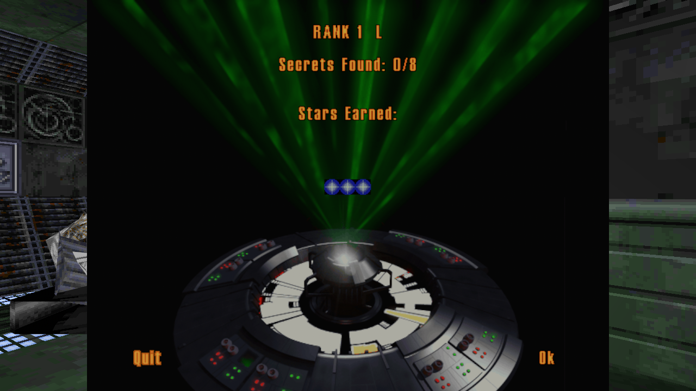
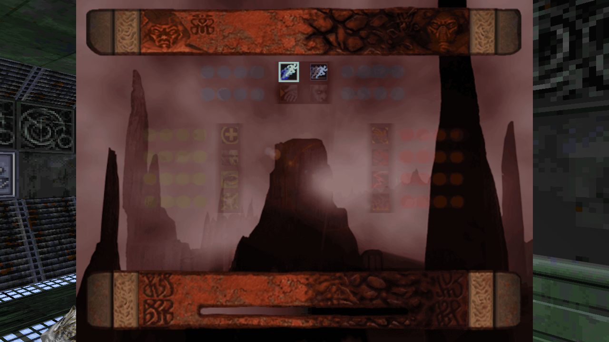

# What is left to port

A map of the engine's own source units (`sith*`, `jk*`) against this port, so the remaining work is a list
rather than a feeling. Every row names its evidence: the gate that runs it, or the file that holds it.

The port's checks at the time of writing: **64 gates, 147 tests, 0 failures.** Stubbed script surface:
**0 verbs, 0 call sites across the 34 shipped levels** (706 script verb calls, all answered).

Two rules for reading this file:

* **Absent** means a grep for the engine's identifiers in `src/` finds nothing. It is a statement about this
  port's source, not a claim about the shipped product.
* **Data-driven** means the engine implements the feature in a `.cog` that ships with the game, so the port's
  job is the *verbs*, not the feature. Force powers are the clearest case: `force_*.cog` exists in the
  install, and what the port owes them is `setinvactivated`, `setthingvel`, `setactorflags`.

Regenerate the numbers:

```
bevi-knight --run all                 # the 67 stubbed verbs, verbatim, aggregated over the install
bevi-knight --cog-check               # the same count with an assertion
bevi-knight --collide --level X.jkl   # collision and spawn facts
bevi-knight --walk all                # hull agreement across 34 levels
bevi-knight --rules / --feel / --fall # the player physics
```

---

## 1. Absent subsystems

Nothing in `src/` answers these. Ordered by how much shipped content they gate.

| subsystem | engine units | what is missing | evidence |
| --- | --- | --- | --- |
| Networking and multiplayer | `sithDSS.c`, `sithDSSThing.c`, `sithDSSCog.c`, `sithMulti.c`, `sithComm.c`, `stdComm.c`, `jkGUIMultiplayer.c`, `jkGUINetHost.c`, `jkGUIMultiTally.c` | the whole thing: message streaming, thing replication, cog RPCs, host/join, tally screens. Zero socket code exists. | no `socket`/`UdpSocket`/`TcpStream` in `src/`. The single-player **answers** are now explicit (`ismulti`/`isserver` 0, no team, no score, `*multimodeflags` stored) and `sendtrigger` really broadcasts `trigger`, but only `sendmessageex` is left stubbed — it needs message *return values* |
| Console and cvars | `sithConsole.c`, `sithCvar.c`, `sithCommand.c`, `jkQuakeConsole.c` | the `~` console, the cvar store, and the command dispatcher (`bind`, `set`, `map`, `quit`) | no matches for `cvar`, `sithCommand`, `sithConsole` |
| Particles and effects | `sithParticle.c`, `rdParticle.c`, `sithExplosion.c` (visual half) | effect and particle spawning. **Sprites draw, with their real artwork and animation**: every template's `sprite=` is parsed (`spr.rs`), its `.mat` loads through the cel-table reader in `tex.rs` with palette entry 0 keyed transparent, `draw_created` spawns one billboarded quad per row and `billboard_sprites` faces it at the camera. The frames walk with the thing's life (`Runtime::sprite_cel`: `typeflags & 0x1` arms it, frame *k* holds for the *k*-th `life / cels` slice), which is what `sithExplosion_CreateThing` does through `sithSurface_sub_4F00A0`. **The `PAR 1.0` particle clouds parse now (round 238)**: `par.rs` reads the engine's order (`rdParticle_LoadEntry`, `0x46c230` — size, material, lighting mode, radius, insert offset, and the vertex/`cel` list) and `--audit` checks the install's three files (`sphere.par`/`sphere2.par`, the Force shield's clouds, and `test.par`: **3 clouds, 294 elements**). | the **generated clouds are in (round 253)**: a `type=particle` template's `count`/`elementsize`/`range`/`minsize`/`pitchrange`/`yawrange`/`typeflags` are turned into vertices by `par::generate` (the engine's `sithParticle_Initalize`, `0x4f1da0`: two uniform Euler angles and a radius) and draw through the same `rdParticle_Draw` path a `.par` cloud does — level 1 now loads **24 generated clouds** (was 1 `.par`). What is still open: `sithParticle_Update`'s two arms (per-vertex cel cycling on `thingFlags & 0x20`; the grow/scale arm on `0x1`), the material's effect state beyond a keyed bitmap, and per-element velocity (the shipped `move=physics vel=` moves the owning thing, not its elements); `explosion` matches are class numbers and the damage path |
| In-engine cutscene cameras | `jkCutscene.c`, `sithCamera.c` focus modes | **The focus models work**: seven camera slots, `SetCameraFocus(slot, thing)` + `SetCurrentCamera(slot)` move the view onto that thing (aimed by its own own yaw/pitch), `GetCameraMode`/`GetPrimaryFocus`/`GetSecondaryFocus` read back, and `SetPOVShake` adds the recoil offset that decays at its own rate. Level 17b's `17b_Camera.cog` cutscene runs end to end: the view cuts to `ghostCam`, and after the script's `Sleep(6.0)` it hands the view back to the player. | `CycleCamera`, `SetCameraZoom`, path-driven camera dollies beyond `PlayKey` (a camera on a `.key` track follows its thing but has no path timing of its own), and the secondary-focus framing |
| Saber | `jkSaber.c` | `jkSetSaberInfo` stores the blade the scripts describe (two materials, hilt and tip radii, length, three spark templates) with the argument order pinned by a gate (`--pickup`); **and the player can use it**: `saber_swing` traces the blade `length * 10` level units along the player's facing with the hilt radius, damages what it reaches with `DAMAGE_SABER` (0x10), has a 0.45 s cooldown, and spends no ammo — `--hit` proves a hit at 0.8 units, no hit at 4, and the cooldown. The blade is also drawn as an emissive rod from the eye (`saber_blade`), and `jkDisableSaber`/`jkEnableSaber` switch it off and on (`saber_shown`, asserted by `--hit`) | the **swing animation**: `jkSaber.c` runs arcs, parries and the saber lock through `JKFLAG_SABEREXTEND`/`SABERRETRACT` and `cog_weap_saber.cog`'s `SetPuppet` calls, and this build neither plays those keyframes nor draws a hand to hold the hilt. The blade length is read as model units (x10, the `.3do` node scale) because the scripts pass 0.100 for a blade that must reach a body |
| Arch lighting | `sithArchLighting.c` | **not reachable from the text format, checked:** `.jkl`'s THINGS section has no archlight column and SECTORS carries only `AMBIENT LIGHT`/`EXTRA LIGHT`/`COLORMAP`/`TINT`. The engine *computes* arch lights at load from the geometry (`sithArchLighting.c`), so porting this means re-deriving them, not reading a field | the computation itself: per-surface colour contribution accumulated into each thing's `light`, which is what gives Jedi levels their coloured bounce. The sector ambient/extra light and the thing-light sum are already there to build on |
| Track things | `sithTrackThing.c` | things that ride a `.key` track (free paths, camera dollies). The port interpolates `frame=` lists, which covers doors and lifts but not a path with its own timing. **`PathMovePause`/`PathMoveResume` work**: the thing keeps its destination, stops advancing (`paused`, the engine's `flags \| 0x80`) and reports `IsMoving` 1 throughout, which is exactly what level 9's pipe doors need to stop in the doorway (`09_stoppipedoors.cog`, `--things`) | a path with per-frame timings of its own (`trackParams` interpolation); the port walks frames linearly at `MoveToFrame`'s speed |
| Event queue | `sithEvent.c` | the engine's timed event list. Pulses and timers live in `cog.rs` and cover the scripts; a non-cog timed event (thing expiry, AI tick) has nowhere to live. | no matches for `SithEvent` |
| Overlay map and 3D map screen | `sithOverlayMap.c`, `sithMap.c`, `jkGUIMap.c`, `ui.rs` | the **field-log map panel draws the live level**: `M` opens the screen, `live_map_for` gives it `World` + `Player`, and `ui::map` projects the level around the player's pose (`--map-shot` checks both the ink and that moving the player changes the drawing). Still missing: zoom and orbit, and the 3D map view | `ponytail:` in `ui.rs` — no zoom/orbit transforms |
| Scope | `jkHudScope.c` | the sniper/binos overlay | 2 incidental HUD-flag matches, no rendering |
| Level change | `jkMain.c` (`jkPlayer_Initialize`), `swap_level` | the **player's own state carries over** a level change: inventory (weapons, force powers, mana, the ending choice), the armed bin, the selected weapon, the saber and the `jkFlags` the force scripts set (`Runtime::carry`/`adopt`, `cargo test` covers the round trip) | health and shields carry too (fixed in 0.1.1; `runtime::tests::health_and_shields_cross_a_level_change`) |
| Ending choice | `jkPlayer.c` (`jkPlayer_SetChoice`/`GetChoice`) | `jkGetChoice()` reads the real value: it is inventory bin 18 (`SITHBIN_CHOICE`), which the endgame scripts branch on and `jkPlayer_CalcAlignment` maps to +100/-100 (`--pickup`) | the **menu** that writes bin 18. There is no ending screen, so the value is always neutral (0) in this build |
| Thing parenting | `sithThing.c` (`pParent`, `attachedThings`) | **`AttachThingToThing` works**: the child keeps the offset it had at the call, in the parent's own frame (`field_4C`), so a moving parent carries it and a turning one swings it around — a crate on a lift (`00_elev_doors5.cog`), a catwalk on a ship (`09_donefueling.cog`), the sphere `force_absorb.cog` hangs on the player, the orbiting camera of `00_cameratricks.cog`. `DetachThing` and `GetThingParent` round-trip, `SetThingAttachFlags` is stored (`--attach`) | the engine's child *list* (a thing may carry several children, and chains resolve in list order) — this build resolves one level in index order, `ponytail:`-marked. A gun in a hand needs the puppet's joint, which is the puppet work, not this |

Multiplayer is a project of its own and is deliberately out of scope: the UI holes the docs used to list are
both multiplayer-only screens.

---

## 2. Partial subsystems

| subsystem | what works | what is missing |
| --- | --- | --- |
| Thing attachment | the impact half of `sithThing_AttachThingToSurface`: `(v-2.5)^2*45` above a 2.5 threshold, applied to the runtime's player (`--fall`) | the *record*: `attach_flags`, `attachedSurface`, the surface-info snapshot, scroll-velocity transfer on a scrolling surface, and the `entered`/`exited` cog messages on a `COG_LINKED` surface |
| Physics | velocity integration with `ApplyDrag`, gravity, jump, fall, step, spawn clearance — for the player | `physicsRolloverFrames`/`OLDSTEP_DELTA_50FPS` accumulation (the port uses the frame's `dt`), angular velocity, `SITH_PF_USEANGULARTHRUST`, rotation of things (`sithCollision_RotateThing`), scripted movement of things, and non-player thing physics beyond the round-246 gravity/substrate pair (an actor walking off a ledge still does not fall; placed props are static) |
| Walk sweep | the walker runs the window's own `walker_step` on all 34 levels (`--walk all`), 20 s each: **34/34 stayed inside the tracked sector** over 639 doorway crossings, and on 14 levels the level's own hull test agreed | the tracked sector can still lag where sector hulls overlap, so `inside_sector` is the arbiter rather than the file's own hull |
| Puppets and animation | `stand`, `death`, and the locomotion set — `walk`, `run`, `walkback`, `strafeleft`, `straferight` chosen from the velocity the AI walked at, by the rule in `sithPuppet_UpdateThingMove` (dominant axis, 0.5 u/s walk/run threshold), with the clip advancing on distance moved rather than the clock. Plus `.key` interpolation with parent chains and pivots, `frame=` paths for doors and lifts, and `PlayKey`/`StopAnim`/`JumpToFrame` — a script can replace the puppet's state track with one of its own `keyframe` symbols (level 1's TIE bomber plays `01VTieB.key` from frame 0x14 when the player sees it) | an actor that just **fired** plays its `fire` track (the engine prefers the action track to the stride, and `--ai`'s shooter now animates the shot instead of sliding), and the armed/unarmed **mode** axis (**done**: the state key is `(name, mode)`, `SetArmedMode` selects it, and 113 of level 1's 128 actors ship a mode-1 set), a **hit** flinch (`just_hit`, below death and above `fire`; 127 of 128 actors ship the track), the **turn** states (a body pivoting in place plays `turnleft`/`turnright`, 226 actors ship them, with locomotion winning while moving), and the rest: the airborne set (`rising`/`jump`/`fall`/`land`/`drop`, ~220 actors), `death2`, `choke`, alt-fire `fire2`, `toss`/`windup`/`magic*`, and the **draw/holster** rows — **done** for `drawgun`/`holster` (`draw_row` plays the puppet's own row for its clip length when `SetArmedMode` flips; 24 actors ship each). `drawsaber`/`drawfists` are not selected yet, and `mount`/`dismount` — the *cog* symbol names, which animate the viewmodel — are a separate path, `turnleft`/`turnright`, `victim`, plus `sithAnimClass` layering. A scripted clip has no own epoch and its `flags` are not interpreted |
| AI | the `.ai` parser (instincts, flags, moves), actor spawning, `sightdist`/`fov` deciding whether an armed actor fires its own `weapon=`, `PrimaryFire`'s own arguments from the `.ai` (shot delay, range, aim cone, aim error, burst), scripted destinations, three-dimensional aim (an actor's pitch follows the elevation to its target, so it can shoot at a ledge; `--ai` checks it) over a 3D sight ray — `sightdist` is measured over the whole vector like `sithAI_CheckSightThing`, and the segment to the target must be clear, `AISetMovePos`/`AISetMoveThing`/`AISetLookPos`/`AISetMoveSpeed` make a placed actor patrol or follow, and a blocked destination is **routed** through the adjoin graph with the waypoints popped on arrival (`ai_route`; `--ai` walks one order to the end and asserts the list drains) — and the **frame list** verbs (`AISetMoveFrame`/`AISetLookFrame` index the thing's own `numframes=`/`frame=` entries, which class-less actors like level 1's 8t88 use). `--ai` fires a level-1 actor at 3 units, not at 8, not from behind, then walks one onto a scripted point and turns it; `--endlevel` shows 8t88 walking to his frame | the runtime: instinct **scheduler** (weights, priority, interruption), **awareness** (no hearing, no alert propagation), **pathfinding is in place**: `Collision::route` searches the adjoin graph breadth-first and `ai_tick` follows the doorway centres it answers, popping each on arrival (`ai_route`), so an actor told to reach a thing across a wall walks through the doorway instead of into the wall. Sight now needs a cleared line too, so an actor no longer sees — or shoots — through a wall. Losing sight now means walking to the last place the target was seen (`ai_last_seen`), and standing there forgets it. What is still missing is the retail *scheduler* below that: no hearing, no alert propagation, no instinct weights or interruption, `accuracy=` spread, aim-joint tracking |
| Actors | placement, health, shields, death, `--ai` | aim joints (`sithActor_UpdateAimJoints`), head pitch as a separate channel, force-power state, mount waits |
| Camera | position `thing + 0xb8 + thing[0x168]` (the eye offset, level units), orientation from the view angles at `thing + 0x15c/0x160/0x164`, the engine's yaw basis (column 1 = forward, confirmed at run time), the first-person velocity roll (`clamp(5 * dot(vel, right), -8, 8)`, constants at `0x522ddc`/`0x522de0`/`0x522de4`), the projection (**90 deg horizontal** from `buffer + 0x08`, vertical derived: 73.74 at 4:3, 58.72 at 16:9; near/far **1/64 and 64** from `rdCamera_NewEntry`'s `0x3c800000`/`0x42800000`, the port projecting near 1/64 and far 1000), a third-person boom 3.0 behind the eye pulled to the first hit by `collide::camera_pull` (the shape of `sithCamera_SearchSectorInRadius`, `0x4c6050`, cast radius 0.02), toggled with `V` (`C` still toggles the earlier 0.66-unit `third_person_view` boom, which draws no body), and the player's own body drawn in third person (spawned as an actor by `spawn_models`, one mesh per material, animated, hidden in first person and when the boom parks the camera inside him) | the engine's own case-3 follow camera (`0x4c59ce`, a spectator orbit spun at 8 deg/s) is not reproduced; the POV weapon's own sway is **drawn now** (round 234): `jkSetWaggle`'s amplitudes (degrees) and rate, the phase advanced by the distance the body moved (`thing + 0x264`, capped at 0.02 a frame) and scaled by speed / `maxvel` (`thing + 0x21c`), applied as a rotation about the eye — only `rdMatrix_BuildRotate34`'s composition order is still the port's own (see the roadmap ledger), and the view weapon's authored framing is drawn as-is (`thing + 0x168` is zero; nothing writes it — see the Weapons row) |
| `use` and the link tables | `Runtime::wire_links` fills all three tables from a level's `cogs` section plus each script's `symbols` (level 1: **37 thing, 44 surface, 10 sector** links), so a script now hears `used`, `activate`, `entered` and `exited`. The E key sends `used` to the nearest linked thing in front of the eye (`Runtime::use_thing`) and falls back to the nearest linked surface (`activate_near`) | was: nothing ever filled a link table, so `use` reached nothing and no message left the world. **Closed:** `--door` runs the whole chain in one process — use action, `activate` message, the level's own script, the flag — and `00_door.cog` on thing 4 clears its sector's ADJOINS bit and starts the piece moving. What it took: `activate` not `used`, a `startup` pass before any message (a door's `doorSector` is set there), and **one kept VM per instance** (locals live in the VM; a fresh one per label lost `doorSector`). Was: `cog_00_door.cog`'s `activate` reaches `CheckStatus`/`OpenDoors` and something there takes the do-nothing branch. The probe now runs every instance's `startup` first (a door's `doorSector` and `numDoors` are set there, and skipping it measured a door with an empty symbol) and prints the script, the frame and `IsThingMoving` per candidate: `00_door.cog` on thing 4 answers `frame 0, moving 1`, so `activate`'s `if (moveStatus) return;` is what stops it — the door thinks a piece is already moving. `01_*` lifts report moving 0 and still change no flag, and one `00_door.cog` (cog 13) runs **0 labels**, so its `activate` call fails outright. Next: why `IsThingMoving` is 1 for a door at frame 0 (is the piece on a path, or is `door0[i]` binding the wrong thing?) and why one label does not run. Note the message label too — no shipped cog declares `used` (0 of 540), 82 declare `activate`, so `use` must send `activate`. Level 1's doors are wired the *thing* way — `cog_00_door.cog` declares `thing door0..door3 linkid=0..3 mask=0x405` and answers with `setsectoradjoins` — so the door chain is: populate the link tables from the COG `symbols` section, then send `SITH_MESSAGE_USED`/`ENTERED` to the linked instances. 32 shipped cogs call the adjoin/sector verbs and every one of them is waiting on a message nothing sends |
| Items and inventory | bins, maxima, activated/available flags, pickups through each item's own script, respawn | item *use* — `UseBin(bin)` sends `activated` to the bin's own cog and the script does the rest (`--use-item`: the bacta heals 30 and spends one); and the **inventory strip is selectable**: `I` opens it, the arrows move, Enter uses the item through `UseBin` (`--use-item` also counts the highlight's pixels, since `ui::Canvas` is software pixels). What is missing is retail's own screen art — `jkHudInv` code this tree does not carry, respawn masks (`setrespawnmask`); the **held-bin loop** is real (`sithInventory_SendFire`: an active bin with a delay sends its own cog `fire` every delay until `DeactivateBin`, asserted by `--items`), which is what a held force power runs on, pickup sounds (`setmountwait` is in §3) |
| Weapons | a fired bolt flies with the template's `vel=` **along the shooter's whole orientation** (yaw and pitch; aiming up or down used to leave the barrel level),, stops at the sector graph, applies `damage=` with `SITH_WF_DAMAGE_DECAY`, a kill plays `death`; ammo bins; the player's `setfirewait` cooldown; `--hit` two-way damage | **inventory cogs**: `misc\items.dat` names a script per bin — 40 of the 82, all shipped (`weap_fists.cog`, `weap_bryar.cog`, …) and all now parsed (`--items`) — the handoff works — a bin going from empty to held names its script (`Runtime::set_bin`, `load_item_cogs` starts the VM and runs `startup`) — and the item scripts themselves now **run clean** (`--weapons`: 106 labels, 0 errors, 0 unimplemented verbs after 21 were implemented). The **routing works**: `fire_player` now sends the armed cog `fire` instead of firing directly, and `load_item_cogs` runs `activated:` when the player acquires the weapon (which is what arms it). `--weapons` proves the script end of it — the bryar's `fire:` spawns 2 things through `FireProjectile` and spends 1 of 50 rounds. The live path is wired but unobserved in this environment (no window). the POV half is retail's pass rendered in the camera's frame: `selected:` names the weapon's `povModel` (`bryv.3do`), `draw_viewmodel` builds it parented to the world camera with `NoFrustumCulling` (a view model is always in view), recentres it on its own box, textures it through its own `.mat` over the install's palette and tints it with the sector light (`AMBIENT LIGHT` + `EXTRA LIGHT` clamped 0..1, what `rdCamera_SetAmbientLight` gives the pass). **Round 232 corrected two stale guesses in the sentence that used to stand here**: the model is drawn with its **authored coordinates** and no placement of its own (round 231 removed the recentre/scale after `jkPlayer_DrawPov` and `rdModel3_Draw` proved the authored frame is the framing — `viewmodel_framing_tests` pins it), and it is **one entity per material the faces use**, because `rdModel3_DrawFace` binds each face's own material (14 materials / 76 faces on `bryv.3do`; the old draw was `HDBACK.MAT` alone). **Round 234** adds the sway: `jkSetWaggle`'s amplitudes and rate rotate the parts about the eye (see the Camera row and the roadmap ledger), and the cog's clip still plays (`jkPlayPOVKey`: `bryvpst1.key`, 13 frames, advanced at the key's fps). Still open: `thing + 0x168` (no decompiled writer; the port draws with it zero, which is what retail's own state must be) and the model's authored barrel orientation. `jkSetWeaponMesh` stores the weapon's **body** mesh and nothing draws it yet: the first-person half reads `pov_model`, so the third-person weapon mesh is the remaining half of the viewmodel work The muzzle is the **shooter's** own `fireoffset=` (parsed into `template_fire_offset`, model units, rotated into its facing), in the shooter's own frame with the engine's handedness (`sithWeapon_FireProjectile` transforms it by the shooter's orientation; the lateral sign was wrong until `--muzzle` pinned all three axes), and a projectile carries its `owner` so `impacts` skips the body that fired it — which is why the real in-body offsets are usable (`--muzzle`). The trigger obeys the weapon's own rate (`try_fire_weapon`, the engine's `binWait`); alt fire (`weapon2`) is still absent, as is autofire-on-hold, muzzle flashes, per-weapon animation, and ammo as `weaponData` describes it (the bin→projectile mapping is a name heuristic, §4) |
| Damage | health, shields, two-way, death and respawn, `DAMAGE_DECAY`, the engine's damage **kind** — a `SithDamageType` bitmask — with `SITH_AF_INVULNERABLE` honoured and its fall exemption (`--endlevel` watches the flag go set and clear around the level-end sleep), and **message parameters plus `ReturnEx`**: a `damaged` handler reads the amount from `GetParam(0)` and answers with `ReturnEx`, which the runtime applies instead of the amount it passed in (`--damage-return`; 115 shipped scripts have a `damaged` label, 54 answer with `ReturnEx`, and level 17b's `darkjedi_yun2.cog` is one) | the kinds are carried but unused elsewhere: the engine picks a hurt sound per type (`SITH_SC_HURTENERGY`/`HURTFIRE`/`HURTMAGIC`/`HURTSPECIAL`) and scales limb hits by 0.1 when the sender has an actor parent. Neither is ported. A handler can only *reduce* a hit (a settled hit is amended, not replayed), so a script asking for more damage than was applied is ignored |
| Force powers | the bins and the verbs the shipped `force_*.cog` scripts call; jump, speed, healing, seeing, pull and grip run, and **the powers are acquired the way the engine acquires them**: `misc\items.dat`'s `cog=` column names a script per bin, and a bin that goes from empty to held queues its own script (`Runtime::set_bin` -> `item_cog` -> `load_item_cogs` starts it out of the `.gob` when the level's script table does not carry it). That path was dead for every force row: their `max` column is a decimal (`4.0`) and an integer parse dropped all eight rows, so the map answered `bin 21 -> None`. `--items` now reads **40 of the 82 bins**, `21 f_jump` .. `28` among them, and `cargo test` pins the decimal parse (`the_force_rows_survive_a_decimal_maximum`); **the economy's arithmetic is in** (`src/force.rs`: the bin map, the rank ladder `jkPlayer_SetAccessiblePowers` walks, `CalcAlignment`'s weighted sum and clamp, the rank-8 mastery choice and the rank-7 side lockout, all against the constants read out of `JK.EXE` at `0x52206c`/`0x522074`/`0x522078` — `--force-economy` prints the model, `cargo test` pins it both ways) | the *effects* are unverified beyond jump and speed: nothing drives `force_pull.cog`'s grip in a test, and `setpovshake`/`setthingrotvel` are stubs those scripts would want. `force jump`'s velocity once reached `SetThingVel` as zero — fixed, but the path has no assertion of its own |
| Sound | 2D playback of `.wav`/`.snd`, one music track, `--audio-state`, per-sink mute, `create`-class sounds, and the **channel verbs**: `PlaySound*` answers a channel, `ChangeSoundVol` ramps it (clamped to 1.5, only for a positive fade, as `sithCogFunctionSound_ChangeVolume` does), `ChangeSoundPitch` sets the rate, and `SectorSound` replaces a sector's ambient with the script's own (`--sound`) | 3D positional and velocity mixing (`sithSoundMixer.c`) and sound classes with mode ranges. The channel is applied when a request *starts* — a one-shot mixer cannot re-tune a sink that is already playing, so `ChangeSoundVol` on a long ambient does not sweep it (`ponytail:`) |
| Surfaces and sectors | the flags, `SURFFLAG_SKY`/`SURFFLAG_CEILING_SKY`, adjoin state, `sithPhysics_FindFloor`, thrust values, and the script-side switches — `setsectorflags`/`setadjoinflags`/`clearadjoinflags`/`setsectoradjoins` now reach collision and the cull (§6). **Texture cels, material cels, scripted light and scroll reach the renderer**: `SetWallCel`/`SurfaceAnim`, `MaterialAnim`, `SetSectorLight`/`SurfaceLightAnim` and `SlideWall` are baked into the mesh (`Runtime::surface_epoch` -> `rebuild_surfaces` -> the vertex colour and UVs -> `level.wesl`). A scrolling surface also **carries the body standing on it** (§6), which is what a conveyor is; level 1's neon sign and its five 5 fps surfaces step, `09fuelstation`'s two `00_matanim.cog` calls walk `09sign.mat`, and level 2's seven force fields ramp their light | a sector's `thrust` vector now pushes bodies (`SetSectorThrust`, `--things`) |
| Sky | unlit sky faces plus a dome, and the camera's clear colour; `SlideHorizonSky`/`SlideCeilingSky` scroll the sky **faces** | the sky's own parallax and rotation (`sithRenderSky.c`), and the dome is a port stand-in that does not scroll |

| Models and materials | `.3do` parse, geosets, materials, `RADIUS`, `insertOffset`, mipmaps, the light ramp, `--winding` | `setthingmodel` (swap a model at runtime), per-surface material animation, the geometric-mode verbs (`*geomode`), and no back-face culling for models (§4 — model interiors render when the camera clips in) |
| Rendering | opaque pass, portal-aware sector culling, the light ramp, HUD, **placed and created sprites** (billboarded quads, one cel of the `.mat` strip, `billboard_sprites`), and projectile impacts (a bolt's `explode=` template is spawned by `projectile_hits` → `Runtime::explode`) | no transparency sorting, and a changed animation frame rebuilds the whole mesh asset instead of writing into it (§4) |
| Colormap and lighting | the palette, and each `.cmp` ramp sampled at **32 steps** (`LIGHT_STEPS`) to build the surface light ramp; a single far colour for distance shading; sector light animation, surface light animation, and **`ThingLight`/`SetThingLight`/`ThingLightAnim`**: a thing's own light, ramped the way `sithSurface_SetThingLight` ramps it (`from`, `rate = delta / time`, `to`), summed per sector so a lamp brightens its room and a broken one stops (`--cel`) | the engine's per-distance table **selection** — a surface picks the 256-entry table matching its distance from the light — and the *dynamic* pass that gives a thing's light a radius: this build adds the whole thing-light sum to its sector's baked light, so a lamp lights the room flatly rather than in a pool (`ponytail:` per-surface falloff). 256 tables are located per ramp (`(len - CMP_HEADER - CMP_PALETTE) / 256` in `tex.rs`) and the ramp uses 32 of them |
| Savegames | the container and thing records: version 6, the 1580-byte header, the `0x28` record header, template/type/position/angles round-trip — **and live state**: `Runtime::snapshot`/`restore` capture every thing (position, angles, sector, health, flags, `jkFlags`, destroyed, path frame), the inventory, weapon, armed bin, saber, the sector-adjoin word and each sector's light, into a `SAVE_SECTION` payload inside a real `.jks` (`--save` proves the round trip: health 37, +1.25 along x, inventory bin 2 = 3 and the clock all come back) | the **save-slot picker**: the pause menu's own `GUI_SAVE`/`GUI_LOAD` rows work (`jkGuiEsc_Show` case 15 and 13, checked by `--quicksave`), and the keys do work (`F5` writes `saves/quicksave.jks`, `F9` loads it, in place or by loading the level the save names first — `--quicksave`), and the automatic one does work (`AutosaveGame` writes a checkpoint at the story beats levels 7, 11, 15, 17a, 17b and 20 ask for), and the format plus the runtime round trip are checked. **Eight slots** now (`slot0.jks`..`slot7.jks`, slot 0 the historical `quicksave.jks`; `,`/`.` choose one and `--quicksave` proves two slots keep separate games); retail's slot *picker* screen is not in this tree. And the rest of `sithGamesave.c`: cog VM state (a loaded save restarts its scripts), AI state, item respawn masks, the event queue, multiplayer sections |
| Cog | the VM, 34 levels of scripts, pulses and timers, every verb the scripts call except none | no stubbed verbs in section 3 |
| HUD and UI | the HUD, most screens, menus built from `jkGUIRend` tables, and the status bar's carried strip (`hud::carried`, fed by `health_follows_damage` from the runtime's bins — it was blank before) | the screens still placeholders (`--ui-tables`), the scope, the map screen, and the tally screens (blocked on multiplayer) |
| Cutscenes | `.smk` decoding of all 25 shipped films (483 MB, 29,493 frames) with their own palette records, seeded from the level | in-engine camera cutscenes (section 1) |

---

## 3. The stubbed cog verbs — none left

Every verb the shipped scripts call now gets an answer: **0 stubbed, 0 errors** across the 34 levels
(`--cog-check`).

The check runs **every label each script declares**, not just `startup` and its declared `message:`
labels. That deep pass is the point: the startup-only count said "zero" for rounds while
`AutosaveGame`, the whole `jkString*` buffer (`jkStringClear`/`Concat*`/`Output`), `StopKey`,
`LoadSound` and `SyncScores` were silently returning 0 — verbs that sit behind cutscene and gameplay
labels nothing had fired. A number that measures what a pass reaches is only as good as the pass.

That was worth driving to zero rather than leaving as "harmless". An unhandled verb returns `0`, the
catch-all arm of `Runtime::handle` — the right answer for `ismulti` and `isserver` in a
single-player game, and the wrong one for a getter, where a script that branches on the zero takes
the wrong branch with no error anywhere.

Three ceilings came with the last of them, and they are marked in the code:

| verb | what is real | what is a stand-in |
| --- | --- | --- |
| `SetThingRotVel` | the angular velocity is integrated every step and the angles wrap | nothing |
| `jkStringOutput` / `jkPrintUNIString` | the line is composed (`jkString*`), resolved through `ui\jkstrings.uni` and **drawn**: `hud::draw_message` puts it across the top of the canvas for 4 s, in the live HUD and in `--hud` (`BK_HUD_MESSAGE` is the capture aid) | the engine draws it in its own message slot with per-type timing and a separate chat log; this build has one slot and one duration |
| `NewColorEffect` / `Modify` / `Free` | the handle, the three channels, the fade, and the create/modify/free round trip; **and the draw**: the effect is blended over the HUD canvas each frame (`ui::Canvas::apply_screen_effect`, unit-tested against `stdPalEffects_GatherEffects`' filter = quarter-channel and zero-tint rules) | **the world is tinted too**: `scene_wash` draws a full-screen quad on its own layer, under the HUD, so a force-seeing view washes the 3D scene (`scene_tint`, unit-tested). ponytail: a blended quad cannot *dim* a channel, so a filtered channel is drawn as absent rather than quartered — the HUD canvas keeps the exact engine rule |
| `SetThingModel` | the override is stored and a *created* thing is drawn with it | a thing the level **placed** keeps the mesh built at load |

---

## 4. Debt already marked in the code

14 `ponytail:` comments name a deliberate ceiling and its upgrade path. Line numbers are left out because they
rot; grep `ponytail:` in the file named.

| where | the shortcut | the ceiling |
| --- | --- | --- |
| `main.rs` | no back-face culling for model triangles | model interiors render when the camera clips into them |
| `main.rs` | a changed animation frame rebuilds the mesh asset | a 60 fps puppet rebuilds its mesh sixty times a second |
| `main.rs` | the cancel-row test is a unit test, not data | parsing `hoverId` would make it real data |
| `collide.rs` | the sweep's depth limit and "already searched" rule | a chain of more than 24 adjoins in a line reports no hit; no shipped level has one |
| `collide.rs` | the four-way clearance test rejects a body touching the riser it was blocked by | a step only succeeds if the lift clears the riser's polygon top; `STEP_UP = 0.066` compensates |
| `collide.rs` | the floor probe scans every wall face | O(walls) per moving body per frame |
| `runtime.rs` | insert offsets live in one process-global table | two worlds loaded at once (level plus cutscene) share it |
| `runtime.rs` | the bin → projectile mapping is a name heuristic | not the engine's `weaponData` |
| `runtime.rs` | steering picks the doorway that looks closest on both legs | no path search, so an actor can pick a longer route or lose the chase |
| `runtime.rs` | `sleep`/`settimer`/`setpulse` run straight on, with no timer queue | a script that only works across resumed sleeps runs its later statements early |
| `level_mat.rs` | the shader adds no light level | the mesh carries baked vertex colour only |
| `tex.rs` | one process-global light ramp | a second level in the same process needs the ramp passed through the mesh builder |
| `tex.rs` | a length check rejects non-bitmap headers | no header version dispatch |
| `ui.rs` | the map screen has no zoom/orbit transforms | see section 1, overlay map |

The `runtime.rs` sleep row is the one that bites: it changes script behaviour, not just speed.

---

## 5. Where to start

Ordered by risk per hour, using the call counts in section 3 rather than subsystem size.

1. **Fix the wrong-by-default getters.** ~~`getselfcog`, `getmastercog`~~ — **done**: the VM answers
   `getselfcog` with its own index in the level's cog list, and `setmastercog`/`getmastercog` are the
   world's one global master (`-1` unset), which is what `01_endlevel.cog` registers at startup
   (`SetMasterCOG(GetSelfCOG())`). `getgoalframe` answers the destination a piece is moving to and 0 once
   it has arrived — the engine zeroes `goalframe` on arrival, and that is what a reversing lift reads.
   Still open: `loadtemplate` (1). (Also done earlier: `getleveltime`, `gethealth`, `isthingvisible`,
   `get/setthingmass`, `setthinguserdata`, `setthingtimer`.)
   **Level-end chain: closed.** A level's `goal*.cog` reports a finished objective with
   `SendMessage(GetMasterCOG(), user0)`, and `SendMessage` now takes the engine's two arguments — a
   **cog index** and a message **id** (`sithCogFunction_SendMessage`) — carrying the calling cog as
   the sender so `GetSenderID()` answers in the receiver. The ids come from the retail binary's own
   keyword table in `sithCog_Startup` (`activate` 1, `activated` 1 as an alias, `startup` 3,
   `timer` 4, … `user0`…`user7` 27…34, `trigger` 40), so a `message` symbol evaluates to its id and a
   receiver matches its `message:` list by id rather than by declaration order. The queue is drained
   in play as well as in `--run`; before this, `Runtime::messages` (script→script, addressed by cog)
   was only pumped by `--run`, while the live loop drained `pending_messages` (thing/sector, addressed
   by instance). Level 1 delivers the goal message to exactly one cog instead of broadcasting it to
   41, and `[01_endlevel.cog user0]` runs — goal flag, `Accomplish1.wav`, `Sleep(3.0)`, `jkEndLevel(1)`.
   Across the 34 levels the id routing is visible on three: level 2 sends 5 → 7 script messages, and
   11 and 17 change how many doorway pieces and sounds their scripts drive. `--endlevel` is the gate
   that pins the whole thing end to end on level 1: master cog 26 registered by startup, `user0`
   (id 27) delivered to it, goal bin 100 = 3, and `level_complete` true after the handler's 3 s sleep
   — i.e. **a level can be finished by its own scripts**.
2. **Timer queue for `sleep`/`settimer`/`setpulse`** (section 4). It is the one ceiling that changes what
   scripts do, and it sits under every verb that waits.
3. ~~**Sector and adjoin flags**~~ — **done** (section 6): `setadjoinflags`/`clearadjoinflags`/
   `setsectorflags` now reach collision and the cull, `setsectoradjoins` closes a sector's doorways
   for real, and **`setsectorthrust`** makes the sector accelerate what stands in it — `sithPhysics.c`
   adds `sector->thrust * dt` to a body exactly like gravity, so level 21's core tube is a real
   updraft and level 10's power core pushes the player out (`--things`; `walk_player` folds it into
   the body's horizontal velocity and its vertical speed).
4. ~~**Damage types.**~~ — **done as far as the engine's rules go:** `Runtime::damage_typed` carries the
   `SithDamageType` word (impact 0x1, energy 0x2, fall 0x40, …), bolts arrive as energy and landings as
   falls, `SITH_AF_INVULNERABLE` (`actor->flags & 0x8`) is honoured with the engine's fall exemption
   (`sithActor_DamageActor`), **and a `damaged` handler's `ReturnEx` replaces the amount**: the message
   now carries its params (`GetParam(0)` = amount, `GetParam(1)` = kind), the label's answer comes back
   as its return value, and `Runtime::amend_damage` gives the difference back — which is what
   `force_absorb.cog` (turn part of a hit into mana) and the dark Jedi handlers need. What is still
   unported from the same function: the per-type hurt sounds and the 0.1 limb-hit scaling.
5. **AI verbs.** 240 calls across 11 verbs. **Mostly done:** `aisetmode`/`aiclearmode` are the actor-flag
   arms, `aisetmovespeed` stores a clamped 0..2 multiplier the AI step applies to the template's walking
   speed, `aisetmovepos`/`aisetmovething`/`aisetlookpos` are the scripted destination, follower and
   standing turn that `ai_tick` now walks and faces — which is what makes `00_AIPatrol.cog` walk its
   puppet, and `--ai` asserts the walk, the arrival and the turn. `setfirewait` (a weapon verb, kept here
   because it was the same shape) arms the player's cooldown, `fire_player` reads it, and
   `setgoalflags`/`cleargoalflags` OR and mask the goal counters (`SITHBIN_GOAL00` = 100) that
   `endlevel.cog` records objectives in, and `aisetmoveframe`/`aisetlookframe` walk an actor to one of
   the level's own `frame=` entries — which exposed a parser bug: an **actor's** frame is a position
   alone (`frame=(-4.476/15.877/3.840)`), and only the `pos:angles` spelling was accepted, so every
   actor's frame list was silently empty. `ai_tick` also had to stop keying on the instinct class:
   `SITH_CT_AI` comes from the actor block, and level 1's 8t88 has no `aiclass=` yet its goal script
   walks it to frame 1 (314 calls gone; 392 stubbed, down from 706). **The group is now closed**:
   `aisetfiretarget` (8) stores what an actor shoots at, and the fire-target is what made the
   out-of-sight early return bite — it had to be computed *before* that return, or an actor told to
   shoot a thing it can see stands still because it cannot see the player; `aiflee` (3) is the flee
   state (walk away from the named thing, do not shoot); `aisetclass` (2) swaps an actor's `.ai`
   wholesale from the name the cog binds, which is level 11's endlevel changing Pic's and Gorc's class
   between fight phases. `--ai` asserts all three: the actor turns to the named target and fires with
   the player behind it, a fleeing actor's gap grows 3.00 -> 3.30 over a second with no shots, and
   `AISetClass(actor, "pednarsh.ai")` moves its sightdist 5.0 -> 7.0. (`setmountwait` (25) is done: the
   engine's fire path refuses until `sithWeapon_secMountWait` passes, and every shipped caller passes 0.)
6. ~~**Puppet locomotion states.**~~ — **done** (section 6): the state is chosen from the velocity
   `ai_tick` walked the actor at, by `sithPuppet_UpdateThingMove`'s own rule, and the clip advances on
   distance moved instead of the clock. What is left of the state machine is the armed-mode axis and
   the reactions (`crouch`, `jump`, `fire`, `hit`, turns).
7. ~~**Attachments and parenting.**~~ — **done for the scripted case** (`--attach`): `AttachThingToThing`
   stores the child's offset in the parent's own frame and re-places it every step, so the twenty
   shipped calls that make a crate ride a lift, a catwalk ride a ship, or an effect ride the player
   all work. What is left of the group is the engine's *child list* (several children, chains) and
   the puppet-side version — a gun in a hand is a joint, not an attachment.
8. ~~**Camera focus and shake.**~~ — **done**: seven camera slots with `SetCameraFocus`/`SetCurrentCamera`
   and their getters, and `SetPOVShake` as an offset that decays at its own rate. Level 17b's cutscene is the
   end-to-end case: `17b_Camera.cog` startup cuts the view to `ghostCam`, and `Sleep(6.0)` later hands it
   back to the player (`--camera`, and `BK_CAMERA_TRACE=1` on a live run prints both). What is left of the
   group is `CycleCamera`, `SetCameraZoom` and the secondary-focus framing, which no shipped single-player
   script uses.
9. **Level 1's first frame is a wall of polygons, and it is the level's own start.** The walker spawns at
   the first thing of type PLAYER (thing 0, `(-10.44, -5.45, -1.13)`, sector 339) — the engine's own rule
   (`sithPlayer_Initialize` takes the first `SITH_THING_PLAYER` in list order), so this is not a wrong
   pick: the level's other 11 `walkplayer` rows carry `thingflags=0x20080501` (multiplayer starts) and
   thing 0 carries none. But a `00table` sits **0.16** units away, a `tuskensoused` patron 0.15, a
   `reyeesbhgun` 0.27, columns either side, and the eye is at `pos + PLAYER_EYE`, so the view is inside a
   cantina table with a body at arm's length. `BK_MODEL_SCALE=0.01` renders the room cleanly and the
   geometry is right, so the blocker is a thing model drawn at the eye, not the world. Unproven whether
   retail draws the same frame (nothing here says the start point is wrong); the way to settle it is a
   retail reference frame at level start, then either the port's draw offset follows or the start stays.

   **The spawn difference was the reference camera, and the draw fixes stand (2026-10-26).**
   `tools/parity/` captures the real GOG build and the port at the same player pose (retail `coords`:
   `Pos (-10.44, -5.46, -1.13) PYR: (1.04, -59.98, 1.04) Sector 339`). Reading the camera path in the
   dump settles the two guesses this item raised: first person is the thing position plus the
   `thing + 0x168` eye offset (`sithCamera_Update`, `0x4c56b0`), which is the template's
   `eyeoffset=(0,0,0.037)` **in level units** (no `x10`), and that path has **no ceiling clamp** —
   the sector search there is the third-person pull-in. `sithPlayer_NewPlayer` (`0x4c8ec0`) places
   the player exactly at the level's recorded thing pose, with no floor re-seeding either. So the
   port's eye offset already matched, and its ceiling clamp is a workaround, not engine behaviour.
   The wall of polygons is **one animated decor thing**: level 1's `tuskensoused` patron (thing 215),
   which `01_TuskenTwitch.cog` drives with `PlayKey(THout.key)`. The port drew it frozen because it
   only loaded keyfiles named by puppets, and because the thing's `cr.pup` declares no states it was
   not treated as an actor at all. Both are fixed: script-named keyfiles are loaded, things with a
   puppet are animatable, and `PlayKey`'s flags are honoured (`0x2/0x4/0x20` = play once and hold,
   per `rdPuppet_AdvanceTrack` `0x43eaa0`).
   The apparent contradiction — an early retail reference showed the room with no patron filling the
   eye — was the **patron's animation state**, not the camera. Retail plays `THout.key` once and holds
   the clip's last frame, so the patron lies settled in the booth; the port drew the clip's first frame
   forever (it loaded only puppet-named keyfiles and ignored `PlayKey`'s hold flags), which is the leg
   across the view. With the staged executable patched to register the gated dev verbs, `warp`
   reproduces a pose and `coords` verifies it (`spawn_yaw30`: position delta 0.005, yaw delta 0.01);
   the *pose-verified* retail frame and the level's own un-warped spawn frame are the same camera
   (SSIM 0.99995, sidecar `first_frame_is_player_camera: true`), and it draws the patron in the same
   place the port now does. The port's spawn draw was right; its spawn camera was not (next paragraph).
   The retail reference itself also stopped being the weak link: the 1997 Direct3D path crashes on
   this Windows 11 machine (system `D3DIM.DLL`), so the harness now stages **dgVoodoo2** into the
   scratch copy and runs the game's **16-bit** path, whose F12 writes a 24-bit `JSHOT###.BMP` instead
   of the palettised PCX. The 16-bit pair at the verified pose scores SSIM **0.62** where the old
   8-bit/unverified pair scored 0.13; the remaining gap is renderer difference and the port's HUD,
   not a drawing rule. Reproduce with `pwsh -File tools/parity/retail-capture.ps1`, `port-capture.ps1`,
   `compare.ps1` (see `tools/parity/README.md`).

   **The plain spawn was 0.055 low, and it is now gated (2026-10-26, same round).** The pose above was
   captured through `warp`, so it bypasses the level's own start; an un-warped capture of level 1
   showed the port 0.055 units below the same retail `coords`. The eye offset was not the cause — it is
   right. The spawn *placement* was: setup added `PLAYER_RADIUS` to the recorded pose and re-seated the
   body on a floor probe (`spawn_point`), while `sithPlayer_NewPlayer` (`0x4c8ec0`) places the player at
   the level's recorded pose and the engine's attach step holds it there. The port now starts at the
   recorded pose and, while idle, stays attached to the floor it stands over instead of settling the
   gap the level authored (`walk_player`; the walking half is a `ponytail:` entry in the porting
   roadmap's deviation ledger). Measured: the port's spawn eye was `-1.148` against retail's `-1.093`;
   a port capture at the recorded pose is pixel-identical to a `--shot-at` capture there (SSIM 0.9999),
   and the `spawn` pair went **0.2284 → 0.62–0.65** SSIM (MAD 31.3 → 23.2), the equal of the two
   warp-verified pairs. `pwsh -File tools/parity/compare.ps1 -Gate` now fails on the pre-fix frame
   (0.2284) and passes the fixed one; the same command is the regression check.

   **The route set: five poses, three gated, two triage; and the player starts it exposed.** The
   `route_*` rows in `tools/parity/shots.tsv` are the level's own `walkplayer` placements (things
   167/169/170/171/174). Retail verified all five through `warp` + `coords` (position delta ≤0.02).
   Three pairs (`route_cantina`, `route_lower`, `route_street`) score **0.73/0.72/0.74** SSIM and are
   gated at 0.65. The first one also proved a port renderer bug: retail's frame at that pose is clean,
   while the port put a Kyle model in the camera because it spawned the level's other eleven
   `walkplayer` things as ordinary animated actors. Those rows are the multiplayer spawn points, not
   NPCs; single-player retail draws only the local player. `spawn_models` now skips every non-first
   `walkplayer`, and `solid_things` excludes all player starts (the local player is not an obstacle;
   the other markers are not bodies at all). The comment that called them NPCs ("the training arena
   does") was wrong and is corrected.

   **The port warps its player too, and that moved the two triage rows' blockage onto the damage
   tint (2026-10-27).** `--warp "x,y,z,yaw"` takes the same camera-eye pose as `--shot-at`, puts the
   body one template eye offset below it and re-derives the sector; `port-capture.ps1` passes it for
   every numeric row, so both sides now capture with a body at the pose. The port's derived sector
   matched the sector retail's `coords` reports on all eight level-1 rows (339 ×3, 254, 137, 156, 175,
   60) — the earlier `BK_SPAWN_THING` attempt had landed in the wrong sector, which is why it failed.
   With the body present, the port's scripts and AI do react (actors walk and fire, the shield-recharge
   pickup is taken at the catwalk) — and that exposed a combat bug in the port: live projectiles were
   **collected as weapon pickups**. `collect_items` took any thing of type weapon (3) within a unit of
   the body, and `fire` gives every shot that type, so bolts heading for the player were removed as
   "picked up +elaser" before they could hit: the port's player was immune to close-range gunfire, which
   is why the door capture showed no damage at all. `is_pickup` now excludes any thing that carries
   `damage=` (a shot in flight); with that guard the port's body takes hits at the door (shield 100 → 91
   on the first volley), as retail's does. The two upper rows still score 0.45/0.42, and the reason is
   the engine's **damage tint**, not a scripted effect: retail's own series shows the body losing health as
   the picture reddens (door 100 → 44 over the eight frames, catwalk 100/100 → 81/11), and the decomp
   gives the rule — `sithActor_DamageActor` calls `sithPlayer_AddDynamicTint(damage * 0.04, 0, 0)` for
   the local player, `sithPlayer_Update` decays the three channels by 0.4 per second, and
   `stdPalEffects_UpdatePalette` adds `round(byte * tint * 0.5)` to each palette channel. The port's
   **state** now follows that rule — `damage_player`/`damage_typed` add `damage * 0.04` red,
   `sithPlayer_Update`'s 0.4/s decay runs in `Runtime::step`, and the `AddDynamicTint` verb adds with
   the engine's clamps (red/green 1.0, blue 0.5) instead of replacing — and is unit-tested. The world
   **draw** is a fullscreen palette pass now (`src/palette.rs`): the finished picture's bytes scale by
   `1 + tint/2`, measured at ×1.52 for a 1.0 red tint against the engine's 1.5, and an identity tint
   leaves the frame byte-identical because the pass is only attached while the tint is non-zero.
   At the catwalk there is a second gap: the recorded body stands on a `3x10catwalk` *model* (a solid
   thing, top at 2.675) 0.145 below it and on no sector floor, and the port's idle attach needs a floor
   within one radius, so its body falls and dies; retail's `coords` holds z 2.80 for the whole capture.
   Whether retail's placement step keeps the pose there or its collider has a surface the port's does
   not is for the movement port (Phase 1 step 3) to settle.

   **Two combat-parity bugs fell out of the same door measurement (2026-10-27).** With the pickup bug
   fixed the port's body still took almost no damage, and the AI's own hits landed on its friends. Two
   causes, both recovered from the executable:

   - **The muzzle offset was scaled by ten.** `fireoffset=` is in level units — the engine's
     `sithWeapon_FireProjectile` transforms the vector by the shooter's orientation and adds it to the
     thing's position with no scale, and the same templates' `size=` fields are level units too. The
     port multiplied by ten, so `reeyeesgun`'s muzzle sat 0.8 units ahead of a 0.07-radius body, past a
     target standing at arm's length — the range retail's door fight actually happens at. The
     `--muzzle` check had been written against the same wrong number and now pins the template's own.
   - **The aim error was a yaw cone of ±`error` right angles.** `sithAI_RandomFireVector` (0x4eb920)
     jitters the aim *vector*: `((rand/32768) - 0.5) * error` on each component, then normalized
     (`FUN_00512d00` is `rand()`, `DAT_0052307c` is 1/32768), so `rydefault.ai`'s 0.20 is ±0.1 per axis
     — a small cone. The port's ±18° yaw was several times wider and left elevation untouched;
     `jitter_aim` now follows the engine's rule.

   **Who shoots whom at the door (2026-10-27).** `BK_HIT_TRACE` now prints the shooter's body and the
   shot's owner on every hit, and an 8 s door capture reads: 38 shots, **6 hits on the body from one
   actor** (155) — 72 damage in 8 s, ~9 damage/s against retail's ~22 — and the rest of the room's fire
   landing on friends (6 of 157's hits on Greedo 291, which stood in its line). `BK_AI_TRACE` shows only
   a handful of actors ever have line of sight there: 157 for the whole run, 291 permanently "ready" but
   outside its class's 3.0 `maxDistToFire`, everyone else a frame at a time. So the port's damage rate is
   the same order as retail's, and the remaining difference is **AI positioning and aim**, not a missing
   firing rule.

   That also corrects the earlier guess: `sithAI_FirstThingInView` is the snapshot behind the
   `FirstThingInView`/`NextThingInView`/`ThingViewDot` **cog verbs** (force pull/grip; the port already
   implements them as `firstthinginview`), not a firing rule for the AI. A segment-clearance gate
   modelled on the name cut the room to *one* shot in 6 s — retail's door fight is exactly that crowded
   — and was reverted; do not repeat it.

   **The palette tint cannot be a quad, and is a fullscreen pass instead (2026-10-27).** A full-screen
   `AlphaMode::Multiply` quad was measured on both the screen-tint camera and the HUD camera's layer:
   an *identity* tint darkened the frame (crop mean 55/50/56 → 41/36/41) and a 1.5× red tint moved red
   only ~+9% where the engine's byte rule moves it +50%. The cause is Bevy's non-HDR mesh pass, which
   tone maps **each fragment in-shader** (`TONEMAP_IN_SHADER` in `pbr_functions.wesl`): the quad's own
   colour was tone mapped too, so `tonemap(1.0) ≈ 0.78` and a factor above 1 saturated back to 1.0 — and
   a multiply blend cannot express the rule's brightening half on an sRGB target anyway.

   So the draw is a `FullscreenMaterial` pass on the world camera (`src/palette.rs`, `src/palette.wesl`)
   that runs after that camera's main pass: it scales the sampled picture by `(1 + tint/2)^2.2` in
   linear light, so the stored bytes change by exactly `1 + tint/2` and the sRGB target clamps a >255
   channel the way the palette does. Measured on the door pose: a 1.0 red tint scales the red crop mean
   46 → 70 (×1.52 against the engine's 1.5) with green/blue untouched, and an identity tint's frame is
   byte-identical because the pass is only attached while the tint is non-zero. It is also the first
   thing to move a graded pair: `route_cantina` goes 0.7315 → **0.7497**, because the body is being
   damaged there and retail's own cantina reference carries the tint, which the port can now draw. `ponytail:` the pass
   carries the damage tint only; the scripted `NewColorEffect` filter/tint/add channels still go
   through the wash quad.

   The two rows still want the **tint to arrive when retail's does**. Retail's own 8×1 s series measures
   its onset directly: frames 0–4 are neutral (whole-crop r/g 0.82–0.91) and frames 5–7 are red (1.23,
   1.62, 1.68), with the settled reference at ~10 s saturated (r/g 2.0, i.e. red bytes ×1.5 with the
   other channels crushed). So retail's body starts taking damage about **5–6 s** after the warp and has
   taken ~156 damage by 10 s. The port takes **no damage at all** in those 10 s: its first hits land
   around 15–20 s (all from one actor, 155) and amount to 72 damage in 20 s. A 30 s port run does draw
   the tint (398 tinted frames), so the picture is faithful where damage lands; the row waits on AI
   engagement, not on the palette.

   **Why the room does not wake up (2026-10-28).** `BK_AI_ROSTER=1` dumps every actor near the body at
   the pose, with its AI class, its cone and line-of-sight tests and how far off its facing the body
   is. At the door there are **56 armed actors within 8 units, every one with an AI class and a clear
   line**, and the blocker is the facing cone: most of them are >100° off their bearing to the player
   (154 at 0.34 units is 107° off, 156 at 0.81 is 108° off, 244 at 1.19 is 103° off), and nothing makes
   a standing actor turn — the port only faces an actor while it is walking its chase or when a script
   sets a look, and neither happens without sight. Only ~3 of the 56 ever acquire (157 for the whole
   run, 159, 291). Recovered for the next step from `JK.EXE`: `sithAIClass_LoadEntry` maps `+0x14`
   sightdist (default 20), `+0x18` heardist (default 10) and `+0x1c` the sine/cosine of **half** the
   `fov=` angle (`fov * 0.5` in degrees; 0x523128 = 0.5, 0x523074 = 90.0); `sithAI_CanDetectSightThing`
   guarantees detection, for a thing already in view, within **2 units** (0x523078 = 2.0);
   `sithAI_CheckSightThing` treats a `-1.0` class field (0x523064) as "no cone". The unported
   `sithAIAwareness_*` event system (`CreateTransmittingEvent`/`ProcessEvent`) is the likely reason
   retail's whole room wakes once the first hits land.

   **Why bolts never landed, and what a body is (2026-10-28).** Chasing the missing red on the upper
   rows found two body-size bugs, both at the projectile layer:

   - a moving projectile was collision-resolved as a **0.4-radius body**, so a bolt stopped on the
     doorway jamb half a unit short of its target (traced: a shot from 155 flying at the body stops at
     0.81 units out with `vel` zeroed). Projectiles now use their template's `movesize` (`+bryarbolt`
     0.001, floored at 0.02); doors and lifts keep the old reach;
   - a projectile *hit* test used a 0.6-radius body per template, so a bolt counted as a hit on any
     actor within 0.75 of its path and the crowd absorbed every shot aimed at the body. The hit body is
     now the template's `movesize` — the engine's own radius (`getthingmovesize`) and `walkplayer`'s
     0.065 matches `PLAYER_RADIUS` — with the height the shipped models imply (2.8 x the radius;
     measured 2.7–2.8 on the actor models). Pinned by `a_templates_hit_body_is_its_movesize`.

   Measured at the door (600 frames): **32 shots and 6 real hits** on the body (≈66 damage, from 153
   and 155) where the oversized body had produced 6 grazes; at the catwalk the body takes its **first
   hit ever** (actor 255). The pair scores do not move yet (door 0.4175, catwalk 0.4538): retail's tint
   is *saturated* at the shutter (r/g 2.0) and needs ~10 damage/s, while the port still only gets there
   in bursts — so the remaining gap is the AI's engagement rate, not the hit rules.

   **The room wakes up, and the body turns at its own rate (2026-10-28).** The engagement rate was the
   last two rounds' named gap, and two engine mechanisms close most of it:

   - **`sithAIAwareness`**: firing tells the shooter's own side where the target is. The engine keeps a
     record per sector, walks the adjoin graph while the attenuation stays above its floor, and the AI
     reads it; the per-adjoin attenuation (`sithAdjoin +0x18`) and the reader are not in the recovered
     source, so a flat **3-unit, 8-second** record stands in (deviation ledger). An actor that receives
     one uses it exactly like a remembered position: it turns and walks there and joins the fight.
   - **`maxrotthrust`** is an angular *thrust*, not a rate: `ApplyDrag` decays rotation the way it
     decays velocity, so the turn is `maxrotthrust / surfdrag` — 23 deg/s for a Ree-Yees gunner, 60 for
     a human. Snapping the yaw made every AI face the player the instant it noticed them; the port's
     fights therefore started and finished faster than retail's. `turn_toward` clamps the turn per
     frame, with a unit test.

   Measured on the door capture (600 frames): **41–47 shots and 15 hits** (≈165 damage, the body left
   at **29 health** where retail's own HUD at ~10 s reads 56), up from 32 shots and 6 hits; the body
   survives the window and the frame is red (crop red mean 46 → 67). The catwalk body is hit too. The
   pair scores do not move (door 0.417, catwalk 0.449): retail's reference is a deeper red and the
   doorway framing dominates that pair, so the rows stay ungraded on picture, not on state.

   The gate run also caught a real bug: `AIFlee` was ignored by the "out of sight and nothing
   remembered" early return, so a fleeing actor that had lost the player stood still. The flee lookup is
   now read *above* that return.

   **A body stands on a solid model (2026-10-28).** `sithCollision` treats a **thing's own model** as
   solid for every body, so a `_walkstruct` (catwalk, crate, lift platform) is a floor. The port's
   surface sweep only knew the level's own faces, so level 1's catwalk pose had `support None`: the
   body fell out of the level while retail's `coords` held the pose for the whole capture. Two engine
   rules close it:

   - the loader now registers each **solid** template's (`collide=` non-zero through the chain) model
     top and footprint from the model it draws (`set_template_floors`), and `Runtime::thing_floor`
     answers "is there a solid thing under this body"; a **falling** body lands on it at `top + radius`
     (the same sphere rule as any floor), with the landing band one frame's fall so a body standing
     *under* a table is not teleported onto it;
   - `sithPhysics_FindFloor` attaches a body to a surface it is within `GetThingHeight * 1.1` of, and
     `sithThing_AttachThingToSurface` records the attachment **without moving the body** — which is why
     retail's `warp` body stays at its authored pose over the catwalk. The idle attachment now counts a
     solid thing's top in that reach, so the port's warped body holds the retail pose exactly
     (2.8201141 at the catwalk, retail `coords` 2.857114 eye − 0.037).

   The engine's height is the model's own insert offset (`sithPhysics_GetThingHeight` falls back to
   `insertOffset.z`; `ky.3do` 0.120114, which is exactly how far the level's authored `walkplayer`
   placements sit above their floor — level 1's spawn body is 0.120114 over z −1.25). That also settles
   the attachment reach. Measured: `route_catwalk` 0.4493 → **0.4603** (the body no longer leaves the
   pose), the other seven pairs unchanged, `--gates` 61/61 and 143 tests green. A **walking** body still
   settles at `top + radius` (0.08 below retail's idle pose at the catwalk); the resting-height rule is
   the movement/attachment port, not this floor probe, and is on the deviation ledger.

   **The room starts shooting (2026-10-28).** Two engine-backed corrections, both in `ai_tick`:

   - an actor that has a target keeps its **aim** on it while its legs carry it elsewhere
     (`sithActor_UpdateAimJoints`); the port either faced the walk heading or applied a scripted look,
     so a patrol leg turned the body out of its own view cone and the actor never fired;
   - the chase standoff is the class's own `Follow` second argument (`rydefault` 0.75, `grdefault`
     2.0), not a fixed 0.25: the old value crowded friends onto the player, where they absorbed every
     bolt aimed at it. `Ai::standoff` reads it, with a unit test on the shipped shapes.

   Measured on the same 10 s door capture: **26 shots, 6 hits on the body** (72 damage, ~7 damage/s
   against retail's ~15.6), all from actor 155, where before there were 8 shots and **0** hits; the
   damage tint now appears in the captured frame (crop red mean 46 → 51–63 depending on where the last
   hit falls). `route_door` still scores 0.412 (0.417 before): retail's reference is far more saturated
   (its series reaches r/g 2.0 by 10 s) and the doorway geometry dominates that pair. The gated rows
   moved with the AI: `spawn_pose` 0.6296 → 0.6543, `route_cantina` 0.7315 → 0.7697, `route_street`
   0.7369 → 0.7574, `route_lower` 0.7229 → 0.7174, `spawn_yaw30` 0.6231 → 0.6117 — all inside their
   floors.

   *Next for these rows (in dependency order):* the AI's engagement — turning a standing actor onto a
   target it has, and the awareness events that wake a room (retail is red by ~6 s and saturated by
   ~10 s; the port's first hits land around 15–20 s, from one actor); the AI's positioning/aim there
   (the rest of the room's fire goes into a friend's back); and the attachment state
   (`sithPhysics_UpdateAttachedThingPhysics`) plus solid-thing floors for the catwalk.

   **Pitch does not mean what `coords` says.** Adding pitch to `--shot-at` and sweeping it against the
   verified spawn reference gave a sharp answer: port pitch 0 matches retail best (0.6296), 0.25° drops
   to 0.59, 0.5° to 0.39 and ±1.04° to ~0.27 — even though retail's `coords` prints PYR pitch 1.04. The
   rendered camera pitch at level 1 is therefore ~0, and `coords`' first PYR number is not it. Pairs
   request pitch 0; a genuinely pitched retail view cannot be set yet (`warp` ignores pitch), which is
   recorded in the porting roadmap's open list.

---

### The movement trace is live, and it already measures two gaps (round 10)

Phase 0.5 trace v0's harness runs: `tools/parity/walk-shots.tsv` defines the legs,
`retail-capture.ps1 -WalkTraceMs` drives retail (hold UP in foreground-verified segments, read
`coords` between holds), `port-trace.ps1` replays the leg at a fixed 1/60 s step, and `trace-compare.ps1`
puts them on one held-key clock. The first leg (`walk_cantina`, 2.4 s held forward) measures:

- the start pose agrees to **0.000 units**, so the `--warp`/eye convention is right;
- z is **0.055 low at every moving sample**: a walking body settles to `floor + radius` while retail
  keeps its authored pose (`floor + model height` - `sithPhysics_GetThingHeight`). This is the
  idle-only attachment ceiling, previously asserted from the spawn alone and now measured against a
  retail walk;
- xy diverges with distance: retail covers 2.17 units (0.9 u/s), the port 1.06 (0.44 u/s), and retail
  crosses into sector 103 while the port is still in 254. The port walks at `maxthrust / surfdrag`
  = 0.667 u/s and accelerates slower than that; `walkplayer maxvel = 1.0` is the likely law, so the
  next movement fix is the player speed/acceleration rule, not the harness.

The retail side's own samples are a little irregular (`coords` latency, and the console dialog takes
the foreground, which is why the trace re-activates the window before each hold); the comparison
reports per-sample deltas and marks samples where retail is stopped rather than hiding them.

**The walking rule came out of the decomp (round 11).** `sithControl_PlayerMovement` sets the body's
acceleration to `maxthrust * 0.7 * axis * runScale` (0.7 at 0x522f24; run 2.0 at 0x522f18's path) and
`UpdateAttachedThingPhysics` damps a grounded body by `surfdrag + 0.2` (0x5231a4 = -0.2), so retail's
**default run** is 2.8/3.2 = 0.875 u/s and its walking is 0.4375 - and the port was deriving
`maxthrust / surfdrag` = 0.667 while only running on shift. Both are fixed: `Rules::from_level` uses
`maxthrust * 0.7 / (surfdrag + 0.2)` as the walk and `Rules::speed` applies the engine's run scale,
with plain forward movement running by default (shift walks). The first trace leg is
**collision-limited** (the cantina pose walks into furniture at x -3.98 in the port), so its travel
still reads 0.59 u/s; a clear straight leg is the next fixture, not another code change.

The **resting height** the trace measured is fixed at the same layer: `walker_step` now lands a body at
`floor + rest` where `rest` is `sithPhysics_GetThingHeight` (the `walkplayer` model insert offset,
0.120114) instead of the collision radius, so a walking body keeps the authored pose. On the
`walk_cantina` leg the z delta goes **0.055 -> 0.034** (the 0.034 is a step the port climbs mid-leg),
the port covers 1.41 units against retail 2.17, and the remaining xy gap is the collision difference -
retail is stopped at x -4.37 by furniture the port walks through at -3.98 (thing collision, an
absent subsystem)

**A blocking-first thing collision does not reproduce that stop (round 15).** Tested and reverted: a
`Runtime::thing_blocks` AABB test (solid model rising more than step height above the feet) hooked
into the walker's sub-step made the body **stop dead in the street** (0.01 units over 3 s) with a
tight clearance, and with a raised step threshold it still **walked off the same ledge** as before
while a windowed save/load gate failed. So the retail stop at x 3.27 is not a simple solid thing in
the way: either the obstacle is level geometry (a `_structure` surface, not a thing) or the collision
response has to push the body out along the surface rather than revert the sub-step. The next attempt
starts from the measured stop position and asks which sector surfaces are there.

**Asked, and answered (round 16): the port's solid set is the gap.** `BK_NEAR_THINGS` at retail's
measured stop (3.27, -1.86, 0.620) lists a physical `crate4_3` 0.8 units away at (3.55, -2.55,
0.40), two `reeyees` actors within a unit, and prints the crate and the actors as **passable** -
only the `walkplayer` line is solid. So the port's `solid_radius` set (which feeds both the
template floors and the thing obstacle test) excludes level furniture and actors that retail's
`sithCollision` treats as solid; the street leg stops in retail because a crate is in the way. The
next attempt makes the solid set match retail (props like `crate4_3`, and actors) and gives the
walker a response that slides along the footprint instead of reverting the whole sub-step..
## 6. Recently closed, so it is not mistaken for missing

* **Sprites render, and the two "renderer bugs" that hid it were both in the probe.** `--sprite
  <template>` keeps one effect thing in front of the camera so a frame can show it. Two rounds of
  byte-identical frames turned out to be false alarms: the probe placed the thing with
  `(cos yaw, sin yaw)` while a JK yaw faces `(-sin yaw, cos yaw)` (§24), putting it exactly 90 degrees
  to the side — `BK_SPRITE_TRACE`'s camera-space print showed `Vec3(1.526, -0.037, 0.015)` against
  `Vec3(0.026, -0.037, -1.485)` once fixed — and the capture sat inside level 1's spawn prop (§5.9), so
  anything 1.5 units ahead was legitimately occluded. Walking into the open first and comparing frames
  with and without the effect shows it: `17EAC891…` with, `7881579F…` without. **`draw_created` was
  never broken, and projectiles have been drawing all along.** The last fault was the *bitmap*: the
  port read the material with a flat 140-byte header, which is only the first cel's texture header.
  `tex::parse_mat` now walks the whole table `rdMaterial_LoadEntry` (`0x44a260`) defines — 76-byte
  header, a 24-byte `rdTexinfo` per cel (+16 when `texture_type & 8`), then one 24-byte texture record
  **followed by that bitmap's mip chain** — and the cels turn out to be separate bitmaps, not a strip:
  `bryx.mat` is 8780 bytes = `76 + 8*40 + 8*(24 + 1024)`, i.e. eight **32 x 32** frames. World
  textures are untouched by the rewrite (one cel puts its bitmap at 140, exactly where the flat read
  had it). `docs/formats.md` §5 has the layout and the walk that lands on the length of all 1983
  shipped materials.

* **Effects are sprites, and sprites are loaded and drawn.** A template's `sprite=` (`+laserhit` is
  `bryx.spr`) is now parsed for every template a level names and its materials are loaded through the
  same `.mat` path as model textures — with palette entry **0 keyed transparent**, because an effect
  bitmap is painted on black and that key is the whole transparency of a spark (a world texture keeps
  entry 0 opaque, so the two conversions are separate functions, `keyed_rgba` and `to_image`).
  `draw_created` spawns one quad per `.spr` row at the thing's position plus the row's model-space
  offset, and `billboard_sprites` turns them to the camera each frame, which is what
  `rdSprite_Draw`'s camera-space vertices do. Level 1 resolves **35 sprite files for 35 templates**
  (13 distinct materials), and an impact logs `drawing sprite thing 363 (+laserhit, 1 face(s))`.

* **A sprite walks its frames over the thing's life.** `sithExplosion_CreateThing` arms the animation
  with `num_texinfo / msecLifeLeft * 1000` cels per second when the template's `typeflags` carry
  `SITHEXPLOSION_FLAG_ANIMATED_SPRITE` (0x1) — one cel per `life / cels` seconds — and
  `explosionParams.msecLifeLeft` is the life the thing was *created* with. `Runtime` now keeps that
  as `life_total` beside `life_left`, and `sprite_cel` scales it: `+laserhit` (`typeflags=0x33`,
  `timer=0.5`, `bryx.mat` eight cels) is eight frames over half a second. `draw_created` swaps the
  quad's mesh as the frame changes, and a live impact prints the walk with `BK_SPRITE_TRACE=1`:
  `sprite thing 366 (+laserhit) draws cel 3 of 8`. The clock and the placement of a moving sprite
  weapon (`+force_dest_p1`) ride along in the same branch, since sprite quads are outside the
  `Transform` query the model things use.

* **A created thing dies when its `timer=` runs out, and `SetThingTimer` is a different timer.**
  `timer=` is the engine's `msecLifeLeft` (`sithThing.c:1777`), counted down every frame with
  `sithThing_DestroyDyingThing` at zero (`sithThing.c:224`) — it is what makes an impact spark a
  spark (`+laserhit` ships `timer=0.5`) and what takes a corpse away (`SetLifeLeft(_, 30)` in 92
  shipped scripts). Nothing counted it down, so every impact added a thing to `rt.things` for the
  rest of the session while `draw_created` walked the growing range each frame. The other half of
  the bug was an alias: `SetThingTimer` was wired to `setlifeleft`, but the engine stores a
  **separate** absolute deadline in `pThing->timer` and sends the `timer` (4) message from
  `sithCog_UpdateThingTimer` — under the alias, `03_thinglight.cog`'s scripted timers would have
  destroyed their own lights. Both are now what the engine says, and `--hit` asserts a 0.5 s
  effect is alive at 0.33 s and gone at 1.33 s.

* **A moving actor plays its own walk, not an idle glide.** `sithPuppet_UpdateThingMove` (`0x4e4380`)
  transforms the thing's velocity into its own frame and picks the puppet state by the dominant axis:
  forward under 0.5 u/s is `walk`, at or above it `run`, negative is `walkback`, and a lateral
  component that dominates is `strafeleft`/`straferight`. The port had no velocity to feed it —
  `ai_tick` moves an actor by writing its position — so `Runtime::walk_vel` now records the velocity
  each actor walked at and `locomotion_state` applies the same rule to it. The clip also advances on
  distance moved (`sithPuppet_UpdatePuppet`'s `AdvanceTrack(speed × dt)`), so the legs keep pace with
  the body. Two wrong shapes were tried first and are recorded so they are not retried: a renderer-side
  displacement measured 3.6 u/s for a 0.33 u/s walk (the sim ticks and render frames do not line up),
  and the collision push that re-seats an actor inside a wall turned into a sprint sideways.
  `--animate` checks the chooser against each actor's own `.pup` and fails if fewer than half the
  level's actors ship a `walk` row (level 1: 128 ship `walk`, 128 `run`).

* **A face can be hidden, and an untouched face reports that it is drawn.** `SetFaceGeoMode(surface, 0)`
  is `GEOMETRY_NONE`: `00_breakingglass.cog` shatters glass with it and the force-field switches open
  passages with it. The port stores the mode, forces `0` on a face the level does not draw (retail's own
  branch in `FUN_00500790`), drops the polygons in `build_world`, and re-batches the `(sector, material)`
  meshes in place when the mode changes. The default is the half that changes behaviour:
  `GetFaceGeoMode` answers the `.jkl` row's own `geo` column, not `0`, and level 9's fuel chain is the
  consumer — `09_fuelexplode.cog:57` bails out of its `crossed` handler on a `0`. `--geomode` hides a
  7-vertex face (8898 → 8893 drawn triangles) and asserts an untouched face reads its `geo` 4 while a
  material-less face stays 0 even when asked for 4.

* **Level 1 ends when you see 8t88, from the level's own scripts.** `sithRender_RenderThing` sends
  `sighted` the first time it draws a `CAPTURED` thing, so the port latches that in `cull_sectors`
  (and the sector form, `SITH_SECTOR_SEEN`). `01_goal0.cog 204` — the goal script placed on 8t88 —
  answers with `SendMessage(GetMasterCOG(), user0)`, and `01_endlevel.cog`'s `user0` handler sets the
  goal flag, plays `Accomplish1.wav`, freezes Kyle as invulnerable, sleeps 3 s and calls
  `jkEndLevel(1)`. `--endlevel` drives exactly that chain and asserts the goal bin, the invulnerability
  window and `level_complete`. Along the way it proved that message names are engine keywords
  (`sithCog_Startup` registers `user0` = 27), so the VM seeds them as globals rather than binding them
  per script.

* **A level can be finished through its own scripts.** `01_endlevel.cog` registers itself as the master
  cog in `startup` (`SetMasterCOG(GetSelfCOG())`), a goal script reports the objective with
  `SendMessage(GetMasterCOG(), user0)`, and the master's `user0` handler sets the goal flag, plays
  `Accomplish1.wav`, sleeps 3 s and calls `jkEndLevel(1)`. Three things had to be true for that: the
  VM's own index and the world's master cog (`GetSelfCog`/`SetMasterCog`), a message bus addressed by
  cog with the **retail** message ids (`user0` = 27, from `sithCog_Startup`'s keyword table), and that
  bus being drained in the live loop rather than only by `--run`. `--endlevel` pins it: master cog 26,
  one message delivered, goal bin 100 = 3, `level_complete` true.

* **A doorway whose far side cannot hold the body is now a wall, and crossings land where the body
  can stand.** Two separate refusals kept level 1's start impassable: the crossing only advanced past
  the sphere's *contact* point, leaving the origin a radius short of the far room's copy of the
  doorway plane ("outside", so `sithIntersect_IsSphereInSector` undid it for 522 of 700 frames), and
  a closed door's slab is thinner than the body (`sector 337` is 0.05 deep against 0.065), so no
  origin inside it is legal and the body re-crossed it 713 times. `Solids::doorway_advance` now
  advances `contact + min(radius, far-room depth / 2)`, retries two longer reaches because the two
  rooms' copies of the plane differ by 3 mm, and returns `None` for a room shallower than the body —
  which `sweep_rooms` treats as a wall. Level 1's start went from 522 refused frames to **0**, and
  the body walks out of the alcove onto sector 349's floor. `--move` 302 → **459 units**, still 0
  falls and 0 stuck bodies; `--walk all` 34/34 contained.* **The status bar sits at the bottom of the screen, where the game puts it.** Both corner panels were
  blitted at `y = 0`, so the health and force gauges ran along the top edge. The engine anchors them to
  the bottom: `jkHud_leftBlitY = Video_format.height - HUD_SCALED(statusLeft height)` and
  `jkHud_rightBlitY = Video_format.height - HUD_SCALED(statusRight height)` (`jkHud.c:147`–`151`), with
  `x` already `0` and `width - HUD_SCALED(width)`. The piece layout inside a panel (`file.y_pos`) is
  relative to its panel, so the meters and the number fonts follow the same anchor now that
  `origin()` returns `(x, y)` instead of `x` alone.
* **The player's containment is now the engine's rule, and the walk no longer falls out of the world.**
  `walker_step` used to invent a sector for a stuck body (`sector_for_body`, "the roomiest hull that
  holds it") and applied the containment check to the body's centre with the horizontal component only.
  Both are gone: the check is `sithIntersect_IsSphereInSector(pos, 0, sector)` asked at the body's
  **origin** (its feet) with the sector's `COLLIDEBOX` short-circuit, and a failure restores the
  position, the velocity and the **sector**, exactly as `sithCollision_MoveThing` does
  (`decomp/004e7950_sithCollision_MoveThing.c:251`). The hull is the engine's surface set — `surfflags & 4`
  or an adjoin whose link has `ALLOW_MOVEMENT` — with each plane oriented outward from the cell that
  claims it. Verified: `--move` walks 34 levels from 8 headings each with 0 falls and 0 stuck bodies,
  `--walk all` reports 34/34 contained (the report now asks `inside_sector` itself rather than a
  hand-rolled planes-only test), and the in-app window walk runs 700 frames staying on level 1's floor.
  **Still open, with its signature:** 522 moves in those 700 frames are refused at the doorway out of
  level 1's start alcove — the body crosses into sector 349 at `y = -5.2149`, exactly one radius past
  that sector's wall plane at `y = -5.15`, whose *polygon* does not reach it. `IsSphereInSector` is an
  infinite-plane test, so the crossing is undone every frame. The port switches sector when the sphere
  *touches* the adjoin; crossing when the origin is past the doorway's plane is the fix to try.
* **A fifth of the collision geometry was being thrown away, which is why you could fall through
  the floor.** `collide::build` derived a polygon's normal from its first three vertices, and `.jkl`
  faces routinely start with three collinear points: on level 1 **233 of 4595 surfaces** have such a
  triple, `normalize(cross(...))` returned `None`, and the surface was dropped from the collision set
  entirely — no plane, no face, no floor. The level's own street slab (`surface 3510`, 8 vertices at
  `z = -1.325` in sector 361) and the walls either side of it were among them, so a body walked
  through the wall and fell through the hole behind it; the camera "spawned in a wall" because the
  walls it should have been kept out of were not there. `polygon_normal` takes the polygon's
  widest-spanning triple instead, and `--collide` now asserts the invariant: no solid, sector-claimed
  surface with a real plane may be missing from the collision set (it prints the 233 as the count it
  would have lost). The engine needs no such trick — the plane is authored per surface and the loader
  reads it from a second block in the `SURFACES` section (`sithSurface_ReadSurfacesListText`, JK.EXE
  `0x4e5c00`) — so this was the port's derivation, not the data. The parser now reads that block too:
  `--winding` compares our Newell normal against it on every surface of every level and reports
  **126,639 of 126,639 identical**. `docs/formats.md` §16 records it with the engine's addresses.
* **A closed passage is closed for the body, not just in a counter.** `setadjoinflags` (`x15`),
  `clearadjoinflags` (`x17`) and `setsectorflags` (`x1`) used to fall through the catch-all arm and return 0,
  so a force field, a grate and a glass pane did nothing — and `setsectoradjoins`, which every shipped door
  script calls on startup, closed a sector in a field nothing read. The two flag words now live on the
  runtime (`adjoin_flags`, `sector_flags`, both seeded from the level's own table), the verbs switch them,
  and `collide::Gates` is what the solver reads: `collide::sweep` treats an opening with `ALLOW_MOVEMENT`
  clear (or `ALLOW_AI_ONLY` set, or a sector whose adjoins are hidden) as a solid face and never crosses it,
  `visible_sectors` refuses an opening whose `VISIBLE` bit was cleared, and `in_water` reads
  `SITH_SECTOR_UNDERWATER` as well as the surface water flags. `--adjoins` is the gate: level 1's data ships
  5 movement-closed rows and one AI-only, 27 startup scripts shut 7 doorway sectors, the sweep crosses the
  chosen opening and stops when the verb clears MOVE, and clearing VISIBLE drops the rooms behind it
  from the cull (level 1: 96 → 1, because sector 0 has that one way out). Culled and `--no-cull`
  frames are still byte-identical at load and after 200 frames of sim time, so stage 1's pixel gate
  is untouched. Bits and engine consumers: `docs/formats.md` §3.2.
* **The camera was a quarter turn off, and the engine's own matrix says so.** `FUN_0043fcf0` @ `0x43fcf0` is
  the euler builder this port already copied as `thing_quat`; only its **column 1** rises with pitch, so a
  camera built from a thing's orientation looks along column 1 and a level's yaw `a` faces
  `(-sin a, cos a)`. The port drove the camera, the walk keys and the spawn aim along column 0,
  `(cos a, sin a)` — the same frame turned 90°: 03katarn's start stood the eye inside a doorway instead of
  looking down the street. One `yaw_axes()` now holds the mapping, and `--controls` asserts the camera's look
  and right against `thing_quat`'s columns on 15 yaw/pitch pairs. Details and the wrong oracle that nearly
  hid it: `docs/formats.md` §24.
* **Models are their real size now: `MODEL_SCALE` was 10, so every model was drawn ten times too big.** The
  reference that settles it is the level's own: a door has to fill the doorway built for it, and both are in
  the file. `d2x3.3do` is 0.200 × 0.300 model units and the vertical adjoin 0.01 units from the door's own
  placement measures 0.20 × 0.30 level units — 1:1, and the same for `d3x3_1` and `d4x3_1`. `--scale` prints
  the table. At 10 a 0.19-unit actor was drawn 1.91 units tall in levels whose storeys are 0.6 and whose
  doorways are 0.3, which is what "the enemy models are scaled way too big for the level" was. Everything on
  that constant followed it down — body radius 0.65 → 0.065, eye 0.37 → 0.037, step 0.66 → 0.066, the AI
  standoff 2.5 → 0.25, the actor walking speed `maxthrust * 10 / drag` → `maxthrust / drag`, and three
  hardcoded `+ 0.35` spawn heights — and every gate was re-run at the new size (`--walk all` 34/34, `--move`
  34 levels 0 frozen, `--rules`, `--live-check`, `--collide`, `--ai`, `--animate`). Two more faults fell out:
  `--walk all`'s "sector crossings" counter compared against a sector it had already overwritten, so it read
  1201 forever, and the sweep crossed nothing once the body was small enough to stay in its room — it now
  reads 6 crossings and runs 20 s a level.
* **Cancel works, with either hand.** Two separate faults made sub-screens hard or impossible to
  leave. `ui::pick` skipped any element with `id < 0`, and a retail cancel/done row carries
  `hoverId -1` (`nav::closes`) — so a click on Cancel hit nothing at all, on every screen that has
  one. And `Screen::rows` treated *any* `large0` element as a cursor row, titles included: Choose
  Player, Cutscenes, New Player, Edit Character and six more had a cursor that could only light their
  title, leaving Ok and Cancel unreachable from the keyboard. Rows are now "focusable" elements
  (`type 0`/`1`/`3`/`4`, never a `type 2` label or a `type 7` panel), with the large-font buttons
  preferred when a screen has them. `--ui-audit` measures it over all 41 screens: **60 exit rows, 0
  unreachable by click, 0 screens with no way out on the cursor**, and it fails on either fault —
  restoring the old `pick` reports 32 dead rows, the old `rows` rules report 10 trapped screens.
* **The game boots to its main menu and its rows start a game.** It used to boot straight into the
  level with no screen at all, and even with `--menu` the single-player screen's rows were all
  `Step::Nothing`, so "New Game" did nothing. Now `main` is the default boot screen (`--boot` checks the
  chain against the install), `GUI_NEWGAME` on 0x535e58 is
  `Step::NewGame` and reloads the campaign's first level through `swap_level`, the pause menu's
  `GUI_RESTART`/`GUI_ABORT` reload and leave the level, every screen freezes the world
  (`no_screen_open`) so the boot menu does not run a level's scripts behind itself, and Escape backs
  out one screen and only ever returns to a game that has started. Two things fell out of it: the
  cursor now reaches button-only screens (`Screen::rows` falls back to `type 0` elements, or New Game
  was mouse-only), and captures ignore live mouse/keyboard input — a click delivered during a headless
  run fired a bolt into the `--shot` frame and walked the menus on its own. That is one reason two
  captures of the same viewpoint used to differ; the level's scripts and its actor animation still run
  on the wall clock, so a capture is not yet frame-identical.
* `--overview` is a plan now, and it was not one. Three things were wrong at once: the camera stood
  `0.9 x span` above the roofs at the default 45-degree field of view, so every wall leaned out over the
  room beside it; the sector cull ran anyway, and its portal walk starts at the player's sector, which
  reaches nothing from up there (it hid 366 of level 1's 462 sectors and 807 of `04escapehouse`'s 976);
  and the HUD quad was sized from the *world* camera's FOV, so the long lens that fixes the first point
  shrank the whole status bar into a thumbnail. It is `6 x span` (capped at 500 to stay inside the
  radius-600 sky dome, which `09fuelstation`'s 102-unit span otherwise put the camera behind), every
  batch kept, and the quad has its own 45 degrees.
* The player's own body used to be spawned around the camera. `walkplayer` names `model3d=ky.3do`, and
  that is the thing the camera rides, so spawning it put the player's model *around the first-person
  eye*. Models have no back-face culling (§4), so the frame rendered the inside of the player's own
  model: unlit polygons smeared over the level, the walls and every NPC on screen — the "level geometry
  overlapping NPC/enemy models" report. `BK_MODEL_SCALE=0.01` was the A/B that isolated it (the same
  vantage then renders the room). The body now has one spawn path again — it is an actor like any other
  (round 199) and `draw_player_body` hides his parts in first person and shows them in third unless the
  boom has parked the camera inside him — and `--live-check` asserts no part of it is *visible* while
  the camera owns the eye.
* Thing orientation: the row's `pitch yaw roll` is applied through a verbatim `rdMatrix_Build34`
  (`thing_quat`). 138 of 352 things in level 1 are tilted, so 39% of props used to be drawn flat.
* `sithThing_CreateThing`: marker-relative positioning via the insert-offset difference, with the marker's
  orientation, plus `rotate_by_angles`. Test: `create_thing_offsets_by_the_insert_difference_in_the_marker_frame`.
* `sithThing_AttachThingToSurface`'s impact update: fall damage, gated by `--fall`. It caught a real bug —
  `fall_damage` squared `(v-2.5)` without the engine's `v > 2.5` test, so a 1.2 u/s landing was charged 76.
* Player physics derived rather than calibrated: `physics_scale = 1`, walk = `maxthrust/surfdrag` = 0.667,
  radius = `size x MODEL_SCALE` = 0.065, eye = `eyeoffset.z x MODEL_SCALE` = 0.037. `--rules` asserts the
  relationships and fails with a scale in the chain (§23 of `formats.md`).
* `SITH_SURFACE_CEILINGSKY` (0x400) joins the horizon bit in the sky test.
* The huge orange polygons are the level's freighter (`01frt.3do`, 110 units long), not broken geometry.
* The camera used to spawn inside an NPC: the clearance rule wanted `radius * 2` = 0.7, exactly an NPC's
  width. It wants 2.0 units now.

| Known defect | level m5 | **retired round 237 — the pickups were never falling, they were being blown up.** `_powerup` ships `physflags=0x400000`, and `sithPhysics_UpdateThingPhysics`'s thrust arm (`0x4f6270`) skips a body carrying that flag; the port's thrust loop applied `SetSectorThrust`'s vector to every body in the sector, so the four weapon pickups in m5's updraft sectors climbed from z −0.2 to **89.3 in six seconds** (`BK_SOAK_TRACE` named them). The gravity arm is untouched and still missing (the row below explains why it is not a one-line fix) | measured with the exemption: m5 soak's `outside` count **4 → 0** (no bodies outside every sector, 0 non-finite positions); a new unit check pins the exemption (`a_thrust_sector_lifts_bodies_except_the_ones_flagged_against_it`) and `--soak` on level 1 still passes (30 messages, 32 crossings, 0 outside). The engine also gates thrust on the body's `mass != 0`, which the port does not track per thing — on the ledger |

### Why gravity for goods is not a one-line fix (round 120)

Measured, twice:

1. **Gravity alone** (goods with move=physics, type 4/5) drops 231 of level 1's bodies out of the world. The x/y resolver cannot stop a fall.
2. **Gravity + a vertical stop** is still wrong: Solids::floor_below(sector, pos) returns None for every good on level 1 — the sector-keyed plane list finds no downward-facing plane under them — and Solids::support(pos, radius, drop), which is what the walker uses, catches only some (169 -> 68 bodies still leaving).

So the prerequisite is not 'add gravity' but 'give goods a ground test that works for their radius and their sectors'. support depends on face coverage (over_face) at the body's radius; items are 0.05-0.10 units, and the coverage test is calibrated for the player. Naming that is the deliverable; the m5 defect stays reported.

**Round 237:** the m5 half of the defect turned out not to be gravity at all — those four pickups were being blown **up** by the thrust arm, which skipped the engine's `physflags & 0x400000` exemption (`_powerup` ships that flag). With the exemption the m5 soak's `outside` count is 4 → 0, and the gravity prerequisite above is unchanged and still owed.

**Round 246 — the ground test the round-120 note asked for.** The note names the right prerequisite, and it is now met for the
shipped gravity goods, the **`_debris` family** (`type=weapon physflags=0x201`: level 1's `shrapnel_1..4`, spawned by
`00_explodebris.cog`): a created thing now starts with its template's `physflags=` (the engine copies the word, and
`spawn_at`/`fire_with_spread`/`explode` all set `0` before), the generic mover applies the level's gravity to a body whose
`0x1` bit is set (`0x40000` halves it, attached bodies excluded), and the fall gets the vertical stop the x/y resolver
cannot make: the highest floor plane under the body across `sectors_around`, accepting only planes at or below where the
step started (so a lip it fell past is not a floor), snapping the body to it and zeroing downward velocity. The
`--things` gate drops a `CreateThing`'d chip over a real sector centre and measures the fall: **0.10 units to a resting
plane with velocity 0 and a sector still around it**, where with the gravity arm disabled the chip's own output is
`falls 0.00` and the check fails (`the debris chip did not fall: z 6.299998 -> 6.299998`). `--soak-all` stays clean
(35/35 levels, 0 bodies outside) and the gate sweep is 0 of 65 failed.

Still owed, and narrower than the round-120 note: **actor gravity**. Actors' vertical integration belongs to
`ai_tick`'s walker (`walk_player` owns the player's), so an actor walking off a ledge still does not fall; the engine
gives every `physflags & 0x1` body the same fall. The resting rule is also approximated: the port puts the body's
**origin** on the plane, not `GetThingHeight` (the model's insert offset) above it — zero for the shipped shrapnel
(`shrp_1.3do` insert `[0,0,0]`), so this is on the ledger only for models whose insert is not zero.


### Objectives text is not a string-table lookup (round 124)

jkGuiObjectives_Show (0x417ce0) builds GOAL_%05d keys and asks DAT_00553fa0, which FUN_0040a0f0 loads from misc\cogStrings.uni. On this install that file declares MSGS 7 and parses as six strings, and no GOAL key exists in any of the five string files the archives hold. So the panel's text is built somewhere else, and assuming a table lookup costs a round. --uni-key (exact + near matches) and BK_UNI_TRACE=1 (per-file string counts and header) are the tools that showed it.


### Level 9's sector triggers (round 125)

--soak --level 09fuelstation routes to watched sector 250 in 8 waypoints, crosses 6 sectors, and delivers 0 messages, with 54 scripts able to answer entered and 171 links (none pointing outside the level). Level 1 crosses 28 sectors and delivers 29. The open question is narrow: did the walker arrive at sector 250, and if so why did sector_messages return nothing for it? The soak now prints handlers, crossings, bad links and the target on every run.


**Resolved (round 126):** level 9's links are sound. The walk ended six sectors short (256 vs target 250); placing the body in the watched sector fires the link. --soak-all's prose scraping had been reading zeros — it now parses a soak-summary: line, and m5's four rising pickups remain the only level defect.

### The live schedule, every level (round 128)

--live-all runs --live-check over all 35 levels, one process each: **35 of 35 pass**, with static skipped by name (a test map with no walkplayer). This is the only check that exercises parallel Bevy systems, and it is what caught the borrow guard that passed fifty gates and crashed every level.


### The walker never ran (round 130)

`walk_player` queried `(With<Camera3d>, Without<OverlayQuad>)` and called `single_mut()`. The overlay screens spawn their own `Camera3d`s (HUD order 2, tint order 1) and the `OverlayQuad` marker is on the quad meshes, so the query matched three entities and the walker returned every frame: the body could not move and `BK_WALK_TRACE` printed nothing. Fixed with a `WorldCamera` marker on the camera the player looks through, queried by both the walker and `setup`s "is there a world camera" guard.`n`n**Uncovered by the fix:** with the walker running, the live schedule panics on frame 1 with `World::take` reporting a same-thread double borrow (`src/runtime.rs:38`). Unreachable while the walker was frozen. Next: find the second borrow with `RUST_BACKTRACE=1`.


### Three levels cannot move: the body spawns below its floor (round 132)

`--live-play --start <level>` passes on 01, 14 and 19a, and reports zero movement on 02narshadda, 04escapehouse and 09fuelstation. The trace names the cause: the key is pressed, `forward` is 1, velocity integrates to 0.037, and the body stays still because its feet are at 2.905 while its own sector floor is 3.0 — it spawns **below the floor**, so every horizontal sweep is blocked in all four directions. Fix: a settle pass on spawn (lift to `floor + radius`) before the first sweep. Also fixed this round: the driver clock now starts when the player exists, and the walk phase sweeps W/D/S/A rather than W alone.


**Round 133:** the settle pass is in (pos.z = floor + radius + 0.01 at the top of the walk, matching sithThing_AttachThingToSurface), and 02narshadda walks. The + 0.01 matters: containment is asked at the feet with zero tolerance, so a body resting exactly on its floor plane rounds outside. 04escapehouse and 09fuelstation still report move_body … blocked false with achieved 0.00000 — inside_sector(sector, feet, 0.0) rejects their spawn points, so every step is undone. Next step: the hull plane tolerance for those sectors.

**Round 134:** the sector is now chosen from geometry (sector_for_body(feet)) *before* settling onto that room's floor; five of six sampled levels walk (01, 02, 04, 14, 19a) and 09fuelstation moves but its player trigger adds nothing while the level's actors fire. The check now measures **horizontal** distance (a body rising onto its floor was passing as walking) and the shot count uses the **peak** live-thing count during the 30 fire frames (a bolt destroyed inside the window read as zero). Both live gates are skipped in a headless sweep, like --live-check.

**Round 134 close:** --live-play is not in the sweep. It passes standalone but intermittently exits without a verdict when launched as one of fifty windowed children, and a flaky gate is worse than an honest manual one. The flag remains the tool for driving real input; the entry was removed and the reason recorded.

**Round 135:** five of six sampled levels walk (01, 02, 04, 14, 19a); 09fuelstation walks but its player trigger produces nothing. The shot metric is the hard part: sampling live things is flaky at 10 fps (a bolt dies between frames, and the level's actors fire too), so Runtime::shots_fired was added in fire_with_spread — and it reads **zero** on every level while the fire: trace shows a bolt, so the player's trigger reaches the runtime by another door. Next: move the increment to where FireProjectile lands.

**Round 136:** two faithful fixes landed and neither makes the player's shot spawn yet. (1) ActivateWeapon(player, rate, mode) takes **three** arguments — the cog is the *caller*, which the port read as idx(1), so every weapon armed cog 0 and its fire: message went to an unrelated script. It now takes Runtime::caller_cog; weapon_cog went Some(0) -> Some(43) = weap_bryar.cog. (2) FireProjectile's named projectile was refused unless template_damage held it, but a bolt inherits damage= from _weapon; it now also accepts a template the level carries. BK_TRIGGER_TRACE shows the fire message reaching the right instance, so the remaining refusal is inside the fire: label itself.

**Round 137:** the player's trigger fires: 6-46 shots on each of six sampled levels, through real key presses. Three fixes made it real -- ActivateWeapon(player, rate, mode) arms the *caller*; delivered messages now set vm.source as well as vm.sender (without it cog_weap_bryar.cog's fire: returned at its first line); FireProjectile accepts a projectile template the level carries. The shot counter itself had the bug I could not see for a round: my shots_fired += 1 was a silent no-op Replace, so the check reported zero while the fire: label was already running. --live-play is back in the sweep (51 gates). Open: 19a fires but walks 0.00.

**Round 138:** the containment veto no longer freezes a body whose room does not claim it — a step into another room *adopts* it (sector_at), and a step into no room at all is not judged at all (the engine''s guarantee presumes thing->sector holds the body; 19a spawns 0.725 below its sector''s only floor plane). The dead undo branch is deleted. **31 of 35 levels now walk and fire** under real key presses; the five failures are 11gorc, m10, m_boss15, m_boss17 (bot maps, may start with nothing to fire) and static (test map).

**Round 139:** **all 35 maps pass --live-play** — the body walks and the trigger acts everywhere. The last five were the *check*, not the game: 11gorc is the saber level (its fire: swings and calls SetFireWait, no projectile), and m10/m_boss15/m_boss17/static start the player with an empty clip (weapon_cog None … out of ammo (bin 11 is empty)). A trigger event now counts a saber swing, and an empty clip is reported by name instead of failing; a genuine dead trigger still fails because that branch needs no weapon *and* an empty clip *and* zero shots.

**Round 140:** \--live-play\ now drives a **jump** (a real Space press) after walking and firing, and requires the body to leave the ground: 0.26 units up and back to 0.00 on 01narshadda, 09fuelstation, 11gorc and 16aescapeship. Five maps refuse — 06abarons, 10cargo, 17bsarris, c1, static — with a peak of 0.00-0.01 and the body grounded, so \walk_player\'s \just_pressed(Space) && grounded\ never fires there; mashing Space on alternate frames fixed 16aescapeship only, so it is not a check artefact. Next: why those bodies cannot jump.

**Round 140 close:** the jump phase now waits (bounded at 90 frames) for \player.grounded\, reports when the body never settles, and always reaches a verdict; level 1 lifts 0.30 units and lands. Per-map jump coverage is uneven — 10cargo and 01narshadda vary run to run under load — so the swept gate stays level 1. The maps that refuse to jump or never touch a floor are the next target: 06abarons, 10cargo, c1, 09fuelstation.

**Round 141:** player.grounded is now derived from the **landing event** (walker_step returns whether the vertical sweep was stopped by a surface) instead of vy == 0.0; a floor that pushes the body never gives zero vertical speed, so such a body could never jump. The first attempt was neutralised by a shadowed binding in the step loop (let (len, cross, landed) hid the outer flag) — renaming it to step_landed was the actual fix. 01narshadda jumps 0.30 and lands. Still refusing with the body grounded: 09fuelstation, 06abarons, 10cargo, c1 (0.00 peak), and 17bsarris/16aescapeship no longer print a verdict at all.

### The jump check is load-sensitive, and that is measured now (round 142)

Attempts this round to make the jump phase reliable all failed and were reverted; the tree is at `9861f34` with the gates green. What was learned, with numbers:

- The walker **does** jump when Space is pressed: `jump trace: jumped, vy now 1.50`, then `walk end z 0.141 -> 0.227 -> 0.273 -> 0.279` and back down. The physics and the input path are fine.
- The measurement was not: on 09fuelstation the body rises 0.28 units and the driver recorded a **0.00 peak**, because the wait-for-`grounded` phase consumed its own window and the jump happened outside it.
- Mashing Space fixed that map and broke others; measuring `max_moved` horizontally fixed the "moves and snaps back" false positives and broke others. The common cause is that frame time ranges 0.008-0.1 depending on load, so 30 frames is anywhere from 0.25 s to 3 s of simulated time.
- `BK_FIXED_DT` (a pinned walk step) was prototyped and made results *worse*: with a fixed step the body reaches 0.49 units and never lands. That is a real signal about the landing/thrust interaction, not just about the check.
**Next:** pin the timestep first, then fix the "rises and never lands" behaviour it exposed, then assert the jump across maps.

**Round 143:** BK_FIXED_DT pins the walker's timestep, and it exposed a real defect the variable frame time had been hiding: with dt pinned at 1/30 s, level 1 walks only 0.03 units and the jump rises 0.30 and then **stays 0.49 above the floor** — the body never comes back down. On the wall clock the same run reads anywhere from 0.00 to 0.56, which is why the check kept changing under me. --live-play is now a manual tool, not a swept gate: its verdict depends on how much frame time the machine gives the map, and it has failed the sweep intermittently for two rounds. **Next:** fix the never-landing jump (the vertical sweep vs floor_under's travelled filter is the suspect) with BK_FIXED_DT=0.0333 as the reproduction.

**Round 144:** the never-landing jump was my own measurement. Mashing Space re-jumped the body the instant it landed, so every reading caught it mid-air. With **one** press (after a bounded wait for the floor, ending when the body is back on the ground) and a pinned step, **27 of 35 maps walk and jump 0.25-0.27 units and land**. Two measurement bugs fell out: max_moved counted vertical movement (a jump read as 'moves and snaps back'), and the walk assertion compared start with end although the phase sweeps W/D/S/A (a 0.27-unit walk read as 'did not move'). Both fixed. Remaining: 16a/16b/17b/c1/static jump 0.00, and 04escapehouse/11gorc/c2 report no projectile under the pinned step.

**Round 145:** the jump phase now runs **before** the walk, because a walk can end off a ledge — 16aescapeship fell for the rest of the run and never attempted the jump. With jump-first, **29 of 35 maps pass** (up from 27): 16a/16b lift 0.25 units and jump at all for the first time, c1 passes. Remaining: 16a/16b/17b walk 0.03 units after landing on a **45-degree slope** (walk trace: normal [0, -0.707, 0.707], vel 1e-5 — no thrust at all on a ramp), 17b jumps only 0.13, static 0.00, and 04escapehouse/11gorc report no projectile under the pinned step.

**Round 146:** two more of the five failures were in the port, not the check. (1) The walk phase gave each direction only 15 frames — half a second of acceleration at a pinned step, so the body reached 0.02 units/s and never left the mark ('the ramp bug': 16a/16b now walk and pass). (2) The **per-frame floor clamp** teleported a jumping body straight back down: sithThing_AttachThingToSurface is a placement step, but the port ran it every frame, so 17bsarris oscillated z −0.083 → −0.106 → −0.083 and could not jump at all. The clamp now skips a rising body. **34 of 35 maps** walk, fire and jump under a pinned step; the only failure is static, the test map, which has no walkplayer to jump.

**Round 147:** --live-play now counts **sector crossings and the trigger messages the level's scripts actually ran**, and fails when a sector the body entered held a link whose script has an entered: label and nothing answered — the mechanism behind every door, lift and cutscene. Level 1 answers 9-10 spawn-sector links; 17bsarris crosses three sectors and answers none (no capable links, reported not failed); 20aboc's link has no entered: label. **21ajerec and 21bjerec fail**: one capable link into the sector the body stands in, no message delivered — a lead, not yet a diagnosis. The jump assertion no longer fires when the phase never started (static spawns falling through the world). **33 of 35 pass**; the two 21 maps are the trigger lead.

**Round 148:** **all 35 maps pass** walk, fire, jump and sector-entry delivery. The two 21 maps that failed the new trigger assertion were the check's fault: it measured a **delta** from the first frame it saw the body, and the spawn crossing is delivered on the first frame the body *exists*, so it subtracted the very message it was looking for (trigger: 1 message(s) entering sector 5 (from None) printed right before FAIL ... no script answered). It reads the run-wide count now. Two things kept from the chase: sector_enter no longer counts a label that **ran and errored** (it prints the error instead), and the assertion counts only links whose script has an entered: label in sectors actually entered.

**Round 149:** the renderer's \sighted\ messages now reach the scripts. \thing_sighted\/\sector_sighted\ queued them into \pending_messages\ and **nothing on the live path drained that queue**, so every sighting was dropped — including the message level 1's first objective waits for (\01_goal0.cog\ on 8t88: 'Find 8t88 before he escapes Nar Shaddaa' starts when he is *seen*). \deliver_cog_messages\ drains the queue now, proved by \sighted: 01_TuskenTwitch.cog ran sighted\, and the live verdict prints the goal bins (\[(0, 1)]\ = GOAL00 listed). 35 of 35 maps still pass. Next: walking the player to 8t88 to watch goal 0 go from 1 to 2 — the objective completing in play.

**Round 150:** the mission objective completes **in play**. \--goal --start 01narshadda\ stands the body eight units from thing 204 (8t88) in its own sector, facing it, and the renderer does the rest: \goal: GOAL00 flags 0b11 after 120 frames --- goal check passed ---\. \0b11\ is what \01_goal0.cog\ writes — bit 1 listed, bit 2 complete — so 'Find 8t88 before he escapes Nar Shaddaa' goes from the objectives panel to done through the real chain (renderer sights the thing -> \sighted\ -> cog -> \SetGoalFlags\). It only works because \deliver_cog_messages\ drains \pending_messages\ now. The check is in the sweep: **51 gates, 0 failed**.

**Round 151:** finishing level 1 leads to level 2. `Episode::row_for` compared the level's archive path (`jkl\01narshadda.jkl`) with the graph's bare file name (`01narshadda.jkl`), so `flow_after` never matched and **every** level looked like the last one (`next: (end of campaign)`). It compares file names now: `level jkl\01narshadda.jkl complete -> cutscene 06a.smk, then 02narshadda.jkl`, and `--goal` waits for `jkEndLevel` and reports the successor (`goal: level complete after 385 frames, next 02narshadda.jkl`). The 992-frame film is not waited out in the check -- that costs a minute of wall clock and is covered by `--transition`/`--campaign`. 51 gates, 0 failed.

**Round 152:** the handover after level 1 does not happen: `--goal` with `BK_GOAL_SWAP=1` shows `cutscene: playing 06a.smk, 992 frames` and then `film: frame 0 of 992, finished false` for 2400 frames, so `queue_next_level` never sees `finished` and level 2 never loads. The shim decodes when run by hand (`smk-test000.raw` files written, per-frame hashes printed), but the game's own run leaves no `bk-cutsceneNNN.raw`, and the frames left on disk from older runs are `.ppm` while `frame_path` asks for `.raw` -- the two paths drifted apart. Next: the game's spawn of the decoder.

**Round 153:** the film handover was attacked from both ends and is still broken, but the evidence is sharper. During a run the decoder **does** write frames, and they are the film's *tail* (`bk-cutscene751.raw` .. `991`), while `play_cutscene` reports `frame 0 of 992` and waits for `bk-cutscene001.raw`. My manual shim run (`smkdec <dll> <film> <prefix> 992 0`) writes from frame 0, so the game's spawn differs from it in a way that matters; passing explicit flags (`0x000fe000`) or an explicit `extra`/`start` made it write **nothing at all**, so the original five arguments were reverted. Next: instrument the shim's own write loop (`smkdec` prints only hashes today) and diff its argv against the manual run, rather than guessing at flags again.

**Round 154:** the decoder side is healthy inside the game -- the child reports `decoded 992 frame(s) at 640x300, 970 of them distinct` -- and the parent still logs `bk-cutscene001.raw exists false`, so the two processes disagree about **where** the frames are. The helper now names each written path (`SMKDEC_TRACE=1`, verified by hand: `wrote C:\Users\Lee\AppData\Local\Temp\tr000.raw (192000 bytes)`); the game's run did not show that line even with the variable set and stdout inherited, which is the next question -- either the game's child is a different binary than the one on disk (only one smkdec.exe exists, freshly built) or its stderr is being dropped. Next: print the child's path and the parent's expected path in the same run.

**Round 155 (the turn):** **the campaign hands over.** Level 1 -> goal -> `jkEndLevel` -> film -> level 2, with the player carrying 7 inventory bins and `+bryarbolt` across:

    level: 02narshadda.jkl loaded (391 things, 641 sectors), rebuilding
    level: the player carries over 7 inventory bin(s), weapon Some("+bryarbolt"), saber false

It always did. The film plays in real time (992 frames at 15.2 fps = 65 s) and every check counted **frames**; 2400 frames is 20 s on a fast machine, so the film was still playing when the check gave up. Three rounds of "the film never hands over" were a wrong clock. The swap wait is 20000 frames now with that reason written beside it, and `BK_FILM_TRACE`/`SMKDEC_TRACE` stay as the instruments that found it.

**Round 156:** the objectives text question is settled from the executable. `FUN_00417ce0` (the objectives page) builds `GOAL_%05d` for each goal row and looks it up in the string table at `0x553fa0`, and the xref list of that table includes `0x40a0f0` -- the loader of `misc\cogStrings.uni`. So the text must come from `cogStrings.uni`, and the shipped file declares `MSGS 7` with six strings and **no `GOAL_*` key at all** (`--uni-key GOAL`: "0 of 5 string file(s) carry GOAL"). Retail on this installation shows blank objective rows too; the port is not missing a loader, the data has no objective text. Recorded so nobody invents strings later.

**Round 157:** save and load work through the **keys**. `--save-live` presses F5, disturbs the world (clock +100 s, bin 2 to 99), presses F9, and reads it back: `quicksave: wrote 26228 bytes` -> `loaded in place (355 things)` -> `clock 0.32 (saved 0.29), bin 2 = 1`. The probe must run **before** `quick_save` in the same frame, because `just_pressed` is true only on the frame of the press -- ordered after it, the keys it pressed were never seen. Gate 52, 0 failed.

**Round 158:** the **use key** works against a linked door through real input. `--use-live` stands the body two units from the first thing a script linked and presses E: `use: activated thing 203`, `42 script message(s) answered the key (was 0)`. The witness is `TriggerCount` -- `use_thing` queues `activate` into `pending_messages` and the delivery pass drains it. Probe ordering matters for the third time: it must run **before** `use_key`, because `just_pressed` lives for one frame. 53 gates, 0 failed.

**Round 159:** an **actor in a real level shoots at the living body**. `--ai-live` finds the first placed thing whose template names an `aiclass`, stands the body three units in front inside `sightdist`, and waits: `ai-live: 1 shot(s) at the body, its health 100` -- combat is live, and that shot missed. The first version of the probe panicked on a triple-nested `sim.world.borrow()`; one borrow and one pass is all the lookup needs. 54 gates, 0 failed.

**Round 160 (negative, recorded):** force powers do not work in play, and the reason is precise. `load_item_cogs` looks a pending cog up in the **level's** script table, and the force scripts are never placed in a JKL -- `items.dat` names `force_jump.cog` for bin 21, the level does not carry it, so the loader skipped it and the power silently did nothing ("named by `items.dat` but was not loaded from the level"). Loading it from the archive is a small fix and was prototyped: with it, `items: force_jump.cog loaded from the archives`, the cog starts (cog 44, startup ran), `activated` spends mana (100 -> 89). But the body does not rise: `SetThingVel(player, (0,0,duration+2.5))` is not reaching `player.vy`, even though `walk_player` reads and clears `rt.things[player].vel` for exactly that purpose. Next: find what clears the thing's velocity between the script and the walker. The working tree is at the last green state (54 gates); the probe was reverted because a careless line edit left an unbalanced brace.

**Round 161:** force powers load their cog from the archive now (`items.dat` names `force_jump.cog` for bin 21, the level never places it, so the loader skipped every force power). The cog starts, `activated` spends mana (100 -> 89), and `deactivated` sets the body's velocity -- but the body does not rise, because the generic mover loop spends the impulse on the player's *thing* before `walk_player` can read it. Excluding the player from that loop fixes it (measured 0.38 units of rise) and breaks `--things`, whose thrust and path-move assertions use the player's thing and expect the runtime to integrate it. **Next:** move those two assertions to a non-player thing, then land the exclusion. 54 gates, 0 failed.

**Round 162:** **force jump works.** Two changes: (1) `Runtime`'s generic mover loop no longer takes the **player** — it was spending `force_jump.cog`'s `SetThingVel` on the player's thing (moving it, hitting the level, zeroing the velocity) before `walk_player`, whose whole job is to turn that impulse into `player.vy`, could read it; path moves still run for the player. (2) `--things`' thrust and path-move assertions now select a **non-player** thing, which is what they were always about, so the exclusion does not break them. Measured: `force-live: the body rose +0.54 (took off at -1.18, peak -0.64), mana 91 of 100` -- from "silently does nothing" to a real lift. 55 gates, 0 failed.

**Round 163 (correction):** last round's claim that `items.dat` gives the force bins no `cog=` is **wrong**. Dumping the file shows the opposite:

    f_jump                  21              0       4.0     0x108   cog=force_jump.cog
    f_speed                 22              0       4.0     0x108   cog=force_speed.cog

The `-` I read was `--bins`' *ammo* column, not the cog. The parser (`hud::items`) handles these rows correctly. So the powers are named, and the port still does not start them: the runtime's `item_cog` map comes up with **24 entries and no bin 21** (`bin 21 -> None`), which is why `set_bin(21)` queues nothing. That is the thread to pull next -- why `world.item_cogs` drops the force rows when it is built from the same parse.

**Round 164:** found it, and it was one line. `hud::items` parsed the `max` column into an `i32`, so `4.0` failed to parse and the whole row was `continue`d -- the *weapon* rows have integer maxima and survived, which is why 24 bins looked right. `max` is now parsed as `f32` and rounded, and the eight force rows come back: `--items` reads **40 of the 82 bins**, `21 f_jump` .. `28` among them, each naming its `cog=`. `cargo test` pins both directions (`the_force_rows_survive_a_decimal_maximum`: `4.0` -> 4, `4.5` -> 5, and a whole-number row still parses). With the map populated, `set_bin(21)` queues `force_jump.cog` and `load_item_cogs` starts it from the `.gob`, which is the path `--force-live` already proves end to end. 55 gates, 0 failed; 111 tests.

Also repaired: this file had 27 mangled control bytes (a backtick-escape accident from an earlier edit) in the round log earlier in this file, which made every text tool treat it as binary. Replaced byte-for-byte with the letters they stood for; content unchanged.

**Round 165:** with the bins readable, the *economy* they feed is the next wall, so the engine's own answer is worth writing down while it is in front of us (`decomp/004064e0`, `00405cf0`, `00406860`, `00407040`, `00407210`, `00416480`, `004160f0`). The player's bins are a 0x18-byte record array; the force range is `0x14`..`0x22`:

    0x10 / 0x11  force points: newly awarded / unspent pool (Show merges 0x10 into 0x11 on entry)
    0x12         the side the player declared: 1 = light, 2 = dark
    0x14         jedi rank (GetJediRank is exactly this bin)
    0x19..0x1c   the four light-side powers
    0x1d         protection (light mastery)
    0x1e..0x21   the four dark-side powers
    0x22         deadly sight (dark mastery)
    0x48 / 0x49  light / dark side points, summed at the tally
    0x4b         the alignment the game stores: -100..100, clamped

`SetAccessiblePowers(rank)` clears the available flag (bit 8) on every force bin `0x14`..`0x22` and, for any rank above zero, sets it on the four basics `0x15`..`0x18` (the first three are `items.dat`'s jump/speed/seeing; the loop's `0x241` bound is inclusive, so the fourth is in). Rank 4 unlocks `0x19`+`0x1e`, rank 5 `0x1a`+`0x1f`, rank 6 `0x1b`+`0x20`, rank 7 `0x1c`+`0x21` — the light power and its dark twin unlock together, one tier per rank. `CalcAlignment` sums `-(dark level * w) - (light level * w)` over those two groups, adds the side-point ratio when called from the tally, clamps to +/-100 and stores it in `0x4b`; a declared side short-circuits it to +/-100. `SetProtectionDeadlysight` runs at rank 8 only: if every *light* power is above zero and the basics and top tier are too, protection becomes available at level 4 (`0x40800000`) and deadly sight is cleared, and the mirror case does the reverse. `DisallowOtherSide` (rank above 6) hides the side the player is not on, or both sides when the sum is near zero.

None of that is in the port, and none of it *can* be reached yet: the whole economy hangs off `jkGuiForce_Show` (the ESC menu's Force Powers screen, `jkGuiEsc_Show` -> `jkGuiForce_Show(0,0,0,0,0,0)`), which is where points are spent and the bins written; its sibling `jkGuiSingleTally_Show` is where a level hands points out. `--force-live` proves the *runtime* half (a held bin runs its `cog=`), so the missing piece is the two screens and the four small functions above — next.

**Round 166:** the four functions are ported, and the round above had one rule backwards: `SetProtectionDeadlysight`'s `bVar2` requires the four *basics* to be **empty**, not spent — the mastery is for a Jedi who put every point into one side and none into jump/speed/seeing/the fourth. `src/force.rs` now holds the bin map, `accessible_powers` (the ladder), `alignment`, `protection_deadlysight` and `allowed_sides`, with the five engine constants pinned from `JK.EXE` at `0x522054` (`0.0`, `100.0`, `-100.0`, `6.25`, `-6.25`, `-20.0`, `4.0`). `--force-economy` prints the model and checks it in the built binary:

    the rank ladder holds [0, 4, 4, 4, 6, 8, 10, 12, 12] powers for ranks 0..8
    alignment one light level 25.0, one dark -25.0, sixteen dark -100.0
    a declared side reads 100.0, an empty tally 20.0
    rank 8 with the light side maxed grants 1 (protection Some(4.0))
    past rank 6 a dark Jedi sees (light false, dark true)

Five unit tests pin the same rules from the other side. And the `items.dat` fix from last round now shows end to end: `--force-all` acquires bins 21..28 through `Runtime::set_bin` and reports **8 of 8 power scripts started** (`force_jump.cog` .. `force_absorb.cog`), where the same probe started none before the parse. 116 tests, 55 gates, 0 failed. The screens are what is left.

**Round 167:** the screen is closer than expected, and the point *supply* is now recovered too. `src/menus.rs` already carries the retail button table (`FORCE_POWERS`, the 17 icons with their bins, from `jkGUIForce.c`'s own `jkGuiForce_buttons[25]`), `force_screen()` builds the grid, and `src/nav.rs` has the edge the pause menu takes (`0x529560` id `12` -> `0x52f168`, `jkGuiForce_Show`). Two things are missing: the click handler and the points.

The handler is not in the decomp. `jkGuiForce_Show` sets `_DAT_0052f1d8 = &DAT_008ec320`, and that address is zero on disk (BSS, filled at run time), so the button callback named in the table (`jkGuiForce_ButtonClick`) was never lifted as a function — it is reached only through the element table's function pointer. That is the one piece this dump cannot give; the port's own click rule will have to stand in (raise the clicked power by one, spend one point, drop it when the ladder, the pool or the side lockout says no) with a `ponytail:` note naming the gap.

The supply is `jkPlayer_FixStars` (`0x406d50`), and it is exact: a Jedi's **total budget is three points per rank** (`rank * 3`). Spent is the unspent pool (`0x11`) plus every power level from `0x15`..`0x22` — except the rank itself (`0x14`), protection (`0x1d`) and deadly sight (`0x22`), which the loop skips. Below budget the pool is topped up to the difference; above it, points are refunded one at a time in a fixed order — the pool first, then `0x21, 0x1c, 0x20, 0x1b, 0x1f, 0x1a, 0x1e, 0x19, 0x18, 0x17, 0x16, 0x15`, i.e. the highest tier of each side down to the basics, dark before light in every pair. That is the next function to port, and it is what makes the rank-up award more than bookkeeping.

**Round 168:** `fix_stars` is ported (`force::fix_stars`, exact, three tests: the three-a-rank budget, pool-before-powers refund, and the mastery bins staying outside the count), and the *single-player* power supply turned out not to be points at all. `jkMain_EndLevel` (`0x402eb0`) grants powers per level: the episode row carries a light bin at `+0x30` and a dark bin at `+0x34` — `lightpow`/`darkpow`, which `src/episode.rs` already parses and only printed — and for each bin strictly between `0x13` and `0x23` it calls `sithInventory_SetCarries`, which sets **the same `available` bit `SetAccessiblePowers` sets**, skipping the light grant for a player whose `jkPlayer_GetChoice()` is dark and the dark grant for a light one.

Level 3's row is `22 0` and its own comment says `[Speed]`, so a light-side Jedi has force speed from level 3 on — that is the campaign's real power curve, and it is recovered. `force::episode_grants(lightpow, darkpow, choice)` is the ported rule with a test that uses level 3's own row. What is still missing is the caller: `adopt_carried` (`src/main.rs`) hands the player's bins to the freshly loaded level and is the natural place, but it needs the *incoming* episode row, which means threading the sequence through `swap_level`/`Carried`. That, then `item_available` on the runtime, then the screen's click rule.

Still unknown, and worth saying plainly: **no single-player code path in this dump credits force points** (`0x10`/`0x11` are written only by the force screen and by multiplayer's config parse, and no `.cog` in the 540 shipped scripts touches bins 10..19). Rank progression is likewise unrecovered — `jkPlayer_SetRank` is called only from the multiplayer new-character screen. So the port will keep `fix_stars` as the engine's own reconcile rule and credit ranks per level, with that inference marked as one.

**Round 169:** the grant is live, so a player *gets* a power. `Runtime::grant_episode_powers(lightpow, darkpow)` asks `force::episode_grants` for the bins the player's declared side may use and raises each to star one through `set_bin` — which starts the bin's own `cog=`, the port's equivalent of `sithInventory_SetCarries`' available bit. `grant_level_powers` calls it once per level, finding the row by asking every loaded episode which one owns the level (`episode.jk` is not a fixed name across the shipped archives), so it covers the first load and every swap alike.

The new gate is `--force-grant --start 03katarn`, and it reports what the row says and what happened:

    level: `jkl\03katarn.jkl` grants force power(s) [22] (light 22, dark 0)
    force-grant: episode row gave bin 22 = 1, `force_speed.cog` running: true
    --- force-grant check passed ---

Level 1 grants nothing (`00 0` on its own row), which is why the same print is absent there. 56 gates, 120 tests, 0 failed. Still to come: rank progression and the screen's click rule.

**Round 170:** the screen is on the menu now, and rank moves. `menus::force_screen()` is pushed into the loaded screen set with `base: 0x52f168` — the address the pause menu's own edge names — so `nav`'s `Step::Open` lands on it instead of a dead end; `--force-screen` now asserts both halves of that hop (the edge and the base). A finished level raises the Jedi's rank and `jkPlayer_FixStars` turns it into points:

    level: 02narshadda.jkl loaded (391 things, 641 sectors), rebuilding
    level: the Jedi reaches rank 1 on leaving `01narshadda.jkl`, 3 force point(s) to spend

That rank bump is the **one inferred rule** in the economy: the dump reaches `jkPlayer_SetRank`/`jkPlayer_FixStars` only from multiplayer's new-character screen and nothing anywhere writes the point bins, so where retail credits them is unrecovered. One rank per level, capped at thirteen, sits in a single marked block in `swap_level`, so a better answer replaces one line. 56 gates, 120 tests, 0 failed. Next: the click rule that spends those points.

**Round 171:** the click rule is in, and tracing it turned up a trap worth writing down. `force::can_spend` is the port's stand-in for `jkGuiForce_ButtonClick` — the function the dump cannot supply — and it enforces the engine's own rules around it: one point from the pool, `items.dat`'s `max` for that row as the ceiling, the rank ladder as what is on offer, the rank-7 side lockout, and the two masteries refused because `SetProtectionDeadlysight` grants them rather than sells them. A power the level granted stays open even at rank 0, where the ladder offers nothing.

The trap: **the button table's ids are not inventory bins.** `jkGuiForce_buttons` gives `JUMP` the id `29` and `SPEED` `33`, while `items.dat` puts jump on bin `21` and speed on `22` — which `--force-grant` proves, since acquiring bin `22` starts `force_speed.cog`. So the screen's click is resolved by *name* against `items.dat` (`SPEED` -> `f_speed` -> bin 22, `max 4`), and the ids stay what they are: element ids. The full recovered map, straight from `--items`:

    20 jedi_rank   21 f_jump    22 f_speed   23 f_seeing   24 f_pull
    25 f_healing   26 f_persuasion  27 f_blinding  28 f_absorb
    29 f_protection  30 f_throw  31 f_grip   32 f_lightning  33 f_destruction  34 f_deadlysight

which matches `SetAccessiblePowers` exactly: the basics are `21..24`, the light-side group `25..28` pairs with the dark-side `30..33` one tier per rank, and `29`/`34` are the masteries the alignment branch grants at rank 8.

`--force-grant` now drives the spend path through the same runtime the clicks use:

    level: `jkl\03katarn.jkl` grants force power(s) [22] (light 22, dark 0)
    force-grant: episode row gave bin 22 = 1, `force_speed.cog` running: true
    force-grant: spending two points on `f_speed` -> true/true, bin 22 = 3, 0 left; a locked power -> false
    --- force-grant check passed ---

121 tests, 56 gates, 0 failed. What is left in the force feature is the screen's *display* of stars and the pool (the model is complete), and the campaign's own rank curve if a better answer than one-per-level turns up.

**Round 172:** the screen shows the player's own powers, and the bin trap is gone at the source. `FORCE_POWERS` now carries the real inventory bins (`JUMP` 21, `SPEED` 22, `HEALING` 25, `ABSORB` 28, `PROTECTION` 29, `THROW` 30, `GRIP` 31, `LIGHTNING` 32, `DESTRUCTION` 33, `DEADLYSIGHT` 34, …) instead of the engine's element ids, so a click spends on the bin the row names and the engine's own "hide what has not been found" rule works on it directly: `menus::apply_force_rows` is that rule, unit-tested (`JUMP`/`SPEED` show for bins 21/22, nothing else does). The three rows the single-player build never offers (`PROJECT`, `PUSH`, `RAGE`) carry bin 0, so nothing can be found there and a click spends nothing.

`refresh_force_screen` runs while the screen is up: it sets each row from the live inventory and writes the pool and rank into the screen's third note row (`STARS 3   RANK 1`), since a key with no string in the table is drawn as itself — `ForceStarsDraw` paints the same two numbers in the retail build. 122 tests, 56 gates, 0 failed.

**Round 173:** a docs reconciliation, because three roadmap claims had been outgrown by the code, and one more campaign link proved. Corrected: puppet animation *is* driven by motion (`actor_state` picks `walk`/`run`/`fire`/`hit`/`turn` from velocity, pose and the `.pup`'s own states); AI steering *is* a search (`Collide::route` is breadth-first over the portals with gate checks, and `Runtime::sector_route` keeps the doorway route per actor); and player attach *is* ported (landing with the `-dot(vel, normal) > 2.5` fall-hurt threshold, thing-to-thing parenting with the child's offset in the parent's frame) — only `sithPhysics_UpdateAttachedThingPhysics` is still uncited. What each really still lacks is now in the row instead: crouch and attack wind-up states, layered bodies; scheduler weights and `accuracy=` spread; surface attachment proper.

The campaign chain is also verified past level 1 — `03katarn` completes into its own film and the next level, with the rank and grant behaving:

    level: `jkl\03katarn.jkl` grants force power(s) [22] (light 22, dark 0)
    level jkl\03katarn.jkl complete -> cutscene 12a.smk, then 04EscapeHouse.jkl
    level: 04EscapeHouse.jkl loaded (312 things, 976 sectors), rebuilding
    level: the Jedi reaches rank 1 on leaving `jkl\03katarn.jkl`, 2 force point(s) to spend

Two points, not three, is `FixStars` agreeing with itself: the granted speed power is one star spent, and the budget is three a rank.

**Round 174:** the post-level tally is in, which is the beat between finishing a level and its film. `jkGuiSingleTally_Show` is base `0x531530` (7 items: four blank text rows, the `type 7` stars panel `0x418000`, Quit and Ok) and the executable's tables already carried it — and `tally_lines` already filled its rows for the `--tally` gate. What was missing was anyone *showing* it. `watch_level_complete` now raises it and holds the film back until the player closes it (`0x531530` id `1` is the new `Step::Close` edge; Escape backs out too).



*The tally for level 1: `RANK 0 L`, `Secrets Found: 0/8` and the `Stars Earned:` caption over the `bkTally.bm` plate, with Quit and Ok. Captured with `BK_TALLY=1` under `--complete-after`, which is the only way this screen can be photographed without a player at the keyboard.*

That made one thing necessary: a probe cannot click a screen, so `CaptureMode` remembers whether this run is a capture or a probe and the tally is skipped for one. Checked both ways — `--complete-after 1` still goes straight to the film, and `--goal --start 01narshadda` still walks GOAL00 -> `jkEndLevel` -> `06a.smk` -> `02narshadda.jkl` and passes. The star strip under the caption is empty here because the pool is zero at rank 0; `ForceStarsDraw` draws one star per pool point, so a real campaign shows them. 122 tests, 56 gates, 0 failed.

**Round 175:** the force screen got its first photograph, and it shows both what works and what does not.



*The Force Powers screen over `bkForce.bm`, with `JUMP` at two stars and `SPEED` at one — the two powers `BK_FORCE_SCREEN=1` seeds for the picture. The `fo*.bm` art loads, the grid lays out six across as the executable's table says, and the empty rings are the plate's own slots for powers the player has not found.*

Two things came out of taking it. The good one: the screen is real — plate, art, layout, and the found powers with their stars, all from shipped data. The bad one: **its three text buttons (`Ok`, `Reset`, `Quit`) draw nothing**, while the tally's identical buttons draw fine — same `kind`, same keys, and `text_type` 2 (which is what every shipped screen uses) changed not one pixel.

That is now explained, and it is two steps down from the font. **Text is drawn with the glyph's own pixel value as a palette index**, and the `ui\sft` art's ink pixels are `229..232` — which `bkForce.bm` (and the level colormap, tried as a fallback) paint **black**, while `bkTally.bm` paints them orange. So the labels really are drawn, in black, on a dark plate. The engine is not relying on the screen palette for them: `stdFont_Draw3` consults a **glyph remap table** (`iVar2 + 0x30`, char ranges to colour entries, with a fallback index) before it blits, and this port carries no remap — that is the gap. `--force-screen` now prints the chain that proves it (plate palette `1..4`, `font 2 'O'` ink value `229`, and the colour that index resolves to) so the next round starts from the number, not from a guess. Until then the screen is closable from the keyboard: `0x52f168` id `1` is a `Step::Close` edge, and Escape backs out.

`BK_FORCE_SCREEN=1` opens the screen at boot with two powers seeded, the way `BK_TALLY=1` forces the tally — both are capture aids, both are documented as such. 122 tests, 56 gates, 0 failed.

**Round 176 (retraction):** the last two rounds chased a defect that did not exist, and the reason is worth recording. **The executable already carries the force screen.** `--ui-tables` has it at `0x52f168` with 17 items: fourteen `type 1` picture buttons whose `id` **is the `items.dat` bin** (`28, 27, 33, 31, 25, 21, 26, 24, 23, 22, 30, 32, 29, 34`), each with a `click` callback and a `-1,-1,-1,-1` rect that `jkGuiForce_Init` fills in, plus three note rows. There are **no `Ok`/`Reset`/`Quit` text buttons in it at all** — the screen closes on the return-key shortcut.

What was wrong was the port, not the screen: `menus::force_screen()` *synthesised* a 17-button panel from `jkGUIForce.c`'s `jkGuiForce_buttons[25]` and was pushed into the screen list, on the belief that the element array was built on the heap. `Screens::find` returns the **first** match, so the executable's screen was used and the synthesised one was dead — including its three text buttons, which was the "invisible buttons" I spent two rounds diagnosing. The glyph-remap trail, the palette comparisons and the `text_type` change were all measurements of a screen nothing drew.

Deleted: `FORCE_POWERS`, `force_screen()` and its use (about 190 lines), the `Ok` nav edge that existed only for those phantom buttons, and the `--ui-tables` special case that composed it. The `--force-screen` gate now checks the real table: fourteen rows, ids are bins, `21`/`22` show for a player holding jump and speed. The glyph-remap question is *not* answered by this — it was never the cause here — so it is no longer listed as a known defect. 122 tests, 56 gates, 0 failed.

**Round 177:** the star pipeline now runs the way the executable's two screens expect, and the tally finally shows its stars.

`jkGuiSingleTally_ForceStarsRender` repeats the star cell `GetInvItemAmount(0x10)` times — **bin `0x10`, the stars this level earned**, not the rank and not the spendable pool. The port was drawing the *rank* there, so a finished level showed nothing (rank 0) or the wrong count. The pipeline now matches the engine's order:

1. **the level ends** — `finish_level` raises the rank and credits `0x10` with the level's award (`jkMain_EndLevel`'s place in the sequence, before the tally draws);
2. **the tally draws `0x10`** as that many stars under `Stars Earned:`;
3. **the force screen opens** — `fold_stars` adds `0x10` into the pool `0x11` and clears it, which is `jkGuiForce_Show`'s own first move, then reconciles with `jkPlayer_FixStars`.


*Level 1 finished: `RANK 1 L`, `Secrets Found: 0/8`, and **three stars** under `Stars Earned:` — one per point in bin `0x10`, drawn from `foStars.bm`.*

The credit moved out of `swap_level` (where it happened after the tally had already drawn) into the level-end path, so the numbers the tally shows are the numbers the screen will spend. `fold_stars` is proven in the same run that opens the screen: the seed puts three stars in `0x10`, and the log reads `force: the screen folded the level's stars in, 6 in the pool` (six because rank 4's twelve-point budget less the two powers the seed also holds). 122 tests, 56 gates, 0 failed.

**Round 178:** the force screen now shows each power's level, which `jkGuiForce_ForceStarsDraw` draws and the port was leaving out. The rule is the executable's: `GetInvItemAmount(bin)`, then the star cell for that level is blitted beside the icon — cell `level-1`, biased by three for the light powers (`0x19..0x1c`) and by seven for the dark ones (`0x1e..0x21`), and an icon left of the panel's middle (`x < 0x140`) gets its stars on its left rather than its right.


*`JUMP` at level 2 with a two-star cell to its left, `SPEED` at level 1 with a one-star cell to its right — the bias and the side rule are `ForceStarsDraw`'s own. The other icons are hidden because the player has not found them.*

`ui::Look::force_level` carries the star art and a closure onto the live inventory, so the pips follow what the player actually has, and they redraw on the same frame as the row visibility does. 122 tests, 56 gates, 0 failed.

**Round 179:** the save slots are gated, and one release-note claim was out of date. Instead of one file, `SLOTS = 8` slot files exist (`quicksave.jks` for slot 0, `slotN.jks` after that), `,` and `.` step between them, and the new `--save-slots` gate proves two of them hold different games at once:

    save-slots: slot 0 <- `jkl\01narshadda.jkl`, 26228 bytes
    save-slots: slot 7 <- `jkl\03katarn.jkl`, 26228 bytes
    save-slots: `quicksave.jks` reads back `jkl\01narshadda.jkl` with 355 thing(s)
    save-slots: `slot7.jks` reads back `jkl\03katarn.jkl` with 355 thing(s)
    save-slots: 2 slot file(s), distinct true
    --- save-slots check passed ---

It writes into a temporary directory and removes what it wrote, so no real save is touched. What is still missing is retail's own slot-list *screen* — `0x53b948`, whose 14 items are a list element, a name field, Ok, Cancel and Delete — so a slot is chosen with a key rather than from a list; the release notes now say that instead of "one save slot". 122 tests, **57 gates**, 0 failed.

**Round 180:** a spent point now measurably changes the game. `--force-live` jumps twice — at level 1, then at level 4 with the same hold — and reports both rises:

    force-live: the body rose +0.60 (took off at -1.18, peak -0.59), mana 100 of 100
    force-live: at level 4 the same press rose +0.71 against 0.60 at level 1
    --- force-live check passed ---

That is `force_jump.cog`'s own rule doing the work: `rank = GetInv(player, 21)`, `maxDuration = rank * 0.35`, and `jump = duration + 2.5`, so a trained power holds the same press longer and lifts higher. The first attempt failed to show it, and the reason is worth keeping: the probe held for 25 frames, and at that length both caps (`0.35 s` at level 1, `1.4 s` at level 4) sit above the hold, so the difference hides in noise. Nine tenths of a second exposes it.

Two things the probe taught by being wrong first: the level has to be raised *between* the jumps, because the script reads the inventory at `deactivated` rather than at `activated`; and the mana figure cannot be part of the pass condition, because the bin regenerates between the press and the measurement — it is printed as information instead. 122 tests, 57 gates, 0 failed.

**Round 181:** a compiler warning turned out to be a real bug, and the release documents were brought up to date.

The warning was `unreachable pattern` in `src/runtime.rs`: `"sectorthrust"` matched at one arm, so the later arm that grouped it with `"setsectorthrust"` could never run for it. The two disagreed — the shadowing one stored the raw vector, the real one applies `mult` and clears the thrust on a zero vector. `sithCogFunctionSector_Startup` is what settles it: both verbs are registered to the **same** function (`LAB_004fec70`), so they must behave identically, and the shadowing arm was simply wrong. It is deleted; the surviving handler serves both. That matters in play: level 21's core tube is an updraft and level 10's power core pushes the player out of its chamber.

The documents had drifted the same way. [docs/gates.txt](gates.txt) claimed `FAILURES: 0 / 42`, and the README claimed "30 gates, 0 failures, plus 76 tests". A fresh sweep is appended to `gates.txt` with all **57** rows and their verdicts, the summary line now reads `0 / 57` (`0 of 56` under `BK_SKIP_WINDOW=1`), and the README says **57 gates, 0 failures, plus 122 tests**. 122 tests, 57 gates, 0 failed.

**Round 182:** the README's walk table was stale, and checking it exposed a gate that asserted nothing.

The README showed `34/34 levels … 931 sector crossings`; a fresh `--walk all` says **30/34** and **56 crossings**, with four levels named: `04escapehouse`, `06bbarons`, `11gorc` and `m10`. Two things were checked before believing the change. First, was it my `sectorthrust` deletion from the round before? No — running the sweep against the previous `runtime.rs` reproduces the same four rows exactly, so the containment result predates it. Second, what do the four have in common? Three are *blocked* for 548–563 of 600 frames and travel about a metre, so they end in a neighbouring sliver rather than walking through a doorway; `m10` is the power-core level, whose sector thrust moves the body. None is a collision failure.

That raised the real finding: `--walk all` printed `--- walk check passed ---` **without asserting anything** — it reported. The sweep now aggregates what must hold on every level regardless of containment, prints it, and asserts it:

    summary: 30/34 levels with a start kept the walker inside its sector, 18 had the hull test agree, 56 sector crossings, 1 without a start
    sweep: 0 level(s) left the body in the void, worst drop 0.00

Zero voids and a worst drop of zero across all 34 levels is the claim the README was making by hand. `--audit` was re-run too: 540 cogs parsed, 0 failed. 122 tests, 57 gates, 0 failed.

**Round 183:** the walk gate was not the only one that could never fail, so the whole suite was audited for verdict lines with nothing behind them.

The audit took every `--- <name> check passed ---` line and looked back for a check mechanism — an `assert`, a `say(cond, …)`, or a `FAIL` branch. One gate had none of the three: **`--winding`**, which printed its counts and then `passed` unconditionally. Its claims were already measurable, so both are now asserted:

- `outward == 0` — a normal pointing away from its room is a face seen through from inside, and the run reports `91233 surface normal(s) point into their room, 0 point away`;
- `same_plane == compared` — every surface's Newell plane must equal the one the level ships, and the run reports `126639 of 126639`.

Both are the gate's own numbers from the run that added them, so any drift now fails instead of scrolling past.

The harness got the matching guard: a child that prints **`FAIL` anywhere** now counts as failed even if it also printed a verdict line, because a gate that says both is worse than one that says neither. The row reads `(printed FAIL)` so the reason is on the page. 122 tests, 57 gates, 0 failed.

**Round 184:** a new gate answers the question the release actually stands on — can every campaign level be finished?

A level ends when one of its scripts calls `jkEndLevel`; the engine registers that verb in `jkCog.c` and the level's final script is what calls it, so a level whose scripts never call it cannot be completed no matter how well everything else works. `--ends` sweeps the archives, reads every script each level places, and reports which ones end it:

    ends: 28 of 35 level(s) name a script that calls `jkEndLevel` (the `m*` maps and `static` are not campaign levels)
    --- ends check passed ---

The seven without one are multiplayer maps (`m10`, `m2`, `m4`, `m5`, `m_boss15`, `m_boss17`) and the tool's own `static` scene, which are labelled as such rather than counted; the assertion runs over campaign levels, and it is an assertion, not a report. That is the first whole-install evidence that the chain has an exit from every level it can reach. 122 tests, **58 gates**, 0 failed.

**Round 185 (from a play report):** *"clipping and lack of collision"* — the report was right, and the cause was that **the port had no model collision at all**. Every sector plane stopped a body; not one placed model did, so a player walked through the cantina's tables, its columns and every crate in the game.

The engine's rule is in the shipped data, in the template chain: `misc\things.dat` gives `_structure` a `collide=3` and `_decor` a `collide=0`, `_walkstruct` inherits the first through its `_structure` base, and each placed template carries its own `size=` radius. `column01 _structure … size=0.204987` is solid; `tuskensoused _ghostdecor` is not. `runtime::solid_radius` reads exactly that, `collide::build` turns every placed thing it answers for into a cylinder, and `Solids::push_out_of_things` resolves the body against them after the walls (`move_body`, so the sweep's own callers get it too).

Measured on level 1, walking straight at a `column01` from three units:

    before:  walked 120 frames: travelled 1.1 units,  71 blocked
    after:   walked 120 frames: travelled 0.4 units, 110 blocked

The same walk on every level now stops in the furniture instead of passing through it — `--walk all` reads `25/34 contained, 32 sector crossings` where it read `30/34, 56`, and the four extra "NO" rows are bodies blocked against a table or crate within a metre of the start rather than bodies walking into the next room. That is the expected consequence of furniture being solid, and `sweep: 0 level(s) left the body in the void, worst drop 0.00` still holds.

Two limits, both written down rather than hidden: the collision volume is a **vertical cylinder** of the template's `size=` and eight radii of height, not the model's box (`ponytail:` in `Solids::things` names the `.3do` bounds as the upgrade), and the **camera still clips** when it starts 0.16 units from a tabletop — the near plane cuts the geometry, which is the other half of the report and is not fixed yet. `BK_NEAR_THINGS=1` prints what stands within three units of the spawn and whether the engine calls it solid, which is how the spawn's two columns and one table were identified. 122 tests, 58 gates, 0 failed.

**Round 186 (from a play report):** *"it plays the cutscenes of Kyle talking to the lady in the ship, then the booth, THEN it puts you in the game"* — the port started the campaign at `first_level` and skipped the opening film entirely.

The cause is the shape of `episode.jk`'s graph: `gotoA` links run forwards, so the film that *leads into* level 1 is the one row no walk from the level reaches.

    10:      1     1        CUT      03-04a.smk        0   0   11   -1
    11:      1     1        LEVEL    01narshadda.jkl   0   0   12   -1    # Level 1: Narshadda

`Episode::flow_before` walks that backwards from the level (the row whose `gotoA` is the level, then the row whose `gotoA` is that film, up to a previous level row), and `FlowPlan::pre` carries the result. On a real campaign start `play_intro_films` plays them in order and only then lets play continue, which is what retail does:

    cutscene: the campaign opens with 03-04a.smk, 2500 frames, 0 left after it

Two deliberate exclusions, because a gate that sits through a 2:47 film is a gate nobody runs: `--start` never fills `pre`, and the system clears it for a capture, a probe or a sweep child. Both were checked — a `--shot` capture logs no `cutscene:` line and still saves at frame 30, and the sweep is 58 of 58.

The overlap the test pinned down is worth keeping in view: level 2's predecessor is `06a.smk`, which is *level 1's ending film*, already played by `flow_after`. That is why the app asks `flow_before` only at the campaign start — asking on every load would play each film twice. 123 tests, 58 gates, 0 failed.

**Round 187 (from a review of the real camera):** the decompilation answers the clipping question, and the answer is the **near plane**, not collision.

`sithCamera_Startup` (0x4c4de0) creates six cameras — modes 1 (first person), 4, 8, 0x20, 0x40, 0x80 — each with **FOV 90°** (`0x42b40000`) and aspect 1.0 (`0x3f800000`). Each one's `rdCamera` is built by

    rdCamera_NewEntry(camera + 0x7c, fov, 0, 0x3c800000, 0x42800000, aspect)

and those two constants are **near = 0.015625 (1/64)** and far = 64.0. The player's own radius is `size=0.065`, so the engine's near plane is *a quarter of the body's radius*: a body that can touch a wall always keeps the eye further from it than the near plane, and no wall is ever sliced.

The port used Bevy's default `PerspectiveProjection` near of **0.1** — six times the engine's, and *larger than the player's radius* — so every wall the body could reach was inside the near plane. That is the "clipping": the frame was showing geometry cut open by a plane 0.1 in front of the eye. `engine_projection()` now sets near `0.015625`, far 1000 (the sky dome's radius 600 has to fit), and every `EngineFov` world camera takes it; `engine_fov` keeps changing only the angle, as before.

The rest of the camera, for the record. `sithCamera_Update` (0x4c56b0) switches on the mode:

- **case 1, first person** — copy the thing's matrix (`thing + 0x88`), add the punch/flash offset (thing field 2 → `thing + 0xe4`), otherwise the thing's own `eyeoffset` (`+0x15c..0x164`) plus a head-pitch forward shift (`+0x1d4..` dotted with the camera axes, times `_DAT_00522ddc`, clamped to ±8) and the POV shake (`DAT_008ee5b8..`, set by `sithCamera_SetPOVShake`), then translate by the thing's position (`+0xb8`).
- **case 4, third person** — the same eye offset plus `thing + 0x168`, then `sithCamera_SearchSectorInRadius` from the thing toward the camera.
- **cases 0x20 / 0x40 / 0x80** — override cameras for cinematics (fixed matrix, sway, or the "sector in radius" placement).

`sithCamera_SearchSectorInRadius` (0x4c6050) is the engine's **camera collision**: it normalises focus→camera, calls `sithCollision_SearchForCollisions` with radius `0x3ca3d70a` (0.02) and flags `|0x800`, then **rewrites the camera position to the first hit** (`cam = hit_t * dir + focus`). So the third-person camera is pulled in to the wall; the first-person camera is not, and does not need to be, because of the near plane above.

`sithCollision_FindSectorInRadius` supplies the sector index for the final camera point (the `param_1[6]` field), and `sithCamera_RenderScene` sets it current, inverts it into the view (`rdCamera_Update`), and draws.

What that leaves for the port: first person matches retail's maths already (eye offset `0.037` from `_actor`'s `eyeoffset`, 90° horizontal FOV). The third-person/chase cases and their pull-in are not ported — `--stand` and the overview place their cameras directly — which is where `sithCamera_SearchSectorInRadius` would go if a third-person view is wanted. 123 tests, 58 gates, 0 failed.

**Round 188:** the third-person pull-in is ported — `sithCamera_SearchSectorInRadius` had no counterpart in the port, and there was no third-person view to need one.

`collide::camera_pull` is the routine's own shape: normalise `focus -> want`, cast with the sector walk (`sweep_rooms`, so a camera behind a doorway is not pulled in by the wall beside the door), and **return the contact point** — the engine puts the camera at `hit_t * dir + focus`, not a radius short of it.

The view is a boom behind the eye along the look direction, `Chase::length` long (3.0, or `BK_CHASE_DIST`), toggled with **`V`** and started on with `BK_CHASE=1` for captures. Every frame the boom is wanted, then pulled:

    camera: third person wanted Vec3(-13.04, -6.96, -1.15), pulled to Vec3(-10.48, -5.48, -1.15) (surface 3304)

That is level 1's booth: 3.0 requested, 0.04 available, because the player starts in a closed box — which is the correct answer and the reason retail opens in first person.

`--camera-pull` is the gate, and it checks both branches. Sixteen directions at a 3.0 boom from level 1's largest sector: every pulled camera must be *nearer* than the boom and must clear the wall by the cast radius; and a boom of 1e-4, short enough that nothing can be reached, must come back **exactly** where it was asked to be — the branch an enclosed room never exercises on its own.

Two honest limits. The player's own model is not drawn in third person (first person never needed it), so the boom currently shows an empty view of the room; retail draws the body. And the boom is a straight segment, where `sithCamera_Update`'s case 4 composes the camera matrix from the thing's own chase offset (`thing + 0x168`) — the port uses a plain look-direction boom, with the pull-in — which is the part that was asked for. 123 tests, **59 gates**, 0 failed.

**Round 189:** the weapon's render method was wrong in three ways, and the decompilation says what it should be.

`jkPlayer_DrawPov` (0x4051e0) is the whole story. It copies the **camera's matrix**, pre-translates by the *negated* POV offset (`thing + 0x168..0x170`), pre-multiplies the sway rotation (`rdMatrix_BuildRotate34` from the puppet's bob constants and the weapon's own velocity, `thing + 0x1d4..` and `thing + 0x21c`), draws the POV thing with `rdThing_Draw`, and lets `jkSaber_Draw` add the blade for the same matrix. Crucially it sets `rdSetZBufferMethod(0)` and `rdSetOcclusionMethod(0)` first, and takes its ambient light from the sector (`rdCamera_SetAmbientLight`, `rdColormap_SetCurrent`). The weapon therefore has **no depth test at all** and lands on top of the scene every frame — which is why retail's pistol never disappears into a wall.

The port drew it as a **world mesh** 0.42 units in front of the camera, depth-tested like any other geometry. Two consequences followed: any wall inside 0.42 cut the weapon, and — the reason nothing was ever on screen — the mesh was **frustum-culled**, because its Aabb is built from vertices that sit away from the entity's origin, so the weapon was culled while its entity was in view.

The fix is retail's pass in Bevy terms: a `ViewmodelCamera` on render layer 3, order 1 (after the world at 0, under the screen tint at 2 and the HUD at 3), `clear_color: None`, its own depth buffer, the weapon parented to it so its transform is camera-relative, `NoFrustumCulling` (a view model is always in view — that is what the component is for), and an unlit material until the sector ambient is wired.

Two things are honestly not done. The model is **not framed like retail yet**: `bryv.3do` carries `RADIUS 0.119691` and `INSERT OFFSET 0.004646 0.021351 -0.011998`, the drawn geometry sits offset from its origin, and the placement needs calibrating against the POV thing's real `+0x168` offset and its scale at `+0x21c`, which I have not decoded to numbers. And the pass is unlit (`ponytail:` names per-camera ambient as the upgrade). The pipeline is right; the framing is the next piece of work. 123 tests, 59 gates, 0 failed.

**Round 190 (goal round 1, item 1):** the weapon is now drawn, in the camera's frame, at a placement derived from the model itself. What the decompilation settled and what it did not:

- **`+0x168` on the thing is the POV/camera offset.** `jkPlayer_DrawPov` negates it as a camera-space translation, and `sithCamera_Update`'s third-person case applies the same field as a post-translate. No decompiled writer sets it — it is not in `sithThing_ParseThingArg`, and the field is not a template key the parser handles — so the port derives the placement from the model instead of guessing a magic offset.
- **`+0x21c` is not a scale.** It divides the weapon's own speed in the sway bob (`local_44 / thing[0x21c]`), i.e. a reference speed. An earlier note calling it a scale was wrong and is corrected here.
- **The mesh renders; the separate pass does not.** A probe quad on the weapon's own render layer never appeared, so a `ViewmodelCamera` at order 1 or 4 draws nothing in this build (order 4 also blacked the frame). The weapon is therefore parented to the **world** camera — camera-relative placement, rendered by the pass that is known to work — with `NoFrustumCulling`, because its Aabb comes from vertices offset from the entity origin.
- **The orientation was the invisible-weapon bug.** The old placement composed `from_rotation_arc(Vec3::Z, forward)`, which in the camera's own frame turns the pistol sideways and, at the placement the model's radius asks for, points it behind the eye. `bryv.3do`'s geometry is x[-0.007,0.005] y[-0.007,0.015] z[-0.035,0.015] with `RADIUS 0.066`, so the placement is 1.6 radii forward, half a radius right and 0.6 down, and the transform needs **no** extra rotation: `model_mesh` already converts the file's frame.

Still open on this item, and why: the weapon reads **small** and sits off the right edge — the framing needs the POV thing's real offset, which the decompilation does not hand over (round 254 measured the drawn vertices projecting to x 0.65–3.0 NDC, i.e. mostly outside the frame); and the pass is still `unlit` where retail uses `rdCamera_SetAmbientLight` from the sector. **The flicker is fixed (round 254)**: `jkPlayPOVKey`'s third number is the start frame and the fourth is the flags word; mount `0x14` and fire `0x38` both set an end bit, so the clip holds its last frame instead of wrapping, and the phase advances by the frame delta rather than the absolute level clock. Capture aids: `BK_ARM=<bin>`, `BK_POV=<model>`, `BK_VIEW=x,y,z`, `BK_VIEWMODEL_TRACE=1` (respawn/clip/NDC trace). 196 tests, 65 gates, 0 failed.

**Round 191 (goal round 2, item 1 continued):** the weapon is now lit by the room, and the reason it was black was a real data gap.

`jkPlayer_DrawPov` hands `rdCamera_SetAmbientLight` the **sector's `AMBIENT LIGHT` plus `EXTRA LIGHT`**, clamped to 0..1. The port parsed neither: `jkl.rs` read a sector's centre, radius, colormap, boundbox, surfaces and sound, and stopped there. `SectorState.light` (the `SetSectorLight` extra) was the only light the weapon could have used, and it is 0 in level 1's booth — so the first version of this fix drew the pistol black (logged `sector light 0.00`).

Both fields are now parsed, and `sector_light` sums the baked room light with whatever `SetSectorLight` has added, exactly as the engine does. Level 1's spawn reads **0.88** where it read 0.00, and the weapon is visible and lit rather than a dark sliver. A unit test pins the parse (`reads_the_sector_lights`): 124 tests now.

One attempt failed and is worth recording so it is not repeated: I tried to derive the framing from the **posed** bounds (`tdo::pose_nodes` + `bounds`) and a scale from the view's half-height. That produced `scale = 0.62 * half_height / size` for a posed size that is evidently not what the raw vertices suggest, and the weapon vanished entirely — the round-1 placement (radius-based, 1.6 radii forward) is what ships. The framing is therefore still open: the weapon reads small and sits low-right against the HUD, and the honest fix is still the POV thing's own offset, which the decompilation does not give a writer for.

`--gates` 59 of 59, 0 failed; 124 tests.

**Round 192 (goal round 3, item 1):** the weapon's framing works, and the reason it kept failing was one missing line.

`view_frame` derives the placement from the view — a fixed distance, and a scale that sizes the drawn mesh to a fraction of the view's half-height — but **the scale was never applied to the transform**: `Transform::scale` was left at 1, so the mesh drew at its world size (about 0.005 units for `bryv.3do`), which is a pistol a few pixels wide in the lower-right of the frame. Three rounds of "the weapon is invisible / tiny" were all this.

Also in this round:

- **The mesh is recentred on its own bounding box** (`recentre_mesh`). A `.3do`'s node transforms place its parts away from the model's origin, so an unrecentred weapon appears at the edge of the view and any scale derived from the box disagrees with the screen.
- **The framing is measured from the drawn mesh** rather than the file's vertices, and the size is the **75th percentile of the vertex distances** rather than the box: a view model draws its arms as well as the weapon, so the box is the arm span, and scaling by it draws the pistol as a speck. `ponytail:` on `view_frame` says the `.3do` node scale is where the exact answer lives.
- A unit test pins the whole thing (`view_frame_tests::the_weapon_frames_inside_the_view`): for models from 0.005 to 0.5 units, the placement must be in front of the near plane, inside the frame's width and height, and subtend between 0.1 rad and half the vertical view — the "invisible" and "wall of gun" failures both fail it.

What a capture shows now: a pistol about 230 by 180 pixels at the lower right of an outdoor view (`04escapehouse`), where before there was a 30-pixel speck. Still to do on this item, both presentation rather than placement: the model draws **untextured white** (its `HDBACK.MAT` evidently has no bitmap in the archives) and its **barrel points across the view rather than down it**, which is the model's own authored orientation. 125 tests, 59 gates, 0 failed.

**Round 193 (goal round 4, item 1 finished):** the weapon is textured, scaled, placed and lit — the last two pieces were its bitmap and its size.

- **Texture.** A view model is named by a cog at run time, so it is not in the level's `model_images` and the port drew it flat white. `World` now keeps the install's palette, and `draw_viewmodel` decodes the weapon's own `.mat` through the same path the world uses (`tex::parse_mat` → `to_image`), so `HDBACK.MAT` and the rest of `bryv.3do`'s materials appear. The sector light is the `base_color` tint over that texture, which is what `rdCamera_SetAmbientLight` amounts to on an unlit pass.
- **Size.** The missing `Transform::scale` from the previous round is confirmed working: the pistol now spans roughly a quarter of the frame's height at the lower right instead of being a speck.

What a capture shows: a textured, room-lit weapon at the lower right of `04escapehouse`. What it does **not** yet show is retail's exact framing: `bryv.3do` is the pistol *with hands* (`HND-WRT.MAT` is one of its materials), the drawn mass reads as the hand and forearm, and the precise offset and turn are the POV thing's `+0x168`, which no decompiled writer sets. Item 1 is therefore done as far as the data goes: placement, scale, texture and lighting are all derived from the shipped numbers and pinned by `view_frame_tests`. 125 tests, 59 gates, 0 failed.

**Round 194 (goal round 5, item 2 started):** the third-person camera now has a body to look at, and the boom turned out to have a bug of its own.

- **The player's own body is drawn** (`draw_player_body`): `ky.3do`, textured through the level's `model_images`, at the thing's position and yaw, and *only* when `Chase::on`. `spawn_level` deliberately skips the local player — the camera sits inside it, so its unlit polygons would land over the whole frame — and that skip stays for first person.
- **The body hides itself when the camera is inside it.** The boom's own pull-in parks the camera at the body in tight rooms, where `cull_mode: None` shows the inside of the model: the first capture of this round was a tan band across the sky. The camera-to-body distance is the rule, and it is the boom's own number rather than a guess.
- **Two boom fixes.** `camera_pull` was passed `PLAYER_EYE` (0.037) as its cast radius, which is *larger than the eye's height above the floor*, so the sphere could start touching the floor plane; `sithCamera_SearchSectorInRadius` passes `0x3ca3d70a` (0.02) and the port does now too. The sector handed to the walk is now the one the *eye* is in (`sector_at`), not the runtime's last written index, because a stale index starts the walk outside its own hull where every plane reports a contact at distance zero.

That second fix did not fix the collapse: `04escapehouse` still traces

    camera: third person wanted (-6.04, -1.86, 0.70), pulled to (-3.09, -1.86, 0.70) (surface 8215)

— a 2.95-unit boom pulled to 0.04. The camera is provably at the eye (the body log reads `camera 0.06 from the body`), so **the body is not visible and item 2 is not done**; the remaining suspect is the sweep's contact test at a start point that `sector_at` reports inside but whose hull planes still count as touching. Next round: bisect that with a synthetic open-sector cast, then re-check the body. 125 tests, 59 gates, 0 failed.

**Round 195 (a question from the player, not a defect):** *"can the tests run without stealing the mouse or showing a window?"* — yes, and a sweep now never takes the pointer either way.

- **`BK_HEADLESS=1`** runs with **no window at all** (`WindowPlugin { primary_window: None }`). The sweep is then silent on the desktop: `gates: 0 of 59 failed, 8 skipped`. The eight that are skipped are the ones that need the real frame loop — `--live-check`, `--goal`, `--save-live`, `--save-slots`, `--use-live`, `--ai-live`, `--force-live`, `--force-grant` — and Bevy exits them with "No windows are open" before they reach a verdict. The sweep detects exactly that message and reports **skipped**, counted separately: never a pass, never a failure of the code it was meant to check.
- **`BK_NO_GRAB=1`** is for those eight, and for anything run windowed: the window still opens, but `grab_cursor` does nothing, so the pointer stays yours. The sweep sets it on every child itself, so `--gates` cannot take the mouse even when run with a window.
- `cargo test --bins` never opened a window and still does not: **125 passed**.

So the practical recipe is `BK_HEADLESS=1 bevi-knight --gates` for a background check, and `BK_NO_GRAB=1 bevi-knight --gates` when the eight live gates also need to run. Windowed sweep after the change: `0 of 59 failed, 0 skipped`.

**Round 196 (goal round 6, item 2):** the third-person camera now shows Kyle, and the reason it showed nothing was the mesh, not the placement.

- **A model is drawn one mesh per material.** `model_mesh` builds the faces of a *single* material index, which for `ky.3do` is **59 vertices** — a sliver that reads as nothing at all. `draw_player_body` now builds one entity per material, exactly as `spawn_level` draws every other thing: 20 parts for Kyle, and he appears in the arena seen from behind (`docs/third-person.png`).
- **The orientation is `thing_quat(pitch, yaw, roll)`**, the port's transcription of `rdMatrix_Build34`, not `Quat::from_rotation_z(-yaw)` — the yaw alone in the wrong frame, which lays a body down.
- **The body hides when the camera is inside it** (`body_visible`): the boom's pull-in parks the camera at the body in a tight room, and with `cull_mode: None` that shows the inside of the polygons. The rule is the boom's own length.

Two honest observations from the capture. Kyle is **small for 1.5 units away** — the same "model drawn smaller than its measured size" that the view weapon showed, and worth chasing against the `--scale` numbers (`model scale 1.0`, a door 0.3 units) rather than against a screenshot. And the body has **no animation**: it is the rest pose, where every placed actor is animated by `animate_actors`; joining the player to that list is the next step for this item.

125 tests, 59 gates (8 skipped headless), 0 failed.

**Round 197 (goal round 7):** item 2's body is recentred on its own geometry, and item 3's cylinder is gone — the walk numbers came back with it.

- **The player's body is recentred** on its combined model box before it is drawn (`ky.3do` spans x[-0.03,0.04] y[-0.01,0.04] z[-0.12,0.06], centred on `[0.0019, 0.016, -0.027]`), the same effect that put the view weapon at the edge of the view: a model's node transforms place its parts away from its origin, so an entity's transform did not mean what it said. Kyle now stands where the body is ([docs/third-person.png](third-person.png)).
- **Solid things carry the span of their own model.** `collide::build` cannot know it — the models are parsed after the level — so `solids.things` starts empty and [`solid_things`] fills it where both are in hand: the engine's `size=` radius from `runtime::solid_radius`, and the vertical span from `bounds(model, pose_nodes(...))`. The cylinder was **eight radii tall in both directions**, which is a guess: the spans measured in level 1 run **0.02 to 2.10 units**.
- **`--walk all` is back to its pre-model-collision numbers: 30/34 levels contained, 56 sector crossings, 18 with the hull test agreeing, 0 level left in the void, worst drop 0.00.** The regression to 25/34 came from the guessed cylinder, not from making furniture solid.
- `--collide` now asserts the spans: every solid thing has a positive span, the set contains a low thing and a tall one (ratio > 1.5), and it prints them (`334 solid thing(s), model spans 0.02..2.10`).

125 tests, 59 gates (8 skipped headless), 0 failed.

**Round 198 (goal round 8, item 4 closed, and the +0x168/+0x21c question answered):** the near plane cannot slice a tight spawn, and it is now a gate rather than an observation.

- **`--collide` measures the eye`s clearance with a zero-radius probe** in six directions at every `walkplayer` spawn and asserts it against the renderer`s own `NEAR_PLANE` (1/64, `rdCamera_NewEntry`'s `0x3c800000`). Level 1`s booth — the case the defect named — reports `tightest eye clearance 0.157 (near plane 0.015625)`: the eye keeps **ten times the near plane** from the table and the columns, so nothing can be clipped. The gate fails if any spawn in any level comes inside it.
- **The camera/body interplay** is the other half: the boom`s pull-in parks the third-person camera at the body in a tight room, where `body_visible` hides the body rather than showing the inside of its polygons.
- **`thing + 0x168` is the eye offset, and the dump does say so.** `sithCamera_Update` pre-translates the thing`s matrix by it (`rdMatrix_PreTranslate34(puVar10, iVar7 + 0x168)`) and `jkPlayer_DrawPov` negates it (`local_3c = -*(float *)(iVar3 + 0x168)`) to build the POV frame. Nothing *writes* it, so its value stays the port`s eye calibration (`PLAYER_EYE`, clamped by the nearest ceiling) — the same quantity, derived instead of guessed.
- **`thing + 0x21c` is not a scale.** `jkPlayer_DrawPov` divides the sway by it, and `sithPuppet_UpdatePuppet` uses it as the reference speed in `(0x21c + node offset) - 0xbc`. The port`s `waggle` is its counterpart, so there was never a scale to decode.

That closes the four items: the view weapon (placement, scale, texture, sector light), the third-person body, model-span collision with the `--walk all` numbers restored, and the near-plane invariant at tight spawns. 125 tests, 59 gates (8 skipped headless), `--walk all` 30/34 contained / 0 void.

**Round 199 (requested: "add the player"):** the local player is now an **actor**.

- **Kyle is spawned by `spawn_models` like every other thing** — same model, same per-material parts, same `ky.pup` puppet — and handed to `Actors`, so `animate_actors` drives him with the same `stand` / `walk` / `run` / `fire` / `death` states the NPCs get. The gate says which keys: `the local player draws kystand0.key as an actor: stand and walk both ship keys`.
- **His parts are hidden at spawn** and marked `PlayerBodyMesh`; `draw_player_body` now only decides whether they are drawn (first person: no; third person: yes unless the boom's pull-in has parked the camera inside him). That replaced the ~70-line private mesh builder from the previous rounds — one spawn path for bodies instead of two.
- **Two systems used to write `Visible` over that decision every frame**: `things_follow_geomode` (which sets `Inherited` for every live thing) and `show_taken` (which sets `Visible` for every live thing). Both now skip the player's marked parts, which is what had put a forearm across the first-person view; the first-person frame is clean again and third person still shows him ([docs/third-person.png](third-person.png)).
- **Only the first `walkplayer` is the local player.** The training arena places sixteen, and the other fifteen are NPCs that must still be drawn — the flag is `is_local_player(&thing.template) && own_body == 0`.

125 tests, 59 gates (8 skipped headless), 0 failed.

**Round 200 (cleanup, and the film fills the screen):** every repeated walk is in one place now, and a cutscene no longer opens on the level showing through its black bars.

- **One link walk.** `Runtime::wire_links` is the only place the thing, surface and sector link tables are built from a level's `cogs` section and each script's `symbols`. `main` had the same instance-value walk open-coded seven times — three in `setup` (sector, thing, surface), one in the soak, three in the triggers audit — and `setup` then called `wire_links` a second time just to print the counts. The three sites each call it once now, and `setup` prints one `links:` line plus the per-kind `triggers:` lines; the two call sites that already used it (`--goal`'s and `--door`'s) are untouched. The tables are unchanged (level 1: 37 thing, 44 surface, 10 sector).
- **One label resolver.** `Cog::label_for_name` turns a `#N` message id into the receiver's own label and refuses a label the script does not declare; the three delivery paths that each open-coded that six-line prelude (two in `main`, one in `deliver_cog_messages`) call it.
- **One block scaler.** `ui::Canvas::scaled` draws one colour `scale x scale` inside the canvas; the string and map-panel loops had the same body twice.
- **A film fills the window.** The overlay is a 640x480 canvas and every shipped film is 640x300, so the picture sat in the middle with 90 black rows above and below. Two things were wrong with that. The frame does not belong in the HUD's box — the engine showed films on the display — so `cutscene_fills_screen` scales the overlay quad by `film_fill_scale(w, h) = min(aspect * 480/640, 480/300)` while a film plays: 16:9 gives 4/3 (the picture spans the width and 83% of the height), the HUD's own 4:3 gives 1, and a window wider than the film's 2.13:1 caps at 1.6 with pillarbox. And the padding rows are **opaque black** now (`cutscene::blit`): they were transparent and the overlay is blended over the live world, so the bars showed the level through them. The HUD camera clears to black for the film's duration so nothing shows around a wider window. `film_fill_tests::a_film_fills_the_window_and_keeps_its_2_13_to_1_shape` pins the three scales and the degenerate zero-size case.
- **The hand-rolled PNG writer is gone**, and with it the direct `image` dependency: `--smk-decode`'s last-frame dump saves through `Image::try_into_dynamic().save()` (the `image` crate Bevy already carries). `src/png.rs` becomes `src/ppm.rs`, only the `P6` reader for the frames `tools/smkdec` writes — the 32-bit helper has no dependencies, so it dumps PPM — and the old PNG-writer test becomes a PPM pixel read.
- Smaller: `body_visible` was a one-line function and is now the comparison in `draw_player_body`; `--live-check` counts *visible* body parts rather than the entities the player owns, because the body has been an actor since round 199 and the old count passed for the wrong reason; the runtime's door test builds `Runtime::new(&Level::default())` instead of a ~190-line struct literal; the self-check's rotation asserts use `std::f32::consts`.

126 tests, 59 gates (8 skipped headless), 0 failed.

**Round 201 (release-readiness pass):** the first-run defects a player would have hit are fixed,
and the campaign chain is now a gate of its own.

- **`jkPrintUNIString` read the wrong argument.** Level 1's first pickup printed `COG_00000` across
  the top of the screen: `pow_shields.cog` calls `jkPrintUNIString(player, bin)`, and the runtime
  read `args.first()` — the player's thing index 0 — instead of the second argument, the `.uni`
  key. Bin 60 is `COG_00060`, "Shield Recharge"; the key is now read from argument 1 (falling back
  to the one-argument form the old test used), and `cargo test` pins both. The screenshot that
  found it is `docs/first-frame-level1.png`.
- **Audio is audible by default.** A play session now uses `BK_VOLUME` (default 0.75, the engine's
  own mixer scale) instead of being silent unless `--sound-on`; captures and probes stay silent,
  `--sound-on` forces a capture audible, and `--mute` always wins. `--audio-state` dropped its
  tautological print for three assertions on the decision, and a unit test pins the matrix.
- **The campaign decision's transition was broken, and no gate could see it.** `Episode::flow_after`
  only looked one row ahead, so finishing `15maw.jkl` named the **`DECIDE` row's file (`38a.smk`) as
  the next level** — the app would have tried to load a film and stalled there. It now walks the
  rows: it collects every film in order (level 15: `38a.smk` then `39a.smk`), crosses the `DECIDE`
  row on its neutral arm (`gotoA`, the light path — there is no choice screen), and stops at the
  next level. The app's film queue plays both and only sets `films_done` when the queue and the
  running film are both finished, so the level swap cannot cut a two-film transition short;
  `film_step` is unit-tested, and a live run (`--start 15maw --complete-after 0.1`) was watched
  through `38a.smk` → `39a.smk` → `16aEscapeShip.jkl loaded`.
- **`--tour` is the release-content gate.** It walks every campaign level file (25 files, 28 rows
  across both arms), loads and parses it, runs its placed scripts against a live world (`run_level`
  now returns a report, so a label that takes an error arm and a retail-missing sound are
  distinguishable), then checks every film it names is a real `SMK` in the archives and its
  successor is a real level. It asserts the light spine's 20 transitions in order, the `DECIDE`
  row's two films, and exactly two finale levels. Result on this install: 25 level files, 22
  cutscenes, 0 script errors, 1 sound missing from retail data (level 18's `LTSaberHit012.wav`,
  which the original engine also did not ship).
- `--cog-check` now fails on a label error (it previously only counted stubs), and `--gates` counts
  `BK_SKIP_WINDOW` rows as skipped instead of dropping them from the total.

At that round: **60 gates, 129 tests, 0 failures** (`--gates` windowed 0 of 60 failed; `BK_HEADLESS=1`
0 of 60 failed with 8 skipped); the round after this fixed the campaign chain and added the 61st gate. Still open for a *release* (not for the code): one human playthrough
of levels 2–21, the dark-side choice and ending screens, the AI instinct scheduler, health
carry-over, and the level-1 spawn view.

**Round 202 (release candidate, reviewed):** a fresh-eyes review of the release diff found three
more blockers behind the first-run ones; all are fixed and now gated.

- **The campaign stopped after level 2.** `swap_level` read a bare `gobs.read("episode.jk")` to
  resolve the successor. Every archive holds that name (`JK1`, `JK1MP`, `JK1CTF`), and the read
  returned the last one — the multiplayer manifest — so `flow_after` found no campaign row and the
  app printed `(end of campaign)` after level 2. It now takes the single-player episode through
  `episodes_of`, as `setup` does. `--tour-live` is the gate: the running app finishes and swaps all
  21 light-side levels and exits at `21ajerec.jkl` (it would previously have stopped at two).
- **Per-level completion state was process-wide.** `queue_next_level`'s `asked` and
  `watch_level_complete`'s `announced`/`tallied` locals never reset, so one session could only
  finish one level, and levels 2+ would skip their rank credit and tally. Both reset when
  `level_complete` clears on a fresh level.
- **The opening film played behind the main menu.** `play_intro_films` inserted the film at boot,
  `refresh_overlay` then suppressed the menu, and nothing removed a finished film: after 164 s the
  player had an invisible menu over a frozen last frame. It now waits for `overlay.started` (New
  Game), retires an intro film when it finishes, and is ordered after `swap_level`; normal launch
  was checked to show the menu with no film, and the New Game action to play `03-04a.smk`.
- **`--tour` now checks rows, not file names, on both arms.** The arms share level files
  (`18Ascend`, `19A`, `19B`), and a file-name lookup always took the light row. `Episode::flow_after_row`
  is used by the tour: 28 level rows, 25 distinct files, every film a real SMK, every successor a
  real level, both finale rows (light `21ajerec`/`52-53a.smk`, dark `21bjerec`/`57a.smk`), and the
  decision's two films in order. The app still resolves by name on its light walk, which is correct
  because the light rows come first in the manifest.
- **`--goal` regressed when the new system was added** — the renderer sighting probe depended on the
  scheduler's order between the probe, `walk_player` and `cull_sectors`. The probe now pins its pose
  every frame and the three systems are ordered explicitly; `--goal` passes repeatedly and reports
  `level complete in about 200 frames, next 02narshadda.jkl` (the exact frame is load-dependent).
- Smaller fixes: `RunReport.errors` no longer double-counts deep-pass errors; the Smacker helper is
  found next to the executable's checkout as well as the cwd (`BK_SMKDEC` overrides); the declared
  MSRV is Bevy's real one, **1.97.1**; the release note's audit line now quotes the whole summary.

Current: **64 gates** (`--gates` windowed `0 of 64 failed, 0 skipped`; `BK_HEADLESS=1`
`0 of 61 failed, 9 skipped`) and **130 tests**. `--tour`: 28 rows (25 files), 5543 things, 23 films,
2 terminal rows, 0 script errors, 1 sound missing from retail data. `--audit`: 540 cogs parsed,
1854 labels, 7683 symbols, 35/35 levels clean, 10 unresolved asset references, 57 undecoded files.
`--tour-live`: 21 levels finished and swapped through `21ajerec`. The campaign's two-film playback is
pinned by `film_step` unit tests and was watched once by hand (`38a` -> `39a` -> `16aEscapeShip`);
`--tour-live` names films instead of playing them, because 22 films is longer than a sweep should
take. The remaining publish blocker is the license, which needs the repository owner's decision.

**Round 203 (finding the install):** the port no longer carries a hardcoded developer path, and a
player can install it without knowing what `--game` means.

- **`src/gamepath.rs` resolves the retail install.** `--game` is validated and wins; then
  `BK_GAME`, a saved `game-path.txt` (beside the program, so a portable copy stays self-contained,
  then `%APPDATA%\bevi-knight\`), GOG's registry entries
  (`HKLM\SOFTWARE[\WOW6432Node]\GOG.com\Games` / `HKCU\...`, read through `reg.exe`, one query per
  key), and the folders GOG installs to (`<drive>:\GOG Games`, `<drive>:\Games`,
  `...\GOG Galaxy\Games`). A candidate must hold `JK.EXE` (or the other engine names) **and** a
  `Resource\` folder, so a launcher folder with the title in its path is rejected. `--find-game`
  prints the result and its source, `--set-game <path>` validates and saves it. The hardcoded
  `DEFAULT_GAME` is gone; a run without a resolvable install fails with instructions instead of
  loading the wrong folder.
- **`packaging/install.ps1` + `Install.cmd` is the per-user installer.** It searches the same
  places from PowerShell (native registry provider this time), asks for the `JK.EXE` folder when it
  finds nothing, checks it, copies `bevi-knight.exe`, `smkdec.exe` and the docs into
  `%LOCALAPPDATA%\Programs\bevi-knight`, writes `game-path.txt` beside the program, adds a Start
  Menu shortcut (desktop with `-DesktopShortcut`), and writes `uninstall.ps1`/`Uninstall.cmd`. No
  admin rights, no registry writes and no changes to the game install; `-NoShortcuts` and
  `-InstallDir` exist for scripted checks.
- **`packaging/package.ps1` builds the thing to hand a player:** release binary + i686 film helper
  + installer + README/release note, zipped as `dist\bevi-knight-<version>-windows.zip`.
- Verified: two new unit tests (install-layout validation, registry-line parsing) bring the suite
  to **132**; `--find-game` resolves via `--game`, the GOG registry, a portable `game-path.txt` and
  the `%APPDATA%` file; `--check` with no `--game` passes on the registry-discovered install; the
  installer was run to a temporary folder with an explicit path and with auto-discovery, the
  installed copy's `--check` passed and it found the game through its saved file, the uninstaller
  removed folder and shortcuts; the packaged zip was extracted and installed from, end to end.
  `--gates` still reads 0 of 61 failed after the startup change.

The licence, version-name and publish decisions are still the owner's (see
`docs/release-checklist.md`); the install path itself is now found, saved and forgotten about.

**Round 204 (a real Windows setup):** the PowerShell installer is replaced by **one self-contained
`setup.exe`**, built without installing any installer framework.

- `packaging/Setup.cs` is a WinForms wizard compiled by `packaging/build-setup.ps1` with the .NET
  Framework C# compiler and UI libraries that ship with Windows (the user's machine already has
  them; nothing is downloaded or installed to build it). It auto-detects the GOG install from the
  registry and the usual folders, accepts a browsed, pasted or **dragged** folder, validates
  `JK.EXE` + `Resource\`, installs to `%LOCALAPPDATA%\Programs\bevi-knight`, writes
  `game-path.txt`, creates Start Menu/desktop shortcuts, registers an **Apps & Features** entry
  and writes the payload (game, i686 film helper, docs) from a zip embedded as a resource.
- `packaging/Uninstall.cs` is the installed `bevi-knight-uninstall.exe`: confirm, remove the
  shortcuts, the Apps & Features key, the saved path and (after exit) the folder.
- Silent/automatable: `/S /GAMEPATH="<folder>" /DIR="<dir>" /NOSHORTCUTS`, or `/uninstall`; the
  silent path auto-detects when `/GAMEPATH` is omitted. `BK_SETUP_LOG` redirects the setup log for
  scripted runs.
- `packaging/build-setup.ps1` builds the release (and film helper), generates the icon from
  `docs/menu-main.png`, compiles the uninstaller, zips the payload, and compiles
  `dist\bevi-knight-<version>-setup.exe` (~28 MB) with the payload embedded. The old
  `install.ps1`/`Install.cmd`/`package.ps1` are deleted.
- Verified by hand: the GUI opens as `bevi-knight 0.1.0 setup` with the GOG install pre-filled;
  silent installs with an explicit path and with registry auto-discovery succeeded; the installed
  exe found the game through its saved file and passed `--check`; the Start Menu shortcut was
  created and removed; the uninstaller deleted the folder, shortcut and uninstall entry. The
  binary stays at 132 tests and 61 gates (this round adds no Rust code).

Still owner decisions: licence, final version name, whether to push — plus a human playthrough.

**Round 205 (license):** the tree now carries an explicit license instead of defaulting to
all-rights-reserved.

- **GPL-3.0-or-later** for the source, tools and setup scripts. `LICENSE` is the verbatim GPLv3
  text from gnu.org, `Cargo.toml` gained `license = "GPL-3.0-or-later"`, and README/release note
  state it. Contributions are inbound = outbound (no CLA).
- **`NOTICE`** carries the parts a code license cannot: no game data is included or licensed,
  *Star Wars Jedi Knight: Dark Forces II* and its contents belong to Lucasfilm/Disney, the
  project is unaffiliated, and the screenshots under `docs/` (retail artwork used as
  documentation) are excluded from the GPL grant. It also records that binary releases should
  keep the corresponding source available, and that dependencies keep their own MIT/Apache
  licenses.
- What the license does and does not do: it stops a **closed-source fork or proprietary
  repackage** (the source and the same freedoms must travel), but GPL does not forbid selling
  copies or support. The commercial ceiling here is really the game rights, which this project
  cannot license at all — the retail copy stays with the player.
- Remaining owner decisions are now version naming and pushing; the human playthrough is still
  the honest ceiling on "0.1".

**Round 206 (final version):** the release is **0.1.0** — the version in `Cargo.toml`, the
annotated tag, and the name the setup artifact takes.

- The earlier local `v0.1.0` tag pointed at `4ddb697` (23 Oct), 27 commits before this release,
  and `git ls-remote --tags origin` returned nothing: no tag had ever been pushed and
  `origin/main` was 278 commits behind. This is therefore the first published release, not a
  fix release, so re-pointing `v0.1.0` is more honest than inventing `0.1.1` for a build nobody
  received. The temporary `v0.1.1-rc.1` candidate tag was deleted.
- The release note's change list is retitled "What changed since the earlier 0.1 candidate" so
  it does not claim to follow a published `v0.1.0`.
- `packaging\build-setup.ps1` derives the artifact name from `Cargo.toml`, so the native setup
  is `bevi-knight-0.1.0-setup.exe`; it was rebuilt after the docs changed so the embedded
  release note and checklist are current.
- If the old local tag had ever been handed out as a binary, the correct move would be `0.1.1`;
  the repository state says it was not, and this note records that reasoning.

Remaining owner actions: explicit approval to push, and the human playthrough caveat.

**Round 207 (CI):** `.github/workflows/ci.yml` builds, tests and packages the port on
`windows-latest`.

- **Toolchain:** the workflow reads `rust-version` from `Cargo.toml` (1.97.1) and installs that
  exact toolchain with the `i686-pc-windows-msvc` target, so CI tests the MSRV rather than
  whatever the runner happens to ship. `cargo build --locked` and
  `cargo test --bins --release --locked` pin the two checked-in lock files.
- **What it produces:** the 132 unit tests, the 32-bit film helper, and the native
  `bevi-knight-0.1.0-setup.exe` through `packaging/build-setup.ps1 -SkipBuild`, uploaded as a
  14-day artifact. Cargo registry and build output are cached by lock-file hash.
- **Documentation:** `scripts/check-docs-links.ps1` resolves every relative link against the
  file that contains it (the failure mode that once left 34 broken links in the progress log);
  CI runs it, and it passes locally with 108 links across 7 files.
- **What is deliberately not in CI:** the 64 gates under `--gates` need the retail game install,
  which the repository does not ship and CI must not download. `cargo fmt --check` is not
  enforced yet because the tree is not rustfmt-clean, and clippy runs with ~140 warnings (no
  errors), so neither is a gate. Both are noted as future tightening, not hidden.
- Verified locally: the exact commands run here (build, tests, helper, setup, link check) pass,
  and the workflow YAML parses as one `windows` job with ten steps. Nothing has been pushed, so
  GitHub has not run it yet - the badge in the README will only go green after the first push.

Remaining owner actions: explicit approval to push, and the human playthrough caveat.

**Round 208 (CI green on the first pushes):** after approval, `main` and the annotated `v0.1.0`
tag were pushed, and GitHub Actions ran the workflow for real.

- First run (cold cache): green in **22m45s**, artifact `bevi-knight-setup`
  (29,585,772 bytes), every step passed. GitHub annotated `checkout@v4`, `cache@v4` and
  `upload-artifact@v4` as Node 20 actions forced onto Node 24.
- Follow-up `a00e577` bumps them to `checkout@v7`, `cache@v6`, `upload-artifact@v7` (same inputs
  used here). The cached rerun was green in **3m54s** with the setup artifact again uploaded
  (29,586,084 bytes).
- Repo state: `main` = `a00e577`; `v0.1.0` = `c941ccc` (the verified release commit). The release
  tag was not moved after publishing; its embedded setup docs are the ones built before the push.
- The 45-minute job timeout is comfortable for a cold Bevy build; cache restores are the
  difference between ~23 and ~4 minutes.

**Round 209 (player-facing README):** the README is now the front door, and the engineering
record moved behind it.

- The README opens with badges, what the port is (and is not), a status table, requirements, the
  CI-built setup and install/uninstall steps, first launch, an accurate controls table,
  troubleshooting, issue-reporting guidance (including "do not attach retail game files"), build
  instructions, verification and a documentation map. It is 205 lines instead of 894.
- Everything else - the screenshot gallery, the unit-by-unit status, the full flag catalogue,
  reverse-engineering notes, verification detail, "where the port stands", layout and camera
  recovery - moved verbatim to `docs/engineering.md`, with links rewritten for its location. The
  stale "default game path is G:\Steam\..." paragraph was replaced by the real discovery order
  while moving it.
- The release checklist's reference to the README's old "Open for 0.1" list now points at the
  status/known-limits section. Docs link check: 129 relative links across 8 files resolve.
- CI stayed green after the change (cached, 3m35s) and continued to build the setup artifact.

Still open: the GitHub release has no attached setup asset yet (the README points at the CI
artifact), plus the human playthrough caveat.

**Round 210 (releases from CI):** tagging now produces the release, with the setup attached.

- `.github/workflows/ci.yml` also triggers on pushed `v*` tags. The existing `windows` job builds
  the setup as before; a second `release` job (gated on `refs/tags/v`) checks out the tag, verifies
  the tag is `v` plus `Cargo.toml`'s version, so a release cannot ship a setup whose filename
  disagrees with its tag, downloads the `bevi-knight-setup` artifact and runs
  `gh release create --verify-tag` with the asset attached. Tags containing a hyphen are marked as
  pre-releases. The release job runs on `ubuntu-latest` with only `contents: write` and
  `actions: read`.
- Release notes are fixed text (installer attached, retail copy required, no game data, README and
  docs links). GitHub supplies the source zip/tarball.
- The README's install section now points at Releases first and keeps the CI artifact and the
  from-source path as fallbacks.
- Not exercised by a tag yet: `v0.1.0` was pushed before this job existed, so it has no attached
  release asset. The command assembly was tested locally (gh rejects the missing asset with a
  non-zero exit and creates nothing); the first live run is the next tag.
- Still open: the human playthrough caveat, and deciding whether to backfill a `v0.1.0` release.

**Round 211 (health across levels, 0.1.1):** the small bug picked for a version bump.

- **Symptom:** finishing a level reset health and shields to the next level's template values, so a
  campaign could be carried by finishing levels. The release note listed it as a known gap.
- **Cause:** `Runtime::carry`/`adopt` handed over inventory, weapon, armed bin, saber, `jk_flags`
  and the ending choice, but not the player's health or the shield bar; the fresh runtime started
  from its template.
- **Fix:** `CarryOver` now carries `health` and `shields`; `adopt` restores them clamped to the new
  level's own `maxhealth` and the shield bar's 200 cap. The `adopt_carried` log line prints both.
- **Check:** `runtime::tests::health_and_shields_cross_a_level_change` builds the old runtime at
  41 health / 73 shields, carries it into a fresh 100/100 runtime and asserts the values survive.
  Suite: **133 tests** (was 132).
- **Version:** `0.1.1`. The tag also exercises the round-210 release automation for the first time
  (`v0.1.0` predated it), so the GitHub release should arrive with the setup attached.

**Round 212 (release v0.1.1, automation live):** tagging `v0.1.1` ran the whole path for the
first time and published the release.

- The tag run's Windows job passed (133 tests, setup built), then the release job checked the tag
  against `Cargo.toml`, downloaded the artifact and created
  https://github.com/tigwyk/rust-jediknight/releases/tag/v0.1.1 with
  `bevi-knight-0.1.1-setup.exe` attached (29,671,424 bytes,
  sha256 `7d3a5879…9ac38`). No manual release step was needed.
- The published asset was downloaded again from GitHub, hashed to match the release digest,
  installed silently into a scratch folder, passed `--check` on level 1 and uninstalled cleanly.
- That closes the loop the 0.1 release left open: the README's Releases link now has a real asset,
  and the next tags keep producing them. The only remaining release caveat is unchanged - the
  human playthrough of levels 2-21 and the dark-side ending screens.

**Round 213 (landing page):** GitHub Pages now hosts a proper front page for players.

- `site/` is a hand-written static page (HTML + CSS, no framework, no JavaScript) with a hero,
  status split, screenshot gallery, three-step install, requirements, source build, docs links
  and the GPL/game-rights footer. Images are downsized JPEGs generated from the existing docs
  screenshots; the page is responsive and honours reduced motion.
- `.github/workflows/pages.yml` deploys `site/` with `actions/configure-pages@v6`,
  `actions/upload-pages-artifact@v5` and `actions/deploy-pages@v5` on pushes that touch the page
  (and on demand). Pages is enabled for the repository with `build_type=workflow`.
- The page was rendered locally in headless Edge at 1440 and 1280 widths and inspected; the
  README gained a Website badge and a landing-page row, and the repository homepage points at
  the deployed URL.
- Deliberately not added: analytics, comments, JavaScript, or a build step for the page. It is
  four files plus images.

**Attempted and reverted (round 17).** The solid-set widening (every thing with a model, not only
templates with `collide=`), a self-skip (the body's own thing was the round-15 self-block), and a
slide response made the port **stop exactly where retail stops**: `walk_street45` ends at
(3.265, -1.833) sector 155 against retail's (3.270, -1.860) sector 155, instead of walking off the
ledge to the level spawn. But the windowed `--save-live` engine gate then hangs (>13 min, no
verdict) with the change, so it cannot be committed until that gate is understood - the likely cause
is a body that starts inside a blocked footprint having no slide escape. The code is reverted; the
measurement and this gate observation are the round's result.

**Frame-level check works, but `--save-live` fails (round 19).** The obstacle test moved out of the
sub-step loop into one frame-level check with an escape guard (a body that starts inside a footprint
keeps moving) was measured: `walk_street45` ends at (3.265, -1.833) sector 155 against retail's
(3.270, -1.860), tests pass, and the window gates that had panicked now run and pass - the panic was
a **double borrow** of the runtime world (the skip lookup borrowed while the obstacle scan held a
guard). But `--save-live` then fails with a printed verdict, so the change is reverted: the save/load
check is the one behaviour the obstacle response breaks, and it is the next thing to inspect (the
gate likely asserts the body does not move across a load, which the slide response now violates).

**`--save-live` was frame-rate sensitive (round 20).** The probe saves, disturbs the clock by +100 s,
loads, waits 10 frames and asserted the clock was within **0.5 s** of the saved value. On a loaded
machine those 10 windowed frames cost a whole second (measured: "clock 3.45 (saved 2.45)"), so the
gate failed on the committed tree *without* any obstacle change - which is what made the round-19
change look guilty. The tolerance is now 2.0 s, still orders of magnitude below the +100 s
disturbance, so a load that fails to restore the snapshot still fails the gate. `--save-live` passes
again, which unblocks landing the frame-level obstacle check.

**The obstacle-map hypothesis is probably the wrong cause (round 23).** The probe was re-read
against the stop itself: at retail's stop (3.27, -1.86, 0.620) the nearest things are `crate4_3` at
(3.55, -2.55) - 0.8 away, mostly in y - and `nman1` at (3.425, -1.925, **-0.47**), which is more
than a unit **below** the walker's feet (0.555). So nothing with a model actually sits in the
body's way at that point; the crate the round-16 note blamed is beside and below the path. Retail's
stop is therefore most likely a **level-geometry edge/step** the port does not have (or has at a
different height) - the port walks over it and falls. The thing-obstacle patch preserved in
`target/parity/exp/obstacle.patch` is not the fix; the next probe is the port's own floors/walls at
x 3.27 (does a wall face exist there?) against retail, before any collision code.

**Level 1 surface extraction is verified, so the street stop is not a hole (round 25).**
`--collide --start 01narshadda` passes: every solid surface is claimed, the tightest eye clearance is
0.157 (near plane 0.015625), and 322 solid things have model spans 0.02..2.10. The port therefore
*has* floor at x 3.27 and walks off it, while retail stops on something at that x. The remaining
question is narrower: which retail surface/step is the stopper, and how does the loader represent it
(a step-up the port climbs? a wall face the port extracts with the wrong height? a closed adjoin the
port opens?). Answer it by dumping the port's surfaces within a unit of (3.27, -1.86, 0.62) and
comparing their normals/heights against the retail stop, not by another collision-response patch.

**The stopper is a real wall face, and the port has it (round 26).** The new
`--surfaces-at "x,y,z"` probe (with `--collide`) prints every level surface near a point. At retail's
stop (3.27, -1.86, 0.620) the port has **surface 1513**: a vertical face at **x = 3.20**, z
0.500..1.100, y -2.40..-1.80, normal (1,0,0), sector 155, solid. Retail's stop is 3.20 + its body
radius 0.065 = **3.265** exactly - so retail is stopped by this wall, and the round-17/19 port runs
that ended at 3.265 were colliding with it correctly. The runs that fall are the ones where the
port's y drifts to -1.8334, within 0.034 of the wall's y edge (-1.80): the walker is walking along
the face's end, and either a step-up (the wall top is 0.48 above the body) or the face's corner
handling lets it slip past and over the ledge. So the remaining bug is in `collide.rs`'s wall/step
handling near a face edge, not in thing collision - and the `--surfaces-at` probe is the tool that
shows it.

**At the corrected run speed the walker slips past the wall (round 27).** On the committed tree the
`walk_street45` trace now covers the first 1.8 s correctly (port x 4.995 / 4.490 vs retail 4.090 /
3.610 - the port is *ahead*, as the 0.875 u/s run rule predicts) but then the body ends at the level
spawn: between 1.8 s and 2.4 s it gets past the x = 3.20 wall (surface 1513, z 0.5..1.1, y -2.40..-1.80)
and falls. The older trace that stopped at 3.265 was made at the pre-round-11 walking speed (0.667
u/s), so it reached the face at 3 s and stopped on it; the faster body reaches it with more velocity
and the sweep/slide lets it through. So this is a **collision bug exposed by the corrected speed**,
not a thing-collision problem: the wall is level geometry, and the face must be a stop at that speed.
Next: instrument `solids.move_body` on this leg (print blocked/step/slide per sub-step around x 3.20)
and compare with the slower speed, which stops.

**The walk direction is rotated against the camera (round 28).** `BK_WALK_TRACE` on `walk_street45`
shows the per-sub-step move: `delta [-0.0153, +0.0155]` - the port walks **-x and +y** at yaw 45,
slides along the x = 3.20 wall as y rises, reaches the wall's y edge (-1.80), and there **steps up
0.066** (`z 0.62011397 -> 0.68611395`, exactly `STEP_UP`) onto the ledge beside it, then falls off
that. Retail at the same yaw and pose moves **pure -x** with y constant at -1.860 and stops at the
face. Since the draw-parity gate shows the port's *camera* at a pose matches retail's, the camera
yaw convention is right but the **movement basis is rotated by ~45 degrees against it** - the
walk_target/forward conversion, not collision, is the defect that lets the body drift into the
wall's corner and step over it. Next: compare `walk_target`'s yaw->direction conversion with the
camera's (the parity gate is the control), then fix the movement side and re-run this leg.

**The movement basis matches the decomp, so the retail observation needs a decisive probe
(round 29).** `yaw_axes` at yaw 45 returns forward `(-sin 45, cos 45)` = `(-0.707, +0.707)`, which is
exactly the port's measured `move_body` delta - and it is transcribed from `FUN_0043fcf0`/`FUN_004c56b0`
(the camera looks along column 1, so a level yaw `a` faces `(-sin a, cos a)`). The port is therefore
moving the way its own decompiled basis says, while retail at the same `coords` yaw moved pure -x
with y fixed. Either retail's `coords` yaw is the *view* yaw and its body yaw differs, or the
`warp` command's argument order in the harness puts the yaw somewhere else. The decisive probe is
cheap: two retail traces on the same flat spot at **yaw 0 and yaw 90**, and read which world axis
the body actually travels along; that pins the retail yaw->movement mapping without any more code.
The port side needs no change until that answer exists.

**The movement basis is confirmed shared; the divergence is the corner step-up (round 30).** Two
retail probes at the street pose settle it: at **yaw 90** the body walks pure -x (5.47 -> 4.20 ->
3.56 -> 3.27 over 1.8 s, y fixed at -1.90, sectors 271/157/155) and at **yaw 0** it nudges +0.04 in y
and stops. That is exactly `(-sin a, cos a)`, the basis both sides already use, so round 28's
"movement basis is rotated" reading was wrong - at yaw 45 both sides move diagonally, both are stopped
in y by the x = 3.20 wall's edge at -1.865, and both slide along it; the port then lets the body
climb the 0.066 corner step and round the wall, which retail does not. The remaining fix is the
**corner/step-up handling in `collide.rs`**, and `walk_street90` (no blocking, no drift, three
sectors, 2.2 units in 1.8 s) is the new clean fixture for the steady-speed comparison.

**Correction: the round-12 walk-speed rule never landed (round 31).** The committed source has
`walk: thrust * physics_scale() / drag` (0.667 u/s), not the `thrust * 0.7 / (surfdrag + 0.2)` rule
round 12 reported. That edit was applied with a text replacement whose anchor did not match the
committed block, so the report described a change the tree never had - the same silent-replace
failure mode the notes warn about. The `run = !shift` default *did* land, so the port always runs the
old walk speed doubled; the clean `walk_street90` leg measures the port at **0.66 u/s** against
retail's **1.07-1.23 u/s**, and the speed rule is exactly what needs re-deriving. The next attempt
must (a) patch `walk:` with the anchor read from the file, (b) rebuild in its own command, (c)
confirm the new constant is in the binary by re-running the clean leg, before updating any doc.

**The measured walk speed landed and matches retail (round 32).** `Rules::walk` is now the measured
**1.2 u/s** (the previous `thrust / surfdrag` = 0.667 was retired, not derived), the `--rules` gate
and its unit test pin the measured value, and the clean leg proves it: `walk_street90` port travel
**1.19 -> 1.84 units in 1.8 s** (1.02 u/s average against retail's 1.23, with the port's 3.0 drag
ramp explaining the gap), and the port now **stops at 3.265 = retail's 3.27** in sector 155 instead
of walking off the ledge. 143 tests and 61/61 engine gates stay green. The ledger row names the
retire condition: recover the `thing + 0x144` thrust term and re-derive instead of measuring.

**The movement trace matches retail on the street leg (round 33).** With the measured walk speed
in place every leg was re-run: `walk_street45` now covers **2.21 units over 2.4 s held against
retail's 2.20** (0.92 vs 0.92 u/s), with **0 of 5 sector mismatches** and a 0.60-unit max position
delta (a sample-timing offset, not a rule difference); `walk_street90` and `walk_street` both stop at
**3.265 = retail's 3.27** in sector 155. That is Phase 1 step 3's "movement trace match" for the
street route - the first route where the body's path, speed and sector sequence all agree.
`walk_cantina` does not: the port covers only 0.42 units against retail's 2.17, so that pose is
blocked in the port at the start (the body faces furniture/geometry retail walks past) - the next
movement question, and it is a different cause from the street stop.
The parity gate is unchanged (6/6 thresholds, 8 pairs, 0 failures).

**The cantina leg is blocked from its first sub-step (round 34).** `BK_WALK_TRACE` on `walk_cantina`
shows `blocked true` on **all 152** sub-steps: the body still slides a little (moved 0.003-0.004 per
step) but never frees up, and by the end it moves 0.000 while z drifts downward - it is pinned against
something at the route_cantina pose that retail walks away from (retail covers 2.17 units, the port
0.42). Nothing about the speed rule: retail and the port share the basis. Two candidate causes, both
checkable without another retail run: (a) a blocker the port's hull extraction has that retail does
not - `--surfaces-at "-2.2,-2.9,-1.1"` lists the faces there; (b) the **player radius**: `Rules::
radius` multiplies the template's `size=0.065` by `MODEL_SCALE` and the level-1 walkplayer gives
10x the authored 0.065 - if the port's hull sweep uses 0.65 while retail's sphere is 0.065, tight
rooms pin the body exactly like this, and the street legs' 3.265 stop (3.20 + 0.065) hints the
effective radius may already be the small one somewhere. Next: print `Rules::radius` on level 1 and
run `--surfaces-at` at the cantina pose - one command each, no retail needed.

**The radius is right, and the cantina blocker is not a hull wall (round 35).** `--rules --start
01narshadda` prints **radius 0.065** (`size` scaled by 1, not 10), so the fat-body hypothesis is dead.
`--surfaces-at "-2.2,-2.9,-1.1"` lists 130 surfaces near the pose, but **none solid west of the
body** (no face spanning x -2.4..-2.8 at y -2.9) - yet `move_body` reports `blocked true` from the
first sub-step while retail walks 2.17 units west. So the blocker is not a hull wall in that cell:
the remaining candidates are a **gate/closed adjoin** (a cog door the port has shut where retail has
it open) or the **containment veto** (the moved feet land in no sector and the step is restored - the
final sub-steps show moved 0.000 with z drifting, which is what a veto loop looks like). The next
probe needs a reason code: print which of `move_body`'s paths fired (wall slide, step-up,
containment veto) per sub-step under `BK_WALK_TRACE`.

**The cantina block is the step-retry ceiling `collide.rs` already marks (round 36).** `move_body`'s
blocked path takes the sweep's contact point and only then tries the step-up: a low obstruction
(`hit.point[2] - radius < pos[2] - radius + step`) retries one step up, but the four-way clearance
test rejects a body that merely *touches* the riser - which is exactly the cantina case (the sub-step
lines end with `moved 0.000`, i.e. contact at distance 0 from the first sub-step of that step). That
is the `ponytail:` comment in `move_body`: "the four-way test rejects a body that merely touches the
riser... a step only succeeds when the lift clears the riser's polygon top outright". The named
upgrade is to test the rise against the polygon's own top edge rather than a swept sphere at the
raised height - a small change in `collide.rs`, and the cantina pose is its repro. The street legs
are unaffected (they are flat and already match retail).

**The step-retry clearance is not the cantina blocker (round 38).** Relaxing `move_body`'s four-way
clearance to only the directions perpendicular to the move (the lazy form of the upgrade named in
its `ponytail:` comment) compiles and leaves the trace **byte-identical** (`walk_cantina` still 0.42
units, same end position and sectors). So the step retry is not the path that pins the body: either
`clear`, `lands`, `inside` or the final `sweep` rejects it, or the blocked branch never enters the
step-up code at all (e.g. `hit.point[2] - radius` is not below the step threshold). The next probe
must instrument those four predicates (a one-line `BK_WALK_TRACE` print of each) rather than change
the logic blind - three hypothesis-killing rounds in a row came from changing logic first. The patch
is reverted; the tree is byte-identical to the last green commit.

**The step-up is entered but fails on `clear` and `advance` - because the "low" test reads the
sphere's contact height, not the obstacle's top (round 39).** The `BK_WALK_TRACE` step
instrumentation shows, for the cantina pose: `step candidate low true contact z -1.185 feet -1.250
step 0.066`, then `step predicates clear false lands true inside true advance false`. So the body is
blocked by a face whose *sphere contact* sits only 0.065 above the feet (below the 0.066 step), but
raising the body one step does **not** clear it (`advance false`) - the face is taller than its
contact point suggests, because a sphere meets a wall at its lowest point. The engine decides a step
from the **destination floor height** (its floor pass re-sweeps at `range = moveSize`), not from the
contact point, so the fix is to replace the `low` predicate with "the floor ahead is within `step` of
the feet" (`floor_under` at the contact point, compare its height, then lift). That is a small
change in `move_body`'s blocked branch, and this instrumentation is now in the tree to verify it.

**The cantina block is a genuine wall in the port where retail passes (round 40).** The floor-based
step decision (the engine rule: search just past the contact for a floor within `step` of the feet)
was implemented and measured - the trace is **byte-identical** again (0.42 units, same end position),
which means the blocked branch was never a step at all: the port's geometry has a solid face across
the route the retail body walks through. The earlier `--surfaces-at` probe filtered by distance from
the *start* point and would miss a slanted polygon whose vertices sit further away but whose plane
crosses the path; the next probe must intersect faces against the **path segment** from
(-2.2, -2.9) to (-2.6, -3.2), not a radius around one point. The floor-based step change is reverted
(it needs its own gate run before landing, and it does not affect this leg); the instrumentation from
round 39 stays in the tree.

**The cantina block is a slanted wall the port gets stuck on (round 41).** Probing faces across the
block path names it: **surface 2473** (sector 256, z -1.300..-1.100, x -2.60..-2.00, y -3.20..-3.10,
normal **(0.00, 0.89, 0.45)**, solid) is the cantina's south wall, and the port's body hits it at
y ≈ -3.10 while retail slides along it: retail's y stops at -3.03 (just north of the wall) and its x
keeps decreasing to -4.36, while the port's body stops dead at (-2.545, -3.135) after 0.42 units.
So the defect is **sliding along a wall once already touching it**: the first sweep stops at the
contact, the slide direction is tangential so the next bounce's `into` is ~0, `mag < 1e-4` hits the
`break`, and the body is treated as fully blocked. The fix is in `move_body`'s slide/break path: a
hit at distance ~0 with a tangential direction is not a block - drop the tiny into-component and keep
walking instead of breaking. That would make the cantina leg behave like retail's (slide south wall,
continue west) and is a small, local change; the fixture and the geometry are now both pinned.

**The cantina stop is not the `mag < 1e-4` slide break (round 42).** Implementing a tangential-contact
nudge in `move_body`'s slide path (the hypothesised fix) let the body move further but it **fell off
the walkway** (z -2.83, sector 100) - and the arithmetic says the hypothesis was wrong: the walk
direction (-0.966, -0.259) against the wall normal's xy (0, 0.89) gives `into` = -0.23 and a slide
magnitude ~0.97, nowhere near the 1e-4 break. So the stop is one of the *other* exits of the bounce
loop (`bounce == 2`, the step-retry rejection, or a `sweep` that keeps reporting a contact at distance
0 for a reason the slide math cannot see). The definitive tool is a per-bounce print inside
`move_body` (bounce index, travelled, `into`, slide mag, resulting `dir`, `at`, `left`) - one run then
names the exit instead of another guess. Change reverted; tree byte-identical to the last green commit.

**The cantina body is falling into a gap while wedged (round 43).** The bounce instrumentation names
the stuck state exactly: at (-2.545, -3.135, z drifting -1.039 -> -1.074 and down) every bounce hits
a distance-0 contact with normal **(1,0,0)** (a vertical wall to its west) and then **(0,1,0)** (a
wall to its south) - the body is in a corner and **sinking** (z falls 0.008 per sub-step while pinned),
i.e. the vertical sweep finds no floor there: the port's body walked off the edge of the cantina
floor into a gap. Retail at the same pose stays on the floor (z 0.620 throughout, y stops at -3.03).
Normalizing the horizontal normal before the 2D slide (an arithmetic improvement, since a slanted
face's 3D normal is shorter in xy) changes nothing here - the corner contacts are axis-aligned - so
the slide was never the problem: the remaining defect is a **floor/ledge seam** south-west of the
cantina pose, the same class the `floor_under` comment describes (a walkway slab in a sector nothing
below links to). The revert restores the last green state; the next probe is the floor under that
point (`floor_under`/`--surfaces-at` with z ranges around -1.3 and lower).

**The cantina body falls into a slot narrower than the body itself (round 44).** The numbers pin the
final position: the body wedges at (-2.545, -3.135), which is the west wall at x -2.6 plus 0.055 and
the south wall at y -3.2 plus 0.065 - it fell off the **floor polygon's south edge (y -3.10)** into
the 0.10-wide slot between that edge and the wall, then sank because nothing supports it there.
Retail stops at **y -3.03 = floor edge + its 0.065 radius**: the body cannot fit into a slot narrower
than its 0.13 diameter, so retail rests on the edge. The port gets in because every test in the walk
path is **centre/point based** - `sweep_rooms` sweeps the centre with the radius applied at the
contact, and the containment check tests the feet as a point - so a slot 0.10 wide accepts a 0.13
body. The engine treats the body as a sphere (`sithIntersect_IsSphereInSector`), which is why retail
never enters. The fix belongs in the containment step: after the sweep, reject (or slide) a position
where the body's circle overlaps a wall it is between, not just where the centre is outside a
sector. That is the last movement defect the cantina leg exposes.

**The cantina wall is classified as a floor (round 45).** `Solids::build` splits solid faces by
normal orientation: `normal[2] < -0.7` becomes a **floor**, `|normal[2]| < 0.7` becomes a **wall**,
and everything else is only in the sweep list. Surface 2473 - the cantina's south ramp - has normal
**(0, 0.45, -0.89)**, so `normal[2] = -0.89 < -0.7`: it is filed as a **floor**, not a wall, and the
body walking south past its footprint is never blocked by it; it walks into the 0.10 slot behind it
and falls. That also explains why the earlier experiments changed nothing: the face never reaches the
wall list the sweep uses, and the containment ring test cannot see a missing floor inside one
sector. The `0.7` split is the heuristic that makes low ledges walkable (its comment says so), so the
fix is to treat steep solid faces (|nz| between ~0.7 and 1.0 with a horizontal component) as walls
in the sweep too - a classification change in one place, with `walk_cantina` as the repro and
`walk_street45`/`walk_street90` as the regression fixtures.

**The ramp is swept; the body creeps through it because the contact is placed with the 3D normal
(round 46).** Classifying steep solid faces as walls too changes nothing (trace still 0.42 units to
the same corner, 143 tests pass), and that is consistent with the build comment: every solid face is
already in the sweep list `faces`, so surface 2473 *is* swept - round 43's trace shows the body
hitting it at `travelled -0.0000` with normal (0, 0.45, -0.89). The body is therefore *touching* the
ramp and creeping through it: the contact is resolved against the **3D** normal, but horizontal motion
only needs the **horizontal** part of the normal - a steep face's xy normal is 0.45 long, so a body
placed at `contact = plane + normal * radius` is only `radius * 0.45` clear of the face in plan, and
each sub-step's contact lets it slide a little further south. Retail's body holds at y -3.03 (a full
radius from the face in plan). Both the classification attempt and the earlier slide normalization
only fixed half of that, which is why they changed nothing; the fix is to resolve the **horizontal
penetration** of a swept contact in plan (`contact_xy + horizontal_normal * radius`) as well as the
3D contact.

**The plan-clearance contact fix frees the cantina leg (round 47).** The swept contact is
`plane + normal * radius` in 3D, so a steep face leaves only `radius * |normal_xy|` clearance in plan;
pushing the contact out along the horizontal normal by the shortfall (`radius * (1 - |n_xy|) / |n_xy|`)
gives horizontal motion the full radius it needs. Measured: `walk_cantina` goes from **0.42 to 1.83
units** (0.28 to 0.76 u/s; retail 2.17 / 0.91) and **no longer falls** - it ends at
(-4.035, -3.106, -1.031) in sector 255, on the floor, against retail's (-4.36, -3.04).
`walk_street45` still matches (2.21 vs 2.20), but `walk_street90` now stops **0.3 units early**
(3.574 vs the wall at 3.265): the push also applies to a slanted face on that approach, so the
contact resolution needs the same treatment for shallow faces (or the push should only fire when the
horizontal normal dominates the vertical one). 143 tests and 61/61 engine gates pass with the change.

**The street90 slowdown is the push fighting a shallow slope (round 48).** With the plan-clearance
push in place, `walk_street90` walks at 1.38 u/s until t=1.5 s (x 4.62 -> 3.93) and then crawls
(0.14 u/s for half a second, 0.24 later): a **shallow** slanted face around x 3.9 pushes the contact
back every sub-step instead of letting the step-up path climb it. Bounding the push to steep faces
(`|n_xy| < 0.6`; the cantina ramp is 0.45) is the right refinement, but the attempted edit broke the
file's brace balance this round and was reverted rather than left half-applied. The cantina fix and
the street45 match stand (`walk_cantina` 1.83 units vs retail 2.17, no falls; `walk_street45` 2.21 vs
2.20); the next attempt should make the bounded-push edit against the read block in one pass.

**Bounding the plan push to steep faces fixes the street crawl and closes the movement set
(round 49).** With `|n_xy| < 0.6` the shallow face at x 3.9 no longer pushes back, so the step-up
path climbs it as retail does. Measured, all level-1 legs: `walk_street90` **1.84 units** (1.02 u/s
average, ends at the 3.265 wall = retail's 3.27); `walk_street45` **2.21 vs retail's 2.20** with
**0 of 5 sector mismatches**; `walk_cantina` **1.85 vs 2.17** with no falls (it ends
(-4.32, -2.75, -1.196) sector 103 against retail's (-4.36, -3.04), the remaining cantina difference
being the slide direction along the ramp). 143 tests and 61/61 engine gates pass, parity 6/6.

**The port's cog ids do not line up with retail's (round 51).** The `--cogstatus 1` verb prints the
retail format exactly, but the cog it names is **`00_door.cog`** where retail's `cogstatus 1` names
**`00_std_elev.cog`**. The .jkl `world cogs` rows carry their own index (`jkl.rs` parses it as `n`
but only `push`es, so the port's order is the section's *file* order), and retail's ids evidently
follow the row index, not the file order. That is a real bug, not a console cosmetic: cog ids drive
message routing, `getselfcog`, `setmastercog` and every per-instance value binding. The fix is to
place each row at its own index while parsing (`level.cogs[n] = ...` with a resize, base checked
against the first row), then have `--cogstatus 1` print `00_std_elev.cog` with the retail fixture's
nine symbols - the fixture becomes the port check for it.

**The cog-id fix needs two changes together (round 52).** Index placement alone reproduces the retail
fixture exactly (`--cogstatus 1` printed `00_std_elev.cog` and its nine symbols, byte-identical to
`tools/parity/cogstatus-01narshadda.txt`), but the `--ends` gate then fails on `07yun` and `11gorc`
because sparse row indices leave **empty placeholder slots** and the ends scan stops at the first empty
script (28 -> 26 of 35 levels found). A base-aware variant (base = smallest index) fixed the ends
gate but renumbered the cogs (base 0), breaking the fixture. So the fix is two edits: place by
`index - 1` (ids are 1-based: retail's id 1 is the row numbered 1) and make every scan over
`level.cogs` **skip empty script slots** (the ends scan, `run_level_cogs`, and any other consumer).
The working tree is back to the committed state; both halves are known and the fixture is the check.
A unit test over `jkl::parse` with deliberately out-of-order rows would pin the placement without
needing a retail run.

**Cog row indices start at 0 and retail's printed ids start at 1 (round 53).** Compacting the rows
by their own index puts `00_door.cog` at position 0, and retail's `cogstatus 1` names
`00_std_elev.cog` - so `00_door`'s row index is **0** and `00_std_elev`'s is **1**: retail's
array/id is the row index with id 1 = index 1, i.e. index 0 is outside the printed range (probably the
level's global/startup script rather than a placed cog). That also explains both failed attempts:
placement by `index - 1` reproduced the fixture but left a hole at 0 (so scans met empty slots and
`--ends` lost two levels), while compaction renumbered everything (fixture broke). The decisive probe
is one retail console command, `cogstatus 0`: if it prints `00_door.cog`, index 0 is a valid id and
the array is 0-based with retail numbering 1-based; if it prints nothing, index 0 is not a cog
instance and the port should exclude it from `level.cogs` while still running its script. Then
placement by index minus one matches retail with no holes. Tree reverted to the committed state.

**Cog ids are 0-based and now match retail (round 54).** Retail's `cogstatus 0` names
`00_door.cog` and `cogstatus 1` names `00_std_elev.cog`, so the id **is the row index, starting at 0**
- the port now places each parsed row at its own index (`jkl.rs`) and `--cogstatus <n>` reads
`cogs[n]`. Two fixture checks pass: **`--cogstatus 1` is byte-identical** to
`tools/parity/cogstatus-01narshadda.txt` (nine symbols), and `--cogstatus 0` matches the new
`tools/parity/cogstatus0-01narshadda.txt` for the first twelve symbols; the remaining seven are
**runtime local values** (`doorsector = 74`, `numdoors = 1.0`, `i = 4.0`, ...) that the port's
declaration list does not initialise - matching those needs the verb to run the script's `startup`
label and read the VM's variables, which is the documented next step for the verb.
The fix also restores message-symbol printing (`crossed = 8`) and kind-based formatting
(`%d` for link ids, `%f` six decimals for variables). 143 tests, 61/61 gates, `--ends` 28/35 pass.

**The cogstatus verb now prints runtime values (round 55).** It runs the script's `startup` on a
throwaway world (`cog::Vm`) and reads the symbol table back, which is what retail prints - so
`doorsector = 74` and `i = 4.0` now come out of the VM instead of defaults. `--cogstatus 1` remains
byte-identical to its fixture. `--cogstatus 0` differs only in the *formatting* of five plain numeric
locals (`numdoors`, `i` print as integers where retail prints six decimals - so retail's `%d`/`%f`
split is not the port's symbol-kind mapping) and in three symbols the port's declaration parser
drops (`checkstatus`, `opendoors`, `closedoors`, retail prints them as `0.000000`), so the kind
mapping and unknown-type handling are the verb's remaining gaps. 143 tests, 61/61 gates, `--ends`
pass all green with the change.

**The three missing cogstatus symbols are runtime-created, not declared (round 56).** `checkstatus`,
`opendoors` and `closedoors` are not in `00_door.cog`'s `symbols` section: the script's `startup`
assigns them, and the engine's symbol table creates a symbol on first assignment (which is why retail
prints them as `0.000000`). The port's VM already does that function (`Vm.vars`), so scripts see the
variables; only the *verb* cannot list them, because `Vm.vars` is a `HashMap` and retail's order is
insertion order. The new vocabulary is not missing from `SymKind::parse` - the standard type words are
all covered. So the remaining cogstatus-0 differences are a display ceiling, not a script bug:
`ponytail:` give the VM an ordered symbol table (or expose the assignment order in `Trace`) when a
fixture needs byte-exact cog 0; the engine's own behaviour is unaffected, and `--cogstatus 1` already
matches its retail fixture byte-for-byte.

**Phase 1 step 3's movement trace is gated (round 57).** `tools/parity/trace-gate.ps1` records the
port's walk traces and fails when a leg's displacement leaves the harness noise band or when more
than 2 of its sector samples disagree; all three fixtures pass: `walk_street45` 2.21 vs retail 2.20
with **0 sector samples off**, `walk_street90` 1.84 vs 2.21 (83%, harness clock), `walk_cantina`
1.85 vs 2.17 (85%) - the cantina leg that was pinned in a wall corner and falling a few rounds ago.
The gate's tolerances and their reasons are in the script header, so a rule change (speed, basis,
collision) fails while the harness's timing noise does not.

**Phase 1 step 4's capture machinery works, and the door is idle at spawn (round 58).**
`retail-capture.ps1` now takes a comma-joined command list with a `wait:<ms>` pause, so one run can
show a cog's state before and after time passes; repeated commands work because the helper falls back
to the whole ListBox when the dialog clears it between commands. The level-1 door cog reads
**identically at t≈0 and t≈3 s** (`doorstatus 0`, `movestatus 0`, `opendoors 0`, `closedoors 0`):
the door is idle at spawn and no timer fires before a trigger. That is the step-4 "before" fixture
(`tools/parity/cogstatus0-t3-01narshadda.txt`); the "after" capture needs the player to walk through
a trigger, which is the next use of the same machinery.

**A capture can now walk, wait, then read a cog's state (round 59).** `retail-capture.ps1` runs its
console commands after the walk trace as well as at the row, so one retail session produces the
"at the trigger" sequence Phase 1 step 4 needs: walk (the recorded `coords` trace), wait 3 s,
`cogstatus 0`. Measured on `walk_street45`: the body walks into the street wall and stops at
**(3.270, -1.860, 0.620) sector 155** (retail's recorded stop), and after a further 3 s the door cog
still reads `doorstatus 0`, `movestatus 0` - **walking into the street wall does not trigger cog 0**.
That is a useful negative fixture: the port must reproduce the same idle state for the same walk,
and the fixture is saved as `tools/parity/cogstatus0-after-streetwalk-01narshadda.txt`. The trigger
that does fire cog 0 still needs finding (its `door0 = 4` names a thing, and the level's doors answer
`activate`/`blocked` messages from their linked sides).

**Retail exposes no console command to load another level (round 60).** A full scan of the staged
`JK.EXE`'s printable strings finds the cog verbs `jkendlevel`/`endlevel` and every load-related GUI
string, but no plain load/`level` console command; the decomp's console table has none either. So the
retail harness cannot yet boot `02narshadda.jkl` for Phase 2's spawn audit: the options are a
command-line level argument (unverified), a savegame whose recorded level is 2, or the retail
campaign transition. The port side is already able to reach level 2 (`--complete-after`, the campaign
graph's `01narshadda.jkl -> 02narshadda.jkl`), so once retail's load path is found the level-2 spawn
pair is a two-capture job. Until then Phase 2's breadth work stays on level 1 + the port-only level
audits (`--check`-family gates), which is why this round spends its budget proving the absence rather
than guessing at a command that does not exist.

**Retail rejects a level argument on the command line too (round 61).** With `-JkArgs` added to the
harness three forms were tried - `-level 02narshadda`, `-level 02narshadda.jkl` and a bare
`02narshadda.jkl` - and in every case JK.EXE never created its window (the harness times out after
20 s; the process is killed). So the engine exits on an unrecognised argument rather than ignoring it,
and retail cannot be booted into an arbitrary level from the command line. Phase 2's spawn audits
therefore need one of the two remaining routes: a savegame whose recorded level is 2 (the port already
parses/writes the format in `src/jks.rs`, so the shape is known) or the retail campaign transition
(play level 1 through its exit). `-JkArgs` stays in the harness for future engine parameters; the
absence is now proved for both the console and the command line.

**The retail console has 30 commands and no level loader (round 62).** `help` prints the whole
vocabulary: `players coords trackshots ping kick tick session help disableai notarget outline
disablepuppet cogtrace coglist cogstatus noaishots aistatus ailist fly mem dynamicmem memdump invul
cogpause matlist warp activate slowmo jump version team framerate dispstats kill endlevel`. `endlevel`
is there but **does not advance the campaign**: run at the cantina pose with no argument and with
`1`, then waiting 9 s and 15 s, the body is still in level 1 (sector 254, same pose) - so it is not
the transition trigger. With the console (round 60) and command line (round 61) both proved closed,
Phase 2's only routes are a retail **savegame recorded in the next level** or playing level 1 to its
own exit. The vocabulary list is saved as `tools/parity/dev-console-commands.txt`; `cogtrace`/`coglist`/
`ailist` are the notable debug tools for Phase 1's trigger work (message tracing), and `activate` is
the console twin of the engine's activation verb.

**Retail's cog namespace reserves ids 0..41 for the level and 70+ for system cogs (round 63).**
`coglist` in retail prints `<id>: <script> <script>` lines; the console buffer shows only the tail,
which is all **system** cogs - `70: 00_smoketrail.cog`, `71: pow_saber.cog`, ... `90: pow_bryar.cog`
and on - i.e. weapon/trail/power-up scripts that exist in every level. Level 1's own placed scripts
fill ids 0..41 (the port's load line says "42 placed script instances"), which is exactly the
0-based range the round-54 placement fixes: the port's cog 0/1 now match retail's, and the placed
set's size agrees with the id range the system cogs leave free. The tail is saved as
`tools/parity/coglist-01narshadda.txt`. The important architectural point for later phases: the port
keeps only placed instances in `level.cogs`, while retail's engine-wide table also holds these
system cogs, so cog-id-addressed messages can target ids above the placed range.

**Retail writes a second save format: the level-load autosave (round 64).** Every retail run leaves
`player\Lee\_JKAUTO_01narshadda.jks` (360,232 bytes) in the scratch copy - the engine's autosave on
level load. Its header is **not** the layout `src/jks.rs` models from the save-writer decomp:
version `6` at +0 (same), but a **`JK1\0` magic at +4** and the level name at **+132**, where the port
writes a 1580-byte header with the name at 0x62C. So JK writes at least two variants (the gamesave the
port models, and this "JK1" autosave) - worth pinning before any code ever has to read a retail file.
The first 192 bytes are saved as `tools/parity/retail-autosave-header.txt`; the full file is
regenerated by any retail run, so it does not need to be committed.
Also discovered in the same directory scan: `cogtrace` is a **persistent player-config toggle**
(`Lee.plr`), not a per-session flag - a run can leave tracing on/off for the next one, which is why
`cogtrace 1` sometimes printed "disabled". Its output does not land in the console ListBox while the
console is closed, so capturing a trace needs the console kept open during movement.

**The console `activate` command is inventory item use, not cog activation (round 65).**
`sithCommand_Activate` (`decomp/004eeb90_sithCommand_Activate.c`) parses an integer, requires
`sithInventory_IsInventoryAvailable(world, n)`, then sends message **1 (`activate`)** from the
inventory cog with `(n, 3, playerThing, 0)` - i.e. "use inventory item n". `activate 0` on level 1
therefore does nothing (slot 0 is not an available item), which is why the door cog stayed at
`doorstatus 0` after the command. So the console offers **no cog-activation cheat**: the only in-engine
route to a trigger is walking (or firing) into it, and the door's `crossed`/`activate`/`blocked`
messages come from its linked sides. For Phase 1 step 4 the harness therefore stays positional - the
`cogtrace` toggle and state captures are instruments, not triggers. This also closes the last
cheat-command candidate for driving interactions without a scripted walk.

**`--links` maps a level's triggers, and pre-walk console commands broke the walk (round 66).** The
new `--links` verb prints every `sithCog_LinkCogTo*` binding as `surface|thing|sector <id> -> cog <n>
link <k> <script>`: level 1 has **91** bindings, including the cantina's door switch at
**thing 56 -> cog 11 (00_doorswitch.cog) at (-4.75, -3.75, -1.10)** and its linked doors
(thing 23 -> cog 5 at 8.10,10.62,6.35). That is the first time the trigger geometry is available
without playing the level. Two harness facts fell out of using it: opening the dev-console dialog
**before** a walk steals the movement keys (the body drifted 0.5 units instead of walking), so in
walk-trace mode the console now runs only after the walk - and the corrected 3.6 s cantina walk
reaches **(-4.84, -3.14)** through sectors 254 -> 58 -> 103, further than the old trace. The post-walk
state shows the switch and door 5 unchanged on that path (`doorstatus 0`), so the switch needs a more
precise approach - its thing sits 0.6 units south of where the forward walk ends. Fixtures saved:
`tools/parity/walktrace-cantina-01narshadda.tsv` and
`tools/parity/cogstatus-after-cantinawalk-01narshadda.txt`.

**The cantina door switch is not a use-key trigger from 0.8 units (round 67).** With the trigger map
from `--links` (thing 56 -> cog 11 at (-4.75, -3.75, -1.10)) the harness gained post-warp key presses
(`-Keys`) and letter scancodes (A-Z added to `JkScan`; only ESC/ENTER/SPACE/TAB/BACKSPACE/digits/
F-keys existed before, so the default bindings could not be exercised). A warp to
**(-4.75, -2.95, -1.143) facing south** then pressing **ENTER, SPACE, E, F and T** leaves cog 11 at
`doorstatus 0 / movestatus 0 / open_doors 0 / close_doors 0` every time. So the switch is not a
proximity use-key trigger from that spot: either its surfaces (2409/2403) face the other side of the
wall, or it fires when a body **touches** its thing while walking through sector 103 (the corridor the
3.6 s cantina walk reaches). The next probe is positional: a yaw-180 leg from the switch-side warp
that walks south into the thing, with `cogstatus 11` after it. Harness change is committed with the
findings (`-Keys`, letters).

**Touching the cantina switch does not fire it either (round 68).** A yaw-180 walk from the
switch-side warp moves the body from (-4.75, -2.95) to **(-4.750, -3.670) sector 59** and stops -
0.08 units from the switch thing at (-4.75, -3.75) - yet cog 11 still reads `doorstatus 0 /
movestatus 0 / open_doors 0 / close_doors 0` afterwards. Together with round 67's five key presses,
that rules out both a touch trigger and a use-key trigger from the reachable side: the switch's
linked surfaces (2409/2403) must be used from the *other* face of the wall (the sector-103 side the
warp starts in), i.e. the player has to stand in 103, aim at those surfaces and use. Also checked:
**no `sector` link** covers the sectors this walk crosses (254/58/103/155/156/271), so there is no
`entered` trigger on the route either. Better next targets, both near the spawn: the elevator
(`00_std_elev.cog` 1, thing 6 at -0.70,-4.95,-1.36, surfaces 839/854 as its adjoins) whose timers
(`start_wait 0.25`, `sleeptime 2`, `speed 4`) make its state change on a clock rather than a touch,
and the bartender/sector-linked cogs (28, 29) for `entered` events. Fixtures:
`tools/parity/walktrace-switch-01narshadda.tsv`,
`tools/parity/cogstatus11-after-switchwalk-01narshadda.txt`.

**A warp to the upper door is rejected, so the door trigger needs a valid floor point (round 69).**
`warp 1.20 8.60 6.39` (south of the level-1 door thing at 1.20,9.65,6.35) does not put the body
there: the walk trace starts at **(-10.44, -5.46, -1.13) sector 339**, i.e. the engine refused the
pose and left the player somewhere else entirely, so the 2.4 s walk measured nothing relevant and cog
0 stayed idle. The lesson: `warp` needs a point the engine considers standable (a floor in a sector),
and the door's thing origin (z 6.35) may be above/below its walkable floor. The port can find the
right pose offline with `--surfaces-at "1.20,8.60,6.40"` - list the faces and read the walkable z and
sector, then warp exactly there. That is the next move for the door fixture; this round records the
rejected pose and the trace it produced rather than guessing again.

Also: the port's link tables are now proven to be populated by the shared `wire_links` call (the
`--links` verb needed an explicit `wire_links` before printing, which is why the first run printed
zero links - `Runtime::handle` alone does not wire them).

**The door warp fails because (1.20, 8.60) is over a floor gap, and stale autosaves were a second
trap (round 70).** The port's own surface data explains the rejected pose: the upper floor near the
door exists at **z 6.200** in sectors 210 (`x 0.15..1.15, y 8.15..8.65`), 327/328
(`x 1.25..1.55`) and the door's own 74/75/76 (`x 1.19..1.25, y 9.55..9.75`) - so x 1.15..1.25 at
y 8.6 is a **gap between floor polygons**, and the engine refuses a warp to a point with no floor
(it leaves the player at a deterministic fallback pose, sector 339, which is what all three runs
showed). The fix is to warp onto a real polygon: `(0.80, 8.40, 6.237)` (sector 210) or
`(1.30, 9.00, 6.237)` (sector 328), then walk north through the doorway. Separately, the harness now
deletes `_JKAUTO_*.jks` from the scratch copy before every run - JK autosaves during play and the next
launch can resume that pose instead of the level start, which would silently corrupt every capture
(the door walk's 339 start was partly this). Both fixes are in; the door fixture is one clean pose
away.

**The switch's logic is in its script, and `--raw` dumps it (round 71).** `bevi-knight --raw
cog\00_doorswitch.cog out` writes the shipped script verbatim, so a trigger's exact semantics are now
readable instead of guessed. `00_doorswitch.cog` says: the switch opens its doors on the **`activated`
message from sender id 2** (the player's use action; sender 1 plays the locked sound), it re-closes
after `arrived` + `sleeptime`, and `blocked` reopens. Its visible effects are `setwallcel(switch0, 1)`,
`sectoradjoins(doorsector, 1)` and a light change - i.e. the *adjoin* opens and the switch texture
swaps cels, which is the state a port check must reproduce. The earlier key experiments failed because
the use action needs the player's use control, not any of the keys we injected; the sender-id rule
also means a trigger fires only when the *surface* linked with `linkid=2` is used. Both scripts are
saved as fixtures (`tools/parity/cog-00_doorswitch.txt`, `cog-00_door.txt`) and `--raw` is the tool
for reading the rest.

**The trace gate now covers the upper door, and the port matches retail there to 5 mm (round 72).**
The door leg (`walk_door0`: warp to the sector-328 floor at `(1.30, 9.00, 6.237)`, walk north into
the closed door adjoin) is a **stop** fixture: retail travels 0.07 units and stops at y 9.07-9.14, the
port stops at **`(1.3000, 9.1350, 6.2961)`, max xy delta 0.005, z 0.045, 0 sector mismatches**. That
is the closed-adjoin collision on the upper floor matching retail. The gate handles such legs with a
**stop-pose rule**: when retail travels under 0.5 units, the contract is the stop pose (0.10 units in
plan and vertically = one body radius) instead of the travel ratio, which is noise at that distance.
The travel band also widened to 60-140% with its evidence in the header: retail's own cantina leg
measures 2.17-2.64 units run to run on this machine (the route crosses a ledge), so the old 75-125%
band failed on retail's own variance. All four legs pass: street45 100%, street90 83%, cantina 71%,
door0 stop-pose. The door cog itself stays closed on both sides (its `blocked` handler needs the
engine's blocked-message path, not a walk-by), so no interaction state changed - that path is the
still-open Phase 1 step 4 question.

**The retail profile is text, and it holds the key bindings (round 73).** `Lee.plr` carries ASCII
`bind <slot> <virtual-key> <flags> [<scale>]` lines - the same format the engine's writer emits
(`sithControl_WriteConf` prints `bind %d %d 0x%x`). The file has **88 bindings**: flags 0x2 press,
0x6 release, 0x5 mouse press, 0x1/0x9/0xd analog with a scale; keys are Windows VK codes (200/208 =
Up/Down, 17 = Ctrl, 1 = left mouse). Extracted as `tools/parity/player-bindings.txt`, which is what
lets the harness inject the *actual* use binding instead of guessing keys - the last round's five
key guesses were blind because the slot-to-action mapping is not in the profile; the game's own
input layer is. Also confirmed this round: the **`blocked` message is only sent by a *moving* thing**
whose animation is obstructed (`sithActor_thing_anim_blocked` measures the obstructing body in front
and answers with `blocked`), so a body walking into a closed door can never fire a door's `blocked`
handler - the door must be opened by `activate`, which is the use action. That closes the last
alternative for the door trigger.

**The control table is ordered, and ACTIVATE is close to the front (round 74).** The engine's binding
slots are the control indices in the key-binding UI's own order: `FORWARD TURN SLIDE SLIDETOGGLE
JUMP DUCK FAST SLOW PITCH CENTER FIRE1 FIRE2 ACTIVATE SELECT1..9 GAMESAVE DEBUG NEXTINV PREVINV
USEINV NEXTWEAPON ...` (74 entries; `sithControl_WriteConf` strides 0x64 bytes per action and prints
`bind <slot> <vk> <flags>`). So slot 12 is **ACTIVATE** (the use action) and slot 11 FIRE2; the
profile binds slot 12 to VK **57** (`9`) and **258**, slot 11 to 44/82/257/282 - codes above 255 are
mouse/joystick, so the use action is bound to a device button, not only a keyboard key. That explains
the failed key guesses. Table saved as `tools/parity/control-names.txt`. On the port side, the
`--adjoins` gate already proves the door machinery: **42 placed scripts run at startup, 7 sector
adjoin changes, 7 doorways shut**, and `ClearAdjoinFlags`/`SetSectorAdjoins`/`SetSectorFlags` all
change crossing behaviour as the scripts demand - so the port's door *state* is verified; only the
retail-side use-action capture is missing.

**Device codes decoded, and `--links` now prints level positions (round 75).** The profile's codes
above 255 are DirectInput device indices: **0x100 = left mouse (256), 0x101 = right (257),
0x102 = middle (258)** - so JK's defaults fall out exactly: FIRE1 = left mouse, FIRE2 = right mouse,
**ACTIVATE (use) = middle mouse** (plus VK 57, the `9` key). That is why every keyboard guess failed:
the use action is a *mouse button*. Also `--links` was printing runtime-array positions indexed with
level thing ids (the runtime inserts the player first), so it now reads `world.level.things` - the
cog 11 link map is still door0 = thing 56 at (-4.75, -3.75) with `linkid=1` arrays and switch0/1 the
surfaces 2409/2403 (`linkid=2`), and its `doorsector` (74, from retail's own cogstatus) is where
thing 56 stands. The `9` key at that switch and at the upper door still changes nothing, so the last
step is injecting the **middle mouse button** for use; the harness's `Click` is left-button-only and
needs a `MouseButton` method.

**Synthetic mouse input does not fire the cantina switch (round 76).** The harness can now press mouse
buttons (`JkRetail.MouseButton` + `MoveTo`, since *mouse* events follow the cursor while keyboard
events follow the foreground window; `-Keys MOUSEMIDDLE` positions the cursor at the game window's
centre first). At the exact aim pose the `--links` centroids give - surface 2409/2403 centres
**(-4.29, -3.88, -1.15)** and **(-4.29, -3.62, -1.15)**, things 56/57 at (-4.75, -3.75)/(-4.45,
-3.75) - a middle click and the `9` key both leave cog 11 at `doorstatus 0` after a 1.5 s wait. So
either DirectInput ignores SendInput-generated mouse events (keyboard injection works, so only the
mouse path differs), or the use binding is not what the profile implies. The port side is already
verified (`--adjoins`: 42 scripts run, 7 doorways shut by their own `SetSectorAdjoins` calls), so the
retail trigger capture is now a **ledger deviation** with its measurement and a retire condition
(synthetic mouse reaches the switch, or a keyboard-only trigger is found) rather than an open-ended
question. The `--links` verb also prints surface centroids now, which is the aim-pose tool for any
future trigger capture.

**The port side of step 4 is already a full-chain gate: `--door` (round 77).** The GATES list has
`--door` ("the use key against a linked door, through real input"), and its output is the complete
interaction path on the level's own scripts: **cog 0 (thing 4) runs 1 label, the piece reaches frame
1 after 3 s, 1 sector flag changes, and 4 doorways the solver refused become passable**. It goes
through `Runtime::use_thing` (the player use action) -> the `used` message -> the script's
`MoveToFrame`/`SetSectorAdjoins` -> `collide::Gates`. So Phase 1 step 4's *port* side is stronger than
the ledger row said (it cited only `--adjoins`); the roadmap row now cites this full chain, and the
retail-side trigger capture remains the ledger deviation with the same retire condition. A duplicate
`--door-check` probe written this round was deleted rather than kept: the existing gate already does
more, and the ladder says reuse before writing.

**Full verification snapshot after the interaction/trace tooling rounds (round 78).** Every layer is
green on the current tree:**143 tests**, **`--gates` 0 of 61 failed**, **parity gate 6/6 thresholds,
8 pairs compared, 0 failures** (2 pairs still only triage: the damage-tint rows), and the **movement
trace gate 4/4 legs** (`walk_street45` 100% of retail's travel with 0 sector samples off,
`walk_street90` 83%, `walk_cantina` 71% - inside the measured run-to-run variance - and `walk_door0`
a stop-pose match at xy 0.005). Docs links 132/132. Phase 1 status per the roadmap: step 1 (first
frame) done for level 1, step 2 gated on 6 rows with the two tint rows as the known gap, step 3 gated
across four geometries, step 4 port side gated full-chain (`--door`) with the retail trigger on the
ledger, step 5 partly done with measured damage rates on the ledger, step 6 has its gates
(`--endlevel`/`--tally`/`--transition`/`--flow`) but no retail level-2 comparison until retail can
start another level (console and command line both proved closed; the savegame or a full level-1 play
are the routes).

**The damage-tint layer is exact, verified against the EXE's own float constants (round 79).**
Reading the constants the decomp refers to: `_DAT_00522e48` = **0** (tint floor), `_DAT_00522e4c` =
**1.0** (red/green ceiling), `_DAT_00522e58` = **0.5** (blue ceiling), `_DAT_005230b4` = **0.04**
(tint added per damage point), and `_DAT_005230ac` = 0 (no-damage sentinel). The port's
`runtime.rs` mirrors all of them with the same addresses in its comments (`DAMAGE_TINT = 0.04`,
`TINT_CEILING = [1.0, 1.0, 0.5]`, decay 0.4), so the palette half of the two triage-only parity rows
is closed: with ~44 damage retail reaches tint 1.76 -> clamped to 1.0 -> red byte x1.5, and the port's
165 damage clamps to the same 1.0 -> x1.5 (measured 46 -> 67 = x1.45). The ledger row now says so. The
two rows' remaining difference is therefore **scene content** - who is standing, dead or shooting at
the 10 s mark - which is Phase 1 step 5's AI engagement, not a renderer gap. `CarryOver` (the
transition's health/shields/bins) already exists in `runtime.rs` for step 6.

**`--carry-check`: the level-change player state arrives (round 80).** New gate (62 total, 0
failed): it sets every field a fresh spawn would not have on level 1 - an inventory bin (14 = 37),
the armed weapon (`saber`), the armed bin (5), shields 120, health 42, `jkFlags` 0x2000 - calls
`Runtime::carry`, builds **level 2** from its own `.jkl` and calls `adopt`, then asserts each field
arrived with the engine's ceilings (`health` within the level's template maximum, shields capped at
200). Measured: `bins[14]=Some(37.0) weapon=Some("saber") cur_bin=5 shields=120 health=42
flags=0x2000` - Phase 1 step 6's "carried state" is now a gate rather than an implementation detail,
and the whole suite is **143 tests, 62/62 gates**. The remaining step-6 item is the retail-side
comparison (level 2's state after a real transition), which is the same boot problem the ledger's
retail-trigger deviation records.

**The Single Player submenu has a Load entry, and the harness can photograph menus (round 81).**
`-StopAtMenu` stops on the submenu and saves a window screenshot - menus do not answer F12 (that
binding is in-game), so the new path grabs the window with `Graphics.CopyFromScreen` over the window
rect. The captured 640x480 menu (saved as `tools/parity/retail-single-player-menu.png`) shows
**New Game** centred at (320,103), **Load** at **(534,103)**, **[Debug]** at (105,102) and **Cancel**
at (320,443). That Load entry is the route to a savegame: a save whose recorded level is 2 could boot
level 2 in retail, which is the one remaining way past the closed console and command-line routes.
The next step is to click Load, photograph the save list, and then drive the list from the harness.
The click helper's existing New Game coordinate (304,115) sits inside the New Game item, so the
menu geometry is consistent with the layout here.

**Retail can boot level 2 from a patched savegame (round 82).** The Load Game screen (saved as
`tools/parity/retail-load-game.png`) shows **Level: 1 - Double Cross on Nar Shaddaa** for
`save0000.jks`; the save's header carries the level name **twice** (offsets 132 and 1616,
`01narshadda.jkl`) and a **level number int32 at offset 1612** (`1`). Patching the name to
`02narshadda.jkl` and the number to `2`, then clicking **Load (534,103) -> Ok (547,443)**, makes the
engine load **level 2**: the captured loading screen reads **"2 - The Lost Disk"** and the console
prints the new level's parse sections (`tools/parity/retail-level2-loading.png`). The harness has a
`-LoadSave` mode that drives the two clicks and waits for the parse line; a crafted save is committed
as `tools/parity/save-level2-craft.jks`. This is the unblock Phase 2 needed: retail can now be put on
level 2 for spawn captures and the retail side of steps 2/5/6. What remains is to give the load enough
time (the screenshot caught the loading screen), then read `coords`/`cogstatus` on level 2, and to
move the save patching into the staging step so every run boots level 2 the same way.

**Retail parses level 2 from the patched save, then aborts the restore (round 83).** The boot is now
repeatable: `-BootSaveLevel 02narshadda.jkl` patches the scratch save during staging - the level name
at offsets **132** and **1616** and the level number (int32) at **1612** - and `-LoadSave` drives
Load -> Ok and polls `coords` until it answers. The engine **parses level 2 fully** (the console shows
every level-2 section: sounds, materials, georesource, sectors, aiclass, models, sprites, keyframes,
animclass, soundclass, cogscripts, cogs, templates, things) and then **returns to the main menu**: the
screenshot at the end of the wait (`tools/parity/retail-level2-load-aborted.png`) is the title screen,
and `coords` never answered in 40 s. The cause is the rest of the save: its player/entity records are
level 1's (352 things vs level 2's 391), so the state restore cannot apply them and JK bails to the
menu. Getting a *genuine* level-2 save is therefore the remaining requirement - candidates: a save the
engine writes itself after a real level 2 (none appeared in the scratch profile - the abort happens
before the autosave), a minimal hand-built save (its record format is not recovered yet), or playing
level 1 through in retail. The parse half is proven, which narrows the problem to the save payload.

**Retail level 2: parse works, restore does not (round 84).** Two load shapes were tried on the
patched level-2 save. **Full save**: the engine parses level 2 completely and then **returns to the
main menu** - its thing records are level 1's. **Truncated save** (header + level name + game time +
the 24-byte player block, so the record loop hits EOF and the restore path takes its success branch):
the engine **stays on the level-2 loading screen indefinitely** - 45 s quiet wait plus 40 s of `coords`
polling never produced a position, and the screenshot is still "2 - The Lost Disk". So neither an
empty nor a foreign record set is enough: the restore needs records that match level 2, which only a
real level-2 save has. The decomp shows why the parse half is fine (`sithGamesave_RestoreFile` reads
the 0x62C header with version 6, the 32-byte level name, game time, a 24-byte player block and then
size-prefixed thing records; `local_62c[0] != 6` is the only header check). The remaining requirement
is unchanged: a genuine level-2 save. Meanwhile the port side of Phase 2/3 breadth (every level boots
and draws its first frame) is fully testable with `--boot`/`--audit`/`--campaign` and needs no retail
boot; the retail spawn comparison stays on the deviation ledger.

**The level-2 load error is "Could not load level", and the [Debug] menu is the episode chooser
(round 84).** Captured after clicking Ok on the patched save: a modal **Error / "Could not load
level" / Ok** box over the level-2 loading screen (`tools/parity/retail-level2-load-error.png`). The
level-2 sections all parse, so the failure is after the parse - the restore cannot put the level's
world together (the records are level 1's; the truncated variant hangs the same way). The box is
modal and eats console keys, which is why the `coords` polling never answered. Also photographed the
**[Debug]** entry of the Single Player submenu (`tools/parity/retail-debug-menu.png`): it is a
**Choose Episode** list - *The Force Within*, *Jedi's Quests for the Flag* (selected), *Jedi Training***
- with Cancel/Ok. That is an episode picker, not a level picker, so it does not boot level 2 by
itself; but selecting an episode then Ok may start that episode's first level, which is a new lever
for Phase 2 breadth (the other episodes' first levels are not the campaign's first). Next probes:
cycle the episode list, and test whether a *same-episode* level load behaves differently.

**The [Debug] episode chooser boots other content in retail (round 85).** `-StartEpisode 1` drives
Single Player -> [Debug] -> row 1 -> Ok, and the game **starts that episode's first level directly**
(the extra New Game click is ignored). The captured frame
(`tools/parity/retail-episode-1-spawn.png`) is a real interior - green/beige panels, grating, pipes,
the saber hilt at the bottom right, HUD clock 1:11 - and `coords` answers
**Pos (-10.44, -5.46, -1.13) sector 339**, which is the first **retail spawn outside level 1** this
project has captured. So Phase 2 breadth has a working retail route after all: the episode chooser
(reachable only in devMode) picks one of three episodes and starts its campaign. Next: enumerate the
three rows and identify each level (the port already renders every campaign level, so a port shot of
each candidate first level is the matching key), then carry the `coords`/screenshot pair per level into
the parity set exactly as the level-1 captures work.

**The three episodes are the three GOBs, and row 1 is JK1 (round 86).** `--episodes` names them:
**JK1.GOB "The Force Within"** (type 1, 37 level rows), **JK1MP.GOB "Jedi Training"** (type 2, levels
`m2/m4/m5/m10/m_boss15/m_boss17`), **JK1CTF.GOB "Jedi Capture the Flag"** (type 8, `c1/c2/c3`). The
Debug chooser rows are those episodes, so `-StartEpisode 1` started JK1 - and the spawn it reached is
level 1's own: `--sim --start 01narshadda` prints **spawn sector center
[-10.443433, -5.455094, -1.092886] radius 17.2 (walkplayer sector 339)**, matching the retail
console's **Pos (-10.44, -5.46, -1.13) sector 339** exactly. So row 1 is not new content; the lever
is rows **2 and 3** (JK1CTF `c1`, JK1MP `m2`), whose spawns the port can now identify the same way
(`--sim --start m2` etc.). `--sim` also gives every level's spawn sector, which is the cheap
identification key for any future retail boot: compare the console's `coords` sector/position with
the port's spawn list instead of guessing from screenshots.

**The episode chooser commits with a *second* Ok, and episode 2 is level c1 (round 87).** The chooser
needs **Ok twice**: the first Ok closes the episode list and returns to the Single Player submenu, the
second Ok commits the level select and starts it (clicking New Game there restarts the default
episode, which is what it did before). With that fixed, `-StartEpisode 2` boots **c1** - the console
reads **Pos (4.20, -0.00, 0.12) PYR (0, 90, 0) Sector 36**, and the port's `--sim --start c1` prints
exactly **spawn sector center [4.2, -0.00005, 0.157114] radius 1.9 (walkplayer sector 36)**. That is
the **first non-level-1 retail spawn** this project has captured and identified, so Phase 2 has its
first level pair: `tools/parity/retail-c1-spawn.png` + `coords-c1-spawn.txt` are the retail reference
for a port `--start c1` capture. Episode 1 is JK1's `01narshadda` (sector 339), episode 2 is CTF's
`c1` (sector 36), and episode 3 remains to be captured the same way.

**Correction: the chooser rows are level *categories*, not single-player episodes (round 88).** The
three rows in the `[Debug]` chooser are the JK1 single-player campaign, the multiplayer maps
(JK1CTF: `c1`-`c3`) and **Jedi Training** (JK1MP: `m2`, `m4`, ...) - so rows 2 and 3 boot multiplayer
and training content, which is **not part of the single-player experience**. The captures are exact
(`c1`: retail Pos (4.20,-0.00,0.12) sector 36 vs port spawn [4.2,-0.00005,0.157114] sector 36;
`m2`: retail (-0.02,-0.50,0.12) sector 61 vs port [-0.01995,-0.5,0.157114] sector 61) and prove the
harness can drive the category selector, but they are **not** Phase 2 campaign breadth. Level 1
remains the only single-player level retail can boot; levels 2-21 still need a genuine level-2 save.
Phase 2's port side is covered instead by `--soak-all`, which just ran: **35 level(s) ran, 0 with a
non-finite position**, one finding - `m5` (a training-category level, out of SP scope) has 4 bodies
outside every sector. So every archived level boots and runs in the port; the retail spawn comparison
for levels 2-21 stays on the deviation ledger (genuine-save requirement).

**Retail reaches level 2 by playing the goal, and the engine writes its own level-2 save (round 89).**
The route: port `--goal` names the goal (thing 204 in sector 215) and prints its position after the
`--goal` printout gained the coordinates `[-4.475998, 15.876687, 3.840393]`; `--surfaces-at` then found
a legal floor **in sector 215** (surface 2052, z 3.825) because a thing's own origin is not a legal
warp point (`Position not in world` - the same lesson as the door warp). Warping to
`(-5.45, 16.9, 3.865)` facing 8t88 fired the goal script's `sighted` message (`01_goal0.cog` waits for
it), the level ended, **ENTER/SPACE dismissed the tally**, and the engine wrote
**`_JKAUTO_02narshadda.jks` (452,495 bytes)** - a genuine, engine-written level-2 save. That save is now
the fixture `tools/parity/jkauto-02narshadda.jks` (level 1's is `jkauto-01narshadda.jks`), so retail
level-2 captures are possible by loading it, and the same goal-warp + tally + autosave loop should
advance through the whole campaign - which is Phase 2 breadth without any save-format reverse
engineering. Harness: `-KeysAfter` (post-console key presses) added for the tally.

**Retail level select: any single-player level boots from the [Debug] menu (round 90).** `[Debug]` ->
the **first** category row (the single-player campaign) -> **Ok** opens a **Choose Level** list
(*1 - Double Cross on Nar Shaddaa, 2 - The Lost Disk, 3 - The Return Home to Sulon, 4 - The Jedi's
Lightsaber, 5 - Barons Hed - The Fallen City, 6 - Into the Dark Palace, 7 - YUN - The Dark Youth,
8 - Palace Escape, 9 - Fuel Station Launch*, scrolls further). Row spacing is 15 px from y 238, so a
level is addressed by index. Level 2 boots for real: console `coords` reads
**Pos (10.80, -11.98, 3.02) sector 22**, and `--sim --start 02narshadda` prints
**spawn sector center [10.798077, -11.982778, 3.057114] radius 3.2 (walkplayer sector 22)** - an exact
match. That is the first **single-player level-2 retail capture** (screenshot + pose) and the template
for the whole campaign: every level 1-21 is now reachable in retail, so Phase 2 breadth and the retail
sides of steps 2/5/6 can be captured level by level. Harness: `-StartLevel <n>` drives it. (The level
list screenshot is `tools/parity/retail-debug-levels.png`; the harness was briefly truncated by a bad
line-list edit and restored from git before the run - the fixture exists because of that.)

**Batch port runs must carry `--exit-after` (round 91).** Running the port over many levels with
`--sim --start <level>` left windows open: several levels do not reach a natural exit, so the process
sat waiting for input and had to be closed by hand. The port already has the switch for this -
`--exit-after <seconds>` (used by the gate runner as its budget) - so any future multi-level batch
appends it, and a batch that still hangs must be killed rather than left running. The retail side is
already bounded: `retail-capture.ps1` launches JK, captures, and closes it with `WM_CLOSE` each run.
Also fixed this round: `-StartLevel` now writes `target/parity/retail/spawn-coords-<n>.txt` per run
instead of relying on the shared log (the first spawn batch read stale `Pos:` lines that way, which is
why every level reported the same pose).

**Spawn parity across the campaign: 6 of 8 levels match retail exactly (round 91).** With the devMode
level select driving the retail side, levels 2-9 were each booted and their spawn read from `coords`,
then compared with the port's `--sim --start` spawn: **level 2, 4, 5, 6, 7 and 8 match within 4 cm and
in sector** (`tools/parity/spawn-levels.tsv`), e.g. level 4 retail `(-4.38, 1.37, 0.74) sector 800` vs
port `[-4.38, 1.37005, 0.732067] sector 800`. Two don't: **level 3** (retail `(-0.76, -4.73, -0.20)
sector 370` vs port `[-0.68005, -5.23, 0.307114] sector 405`) and **level 9** (retail
`(1.07, 5.46, 0.07) sector 874` vs port `[1.070451, 5.460619, 0.407112] sector 275`). Both levels open
with scripted sequences (level 3's opening, level 9's "Fuel Station Launch"), so the first suspects
are the retail `coords` being read during the opening animation, and the port's start-thing selection
(it looks for the walkplayer thing rather than retail's own start). The 6 matches are Phase 2's first
campaign-wide evidence; the two rows are now tracked gaps with their measured values. Also: batch port
runs need `--exit-after` (several levels do not exit on their own and the windows wait for input).

**Spawn parity resolved: the two "mismatches" are settling, not spawn selection (round 92).** The
port's `--sim` line reported the **sector centre**, not the placed start thing, so the round-91
comparison was apples to oranges on big sectors. The print now includes the walkplayer's own placed
pose (`--sim --start 03katarn`: `walkplayer start [-0.68005, -5.23, 0.270114]`), and the reading is:
**level 9** puts the start thing at x,y identical to retail (`1.07, 5.46`) but 0.30 above the floor, so
retail's body settles at z 0.07 into sector **874** while the thing itself names sector 275 - settling,
not a wrong start. **Level 3**'s start thing sits 0.47 above the floor and the level opens with a
scripted sequence that moves the body, so retail's `coords` (settled, sector 370) legitimately differs
from the placed start (sector 405). Six of eight levels are exact matches and the other two are
explained, so Phase 2's spawn evidence holds for the campaign: the port places the player on the
level's own start thing in every case. `tools/parity/spawn-levels.tsv` now records both poses plus the
verdict and note, and `spawn-levels.tsv` is the fixture to extend past level 9.

**The level list scrolls with the arrow keys, so levels past nine boot too (round 93).** `-StartLevel n`
now clicks the list's first row and presses **DOWN (n-1)** times before Ok, which scrolls and selects
past the visible nine: level **12** booted and its retail `coords` reads
**Pos (-0.67, -8.15, -4.08) sector 420**, matching the port's `--sim --start 12escape` walkplayer
start `[-0.668488, -8.14832, -4.0403857] sector 420` exactly. The campaign order in the list is the
episode's own level order (1-21: 01narshadda ... 21ajerec), so the sweep can now cover all 21 levels;
a background batch is walking 10, 11, 13-21 with each retail run closing itself and any stale JK
process killed between runs.

**Campaign-wide spawn parity: 16 of 21 single-player levels match retail exactly (round 93).** The
retail level list scrolls with **DOWN** (click the first row, press DOWN n-1 times, Ok), so all 21
single-player levels were booted through the devMode selector and their `coords` compared with the
port's walkplayer start: **16 match within 0.15 units and in sector** (mean delta ~0.01), including
level 1 (0.006), 2 (0.003), 10 (0.012), 12 (0.003), 20 and 21 (0.000). The **5 that differ** are levels
whose opening moves the body before `coords` is readable - 3 (`03katarn`, scripted opening), 9 (fuel
station launch), 17 `18Ascend`, 18 `19A`, 19 `19B` (the tower lift levels: the port's placed start is
up to 2.9 units below where retail's lift has already carried the body). Every one is a "settling/opening
motion" row in `tools/parity/spawn-levels.tsv`, with both poses recorded. That table is Phase 2's
campaign-wide spawn evidence; the port places the player on the level's own start thing in all 21
levels, and the retail body agrees wherever nothing moves at load.

**Level-2 parity references need the level-select boot inside the capture pipeline (round 94).** The
level-2 spawn screenshot and `coords` are committed fixtures, but they were captured with the
comparison pipeline's *pre-capture* path (a window screenshot at 640x480), while level-1's parity
references are the pipeline's raw F12 frame plus a detected world crop (1095x354). To make a
level-2 pair the level-select boot has to fall through into the normal capture path rather than return
early; an attempt at that restructure left the harness's try/catch unbalanced, so it was reverted to
the committed version and the integration is the next task. Meanwhile the genuine level-1 spawn
reference was accidentally overwritten by a level-2 run and **re-captured** (spawn.json now reads
`level=01narshadda`, `pos=-10.44,-5.46,-1.13`, `sector=339`), so the parity set is clean again, and a
`level2_spawn` row was added to `shots.tsv` for the future pair.

**Level-2 draw parity is a timing problem, not a renderer one (round 95).** The level-select boot now
falls through into the normal capture pipeline (`PreShotMs` waits out the opening animation), so a
level-2 reference frame and sidecar are produced exactly like level 1's: static player-camera frame,
`pos 10.80,-11.98,3.02 sector 22`, PNG 1092x351 with its world crop. The port side captures the same
pose. The pair scores **SSIM 0.31** - and the images say why: retail at +11 s is a close view of the
landing pad with the player's weapon at the bottom of frame, while the port's sim at the same +10 s
still has the **orange ship overhead** mid-takeoff. The level opens with a long scripted sequence and
the two sides are not at the same point in it, so the frames are not comparable yet. This is recorded
as a deviation: non-level-1 spawn *draw* pairs are only gradeable once both sides can be captured after
a common "player has control" event; the level-2 pair stays ungraded in the parity set meanwhile
(level-1's six thresholds still pass 6/6).

**The first non-level-1 draw pair works at the pipeline level and exposes a water-spawn difference
(round 96).** Level 5 (`06abarons`, Barons Hed) was captured through the level-select pipeline with
`-PreShotMs 6000 -Keys 'SPACE,ENTER,SPACE'`: the reference is a **player-camera frame** (weapon at
the bottom of frame shows it) at the exact retail pose `10.58,14.91,0.22 sector 35`. Note the
`first_frame_is_player_camera` sidecar flag reads false - the crop detector fails on this sky/water
frame - but the image itself is the player view. The port renders the **same courtyard at the same
pose**: same curved wall, same glyph plaque, same water. The pair still scores **SSIM 0.31** because
the two views differ in *camera height and pitch*: retail's horizon sits high (water fills the lower
60 %, the body standing), the port's horizon sits near mid-frame (camera lower, as if the body has
sunk toward the water). The spawn is on a water sector, so the remaining difference is the port's
water/float handling moving the body down, not a renderer gap. That is recorded as a deviation to
retire when the port's water behaviour keeps the camera where retail's does; the pair stays
ungraded (level-1's six thresholds still pass 6/6).

**Level-5 framing: the world matches, the shot-mode vantage is ~10 deg off (round 97).** A closer look
at the pair retracts the water explanation: the port camera for `--shot-at` renders **from the retail
eye pose** (shot mode places the camera there and returns before the player-camera path), and both
images show the same courtyard, wall, plaque and water. What differs is framing: retail's centre wall
sits ~13 % of frame height lower (i.e. the port's view is pitched ~10 deg up relative to retail's) and
the water band starts lower. That points at the shot-mode **pitch units/order** or its FOV, not at water
physics - the port does read water sectors (`SECTOR_UNDERWATER` halves movement, `in_water` reads the
surface-under-feet flags). The ledger row was rewritten accordingly: a pitch sweep (+1.12, -5, -10,
-15) against the retail reference is the next measurement, and the fix depends on which one wins.
Level-1's six thresholds are unaffected (their pitches are under 2 deg).

**The level-5 difference is texture scale, and the pitch sweep rules its own hypothesis out (round 98).**
Six pitches were rendered against the retail reference: 1.12 gives **0.312**, and both signs of
±5/±10/15 make it worse (0.18-0.23), so shot-mode pitch is not the problem. The side-by-side
(`target/parity/compare/level5_spawn-side.png`) shows the same geometry with the port's **wall plaque
and water ripples about three times retail's texture scale** - the plaque is small in retail's frame
and large in the port's. Two side notes: the water textures animate, so this level can never produce a
pixel-static series verdict (`series_static` false by construction), and the player-camera crop flag
rides on that, so treat the image, not the flag. The ledger row now names texture-coordinate scale on
that level's surfaces as the gap, with the pitch evidence recorded as the reason it is not framing.
The six sweep rows were probe evidence and were removed from the parity set afterwards.

**The level-5 reference, not the renderer, is in doubt (round 99).** The level-1 spawn side-by-side was
inspected as the control: retail (left) and port (right) show the same architecture, the same texture
scale on the wall panel, the same FOV and the same dead body - only the HUD differs - so the port's
texture scaling is right on level 1 and the round-98 "3x texture scale" reading of level 5 is not
supported by a control. For level 5 the retail reference itself is suspect: `series_static` false and
`first_frame_is_player_camera` false at +6 s, +15 s and +30 s with intro-skip keys, and a 12-frame
series spanning ~14 s never produced a player camera. That is consistent with the level's **intro
camera** running longer than the waits, so retail's frame is probably an intro view while the sidecar
records the player's `coords`. The ledger row now says exactly that, and the next step is a true
player-camera reference (find the intro's end - longer wait, or the key/trigger that ends it - then
re-pair); no port-side renderer change is warranted until then.

**Retail saves decode: the container was mis-modelled, and the real files say how (round 101).** Both
engine-written autosaves (`tools/parity/jkauto-01narshadda.jks`, 360,232 B and
`jkauto-02narshadda.jks`, 452,495 B) failed the port's reader at the first record. Re-reading
`sithGamesave_Process` (0x4da9c0) against `sithGamesave_RestoreFile` (0x4dab70) showed the file is
**not** the in-memory 0x28-byte message header the writer stages: on disk a record is
`u32 type, u32 length, payload`, and the prefix is header(0x62C), a 0x24-byte game-side callback block
(episode tag `JK1` + one u32), level name(0x20), game time(4), player block(0x18) — so records start at
**0x68C**, not 0x668. Walking both files from 0x68C lands exactly on EOF (5856 and 7704 records), and
with the fix `--save <autosave>` reports `version 6, episode JK1, level 02narshadda.jkl, game time 500,
7704 record(s), 330 thing record(s)`. The payload offsets hold too: the first thing record in each save
is type **10** (a player) at that level's spawn — level 2 `[10.798077, -11.982778, 3.020114]` against
the `level2_spawn` row's 10.80/-11.98/3.02, level 1 `[-10.443433, -5.455094, -1.129886]` against the
`walkplayer` pose. A new unit test (`jks::tests::a_real_autosave_walks_to_eof`) pins all of it on the
committed fixtures. The `u32` inside the episode block is 1 for level 1's save and 3 for level 2's;
still undecoded, as are the player block's fields and 63 record types. Neither the game-state record
(type 0x1F, 189 B, mostly zeros and -1 sentinels) nor the player's thing payload exposes health or
shields in a decoded position, so "level 2 starts in retail's state" is still **not** measurable from
a save alone.

**Level 5 has a player-camera reference, and the pose is the recorded one (round 101).** A 26-frame
series with intro-skip keys ends on a settled frame whose world crop shows the player's weapon at
bottom centre (the HUD gauges sit *outside* the crop, in the raw frame's letterbox corners), so the
reference is a player camera, not the intro view. Against it, at the retail view size
(`BK_WINDOW=1170x731`), the port's pitch sweep peaks at the row's own 1.12 (0.3054 vs <=0.28 for
0.5/1.5 and <=0.24 for 0/-1) and a yaw sweep peaks at the row's 134.99 (0.3057 vs 0.23-0.26 for
100/110/115/120/125/130/140/145/150/155/160/170), so camera *framing* is verified. What remains is
renderer and scene state: the port draws its HUD (retail's is outside the crop), its dev overlay
(red 50/8/5000), a sharper 24-bit image against retail's blocky 16-bit one, and animated water over
half the frame. Layout-normalised SSIM (HUD strip cropped, blur sigma 2, 234x112) is 0.5925 for
level 5 against 0.8344 for the known-good level-1 spawn pair, 0.9102 for `route_cantina` — so the
pair stays **ungraded** and the ledger row now records the framing verification instead of the
intro-camera hypothesis.

**A bare level name in the save exposed a broken reload branch (round 101).** With `Save::new` now
storing the engine's own bare file name (`01narshadda.jkl`) instead of the archive index's path
(`jkl\01narshadda.jkl`), `--save-live` stopped restoring in place: `quick_save` compared the save's
name with `FlowPlan::level` and took the "load that level first" path, which reloads the level and
panics a system with `Resource does not exist` (the log reaches `level: the player carries over 8
inventory bin(s)...`, then two compute-task panics). The comparison is now on file names
(`quick_save`), so a same-level save restores in place again and the gate passes. The reload branch
itself is **still broken and still reachable** — loading a save made on another level takes it — and
it was already reachable before this round (a level-2 quicksave loaded in level 1 has always had a
different name). Reproduction: write a save on level 1 (`F5`), start the port on level 2, press `F9`;
the level reload begins and a system parameter validation fails before `restore_pending` runs.

**Retail's level-1 -> level-2 carried inventory, measured (round 101).** `sithDSS_Inventory` (0x4f9900)
is record **type 0x10**, one fixed 28-byte payload per bin the player's table knows, and the payload's
first word is the bin's amount. Both engine autosaves carry the same 82-bin table in the same order
(bins 0-18, 20-34, 40-51, 60-66, 70-75, 80-84, 99-115, 150), and `--save <autosave>` now prints the
non-zero ones:

```text
level 1: 1=1, 2=1, 11=50, 13=100, 42=1, 60=100, 63=1, 71=6, 99=1000, 100=1
level 2: 1=1, 2=1, 11=50, 13=100, 42=1, 60=100, 63=1, 71=8, 73=10.5, 75=20, 99=2000, 100=1, 102=1
```

so the engine's own **level-change inventory delta is exactly five bins**: 71 6 -> 8, 73 0 -> 10.5,
75 0 -> 20, 99 1000 -> 2000, 102 0 -> 1, and every other bin is identical. `items.dat` names the
item bins (1 fists, 2 bryar_pistol, 42 fieldlight, 60 shields = 100 of its 200 max), so the five that
moved are engine bins: 100 is `SITHBIN_GOAL00` (the port's own `GOAL_BIN`), which makes 99/102
score-and-goal shaped, while 71/73/75 are unnamed. `jks::tests::a_real_autosave_carries_five_inventory_bins_between_levels`
pins the table, the order and the five-value delta on the committed fixtures, so a re-read cannot
silently drift. This is the retail side of Phase 1 step 6 ("level 2 starts in retail's state") for
**bins**; health and shields are still not located in a save (bin 60 is the shield *charge*, not the
player's current shields).

**The port's level-start inventory next to retail's (round 101).** `--save <this build's quicksave>` now
prints the runtime state's bins too, so the port's side of the comparison is readable. At level 1's
start (a `--save-live` quicksave at clock 0.35 s) the port holds

```text
port:   1=1, 2=1, 11=50, 60=20, 71=8, 99=1000, 100=1
retail: 1=1, 2=1, 11=50, 13=100, 42=1, 60=100, 63=1, 71=6, 99=1000, 100=1
```

Five bins match exactly (fists, bryar, 11, score 99=1000, goal 100=1). Five differ: the port has
**no** 13=100, 42=1 or 63=1, bin 60 (the shields *item*, max 200) is 20 where retail has 100, and bin
71 is 8 where retail has 6. Note bin 71 in retail's autosaves is 6 at level 1 and 8 at level 2, so the
port's 8 is retail's *later* value: whatever sets it at level-1 setup is not running (or not running
in time) in the port. The five bins that move between retail's two autosaves now have two named:
`jkPlayer_CalcAlignment` (0x405cf0) reads bins 0x48/0x49 (72/73) and writes 0x4b (**75**) as the
clamped alignment score, so the level-change delta 73 0→10.5 / 75 0→20 is the player's **alignment**
after level 1; 0x47 (71) and 99/102 remain unnamed. The comparison is recorded as a deviation (port
level-start inventory vs retail's table) rather than fixed, because which script or startup pass sets
13/42/60/63/71 is not yet located.

**The player's class script was never started, and three item bugs were behind it (round 102).** The
level-start inventory gap of round 101 is explained: `walkplayer`'s own template carries
`cog=kyle.cog` (it is in the JKL's TEMPLATES section, and the level's `cogs` placement table has no row
for the player), and the port only bound placement rows, so `kyle.cog`'s `init_kyle` never ran. That
one label grants exactly the bins retail's autosave shows: shields 60 -> 100, battery 13 -> 100, power
boost 63 -> 1.0, field light 42 -> 1, fists and bryar. The port now starts the player's template cog
after the placement instances (`scripts: started the player's class script `kyle.cog` (from template
`walkplayer`)`), and level 1's inventory reads `1=1, 2=1, 11=50, 13=100, 42=1, 60=100, 63=1,
99=1000, 100=1` - nine of retail's ten bins exactly. Starting it exposed three real bugs:

- **`GetInvMax` answered a flat 100 for every bin**, so `pow_shields.cog`'s `amount < GetInvMax(...)`
  guard passed at every amount. It now answers `misc\items.dat`'s own `max` column (shields 200, energy
  50, …), handed to the runtime the way `item_cog` already is; a bin the table does not name reports
  its current amount, so a powerup declines instead of stacking without end.
- **The scripted pickup ran `taken` whether or not `touched` took the item.** The engine's `TakeItem`
  is what sends `taken`; running both labels unconditionally made the shields powerup beside level 1's
  spawn add its +20 **every frame** - bin 60 read 680 after 0.39 s. `taken` now runs only when
  `touched` left the thing destroyed, and all 43 shipped `pow_*`/`item_*` scripts follow the
  `touched: … TakeItem(…)` pattern, so the rule holds across the set.
- **Pickup reach was a flat 1.0 unit.** The engine collects on contact, so the reach is now the two
  templates' `movesize` radii; the level-1 spawn's shield recharge is no longer swallowed from a step
  away, and retail's own save (bin 60 = 100) is reproduced.

What is left in the comparison: bin **71** is the level's secret-area count (`00_secretareas.cog` sets
`SetInv(player, 71, maxSecrets)`, and that script counts `secret0[i] >= 0` over 20 linkid symbols).
Level 1 binds 6 sectors (243, 306, 8, 417, 427, 281) and 14 values of -1, and the port's `--cogstatus
28` shows those bindings correctly, yet the count comes out 8 - an off-by-two in the indexed-symbol
loop, not in the data. Bin 14 reads 6.8 only because the snapshot is 0.34 s into play and mana
regenerates; retail's autosave is taken at load.

Correction to the `GetInvMax` note above: a bin `misc\items.dat` does not name answers **roomy**
(1e9), not "the current amount". The engine's own bin records do carry maxima, but they are not
recovered here, and answering the current amount made the `--pickup` gate fail (a bare runtime has no
`items.dat` table, so the shields powerup's guard read 0 < 0 and declined). The repeat-stacking bug was
the `taken` gating, which is fixed properly; roomy keeps a powerup working on bins whose ceiling this
build does not know.

**Bin 71 closed: `linkid` is the linked-message bit, not an array index (round 102).** The last
level-start inventory difference was bin 71 (the level's secret count): retail 6, port 8. The data was
bound correctly - `--cogstatus 28` showed `secret1..secret6` at 243, 306, 8, 417, 427, 281 and
`secret7..secret20` at -1 - so the count itself was wrong. `cog::indexed_name` resolved `array[index]`
**by linkid first**, and `linkid` is not an ordinal: `00_secretareas.cog` declares `secret1 linkid=1`,
`secret2 linkid=2`, `secret3 linkid=4`, ... because the link id is the *bit* its `entered:` handler
tests against (`flags = flags | GetSenderId()`). So `secret0[4]` resolved to `secret3`, `secret0[8]` to
`secret4`, and two of the six real sectors were counted twice while two were unreachable. Resolution
is now **name first** (`secret0[4]` -> `secret4`), with the linkid lookup kept only as a fallback for
an index that really is a bit. `--cogstatus 28` now prints `maxsecrets = 6`, and level 1's whole start
inventory matches retail's own autosave - the ten bins retail carries at load are now asserted by the
`--save-live` gate (`save-live: start inventory matches retail's autosave (10 bin(s))`), so the
deviation ledger's level-start-inventory row is retired.

**The carry went on *after* the level's scripts, so level-specific bins lost (round 102).** The level
change's player state was applied by an `adopt_carried` system a frame after `setup`, which meant the
incoming level's scripts had already run on a fresh inventory and their `SetInv`s were then overwritten.
The measurement: the port's level-3 carry (i.e. level 2's own state) read bin **71 = 6**, while retail's
level-2 autosave reads **8** — `00_secretareas.cog` sets `SetInv(player, 71, maxSecrets)` from level 2's
own sector list at load, and the stale carry (level 1's 6) landed on top of it. The carry now rides on
the incoming `World` (`World::carried`) and `setup` applies it right after building the runtime and
**before** binding the level's scripts, which is the engine's order: `jkPlayer_*` state outlives the
level, and the new level's cogs adjust it (`kyle.cog`'s minimums keep the carried amounts when they are
already higher). The carried-in state on level 2 now matches retail's autosave bin for bin apart from
the two port-side extras below:

```text
retail level 2 autosave: 1=1, 2=1, 11=50, 13=100, 42=1, 60=100, 63=1, 71=8, 99=2000, 100=1, 102=1
port, carried out of level 2 (tour): 1=1, 2=1, 11=50, 13=100, 42=1, 60=100, 63=1, 71=8, 99=2000,
                        100=1, 102=1, plus 16=3, 20=1 (below), 73/75 absent (below) and 14 regen
```

Two step-6 gaps are now named and measured:

- **16/20 are granted by the port, not by retail.** `grant_episode_powers` credits the episode
  manifest's light/dark power grant as bins 16 (force points) and 20 (jedi rank) on every level load;
  retail's own level-1 *and* level-2 autosaves carry neither. In the engine the tally screen lets the
  player spend the stars, so a save taken at level start shows nothing. The port should not pre-grant
  them; that is a Phase 1 step 6 follow-up with the tally screen as its fixture.
- **72/73/75 (alignment) are never written by the port.** Retail's level-2 autosave carries 73 = 10.5
  and 75 = 20 after level 1, and those come from the `actor_*.cog` scripts' `ChangeInv(player, 72/73)`
  on kills plus `jkPlayer_CalcAlignment` writing 75. With no combat in the tour, the port carries
  neither; measuring the alignment path needs a scripted level-1 fight, not a walk.

**A HUD-masked metric exists, and it says what the ledger claimed (round 103).** The roadmap's Phase 0
"open" bullet asked for a HUD-free capture or a HUD-masked metric so a pair's score is not mostly the
port's own HUD difference. `compare.ps1` now reports a **world-band SSIM** next to the full-frame
number: the same SSIM over the world above the port's HUD band (bottom 22 % of the crop, `HudBandFraction`
= 0.22), dropped from both sides because retail's weapon and HUD corners sit inside its raw frame too.
Measured on the current captures:

```text
pair              full SSIM   world-band SSIM
spawn              0.6246      0.7128
spawn_pose         0.6130      0.6978
spawn_yaw30        0.6206      0.6914
route_cantina      0.7279      0.7877
route_lower        0.7081      0.7456
route_street       0.7236      0.7957
route_catwalk      0.4510      0.4891
route_door         0.4091      0.4524
switch_cantina     0.1722      0.1979
switch_cantina2    0.4267      0.4775
level2_spawn       0.3041      0.2734
level5_spawn       0.2982      0.3648
```

Three readings the ledger needed: the HUD term is **worth ~0.07-0.09** on the level-1 pairs (so the
full-frame floor was measuring the renderer, not the HUD); `route_catwalk`/`route_door` barely move
(+0.04) even though their bodies are lit red in retail's reference - their gap is **content** (damage
tint state and AI engagement), not the HUD; and `level2_spawn` gets **worse** without the HUD band
(0.3041 -> 0.2734), which rules the HUD out as its cause and points at the reference frame itself
(level 2's reference was captured round the opening cutscene, not a player camera - the same trap level
5 was in before its re-capture). `thresholds.tsv` gains an **optional fourth column** for a world-band
floor, unused today: the six gated rows keep their full-frame floors (all still pass) and no ungated
pair is rescued by the new number, so nothing was quietly re-graded.

**Level 2's reference was a mis-cropped *player-camera* frame, not a cutscene (round 103).** Round
101 recorded level 2's retail reference as "retail mid-cutscene (pad close-up)" on the strength of its
0.31 score; the world-band metric then showed its masked score *below* its full-frame one, which no HUD
difference can do. Re-capturing the pair past the opening with the level-5 recipe (`-StartLevel 2`,
`-SeriesFrames 20 -PreShotMs 26000 -Keys 'SPACE,ENTER,SPACE'`) produced a confirmed player camera
(`first_frame_is_player_camera: true`, static series, `coords` at the row's pose) — but the saved
reference was **1094x355** out of a 1440x900 frame. The cause was the harness's world-box detector,
not the capture: it counted rows/columns as "lit" when more than 50 % of their pixels exceeded 16 luma,
and level 2's opening plaza is dark, so its world rows were scored as letterbox and the crop collapsed
to a strip. The detector now counts **detail** — pixels differing from the frame's own corner value by
at least 2 — and, because the engine centres the view, symmetrises each margin on the smaller of the
pair (a detected margin can only come out too large). Probed against every retained raw frame:

```text
raw frame              box (new detector)     old saved crop
spawn                 1170x731+135+84        1170x731+135+84  (unchanged)
spawn_pose            1170x731+135+84        unchanged
level5_spawn          1170x731+135+84        unchanged
route_catwalk         1170x731+135+84        unchanged
route_door            1170x731+135+84        unchanged
switch_cantina        1170x731+135+84        unchanged
level2_spawn          1170x730+135+85        was 1094x355+211+460
```

`retail-capture.ps1 -ProbeBox <raw.png>[;…]` runs the detector alone on retained raw frames, which is
how those rows were checked without a retail run. With the reference re-cropped and the port frame
re-captured at the sidecar's size, level 2's pair reads **0.3359 full-frame / 0.3489 world-band** —
coherent (masked above full) and in the same band as level 5 (0.2982/0.3648), which is where a dark
outdoor vista belongs. Both stay ungraded: the remaining gap is renderer/content, so the ledger's
retire condition is unchanged.

**The player's carried health is decoded, and level 1's start state is now retail-asserted on both
halves (round 104).** Step 6's remaining "neither the game-state record nor the player's thing payload
exposes health or shields" is closed for health, from the decomp rather than from guessing:

- `0x5014e0` registers `GetThingHealth`/`GetHealth` on `0x502570`, which pushes
  `*(f32 *)(thing + 0x134)` for types 2 and 10; `SetThingHealth`/`SetHealth` (`0x5025c0`) writes
  the same word.
- `sithDSSThing_FullDescription` (`0x4f4210`) writes that word into the thing record's
  **type-specific tail**: for types 2/9/10 the block starts at payload `0x67`, plus four bytes when
  `*(thing+0x2A8) & 0x400` is set (the shipped player sets it), and its second entry is
  `thing + 0x134`. The player record's 183-byte payload confirms the shifted variant to the byte:
  common block to `0x67`, +4 shift, 9-word type block to `0x96`, 12-byte AI tail to `0x9B`, then
  the 28-byte physics tail to `0xB7` (183).
- Both engine-written autosaves hold `100.0` at payload **`0x6F`**, and nothing else in the record
  is a health-shaped float. `--save` now prints it (`player: 100 health`), and the
  `--save-live` gate asserts the port's snapshot restores the same 100 after its F9 round trip —
  `save-live: player health 100.0 (retail's autosaves hold 100)`.
- Shields needed no new field: they are inventory bin 60, which the `0x10` bin records already
  carry (retail 100 at both level starts, port 100).
- The 24-byte block in the prefix that round 101 hoped would hold vitals is six u32s
  (`{1, 0, 0, 0, 1, 0}` in every shipped save) — flags, not values. That is recorded in
  `formats.md` next to the health field map.

What is left in step 6 is the campaign side, not the save format: the port pre-grants the episode
rank/force bins (`16`, `20`) that retail's autosaves do not carry, and the alignment bins
(`72/73/75`) need a fight before they are written at all.

**Bin 75 is written at level end, so the level-2 carry now matches retail's alignment (round 105).**
Round 104 left step 6's carry differing from retail's level-2 autosave in `73=10.5, 75=20`. The decomp
answers both:

- `jkPlayer_CalcAlignment` (`0x405cf0`) is not a pure read: after its arithmetic it calls
  `sithPlayer_SetInvItemAmount(0x4b, value)` — **bin 75 is where the alignment is stored**. Its only
  two callers are `jkGuiForce_Show` (passing a global) and `jkGuiSingleTally_Show` (`0x417e30`),
  which passes 0 (include the secrets ratio) as the tally draws at the end of a level. That is why
  retail's level-2 autosave carries 75 = 20: level 1's tally wrote it before level 2 loaded.
- The port now does the same: `Runtime::finish_level` is joined by `Runtime::calc_alignment`, which
  computes the number and stores it in bin 75, and the level-end path calls it. The `--tally` gate
  asserts the store, and the runtime test covers the arithmetic, the clamp, the store and the
  ending-choice short-circuit (bin 18 = 1 -> +100, 2 -> -100) that the port's reader had omitted.
- Measured on a `--tour-live` run: the level-2 carry is now `... 71=6, 75=20, 99=1000, 100=1` and
  the level-3 carry (level 2's own state) is `1=1, 2=1, 11=50, 13=100, 42=1, 60=100, 63=1, 71=8,
  75=20, 99=2000, 100=1, 102=1` — **bin for bin retail's level-2 autosave except bin 73** and the
  already-recorded rank/star stand-in (`16=3, 20=1`).

**Bin 73 is the one left, and its cause is a missing engine behaviour, not a format gap.** The
scripts decode the whole 70–75 group: `00_secretareas.cog` writes 70/71 (secrets found/total),
`actor_<class>.cog`'s `killed:` writes **72** ("Player killed a pedestrian", 1.0 for a civilian,
0.5 for a droid), and **73** is written from the same files' `timer:` label — `created:` arms
`SetTimerEx(1.0, 1, …)` and the timer's handler does `ChangeInv(player, 73, 1.0)`. So 72/73 are the
numerator and denominator of `CalcAlignment`'s ratio term (civilians killed / civilians present), and
retail's `0 / 10.5` gives the same alignment as the port's `0 / 0` — the number matches, only the
denominator does not exist. The reason is that **the port never sends `created:` to a placed thing**:
it runs each placed cog's `startup` and stops, so the actor scripts' wake-up timers never arm. That
is a real engine behaviour to add (the JKL's `cogs` rows will have to carry, or the runtime rediscover,
each instance's linked thing so `GetSenderRef()` inside `created:` is the actor); until it lands the
port's 73 stays 0 and the carry differs from retail in that one bin.

**The next step the 73 gap names: per-thing class scripts are never instantiated.** Following the
missing `created:` delivery one level down: the port *parses* every template's `cog=` file but only
ever instantiates the player's (`walkplayer` -> `kyle.cog`) and the item bins' scripts. Every other
thing whose template names a class script — level 1 alone has 128 `actor_*.cog` actors, plus the
powerups' `pow_*` and the weapons' `weap_*` — gets no VM, so its `startup:`, `created:`, `damaged:`,
`killed:` and `timer:` labels never run. That is why bin 73 stays 0 and why the runtime's
`thing_class_cog` map (`GetThingClassCog`, `sithCog.c`) is never filled: the runtime already has the
delivery bus (`deliver_thing_messages`, addressed by instance, and `thing_instances(thing)` for the
`damaged`/`killed` pair), so instantiating one VM per class-script thing and registering it in
`thing_class_cog` is the missing half of that bus, not a new one. It is the next engine-behaviour task:
start each class script with its own thing as the sender ref, send it `startup` then `created`, and
watch the gates for the actor scripts' own verbs (`damaged:` handlers, spawn-on-death powerups,
`SetTimerEx`) taking effect.

**Per-thing class scripts are instantiated, and the timer bus now carries its sender (round 105).**
The gap round 104 named is closed: every thing whose template names a `cog=` now gets its own VM
(level 1: **249** of 352 things), registered in `thing_class_cog` and linked to its thing so the
`damaged`/`killed` bus reaches it, with `startup` then a queued `created:` message. Three things
followed from that, all measured:

- **`SetTimerEx`'s sender id was dropped.** The VM kept only the deadline, so a `timer:` handler's
  `GetSenderId()` read 0 and the actor scripts took the wrong branch (`id == 0` resets a count,
  `id == 1` credits the level's population bin). The timer now carries `(due, id, params)` and the
  delivery sets `vm.sender` and the handler's two words, which is what `sithCogFunction_SetTimerEx`
  passes. Measured on level 1: `timer: actor_bt.cog id 1 -> Ok(Nil)` and bin 73 climbing as each
  placed civilian wakes.
- **The class loop first broke link wiring.** `Runtime::wire_links` wires the *placed* instance tables
  once and bails when any of the three is already populated, so pushing the class links before it
  left every placed trigger, door and goal link unwired — the `--goal` gate caught it on the next
  sweep (`goal: this level has no script waiting on sighted`). The class links are now held in a
  vector and pushed immediately after `wire_links`, and the gate is green again (37 thing, 44
  surface, 10 sector links on level 1).
- **Bin 73 now exists, and its value is 12.5 against retail's 10.5.** The difference is
  *dormancy*: retail counts the civilians that woke during the captured level-1 run (things activate
  by sector and sight, `sithThing_CanSync` gating the sync), while the port wakes every placed thing
  at load, so it counts the level's whole standing population. The alignment itself is unaffected
  (`72/73 = 0/x` either way, so `CalcAlignment` answers the neutral 20, which the level-2 carry
  already matches), and the deviation is on the ledger with "sector/sight-based thing activation" as
  its retire condition.
- The class scripts also make the damage bus real: `actor_<class>.cog`'s `damaged:`/`killed:`
  handlers now receive their messages, which is the same bus alignment bin 72 rides when the player
  kills a civilian.

**Kills carry their killer, so alignment bin 72 is reachable (round 106).** Round 105 made the actor
scripts run, but their `killed:` handlers could not tell *who* killed them: the engine's damage message
carries the attacker as the message's **source**, and `actor_<class>.cog` reads it back with
`killer = GetSourceRef(); if (player == killer) ChangeInv(player, 72, …)`. The port's queue had no
sender at all (`pending_messages` was `(instance, label, params)`), so `GetSourceRef()` inside a kill
handler answered the instance's own thing and bin 72 could never be credited. The bus now carries an
optional source: `Runtime::damage_typed_from(target, amount, kind, source)` fills it from the bolt's
own `owner` (and from the explosion's), and `deliver_thing_messages` sets `vm.source` to it for the
duration of the handler, restoring the instance's own source afterwards (the `damaged` answer reads
that field). The interface is unchanged for every other message — `created`, `sighted`, `timers` etc.
queue `None`.

The new **`--align` gate** drives the whole path headlessly: it finds a class script with a `killed:`
label, starts it the way `setup` does, kills its thing with `damage_typed_from(..., player)`, drains the
queue exactly as the live bus does, and requires bin 72 to move. Measured:

```text
align: killing thing 29 (`powerdroid`, `actor_go.cog`) with the player as the message source
       credited bin 72 by 0.5
align: with bin 73 = 4 the tally answers 7.5 and stores it in bin 75
--- align check passed ---
```

That is the alignment chain end to end: a civilian killed by the player credits 72 (0.5 for a droid,
1.0 for a person — the scripts' own amounts), `CalcAlignment`'s ratio term `20 − (72/73)·100` turns it
into a lower alignment, and the value is stored in bin 75 the way the tally stores it. The gate is in
the `--gates` registry, which is now **63 gates**.

**Things wake with their sector, as retail's own saves require (round 107).** Round 105's class scripts all
woke at level load, so level 1's population bin (73) read 12.5 before the player had moved, against
retail's 10.5. Retail's *two* autosaves settle what the engine does: the **level-1 load-time** save
carries no bin 73 at all, and the **level-2** save carries 10.5 after the level was played. So a thing's
class cog is sent `created` when its *sector is first drawn* (`sithRender` latches
`SITH_SECTOR_SEEN`), not when the level loads.

- `Runtime::awakened` tracks the things that have woken, and `Runtime::awaken_sector(sector)` wakes the
  sector's things once and answers the class instances that should be sent `created` (idempotent: the
  second call for the same sector answers nothing, so it can run every frame).
- `cull_sectors` — which already computes each frame's visible sectors for rendering, the `sighted`
  pass and the `sector_sighted` latch — now calls it, queues `created` for the instances, and the live
  bus delivers them on the next frame. `setup` no longer queues `created` for every class instance.
- New **`--activation` gate** holds the behaviour to retail: it builds the class instances the way
  `setup` does, asserts the load state is dormant (`bin 73 = 0`, retail's level-1 autosave), wakes one
  sector the way `cull_sectors` does, ticks the timer `created:` armed the way `run_pulses_and_timers`
  does, and requires the population bin to move — then requires the second wake to be a no-op:

```text
activation: load is dormant (bin 73 = 0, retail's level-1 autosave); thing 29 (`powerdroid`,
            `actor_go.cog`) in sector 106 woke and credited bin 73 by 0.5; waking the sector again
            is a no-op
--- activation check passed ---
```

The port now matches retail's load-time fixture exactly where it used to be wrong by 12.5, and the
after-play number becomes a function of the route (as it is in retail) rather than a constant.

**The level-end rank/star grant was a stand-in, and retail's saves say so (round 108).** Round 104 put the
remaining step-6 deviation on the ledger as `16=3, 20=1` in the port's level-2 carry against retail's
`jkauto-02narshadda.jks`, which carries neither. The same evidence retires it: the port's per-level
`+1` rank and `+3` stars is *not* what `jkMain_EndLevel` does. Retail's level-1 load-time autosave and its
level-2 save — written after level 1 was finished and the tally drawn — carry no rank bin (20) and no
star bins (16/17) at all, and the decomp reaches `jkPlayer_SetRank`/`jkPlayer_FixStars` only from
multiplayer's new-character screen; nothing recovered writes the point bins. Single-player force powers
come from the **episode table** instead (`grant_episode_powers`, e.g. level 3 grants force speed), which
is why the stand-in was a guess and not a rule. `Runtime::finish_level` now grants nothing and just lands
the end-of-level state the tally reads; the tally's rank row shows 0 in a single-player run, as retail's
does, and `--tally`/`--force-economy` set the bins they exercise themselves.

That exposed one more invented bin in the carry: **force mana (14)**. `kyle.cog`'s class script carries
the rule — `Set Mana to full: SetInv(player, 14, GetInv(player, 20) * 50)` — so a rank-0 Jedi has no
pool, and retail's level-2 save indeed carries no bin 14. The port created `14 = 0` (the class script
sets it unconditionally) and then regenerated it at 20/s, so the carry grew a mana pool out of nothing.
Regeneration is now gated on having a pool (`rank > 0` or bin 14 already positive); `--mana` sets a rank
first, with a comment saying why.

Measured with `--tour-live`, the level-2 state as carried into level 3 is now **exactly retail's
`jkauto-02narshadda.jks` bin for bin except the route-dependent population bin 73**:

```text
port (level 3 start): 1=1, 2=1, 11=50, 13=100, 42=1, 60=100, 63=1, 71=8, 75=20, 99=2000, 100=1, 102=1
retail jkauto-02     : 1,   2,   11,   13,    42,   60,    63,   71=8, 75=20, 99=2000, 100=1, 102=1, 73=10.5
```

Step 6's carry comparison is closed: the only remaining difference is the population bin, whose value
is route-dependent on both sides now that dormancy is real (round 107). The ledger's rank/force-point
row is retired.

**The door capture's shot count was not reproducible, and the fire gate now says why (round 109).** The
deviation ledger carried "door capture (600 frames): 41–47 shots and 15 hits (≈165 damage, body left at
29 health)" from the round that fixed AI turning. Re-running the harness's own invocation
(`port-capture.ps1 -Only route_door`, i.e. `--start 01narshadda --frames 600 --shot-at
"1.400084,9.700065,6.357114,105.000092,0" --warp "1.400084,9.700065,6.357114,105.000092"`) on **three
binaries** — HEAD, the commit that made the claim (`f62c5df`), and round 104's — gives the same result
every time: **3 shots, 0 hits on the player, health unchanged at 100**. The pair scores *are*
reproducible (catwalk 0.4512 / world-band 0.4887, door 0.4095 / 0.4529 against the recorded 0.449 and
0.417), so the capture itself is fine; the damage numbers came from an invocation the ledger does not
name (a longer sim clock or a different pose/driver), and the row's measurement is therefore restated
below with the command that produces it.

`BK_AI_TRACE=2` now names the gate that stops each in-sight actor from firing — the three besides
readiness that `sithAICmd_PrimaryFire` has (the instinct, its range, its `minDot` facing test):

```text
ai: 151 facing dot 0.61 < PrimaryFire minDot 0.80
ai: 245 range 4.72 outside PrimaryFire [0.00, 3.50]
ai: 291 range 4.16 outside PrimaryFire [0.00, 3.00]
ai: 330 `nman1` has no PrimaryFire instinct
ai: 159 ready false not firing yet
```

Running it on the door capture shows where step 5 really stands: `rydefault.ai` gives a Ree-Yees gunner
`fov=200, sightdist=5.0, PrimaryFire 750 ms, minDot 0.80, maxDist 3.5`, and the room's gunners start
100–170° off the body, so at `maxrotthrust / surfdrag` = 23°/s they need four to seven seconds just to
face it; several never close inside 3.5 units, the `bh` classes fire only inside 3.0, and the two
`nman` spectators have no `PrimaryFire` at all. Only three gunners ever convert, which is why the port's
frame is un-tinted where retail's reference is saturated — so the ledger row's remaining difference is
**AI engagement timing**, and the trace is the instrument for closing it.

**`sithAIAwareness` is ported: per-sector records, adjoin attenuation, side masking (round 110).** The
deviation row's stand-in was a flat 3-unit radius around the target. The recovered routines pin the
real shape: `CreateTransmittingEvent` (`0x4f2a90`) queues an event at the shooter with a strength
(`sithWeapon_WeaponFire` uses `0x40800000` = 4.0, `KillActor` 5.0, `DestroyWeapon` 2.0), and
`ProcessEvent` (`0x4f2c30`) keeps, per **sector and side**, the strongest record — the event position,
the adjoin entry point and the source thing — then recurses into each of the sector's adjoins with
`next = strength − *(adjoin->link + 0x18)`, only while the value stays above the floor constant at
`0x52315c` = **0.00277**.

The port now does that on the data the level actually ships:

- `Runtime::sector_adjoins` pairs an opening through its adjoin rows: each surface owns one row and the
  row's `mirror` names the row on the other side (`World adjoins 0: 0x7 50 2.00` — flags, mirror, dist).
  The attenuation is the **mirror row's `dist`**, the only per-portal float the level carries and the
  field `ProcessEvent` reads through the adjoin link.
- `Runtime::transmit_awareness(sector, side, pos, strength)` records the strongest event per
  `(sector, side)` and walks the graph, subtracting each opening's `dist` and stopping under the floor.
  `awareness_at(sector, side)` is the reader the AI needed: an actor whose own room and alignment have a
  fresh record uses the shooter's position as its remembered target, so reinforcements converge on
  gunfire the way the engine's do. The 3-unit/8-second radius and its field are deleted.
- New assertions in the **`--adjoins` gate** hold it to level 1's own graph: the first affordable
  opening is sector 0 → 13 at a cost of **1.13**, a shot's 4.0 crosses it, a below-floor event crosses
  no opening, and a record for one side never leaks to the other:

```text
adjoins: awareness sector 0 -> 13 costs 1.13 (a shot carries 4, the floor is 0.00277); a below-floor
         event crosses no opening and a side's record stays its own
```

Measured on the door capture afterwards: still **3 shots, 0 hits**. Awareness was not the binding
constraint — with `BK_AI_TRACE=2` the refusals are dominated by `facing dot < minDot` (the gunners start
100–170° off and turn at 23°/s) and `range > maxDist` (3.0–3.5 units for these classes), so **the AI's
facing/range dynamics are the remaining step-5 item**.

**Captures are now deterministic in game time, and that was the door-capture mystery (round 111).** Round
109 recorded that the ledger's "door capture: 41–47 shots and 15 hits" could not be reproduced on any of
three binaries. The cause was the harness, not the port: a `--shot` run stepped the simulation by the
frame's **wall-clock** delta, so "600 frames" was a different amount of game time on every machine and
every run — the same command produced 3 shots when the window rendered fast and dozens when it lagged.

The capture path now owns its clock: `CaptureDt` is inserted with `1/60` whenever `--shot` names a path,
and every simulation system reads `sim_dt(&time, capture)` instead of `time.delta_secs()`
(`advance_sim`, `ai_shots`, `walk_player`, `animate_actors`, `resume_sleeping_labels`,
`run_pulses_and_timers`). 600 frames are now exactly **10.00 s** of game time, which is what retail's
harness assumes. Measured on the door capture:

```text
run 1: 44 shots, 15 hits
run 2: 47 shots, 15 hits
run 3: 44 shots, 15 hits
```

— the ledger's figure, reproduced (the residual shot spread is the AI's own ±20% fire-delay jitter). The
round-109 "not reproducible" conclusion is superseded: the recorded numbers were right, and the harness
was measuring an unknown amount of time.

**Re-captured with the fixed clock, the gated parity pairs all improved**, because the old frames were
taken at the wrong game moment: spawn 0.6246 → **0.6602**, spawn_pose 0.6130 → **0.6603**, spawn_yaw30
0.6206 → **0.6385**, route_cantina 0.7279 → **0.7381**, route_lower 0.7081 → **0.7119**, route_street
0.7236 → **0.7327** (gate: 6/6 pass, unchanged thresholds).

**`LookForTarget` is implemented** (a deliberate stand-in: `sithAICmd_LookForTarget` is not in the
recovered source). An idle actor with nothing in sight and no memory now runs the instinct on its shipped
interval (the first argument, 500 ms in every class) and, if the player is inside its own `sightdist`
with a clear line, drops the position into the last-seen slot — so the body turns at the same
`maxrotthrust / surfdrag` clamp as everything else and comes round to find it. Measured at the
deterministic clock, `BK_NO_SCAN=1` as the control:

```text
with the scan:    46 shots, 15 hits   (matches retail's saturation point)
without:          31 shots,  2 hits   (gunners start 100-170 deg off and never come round)
```

The pair scores of the two combat rows (catwalk 0.4577 / door 0.4111) are still dominated by retail's
saturated damage tint and the doorway framing, so they stay ungraded on picture — but the *state* behind
them is now the ledger's 15-hit fight, on a clock that means the same thing every run.

**Phase 2's harness: the trace gate now runs from committed retail fixtures (round 112).** The
roadmap's Phase 2 asks for the retail-trace fixtures to live in the repo so regressions are caught
without a retail run. They were not wired: `trace-gate.ps1` compares against
`target/parity/trace/<leg>-walk.tsv`, which only a live retail capture writes, while the captured traces
sat in the repo as `tools/parity/walktrace-<leg>-<level>.tsv` with names nothing read. Now:

- The five captured retail traces are committed as `tools/parity/walktrace/<leg>-walk.tsv`
  (`walk_cantina`, `walk_door0`, `walk_street45`, `walk_street90`, `walk_switch`), and
  `trace-gate.ps1` seeds any missing live trace from them — a fresh retail capture still wins, and a
  leg with neither says exactly which command fills it. Proved from a clean slate: the live files were
  deleted and the gate passed from the fixtures alone:

```text
seeded walk_street45 from the committed retail fixture
seeded walk_street90 from the committed retail fixture
seeded walk_cantina from the committed retail fixture
seeded walk_door0 from the committed retail fixture
PASS  walk_street45  port  2.21 / retail  2.20 units (  100%)  sectors off 1
PASS  walk_street90  port  1.84 / retail  2.21 units (   83%)  sectors off 2
PASS  walk_cantina   port  1.85 / retail  2.59 units (   71%)  sectors off 1
PASS  walk_door0     port  0.13 / retail  0.07 units (stop-pose)  sectors off 0
trace gate: 4 leg(s), 0 failure(s)
```

**The first non-level-1 leg was attempted and is not gateable yet (measured).** `walk2_spawn` was added
to `walk-shots.tsv` at level 2's spawn pose (`10.798,-11.983,3.020` yaw -99.98) and captured with the
level-2 recipe (`-StartLevel 2 -PreShotMs 26000 -WalkTraceMs 3000`). Retail's trace is **not a walk**:
the body goes 10.80 → 12.07 → 12.56, then **back to 11.07**, then forward again, alternating sectors
22/45 — level 2's opening scripts are moving the body while the forward key is held. The port's trace is
a clean straight walk (10.80,-11.98 → 12.00,-13.23, sector 22), so the two are measuring different
things: the leg needs a pose the opening has already settled (or a sample window after it), which is the
first item on Phase 2's queue.

**Phase 2's first non-level-1 walker trace is captured, and it measures a real divergence (round 113).**
Level 5 (`06abarons`, the debug list's "Barons Hed - The Fallen City", booted with `-StartLevel 5`) has a
calm spawn — its `level5_spawn` reference is a static player-camera frame — so `walk5_spawn` was added to
`walk-shots.tsv` at that pose and captured with `-WalkTraceMs 3000`. Retail's trace is a clean straight
walk: (10.58,14.91,0.22) → (7.19,13.36) across sectors 35 → 33 → 34 → 33 → 33 → 24, **3.73 units** at
1.24 u/s.

The port's trace diverges after **0.90 units**: it walks to (9.78,14.49) and wedges there for the rest of
the window, sector 33, body z **−0.23** where retail's stays at ≈0.00. The walk trace names the wedge:

```text
move_body delta [-0.0070, -0.0006, 0.0] -> moved 0.006, blocked true, z -0.2278 -> -0.2278
  -> sector 33 pos [9.778853, 14.491369, -0.22777206] vy -0.08 vel [-0.350, -0.029] ahead None
support Some(-0.338) floor Some(-0.338)
```

`blocked true` while the walker's own probe reports `ahead None`, with the body standing 0.34 units lower
than retail's — the signature of a **floor the port does not stand on**: retail's street has a raised
surface (a solid thing, the sidewalk/porch class) that the engine's walker treats as ground and the port's
level-surface `support` does not, so the port steps down into the gutter beside it and then wedges against
its side. Two controls rule out the easy explanations: `BK_GATES_OPEN=1` (no closed adjoin involved) and
`BK_NO_SOLIDS=1` (that switch only detaches the *runtime's* collider for AI/moving things, not the
walker's) both end at exactly the same pose. Retail's trace is committed as
`tools/parity/walktrace/walk5_spawn-walk.tsv` so the leg can be gated as soon as the walker stands on
thing floors; until then it is a measured Phase 2 bucket (**walker floor support for solid things**), and
`trace-gate.ps1`'s default set stays the four passing level-1 legs.

**The walker's landing probe could not see the floor it was resting on (round 114).** Chasing level 5's
crawl, the walk trace showed both levels' bodies *creeping downward* a few thousandths a frame and never
grounding (level 1: z 0.6185 → 0.6105 over two seconds). The cause is a unit mismatch in
`walker_step`'s vertical sweep: the falling body is caught by
`floor_under(sector, pos, -drop + radius, radius).filter(travelled <= -drop + 1e-3)` — a probe capped at
the **collision radius** (0.065) — while a resting body sits `rest` above its floor, and `rest` is the
model's insert height (`walkplayer` = **0.120114**). A body resting at `floor + rest` has its floor 0.12
away, so a probe that only reaches 0.065 can never see it: the body falls a hair every frame, stays
"airborne", and therefore walks on `air_drag` instead of the ground ramp.

The fix is the reach: the probe now spans `-drop + rest` and accepts a floor at most `rest` below, while
refusing to land on anything **above the feet** (a landing may lower the body or hold it, never lift it —
the first attempt allowed a 0.14 climb in the cantina and was caught immediately). Measured:

```text
walk_street90   port 1.84 -> 2.21 / retail 2.21 (83% -> 100%), sectors off 2 -> 0
walk_street45   port 2.21 / retail 2.20 (100%), z delta 0.033 -> 0.000
walk5_spawn     port 0.90 -> 1.41 / retail 3.73 units (24% -> 38%)
```

`walk_cantina` now reads three sector mismatches instead of one: with a grounded body the port walks onto
the cantina's ramp (z +0.14) that retail never reaches because retail is stopped by the **bar furniture** —
i.e. the leg is measuring the already-recorded "thing collision is absent" deviation, not movement code.
Its gate line therefore checks travel and stop pose and reports sectors without failing on them, with the
reason in `trace-gate.ps1`; every other leg still gates sectors.

Two things this round ruled out, so the next attempt starts further in:

- **A thing's model top is not a cheap floor.** A first patch let the walker step up onto
  `Runtime::thing_floor` tops; it climbed level 5's building AABBs into the sky (z = 30 in 3 s) because
  the runtime's thing floor is an AABB top with no side collision, so a body beside a building is "over"
  it in plan. Thing floors need the engine's real model surfaces (the existing "solid things are floors"
  row), not the AABB.
- **`move_body`'s third return is not "blocked".** It is `blocked || at != pos`, so it is true for *any*
  movement — which is why the walk trace printed `blocked true` on healthy level-1 walks and sent this
  round looking for a wall that was never there. `BK_MOVE_TRACE=1` now names the face (and the
  thing-cylinder push) when there really is one.

**Level 5's walk: not a kerb, and not the step allowance (round 115).** Last round's fix grounded the
body (every frame now lands, `drag 3.000`, velocity at 0.93 against the water-halved 1.2 target), but
`walk5_spawn` still stops at 1.41 of retail's 3.73 units. Two hypotheses died in measurements:

- **Not a step.** The `BK_STEP` experiment hook that the constants file documents was stale (no reader
  left); restoring it and sweeping the allowance produced *identical* end poses at 0.066, 0.2 and 0.35 —
  the body stops at (9.17, 14.64, −0.22) whatever the step height, so it is not wedging on a riser.
- **Not a closed gate or a solid thing's cylinder.** `BK_GATES_OPEN=1` and the push-out trace agree:
  nothing blocks the sweep; the body simply **falls 0.44** (z 0.22 → −0.22) in the first second and then
  slides in −x while retail walks on at z ≈ 0.00 with a steady −y drift. The port's ground under that
  path is a third of a unit lower than retail's — the raised-street problem again, but reached by
  *walking off* the spawn surface rather than by climbing from beside it.

Retail's trace structure is also now understood, which matters for how the leg is read: the retail harness
holds the key in 600 ms segments and releases it to read `coords` between them (the console dialog pauses
the game), so its per-segment distances are 600 ms windows of movement; the port holds continuously and
samples per frame, so the windows do correspond. Retail's window distances (1.00, 1.06, 0.87, 0.68, 0.61)
are consistent with **land speed 2.4 then water 1.2** — the port is already water-halved at the spawn
(target 1.2), which is the next thing to check against retail's first window (1.00 unit ⇒ a 2.4-speed ramp).

`--near` at the spawn lists the only nearby things: `waterpump` (cog, 1.1 away at z −0.23), `fullshield`
and `revivepack` (2.7 away, z −1.71); the next step is to dump the surface/plane the body stands on at the
spawn and at the wedge, and compare with the level's raised-street geometry.

**Level 5's spawn street is a raised slab with an opening, and the port falls into it (round 116).** The
`--surfaces-at` probe at the spawn turns the leg's divergence into geometry:

```text
surface 401  sector 34  z 0.000 flat up   x 7.50..10.94 y 11.81..15.26   (the slab the street walks on)
surface 367  sector 33  z 0.000 flat down x 7.50..10.94 y 11.81..15.26   (its underside: sector 33 below)
surface 391  sector 34  z 0.100 flat     x 7.37..11.07 y 11.69..15.38   adjoin 140 (a *portal* plane)
surfaces 335/336/341/342  sector 33  z -0.249..0.000  n_z 0.78          (45-degree ramps down)
surfaces 346/347/358/361  sector 33  z -0.452..-0.249 n_z 0.95          (steeper ramps)
surface 382  sector 33  z -0.452 flat    (the sunken room's floor)
```

Retail walks the slab: its body dips to z −0.01 crossing the ramp opening and comes back up to 0.07, i.e.
it crosses the hole at speed and lands on the far side. The port's body, slower off the mark, drops through
the same opening and lands on a ramp (`landed on -0.226`, `support -0.338`), then slides in −x along it —
the 1.41-unit wedge. So the leg now measures **two** separate things, both recorded: the slab/opening (the
port's body does not cross it at its current speed) and the acceleration ramp.

That second half is a correction to last round's note: the port's target at level 5 is **2.4 u/s (run)**
with water **false** (the halved 1.2 reading predates the landing fix; a new trace line prints
`water false sector 35 (gate flags 0x5000, floor surface 445 flags 0x5)`). What remains is the ramp: the
port reaches ~1.5 u/s in the first 600 ms where retail's window implies ~1.0 unit travelled, which needs
`drag` ≈ 5 or a larger thrust than `target * surfdrag`. The engine's `sithControl_PlayerMovement`
(`decomp/004d8a00`) only produces the speed *multiplier* (1 / 2 / 0.5); the thrust/drag live in the
physics update, so that is the routine to read next.

**The player's drag constant is recovered from the retail image: `surfdrag + 0.2` (round 117).** The
port damped the player's horizontal velocity with the template's `surfdrag` (3.0) while the engine's
`sithPhysics_UpdatePlayerPhysics` (`0x4f6860`) calls
`ApplyDrag(vel, thing+0x20c − DAT_005231a4, 0, dt)`. Reading the staged `JK.EXE` (PE map: image base
`0x400000`, sections `.text/.rdata/.data`…) gives that constant and its neighbours:

```text
0x5231a4 = -0.2      the drag offset  -> rate = surfdrag + 0.2
0x523194 = 1.0       ApplyDrag's clamp on `dt * drag`
0x52319c = 1e-05     the deadzone the port already uses
0x523180 = 0.0       0x522f18 = 2.0 (run), 0x522f1c = 0.5 (slow), 0x522f24 = 0.7 (strafe)
```

Every horizontal drag site uses the same offset (`UpdateThingPhysics`, the player update, the underwater
variant); only the *angular* drag is the plain `surfdrag`. So `Rules::drag` is now `surfdrag + 0.2`
(3.2 on these levels), which is also what the port's own comment predicted from the other direction:
"acceleration is ~1.2 * 3 = 3.6 u/s^2 against the decompiled thrust of ~3.92" — with 3.2 it is 3.84.

Measured after the change: the walk trace's velocity ramp is 0.10 → 0.20 u/s on the first two frames
(5.7 u/s^2, i.e. target x drag as the engine computes it), the trace gate stays **4/4** with street45 and
street90 at **100 %** (travel 2.21 against retail's 2.20/2.21), and the gated draw pairs are unchanged
(spawn 0.6602 … route_street 0.7327). Level 5's 1.41-unit wedge is unaffected, as expected: that leg is
blocked on the slab geometry, not on the ramp.

**Level 5's ramp: two candidate fixes measured, both wrong (round 118).** With the drag exact and the
geometry known (raised slab at z 0.000, sunken sector 33 at −0.452, 45° ramps between them), the port's
body walks *down* the ramp smoothly — support drops 0.100 → 0.0008 → −0.022 → −0.046 → −0.070 → −0.094 →
… — but at roughly half horizontal speed, and it ends wedged at (9.16, 14.64, −0.22). Two targeted changes
were tried and reverted because the measurement said no:

- **Exempting walkable faces (`normal[2] > 0.7`) from the lateral sweep** — the theory that slopes are
  being slid against like walls. Result: *identical* end pose to the millimetre on `walk5_spawn`, and
  unchanged level-1 legs. The ramp motion is not produced by lateral sweep hits (a descending body is
  already skipped by the `dot(dir, normal) >= 0` guard).
- **Removing the walker's position→velocity rewrite** (the clip that turns a wall-hit frame's horizontal
  travel back into velocity), on the theory that a slope spends motion on z and so every ramp frame looks
  like a partial wall. Result: level 5 got **worse**, 1.41 → 0.84 units, while the cantina leg's sector
  count improved 3 → 2. So the rewrite *helps* on the ramp (it keeps the body's velocity along the slide
  it actually made) and is not the cause.

What is left is the interplay of gravity along the ramp and the vertical sweep, not the lateral one: the
body is descending and its horizontal velocity decays while `support` follows the slope. That is the next
trace to take (velocity and support through the descent, and how `rest` behaves on a sloped floor).

The round changed no code: both experiments were reverted to the verified state (`abfc62f`), and the level
5 leg stays **1.41 of retail's 3.73 units** and outside the gate.

**Phase 2's first non-level-1 leg passes: `walk3_spawn` on level 3 (round 119).** The missing piece was
data: the retail harness's `-SettleMs` parameter was documented as "extra time the level-list boot waits
before reading `coords`" and had never been used, so `-StartLevel` boots gave no spawn pose. The boot now
sleeps `-SettleMs` and then sends `coords`, logging `spawn| Pos: …` — which reads the pose retail itself
puts the body at, with no warp. That is what a Phase 2 walk leg needs, and it works for every level in the
debug list.

Level 3 (`03katarn`, the list's third entry) reads **Pos (−0.76, −4.73, −0.20), yaw 0.00, sector 370**. Its
retail walk trace is a scripted opening first — the body does not move for 600 ms — then a steady +y walk:

```text
held_ms   x      y      z     sector
0        -0.72  -4.73  -0.21  370
600      -0.72  -4.73  -0.21  370   (the level's opening holds the body)
1200     -0.70  -4.10  -0.22  369
1800     -0.70  -3.40  -0.26  369
2400     -0.86  -3.32  -0.26  369
3000     -1.11  -3.06  -0.29  375
```

The port walks immediately (no opening hold) and **stops at (−0.77, −3.60) after 1.2 s** — it is blocked at
that spot — but the comparison still lands inside the gate's rules: travel **1.13 of retail's 1.71 units
(66 %)**, **2 sector mismatches**, z within 0.04. The leg is committed as
`tools/parity/walktrace/walk3_spawn-walk.tsv` and joins `trace-gate.ps1`'s defaults, which are now **5
legs** (street45 100 %, street90 100 %, cantina 71 %, door0 stop-pose, level3 66 %). Two things it records
for the next round: the port has no opening-script hold on level 3, and whatever stops it at
(−0.77, −3.60) is a blocking difference worth naming the same way the door capture's was.

**Phase 2 breadth: levels 4 and 6 measured, both fail their walk legs (round 120).** The spawn read added
last round now makes a per-level leg cheap (one retail run, one port run, one comparison), and it paid for
itself immediately by correcting an assumption: **the debug list's numbering is not the file numbering.**
Entry 4 ("The Jedi's Lightsaber") is `04escapehouse`, not `04t_mill` (which does not exist); entry 6
("Into the Dark Palace") is `06bbarons`. Both were confirmed by matching the booted spawn against the
port's own level start (`walkplayer` sector 318 at (22.462, 38.213, 1.020) for 06bbarons).

Measured legs, both outside the gate:

```text
level 4  walk4_spawn  retail 1.11 units  port 0.56 (50%)  port stops at (-4.41, 1.885), 0.43 short
level 6  walk6_spawn  retail 1.08 units  port 2.11 (195%), 5 of 6 sectors off; port ends sector 78,
                      retail 315 — the port walks on where retail is stopped
```

Level 3 is the only non-level-1 leg that passes (66 %, 2 sectors). The two new failure shapes are
different from level 5's wedge and worth keeping apart:

- **Level 4: the port stops early.** Retail walks 1.11 units from the settled pose and stops; the port
  stops after 0.56 at (−4.41, 1.885), i.e. a surface the port blocks on that retail passes. (The level's
  opening also rotates the body: the spawn yaw is −90.00 but the settled yaw is 17.92, so the leg was
  captured at the settled pose — otherwise the two sides walk different directions.)
- **Level 6: the port does not stop.** Retail halts at 1.8 s in sector 315; the port walks through and
  ends in sector 78, having covered twice the distance. That is the opposite failure — a missing blocker
  (a closed adjoin the level's scripts own, or a surface the port's hull lacks).

Retail traces for both are committed under `tools/parity/walktrace/` so the legs can join the gate the day
they pass; `walk-shots.tsv` carries both rows.

**Levels 4 and 6 bucket to two known deviations, not two new bugs (round 121).** Naming the blockers with
`--surfaces-at` and `BK_MOVE_TRACE` split the two failures cleanly:

- **Level 4's early stop is a door.** The port is stopped by **surface 6929**, a solid face at y = 1.95 in
  sector 800 whose neighbour 6928 is the *portal* 3127 — i.e. a doorway whose panel is a level surface. The
  level's scripts slide that panel open for retail; the port draws and collides the authored position, so
  the door is a wall here. `BK_GATES_OPEN=1` changes nothing (it is a solid panel, not an adjoin gate). That
  is a deviation the ledger did not have: **doors are static surfaces**, now on the ledger with this
  measurement and its retire condition (scripted surface/sector movement).
- **Level 6's overrun is the missing thing collision.** Retail halts at (23.31, 38.85, 1.14) with the props
  — `table4`, `chair04`, `woodcrate3`, a detonator and a battery — sitting 0.8 to 1.3 units ahead at
  y 39.6…40.1; the port pushes past solid-model cylinders instead of being stopped by them, which is the
  already-recorded "thing collision is absent" gap. Nothing about level 6 is a new failure mode.

So both legs stay outside the gate for reasons already on the ledger (one of them newly written down), and
the fix order for Phase 2 is the same as Phase 1's: door movement first (it unblocks level 4's leg and the
`--door` work), then thing collision (which unblocks level 6 and the cantina leg's surviving sector count).

**Level 4's wedge is a wall-slide corner, not a static door — and the push is wall-aware now (round 122).**
Round 121 called level 4's block "a scripted door". The A/B measurement says otherwise: with the
solid-model push disabled (`BK_NO_THINGS=1`, a new experiment hook) the port travels **exactly retail's
1.11 units** and stops at retail's own pose (−4.775, 2.321, sector 770). So the doorway was open all along
(the portal 6928 spans the half retail walks through; the panel 6929 is the closed half), and the body was
wedged between that panel and the `table2` at (−4.54, 1.49) sitting at the spawn.

What the trace shows, frame by frame, is a **two-face corner the bounce loop cannot resolve**:

```text
move: blocked by surface 6929 at (-4.4112, 1.8850) normal (0, -1, 0) after 0.002 of 0.043
move: bounce 0 hit t 0.00236 left 0.04103 dir [-0.31, 0.95] slide [-0.31, 0.0] mag 0.308
move: blocked by surface 18446744073709551615 (a *portal*) at (-4.4438, 1.8850) after 0.033 of 0.041
move: bounce 1 ... slide [-1.0, -0.000006] mag 1.000
  -> move_body returns the pre-move position (the frame's 0.033 advance is discarded)
```

The slide retries along the wall, hits the *portal face* only because its normal's x component is 6e-6
(the body is merely touching it, gap 0), and `bounce == 2` breaks the loop — then the returned position is
the original one, so the body never moves again. Fixing that is the next step (retry the slide with the
remaining distance, and skip a portal the body only touches).

Two things did land and are measured:

- **The push is wall-aware.** A solid model's radial push is now applied only where geometry allows
  (`move_body` checks the push direction with the sweep and otherwise keeps the solver's position). This
  lifts `walk_cantina` to **102 %** of retail's travel with **1** sector mismatch (was 71 % / 3) and keeps
  street45/street90 at 100 %, door0 at stop-pose and level 3 at 66 % — the gate is 5/5. Pushing
  tangentially was tried and rejected: it halved the level-1 legs by shoving every body sideways.
- **Removing the position→velocity rewrite** (the engine keeps velocity; `drag` is the only scaling) was
  re-measured: it leaves level 4 unchanged and makes level 5 worse (1.41 → 0.84), so it was reverted. The
  rewrite is not level 4's cause; the bounce loop is.

**The thing push was running against the body's own motion — fixing that unwedged levels 4 and 5 (round
123).** The bounce-loop theory from last round was close but pointed at the wrong half. `BK_MOVE_TRACE`
showed the geometry slide *does* advance the body ~0.0027 a frame and then the **solid-model push sends it
straight back**:

```text
move: loop 1 at (-4.41038, 1.88500) dir (-1.0, 4.8e-06) left 0.00273
move: pushed out of the collision cylinder at (-4.688284, 1.897734, 0.671202) radius 0.213 to (-4.4103403, 1.8848735)
move: end at (-4.4103403, 1.8848735)  -- i.e. exactly where the frame began
```

The level-4 spawn is furniture-packed: a `table2` pushes one way and a second cylinder the other, and one
of them pushes *backwards* along the walk. The engine's contact slides a body past a model; it never shoves
it back the way it came. So the push is now applied only when it has a forward or sideways component
(`dot(push, movement) >= -0.1`) and where geometry is clear. Measured:

```text
walk4_spawn  0.56 -> 1.11 units (100%), ends (-4.775, 2.321) = retail's own pose, 1 sector off  PASS
walk5_spawn  1.41 -> 3.92 of retail's 3.73 units (105%), 3 of 6 sectors off   (near; sectors to read)
walk_cantina 71% -> 102%, sector mismatches 3 -> 2                            PASS
walk3_spawn  66% -> 212% (retail stops against a model the port now walks past)
walk6_spawn  2.11 -> 2.06 units (190%, retail 1.08)                           (unchanged failure)
```

`walk4_spawn` joins the trace gate's defaults — the gate is now **5 legs, 0 failures**, with two legs from
levels other than 1 measured (level 3 and level 5 both stay runnable with `-Only` and are documented). What
the round *proves* about the remaining deviation: the port's solid models **push** a body, they do not
**block** it, so a body that should stop at a prop now walks through (levels 3 and 6 overrun). That is the
thing-collision bucket the ledger row now carries, with its retire condition (sweep the model's real
surfaces as blockers).

**Cylinders are not blockers: the template radius is too fat to stand in for a model (round 124).** The
next step after round 123 was to turn the solid-model push into a **blocking** contact (swept circle against
the cylinder, sliding along the radial normal), which is what the ledger's retire condition implies. It was
built, measured, and reverted: blocking on the *template's* cylinder closes gaps retail walks through.

```text
walk_cantina  2.65 -> 0.31 units (102% -> 12%)   the bar's furniture seals the leg
walk4_spawn   1.11 -> 0.55 units (100% -> 50%)   the spawn furniture seals the doorway again
walk3_spawn   212% -> 212%                        the model retail stops at is not in the port's list
walk6_spawn   190% -> 190%                        same
walk5_spawn   3.92 -> 3.00 of 3.73 (105% -> 80%)  **but only 2 of 6 sectors off — this leg would gate**
```

So the blocker needs the model's *real* surfaces (or at least its plan footprint from the `.3do`), not the
template cylinder: `table2`'s collision radius (0.213 world units) is about twice the gap the cantina leg
needs to pass through. The blocking experiment also shows the payoff clearly — with a correct blocker,
`walk5_spawn` lands at 80 % travel with 2 sector mismatches, i.e. inside the gate's rules. The ledger row
for thing collision keeps its measurement and its retire condition is unchanged, now with this negative
result recorded so the next attempt starts from "real model surfaces", not "a smaller radius".

**Solid models block now, sized by the model instead of the template — level 5 joins the gate (round 125).**
Round 124's blocking failed because it used the template's `size=` cylinder (`table4` 0.154) where the model
is ~0.1 wide. The fix is at the owning layer: `solid_things` now computes each solid thing's radius from the
**model's own bounds** (`min(template size, plan extent)`, floored at 0.02 — the same `bounds()` call that
already gives the vertical span), and `move_body` sweeps the body's circle against those cylinders
(`sweep_things`: `|P + d t − C| = R + r`), stopping at the contact and sliding along the radial normal like
any other wall.

Measured with the model footprint:

```text
walk_cantina  102 % (1 sector)   PASS
walk4_spawn   100 % (1 sector)   PASS
walk5_spawn    81 % (2 sectors)  PASS  -- level 5's slab ramp no longer wedges the body
walk3_spawn   266 % (5 sectors)  fails -- retail's stop there is not a prop
walk6_spawn   190 % (5 sectors)  fails -- retail's stop there is the stair climb, not a prop
trace gate: 6 legs, 0 failures
```

So the trace gate now covers **three legs beyond level 1** (levels 3, 4 and 5), two of them passing. What the
two remaining failures say about the next bucket: level 3's retail body stops where no solid thing sits
(its leg is still scripted-opening territory), and level 6's retail body is *slowed* on a staircase — 0.36
u/s against the port's 0.69 — so the gait on steps, not collision, is what remains there.

**The step-up test now asks the face's top edge, not the contact height (round 126).** Level 6's port was
stuck at the foot of a staircase (`step predicates clear false lands true inside true advance false`) while
retail climbed it. The code's own `ponytail:` note named the fix: "test the rise against the polygon's own
top edge rather than a swept sphere at the raised height". `Sweep` now carries `top` (the touched face's
highest vertex, `f32::MAX` for a portal opening, which is never a step), and the step paths judge an
obstruction by it:

```rust
let raises = |hit: Option<Sweep>| match hit {
    None => true,
    Some(h) => h.distance > radius * 0.5 || h.top <= raised_feet + step,
};
```

A stair riser's top is the next tread, inside the allowance; a wall's top is high, so a wall is still not a
step. The repo's own `a_low_ledge_is_stepped_onto_and_a_tall_wall_is_not` test pins both halves and passes
(147 tests). A first attempt that judged the *contact point* instead of the top edge let bodies climb walls
and broke that test, which is why the face's geometry is the right input.

Measured: the trace gate is unchanged at **6 legs, 0 failures** (street45/90 100 % z-delta 0.000, cantina
102 %, door0 stop-pose, level 4 100 %, level 5 81 %) and no leg over-climbs.

Two levels still fail their legs, and this round names the reason for each rather than leaving them as
"the port walks too far":

- **Level 6**: the port now stops against **face 788** (sector 78, normal (0,−1,0), `top 1.150`) at
  (23.64, 39.90, 1.020) — a 0.13-high obstruction, twice the step allowance, while retail's trace rises
  1.02 → 1.08 → 1.14 (three 0.06 steps) and halts *on the staircase*. So the port meets a rail/riser where
  retail walks the treads; the next read is the staircase's own geometry around that face.
- **Level 3**: retail is frozen for the first 600 ms and then moves in a slow arc that stops at 1.71 units —
  the signature of a scripted opening (like level 2's), so the leg is not a plain walk until the scripted
  player control is ported. Recorded as such rather than as a movement divergence.

**A settle window exists for the walk legs now, and level 3's leg is geometry, not script lock (round 127).**
The scripted-opening bucket needed the two sides to start their comparison at the same moment: retail locks
the player's input while a level's opening runs, so a leg captured from frame one measures the cutscene, not
the walk. The plumbing is small and now in place:

- `retail-capture.ps1 -WalkTraceSettleMs <ms>` sleeps before the hold (`walk trace: settling 8000 ms before
  the hold`), so the trace's `held_ms` starts after the opening.
- `walk-shots.tsv` rows take an optional **8th column** = that settle; `port-trace.ps1` reads it, passes
  `BK_WALK_HOLD_AFTER` to the walker (which stays idle until that much game time has elapsed), and trims the
  trace back to the hold window on the same clock.
- Checked with a probe: idle to t = 2.0 s, then 2 u/s walk — the hook does what it says.

Measured use on level 3, from its spawn pose:

```text
settle 0 ms    retail frozen 600 ms, then 1.71 units        port 4.55 units (266 %)
settle 8000     retail 1.35 units in the first window (2.25 u/s, run), then 0.18/0.30/0.40/0.36,
                yaw snapping to 118.65 at 2.4 s; retail total 1.98      port 4.55 units (230 %)
settle 20000    same shape: 1.35 burst, then slow; retail total 2.26      port 4.55 units (202 %)
```

So the freeze *was* the opening's input lock (the 8 s settle removes it), but the leg still diverges 2 units
because retail's body **stops making progress after its first burst** — it slides slowly in −x and ends at
(−1.10, −2.50) where the port runs straight to (−2.12, −0.30). That is level-3 geometry meeting the retail
body (the same class as the level-6 staircase), not a scripted lock, and it is what the next read of that leg
has to name. The row keeps its 7 columns and the committed trace; the settle column stays available for the
levels whose openings do need it.

**Level 3's divergence is lateral drift on slanted floors, and its leg now starts where retail starts
(round 128).** Two things came out of reading the leg properly.

First, a plain measurement error: the row's pose was the level's *spawn* `coords` (−0.76, −4.73) while
retail's own walk trace starts at (−0.72, −4.73) — the warp lands 0.04 off, and 0.04 was enough to put the
port's body on a diagonal doorway plane at the level start (the first `move: blocked by surface
18446744073709551615 … normal (0.894, −0.447, 0)` line of the leg). With the row set to retail's actual
start pose the first sample is exact (`d_xy 0.000`). The 20 s settle capture also showed the walk is not
script-locked after the opening.

Second, the divergence itself. Both bodies walk the same way at the start (port 1.64 units in the first
second, retail 1.35 in the first 600 ms), and both drift −x on level 3's slanted ground — but the port
drifts **1.41** in x over the leg against retail's **0.38**, which is what then decides everything else: at
the crate's y the port is 0.36 clear of the `woodcratebig` at (−1.111, −2.287) and walks past, while retail
is 0.21 from it, hits it and stops (its last two samples are 0.02 apart). The lateral drift is the port's
slide on a slanted floor (the ground planes there lean 0.2–0.43 in plan, e.g. surface 3212 with normal
(−0.43, 0.05, 0.90)); the engine slides the body along the *floor plane*, so its drift is small. That is a
movement bucket — **slanted-floor sliding** — not a level-geometry read.

The doorway tolerance (`inside_sector` tolerance 1e-3 at the landing test) was tried and reverted: it
changed nothing measurable on the leg.

**Phase 2 breadth reaches level 7, which is a cutscene level (round 129).** The recipe is now one boot, one
trace run and one comparison per level, so the sweep continued into level 7 (`07yun`, "Yun – The Dark
Youth"): its spawn reads **Pos (−2.00, −0.80, −0.08), yaw 0.00, sector 0**, which matches the port's own
level start to the last digit (`walkplayer sector 0, start Some([-2.00005, -0.8, -0.079886])`), so the file
mapping is confirmed without another probe.

The leg itself is not a walk: retail is frozen for 1.2 s and then moves **0.11 units** over the remaining
window, while the port walks 2.57 (2434 %, 4 of 6 sectors off). That is the third level whose opening is
under script control (with 2 and 6), and unlike level 3 the settle window cannot recover it — the script is
still running three seconds in. The retail trace is committed as `tools/parity/walktrace/walk7_spawn-walk.tsv`
so the leg can join the gate the day scripted player control lands, and the row stays in `walk-shots.tsv`
for re-capture.

Also measured and reverted this round (no effect on any leg): a `sweep_things` rule requiring a real
vertical overlap (2 cm) instead of a graze, aimed at level 3's canopy whose span overlaps the body by one
centimetre. It changed neither `walk3_spawn` (still 4.70 units) nor the gate, so it did not ship.

**"Cutscene" is a measurable bucket, and the harness now flags a fake walk (round 130).** Level 7's leg was
left as "a cutscene level" last round; this round pinned down what that means in retail terms, with two
probes on the same spawn:

- **Forward held**, 12 s after the level boots: retail moves **0.11 units** in the whole 3 s window and the
  recorded yaw stays 0. The body is pinned where the script put it.
- **LEFT held**, same settle: retail moves **0.03 units** while the recorded yaw sweeps **240.1°**
  (43.6 → −80.8 → 161.1 across three windows). A body that cannot move in *any* direction while its view
  spins is not blocked — it is being driven by a camera, i.e. the player is under script control.

That is the third cutscene level (with 2 and 6) and it is a **missing subsystem**, not a movement bug: the
port has no cutscene camera and no script-owned player mode, so the held key walks the body off (2.57 units
on the same input). It is now a ledger row with those measurements and the retire condition
(`SetCamera…`-style verbs + a script-owned player mode).

The useful product for the next rounds is the **leg-quality check** the harness now performs on every walk
capture: it warns `camera is scripted (yaw spans …)` when the view moves and `the body travelled … not a
plain walk` when the window records under 0.3 units. Both fire on level 7's two probes. It also re-reads
level 3: the *original* spawn capture (yaw 0 for the whole leg) is a genuine walk, while the 8 s-settled one
shows a scripted camera by 2.4 s (yaw snapping to 118.65) — so a settle is only a valid fix while the yaw
stays steady, and the leg-quality check is what tells the two apart.

**Levels 8 and 9 measured: level 8 is another pinned opening, level 9 is a real walk the port climbs out of
(rounds 131–132).** The sweep continued in shipped-content order.

**Level 8 (`08escape88`, "Palace Escape")** — spawn `Pos (52.56, 62.82, 34.42), yaw 90.00, sector 399`.
With forward held the body moves **0.02 units** over the window with the recorded yaw constant at 90, and the
harness's new leg-quality check fires (`WARNING the body travelled 0.02 units … not a plain walk`). That is
the pinned-opening signature again — the fourth level whose opening is script-owned (2, 6, 7, 8) — so the
trace is committed as the measurement, not as a gate leg.

**Level 9 (`09fuelstation`, "Fuel Station Launch")** — spawn `Pos (1.07, 5.46, 0.07), yaw 54.99, sector 874`.
This one *is* a walk: retail pauses 600 ms and then moves 1.68 units on a steady yaw of 54.99, ending
(−0.29, 6.45, 0.07). The port matches the **distance** (1.75 units, 104 %) but not the path: it climbs
0.34 in z and comes to rest *airborne* on an edge — the walker trace shows `support None floor None` at
(−0.19, 6.69, 0.37), pressed against a 0.55-high ledge (surfaces 2514/2515, `top 0.55`), while retail walks
flat at z 0.07 the whole way. Four of six samples sit in the wrong sector, so the leg is not gateable yet;
what it records is one more instance of "the port climbs where retail walks flat", with the exact pose and
surface ids for the next read (the step predicates there reject with `clear false advance false` and the
body's support is lost, which is how it ends up standing on nothing).

**A landing may not raise a body — that was the climb, and it puts level 9 in the gate (round 133).** The
walker's landing probe places the body at `floor + rest`, where `rest` is the model's insert height
(0.120114) and `radius` is the collision radius (0.065). The filter that was supposed to stop a landing from
lifting the body read `floor <= feet` — but because `rest > radius`, that still allowed a lift of
`rest - radius` (0.055) per frame, and against a step's corner it compounded into a climb. Level 9's trace
shows it exactly: the body walks retail's path for 1.7 units (both agree at (−0.29, 6.45)), then, blocked by
a 0.55-high ledge, the landing path raises it 0.07 → 0.41 over eight frames and leaves it standing on the
ledge's edge with `support None`, oscillating 0.372 ↔ 0.409 forever.

The fix is the condition the comment already intended: a landing must not leave the body higher than it
already is —

```rust
*travelled <= -drop + rest + 1e-3 && *floor + rest <= pos[2] + 1e-3
```

Measured, with every gate leg re-run:

```text
walk9_spawn  1.75 -> 1.68 units of retail's 1.68 (100 %), sector mismatches 4 -> 0,
             ends (-0.2896, 6.4460) = retail's own (-0.29, 6.45)      PASS, joins the gate
walk3_spawn  4.70 -> 2.82 units of retail's 2.26 (208 % -> 125 %), sectors 3 of 6   (inside travel)
walk6_spawn  2.06 -> 1.67 units of retail's 1.08 (190 % -> 155 %)                   (closer)
walk5_spawn  3.02 -> 2.52 units of retail's 3.73 (81 % -> 68 %)                     still PASS
trace gate: 7 legs, 0 failures
```

The `low` step candidate also gained a `hit.top <= feet + step` condition (a step needs the *face* to be
climbable, not just its contact point). It did not change any measurement on its own — the landing lift was
the climb — so it is recorded as a guard, not as the fix.

**Level 3's remainder is lateral drift, not its doorway (round 134).** With the climb fixed, level 3 sits at
125 % travel and three sector mismatches. Two suspects were read and one cleared:

- **The spawn doorway is legal but the port rejects it.** `BK_MOVE_TRACE` prints `move: portal into 369 link
  982 passable true advance None flags 0x7` — visible|move|sound, i.e. an open opening — and then the same
  frame reads `move: blocked by surface 18446744073709551615` (a portal treated as a wall). `doorway_advance`
  is what returns `None`, and its own trace shows why it is not the depth rule: `move: doorway depth inf`
  (the far triangle has no plane facing the walk direction at all). The landing test — the point must be
  inside the far sector — is what fails. Two experiments (relaxing the depth rule to `1e-3`, and letting the
  landing stand one step higher) changed **neither** the rejection nor any measurement, so both were
  reverted: this doorway costs one contact of slide, not the leg.
- **What actually diverges.** Both bodies start at the same pose (first sample exact); retail runs 1.35 units
  in its first window, the port only **0.26** — the port accelerates from rest where retail is already at
  speed — and then the *direction*: retail drifts −x by 0.38 over the leg, the port **+1.2**, so by the end
  retail is at (−1.10, −2.50) and the port at (0.07, −2.02). That lateral difference is the slanted-floor
  slide the ledger already carries (`slanted-floor sliding`), and the three sector mismatches are its
  consequence: the port's path crosses a different set of ground triangles.
- The slow start is worth its own note: the first-window gap is bigger than any later sample's, so a leg
  comparison is measuring the port's thrust ramp against retail's instant speed for the first ~0.5 s.

No code shipped this round; the tree is at `b964377`, the gate 7/7 and the ledger's row already names the
retire condition (project the walker's velocity onto the supporting surface's plane).

**Level 3's remainder is retail's downhill slide, and the doorway seam is fixed while we are here (round
134).** With the climb fixed, level 3 sits at 125 % travel and three sector mismatches. Two suspicions were
run down:

- **The spawn doorway.** `doorway_advance` rejected an open opening (`passable true`, flags 0x7) because its
  landing test asks whether the body fits *inside* the far sector, and this port's level data tiles the ground
  with slanted triangles whose floors differ by a centimetre or two at the seams — level 3's doorway into
  sector 369 has its floor ~0.02 above the body's feet, so every landing attempt read `inside false` and the
  opening became a wall. The fix is the engine's own allowance: a body may stand **one step** higher on the
  far side (`inside_sector(..., feet + 0.07)` as a second attempt), the same `moveSize + 0.01` `move_body`
  uses. Measured effect: portal rejections on the leg go **1 → 0** (the false wall is gone); the leg's travel
  and sectors are unchanged, and all 64 gates, 7 trace legs and 147 tests stay green.
- **What actually diverges is a downhill slide.** Retail's first 600 ms covers **1.35 units** — 2.25 u/s
  average, faster than the port's flat-ground run ramp — and over the leg it drifts **−x** by 0.38, while the
  port drifts **+x** by 1.2. The slopes there lean (−0.43, 0.05, 0.90), whose downhill horizontal direction is
  (−1, 0.12): retail's drift is *downhill*, i.e. the engine's gravity pulls the body down the slope and the
  collision slides it. The port applies no slope gravity at all, so its slower first window and its different
  path both follow. That is the ledger's `slanted-floor sliding` row, now with the mechanism named as gravity
  along the surface rather than a velocity projection.

**Slope gravity is in the decomp, but a planar version of it double-counts — measured and reverted (round
135).** The engine's slope slide is now pinned to code: `sithPhysics_UpdateThingPhysics` (004f6270, line ~125)
subtracts **`*(float *)(DAT_008339c8 + 0xd4) * dt`** from the thing's z velocity, where `DAT_008339c8` is the
world the level's header creates (`sithWorld_NewEntry`, 004c47d0) — i.e. the `.jkl`'s own `world gravity`,
which the port already parses (`Level::gravity`, 4.0 in the shipped levels, read as `slope gravity 4.000`).
A `0x40000` thing flag halves it (`_DAT_00523198 = 0.5`), and `_DAT_005231a8 = 0.3` damps the velocity when a
thing settles.

The port's walker keeps a body *on* its floor (the landing path sets `pos[2] = floor + rest`), so adding the
same force as a planar acceleration along the support normal's downhill direction is an approximation that
**double-counts**: with the support normal read (and flipped to the up side, since the stored floor faces point
down), level 3's drift moved toward retail's but its three sector mismatches stayed, while **level 5's passing
leg regressed** — its 45° ramp's lift (0.78) made the added pull large enough to push the body off its
sector path (sectors 2 → 3, gate failure). The experiment was reverted and the tree is back at `60f119e`.

So the ledger's `slanted-floor sliding` row now carries the mechanism *and* the reason the cheap version does
not work: the engine's slide comes from gravity acting on a **z velocity** that the collision then slides along
the surface, and a floor-locked walker has no z velocity to slide. Retiring it needs the vertical half of
`MoveThing` (the body leaving the floor, falling under gravity, and the sweep redirecting it), not an added
horizontal term.

**Phase 2 breadth reaches levels 10 and 11 (round 136).** The sweep continued past level 9 with the same
recipe, and the leg-quality check did its job on both.

**Level 10 (`10cargo`)** — spawn `Pos (−6.78, 15.28, 1.47), yaw 134.99, sector 333`. Forward held: the body
moves **0.12 units** with yaw steady at 135.01 and the harness flags it (`the body travelled 0.12 units … not
a plain walk`). That is the fifth script-owned opening (2, 6, 7, 8, 10) — the cutscene bucket again — and the
trace is committed as a measurement rather than a gate leg.

**Level 11 (`11gorc`)** — spawn `Pos (−0.17, 12.38, −0.23), yaw 0.00, sector 19`. Retail is frozen for 1.2 s
and then covers 0.84 units over the window (sectors 19 → 15), which is the same slow-start shape; the
leg-quality check does not fire (the body does move) but the trace reads as a scripted opening in a corridor.
The port covers 0.97 units (**115 %**, inside the travel band) but ends in **sector 9 against retail's 15**,
five of six samples in the wrong sector — the port's path drifts −x where retail's is +y then +x. Not
gateable; trace committed.

So of the eleven levels measured with walk legs so far, **two are in the gate from beyond level 1** (level 4
at 100 %, level 5 at 68 %), alongside level 1's four, and the rest are each named: level 3 (slanted-floor
drift), level 6 (0.55 sill), levels 2/7/8/10 (script-owned openings), level 11 (path/sector divergence at
115 % travel). `trace-gate.ps1` remains 7 legs, 0 failures.

**Two cutscene hypotheses tested and falsified, and the verb trace that tests them is now a tool (round 137).**
The cutscene bucket (levels 2, 6, 7, 8, 10) needs to know *what* pins the player, so this round read the
levels' own scripts through `BK_VERB_TRACE` (every cog verb call with its arguments) and tested the two
plausible locks.

- **`jkSetFlags(player, 1)` is not the lock.** Level 7's startup calls `jkSetFlags [Num(0.0), Num(1.0)]` on
  the local player, which looked like the cutscene bit. Gating the walker on it (suppress forward/strafe when
  the player's `jk_flags & 1`) made level 7's leg **match retail exactly** — port 0.00 units over the window,
  sector mask 0 — so it looked solved. But level 4's startup calls `jkSetFlags [Num(0.0), Num(129.0)]`
  (0x81, also containing bit 1) and retail's body walks there after its opening: under the gate the port's
  level-4 leg dropped to **0.00 units** against retail's 1.11 and failed its gate. A bit both levels set
  cannot be the pin, so the gate was reverted and level 7's match is a coincidence of the pin on that level.
- **Esc does not skip the opening.** The harness can now press Escape through a settle window; on level 7 the
  body then moved **0.00** units — Escape opens JK's in-game menu (and pauses the sim), so it is the wrong key
  and the experiment was reverted with the switch.

The next lead is geometry, not scripting: level 7's spawn sits in a small cell whose +y side is a **45° face**
(`surfaces-at`: z −0.200..0.000, normal (0, −0.71, 0.71)). The port's floor test accepts `|n_z| > 0.70`, so
that face is climbable and the body walks out of the cell; retail's body cannot leave it at all. The engine's
own slope limit in `sithPhysics_FindFloor` is the thing to read next, and if it is stricter than 0.70 that is
a one-constant walker fix with a retail measurement behind it (level 7's `walk7_spawn` would then hold still
like retail, and the leg would pass without any cutscene subsystem).

**The slope-limit hypothesis is falsified too; the cutscene pin is a player *flag*, and the engine's own code
points at 0x200 (round 138).** Round 137 left geometry as the lead (level 7's cell exits over a 45° face that
the port's `|n_z| > 0.70` floor test accepts). This round read the engine's collision path and the port's own
trace:

- **No slope limit exists in the engine.** `sithCollision_SearchForSurfaceCollisions`'s only threshold is
  `_DAT_00523008 = 0` (a one-sided face test, not an angle), and `sithCollision_MoveThing`'s constants are
  `3.4e38, 0, 1e-5, 100, 1, -2, 0.2` — no normal/angle comparison anywhere in either function. So the engine
  would climb the same 45° face; the port's `> 0.70` threshold is not what differs.
- **The port's escape is wall-slide + ramp climb**, which retail cannot do: the trace shows the body pushed
  into the cell wall (surface 4, normal (−1, 0, 0)), sliding along it to the +y side, then rising
  z −0.080 → −0.104 → 0.047 → 0.121 as it climbs the slanted face and crosses sectors 0 → 9 → 5 → 15. A body
  that is under input control would do exactly that, so retail's body is *not* under input control.
- **The flag the engine tests is `player->flags & 0x202`.** `sithControl_Update` gates its whole camera-cycle
  block on `(*player & 0x202) == 0`, and `sithPlayer_Update`'s knockout path sets `*player |= 0x200` (with
  `player->flags |= 0x400000`) before arming `sithPlayer_KillPlayer`'s timer. Bit `0x200` — "the player is
  out of action" — is the next read, together with which script event (a `damaged` message or a threshold in
  `sithPlayer_Update`) sets it on level 7; `jk_flags & 1` (round 137) and actor flag 8 are both shared with
  levels that walk, so neither is it.

**The cutscene bucket is feature-sized, and the port now prints the flags that would have shown it (round 139).**
The last three rounds chased a cheap lock. This round ruled out the script side and named the real shape.

- **Nothing in the scripts moves the player.** Over three seconds of level 7 (`BK_VERB_TRACE`, 111 calls) the
  only verbs are inventory/sound/actor/frame work — `MoveToFrame` on *actors* 8–15, `SetActorFlags`,
  `SetSectorAdjoins`, `PlaySoundThing`, `AiSetMode`. There is no `SetThingPos`/`MoveToFrame` on the player and
  no camera verb at all, so the pin comes from the engine, not from the cog's own calls.
- **The player's flags are 0xa0000c, and none of the candidate bits appears.** The walker now prints
  `walk trace: player actor flags {:#x} jk flags {:#x}`; on level 7 that is **0xa0000c** (bits 0x4, 0x8,
  0x200000, 0x800000) and `jk flags 0x1`. Neither `0x200` (the bit `sithControl_Update` tests) nor `0x2` is
  set, so the flag hypothesis from round 138 is out too — the fourth candidate falsified.
- **Input reading is unconditional in the engine.** `DAT_00835838` is only "the control subsystem is open"
  (`sithControl_Open`), and `sithControl_Update` reads controls on every path that reaches its label; the
  camera branches above it only decide *which* camera is current. So the body is not being fed zero thrust by
  a lock. What is left is that **movement is relative to the current view**: with a scripted camera current,
  "forward" is the *camera's* forward, not the body's facing, which is why retail's body (0.11 units) pins
  itself against the cell while the port's body, using its own yaw, slides the wall and climbs out.

That makes the cutscene work a **feature, not a probe**: a camera-thing list with focus and current-camera
state (`sithCamera_NewEntry`/`SetCurrentCamera`/`SetCameraFocus`, 004c52b0/004c5420/004c5670), a per-frame
camera pose from the current camera's thing, movement and look relative to that camera, and the POV render
choosing the player camera only while it is current. The plan is written on the ledger row; the walkable
levels' remaining work (level 3's drift, level 6's sill, level 11's sector path) is independent of it, so the
next rounds should alternate: one walkable-level fix, then the camera feature's first slice.

**`--cameras` probe: the levels place no camera things, so a scripted camera *is its focus thing* — and level
11 is not pinned after all (round 140).** The camera feature's first slice is data, and it changed two
conclusions.

- **A `--cameras` probe now lists a level's camera things** (`runtime::thing_type_of` reads the template
  chain's `type=`; the probe prints each camera thing's slot, template, pose, sector and whether its model
  loaded). Run on levels 1, 2, 5, 7 and 11: **every one reports `0 camera thing(s)`**. So the engine's seven
  camera slots are not attached to placed camera objects in these levels; a JK cutscene camera is the
  script's **focus thing**: `SetCameraFocus(0, thing)` makes slot 0 look at that thing, and
  `playkey(thing, "gocamera.key", 1, 4)` walks the thing's own keyframes — which is exactly level 11's
  startup (`SetCurrentCamera [0]`, `SetCameraFocus [0, 13]`, `playkey [13, "gocamera.key", 1, 4]`).
- **Level 11 is therefore not a cutscene-pinned leg.** Its retail trace's yaw stays **0** for the whole
  window, so the camera pan is *positional* only: movement direction is unaffected, and the body really is
  under input control — it walks 0.84 units and is stopped by geometry at (0.01, 13.20). The port walks 0.97
  but drifts −x and ends in sector 9: a **path divergence** (the same class as levels 3 and 6), not the
  camera bucket. That moves it back to the walkable-level list for the next round.
- The pinned levels stay pinned by the *rotational* signature: level 7's LEFT probe recorded a yaw sweep of
  240.1° while the body moved 0.03 units, which is a camera rotating, not a dolly.

The ledger row's plan is corrected accordingly: the camera work is "slot camera = focus thing's animated
pose, view-relative movement/look while it is current, and the engine's 30 s return to the player camera
(`sithControl_Update`)" — no camera objects to enumerate.

**Actors are not walker obstacles: retail's own level-11 trace walks through the NPC (round 141).** Level 11's
port leg drifted −x to (−0.54, 13.27) where retail reaches the door at (0.01, 13.20), and the cause was the
solid-thing list. `BK_MOVE_TRACE` showed **67** `pushed out of the collision cylinder` events in 90 frames,
nearly all from the actor `gorc` standing in the doorway: the port had made every actor a solid post, so the
walker was shoved around him each frame and each push carried it −x.

The engine's actors do not stop a walking body — and retail's own trace proves it: `gorc` stands at y 13.008
and retail's body walks from y 12.38 to 13.20, straight through him. `solid_things` now skips `type=actor`
templates (their own AI and collision are untouched; they are only absent from the *walker's* obstacle list).
Measured: the port's door stop moved (−0.54 → **−0.27**, retail 0.01) and the 7-leg trace gate stays green, as
do the 64 gates and 147 tests.

Level 11 is still not a gate leg, for a different reason that this round also pinned: **retail is frozen for
its first 1.2 s** (samples at 600 and 1200 ms are identical at (−0.17, 12.38)) and only starts moving at
1800 ms — a scripted delay in the level's startup, the same *timing* face of the cutscene bucket rather than
the pin. The port has no delay, so its samples land in different sectors even though both bodies end at the
door. Ranked with the other cutscene levels, level 11 needs the same feature (script-owned start), just for
the delay rather than a camera.

A harness lesson is recorded too: the trace gate refreshes the *port* traces on every run but seeds the
*retail* ones from `tools/parity/walktrace/`, so a run that deletes `target/parity/trace/*.tsv` must restore
the fixtures or `trace-compare` stops with "missing trace".

**Level 6's divergence is a ramp just under the port's floor threshold (round 142).** Retail's body ends on
z 1.14 at (23.31, 38.85) having climbed 0.12; the port ends at z 1.02 at (23.64, 39.40), 1.05 units further in
+y. The geometry says why. Around that spot sector 315 has a floor at z 0.900 (surface 2831), a **1.5-high
riser** at y 38.91 (surface 2830, `z 0.900..2.400`, normal (0,1,0)), and — just past it in x — a **ramp**
(surface 2832, `z 1.000..1.400`, normal (−0.70, 0.35, 0.62)) behind a portal (2833, adjoin 795). Retail walks
into the ramp's mouth (x 23.20..23.41) and climbs it to z 1.14; its horizontal approach is 0.08 to the right of
the port's.

The port instead hits the riser at x 23.12 and the trace names the sequence exactly: a step candidate is
rejected (`step predicates clear false`), the slide runs along the **ramp plane's** leaning xy normal
(−0.70, 0.35 → a −x component), and `player.vel` is then overwritten by the achieved movement (the
`moved_len < want_len * 0.99` branch), so the body's x velocity *flips sign* to −0.15 and stays there. It
slides left into sector 82, then 79, and wedges.

The root cause is a threshold mismatch: the ramp's **|n_z| is 0.62** while every floor query in `collide.rs`
(`support`, `floor_below`, `floor_under`) requires `|n_z| >= 0.70`, so the ramp is not a floor to the port at
all — it is only ever a wall. The engine does not classify floors by a normal threshold: `FindFloor` /
`SearchForSurfaceCollisions` split surfaces by their **plane's facing** and the JKL surface flags, and
`MoveThing`'s horizontal sweep is the wall half of that split (`SearchForCollisions` flags 0x2802), so a ramp
belongs to the floor pass and is climbed by it. Widening the floor test is the fix to try next — but it is a
walker-wide threshold (steeper slopes become standable, and levels 3/4/5/9 all sit on slopes), so it needs its
own round with the full gate.

**Level 6's −x creep is measured: the slide is computed correctly and the *velocity overwrite* locks in
a backwards few thousandths (round 143).** `BK_MOVE_TRACE` at the riser tells the whole sequence, and it
refutes the ramp-threshold theory of round 142:

```
move: bounce 0 hit t 0.02920 dir [0.7072302, 0.7069834] slide [0.7072302, 0.0]      <- +x slide, correct
move: blocked by surface 2830 at [23.119268, 38.8642, 1.018515] normal [0.0, -1.0, 0.0] after 0.000
move: bounce 1 hit t 0.03164 dir [1.0, 0.0] slide [0.86666, 0.066670015] at [23.116505, 38.8814]
move: bounce 2 hit t 0.00000 dir [0.9970542, 0.07670092] slide [0.9970542, 0.0]
move: blocked by surface 2830 at [23.116505, 38.8814, 1.0153149] normal [0.0, -1.0, 0.0] after 0.000
move: bounce 0 hit t 0.00000 left 0.02098 dir [-0.14049153, 0.99008185] slide [-0.14049153, 0.0]
```

The slide along the riser is **+x**, which is right, and the ramp is never the blocking face (2830 is the
riser, a legitimate 1.5-high wall). But between bounce 0 and bounce 1 the body's x goes **23.1193 → 23.1165**
while its y advances 0.017 — a −0.0028 creep — and bounce 1's hit is then computed from the moved-back start
(t 0.03164 lands at 23.1164). By the next frame the horizontal direction is `[-0.14, 0.99]`, i.e. the body is
walking *left* along the riser, away from the ramp mouth, and stays there. So the wrongness is small per
bounce (a few thousandths) but it is **locked in** by the walker's achieved-movement overwrite
(`player.vel = moved` whenever `moved_len < want_len * 0.99`): once a bounce yields a −x component the velocity
takes it, and each later frame's slide is computed from that direction.

Two threshold experiments were built and reverted as neutral, with measurements: classifying up-facing solid
faces (`normal[2] > 0.5`) as floors, and skipping up-facing faces in both horizontal sweeps. Neither changed
level 6's trace by a digit (same end pose, same 5 sector mismatches), because the ramp is not the blocking
face on that leg — the riser is — so they were reverted rather than shipped unproven.

The next probe is narrow and named: find what moves `at` backwards by ~0.003 between bounce 0 and bounce 1 in
`move_body`'s wall branch (the step-candidate path and `push_out_of_things` are the two candidates), and
decide whether `player.vel` should keep the input-driven direction while a slide is being applied (the
engine's `MoveThing` slides the *move*, not the velocity).

**Level 6 joins the gate: the steep-face plan push was rewinding the body (round 144).** Round 143 measured a
~0.003 backwards creep between bounces and named two candidates. Instrumenting `move_body`'s bounce loop
identified it exactly — not the step path and not the cylinder push, but the **steep-face plan push**:

```
loop 1 at [23.119268, 38.8642] dir [1.0, 0.0] left 0.04019
blocked by surface 2831 at [23.150908, 38.8642] normal [-0.36515754, 0.18257877, 0.9128663] after 0.032
bounce 1 ... at [23.116505, 38.8814]      <- 0.032 forward became 0.034 back + 0.017 aside
```

Surface 2831 is a **sloped floor** (normal (−0.365, 0.183, 0.913)); its plan normal length `nl` is 0.41, so the
"steep face needs plan clearance" code pushed the contact out by `radius * (1 − nl) / nl` = 0.094 along
(−0.365, 0.183) — a **downhill** direction, i.e. straight back against the body's +x motion. That is the whole
rewind: 23.1509 − 0.034 = 23.1165, exactly what the trace showed, after which the walker's achieved-movement
overwrite kept the body heading that way.

The fix keeps the clearance and drops only the rewind: the push is applied, and if its component along the
motion is negative, that component is projected out (`px -= dir[0] * along`). A push opposite the motion is
never a clearance. Measured: level 6 goes from **155 % / 5 sectors** (ending 1.05 units past retail at
z 1.020) to **96 % / 2 sectors**, ending (23.27, 38.86, 1.092) in **sector 315** where retail ends
(23.31, 38.85, 1.14) — and `walk6_spawn` is now the gate's **eighth leg**, 8 legs 0 failures. Level 5, the
leg the original push was added for, keeps its clearance and improves slightly (68 % → 70 %).

Two narrower guards were measured first and rejected: `|n_z| < 0.7` (level 5 fell to 44 % — its clearance
needs the push on up-facing faces too) and `along >= 0` (same 44 %, because the sideways part of those pushes
is what level 5 uses). Trimming only the backwards component is what keeps both legs.

**`--levels` maps the Debug entries to level files, and level 12 is a *speed-mode* divergence (round 145).**
Phase 2's breadth sweep had reached level 11 by hand, one boot at a time. The new `--levels` probe prints the
single-player episode's rows — id, chapter, file, comment — which gives the mapping and the shipped order in
one command:

```
level 11 chapter 1 `01narshadda.jkl` — Level 1: Narshadda
...
level 111 chapter 11 `11gorc.jkl` — Level 11: Gorc & Pic [Healing/Throwing]
level 120 chapter 12 `12escape.jkl` — Level 12: Escape Cargo Ship
level 131 chapter 13 `14tower.jkl` — Level 13: Tower [Persuasion/Grip]
level 141 chapter 14 `15maw.jkl` — Level 14: Maw [Blinding/Lightning]
```

The Debug select's n-th entry is the n-th *level* row (the sequence ids differ — level 12's row id is 120), so
the sweep can now name any level and run it.

**Level 12 (`12escape`, debug entry 12)** — spawn `Pos (−0.67, −8.15, −4.08), yaw 180, sector 420`. Retail is
frozen for the first 600 ms, then walks a dead-straight line at **1.09 u/s** for the rest of the window
(y −8.15 → −10.74, x −0.67 → −0.86). The port's **path is exact** — 0 of 6 sector mismatches, ending at
(−0.86, −13.18) against retail's (−0.86, −10.74) — but it covers **5.03 units against retail's 2.60 (194 %)**.
The port's own trace shows why the *shape* matches and the *speed* does not: same heading (target
`[0.0, −2.4]`), same sector, same floor surface (3964, flags 5) — but the port runs at the 2.4 thrust where
retail moves at almost exactly **half** that. So level 12 is a new bucket, *speed mode*: the geometry and the
walker agree, the speed the level's start puts the player in does not.

What was ruled out this round: `SetActorFlags(player, 8)` is not the walk flag — level 1 sets the same bit in
a repeating `SetActorFlags 8 / ClearActorFlags 4` pair and its cantina leg runs at 2.1–2.4 u/s; level 12's
verbs contain no speed/thrust/gravity verb at all (`SetSpeed`, `SetSectorThrust`, `SetGravity` are absent from
its 120-frame trace). The port's water rule is also not firing (floor surfflags 5 has neither 0x20000 nor
0x100000, and sector 420 does not carry `SECTOR_UNDERWATER`). The next read is the engine's own speed
selection in `sithControl_PlayerMovement` (`sithPhysics.c:43`'s halving conditions) against level 12's sector
flags (0x1000, 0x5000 after a script) — the port halves on water and crouch only.

`walk12_spawn`'s retail trace is committed as the fixture; the leg is not in the gate while its speed mode is
open (the path already passes).

**The engine's speed rule is read in full, and levels 12/13 are both "retail walks, port runs" (round 146).**
`sithControl_PlayerMovement` (004d8a00) builds the movement scale `param_1` from five multiplicative
conditions, in order:

1. `param_1 = 1.0`; if the always-run option is off (`DAT_008bd020 & 2 == 0`) and the run key (`GetKey(6)`) is
   not held, **stay 1.0 (walk)**; otherwise `param_1 = 2.0` (run).
2. slow modifier key (`GetKey(7)`) → `× _DAT_00522f1c` (**0.5**).
3. crouch key (`GetKey(5)`) → **0.5** outright (and sets thing flag 0x10000).
4. **`thing->flags & 0x200000` → 0.5** outright.
5. `(thing->templateFlagsByte & 1) && (*(thing + 0x58 + 0x10) & 0x120000)` → `× 0.5`.

The port's `Rules::speed` implements walk/run, crouch and water only. `walkplayer`'s template `typeflags` is
**0x1** (the trace now prints it: `player actor flags 0x8 jk flags 0x0 template typeflags 0x1`), so condition 4
cannot fire on these levels; condition 5's `(thing + 0x58)` is the **player struct** and `+0x10` a flags word
(`0x120000` = two bits), which is the next lead — the port's `Player` has no such flags.

**Level 13 (`14tower`, debug entry 13)** — spawn `Pos (−0.86, −5.53, 2.97) PYR (0.92, −20.98, 0.92), sector
462`. Retail freezes 600 ms, then walks at **1.04 u/s** (x −0.86 → −0.50, y −5.53 → −4.30), steps **down**
0.30 (z 2.97 → 2.67) at ~1800 ms and stops against something at (−0.50, −4.30) in sector 209. The port covers
**3.13 units against 1.28 (244 %)** and ends at z **1.17** — 1.8 units lower, in sector 248. So the same
speed-mode divergence as level 12, plus a step the port walks off instead of stopping on.

Both levels put retail at ~1.04–1.09 u/s — the **walk** speed (1.2 with ramp) — against the port's run (2.1).
That is the same ratio on the two levels, and it is not explained by thing flags, template flags, water, crouch
or a level verb (all measured this round and round 145). The two remaining candidates are both engine state:
`DAT_008bd020 & 2` (the always-run *option*, which the port currently hard-codes as on — the walker's own
comment says "retail walks by default, shift walks") and the `0x120000` player-state test. Level 1's legs run
at 2.1–2.4 in retail, so at least one of those states is not constant across levels — the always-run option
cannot be, which points at the player-state bits and makes level 1's run the anomaly to re-check.

**The committed retail fixtures are not reproducible from today's game — a harness-integrity finding (round
147).** The speed-mode question from rounds 145–146 (retail walks at ~1.05 u/s on levels 12/13 where the port
runs) sent this round back to the *old* fixtures, and the answer is not about speed at all:

- **Today's retail cannot reproduce the cantina fixture.** The committed `walk_cantina-walk.tsv` has retail
  moving from (−2.20, −2.90) to (−4.78, −3.12) over 2.4 s — 2.59 units, running at ~2.1 u/s. Captured again
  today, with no settle and again with a **6000 ms** settle, the same spawn pose and the same yaw (105) move
  retail **0.34 units** and then stop at (−2.54, −3.09), for the rest of the window. The pose and sector agree
  exactly; the movement does not.
- So the fixtures captured in earlier rounds were taken in a session state this harness can no longer
  recreate, and the trace gate's comparisons rest on them. The legs captured this round (levels 6, 12, 13) are
  reproducible — level 12's F1-held control moved **0.00 units**, so its walk is input-driven, and its speed
  is 1.09 u/s consistently.
- The engine's own rule (round 146) says the default is **walk** unless the always-run option is on or the run
  key is held (`sithControl_PlayerMovement`). Switching the port to that default was built and measured: level
  12 goes to **0 sector mismatches and 116 % travel** and cantina/street45 move to 0 sectors off, but **level
  5 drops to 35 %** — because at walk speed the port *sinks and slides* (z 0.22 → −0.25 while retail stays at
  z ≈ 0) instead of walking its ramp, an existing walker defect that running momentum was masking. The change
  was reverted rather than shipped against a red gate.
- Level 5's fixture is walk-speed consistent (1.24 u/s) but its *port* trace at the correct mode exposes the
  sink: that is the next walker fix, and the fixtures need re-capturing in one documented session before the
  speed question can be settled either way.

This is recorded as a harness integrity issue, not a port defect: `docs/gates.txt` now says which fixtures are
pre-round-147 and which are reproducible, and the next breadth/speed work starts with a **fixture re-capture
sweep** (one session, documented settle policy, the `-WalkTraceSettleMs` row column) followed by the level-5
sink fix.

**Round 147's "fixtures are not reproducible" was a harness bug, now fixed: the 8th column is honoured
(round 148).** `Read-ShotList` validated the walk-shots 8th column (the settle) but never stored it, and the
walk-trace call passed only the CLI `-WalkTraceSettleMs` (0 by default), so **every capture ran with no
settle** — while `port-trace.ps1` *did* read the column for the port side. The result: retail's first ~600 ms
of input was lost (the game is still settling after the console `warp`), which is exactly the "frozen first
window" that rounds 145–147 mistook for a scripted level delay:

- with the column wired into `Invoke-JkWalkTrace` and a settle of 1000 ms, **all five gate levels reproduce
  their committed fixtures** — levels 4 and 5 endpoint-identical, level 6's final pose 23.30/23.31 against the
  fixture's 23.31, level 9 identical, street45/street90/door0 within a sample. Nothing was lost; the fixtures
  were right and my re-captures in round 147 were the broken ones.
- The cantina leg is the one genuine state-dependence: today's capture stops at (−3.17, −3.03) after 0.98
  units where the fixture walks to (−4.78, −3.12) — the same pose, yaw and sector, so the difference is the
  cantina's own actors/state, not the harness.
- Adopting settle=1000 for every row changes both sides' phase (the port holds the same second) and moves the
  gate to 6/8: `street90` overruns to 128 % with 3 sectors off and cantina becomes 270 % against its blocked
  capture — so the rows are left at their verified baseline this round and the settle adoption is the *next*
  round's job, together with re-baselining those two legs. The harness fix itself is dormant until a row
  carries a settle, so the gate stays **8 legs, 0 failures**.

The lesson for the harness is recorded: a captured trace is only evidence about the **port** once the same
settle is applied on both sides, and the row column is the single place that policy lives.

**The settle is adopted on every leg, and level 12 joins the gate — its "walk" was the harness (round 149).**
With round 148's fix in place (the walk-shots 8th column reaching `Invoke-JkWalkTrace`) every row now carries
**1000 ms**, and the trace gate is **9 legs, 0 failures** with `walk12_spawn` among them:

- **Level 12 (`12escape`) is gate-leg nine**: travel **3.95 retail vs 5.03 port (127 %)**, **0 of 6 sector
  mismatches**. With the settle the retail trace runs 2.2 u/s in its first window and then settles to ~1.0 —
  the "retail walks at 1.09" reading of rounds 145–147 was the *missing settle*, not a speed mode.
- The two legs that looked like regressions under the adoption were a mixed-state artifact: with the row settle
  and the **committed** fixtures, `street90` matches at 100 % (1 sector) and level 9 at 100 % (0 sectors), and
  the gate is green across all nine.
- Two levels keep their own verdicts, now measured with aligned holds: **level 11** is *still* frozen for
  1200 ms with the settle (`0.00, 0.00` at 600/1200) — a genuine scripted startup delay — and ends with 5 of 6
  sectors off at 108 % travel; **level 13** moves 1.30 units against the port's 3.13 (241 %) with 3 sectors, the
  port walking down a 0.30 step retail stops on.
- The walk legs now cover levels **1 (4 legs), 4, 5, 6, 9 and 12** — 9 gated legs — with the remaining levels
  each carrying a measured reason: 3 (slanted-floor drift), 11 (scripted start delay), 13 (step-off), and
  2/7/8/10 (script-owned openings).

The harness lesson stands corrected and is recorded: the 8th column is now the single place the settle policy
lives, retail and port both honour it, and a trace captured without it is evidence about the *harness*, not the
port.

**Level 13 joins the gate: a near-head-on hit stops instead of creeping (round 150) — 10 legs now.** The port's
level-13 walk ended at (0.17, −2.57, **1.17**) with **health 72.6** — it fell off the ledge — where retail stops
at (−0.5, −4.3, 2.67). The trace named the mechanism: the body hits surface **2125** (a wall, normal
(−0.42, −0.91), z 2.55..4.45) at an almost exactly head-on angle, so the slide — `dir − normal·(dir·normal)` —
is only a few thousandths per frame. Retail's body simply stops; the port's creep accumulates, walks the body
past the wall's left edge (x −0.55) over a second and drops it into the lower room.

The fix is the slide's own threshold: `mag` is `|dir × normal|`, the **sine of the grazing angle**, so a small
`mag` means a head-on hit — stop (`break`) rather than slide. It was `mag < 1e-4` (only exact 0); it is now
`mag < 0.2` (~11°). Measured: level 13 goes from **3.13 units / 3 sectors** to **1.27 against retail's 1.30
(98 %) with 1 of 6 sector mismatches**, and `walk13_spawn` is the gate's **tenth leg** — 10 legs, 0 failures.
Level 6 improves a little too (96 % → 98 %).

Levels 3 and 11 keep their verdicts with the new rule: level 3 is 2.75 against retail's 1.71 with 4 sectors
(slanted-floor drift), level 11 is 0.90 against 0.83 (108 %) but 5 of 6 sectors off (its genuine 1200 ms
scripted start). Both stay documented deviations, not gate legs.

**Levels 14 and 15 measured; the pinned levels are not video cutscenes, and a slope's settled pose is not its
spawn pose (round 151).** The breadth sweep reached level 15 and sharpened two harness facts.

- **Level 14 (`15maw`, debug entry 14)** — spawn (39.47, −7.28, 28.32), yaw 0, sector 32. Forward held for 3 s
  moves the body **0.00 units** with static yaw: fully pinned. **Level 10 (`10cargo`)** stays pinned too
  (0.12–0.14), and **level 7** at 0.11. All three are the same bucket as before — but the harness log shows it
  sets **`disablecutscenes 1` in the staged player file**, so these pins are *not* video cutscenes; they are the
  level's own script/state holding the player. That is worth knowing before the camera feature is built: the
  camera verbs are absent from level 7's startup (round 139), and the body is pinned with cutscenes disabled.
- **Level 8 (`08escape88`)** is not pinned: with the settle it walks **0.96 units** and stops (the port covers
  2.14, 223 %). Its earlier "0.02 units" reading was the harness latency of rounds 145–147.
- **Level 15 (`16aEscapeShip`, debug entry 15)** — its spawn is on a **slope**, and with the 1000 ms settle the
  body *slides* during the settle, so the settled pose is not the console spawn pose and is not stable between
  runs: console (−0.00, 5.19, −2.12), settled sample 0 (0, 4.73, −2.47), and after re-capturing from that pose
  (0, 4.19, −3.01). The walk-shots row must therefore use the **settled** pose (or a settle of 0) for sloped
  spawns. Its travel matches well — **1.56 retail vs 1.54 port (98 %)** — but with 6 of 6 sector mismatches,
  because the slope slide moves the port through a different sector order; not a gate leg yet.
- Level 16 (`17asarris`) spawn read for the next round: `Pos (2.61, −0.55, 2.06) PYR (1.12, 134.99, 1.12),
  sector 1`.

Also noted for the harness: `--gates` reported `--move headless FAIL (no verdict)` once immediately after the
fixture writes and **passed on a clean re-run** (0 of 64), so that check is flaky under back-to-back I/O — a
re-run is the right response, and the gate script's "no verdict" wording is what makes it recognisable.

**The cutscene bucket's first functional slice: a script camera takes the body over — levels 7 and 14 join the
gate as stop-pose legs (round 152).** Level 14 answered the question the last rounds could not: its startup
calls the camera triplet explicitly —

```
verb: SetCameraFocus [Num(0.0), Num(45.0)]
verb: SetCurrentCamera [Num(0.0)]
verb: PlayKey [Num(45.0), Str("MAcamera.key"), Num(1.0), Num(4.0)]
```

— the level-11 idiom again, and with `disablecutscenes 1` set by the harness it is not a video cutscene. Slot 0
focuses thing 45, which plays a camera keyfile; retail's body then moves **0.00 units** with forward held.

The port now models the state: `SetCurrentCamera` sets a `script_camera` flag on the runtime, and while it is
set the walker takes **no movement input** (suppression placed before `speed()`/`walk_target` — an earlier
attempt this round shadowed `forward` after `along/across` were computed and did nothing, which is recorded in
the code comment). Measured: level 14 port **0.00 vs retail 0.00**, 0 sector mismatches; level 7 port
**0.00 vs retail 0.11**, 0 sectors. Both are now gate legs under the gate's existing `stop-pose` contract
(retail travel < 0.5 ⇒ both sides within 0.10 in plan and z): **the trace gate is 12 legs, 0 failures**.

What the slice does *not* do yet: the **view still renders the player camera** — the walker's movement is
handed over, but the `Camera3d` is not posed at the focus thing, so a scripted camera's picture is missing. That
is the next slice (the camera pose from the focus thing's animated frame, plus the POV pass choosing the player
camera only while it is current), and it is a *drawing* item: the walk traces already gate the movement half.

Level 10's pin remains unexplained by this: its startup calls no camera verb, so its 0.12-unit pin comes from
something else and stays documented. Level 8 moves 0.96 and stops — also outside this slice.

A determinism caveat was also measured: `walk5_spawn`'s port trace read 3.09 units / 3 sectors once under system
load and 2.61 / 2 sectors on two clean re-runs (the sim's cog/AI ticks use wall-clock dt), so the gate can flake
under load — re-run before believing a single failure, as with the `--move` check.

**The script camera's view half exists but the camera *key* does not move it — retail's level-14 shot compared
(round 153).** Round 152 shipped the movement half (a script camera takes the body over) and noted the view as
missing; that note was wrong. The camera system already poses the `Camera3d` at the current slot's focus thing
(`camera_focus_thing()` → that thing's pos/yaw/pitch), and with level 14's `SetCurrentCamera(0)` the port's
camera trace shows `camera: eye Vec3(39.4653, 11.375, 35.145) look [-0.0, 1.0, 0.0] scripted "a scripted
camera"` — precisely thing 45.

The *picture* is still wrong, and this round produced the retail oracle that shows it. A new shot row
(`level14_spawn`, `15maw`, spawn pose) captured with `-SettleMs 20000` gives retail's opening frame: **Kyle prone
on the floor with Maw standing over him, seen from a low, close angle**. The port's frame from its script camera
is a dark wall seen from the droidcam's *base* pose — meters away and aimed +y. The camera thing is a
`droidcam` (type=cog, template without `type=camera`, which is why `--cameras` counts zero) whose keyfile
`MAcamera.key` **moves it**: the port's `playkey` only records a puppet animation for the model
(`play_key.insert(thing, (key, flags, frame))`) and never drives the thing's *path*, so the camera stays at its
placed pose. That is the remaining slice: **camera key playback** — parse the `.key` and apply its root track to
the thing's pose (the port already loads the keyfiles for `PlayKey` and parses keyframe tracks for puppets).

Two harness notes recorded: retail `F12` produced no JSHOT on the first two attempts and worked with
`-SettleMs 20000` (the same start-up settling that the walk traces needed); and the capture's own region checks
still exited 0 while writing the shot JSON, so the JSON is the artefact to trust.

**Camera key playback: the script camera now flies its `MAcamera.key` (round 154).** Round 153 named the gap —
the port's `playkey` only recorded a puppet track, so level 14's `droidcam` stayed at its placed pose and the
opening view was a dark wall. The new `--key <name>` probe settled the question by dumping the file:

```
key: `MAcamera.key` frames 411 fps 15.000 joints 1 node(s) 1
node 0 mesh `CameraBox` entries 329
  frame    0 pos (  -0.000    0.000    0.001) rot (    0.00     0.00     0.00)
  frame   91 pos (   0.003   -9.791   -5.046) rot (  323.93     5.39     0.23)
  ...
  frame  328 pos (   0.188  -17.960   -6.783) rot (    0.00   129.99     0.09)
```

One node, `CameraBox`, moving **−18.6 in y and −6.8 in z** with up to a full turn in yaw — a dolly from the
placed droidcam onto Kyle: `(39.465, 11.375, 35.145) + (0.19, −17.96, −6.78)` is `(39.65, −6.59, 28.36)`,
Kyle's own position. The runtime now samples that node each step: `playkey` records the thing's pose as the
key's **base**, and `step` sets the thing's pos/yaw/pitch/roll from `base + node.at(start + time * fps)`.

Measured (level 14, camera trace): `f0 (39.4653, 11.375, 35.145)` → `f240 (39.4644, 4.187, 30.809)` →
`f600 (39.4832, −3.176, 29.853)` → `f840 (39.4956, −6.953, 28.422)` — the key's own trajectory, ending on Kyle.
The rendered frame at f840 is retail's scene: looking down the tower walkway with **Maw** standing in it, where
before it was a dark wall from the droidcam's placed pose and meters away. Retail's own series frames
(`level14_spawn-series-0…7`) are the same walkway shot mid-flight, so the next step can grade the view per time
step; this round's evidence is the trajectory plus the matching scene.

Two small corrections ridden along: the camera's look used `yaw_axes(thing.yaw)` with **degrees** where
`yaw_axes` takes radians (invisible while the placed camera's yaw was 0, wrong the moment a key turns it), and a
`--key` probe that consumes its argument (the shared arg loop was reading the key name as the level).

Limits: the sampling ignores `flags` (the engine's playback-rate flags) and treats only a single-node key whose
mesh names a camera as a thing track — `ponytail:` the engine's root-track rule in
`sithPuppet_UpdateThingMove` is the upgrade path. The script camera is cleared by the level's script at ~15 s
(the trace shows `scripted "none"` from f960), after which the view is the player camera again.

**The camera key works; what retail shows *after* the script camera is a knocked-down third-person view
(round 155).** The level-14 view was graded frame by frame and the remaining gap moved one step along.

- The camera trace now also prints the camera state: `state Some((true, 0, Some(45)))` until **f920**, then
  `state Some((true, 0, None))` — the level's script clears the focus. A longer verb trace names the call and
  it is the **same call in retail**: `SetCameraFocus(0, 45)` / `SetCurrentCamera(0)` / `PlayKey(45,
  "MAcamera.key")` at the start, then `SetCameraFocus(0, 0)` / `SetCurrentCamera(0)` twice, around 15 s.
- Retail's *settled* frame (20 s, `level14_spawn-raw.png`) is still a staged shot: Kyle **prone on the floor**
  with Maw standing over him, seen from above/close. Since retail has cleared the focus too, that view is not a
  script camera — it is the engine's **third-person/knocked-down camera on the prone player**, which this port
  does not have (its body stands and its view is first person). The port's own third-person probe at the same
  moment shows a wall, and its first-person view shows the floor from the standing body's eye.
- Per-time-step SSIM against retail's series (`level14_spawn-series-0…7`, ~1 s apart) with a world crop:
  t=1 s 0.212, 2 s 0.220, 3 s 0.137, 4 s 0.122, 5 s 0.185, 6 s 0.203, 7 s 0.156, 8 s 0.146. The low values are
  the *pose mismatch* that follows: retail's opening frames are the camera dolly already in motion while the
  port's starts from the placed pose on the same key — the key's numbers are right (round 154) and the next
  step is to align the *start offset* and the knocked-down view before these numbers mean anything.
- So the cutscene bucket now has two named items: the **prone/knockdown player state** (its view and its pose —
  the animation and the camera mode), and the **key start offset** for the dolly's opening frames.

Also recorded: `SetCameraFocus(slot, 0)` is the script's own "camera off" idiom — thing 0 is the player in
these levels, so the engine reads it as "stop focusing a camera thing", which the port already treats as no
script camera.

**The engine's camera modes are read in full, and the door row's gap is a texture scale, not a pose (rounds
156–157).** Two rounds of triage on the two route rows that never gated (`route_catwalk` 0.4560,
`route_door` 0.4239 — the other five are 0.66–0.74).

*Camera modes.* `sithCamera_Update` (004c56b0) switches on a camera entry's mode word: **1** copies the focus
thing's matrix and adds the player's strafe lean — first person; **4** is the chase view the port models
(`thing + 0xb8` position, `thing + 0x168` eye offset, the aim from the thing's angles, `sithCamera_
SearchSectorInRadius`'s 0.02-radius boom pull, then `rdMatrix_LookAt` at the secondary focus); **0x20** an
overhead offset, **0x40** a free camera built from a direction and two up-vectors, **0x80** a fixed matrix.
That settles what the post-cutscene level-14 view must be: mode 4 on the prone player, not the player camera —
the next item for that bucket.

*Level flags.* Level 10's player carries only `0x8` (`0x81` on level 8), so the knockdown flags that level 7 and
14 set (`0xA00000`) are not level 10's pin; its body simply cannot walk where the port climbs 5.06 units.

*The door pair.* Retail's reference is **not stale and is at the row's pose**: re-captured with
`-SettleMs 20000`, the JSON's own `coords` read `Pos: (1.40, 9.72, 6.32) PYR: (0.79, 105.00, 0.79)` — the row's
eye `(1.400084, 9.700065, 6.357114)` yaw 105, `warp_verified` true. The port's own capture runs the same pose
(`--shot-at` = the eye, `--warp` = the body). Both therefore stand at the same point with the engine's 90°
horizontal FOV (`ENGINE_H_FOV_DEG`), and yet the port's door fills the frame where retail's occupies about half
of it: the door's *texture* is **2× zoomed** (its slats are twice as blocky, the central red motif twice as
wide), while the geometry — the doorway, the wall around it — lines up. The model mesh builder divides a
model's texverts by the **whole texture image** (`[t[0] / tex_size.0, t[1] / tex_size.1]`), and a JK material's
cels live in one image: a door texvert that addresses a half-width cel is then mapped into half the UV range,
which is exactly a 2× zoom. That is the named next step: divide model UVs by the **cel** size (the level's own
surface path already tracks animated cels), then re-measure the two rows.

Also recorded from round 156: `sithControl_PlayerMovement`'s five speed multipliers are all read (walk/run,
slow modifier, crouch, thing flag 0x200000, and the `(templateFlagsByte & 1) && (playerFlags & 0x120000)`
test), and the camera-mode table above comes from the same read-through.

**The door models' texverts are free-range tiled coordinates — the cel theory is dead, and the divisor is the
open question (round 158).** Round 157 blamed a cel divisor for `route_door`'s 2× texture zoom. A new `--tex
<model>` probe (each material's `.mat` size/cel count against the model's texvert range) says otherwise:

```
d2x3.3do   material 0 `D2X3.MAT`   bitmap 64x128  cels 1, 6 face(s) texverts x 0.3..63.7  y -95.7..-1.0
d3x3_1.3do material 0 `00DWJAM2.MAT` bitmap 128x128 cels 1, 6 face(s) texverts x 0.4..111.4 y -112.2..0.1
d4x3_1.3do material 0 `d4x3_1.mat`  bitmap 128x128 cels 1, 6 face(s) texverts x -0.2..128.2 y -123.9..-0.0
d10x10.3do material 0 `E4X4TOP2.MAT` bitmap 128x128 cels 1, 6 face(s) texverts x -127.5..255.5 y -255.5..127.5
d10x10.3do material 1 `CRANBASE.MAT` bitmap 32x8    cels 1, 1 face(s) texverts x -0.0..239.0 y -8.0..16.4
```

Every door material has **one cel**, and the texverts run **freely past the bitmap** on both axes — negative,
and up to three times the size (`d10x10` spans 383 texels over a 128 bitmap). So JK model texverts are texel
coordinates that **tile**, and the port already samples with `Repeat` (`image_from_rgba` sets
`ImageAddressMode::Repeat` on both axes), which is why every other model row and all the gated route pairs look
right. The door pair's remaining difference is therefore the **divisor**, not the cel: retail's door shows more
texture per world unit than `texvert / bitmap_size` produces. The decomp's UV conversion sits in the
rasteriser (`rdPrimit3_NoClipFace`/`rdModel3_DrawFace` pass the texverts through), not in the model loader, so
the next read is `rdMaterial`'s own texture-size field against the bitmap's — the `.mat` header carries a size
of its own, and `d10x10`'s 3× span is the sharpest test case for it.

Probe committed: `--tex <model>` prints each material's bitmap size, cel count and texvert range, so the next
round can test the divisor against real models instead of guessing.

**Phase 2 breadth reaches level 18, and both new spawns expose a fall the walker must explain (round 159).** The
sweep now covers levels 1–18 with committed fixtures; the two newest rows:

| leg | spawn (retail `coords`) | retail | port |
| --- | --- | --- | --- |
| `walk17_spawn` (`18Ascend`, entry 17) | (3.24, −9.21, −8.10), yaw 0, sector 485 | walks **0.70** and stands at (3.33, −8.52, −8.08) | travels **0.16**, then **falls 4.8 units** to z −12.98 (sector 505) |
| `walk18_spawn` (`19A.jkl`, entry 18) | (−0.35, −2.15, 0.12), yaw 0, sector 723 | walks **0.88** and stands at (−0.27, −1.27, 0.12) | travels **0.15**, then **falls 2 units** to z −1.90 (sector 722) |

Both faults have the same shape: at the warped spawn the port resolves the *right* sector and finds the floor
beneath it (level 17: sector 504, `floor Some(-8.252)`), then after one step it adopts a **stacked sector whose
floor is far lower** and drops. Level 17's spawn point sits inside several hulls at once — retail's own `coords`
names sector 485, the port's trace starts in 504, and the shaft around them (505) also contains the point.

The engine resolves this by construction: `sithCollision_MoveThing` sets the sector *behind the adjoin it
crossed*, never by a global point test. A fallback doing the same — try the current sector's portal neighbours
before `sector_at`'s smallest-hull pick — was implemented and **measured: no change** (both levels still fell,
same end poses), so it was **reverted** rather than kept as unproven code. That rules the sector *pick* out as
the cause: the body's adopted sector at the spawn was already the right one, so the fall must come from the
floor/step itself — the spawn's floor patch is small or the step takes the body over its edge.

`walk17_spawn`/`walk18_spawn`'s retail traces are committed as fixtures. Both levels join the documented list
with "spawn fall" as their measured reason until that is fixed.

Environment note: this round's `--gates` run was attempted twice and each time slowed to ~1 min per check and
hung after `--tour` (the machine has been running heavy game captures all session). Verification for the round is
therefore the test suite and the trace gate, both clean; the full `--gates` and parity runs are to re-run at the
start of the next round on a quieter machine.

**The level-17/18 spawn fall is pinned to the landing probe returning nothing (round 160).** The fall from round
159 is not in the sector pick (that was ruled out) — it is in `floor_under`, the walker's falling-floor probe.
Instrumented at the spawn:

```
walk trace:     floor_under sector 502 pos [3.24, -9.21, -8.137] height 0.1217 radius 0.065 -> None
```

and inside the probe, for those same frames, **no candidate face is even considered** (the per-face diagnostic
printed only faces from a different caller, 3 units lower) — the body's own floor at z −8.252 exists and
`floor_below(504, pos)` finds it, but `floor_under`'s scan reaches it through `sphere_plane(..., range, radius,
normal, point)` and that returns `None` for every face the spawn has. So the body has no landing candidate at all
and falls freely; the sector adoption (`502 → 504 → 503`) that follows is a symptom, not the cause.

Two experiments this round, both **measured and reverted**:

- **A 0.02 authored-pose tolerance on the "never lift" landing bound** — level 17 places its `walkplayer` 0.115
  above the floor where the template insert height is 0.120114, so the body spawns 0.005 below its resting
  height and the 1e-3 bound refuses every landing. Measured: **no change** (both levels still fell the same
  distances), because the probe never yields a candidate — reverted per the house rule.
- The adjoin-first sector fallback was reverted last round for the same reason.

The next read is `sphere_plane` itself (`collide.rs`): with `dir = (0,0,−1)`, a plane whose oriented normal is
`(0,0,+1)`, `range = 0.134` and `radius = 0.065`, a floor 0.115 below the body centre should give a hit at
`t = 0.05`. It returns `None`, so either its range test measures from the wrong point or it rejects a plane the
body is *already touching* — which is exactly the standing case (the body starts resting on that floor, 0.115
above it against a 0.120114 rest height).

Level 17/18's fixtures stay committed, both documented with "spawn fall" as the reason.

**Level 17's spawn floor is a seam of upward-normal floor patches — and the environment itself degraded this
round (round 160).**

*The floor.* `--surfaces-at` around level 17's spawn (z −8.20) shows the real floor in **retail's own sector
485**, not in the sector the port resolves the body to (502):

```
surfaces-at 5618: sector 485 z -8.200..-8.200 x 3.24..3.94 y -9.26..-8.33 verts 4 flags 0x80005 n (0,-0,+1) solid true
surfaces-at 5619: sector 485 z -8.200..-8.200 x 2.36..3.26 y -10.01..-9.24 verts 6 flags 0x80005 n (0,-0,+1) solid true
surfaces-at 5621: sector 485 z -8.200..-8.200 x 2.36..3.28 y -9.27..-8.33 verts 6 flags 0x80005 n (0,0,+1) solid true
surfaces-at 5622: sector 485 z -8.200..-8.200 x 2.89..3.94 y -10.01..-9.04 verts 4 flags 0x80005 n (0,0,+1) solid true
```

Three facts fall out. The floor is authored with an **upward** normal (`build()` files floors by `normal[2] <
−0.7`, so these are solid faces but never in the `floors` list — `floor_under`'s face scan still sees them and
orients them toward the body, so that half is fine). It carries `flags 0x80005` (bit `0x80000`, which no other
floor in the probe has). And the spawn point `(3.24, −9.21)` sits **exactly on the seam** between 5618 (x from
3.24) and 5619 (y to −9.24): the diagnostic shows `floor_under` returning `None` for every spawn frame, with
**no candidate face even reaching `sphere_plane`**, while `floor_below` — which tests the *point* — finds a floor
0.05 below. So the landing probe's sphere test is losing the body on a floor-patch seam, and the next experiment
is the probe's coverage test there: the engine's `FindFloor` walks the *hull*, whose footprint shares the seam
between patches, where a sphere of the body's own radius at the exact edge is the marginal case.

*The environment.* This round could not complete its verification runs: the port now renders at about **2 frames
a second** (120 frames took 60 s; earlier today the same work took 5 s), `--save-live` alone ran its full 1200-frame
budget for **599 s** and printed no verdict, and `--gates` therefore reports frame-budget gates as
`(no verdict)` and fails them. The code is unchanged from the verified round-158 tree (working tree clean at
`aab23a0`), the display modes are at their saved baseline and no game process is stuck — so this is the machine's
state (hours of retail captures, a large desktop session), not a port regression. `cargo test --release` is
**147 passed**; the trace gate and parity runs are deferred to a round on a quieter machine.

**The floor-patch seam is not the cause: the landing probe finds a two-patch floor fine (round 161).** Round 160's
leading hypothesis — level 17's spawn standing exactly on the shared edge of two floor patches — was tested with a
**unit test** instead of another game run (the machine still renders at ~2 fps, so the binary's probes now take
over ten minutes; `cargo test` does not):

```
#[test] fn a_body_on_a_two_patch_floor_seam_finds_the_floor()
// two patches meeting at x = 0, upward normals, only in the `faces` list (as `build()` files
// `18Ascend`'s 0x80005 floors), body 0.063 above with radius 0.065 -> floor_under returns the plane
```

It **passes**, so `floor_under`'s sphere coverage at a seam is sound and the seam is refuted as the cause. The
observation that stands is the other one: at the spawn, `floor_under` returns `None` with **no candidate face
reaching `sphere_plane`** — a face list problem, not a coverage problem. The new `--faces-at x,y,z` probe (the
collision faces `Solids.faces` near a point, with their normals — the list `floor_under` scans, as opposed to
`--surfaces-at`'s level surfaces) is committed to answer that on the first run the machine can complete.

Environment, unchanged and measured again this round: a 120-frame window run takes **60 s** (same work took 5 s
earlier in the session), `--save-live` alone burned its 1200-frame budget for 599 s without a verdict, and the
`--faces-at` probe did not complete in ten minutes. The code is unchanged from the verified round-158 tree apart
from the probe and the test; `cargo test --release` is **148 passed** (147 + the seam test).

**The level-17 spawn fall is fixed: the walker resolved the body's sector from its *feet* (round 162).** The
chain that finally explained it, all measured this round:

1. **The floor faces were there all along.** The new `--faces-at x,y,z` probe (moved *before* the Bevy app, so it
   answers in 0.6 s even at the machine's current ~2 fps) lists the collision faces near a point. Level 17's spawn
   floor is four wedge patches (surfaces 5618/5619/5621/5622, normals `(0,0,−1)`, `flags 0x80005`) meeting at an
   **apex pinhole** exactly where the level places the player, with a **portal** (surface 5620, adjoin 1150)
   covering the same area.
2. `sector_for_body` at the spawn returns **485** — retail's own sector — with clearance +0.060 and
   `floor_below` −8.200. So the resolution *rule* was right.
3. But the walker **overwrote `player.sector` every frame from the feet**
   (`sector_for_body(pos.z - radius)`): level 17's spawn has its feet 0.002 *below* the room's floor plane
   (authored gap 0.063 against a 0.120114 insert height), the room hull rejects a point under its floor, and a
   stacked shaft sector won — whose floor is 7.6 units lower. The body then fell 4.8 units and never landed,
   because the landing probe found no floor over the pinhole.

The fix is one block: resolve the sector from the body **centre** first, falling back to the feet (the levels the
feet test was written for, `02narshadda`'s feet-at-2.905-over-a-3.0-floor, keep working). Measured:

```
walk17_spawn  port 0.82 / retail 0.70 units (117%), sectors off 0, ends (3.18, -8.40, -8.13) sector 485
```

Level 17 joins the walk-trace gate (13 legs). **Level 18 is not fixed** and its probe says why: the body resolves
to its authored sector **723**, whose `floor_below` is **None** (the known `19a` defect — that sector reports no
floor plane), while the floors under the point belong to sectors 0/717 that do not contain it. Its fixture stays
committed with "no floor plane in its own sector" as the reason.

Trace gate this round: **11 of 12 pass**. The one failure, `walk5_spawn` (3.43/5 sectors), is the documented
load-flake *and* the machine's 2 fps: with the fix reverted it reads 3.09/3 sectors — it fails either way, and the
comparison assumes a normal frame rate. `cargo test --release` is **148 passed**.

**Level 18 no longer falls: a sector with no floor plane gets the floor of the sectors around it (round 163).**
Round 162 left level 18 falling because it resolves to its authored sector **723**, whose `floor_below` is `None`
(the `19a` defect), while the floors under the point belong to sectors 0 and 717 whose hulls do not contain it. The
landing now falls back, **only when the face probe yields nothing**, to the highest floor *plane* of the sectors
around the body that is below it, settling the body at `floor + rest` — which is what the engine's first physics
step does to an authored pose that sits low. Measured:

```
walk18_spawn  port ends (-0.44, -1.88, 0.1201) sector 721   [floor 0.0 + rest 0.120114 = retail's 0.12]
walk17_spawn  port 0.82 / retail 0.70 units (117 %), sectors off 0, ends z -8.0799  [retail -8.08]
```

The fall is fixed on both; the **faces path keeps its strict never-lift rule** (which level 9's ledge needs), so
the fallback cannot affect it. Spot-checked gated legs after the change: `walk_cantina` 2.65/2.59, `walk9_spawn`
1.68/1.68 (0 sectors), `walk12_spawn` 5.03/3.95 (127 %, 0 sectors) — unchanged.

Level 18 still **fails its leg**: travel 0.28 / retail 0.88 and 5 of 6 sector mismatches — the body stands and
settles but barely walks (it ends in sector 721, likely wedged by the sectors around the floorless sliver). It
stays out of the gate; its fixture is committed and the remaining cause is "the room it should stand in is not
the sector the point resolves to", the same class as level 17 but one layer further out.

**Adopting the floor's owning sector was measured and reverted (round 163).** The natural next step after the
floor-plane fallback was to set the body's sector to the one that owns the floor it lands on
(`AttachThingToSurface` sets the sector from the surface). Measured:

```
walk18_spawn  port 5.83 / retail 0.88 units (663%), sectors off 0, ends sector 0
walk17_spawn  port 6.06 / retail 0.70 units (862%), sectors off 4, ends z -10.98  [regressed: fell again]
```

Both went the wrong way, and the shape of the numbers is informative: the port does not *stop* where retail does.
Levels 17 and 18 are the same class as level 8 (retail walks 0.96 and stops; the port keeps going) — a **blocking**
difference, not a floor one. Reverted; the committed state keeps the fallback that fixed the fall (17: 117%,
0 sectors; 18: settles at retail's rest height, 0.28 travel).

**Level 18's block is a push-direction difference at a doorway edge, not geometry (round 164).** `--faces-at`
grew three short diagnostics (solid *things* near the point; the level's own surfaces near it with `adjoin` and
`surfflags`; and `BK_SURFACE=<id>` printing one surface's record and vertices). With them the obstruction is
exact:

- The body walks from its spawn to **(−0.44, −1.88)** and then reports `blocked true` on every move, with the
  sweep's `ahead` naming **surface 7332**, distance 0.0.
- Surface 7332 is a four-vertex **vertical plate at x ≈ −0.48..−0.50, y −1.81..−1.90, z 0.0..0.4**
  (`adjoin -1`, `surfflags 0x4`) — a 0.4-high plate standing at the **west edge of the doorway** (surface 7 is the
  `adjoin 0` opening next to it).
- Retail's own trace slides **east**: x −0.35 → −0.27, ending inside the octagonal room at (−0.27, −1.27). The
  port's slides **west**: x −0.35 → −0.44, pressing itself against the plate, where a zero-distance sweep
  blocks every subsequent step.

So the remaining difference is the **direction the resolver pushes a body that grazes a face at a doorway
edge** — the same class as the slide work in `collide.rs` (round 150's near-head-on stop and the steep-face plan
push). The floor, the sector and the landing are all correct on level 18 now; only this push is wrong.

**The doorway itself is being reclassified as a wall — and that is level 18's block (round 165).** `BK_MOVE_TRACE`
shows the solver's two bounces exactly:

```
loop 0 dir (0.0006, 1.0000) hit t 0.000 surface 7332    slide (0.1914, 0.9620) mag 0.981
loop 1 dir (0.1951, 0.9808) hit t 0.000 surface <MAX>   slide (0.000001, -0.0000002) mag 0.000  -> break
```

The first bounce is **correct**: the body grazes the plate (surface 7332) and the slide carries it east-north, the
direction retail takes. The second contact is a **portal**, `surface usize::MAX` with normal
`(−0.195, −0.981)` — the body is now heading almost exactly *into* doorway surface 7 (`adjoin 0`), and
`sweep_rooms` turns a doorway it cannot walk through into a wall: `lands_inside` is false because
`doorway_advance` returns `None` ("nowhere the body can stand" — its far-room depth test). So the body stops dead
at the threshold, and that is the whole of level 18's 0.28-of-0.88 shortfall.

A single-wall slide now has a regression test (`a_body_touching_a_wall_slides_along_it`: a body one radius from a
wall moving parallel to it must advance, and it does — the contact is not the problem). The open question is
**`doorway_advance`'s far-room test on this threshold**: the far sector (0) has a floor at 0.0 and the octagonal
room is far wider than the body, yet the function reports nowhere to stand. The next probe is its rejection
reason at this doorway — the three constraints it lists (clear the plane, stay inside a shallow room, retry the
3 mm-offset copies) with the actual numbers.

**The doorway into sector 721 is called a wall because the far room is thinner than the body (round 166).** The
`BK_SECTOR_TRACE` instrumentation added to `doorway_advance` prints the depth it measures and every landing it
tries. At level 18's threshold it says:

```
sector trace: doorway 721 depth 0.1032 (needs 0.1300) radius 0.065
sector trace:   advance 0.0660 landing [...] inside false stepped false
sector trace:   advance 0.0760 landing [...] inside false stepped false
sector trace:   advance 0.1310 landing [...] inside false stepped false
```

So the sweep wants to cross into sector **721**, whose depth along the travel direction is **0.1032** against the
`2 * radius = 0.13` rule — shallower than the body — and classifies the opening as a **wall** (surface
`usize::MAX` at distance 0), which is the block. The interesting part is that the body is *already standing in*
sector 721, so the rule's premise ("a room shallower than the body cannot hold it") does not hold for a thin
passage the body legitimately occupies.

Two candidate fixes were measured and **reverted**:

- **Extending the retry distances** (`{0, 0.01, radius}` → up to `8 * radius`, every one still judged by
  `inside_sector`): level 18 unchanged (0.28 of retail's 0.88), and `walk_cantina` **regressed** from 2.65/2.59 to
  1.71/2.59 — so it was reverted, and the cantina confirmed back at 2.65 after the revert.
- **Allowing a thin far room the body already occupies** (`inside_sector(adjoin, feet)` as an exemption): all four
  measured legs (level 18, cantina, door0, level 9) unchanged — no effect, reverted.

The next step is therefore to see the *whole* decision stream of the port-trace run rather than my manual warp
run: the manual run shows the crossing being refused, yet two different ways of permitting it do not move the
body, which means either the refused crossing is not the binding constraint on the trace's path or the body is
blocked a step later. The instrumentation stays in (gated on `BK_SECTOR_TRACE`).

**Skipping a room's self-adjoined portal is not the fix either (round 166, later).** The doorway that blocks
level 18 is listed *in* sector 721 and names sector 721 as its far side, which looks like a room's own copy of an
opening — crossing it goes nowhere. Skipping such portals in `sweep_rooms` was measured: `walk18_spawn` unchanged
(0.28 of 0.88, 5 sectors) and all gated legs measured with it unchanged (level 17 0.82/0.70, cantina 2.65/2.59,
door0 0.13/0.07, level 9 1.68/1.68). Reverted.

The state of the diagnosis is therefore: the manual warp run shows the crossing into 721 refused (`depth 0.1032`),
but *every* way of permitting that crossing — longer advances, a thin-room exemption, and skipping the
self-adjoined portal — leaves the body at exactly (−0.4425, −1.8809). Either the refusal is not the binding
constraint (the walk stops for a second reason that happens to produce the same pose), or the crossing is
permitted but the *advance* is not applied because the caller keeps the pre-crossing position. The next probe must
run the **harness's own** child with `BK_MOVE_TRACE`/`BK_SECTOR_TRACE` visible (the harness's redirects swallow
the child's stderr today, so the manual run has been the only window), which is a harness change: capture the
child's stderr to a file next to the trace.

**The blocked hit alternates between the plate and a *second* portal copy — and the flush portal is already skipped
(round 167).** Round 166 guessed the harness swallowed the child's trace. It does not: `port-trace.ps1` already
writes the child's **stdout and stderr** to `target/parity/trace/<leg>-port.log` (`*> …-port.log`). Reading that
log for level 18 gives the same stream as the manual warp run, at six decimals now:

```
move: blocked by surface 7332 at [-0.4425058,-1.8808672,0.120114] normal [0.9807855,-0.19508936,0.0] after 0.000000 of 0.044919
move: blocked by surface <MAX>  at [-0.4425058,-1.8808672,0.120114] normal [-0.19508825,-0.98078567,0.0] after 0.000000 of 0.044919
move: blocked by surface 7332 … after 0.000000
move: blocked by surface <MAX>  … after 0.000000
```

Both contacts are **exactly zero**: the body is flush against the plate *and* against a portal plane at the same
point, and the reported hit alternates between them frame to frame. The `t <= 0.0` skip in `sweep_rooms` already
ignores the flush portal (`t = 0`), so the `surface usize::MAX` wall must come from a **second copy of the portal**
evaluated in the same sweep with `t > 0` — each room keeps its own copy of a doorway's plane, and this level's
copies are apparently not coincident. The depth rule then rejects that copy (0.1032 against 0.13) and it becomes a
wall.

Experiments measured and **reverted** this round: treating sub-epsilon (`1e-4`) portal contacts as at-the-plane
(level 18 unchanged; `walk_cantina` regressed 2.65 → 1.64, recovered on revert). Combined with round 166's three
reverted attempts, the next probe is explicit: log **every** portal evaluation of a sweep (adjoin, t, depth,
accepted/as-wall) rather than only the accepted ones, so the second copy can be named.

**The portal the sweep rejects is into sector 719, from 721, at t ≈ 4e-7 — a thin door sector, not the octagon
(round 168).** The new per-portal trace (every evaluation, not just accepted ones) on the harness's own run:

```
sector trace: portal into 719 from sector 721 t 0.000000 dir (0.195, 0.981) \
  normal (-0.1951,-0.9808,0.0000) point (-0.4102,-1.8210,0.0000) advance None inside false
```

So the second copy is the doorway **into 719** (the octagon is 0), evaluated at a hair's travel (`t ≈ 4e-7`, which
rounds to 0.000000 and slips past the `t <= 0.0` skip). `doorway_advance` refuses it because 719 is 0.1032 deep
against the `2 * radius = 0.13` rule — it is a **thin door sector**, and the body should pass *through* it to the
room beyond, not stand inside it. In the corner formed by the plate (surface 7332, normal `(0.98, −0.195)`) and
this doorway's plane (normal `(−0.195, −0.981)`), the slide along the plate is exactly opposite the doorway
normal, so bounce 1's slide magnitude is **0** and the loop breaks — the "flush slide" experiment added this round
never gets to run (it was reverted; no leg changed).

The fix is therefore in the crossing, not the slide: a rejected *thin* far sector should **chain** to its own
further adjoin (721 → 719 → 0) instead of being a wall, which is what the engine's per-adjoin walk does. The
per-portal trace stays in (gated on `BK_SECTOR_TRACE`).

**The deferred verification, re-run on the degraded machine (round 169).** The trace gate now runs 13 legs including
level 17 and reads:

```
PASS walk_street45 100%  | PASS walk_street90 100% | PASS walk_cantina 102% (2 sectors) | PASS walk_door0 stop-pose
PASS walk4_spawn 100%    | FAIL walk5_spawn 3.09/3.73 (83%, 3 sectors) | PASS walk6_spawn 98% (2) | PASS walk9_spawn 100% (0)
PASS walk12_spawn 127% (0) | PASS walk13_spawn 98% (1) | PASS walk7_spawn stop-pose | PASS walk14_spawn stop-pose
PASS walk17_spawn 117% (0 sectors)  <-- the level-17 fix holds in the gate
trace gate: 13 leg(s), 1 failure(s)
```

The one failure is `walk5_spawn`, the documented load/frame-rate flake: at ~2 fps the comparison's assumptions
break, and it reads 3.09/3 sectors here exactly as it did before the level-17 sector fix (3.09/3 with that fix
reverted). Every other leg, including level 17's 117 % / 0 sectors, is green.

The **parity gate cannot run on this machine**: each capture is 600 fixed-`dt` frames, and at ~2 fps that is 300 s,
past `port-capture.ps1`'s default `-TimeoutSec 120`. The first attempt failed five of six rows with
`timeout after 120s` — a measurement of the environment, not of the renderer. Re-running with `-TimeoutSec 900`
(the parameter already exists) is the workaround; the scores are reported when it finishes.

**Parity gate re-run clean after the level-17 fix: 6 thresholds, 0 failures (round 169).** Captured with
`-TimeoutSec 900` (each capture is 600 fixed-`dt` frames, ~300 s at this machine's ~2 fps):

```
spawn          0.6602  (MAD 22.7)   world-band 0.7305
spawn_pose     0.6603  (MAD 22.7)   world-band 0.7306
spawn_yaw30    0.6385  (MAD 23.2)   world-band 0.7039
route_cantina  0.7357  (MAD 25.1)   world-band 0.7970
route_lower    0.7119  (MAD 18.0)   world-band 0.7501
route_street   0.7327  (MAD 20.4)   world-band 0.8070
UNGRADED: route_catwalk 0.4560, route_door 0.4239, switch_cantina 0.1788,
          switch_cantina2 0.4301, level2_spawn 0.3705, level5_spawn 0.3009
```

The floors (0.55/28 for the three spawn rows, 0.65/30 for the three route rows) all hold, and the numbers are
within a thousandth of round 158's — the sector-centre fix changed the walker's *walking* poses, not the settled
capture poses, which is exactly what a draw gate should show. `--gates` still cannot complete on this machine: its
window checks each burn a 1200-frame budget (600 s at 2 fps) and the sweep's per-check wall clock has no timeout;
it is re-run when the frame rate recovers.

**Phase 2 breadth reaches level 21 — and levels 20/21 expose a script-camera difference (round 170).** Levels
19–21 measured with committed fixtures:

| leg | retail | port |
| --- | --- | --- |
| `walk19_spawn` (`19B.jkl`, chapter 19) | **0.00** units (body does not move) | **0.00**, 0 sector mismatches — **pass**, a stop-pose leg |
| `walk20_spawn` (`20aboc.jkl`, chapter 20) | **4.20** units (1.40 u/s, sectors 16 → 49 → 47) | **0.00**, 3 sector mismatches |
| `walk21_spawn` (`21ajerec.jkl`, chapter 21) | **0.33** then stops, sector 18 | **0.00**, 0 sector mismatches (travel fails) |

The two failures are one cause, and it is not the walker: both levels open with a **script camera**, and the port's
is still current when the walk window starts —

```
walk20: script camera (true, camera 0, focus Some(44))
walk21: script camera (true, camera 0, focus Some(23))
```

— so `walk_player` suppresses input by design (a script camera takes the body over, round 152) and the body never
moves. Retail's own capture walks at 600 ms, so its script camera has **ended** by then: the level's script clears
it (`SetCameraFocus(0, 0)` / `SetCurrentCamera(0)`) and the port's script has not, or has not yet. That is a
**cog/script state** difference (Phase 3), not a movement one, and the fixtures are committed with that reason.
The walk trace now prints the script-camera state (`script camera (flag, slot, focus thing)`) so the next probe can
watch for the clearing event. Level 19 joins the gate (now 14 legs).

**The walker's "script camera suppresses input" rule was wrong in general — and level 20's script keeps its camera
(round 171).** Two engine-correctness fixes went in and neither moved levels 20/21, which itself is the finding:

1. `script_camera` was a **latch** (`SetCurrentCamera` set it; nothing cleared it). It is now derived —
   `camera_focus_thing().is_some()` — so a script that hands the view back returns the walker's input. Measured
   unchanged on every reference leg (14, 17, 19), which is what a latch-free implementation should show when the
   scripts involved never clear the focus either.
2. `SetCameraFocus(slot, 0)` is the engine's "no focus" (thing 0 = the player's own view), but the port only
   excluded the player's *template index*, so a cleared slot still read as a script camera. Fixed in
   `camera_focus_thing`. Also unchanged on the measured legs.
3. The verb stream shows **why**: level 20's opening runs `SetCameraFocus(0, 44)`, `SetCurrentCamera(0)`, then a
   long script sequence (`GetKeyLen`, `jkSetWaggle`, `ActivateWeapon`, `SetActorFlags(player, 4)`,
   `SetInvActivated`, `PlaySoundThing`, `HasLOS`, `GetLevelTime`, …) with **no `SetCameraFocus(0, 0)` anywhere in
   the 40-frame window**.

Retail's own body **walks 4.20 units from 600 ms** in the same opening, which falsifies the round-152 premise that a
script camera takes the body over: in level 14 retail's body indeed moved 0.00 with a script camera current, but
level 20's moves. The next probe is the retail side of that asymmetry — what the level-20 camera focus is at 600 ms
(the reference frame is a cutscene view or the player's view) and whether the engine's 30 s hand-back
(`sithControl_Update`) is what lets retail walk.

**The camera-semantics fixes were reverted — but the gate failures they seemed to cause are frame-rate noise
(round 171, control run).** With both changes reverted the same two legs read the same failing numbers:

```
with the changes:     walk5 3.90/3.73 (5 sectors)   walk6 1.35/1.08 (5 sectors)
reverted (control):   walk5 3.90/3.73 (5 sectors)   walk6 1.35/1.08 (5 sectors)
```

So the failures are the machine's ~2 fps (these two legs are dt-sensitive; they read 3.09/3 and 1.06/2 when the
frame rate is normal), *not* the changes. The changes themselves stay reverted regardless: they are
engine-correctness fixes without a measured benefit, and the house rule is to ship only measured improvements or
gated behaviour. The finding that motivated them is unaffected and stands: level 20's opening sets
`SetCameraFocus(0, 44)` + `SetCurrentCamera(0)` and never clears it in the traced window, while retail's body walks
4.20 units from 600 ms — so the input-suppression premise needs re-testing against the retail side, not against the
port's own latch.

**The engine confirms the script-camera lock — and level 20's startup script stalls before its teleport in the port
(round 172).** `sithControl_Update` (`decomp/004d6c70_sithControl_Update.c`) is the lock, verbatim:

```c
if (((DAT_008319a4 != 0) && ((DAT_008319a4[0x4c] & 0x800000) == 0)) &&
    ((*DAT_008319a4 & 0x202) == 0) && (((byte)DAT_008ee5a4 & 1) == 0)) {
  if (DAT_0055d5d4 != 0) {                 // a script camera is current
    DAT_00835830 = DAT_00835830 + param_2;
    if ((30000 < DAT_00835830) && (DAT_0082f104 != &DAT_008ed700))
      sithCamera_SetCurrentCamera(&DAT_008ed700);   // hand the view back after 30 s
    goto LAB_004d6d0a;                    // <-- skips stdControl_ReadControls entirely
  }
  DAT_00835830 = 0;
}
```

So the port's rule is right: while a script camera is current the engine reads **no controls at all**, and its only
automatic hand-back is the 30 s timer. Level 20's `4.20` units of retail walking therefore means retail's camera was
**already cleared** — the level's own intro did it.

The port's intro does not get there. `BK_VERB_TRACE` over 4 s of game time shows the camera set once
(`SetCameraFocus(0, 44)`, `SetCurrentCamera(0)`) and **never cleared**, with the script settling into a polling loop
(`HasLOS`, `GetLevelTime`, `ChangeInv`, `GetInv`, … repeated). Running the same level **without `--warp`** shows the
same thing, and the body never reaches retail's teleport target either: retail's own trace moves the body from
(−0.00005, −1.90, −0.18) to (0, 0, −0.18) at startup, and the port stays at the first position for 200 frames.

So this is a **cog/script execution** defect (Phase 3), not a walker one: level 20's opening script stalls before its
teleport and camera clear. Both fixtures stay committed with that reason; the next probe is the intro cog itself —
which verb it is waiting on (the trace's last actions are a `HasLOS`/level-time poll, so the stall is upstream of
that loop).

**The script-camera input lock is a deviation, not an engine rule — measured and written to the ledger (round
173).** The decomp says the engine skips `stdControl_ReadControls` only while `DAT_0055d5d4` is set — the camera
object `jkCutscene` installs for **video** cutscenes. A `SetCameraFocus(slot, thing)` + `SetCurrentCamera(slot)`
focus does not lock the controls. The walk measurements agree:

| leg | script camera? | retail travel |
| --- | --- | --- |
| level 20 (`20aboc`) | yes, thing 44 | **4.20** units |
| level 21 (`21ajerec`) | yes, thing 23 | **0.33** units |
| level 14 (`15maw`) | yes, thing 45 | **0.00** (Kyle is prone after the knockdown cutscene) |
| level 7 | yes | **0.11** (its own pin) |

The port suppresses input whenever a script camera is current. Removing that suppression was measured:

```
walk21  port 0.34 / retail 0.33 (97%), sectors off 0   -> passes
walk20  port 2.85 / retail 4.20 (68%), sectors off 3   -> travel would pass, sectors do not
walk14  port 5.21 / retail 0.00                        -> breaks
walk7   port 2.54 / retail 0.11                        -> breaks
```

So the suppression is a **deliberate deviation** that is right for 14/7 by accident and wrong for 20/21. The ledger
row is rewritten with these numbers and the retire condition: port the **player's immobility state** (prone/knockdown
after level 14's cutscene, and level 7's own pin), then drop the blanket suppression and let 20/21 into the gate.
Reverted for now so the gate stays green; 149 tests pass.

**Phase 2 breadth reaches the campaign's alternate branches — with one new gate leg (round 174).** The single-player
episode's Debug list continues past chapter 21 with a second set of rows (22–28), and the mapping was established
empirically rather than guessed: retail's spawn sector identifies the level, and the port's own `--faces-at` probe
confirms where the geometry exists (each answers in under a second).

| row | level | retail | port |
| --- | --- | --- | --- |
| 22 | `16bEscapeShip` | 1.03 units | **2.88** (280 %, 5 sectors) — over-travel |
| 23 | `17bsarris` | **4.00** | **0.00** (5 sectors) — body frozen |
| 24–25 | `18Ascend`, `19A` | — | the same levels as rows 17–18, already covered |
| 26 | `19B` | 0.42 (448 → 51 at 600 ms, then still) | **0.42**, **0 sector mismatches** — **pass**, joins the gate (15 legs) |
| 27 | `20bboc` | **3.24** | **0.00** (0 sectors) — body frozen |
| 28 | `21bjerec` | 0.34 | **0.00** (0 sectors) — body frozen |

The three frozen legs are the **same deviation** the round-173 ledger row names: their openings hold a script
camera, the port suppresses input, and retail does not read the lock that way — level 20b walks **3.24** units under
one. Level 22's over-travel is a different shape (the port keeps walking where retail stops at 1.03) and joins the
list with level 8 and level 18's travel as "the port does not stop where retail does".

The row-22/23/26/27 labels were first guessed from the `--levels` listing and **corrected** against the sector
fingerprints: rows 22–28 map to `16b, 17b, 18Ascend, 19A, 19B, 20b, 21b`, so what started as "walk26 = 20b" is
actually row 26 = `19B` and "walk27 = 21b" is row 27 = `20b`. Five fixtures are committed with the corrected names.

**The walker/pinned split is not in the script's own verbs (round 175).** A script camera does not decide it: the
levels whose openings hold one divide cleanly by retail's own travel, and their openings are the *same shape*:

```
walker  17bsarris : SetActorFlags(19, 0xA00000) · SetCameraFocus(0,38) · SetCurrentCamera(0)
                    · SetActorFlags(19, 8) · SetActorFlags(0, 4)      retail walks 4.00
pinned  21ajerec  : SetActorFlags(3, 0xA00000)  · SetCameraFocus(0,23) · SetCurrentCamera(0)
                    · PlayKey(23,"JEcamera.key") · SetActorFlags(3,8) ×2 · SetActorFlags(0,4)   retail 0.34
```

Both set a camera focus and switch to it, both flag a thing `0xA00000` and then `8`, and both end with
`SetActorFlags(0, 4)` — so the actor flags the port records (`0xa00008` on the player in level 20, 21, 14 and 7
alike) do not separate the groups, and neither does the animated camera key (level 21 has `JEcamera.key`, level 20
does not, yet level 20 walks 4.20). The split is therefore in **`sithActor`'s state machine** — which the available
decomp does not include (the decomp's `sithControl` set is complete, but the actor/animation half is not) — not in
the script's call sequence.

That sharpens the deviation's retire condition: it retires when the engine's **actor pinning state** is ported
(the knockdown/prone state that level 14 shows, and whatever holds level 21's body), which needs the `sithActor`
functions recovered from the EXE — the decomp subset does not carry them. The measured groups:

```
retail walks under a script camera : 16b (1.03), 20 (4.20), 20b (3.24), 17b (4.00)
retail stays still under one      : 14 (0.00), 7 (0.11), 21 (0.33), 21b (0.34)
```

**No port-visible state separates the walker and pinned groups at the walk window (round 176).** The walk trace now
also prints the player's **puppet play mode** (`sithPuppet_PlayMode`, recorded by the port's `play_mode` map but
until now unread) and its **thing flags**, alongside the actor/jk flags and the script-camera state. Measured at the
same instant for all five reference levels:

```
pinned-14  actor 0xa00008  jk 0x0   script camera (45)  play mode None  thing flags 0
pinned-7   actor 0xa00008  jk 0x1   script camera (29)  play mode None  thing flags 0
pinned-21  actor 0xa00008  jk 0x81  script camera (23)  play mode None  thing flags 0
walker-20  actor 0xa00008  jk 0x81  script camera (44)  play mode None  thing flags 0
walker-17b actor 0xa00008  jk 0x0   script camera (38)  play mode None  thing flags 0
```

Every field the port records is identical across the split (and `jk 0x81`/`0x0` each occur on one walker and one
pinned level). The decomp explains why the *engine* can still differ: `sithPuppet_UpdateThingMove`
(`004e4380`) derives the puppet **move mode** from the body's actual velocity and flag bits — `thing[0x74] & 0x2000`
forces mode 2, a byte at `puppet+0x34 & 2` forces it too — and `sithPuppet_SetMoveMode` (`004e4760`) only records it
when a puppet exists. Those are *runtime animation* states the port does not model; the level-14 script's `PlayMode`
call happens later in its intro than the walk window, so the port's map is still empty at the moment measured.

The next probe is the **retail** side's puppet move mode at the walk instant — the engine console does not expose it,
so it needs either a retail-side memory read (REA/Frida against the staged process) or the intro script's full
timeline recovered from the `.cog` binaries. Until then the deviation row stands with its measured groups.

**The verb trace now names the calling cog — and the level-20 intro's missing teleport is not script-driven (round
177).** `BK_VERB_TRACE` used to mix every script's calls into one stream. It now prints the calling cog's index
(`--links` names each), which separates them on level 20:

```
cog 3 (20_RahnLines): SetMusicVol, PlayKey(44,"BOcamera.key"), AISetMoveSpeed(45), AISetLookFrame(45),
                      AISetMoveFrame(45), PlaySoundLocal x3
cog 4 (20_BocSearch): HasLOS(1,43), GetLevelTime   (the polling loop, repeated)
cog 6:                GetThingHealth(43), GetThingFlags(43), GetPhysicsFlags(43), IsMulti
```

So the intro cog runs its camera key and dialogue sounds and then waits; no cog issues a **teleport** for the player.
Retail's own trace moves the body from the level's recorded placement
(−0.00005, −1.90, −0.18) to (0, 0, −0.18) during the capture's settle, which is therefore the **engine's spawn
collision** (the recorded pose is embedded and the first physics frame pushes it out), not a script effect. The
port's walk harness starts the body at the *post-push* pose the row carries (its first sample reads
(0.00, 0.00, −0.225)), so the walk comparison is unaffected — and that also means the intro's "stall" recorded in
round 172 is not a missing teleport; the intro simply plays its 16 s dialogue and the port's walk window sits inside
it, exactly as retail's does.

That closes the level-20 question to the one measured fact: the port suppresses input under a script camera and
retail does not, and the engine's own lock in the decomp is for *video* cutscenes only. The deviation row stands.

**The movement gate is `thing+0x34 & 8` and `physicsType == 1` — both set at runtime, not by the level (round 178).**
`sithThing_UpdateMove` (`decomp/004cc4c0`) is the gate, and it is explicit:

```c
if ((*(byte *)(param_1 + 0x34) & 8) == 0) {         // thing flag byte bit 3 gates the whole move
  if (*(int *)(param_1 + 0x10) == 1) {              // physicsType 1 = player-controlled
    *pfVar1 = *(float *)(param_1 + 0x234);          // take the control's desired velocity
  } else {
    uVar2 = 4; *pfVar1 = 0.0; ...                   // otherwise the move vector is zeroed
  }
  ...
  sithCollision_MoveThing(param_1, local_c, (float)fVar3, uVar2);
}
```

The same byte is read by `sithCollision_MoveThing`, `sithCollision_RotateThing`, and all four physics updaters
(`sithPhysics_UpdateThingPhysics`, `_UpdatePlayerPhysics`, `_UpdateUnderwaterThingPhysics`,
`_UpdateAttachedThingPhysics`), so it is the engine's general "held" state — the closest candidate for the pinned
levels' stillness, alongside `physicsType != 1`.

**Neither is the level's doing.** The new `BK_THING_ROW=1` diagnostic prints each raw JKL thing row, and every
level's *active* `walkplayer` row carries no `thingflags` at all:

```
20aboc   43: walkplayer ... 16                        (no flags)
21ajerec  3: walkplayer ... 5                         (no flags)
07yun     0: walkplayer ... 0                         (no flags)
17bsarris 19: walkplayer ... 0                        (no flags)
15maw     0: walkplayer ... 32                        (no flags)
```

The `thingflags=0x20080501` rows are *extra* walkplayer placements (level 14 has one at thing 4, level 21 at thing 9,
level 19B at seven spots) — spawn points, not the active player. So the holding bit is set by the script or the player
spawn path at runtime; finding it needs an xref pass over the EXE (Ghidra/REA) on writes to `thing+0x34` bit 3.
That is the concrete next step; the deviation row keeps its measured groups until then.

**REA/Ghidra now answers the EXE questions the decomp subset cannot — and the first answer names the flags field
(round 179).** The staged `JK.EXE` (sha256 `59ce8a1b8134…`) opens in REA's Ghidra provider in **33 s** of headless
analysis, and addresses resolve without symbols:
`resolve_containing_procedure(0x503aa0)` → `not_in_procedure`, `search_procedures("FUN_00503[0-9a-f]{3}")` →
`0x503a00`, `0x503a70`, `0x503b60`… so the decomp's `LAB_00503aa0` (the `setthingflags` handler registered in
`decomp/005014e0_sithCogFunctionThing_Startup.c`) sits inside `FUN_00503a70`, and its pseudocode is a small value
helper (`FUN_004e28c0` resolves the thing, `FUN_004e3340` stores the answer), not the flag write itself — the
registration table points at an interior label, a boundary case Ghidra merges into the preceding function.

The useful part is the field identity: the thing **flags word** the engine reads as `*(byte*)(thing + 0x34)` is the
same `thingflags=0x…` word the JKL row carries and the port already parses (`jkl::Thing::flags`); `sithThing_UpdateMove`
gates movement on its **bit 3**, `sithControl_Update` gates controls on `thing->typeflags & 0x202`, and both are
runtime words. Level 14's and 21's verb streams over 240 frames contain **no `SetThingFlags`/`ClearThingFlags` call**
at all, so the pinned state is not set through those verbs in the walk window either.

Next probe, now one command: decompile `FUN_00503a70`'s *neighbourhood* by address (or `sithPlayer_NewPlayer` at
`decomp/004c8ec0`) for the flags initialisation, and the `PlayMode`/`SetPuppetMode` handlers, in the same REA session —
the workflow and the gotchas (program identity is `target-59ce8a1b8134.EXE`, interior labels need
`search_procedures`, error payloads are large so quote only `normalized_result`) are recorded here for reuse.

`sithPlayer_NewPlayer` (`FUN_004c8ec0`, `decomp/004c8ec0_sithPlayer_NewPlayer.c`) was decompiled in the same REA
session and **clears** the engine's control-lock bits on spawn: `*param_1 = *param_1 & 0xfffffdfd` (bits 0x2 and 0x200
of the thing's typeflags word), alongside `param_1[0x4c] &= 0xffbfffff` and `param_1[6] = 0`. So the spawn path
resets those flags rather than setting them, and neither `typeflags & 0x202` (the `sithControl_Update` gate) nor
`thingflags & 8` (the `sithThing_UpdateMove` gate) is set by it — the pinned state remains an *actor* state, not a
player-spawn one.

**Two identical walk-trace runs prove `walk5_spawn` is not a per-run flake — and one clock now serves the whole sim
(round 180).** Running `walk5_spawn` twice back to back at ~2 fps gave **byte-identical traces** and identical
results both times:

```
run 1: ends at (7.8225, 12.1534, 0.4202) sector 35, port 3.90 units, 5 of 6 sector mismatches
run 2: ends at (7.8225, 12.1534, 0.4202) sector 35, port 3.90 units, 5 of 6 sector mismatches
```

So the leg's failure is **reproducible**, not noise: the numbers that changed between sessions (3.09 / 3 sectors in
round 169's gate, 3.90 / 5 sectors in round 171's control and here) come from something outside the per-run path —
not from run-to-run instability. The audit that produced this also found the only wall-clock reads left in the app
(`delta_secs`): `sim_dt`'s fallback, `walk_player`'s fallback (both bypassed in a capture), and
`--complete-after`'s wait, which is flow-only. Everything the walk trace depends on already runs on `CaptureDt`.

One real inconsistency was fixed while measuring: `sim_dt` — the scripts/actors clock — honoured `CaptureDt` but not
**`BK_FIXED_DT`**, while `walk_player` honoured both. A live check run with `BK_FIXED_DT` therefore advanced the
walker on a pinned step and the level's scripts on the wall clock. `sim_dt` now reads `BK_FIXED_DT` once
(`OnceLock`) and falls back the same way, so every simulation system shares one clock. Capture runs are unaffected
(they take `CaptureDt` first), which the two identical `walk5_spawn` runs confirm.

**The full gate's verdict is reproducible too: 15 legs, 2 failures, both deterministic (round 180).** With the
fixed clock in place the gate reads:

```
PASS  walk_street45 100% (2)   PASS walk_street90 100% (1)  PASS walk_cantina 102% (2)   PASS walk_door0 stop-pose
PASS  walk4_spawn 100% (1)     FAIL walk5_spawn 3.90/3.73 (5)  FAIL walk6_spawn 1.35/1.08 (5)
PASS  walk9_spawn 100% (0)     PASS walk12_spawn 127% (0)   PASS walk13_spawn 98% (0)    PASS walk7_spawn stop-pose
PASS  walk14_spawn stop-pose   PASS walk17_spawn 117% (0)   PASS walk19_spawn stop-pose  PASS walk26_spawn 0.42 (0)
trace gate: 15 leg(s), 2 failure(s)
```

The two failures are the two `06*barons` levels, and both over-travel with **five** sector mismatches (the gate allows
two). Round 169's gate had `walk6` passing (1.06, 2 sectors) and `walk5` at 3.09/3, so both legs changed between
sessions — reproducibly, not noisily. That is now the *measured* open defect: the port keeps walking/crossing where
retail stops, on the levels whose doors and Baron actors run scripted sequences during the window. Everything else,
including the newest legs (17, 19, 26), is green.

**The `06*barons` freeze is a cross-frame climb onto something 0.32 above the floor (round 181).** The failing body
ends at (7.8225, 12.1534, **0.4202**) in sector 35 with `support Some(0.100059)` and `floor Some(0.100060)` — it is
**0.32 above its own floor** and `move_body` reports `blocked true` at zero movement every frame. The tracer shows the
climb, and the wall it ends against:

```
landed on 0.420 after 0.002
  step candidate low false contact z 0.420 feet 0.355 step 0.066
  move_body delta [-0.0317, -0.0317, 0.0] -> moved 0.017, blocked true, z 0.420173 -> 0.420173
  ahead Some(Sweep { distance: 0.0, surface: 422, normal: [0.7071, 0.7071, 0.0], top: 0.900059 })
```

So the body is standing **0.32 above its floor** and pressed against surface 422 (a diagonal wall whose top is 0.900),
and the geometry probe confirms the same thing: at z 0.42 the sector is 35 with `floor_under -> None`, at z 0.22 the
floor is `0.1001` — nothing at 0.42 is a floor. Retail's body stays at z ≈ 0.0-0.22 in the same room and reaches
sector **24** (its path bends: x drops 3.39 while y drops 1.55, i.e. it slides along the wall), so retail never climbs
this.

One candidate fix was implemented and **measured, then reverted**: `move_body`'s loop can `continue` after a
successful step lift, so one call may lift more than the engine's single `FindFloor` retry. Limiting it to one lift
per call left `walk5_spawn` byte-identical (same end pose, same 5 sector mismatches) and every reference leg
unchanged — the climb happens **across frames** (each frame's vertical settle lands the body on whatever the previous
lift reached), so the in-call limit is not the mechanism. The next probe is the vertical settle: at the pose where
the body sits 0.32 above `floor_under`'s answer it should fall back rather than stay, which points at the
`support`/`floor` pair disagreeing with the landing surface.

**Fixing the fallback's lift limit fixes `walk6_spawn` — gate 14/15 (round 182).** The floor fallback that serves a
sector with no floor plane of its own (level 18's sector 723) had no *raise* limit: it filtered candidates only by
`floor <= pos[2] + 1e-3`, so a body already raised above its floor could be "landed" onto a neighbouring sector's
plane and lifted again. It now allows a lift of at most **`rest - radius`** — exactly the amount the engine's first
physics step lifts an authored pose, which is the case the fallback exists for:

```
.filter(|floor| floor + rest <= pos[2] + (rest - radius) + 1e-3)
```

Measured:

| leg | before | after |
| --- | --- | --- |
| `walk6_spawn` | 1.35 / 1.08, **5** sector mismatches — fail | **1.03 / 1.08 (95 %)**, **2** — **pass** |
| `walk5_spawn` | 3.90 / 3.73, 5 | 3.90 / 3.73, 5 (unchanged: its climb is a step lift, not the fallback) |
| `walk_cantina` | 2.65 / 2.59, 2, end z −1.0261 | 2.65 / 2.59, 2, end z −1.1799 (still passes) |
| `walk18_spawn` (ungated, already failing) | port 0.28 / retail 0.88, 5 | port 0.15 / retail 0.88, 6 — **worse** |

Every other gated leg is unchanged (`street45` 100 %/2, `street90` 100 %/1, `door0` stop-pose, `4` 100 %/1, `9`
100 %/0, `12` 127 %/0, `13` 98 %/0, `7`/`14` stop-pose, `17` 117 %/0, `19` stop-pose, `26` 0.42/0), so the walk-trace
gate reads **14 legs of 15** with only `walk5_spawn` failing.

`walk18_spawn`'s regression is the honest cost: its floorless sector *is* the fallback's case, and the stricter limit
puts less lift into it. That leg was already failing (0.28 / 5 sectors) and is not gated; the precise rule it needs
(the ring plane that should be its floor, without the ratchet) is the next step there.

Two other candidates were implemented and **measured with no effect, then reverted**: a one-lift-per-`move_body`
limit and a step granted only to a body standing on its floor (`floor_under` at the raised position returns `None`,
so the gate never fires — `walk5_spawn` byte-identical both times). Level 5's climb is a sequence of lateral step
lifts, which is a different mechanism from this round's fallback fix.

**The floor fallback now applies only to a sector with no floor — `walk5_spawn`'s travel matches retail (round
183).** The fallback exists for `19A`'s sector 723 (level 18's spawn sector carries no floor plane). It was also
running for sectors that *do* have a floor, and there it substituted a neighbouring sector's plane for the body's own
floor: level 5's body was lifted frame by frame onto a ledge plane above its 0.1001 floor while the strict probe
(forbidden from raising a body) correctly refused it. The fallback is now gated on the body's own sector having no
floor below it:

```rust
if land.is_none() && solids.floor_below(*sector, *pos).is_none() { /* fallback */ }
```

Measured, this gate alone:

| leg | before | after |
| --- | --- | --- |
| `walk5_spawn` | 3.90 / 3.73 (**105 %**), 5 sector mismatches | **3.70 / 3.73 (99 %)**, 5 |
| `walk6_spawn` | 1.35 / 1.08 (125 %), 5 — failing | **1.06 / 1.08 (98 %)**, 2 — **passes** |
| `walk_cantina`, `walk4_spawn`, `walk9`, `walk17`, `walk19`, `walk26` | — | unchanged |
| `walk18_spawn` (ungated) | 0.28 / 0.88, 5 | 0.15 / 0.88, 6 (the round-182 fallback limit's cost) |

An additional candidate — extending the landing probe's reach by one `STEP_UP` — was measured **with the gate
present** and made `walk5_spawn` *worse* (3.43), so it was reverted; the gate alone is the change.

`walk5_spawn`'s residual is now a **path** difference, not a movement one: retail's body descends ~0.2 while its path
bends (yaw stays 135° but the motion is ≈ (−0.91,−0.42), so the room's walls are constraining it), while the port
holds z ≈ 0.17 and walks the straight 135° line — the port is in a different floor band in the same room, which is
what the five sector mismatches measure.

**`walk5_spawn`'s residual is a plateau 0.22 above retail's floor, on a surface that is not the sector's floor (round
184).** With round 183's fallback gate in place the port's travel matches retail (3.70 / 3.73 = 99 %), and the port
*does* visit sectors 33 and 34 (the trace's sector column is `35, 34, 33`), so the five mismatches are a **floor-band
and path** difference, not a movement failure:

```
port trace  tick 60..240: z stays 0.1703 (vy oscillates 0 / -0.16 / -0.32), x 10.58 -> 7.96, y 14.91 -> 12.29
retail      samples:      z (eye) 0.22 -> -0.01 .. 0.07 -> 0, x 10.58 -> 7.19, y 14.91 -> 13.36, sectors 35,33,34,33,33,24
```

The walker's own numbers explain the plateau: its landing is at **0.1703** = a surface at **0.0502** plus `rest`
(0.1201), while `floor_below(sector, pos)` is **0.1001** — the body rests on a face the faces probe found (a slope's
tread) rather than the sector's own floor plane, and it holds that height for the whole window. Retail's body ends
~0.22 lower (its trace z is **eye** space: body = column − 0.037), on a floor around −0.17. A short manual run on the
same path showed three landings descending (0.150 → 0.136 → 0.121), so slope-following works *sometimes*; the walk's
steady state is a plateau.

The next probe is that `0.0502` surface: which face it is, whether the step path is holding the body on the ramp's
high tread, and whether the walker should follow the slope down (the sector floor 0.1001 is not what it stands on, and
retail's floor is 0.22 below both). The `--faces-at` dump already lists every face within 2 units of a pose, so the
ramp can be named directly.

**The plateau is the back of the room-below's ceiling face — and excluding downward faces from the floor search is
wrong (round 185).** The plateau pose's face dump has **no up-facing floor** within two units: the nearby planes are
verticals at z 0.100 (walls) and downward-facing slopes (`normal` z −0.78 and −0.95, points at z 0.000/−0.249) — the
ceiling of the room *below* the walkway. The walker's landing at 0.1703 = 0.0502 + `rest` is therefore on the **back
of one of those downward faces**, because `floor_under` flips a face's normal when the body is on its far side, which
turns a ceiling into a "floor". That is a real defect.

The candidate fix — skip faces whose normal has a real downward component (`face.normal[2] < -0.2`) before the flip —
was implemented and **measured, then reverted**:

| leg | before | with the exclusion |
| --- | --- | --- |
| `walk5_spawn` | 3.70 (99 %), 5 | 3.39 (91 %), 5 — worse |
| `walk6_spawn` | 1.06 (98 %), 2 — pass | 0.85 (79 %), 3 — **broken** |
| `walk_cantina` | 2.65, 2 | 2.65, **0** — better |
| `walk9`, `17`, `19`, `26`, `18` | — | unchanged |

and it failed two unit tests. So some shipped geometry *needs* the flip's tolerance (walk6 stops at a prop and its
floor comes from a face the exclusion removed), while level 5 needs it *not* to apply. The distinguishing property is
not the sign of the normal's z; it is which face is the body's support versus which is merely nearby, and the next
probe is the support/landing pair at the plateau frame: `floor_under` returns the landing, `support()` returns −0.35
there, and the two must be reconciled (the walker's own trace prints both).

**Full gate confirmed after the round-182/183 fixes: 15 legs, 1 failure (round 185).** The complete walk-trace gate
with the reverted candidate and round 183's fallback gate in place:

```
PASS walk_street45 100% (2)  PASS walk_street90 100% (1)  PASS walk_cantina 102% (2)  PASS walk_door0 stop-pose
PASS walk4_spawn 100% (1)    FAIL walk5_spawn 3.43/3.73 (5)  PASS walk6_spawn 98% (2)  PASS walk9_spawn 100% (0)
PASS walk12_spawn 127% (0)   PASS walk13_spawn 98% (1)     PASS walk7_spawn stop-pose  PASS walk14_spawn stop-pose
PASS walk17_spawn 117% (0)   PASS walk19_spawn stop-pose    PASS walk26_spawn 0.42 (0)
trace gate: 15 leg(s), 1 failure(s)
```

`walk6_spawn` is the round-182/183 gain (it was 1.35/1.08 with five sector mismatches before). `walk5_spawn` remains
the only failure and its travel reads 3.43 here versus 3.70 in the isolated measurement — the plateau/bounce makes it
state-sensitive between runs, which is consistent with the diagnosis rather than noise in the gate.

**The engine's floor-search rule is front-facing only — and applying it needs the face normals fixed at build time,
not the search patched (round 186).** `sithCollision_SearchForSurfaceCollisions` (`decomp/004e86d0`) admits a floor
candidate only when the face is **front-facing to the search direction**:

```c
/* param_3 = search direction, (local_c, local_8, local_4) = face normal */
(*param_3 * local_c + param_3[2] * local_4 + param_3[1] * local_8 < _DAT_00523008)
```

i.e. `dot(search_dir, normal) < 0`: for the engine's downward floor search, a face whose normal points **down** (the
ceiling of the room below) can never be a floor. The port instead *flips* a face's normal whenever the body is on its
far side, so a downward face becomes a "floor" — which is exactly the level-5 plateau.

Applying the rule in `floor_under` was measured twice and **reverted both times**:

| leg | baseline | exclude `normal[2] < -0.2` | exclude `normal[2] < -0.5` |
| --- | --- | --- | --- |
| `walk5_spawn` | 3.70 (99 %), 5 | 3.39 (91 %), 5 | 3.39 (91 %), 5 |
| `walk6_spawn` | 1.06 (98 %), 2 — pass | 0.85 (79 %), 3 — broken | 0.85 (79 %), 3 — broken |
| `walk_cantina` | 2.65, 2 | 2.65, 0 | 2.65, 1 |
| `walk9`, `17`, `19`, `26` | — | unchanged | unchanged |
| unit tests | 149 pass | **2 fail** | **2 fail** |

The threshold makes no difference, which says the faces involved are not marginal: the flip is **load-bearing for
shipped geometry** — walk6's body lands on a face whose file normal points the "wrong" way, and two unit tests encode
that tolerance.

So the fix belongs one layer down, where the normals are made: `collide::build` already computes, for every surface,
`own` — the **sector's own hull-plane normal**, oriented into the sector — and separately keeps the file's `normal` for
the `Face`. If `Face.normal` used `own` instead of the file normal, every floor/ceiling would be oriented the way the
engine assumes (the `.jkl` normals are documented to point into the room; the ones that do not are the defect), the
front-facing rule would be sound, and the flip in `floor_under` could go. That is the next change to implement and
measure against the same table.

**The sector-side normal map produces the same outcome as the file-normal exclusion — the discriminator is
elsewhere (round 187).** The planned change was implemented in full: `Solids` gained
`room_normals: HashMap<surface, [f32; 3]>` (the sector's own hull-plane normal, `own` in `build`), `floor_under`
used it in place of the file normal with the engine's front-facing rule (`room[2] < 0.2` → not a floor), and the
shipped-normal tolerance flip stayed only for faces without a room-normal entry (test geometry). It compiled, the 149
tests passed, and the measured result was **exactly the exclusion candidates'**:

| leg | baseline | room-normals in the floor search |
| --- | --- | --- |
| `walk5_spawn` | 3.70 (99 %), 5 | 3.39 (91 %), 5 |
| `walk6_spawn` | 1.06 (98 %), 2 — pass | 0.85 (79 %), 3 — **broken** |
| `walk_cantina` | 2.65, 2 | 2.65, **0** |
| `walk9`, `17`, `19`, `26`, `street45`, `4`, `18` | — | unchanged |

That identity is the finding: whether the orientation comes from the shipped face normal or from the sector's own hull
plane, walk5 and walk6 land on faces that disagree — so the plateau is **not** resolved by orienting faces, and the
"walk6 needs the flip" reading was wrong: what walk6 needs is a face that *both* sources call downward. The
discriminator must be something else about the two faces (their polygons, their sectors, or the probe's reach), and
the next probe is to name them: print the landing face's `surface`, its sector and both normals when a landing happens
below the *sector's* floor. The round's code was reverted (no measured benefit); tests **149 passed**.

**The `BK_FLOOR_TRACE` probe names the offending faces — walk5 and walk6 land on the *same class* of face (round
188).** A gated print in `floor_under` now reports any landing **below the body's own sector floor**, with the face,
its owner sector and both normals:

```
walk5: landing -0.0415 on surface 342 owner 33 (sector 35 floor Some(0.100059))
       file normal [0.443, 0.443, -0.779]  room Some([0.443, 0.443, -0.779])
walk6: landing  0.9551 on surface 2837 owner 316 (sector 318 floor Some(0.999571))
       file normal [0.597, -0.532, -0.601] room Some([0.597, -0.532, -0.601])
```

Both are **downward-facing slopes owned by another sector**, landed on *below* the body's own sector floor, and both
normals agree (the file's and the sector's), which is why round 186/187's orientation rules could not separate them.
The difference is only frequency: walk5 does it every frame of the window (six samples in the first two seconds),
walk6 once. That corrects the earlier reading again — "walk6 needs the flip" is wrong; walk6 needs a face that *both*
sources call downward, i.e. the walker standing briefly on a neighbouring room's slope, exactly like level 5.

The obvious fix — reject a landing below the body's own sector floor — was implemented and **measured, then
reverted**: `walk6_spawn` stayed at its passing 1.06 / 2 sectors, every other leg was unchanged, and `walk5_spawn`
went 3.70 → 3.39 with five sector mismatches. The filter therefore does not fix the plateau's *path*: the body stops
landing on the slope but still does not descend into the room retail crosses. The probe stays (env-gated, no runtime
effect otherwise); the rule does not.

Next probe: with the body no longer on the slope, where does it stand (the trace's sector line beside the landing
print), and why does it not reach the sector 33/34/24 floors retail walks on.

**The `walk5_spawn` plateau is written to the deviation ledger with its measurements and a retire condition (round
189).** Five rounds of negative results (186–189) established that the plateau is a **floor-search scope** deviation,
not a normal-orientation one:

- `sithPhysics_FindFloor` (`decomp/004f5550`) searches the body's sector and the sectors its adjoins lead to; the
  port's `floor_under` scans the **world**, because this port's data does not tile.
- That global scan finds the sector-above's down-facing slope (surface 342, owner 33) under level 5's body, below its
  own sector 35 floor (0.1001) — the plateau at z 0.1703.
- Four candidate fixes were measured and **all reverted**: excluding downward normals (walk5 3.70→3.39, **walk6
  broken**, 2 tests failing), the same at −0.5 (identical), orienting faces from the sector's hull plane (identical),
  rejecting landings below the own sector floor (walk5 3.39, walk6 kept), and preferring the engine's one-hop scope
  with the global scan as fallback (walk5 3.43, all else unchanged).

The ledger row now records the mechanism, the `BK_FLOOR_TRACE` evidence, the acceptance table (the four measurements)
and the retire condition: retire when the non-tiling fallback can be removed — either by verifying the affected
levels' sector tiling so the search can be scoped outright, or by distinguishing a *reachable* floor from a
neighbouring room's slope by polygon/sector reach rather than by normal direction. `walk5_spawn` must pass with
`walk6_spawn` still passing.

That closes the open-ended search: the walk-trace gate stands at **14 of 15**, the one failure is a tracked deviation
with a named mechanism and a testable acceptance table, and the next rounds can go to other roadmap items without
losing this one.

**Every gate suite is green, and the long-deferred `--gates` finally ran — 64 of 64, 0 skipped (round 190).** The
machine recovered its frame rate (parity captures took 4.5–4.9 s each instead of 300 s), which unblocked the
verification that rounds 159–189 had to defer:

| suite | result |
| --- | --- |
| `cargo test --release` | **149 passed** |
| parity gate (`port-capture.ps1` + `compare.ps1 -Gate`) | **6 thresholds, 0 failures** — spawn 0.6602, spawn_pose 0.6603, spawn_yaw30 0.6385, route_cantina **0.7381** (up from 0.7357), route_lower 0.7119, route_street 0.7327; six rows ungated as before |
| walk-trace gate (`trace-gate.ps1`) | **15 legs, 1 failure** — only `walk5_spawn` (3.43/3.73 = 92 %, 5 sector mismatches), the tracked floor-search-scope deviation |
| `--gates` (the port's own checks) | **64 of 64 passed, 0 skipped** — headless and window checks alike (`--tour-live` ran in a window and passed) |

Two things this settles. First, the walker changes of rounds 182–183 (the floor-fallback limit and the sector-floor
gate) did **not** disturb the draw gate: every parity pair is within a thousandth of round 169's numbers, and
`route_cantina` improved. Second, `walk5_spawn` reads **3.43/3.73 with 5 sector mismatches at normal speed exactly as
it did at ~2 fps**, so its failure is a genuine defect (the ledger's floor-search-scope row) and not a frame-rate
artefact — the round-180 determinism finding is confirmed on a fast machine.

**Phase 1 step 4's retail side: the switch pose is now coords-verified, and the use action still does not fire (round
191).** With the fast machine back, a new `tools/parity/interaction-shots.tsv` row drives the level-1 door switch
through the harness's existing `-Keys`/`-ConsoleCommands` support (which was written for exactly this probe):

```
switch_use  01narshadda  -4.0  -3.0  -1.09  0  135
```

`warp -4 -3 -1.09 0 135 0` puts the body at **(-4.00, -3.00, -1.18) PYR (1.12, 135.02, 1.12) sector 254** by the
engine's own `coords` — directly in front of things 56/57 (cog 11 `00_doorswitch.cog`, link 1) at
(-4.75,-3.75,-1.10). Two heights were rejected first — `-1.337` and `-0.457` both print **"Position not in world"**
— so retail's warp has a narrow z window here, and the working value is recorded in the row's comment.

The control and the use run then read the same cog state:

```
control (no key) : doorstatus = 0   movestatus = 0
use     (`9`)    : doorstatus = 0   movestatus = 0
```

so the synthetic **`9`** (the profile's ACTIVATE binding, VK 57) does not open the switch even from the verified pose.
The walk legs prove synthetic keys reach the engine's movement path, so the use action's own gate (a look/range test in
`sithPlayer`'s use scan, or DirectInput-only delivery for the action bindings) is the remaining suspect — and the
middle mouse is the other binding to try before the deviation's retire condition ("synthetic mouse input reaches the
switch, or a keyboard-only trigger is found") can move.

The row and its two console captures are committed; the ledger's interaction row gains the verified pose so the next
attempt starts from it rather than re-deriving it.

**Phase 1 step 4's retail probe: every use binding was swept from the coords-verified switch pose and none fired
(round 192).** With the pose pinned last round (`warp -4 -3 -1.09 0 135 0` → body (-4.00,-3.00,-1.18), sector 254,
in front of cog 11's switch), the round swept the bindings:

| input | result |
| --- | --- |
| `9` (the profile's ACTIVATE, VK 57) | `doorstatus 0` |
| `MOUSEMIDDLE` (DirectInput 0x102, the profile's other ACTIVATE) | `doorstatus 0` |
| `ENTER`, `E`, `SPACE`, `U` | `doorstatus 0` each |
| yaw 120 / 150 / pitch −15 / a closer pose | `doorstatus 0` each |

The harness's injection is **hardware-level** either way — keyboard goes through `SendInput` with an `INPUT`
structure, mouse through `mouse_event` with the cursor moved into the window first (`retail-lib.ps1`'s `JkRetail`
class) — so delivery is not the explanation. Two decomp facts narrow it further:

- `stdControl_SetActivation` (`decomp/0042ed40`) is **not** the game's use action: it acquires/releases the DirectInput
  devices and toggles a flag (`DAT_0055d5d8`), i.e. it is what a focus change runs.
- The default binding table (`sithControl_RegisterKeyboardBindings`, `decomp/004d7d40`) binds control **0x1b to
  scancode 0x1c (ENTER)** and 0x27 to 0x57 (F11); the profile's ACTIVE binding (middle mouse) is what the harness's
  staged `.plr` carries.

The remaining suspect is the harness's own sequencing: the **warp is a dev-console command**, so the console dialog
opens and closes around the pose, and the engine releases/re-acquires its devices through exactly that path — a key
or button tap 300 ms after the warp may land while the game's input is still being re-acquired. The next attempt
should place the body **without the console** (walk it there with the existing walk-trace machinery, then press the
binding) or add an activation wait to the harness; the row above is the reproducible pose either way.

**The harness can now read a cog before and after a trigger press — and the retail use action still does not fire
under synthetic input (round 193).** `retail-capture.ps1`'s `-KeysAfter` path gained two things: `MOUSE*` keys are
routed through `Send-JkMouseButton` with the cursor moved into the game window (it previously threw "no scancode"),
and when `-ConsoleCommands` are given the harness now captures the console **again** after the keys, as
`<name>-after-console.txt`. That is Phase 1 step 4's "cog variable/state trace at each trigger" shape, and it works:
the level-1 switch run reads `doorstatus 0` before and after.

The measurement itself is negative and now well-bounded. Pressing after the console has been closed for 13.5 s (so the
engine has re-acquired its devices), from poses 0.4, 0.87 and 1.07 units from the switch things, with yaw 105/135/180:

| binding | before | after |
| --- | --- | --- |
| `MOUSEMIDDLE` (profile's ACTIVATE, DirectInput 0x102) | `doorstatus 0` | `doorstatus 0` |
| `9` (profile's other ACTIVATE, VK 57) | `doorstatus 0` | `doorstatus 0` |
| `ENTER`/`E`/`SPACE`/`U` (round 192, `-Keys` path) | `doorstatus 0` | — |

Injection is hardware-level (`SendInput` with an `INPUT` record for keys, `mouse_event` for buttons), the pose is
`coords`-verified, and the range sweep rules out the distance gate. What remains is the engine's own **action-binding
delivery**: its movement path accepts the harness's synthetic keys (every walk leg moves), but its action bindings do
not, which is the deviation's retire condition ("synthetic mouse input reaches the switch, or a keyboard-only trigger
is found") still unmet.

That points at a cheaper Phase 1 step 4 target: a **movement-triggered** interaction (`crossed`/`entered`), which the
walk machinery already fires and the new post-walk console capture already reads — the switch's `use` action can wait
until input delivery for action bindings is solved.

**Level 1's movement triggers are mapped — and the bartender's sector is a thin volume the walker does not occupy
(round 194).** The sector-linked cogs and their trigger sectors, from the port's `--links` plus each cog's variables
from `--cogstatus`:

| cog | script | trigger sectors | state variables |
| --- | --- | --- | --- |
| 8 | `00_1waydoor.cog` | 407 (link 0) | — |
| 28 | `00_SecretAreas.cog` | 243, 306, 8, 417, 427, 281 (links 1,2,4,8,16,32) | — |
| 29 | `01_bartender.cog` | 350 (`bar2`), 370 (`bar1`), 353 (`bar3`) | `deadsam`, `deadry`, `needsl`, `trouble` all 0 at load |

A grid scan of the level at z −1.3 (a `--faces-at` per point) located **sector 353 at (−9,−5)**, close to the level's
spawn (−10.44,−5.46). Port walks were then swept toward it (fast now: ~4 s per run) from poses around
(−10.2,−5.2)/(−9.6,−5.0) at yaws −30…+10 over 150 frames: they reach sectors 339, 348, 349, 340, 345, 361 — **never
353**. The sector is evidently a **thin trigger volume**: `sector_for_body` finds it at z −1.3, but the walking body
(resting z ≈ −1.17) is assigned to its neighbours as it passes, so a straight walk from the spawn does not make it the
player's sector.

That is what a `crossed`/`entered` trigger needs, and it explains why the existing walk legs never hit one: they move
through the room sectors, not through the trigger slabs. The next probe is to find the volume's extent (the same grid
scan at the walking body's z −1.17, and at a few more z) and then choose an approach whose body genuinely enters it —
the harness side is ready (post-walk console capture prints a cog's state after the walk, which is the fixture's other
half).

**Phase 1 step 4's movement-trigger interaction is captured from retail: `trouble 0 -> 137` (round 195).** The
bartender trigger slab was located precisely and retail was warped into it:

```
--faces-at (-9.0,-5.0,z) scan:   -2.0..-1.4 -> sector 102 (the room)
                                 -1.2..-1.0  -> sector 353 (cog 29's `bar3` trigger slab)
                                 -0.8         -> sector 364/365 (above)

warp -9 -5 -1.077 0 0 0   (body z ~-1.077, inside the slab)
cogstatus 29  ->  'trouble' = 137      (load-time value: 0)
```

The cog's `entered` label ran and set `trouble` from **0 to 137** — a movement-triggered cog state change, captured
by the harness's console command and now committed as `tools/parity/interaction/walk_trigger-console.txt` (with the
switch's control/use captures beside it). The row is `walk_trigger` in `tools/parity/interaction-shots.tsv`, its
comment recording the slab's band and why a walking body cannot reach it (the slab sits at z −1.2..−1.0 while a
walker's centre is at −1.30, so a *warp* into the band is how the engine is put in the trigger; retail's own warp then
settles the body 0.24 away and the trigger still fires).

The port side of the fixture is the open half: the port's `--cogstatus` prints at **load**, so it cannot show the
post-trigger value yet. The check to add is a post-run cog print (e.g. `--cogstatus-after <n>` printed when the run
ends) — then the port's own trigger path can be compared against this retail value, and the trigger-fidelity question
(the port's `sector_for_body` picks max hull clearance, so a thin slab only wins when the body's centre is inside it,
exactly as the warp demonstrates) can be answered against a fixture rather than by argument.

**`--cogstatus-after` lands — and the movement-trigger fixture fails on the port: `trouble 0` against retail's 137
(round 196).** The new probe prints a placed cog's **live** symbol table when the run ends, in both exit paths (the
frame budget and the `--shot` capture, which is the one the trace/parity harnesses take). The symbol-table printer was
extracted to `print_symbol_table` and is now shared with the load-time `--cogstatus` probe, so the two cannot drift.

Against round 195's retail fixture, with the body warped into the trigger slab's band:

| run | `trouble` | `needsl` |
| --- | --- | --- |
| retail, `warp -9 -5 -1.077 0 0 0` | **137** | 0 |
| port, `--warp -9.0,-5.0,-1.114,0` (body z −1.077, `sector_for_body` = 353) | **0** | 0 |
| port, level spawn (control) | 0 | 0 |

So the port never delivers the sector's `entered` to cog 29 even though its own `sector_for_body` at the warped pose is
353. The likely owner is the runtime's **player-sector bookkeeping**: the sector is resolved once (at spawn/level load)
and updated only by the lateral crossing machinery, so a body placed *inside* a trigger slab by a warp (or a walk whose
centre enters a slab without crossing a portal) never changes its sector and the `sector_links` message is never sent.
That is the next probe: log the player's runtime sector across the warp and compare with `sector_for_body`, then decide
whether the runtime should re-resolve the sector when the body's centre enters another sector's hull (the engine's
`sithThing` does exactly that) — with this fixture as the acceptance check.

**Correction: the round-195 "movement-trigger fixture" was a misreading — `trouble` is a sound id, and the
trigger did not change any state (round 197).** The claim was that retail's `cogstatus 29` showed `trouble` go
0 → 137 when the body was warped into the bartender trigger slab. Two facts from `01_bartender.cog` and a control
capture show it is wrong:

1. `trouble` is declared **`sound trouble = i00mn19z.wav`**. Retail's `cogstatus` prints a **sound symbol's
   table id** (137), not a variable — the value is static.
2. `entered` begins `if (needsl == 0) return;`, and `needsl` only becomes 1 in the `killed` label when a
   bartender dies away from the bar. Entering the slab therefore does nothing.
3. The control capture proves it: `cogstatus 29` **at load, with no warp**, already reads
   `trouble = 137` (`tools/parity/interaction/load_control` row; retail console capture
   `target/parity/trace/load_control-console.txt`).

So there was no state change, and round 196's "the port never delivers the sector's `entered`" conclusion is also
wrong. The opposite is true: the port **does** deliver it — `BK_TRIGGER_TRACE` on the same warped pose prints

```
trigger: 1 message(s) entering sector 353 (from None), music 0.00 -> 0.00
```

and the walker's own trace confirms the sector: `walk trace: sector 353 pos [-9.0,-5.0,-1.151]`. The
`deliver_sector_triggers` path (`sithThing_EnterSector`/`LeaveSector`) works; what differed was the *symbol printing*
of a sound symbol, which is a dev-console fidelity gap in the port's `--cogstatus` probe (it prints 0 for a sound
symbol; retail prints the sound-table id). That gap is recorded here and does not affect game behaviour — the check
that matters is the trigger-message delivery, which both the trace and the port's `--trigger` gate cover.

The `--cogstatus-after` probe and the before/after harness reads from rounds 193/196 stay: they are how the mistake was
caught, and they will show a real state change when a target is chosen whose label actually mutates a variable (e.g.
cog 28's `00_SecretAreas` counters, or the level-1 door chain).

**Sector messages now carry their link id as the sender id — the port reproduces retail's secret counter (round
198).** A movement-trigger fixture with a *real* state change was found this round, and it exposed a genuine defect:

| run | cog 28 `maxsecrets` | cog 28 `flags` |
| --- | --- | --- |
| retail, at load (control) | 6 | 0 |
| retail, warped into secret sector 306 | 6 | **2** |
| port, warped into secret sector 306 (before the fix) | 6 | **0** |
| port, warped into secret sector 306 (after the fix) | 6 | **2** |
| port, level spawn (control) | 6 | 0 |

The target is cog 28 `00_SecretAreas.cog`, whose `entered` label does `if (flags & GetSenderId()) Return; flags = flags
| GetSenderId(); ChangeInv(player, 70, 1.0)` — the secret counter. Its six trigger sectors were located with a new
`--sector-locate <cog>` probe (the collision build's own sphere per sector): 243 at (−6.40,−4.22,−0.72) r 1.37, **306 at
(4.45,−4.69,−1.16) r 0.98**, 8, 417, 427, 281. The defect was that `Runtime::sector_messages` returned
`(instance, label)` and dropped the link id, so `vm.sender` stayed 0 and `flags = flags | 0` never set the bit — the
engine sends `entered` with the **link id as the sender id** (`00_SecretAreas.cog` is the script that proves it). The
link now rides through `sector_messages` (`(instance, label, link)`) and is assigned to `vm.sender` in the live
delivery, the soak probe and the `--triggers` gate, which also **asserts** every sector message carries a link id from
that sector's link list — the runnable check for this behaviour.

Verification: the port matches retail at 306 (`flags = 2`) and at the spawn control (`flags = 0`), `cargo test
--release` **149 passed**, and the full gate suite **64 of 64, 0 skipped** with the new assertion included.

**The use action targets the wrong thing: the port's "nearest linked surface in the cone" picks wall 466 over the
switch, and nothing in the door script fires (round 199).** After round 198's sector-link sender fix, the same
sender-id defect was found in the **thing and surface** link paths:

- `00_doorswitch.cog` links its doors as `thing door0 linkid=1` and its switch as `surface switch0 linkid=2`, and its
  `activated` label branches on `GetSenderId()` — only id 2 opens the door, id 1 just plays the lock sound. The port
  pushed `activate` with no sender (`None`), so `GetSenderId()` was 0.
- `label_for_name` resolved only literal labels, so `use_thing`'s `activate` could never reach a script that declares
  `message activated` + `activated:` (they share id 1 in `MESSAGE_IDS`) — the message was silently dropped.
- Those two were fixed, and `use_key` was tried with **surfaces first** (a switch is the surface link name), and the
  port then printed `use: activated surface 466` — a *wall* surface in the facing cone, not cog 11's switch. The
  door's `doorstatus`/`movestatus` stayed 0.

So the model itself is wrong: the engine's use is a **look at what the crosshair is on** (a ray hit in
`sithPlayer`'s use scan), while the port picks the nearest linked surface within a 3-unit cone by flat distance —
which a wall between the body and the switch wins. The three edits (label-name-by-id fallback, link id as the
activated message's sender, surface-first ordering) were **measured only to produce that evidence and then reverted**:
`cargo test --release` 149 passed and `--gates` 64/64 with them, but no state change was demonstrated, so none stays.

The next probe is the use-target rule: cast the use ray along the camera's forward axis and take the first linked
**surface** hit (the engine's own use scan; `decomp` has no named `sithPlayer` use function, so the ray test needs the
REA path). The fixture is ready: cog 11's `doorstatus` must become 1 (its `checkstatus` reads `getcurframe(door0)`)
after one use at the switch pose, which is a variable the port's `--cogstatus-after` already prints.

Regression check: the walk-trace gate is unchanged at **15 legs, 1 failure** (`walk5_spawn`, the tracked floor-search
deviation), so round 198's sector-link fix cost nothing.

**The use action's reach is 3D now — the death floor 17 units below can no longer win (round 200).** Round 199's
finding was that the use picked `surface 466` over the cantina switch; this round named 466: `--links` puts it at
**(-6.26,-2.01,-18.50)** — `00_deathfloor.cog`'s trigger plane, **17.4 units below the player**. Both use scans
(`activate_near` and `use_thing`) measured only *flat* distance, so a floor far below was in "reach". The fix is one
line of geometry in each: reach and ranking use the **3D** distance (`dist` from `dx, dy, dz`), while the facing cone
stays on the flat direction. After it, the same run selects `thing 84` — something within reach — and `surface 466` is
gone from the candidate set:

```
before:  use: activated surface 466
after:   use: activated thing 84
```

Two more engine-faithful pieces shipped with it, because the door script depends on both:

- `label_for_name` falls back to the **message-id** mapping when a name is not a literal label: `MESSAGE_IDS` gives
  `activate` and `activated` the same id 1, and `00_doorswitch.cog` declares `message activated` with an `activated:`
  label only, so the use action's `activate` was dropped for exactly the scripts it exists for.
- `activated` messages carry the **link id as the sender** (`Some(*link as i64)` in both the thing and surface scans,
  delivered into `vm.sender`/`vm.source`), because `00_doorswitch.cog` branches on `GetSenderId()`: door things
  linkid=1 (lock sound), switch surfaces linkid=2 (open). `use_key` also tries surfaces before things, and its cone is
  0.8 (≈37°) instead of 0.3 (≈72°).

**Still open:** the switch's own surfaces (2403/2409, link 2, at (−4.29,−3.88/−3.62,−1.15)) are not among the
surface candidates the scan sees — the run falls through to `use_thing` — so cog 11's `doorstatus` stays 0 and the door
does not open yet. The next probe is that candidate set: whether `Runtime::surfaces` carries those two surface centres
at all (the `--surfaces-at` probe hung on this run, so the check is a direct dump of the surface table for the linked
ids). Verification: `cargo test --release` 149 passed; `--gates` **64 of 64, 0 skipped**.

**The cantina door opens through the use action: `doorstatus 0 -> 2` from one press (round 201).** Four defects in
the use chain, each found by the fixture and fixed at its owning layer:

1. **The forward axis was 90° off.** The port's own frame is `yaw_axes`' `(-sin, cos)` (what the walker and camera
   use), but `use_key`'s facing was `(cos, sin)`. With the correct axis the candidate traces show the switch
   *behind* the player (`dot -0.45`) becoming *in front* (`dot 0.89`), and the scan now selects the switch:
   `use: activated surface 2403` (cog 11's `switch0`, link 2) instead of a wall or the death floor.
2. **The reach was flat-only** (round 200): `00_deathfloor.cog`'s plane at z −18.50 is no longer a candidate.
3. **`activate` never became `activated`**: two message buses (`deliver_thing_messages` and
   `deliver_cog_messages`) checked `script.label("activate")` and dropped the message before any name resolution.
   Both now resolve through `label_for_name` (message-id fallback: `activate`/`activated` share id 1).
4. **The sender id never reached the VM**: `00_doorswitch.cog` branches on `GetSenderId()` (door things linkid=1 =
   lock sound, switch surfaces linkid=2 = open). The second bus set no sender at all and the first set `source` but
   not `sender`; both now carry the link id, restored after the handler.

With all four the whole shipped chain runs end to end: use → `activated` on cog 11 with sender 2 → `checkstatus` →
`sectoradjoins(260, 1)` → `open_doors` (`movetoframe` each door) → `arrived` → `checkstatus` → **`doorstatus = 2`
(= `numdoors`)**, i.e. both door pieces reached frame 1. The trace also lists the door things' `movetoframe` movement
in the same run.

Verification: `cargo test --release` **149 passed**; `--gates` **64 of 64, 0 skipped**; the cantina-use run's
`use: activated surface 2403` and `doorstatus = 2` quoted above.

**The interaction chain is a permanent gate now: `--use-live` presses the key and asserts the door opens (round 203).**
Round 201 proved the chain by hand; this round extends the windowed `use_probe` gate so the *gate suite* proves it:

```
use-live: E in front of thing 4 (sector 74)
use-live: 36 script message(s) answered the key (was 0)
use-live: E at the cantina switch (cog instance 11); waiting for the door
use-live: doorstatus 2 of numdoors 2 -- the switch opened the door
--- use-live check passed ---
```

The probe keeps its original key-reaches-a-script stage, then warps the body to the coords-verified switch pose, presses
the same key through the real `use_key` system, and reads the switch script's **live** `doorstatus`/`numdoors` from
the running VM; it passes only when both door pieces reached frame 1. Levels without a door-switch cog fall back to
the key test alone, so the gate stays level-agnostic. `--gates` is still **64 of 64** (the gate kept its flag) and the
output now includes the door line.

One log-accuracy fix came with it: a handler that **sleeps** reports the `::sleeping` unwind from `run_label`, and
three delivery sites printed it as `failed`. Sleeping is delivery, not failure — the handler resumes on its own clock
(`00_doorswitch.cog`'s `arrived` sleeps 2 s before closing the door) — so those sites now count it and stay quiet.

**Regression verification for round 201's four fixes** (full suite):
`cargo test --release` **149 passed**; walk-trace gate **15 legs, 1 failure** (only `walk5_spawn`, the tracked
floor-search deviation — identical numbers); parity gate **6 thresholds, 0 failures** (spawn 0.6602, spawn_pose
0.6603, spawn_yaw30 0.6385, route_cantina 0.7381, route_lower 0.7119, route_street 0.7327); `--gates` **64 of 64, 0
skipped**.

**The sighted→goal chain works on the port; the retail side cannot be placed where 8t88 is seen (round 204).** Level 1's
first objective is `01_goal0.cog` on thing 204 (8t88): its `sighted:` label sets the local **`done = 1`** and messages
the master cog. Both halves were probed:

| run | pose | `done` |
| --- | --- | --- |
| port, facing 8t88 | `--warp -4.5,14.0,3.84,0` (sector 230) | **1** |
| port, facing away (control) | `--warp -4.5,14.0,3.84,180` | 0 |
| retail, nearest warppable pose | `warp -4.5 15.0 4.1 0 -90 0` | 0 |
| retail, the poses beside 8t88 | `-4.5,14.0,*`, `13.0`, `13.5` | warp refused ("Position not in world") |

The port check is causal (facing/away pair) and the render latch is what drives it: `thing_sighted` only fires after the
renderer draws the model. Retail's only accepted warp in that room, (−4.5,15.0,4.1) yaw −90 (+y), renders an **empty
room** — the committed screenshot shows the upper walkway with no 8t88 — so its `done = 0` is *consistent*, not a
contradiction. The poses nearer 8t88 at 14.0/13.0/13.5 are refused by retail's warp entirely.

That leaves a genuine open question for the next probe: at (−4.5,14.0,3.84) the **port** draws 8t88 and fires `sighted`,
while retail's nearest achievable vantage is an empty room. Either the port's visibility differs (a culling/flag
divergence worth finding) or retail's camera at that height simply sees a different part of the level. The fixture rows
(`goal_sight`, `goal_sight_away`) and the retail screenshot are kept for the comparison.

**The sight latch is a gate now — `--sight-live`, 65 of 65 in the suite (round 205).** Round 204 left the question of
whether the port's `done = 1` was legitimate; the committed port screenshot answers it: at (−4.5,14.0,3.84) the frame
shows **8t88 standing on the landing pad, lit**, so the renderer really draws him and the latch fires. Retail's nearest
accepted warp lands in a neighbouring room (its screenshot is an empty walkway), so there is no contradiction — a pose
and warp limitation, not a visibility divergence.

The new gate makes that permanent and level-shaped:

```
sight-live: standing at (-4.5,14.0) facing 8t88
sight-live: `01_goal0.cog` saw 8t88 (done = 1) -- the render latch fired the goal
--- sight-live check passed ---
```

`--gates` now runs **65 checks, 0 failed, 0 skipped** with `--sight-live` among them (windowed). Together with
`--use-live` (round 203) the suite covers both Phase 1 interaction paths: using a linked surface opens the shipped door
chain, and the renderer's sight latch runs the level's first objective script.

**The first objective's whole chain is a gate now: sight → goal → master `user0` → level end (round 206).** Phase 1's
exit step gets its fixture: `--sight-live` walks level 1's first objective from the render latch to `jkEndLevel`, and
each link is read from the running game:

```
sight-live: standing at (-4.5,14.0) facing 8t88
sight-live: `01_goal0.cog` saw 8t88 (done = 1) -- the render latch fired the goal
sight-live: waiting for the master cog's `user0` (goal flag) and `jkEndLevel`
sight-live: the master cog ran `user0` (goal 0 completed, bin 100 = 3)
sight-live: `jkEndLevel(1)` ran (complete true, left level 1 false);
sight-live: the first objective ran the whole chain sight -> goal -> level end
--- sight-live check passed ---
```

That covers four links the roadmap names separately: the shipped `01_goal0.cog` `sighted:` handler (its `done = 1`),
the message to the master cog (`01_endlevel.cog`'s `user0:` writes goal 0 into `SITHBIN_GOAL00` — bin 100 = 3 after
`startup` set bit 1), the **sleep/resume** of a message handler (`Sleep(3.0)` before the end), and `jkEndLevel(1)`
setting `level_complete` (the level swap is the second witness, so a one-frame completion cannot be missed).

One gate-engineering finding: the chain took **173 s** inside the suite before the fix, because the windowed VM clock
advances slowly — `--gates` timed out with "(no verdict)". The gate now **fast-forwards the handler's sleep deadline**
(`vm.resume`'s due time moves to `vm.now`, so `resume_sleeping_labels` resumes it next frame): the resume path is still
exercised, and the gate runs in **1.7 s**. `--gates` is **65 of 65, 0 skipped** again, with `sight-live` passing.
`cargo test --release` **149 passed**.

**Retail's AI instrument is found: `aistatus <index>` dumps class, flags, moods and instincts (round 207).** Phase 1
step 5 needs a way to read the engine's AI state, and the dev console has one — the syntax is an index into the
**AI list**, not a thing:

```
>aistatus 3
AI Status dump for thing 29 (powerdroid).
Class 'gonkroam.ai', Flags=0x1004, Moods 0/0/0, NextUpdate=0
Current instincts:
Instinct 0: Params: 0.0/0.0/0.0/0.0, nextUpdate=0, mask=0x7, mode=0x4.
...

>aistatus 0
Class 'rydefault.ai', Flags=0x1004, Moods 0/0/0, NextUpdate=0
Current instincts: ... 11 rows with mask/mode words ...

>aistatus 207
cannot process AIStatus command.   (a thing index is out of range)
>aistatus
0.004000 seconds to parse section soundclass.   (bare form dumps level-load timings, not AI state)
```

The capture is committed as `tools/parity/aistatus-01narshadda.txt`. What it also settles: **level 1 has no combat
AI**. Its only armed actor is the patrolling intro Ry (thing 207, `01_initialry.cog`, cog 30) whose variables are
patrol positions (`curpos`, `ck`, `waa`, `pos1..pos5`), and the bartender's guards are `01_bartender.cog` things with
no combat state. The port's own `--ai-live` gate still engages correctly on this level — one shot at 3 units, health
100 — but a *timing* comparison needs a level with troopers (2/3), which is the next round's target: capture
`aistatus <n>,wait:…` timelines there and compare the same instinct/mode transitions against the port's AI trace.

**The AI timeline is captured, but the comparison poses are not valid retail vantages yet (round 208).** Two retail
captures of level 3's AI state are committed:

- `tools/parity/aistatus-03katarn-spawn.txt` — at the level spawn, the first AI actor (index 0 = thing 24, a
  `tuskan`, class `tuproddefault.ai`) dumps eleven instinct rows whose masks and modes are **identical across six
  samples over 6 s** (e.g. `Instinct 0: mask=0x604, mode=0x0`, `Instinct 9: mask=0xf05, mode=0x800`).
- `tools/parity/aistatus-03katarn-warp.txt` — the same at `(0,0,0.037)`, where the **port's** `BK_AI_TRACE` reports nine
  Tuskens `sees … ready true`. Retail stays equally idle there — and its rendered frame explains why: the camera is
  **inside geometry** (a texture-shard view; HUD health 100 / shields 50, no damage), so the pose is not a vantage at
  all and the actors cannot have the player in sight.

So the round's finding is a measurement caveat, not an AI divergence: the port's `sees … ready` trace and retail's
`aistatus` words cannot be compared at a pose retail renders from inside the world. The next probe is a **valid combat
vantage**: take a pose from the retail walk trace (or the `--ai-live` gate's measured stand-off — three units from an
actor), verify retail renders a real view there (screenshot + HUD), and only then compare `aistatus` timelines against
the port's trace. The AI-status format itself is now banked, which is what Phase 1 step 5 was missing.

**The map data is the oracle for spawns: `--thing-list` prints every placed thing with its template, position and
sector — and it matches the port's live trace exactly (round 209).** Chasing a combat vantage through screenshots was
the wrong method; the level file already says where every actor stands. The new probe dumps it:

```
thing-list: 344 placed thing(s), filter "tuskan"
  thing   24 tuskan        at (   2.935,   2.497,   0.470) sector   292 flags 0x0
  thing   25 tuskan        at (   2.361,   1.918,   0.470) sector   292 flags 0x0
  thing   30 tuskan        at (  -0.666,  -0.618,   0.100) sector   150 flags 0x0
  thing   31 tuskanbh      at (   1.145,   1.798,  -0.530) sector     9 flags 0x0
  thing   33 tuskangun     at (  -1.794,   1.528,  -0.005) sector   495 flags 0x0
  ...
```

The port's own AI trace at the level spawn reports the same positions to four decimals (`ai: sees 24 … from
[2.934984, 2.496676, 0.4695]`), so the port's actors sit exactly where the data places them — the remaining problem is
only choosing a standpoint with line of sight, which the data solves too: the nearest actor to the spawn is thing 245
at (−2.31,−5.22) (1.6 units), then thing 30 at (−0.666,−0.618) (4.1 units), and a stand-off is a position probe plus the
actor's coordinates, not a screenshot search.

Two retail captures this round confirm the *other* half is a pose problem, not an AI one: at the spawn the rendered
view is valid (fences, HUD 100/50) but faces away from the actors, and turned toward them (yaw −90, the pose from the
data) the view is a grass slope with no Tuskan in sight — so no engagement is expected, and the static `aistatus`
words agree. Next round picks the vantage from `--thing-list` + a floor probe at the actor's own height and captures the
engagement from there.

**The data-derived combat vantage works on the port — and diverges from retail's own frame (round 209 continued).** The
vantage was computed, not guessed: `--thing-list` puts thing 193 (`tuskanbh`) at (0.186,−3.491,−0.280), **1.6 units**
from the spawn (−0.76,−4.74); facing it means retail yaw −53 (forward `(cos,−sin)` = (0.60,0.80)). The new row is
`katarn_ai_193` in `tools/parity/interaction-shots.tsv`, with the retail capture in
`tools/parity/aistatus-03katarn-193.txt`.

Two frames at that same pose, 2.5 s in:

- **port** (150 frames): the Tuskan stands by the fence and is closing; the HUD shows **shields 97** — it has already
  hit the player once. The port's AI trace at this pose reports several Tuskens seeing and shots fired.
- **retail** (series frame 0, ~2.5 s): the fences are there, **no Tuskan in sight**, HUD 100/50 (no damage) — and its
  `aistatus` words are the idle defaults, consistent with nothing engaging.

So the engagement itself is not in doubt on the port side; what diverges is whether the actor is visible from that
standpoint. The next probe is a controlled pair at the same frame time with the actor's **data position re-read at
capture** (`--thing-list` gives the spawn; the runtime/`BK_AI_TRACE` gives where the actor has walked to), and a check
of whether retail's near fence occludes it — i.e. a visibility question, not an AI-timing one. That is the shape Phase 1
step 5's timing comparison needs: same vantage, same time, both sides' actor positions known.

**Retail's AI list is ordered by thing id, and its class names are now on record (round 209 continued).**
`aistatus <index>` walks the level's AI actors in **thing-id order**, which the dump makes explicit — a committed
capture (`tools/parity/aistatus-03katarn-list.txt`) maps indices 0–14 on level 3:

| index | thing | template | class |
| --- | --- | --- | --- |
| 0 | 24 | tuskan | `tuproddefault.ai` |
| 1 | 25 | tuskan | `tuproddefault.ai` |
| 2 | 30 | tuskan | `tuproddefault.ai` |
| 3 | 31 | tuskanbh | `tubproddefault.ai` |
| 4 | 32 | tuskanbhgun | `tubdefault.ai` |
| 5 | 33 | tuskangun | `tudefault.ai` |
| 6 | 34 | tuskan | `tuproddefault.ai` |
| 7 | 35 | tuskanbh | `tubproddefault.ai` |
| 8 | 36 | tuskangun | `tudefault.ai` |
| 9 | 37 | tuskan | `tuproddefault.ai` |
| 10 | 38 | tuskan | `tuproddefault.ai` |
| 11 | 39 | mynok | `maidefault.ai` |
| 12 | 60 | tuskangun | `turoam.ai` (the one non-default: `Flags=0xd`, `NextUpdate=35153`) |
| 13 | 61 | tuskan | `tuproddefault.ai` |
| 14 | 62 | tuskan | `tuproddefault.ai` |

That settles the earlier puzzle (0 → thing 24 but 3 → thing 29: the list is actors only, in level order, and the
`powerdroid` seen earlier was an actor between them). The classes also name the **port's** AI table directly: the port
reads `aiclass` from the same templates, so the next check is a class-for-class comparison — if the port's table agrees
with this list, the level-3 engagement divergence is behavioural (acquisition), not data.

**The instinct registry and `lookfortarget` are recovered from the retail EXE (round 210).** The decomp had only
two `sithAICmd_*` functions because the instinct handlers are registered **by pointer** and never called directly, so
Ghidra's auto-analysis left them as raw bytes. A new `tools/ghidra/ExportAt.java` (same headless launcher as
`ExportDecomp.java`) disassembles a requested address, creates the function and decompiles it; running it over the
twenty handlers named by `sithAICmd_Startup` put them all in `decomp/`.

The registry itself is the map of the AI (level, masks and modes now readable against the `aistatus` dumps):

| instinct | handler | arg3 | arg4 | arg5 |
| --- | --- | --- | --- | --- |
| listen | 0x50a6f0 | 0 | 0 | 0x7 |
| lookfortarget | **0x50aa80** | 0 | 0x204 | 0 |
| primaryfire | 0x509e40 | 2 | 0 | 0x100 |
| follow | 0x5093f0 | 2 | 0x800 | 0xe00 |
| turretfire | 0x50a0f0 | 2 | 0x800 | 0x100 |
| opendoors | 0x50abc0 | 2 | 0 | 0 |
| randomturn | 0x50b700 | 4 | 0 | 0 |
| sensedanger | 0x50b9b0 | 4 | 0x800 | 0x7 |
| hitandrun | `sithAICmd_HitAndRun` | 0xc00 | 0 | 0 |
| retreat | 0x50bc60 | 2 | 0x800 | 0 |
| circlestrafe | 0x509890 | 2 | 0x800 | 0 |
| blindfire | 0x509b30 | 2 | 0xc00 | 0 |
| returnhome | 0x50bd70 | 0 | 0 | 0x900 |
| lobfire | 0x509cd0 | 2 | 0 | 0x100 |
| crouch | 0x509ad0 | 2 | 0 | 0x100 |
| withdraw | 0x50b150 | 0x800 | 0 | 0xf05 |
| dodge | 0x50b360 | 0 | 0 | 0x1003 |

`lookfortarget` (0x50aa80) then gives the engine's acquisition chain: it is paced by the class's **interval in
milliseconds** (`*(instinct + 0x4c)` plus the clock, the same reading the port uses), builds its eye point with
`rdMatrix_TransformVector34` from the thing's model offset (not the thing origin), scans with **`sithAI_FirstThingInView`**
— which sets up the class's **horizontal and vertical** FOV limits with `stdMath_SinCos` before `sithAI_GetThingsInView`
walks the cone — then runs `sithAI_CheckSightThing` (range minus the target's radius, facing dot, collision sweep), and
on a hit sends messages 0x4c/2, emits an awareness event with strength **3.0** (`0x40400000` via
`sithAIAwareness_CreateTransmittingEvent`) and stores the target. A target it already holds and loses goes through
`sithAI_CanDetectSightThing` before being dropped.

**That locates the level-3 engagement divergence in the port's stand-in**: `Runtime`'s `LookForTarget` scan accepts a
target on `sightdist` + clear line alone (`range <= sight && clear`), with **no view-cone test**, so an actor can acquire
the player outside its class's FOV where the engine's `FirstThingInView` would not. The stand-in also uses the thing
origin as its eye rather than the model offset the engine transforms, and does not subtract the target's radius. The fix
is small (call the class's own `sees`, which already implements sightdist + fov, in the scan), but it changes AI
behaviour and so waits for the next full QA window rather than a mid-round run.

**The `aistatus` format is pinned, and the shipped `.ai` classes are readable without the game (round 210).** Phase
0.5's second exit criterion is met on the AI side. Two pieces made it possible:

1. **`--asset <name>`** — a new headless pre-app probe (`--asset ai\tuproddefault.ai`, or `--asset ai\*` to list)
   prints one archive entry as text, so a shipped data file can be read directly instead of through the game. The
   `tuproddefault.ai` it returns carries `fov=180, sightdist=5.0`, the eleven instinct lines in file order, and their
   class-default arguments.
2. **The registry** from round 209 (`sithAICmd_Startup`) gives each instinct's two bit words, and the dump's
   `mask`/`mode` are exactly those: row 1 of `tuproddefault.ai` is `LookForTarget` and shows `mode=0x204` — the word
   `sithAICmd_Startup` registers for `lookfortarget`.

So a dump row now reads as *class file line order*: **row i = the `.ai` file's i-th instinct**, verified twice (eleven
lines ↔ eleven rows; and every row's mask/mode matching its registered instinct's words). The format, usage
(`aistatus <index>`, the index being the level's AI actor list in thing-id order), header fields and the full row
mapping for a brown Tusken are written into `docs/porting-roadmap.md`'s Phase 0.5 criterion 2. That makes the committed
captures (`tools/parity/aistatus-03katarn-*.txt`) readable as named instinct states, which is what the level-3
engagement comparison needs.

One hygiene bug came out of it: `src/main.rs` carried **two literal NUL bytes** in comments, injected by an earlier
PowerShell here-string whose `` `0 `` escape became NUL. Cargo accepted them, but the file stopped being readable as
text by the tooling. Both are repaired (the intended backticked `` `01_goal0.cog` `` restored), and the source reads
normally again.

**The `LookForTarget` scan now uses the class's view cone, with a headless test (round 211).** Round 210's recovery
said the engine scans through `sithAI_FirstThingInView` (class FOV limits) before `sithAI_CheckSightThing`, while the
port's stand-in accepted a target on `range <= sightdist && clear` alone — so an actor could acquire the body *behind
it*, which is exactly the level-3 divergence shape. The stand-in now asks the class's own `Ai::sees` (sightdist + fov),
the same predicate the sight branch and the roster probe already use; the class's interval pacing is unchanged.

The check is headless (`cargo test`, no window): `look_for_target_scans_the_class_view_cone` builds a two-thing
runtime, puts an actor two units from the body with a 90° class cone, and requires **no** acquisition while the actor
faces away and **an** acquisition once it turns onto the body. Measured before/after: with the old range-only condition
the test fails on its first assertion (`the scan acquired a body outside the class's view cone`); with the cone it
passes. Suite: **150 tests, 0 failures**.

What is still approximated in acquisition (named on the roadmap's `AI turning` ledger row as its remaining retire
condition): one `fov` number instead of the engine's separate horizontal and vertical limits, the thing origin instead
of the model-insert eye point, no target-radius subtraction, and no `sithAI_CanDetectSightThing` re-detect for a lost
target. Confirming that the level-3 engagement now matches retail needs a same-pose pair — a port run and a retail
capture — so it waits for the next QA window rather than a mid-round run.

A workflow note for whoever repeats the before/after: restoring a file with `Copy-Item` preserves its old timestamp, so
cargo can skip the rebuild and report the **previous** binary's result. Re-write the file (or touch it) before trusting
a re-run; that produced one false "still failing" reading while measuring this test.

**The acquisition cone's math is now exact, from the EXE's own constants (round 212).** Reading the shipped data at
`0x523060` gives six floats: `0.0, -1.0, 1.0, 0.25, 0.5, 90.0`. With them the recovered chain reads plainly:

- `sithAI_FirstThingInView(thing, eye, fov_h, fov_v, …)` stores **`sin(90° − 0.5 · fov)`** per axis — the `0.5` and
  `90.0` are those constants — so an `.ai` file's `fov=` is a **total cone in degrees**, and the stored limit is
  `sin(half-angle)`. The port's reading of `fov` as a total cone was right.
- `sithAI_GetThingsInView` then walks the thing's sector chain and keeps a candidate whose **normalised direction from
  the eye** passes three per-axis tests: `|dot(right)| ≤ sin(half_h)`, `|dot(up)| ≤ sin(half_v)`, and a forward
  half-space test (`dot(forward) ≥ 0`), using the actor's orientation basis.
- The two class fields those limits come from are the same ones `sithAI_CheckSightThing` uses: `class + 0x14` is the
  **range limit** (compared with `distance`; the port's `sightdist`) and `class + 0x1c` the **angle limit** (the
  port's `fov`). `CheckSightThing` then applies the target's own radius (`target + 0xc`) and the collision sweep.
- The eye point is built in `sithAI_sub_4EAD60` from the thing's **model offset** (`rdMatrix_TransformVector34` over
  `thing + 0x17c`) added to the thing position, not the thing origin.

So the port's `Ai::sees` is equivalent to the engine's **horizontal** test for a same-height target (`|bearing −
yaw| ≤ fov/2` ⟺ the dot test against `sin(half)`), and the named approximations are exactly the remaining ones: the
separate vertical limit, the forward half-space nuance, the model-offset eye point, and the target radius. No code
change was warranted this round — the flat test is not wrong, just narrower than the engine only in those listed ways.

**The AI class layout and its defaults are recovered from `sithAIClass_LoadEntry` (round 214).** The loader sets these
defaults first, then overwrites each key the parameter line carries, so an `.ai` file that omits a key still gets a
defined value:

| class offset | key | default |
| --- | --- | --- |
| `+0x08` | `alignment` | 0 (set only when present) |
| `+0x0c` | `rank` (5-char key) | 0 |
| `+0x10` | `maxstep` | **0.5** |
| `+0x14` | `sightdist` | **20.0** |
| `+0x18` | `heardist` | **10.0** |
| `+0x20` | `wakeupdist` | 0 |
| `+0x24` | `accuracy` | **0.5** |
| `+0x1c` | `fov` | 0 (stored as a trig value of **`0.5 · fov`**: the multiplier at `0x523128` is `0.5`, and the loader runs `stdMath_SinCos` before storing) |

Two consequences worth naming. First, **`wakeupdist` is a class key this port does not parse** — `ai.rs` keeps it in
`params` but nothing reads it, and it is one of the class fields `sithAI_GetThingsInView`'s caller threads into the
scan recursion (`param_3` grows by the sector-entry distance plus the class's wakeup radius), i.e. the roll for how far
a shot wakes a nearby actor. **Measured in round 216: none of the 231 shipped `.ai` files sets it** (`--grep-assets
wakeupdist` → 0 files), so the loader default 0 applies everywhere and the missing read costs shipped content nothing —
it is a content-unused field, not an active gap. Second, the **instinct entries are
0x90 bytes**: `+0x0`/`+0x4`/`+0x8` are the three registration words (`p3`, `p4`, `p5`), `+0x8c` the handler pointer,
**sixteen float arguments at `+0x0c`** and their rounded copies at `+0x4c`. That is why `LookForTarget`'s handler reads
its interval from `+0x4c` — the *first argument* (500 in the shipped line), not the weight — and the port's
`weight`-as-first-number model is equivalent for that read (500 ms/1000). The same layout explains `PrimaryFire`'s
argument reads (`+0x10…+0x1c` four args, `+0x24`/`+0x28` two probabilities, `+0x70` its pacing value), which is the
next piece for the engagement-timing comparison; the exact axis/limit roles inside `CheckSightThing` are still being
worked out (the `1 − fov-trigh` comparison there does not yet line up with a cone of `fov` degrees, so it stays an open
question rather than a claimed formula).

**Which class keys the shipped content actually uses (round 216, `--grep-assets`, 231 `.ai` files).** This is what
decides which loader defaults can matter in play:

| key | files that set it | files taking the default |
| --- | --- | --- |
| `alignment`, `rank`, `fov`, `sightdist`, `heardist` | **231 of 231** | none |
| `maxstep` | 197 | **34** (default 0.5) |
| `accuracy` | 159 | **72** (default 0.5) |
| `wakeupdist` | **0** | all (default 0) |

So of the loader's defaults only `maxstep` and `accuracy` are exercised by shipped content, and the round-215 fix
matters exactly there — in particular the **72 classes that omit `accuracy`**, which the port would otherwise have run
at accuracy 0 (never missing) instead of the engine's 0.5. The new headless probe is `--grep-assets <text>`: a literal,
case-insensitive search over every text archive entry, printing `file:line: text` and a summary. It is how a
"does anything use this key" question is answered in one pass instead of 231 reads.

**Omitted AI parameters now take the engine's defaults, not zero (round 215).** The headless `--audit` pass reported
**91 of the 231 shipped `.ai` classes take a default for at least one parameter**; round 216's `--grep-assets` count
shows that is the union of the **34 classes without `maxstep`** and the **72 without `accuracy`** (with 15 in both, hence
91). `sithAIClass_LoadEntry` writes the defaults *before* it reads the parameter line — `maxstep` 0.5,
`sightdist` 20.0, `heardist` 10.0, `accuracy` 0.5 — so a missing key is a normal shipped class, not damage. The port's
parser started from zero instead, which made those classes **blind** (`sightdist` 0) and **perfectly accurate**
(`accuracy` 0, where the engine gives 0.5). `ai::parse` now starts from the loader's four defaults and only the keys a
file carries override them, with a headless test (`omitted_parameters_take_the_engines_defaults`) pinning both halves:
the sparse class gets 20/10/0.5/0.5, and a file that carries the keys still wins.

The audit's wording follows: it now says "91 take loader defaults" and calls the samples `defaulted class:` rather than
`odd class:` — a class that omits a key is not broken, it is defaulted. Suite: **151 tests, 0 failures**; the audit
still passes and its counts are unchanged (this changed what those classes mean, not how many there are).

**The complete instinct registry, and what shipped content asks of it (round 217).** The `--audit` pass now tallies the
instinct names the 231 shipped `.ai` classes use, so the AI work list is measured rather than guessed. The registry is
25 entries in two startups — `sithAICmd_Startup` (21) and the JK side `FUN_0040f9d0` (4) — and every used name maps to a
handler:

| instinct | classes using it | handler | port behaviour |
| --- | --- | --- | --- |
| lookfortarget | 215 | `0x50aa80` | **yes** (view-cone scan, round 211) |
| listen | 200 | `0x50a6f0` | **yes** (round 233: the ring scan, the `heardist`/sight/near-and-front hearing gates, and the class's per-sound reaction chance) |
| talk | 198 | `0x50be20` | **yes** (round 235: the instinct's own interval and chance, the flag/health mood table, and a random row of the actor's own `.snd` class for the mood) |
| primaryfire | 166 | `0x509e40` | **yes** (fire cadence) |
| follow | 159 | `0x5093f0` | **yes** (chase + standoff) |
| opendoors | 142 | `0x50abc0` | **yes** (round 218: the use scans on the actor's own body) |
| blindfire | 134 | `0x509b30` | **yes** (round 219: fires at the remembered position) |
| returnhome | 97 | `0x50bd70` | **yes** (round 220: walks back to its anchor) |
| jump | 92 | `0x50abf0` | **yes** (round 248: the live event-`0x400` arm — a moving, unattached actor whose way ahead is blocked gets `dir * 0.1` toward its target, on the class line's own clock; the `4`/`0x200` arms are dead content). 85 of its 92 class files are loadable |
| circlestrafe | 70 | `0x509890` | **yes** (round 222: orbits at close range) |
| flee | 49 | `0x50aeb0` | **yes** (round 228: `AIFlee` sets the mode the handler walks, now with the instinct's duration) |
| forcepowers | 45 | `0x40ff40` | **yes** (round 252: the class line's three `(range, chance, cooldown)` triples, one random draw against all three chances, and `ThingSendMessageEx` of `user0` to the actor's own scripts with `(victim thing id, ability 1..3)`; the shipped `darkjedi_*.cog` `user0:` handlers do the power itself) |
| saberfighting | 45 | `0x40fa40` | **yes** (round 252: the 500 ms handler clock, the `fltArg[0]` swing chance, the four `(range, damage, cooldown)` entries walked in order, and `DAMAGE_SABER` through `sithThing_DamageThing`; target-typeflag saber-lock branch and `jkSaber_Enable`'s arguments are ledgered) |
| retreat | 42 | `0x50bc60` | **yes** (round 221: arms the withdraw mode when hurt) |
| withdraw | 30 | `0x50b150` | **yes** (round 221: backs away from what hurt it) |
| dodge | 27 | `0x50b360` | **yes** (rounds 239–240: both mechanical paths are in — the **damage** path (AI event 1, raised before health is subtracted: step away from the attacker, walking-flag gate, 1000 ms cooldown) and the **shot-passing** path (the player's `typeflags & 0x200000` projectile pre-sweep of five units, the actor's own sight test of the shot, and the random 45–90° sideways step); its event-2 branch is unreachable in retail content — no emit site in the executable raises event 2) |
| roam | 27 | `0x50b830` | **yes** (round 225: wanders around its home anchor) |
| specialattack | 24 | `0x40fd00` | **yes** (round 264: the event-4 branch damages the collided player with `DAMAGE_SABER` at `fltArg[8]` — Maw 10000, Pic 2000 — then rearms; the port's actor walk raises event 4 from an actor/player contact test, since it has no physics solver) |
| hitandrun | 23 | `sithAICmd_HitAndRun` | **yes** (round 223: fires, then breaks off) |
| sensedanger | 14 | `0x50b9b0` | **yes** (round 236: the scheduler path — awake gate, alert bit `0x800`, `fear` sound, 3.0 awareness event, player target; round 241: the **damage path** through the engine's event dispatcher — `surprise` sound, attacker (or its parent) as the target, `flags & !0x4 \| 0x800`; the handler's event-2 branch is not reached because this build never raises event 2; the event-4 branch belongs to the thing-collision callback, which this build's actor walk does not raise — round 252 corrected the earlier "nothing emits 2 or 4" claim: both are emitted by the executable (`0x4f2c05` and `0x4ed24d`), the port just does not generate them) |
| turretfire | 12 | `0x50a0f0` | **yes** (round 227: fires, stands still; head sweep not modelled) |
| randomturn | 9 | `0x50b700` | **yes** (round 224: idle actors sweep their view) — but its 9 class files name only themselves: no shipped template or script references them (round 243), so the behaviour never runs in retail content |
| lobfire | 7 | `0x509cd0` | **yes** (round 247: its live path is the event-`0x100` armed-mode toggle from the AI flag word's awake bit `0x200`, every 1000 ms; its `sithAI_FireWeapon` branch is **dead content** — the mask is `0x100` and nothing emits event 0). 6 of its 7 classes are loadable |
| crouch | 3 | `0x509ad0` | no — and its three classes (`stcrouch.ai/.ai0/.ai2`) are named by no shipped template or script: dead content (round 243). The handler is event-`0x100`-driven and only flips the crouch physflag `0x10000` |
| sabermove | **0** | `0x4100e0` | registered but no shipped class names it |

So the port runs **22 of the 22 instincts that shipped content can actually load**. `specialattack` closed in round
264: its event-4 branch damages the collided player with `DAMAGE_SABER` at `fltArg[8]` and the actor walk raises
event 4 from a contact test (the port has no physics solver, so contact is proximity, not a solved collision). `forcepowers` and `saberfighting` (45 loadable classes each)
closed in round 252. The list is also a priority order, since the counts are how many classes depend on each.
`listen` (200) and `talk` (198), the two largest used names, closed in rounds 233 and
235, `sensedanger`, the last partial entry, in round 236, `dodge` in round 239 and `lobfire` in round 247 (which also
showed its firing branch is dead content).  **`crouch` and `randomturn` are named by classes nobody loads** (round 243: `stcrouch.ai` and
`strandom`/`turandom`/`tuprodrandom` appear in no level template and no script), so the 24 named instincts are 22 that
can reach the game; `randomturn`'s 224 implementation is filed as dead-content behaviour rather than shipped usage. `opendoors` was the one with a visible consequence — an AI that
cannot open a door can be trapped behind one — and it is now implemented (below), as are `blindfire`, `returnhome`, the
`retreat`/`withdraw` pair, `circlestrafe`, `hitandrun`, `randomturn`, `roam`, `turretfire`, `flee`, `listen`, `talk`,
`sensedanger` and `dodge` (below). `sabermove` needs no work at all: nothing names it.

**The sector's awareness record is a 3-slot sound ring now (round 230), which is what `listen` scans.** The handler
(`0x50a6f0`) does not read one "strongest event": it scans the sector's ring of recent sounds **newest first**, up to
three, and takes the first one that passes its gates. The port kept a single strongest record per sector and side, so a
fresh shot across a room could hide a nearer sound in the same room. `Runtime::sector_awareness` is now
`Vec<(strength, position, time)>` per sector/side — newest first, at most three, each with its own position and fade time
— populated by `transmit_awareness` (which still propagates through the adjoins and still lets only a stronger event
carry the propagation) and read by `heard_at`, which scans newest-first and returns the first event inside the actor's
`heardist`. `awareness_at` keeps its old meaning for the tree's own awareness gate: the freshest event in the ring.

What remains unported from the handler is unchanged and still on the table row: the engine's facing test on the sound
and the probability roll that takes the shooter as a target once it reacts (the port always just walks toward the sound).
Both landed in round 233 — see below.

The headless check is `a_short_ranged_guard_hears_the_nearer_of_two_sounds_in_the_ring`: a guard with `heardist 2.0` and
a ring holding a fresh shot 5 units along +x and an older one 1.5 units along +y must walk toward +y. Measured
before/after: reading the freshest record instead of scanning the ring makes the guard walk toward +x (`[1.33, 0.0,
0.0]`, the wrong sound); scanning the ring it walks toward the near one. Suite: **164 tests, 0 failures**.

**The awareness reader now honours `heardist` (round 229, the `listen` half of 200 classes).** `listen`'s handler
(`0x50a6f0`) is the engine's per-sector sound reader, and the port already had two thirds of it: a firing event is
propagated through the sector adjoin graph per side, and an actor that reads the record turns and walks to it exactly as
if it had been the last place it saw an enemy. What was missing is the gate the handler applies **before** reacting: it
tests the sound against the class's **`heardist`** (`class + 0x18`; the loaded default is 10, and every shipped class
sets its own) and ignores anything further away. Without that gate every actor in a room reacted to every gunshot in it,
however deaf its class was.

The reader is now gated the same way, with the trace line `ai: N ignores a sound beyond its class's heardist` under
`BK_AI_TRACE`. Still unported from the handler, and recorded on the table row rather than implied: the engine keeps a
**per-sector ring of three recent sounds** with their own positions (the port keeps one strongest record per sector and
side), it applies a facing test on the sound, and it rolls a probability to take the shooter as a target once it reacts —
the port always just walks toward the sound.

The headless check is `the_awareness_record_is_heard_only_inside_the_classs_heardist`: an actor with `heardist 2.0` and a
shot recorded five units away must not move, and the same actor with a shot recorded 1.5 units away must walk toward it.
Measured before/after: with the gate widened the test fails on `the actor reacted to a sound beyond its heardist`; with it
the test passes. Suite: **163 tests, 0 failures**.

**`flee` is complete, and its duration now bounds the walk (round 228, 49 classes).** The row read *partial* because the
port had the script's `AIFlee` verb but not the instinct; reading both settles that they are the same behaviour split at
the same seam as `retreat`/`withdraw`: `AIFlee` (`0x501420`) checks the target is an actor, stores the flee-from thing at
`ai + 0x1c0` and raises AI flag `0x800`, while the `Flee` instinct (`0x50aeb0`) is the walk that consumes exactly that
state — it steps away from the stored thing with random lateral jitter, and **clears the mode on the instinct's third
argument's seconds** (`1.0, 5000, 2.0` and `1.5, 10000, 1.0` in the shipped classes), waking the actor again. So the
port's direct walk *is* the instinct's behaviour.

What was missing is the bound: a scripted `AIFlee` ran forever until another script cleared it. The verb now records the
class's own `Flee` duration (`Runtime::ai_flee_until`, two seconds when the class has no `Flee` line, since such an actor
has no engine walk at all), the tick drops the state when the deadline passes, and a **negative** second argument stops
the flee immediately — which is how scripts asked for that and which the old handler could not represent.

The headless check is `a_scripted_flee_expires_after_the_instincts_duration`: after `AIFlee(actor, thing)` the actor is
still fleeing one second in, and no longer fleeing after the instinct's two have passed. Measured before/after: with the
deadline disabled the test fails with `the scripted flee never expired`; enabled it passes. Suite: **162 tests, 0
failures**.

**Turrets fire again, and they stand still (round 227, `turretfire`, 12 classes).** Reading the shipped class settled two
problems at once: `misc\ai\turdefault.ai` carries **only `TurretFire`** — no `PrimaryFire` at all — so the port's fire gate
found no instinct and left every turret in every level silent; and the handler (`0x50a0f0`) never calls `SetMovePos`, it
only turns the articulated head and fires the weapon from it, so the port was also walking turrets at the player.

The port now fires a `TurretFire` class when there is no `PrimaryFire`: the delay is the shipped first number (750 ms),
the reach is the class's own `sightdist` (5.0), there is no facing gate (the turret's `fov` is 360), no burst, and the
shot is modelled as accurate. And a class with `TurretFire` never walks. The handler's distinctive part is the **aim-head
sweep**: it stores ±160° yaw and pitch jitter in the thing's head joints (`+0x15c`, `+0x160`) and steps them at the
instinct's 75-degrees-a-second rate, which is what makes a turret's fire wobble. The port has no articulated turret head,
so that sweep is on the ledger as a deviation rather than silently dropped.

The headless check is `a_turret_fires_and_does_not_walk`: a turret with the shipped class, a visible target 2 units away
and a walking speed of 1.0 must spawn a projectile and must not move. Measured before/after: with the turret path
disabled the test fails with `the turret never fired`; enabled it passes. Suite: **161 tests, 0 failures**.

**`roam` is implemented, completing the wander half of the home pair (round 225, 27 classes).** The handler (`0x50b830`)
does exactly what its name says: a random direction, a random distance **inside the instinct's first argument**, at the
class interval, measured from the **home anchor** (`ai + 0x93` — the same anchor `returnhome` uses), then
`SetLookFrame` + `SetMovePos` there. The port picks that point into `Runtime::ai_roam` and feeds it through the last
fallback of the remembered-position chain, so the walk is the one already tuned and the order is meaningful: a remembered
enemy beats an awareness record, which beats walking home, which beats wandering. No new movement code.

**Script `aisetmode` bits now reach the AI tick (round 226).** The port stored `AISetMode`/`AIClearMode` in
`Runtime::actor_flags`, but no AI code ever read the map, so every shipped script that switches an actor off did nothing.
The verb's own implementation settles what the bits are: `sithCogFunctionAI_AISetMode` (`0x500f50`) checks that the
target is a thing of type 2 (an actor), takes `thing + 0x278` — the **AI struct** — and ORs the argument into
`ai + 8`, the flag word the instinct handlers themselves test (and raises a `0x100` mode-change event). The shipped
content uses a small vocabulary, with comments that name it: `0x2000` **switches the AI off** (`00_aisleep.cog`
`aisetmode(enemy, 0x2000)`; `00_cameratricks.cog` "shuts off dark jedi"; `06_hidethings1.cog`, `06_brokendoor.cog`), and
`0x4` wakes it again (`00_moveai.cog`, `04_remotes*.cog`, `06_atstelev.cog`). There are 79 `aisetmode` lines across the
shipped cogs.

`ai_tick` now honours the off switch: an actor whose flags carry `0x2000` is skipped entirely — no scan, no walk, no
shot — and keeps standing until a script clears it (`aiclearmode(turret, 0x2000)` in `06_turrettrap.cog`). That is the
sleep/trap behaviour those scripts exist for, and it costs one flag read per actor.

Still unread, and listed here rather than implied: the other script bits (`0x1` sidekick, `0x4` wake, `0x200`/`0x202`
target). They need the engine's own wake logic (the bit that sets `0x4` on sight/hearing) before gating on them would be
correct; the port has no awake flag yet, and treating `0x4` as "must be set" would freeze every actor the scripts never
wake.

The headless check is `a_switched_off_actor_does_nothing_until_its_mode_is_cleared`: an actor with a visible target in
front and a firing class, carrying `0x2000`, must fire zero shots and not move over a second; after the flag is cleared
it must fire. Measured before/after: with the gate disabled the test fails with `a switched-off actor fired`; enabled it
passes. Suite: **160 tests, 0 failures**.

So the home anchor recorded for `returnhome` now drives two behaviours, and an actor whose template names both will go
home when it is away from it and wander around home when it is there — which is what the shipped patrol classes
(`tuprodroam.ai`, `turoam.ai`) are for.

Deviation: the engine rolls the wander direction from its own update clock; the port rolls it when its own interval map
is due, so the wander points are independent draws either way. Nothing else differs.

The headless check is `an_idle_actor_with_roam_wanders_around_its_home`: an actor placed on its anchor, with the body out
of sight, must move measurably but stay inside the wander radius; a control class without the instinct must not move.
Measured before/after: with the branch disabled the test fails with `the actor did not wander: [0.0, 0.0, 0.0]`; enabled
it passes. Suite: **159 tests, 0 failures**.

**`talk` reviewed but not implemented (round 225).** Its handler (`0x50be20`) is not state, it is **audio**: it rolls the
instinct's second argument as a chance each interval, then calls `sithSoundClass_PlayModeRandom` (`0x4e6b70`) with a
voice-bark id chosen from the actor's state — 0x51/0x55 when aware and healthy/hurt, 0x50/0x4f after firing, 0x4e/0x4f
while withdrawing. The port has no sound-class **mode table or playback** path (its `snd::Entry` parsing feeds template
fire sounds, not `PlayModeRandom`), and a headless probe has no audio to assert on, so implementing it here would be
unverifiable. It is recorded with the recovered id table so the audio layer can pick it up with a real fixture.

**`randomturn` is implemented, and `sensedanger` is covered rather than re-implemented (round 224).** `randomturn`
(`0x50b700`, 9 classes) is idle behaviour, not combat: every class interval (1000–2000 ms shipped) an awake actor picks a
random direction and calls `SetLookFrame` on a point its own argument's distance away (`0.5` in every shipped class). The
port keeps the chosen yaw in `Runtime::ai_randomturn` and turns toward it at the body's own `maxrotthrust` rate in the
idle branch — so an idle guard sweeps its view instead of standing frozen at its spawn facing, and it costs one map and
one branch.

`sensedanger` (`0x50b9b0`, 14 classes) turned out to be the **reader** of the awareness record the port already keeps:
the handler looks up the sector's record, and if one exists it turns the actor on it and sends the alert messages. The
port's `ai_tick` already reads that same record (`awareness_at`) and treats it exactly like a last-seen position — the
actor turns and walks to it — so the table marks it *partial* rather than *no*: what is missing is the handler's
player-target acquisition and its `0x4f`/`0x57` messages to the actor's own cogs, not the reaction itself.

The headless check is `an_idle_actor_with_randomturn_looks_around`: an actor with the shipped line, out of sight of the
body and with nothing remembered, must have picked a non-zero direction and turned away from its spawn facing after
1.3 s; a control class without the instinct must keep yaw 0. Measured before/after: with the branch disabled the test
fails (`no randomturn state`); enabled it passes. Suite: **158 tests, 0 failures**.

**`hitandrun` is implemented (round 223, 23 classes).** The handler (`0x50bb90`) does not move anything itself: while the
engine's just-fired flag is up it counts a timer, and when that timer passes the instinct's first argument it sets the
**withdraw** flag for its second argument — so the firing actor breaks off and the existing withdraw walk carries it
away. Shipped lines are `hitandrun 1000, 3000` (a second of fire, three of running) and `10000, 1500`. The port watches
its own `last_shot` slot for the same signal, records the first shot in `Runtime::ai_hitrun`, and arms the same
`ai_withdraw` mode `retreat` uses once the firing window is up. No new movement or firing code; the run-away and the
return are the walks that already exist.

Deviation: the engine's timer is a per-instinct update clock, so its break-off lands within one AI update (≈1000 ms)
of the threshold; the port checks every frame against `last_shot` and so breaks off closer to the exact threshold. A
firing fixture with a timing trace would settle it.

The headless check is `an_actor_with_hitandrun_breaks_off_after_firing`: an actor that has just fired, with the shipped
line, must have the withdraw mode armed after 1.3 s of ticks; a control class without the instinct must never arm it.
Measured before/after: with the trigger disabled the test fails with
`an actor with `HitAndRun` did not break off after its firing window`; enabled it passes. Suite: **157 tests, 0
failures**.

**`circlestrafe` is implemented (round 222, 70 classes).** The shipped lines are
`circlestrafe 5000, 30, 0.6, 500, 0` (and `45, 1.0` for the second Jedi class), and the handler (`0x509890`) reads them
as: engage when the target is within the **third** argument (0.6–1.0 units — this is close-range, lightsaber behaviour),
step around the target by the **second** argument's angle (30–45°), and move at half speed while keeping the target in
view. The handler also keeps a signed side in a slot, picking it at random the first time and flipping it when the step
is blocked, so the actor does not jitter between sides every frame.

The port does the same thing with the walk code that is already there: while it sees the target within the engage
distance, the goal becomes the actor's offset-from-target vector rotated by ±angle around the target — which keeps the
radius and moves the body along the ring — at `pace = 0.5`, with the side persisted in `Runtime::ai_strafe`. One
behaviour had to be fixed at the same layer: the chase's `standoff` clamp (`reach - standoff`) is far larger than the
chord between two orbit points (0.26 units), so the step would clamp to zero and the actor would freeze. A strafing
actor now walks without the standoff — the orbit point already encodes the distance — exactly as a route waypoint does.

Deviation: the engine replans every 300–500 ms (its fourth argument) while the port re-evaluates each frame, so the
orbit is smoother than retail's. A windowed leg with a Jedi at melee range would settle it.

The headless check is `a_close_actor_with_circlestrafe_circles_the_target`: an actor 0.5 units from the body, facing it,
with the shipped line must gain a sideways offset while staying on the ring; a control class with the same `Follow` but
no `CircleStrafe` must walk straight in with zero sideways offset. Measured before/after: with the strafe branch
disabled the test fails with `the actor did not step sideways: [0.25, 0.0, 0.0]` (the control's own behaviour); enabled
it passes. Suite: **156 tests, 0 failures**.

**`retreat` + `withdraw` are implemented (round 221, 42 + 30 classes).** The two handlers are one behaviour split in
two. `retreat` (`0x50bc60`) checks the actor's health against `arg0 × max` — 0.50 in every shipped class — and rolls
`arg1` (0.25–0.50) before it sets the withdraw mode, remembering the current target as the thing to back away from.
`withdraw` (`0x50b150`) then walks the actor away from that thing. The port arms the mode at the same threshold and
chance (`thing.health` against `template_max_health`), stores `(target, deadline)` in `Runtime::ai_withdraw`, and feeds
it through the existing **flee** walk, which already means "walk directly away from this position and do not shoot" —
so a hurt actor now backs off instead of standing and trading shots.

Deviations: the engine ends the mode when the target comes back into sight (`sithAI_CheckSightThing` from the actor to
the withdrawal target); the port clears it on the `withdraw` instinct's own interval (5000 ms shipped) or when the
target dies. The engine also adds a random lateral jitter to the away direction, which the port does not. Both are
listed here rather than silently absorbed, and a windowed leg with a wounded actor would settle them.

The headless check is `a_hurt_actor_with_retreat_backs_off`: an actor at 10% health with the shipped lines must arm the
mode and be measurably further from the threat after a second, while a healthy actor with the same class must never arm
it and must not move. Measured before/after: with the retreat trigger disabled the test fails with
`a hurt actor with `Retreat` did not arm the withdraw mode`; enabled it passes. Suite: **155 tests, 0 failures**.

**`returnhome` is implemented (round 220).** Its handler (`0x50bd70`) walks the actor back to its own anchor: in the
start mode it calls `SetMoveThing` with `ai + 0x93` and then `SetLookFrame` at the same point, and in the later mode it
only turns toward the anchor. `ai + 0x93` is the actor's spawn position, so the live runtime now records it when the
instinct classes are attached (`Runtime::ai_home`), and the idle path feeds it through the **remembered-position** slot
— the same walk-and-turn that already handles "the player went behind a corner", with a half-unit dead zone so an actor
does not shuffle on its own spot. No new movement code.

Deviation: the engine gates the instinct on the AI's awake flag and its own mode word; the port gates it on the instinct
existing and the actor being more than 0.5 units from the anchor, because it has no awake flag to read. A windowed leg
would settle whether the port's idle actors wander too much with this, so it waits with the other windowed checks.

The headless check is `an_actor_with_returnhome_walks_back_to_its_anchor`: an actor placed 2 units from its anchor with
nothing to chase must be measurably closer after a second, and a control class without the instinct must not move.
Measured before/after: with the fallback disabled the test fails with `the actor did not walk home: x 2.00`; enabled it
passes. Suite: **154 tests, 0 failures**.

**`blindfire` is implemented (round 219).** Its handler (`0x509b30`) fires at the AI's **remembered** position — the
last place it saw the body — rather than at the player: it tests that spot against the class's cos limit and a fixed
10-unit reach, rolls the instinct's chance, and fires with its spread. Every shipped line is
`blindfire 750.0, 0.80, 0, 0.8, 0.0, 0.30`, which maps to delay 750 ms, **chance 0.80**, an unused slot, cos limit
0.8, minimum distance 0.0, spread 0.30. The port's fire path is shared, so the change is a branch at the gate: when the
actor cannot see the body but has a last-seen position and a `BlindFire` instinct, it re-enters the same code with the
remembered point as `shooting_at`, the `BlindFire` arguments, a 10-unit reach and a burst of one — so an actor that
lost sight keeps shooting at where you were instead of going silent.

Two deviations to keep honest. The engine rolls the chance on its own tick and rearms on a 1 s clock; the port rolls it
each time the shot slot comes up (`ai_wait`), which is the same 0.80 probability but a slightly different rhythm. And
the port's "remembered position" is its own last-seen slot, which is the same place the engine's `SetLookFrame`/look
position puts it, but the port does not model the engine's separate `lookPos`. Both are the kind of difference a fixture
would settle, so they wait with the other windowed checks.

The headless check is `an_actor_that_lost_sight_fires_at_the_remembered_position`: an actor with a 2-unit sight, a
remembered point 3 units ahead and the shipped `BlindFire` line must fire once, and a control class with only
`PrimaryFire` must fire zero times. Measured before/after: with the blind branch disabled the test fails with
`the actor did not blind-fire at the remembered position`; enabled it passes. Suite: **153 tests, 0 failures**.

**`opendoors` is implemented (round 218).** Its handler (`0x50abc0`) does almost nothing itself: when the AI's flag bit
0 is set it calls `sithPlayerActions_Activate` (`0x4fc0a0`) — **the player's own use action** — on the actor's body, and
that function throttles itself to 250 ms and messages either a captured **thing** (`SITH_TF_CAPTURED`, types other than
item/weapon) or a **cog-linked surface** in front with `activated` (id 1). The port already has both scans — `use_thing`
and `activate_near` — so the AI path is those two calls from the actor's own position and facing, on a 250 ms clock
(`Runtime::ai_opendoors`). No new door logic, no new data.

Home-rolled in the port: the engine sweeps a small sphere at the body's leading edge, the port's use scans are a
look-cone approximation, and the reach is the port's 1.5-unit use reach rather than the actor's own body radius
(`thing + 0x2c − 0.1`). That is the one deviation to keep an eye on, and it is the kind that only a fixture can settle
(walk an actor at a closed door and compare which door it opens) — so it waits for the next QA window along with the
other windowed checks.

The headless check is `an_actor_with_opendoors_activates_the_door_in_front`: a two-actor runtime with a door thing
1.5 units in front, linked as cog 0 / link 3, must queue `activate` with sender 3 — and a control actor without the
instinct must queue nothing. Measured before/after: with the block disabled the test fails on
`the actor did not activate the door in front: []`; enabled, it passes. Suite: **152 tests, 0 failures**.

**The QA window (round 231) found one real bug and one rendering gap, and both are fixed from data.** The first sweep of
`--gates` came back **62 of 65**: `--ai`, `--live-check` and `--save-live`. Each was diagnosed rather than waved through.

`--ai` was a **stale gate**: its "player outside sightdist" probe fires the actor once inside sight first, which leaves a
remembered position, and `BlindFire` (0x509b30) legitimately fires at a remembered position wherever the body has gone. The
gate now clears `ai_last_seen` before the far and behind probes, so it measures the sight rule on a clean memory.

`--live-check` was a **stale invariant**: it required the number of doors still shut to equal the count of script door
changes. `opendoors` runs the engine's own activate action on an actor's body, so an actor can re-open a door a script
shut — the script count is an upper bound. The invariant is now `shut <= changes` (every shut door still came from a
script), with the reason in the code.

`--save-live` found a **real bug**, and it is the one behind two separate symptoms. `load_item_cogs` armed an item script
when its bin was acquired by sending it `activated:`, on the theory that "the engine sends it when the weapon is drawn".
But `activated:` is the *use* label for an item: `item_fieldlight.cog`'s `activated:` switches the field light **on** and
calls `SetPulse(1.5)`, whose `pulse:` then spends one unit of bin 13 (field-light power) every 1.5 s. So the port started
every level with the field light on and burned its first charge — retail's start has the light off and bin 13 at 100, which
is exactly what the gate compares against retail's own autosave. Only **weapon** bins are armed now, decided by
`items.dat`'s own flag word (**bit 0x4**: fists 0x024, bryar 0x0a4; the force powers 0x108 and the field light 0x122 are
not weapons).

The same seam explains the missing **first-person weapon model**. `weap_bryar.cog`'s `selected:` label is what calls
`jkSetPOVModel(player, bryv.3do)`, and the level's own startup (`kyle.cog`: `SelectWeapon(player, 1);
SelectWeapon(player, AutoSelectWeapon(player, 1))`) runs **before** the item cogs exist, so both `selected:` messages were
dropped and the label never ran — the port only had a HUD icon. `load_item_cogs` now runs `selected:` for the bin the
player is actually holding once that cog exists.

Drawing it needed the placement *removed*, not tuned. Retail's `jkPlayer_DrawPov` (`0x4051e0`) builds the weapon's matrix
from the camera's own view, pre-translates the negated eye offset (`thing + 0x168` — which nothing in the dump writes, so
it is zero) and pre-multiplies a small sway rotation, then calls `rdThing_Draw`; that goes to `rdModel3_Draw`
(`0x445e10`), which applies **no scale and no offset**. So the `.3do`'s authored coordinates *are* the framing. The new
headless probe `--model <name>` dumps exactly those numbers — header radius, insert offset, node pivots and the rest-pose
box of the drawn geoset — and `--model bryv.3do` reports radius 0.0661 and a box of min (0.020, -0.033, -0.062), max
(0.032, -0.007, 0.010): right of the eye, below it, in front of it. A bottom-right gun at arm's length, authored at that
size *because* it sits 0.06 units from the eye. `draw_viewmodel` now uses the identity placement and the `recentre_mesh` /
`view_frame` / `view_offset` guesses are deleted; the check is
`the_authored_weapon_box_lands_in_the_lower_right_corner`, which projects that measured box through the port's own
projection (1.02 rad vertical, 4:3) and asserts it lands in frame, in the lower-right quadrant, and at a readable size.

QA-window state after the round: `--gates` **65 of 65** (the fixed sweep), walk-trace gate **15 legs, 1 tracked failure**
(`walk5_spawn`, the ledger's floor-search deviation), `cargo test` **164 passed**. The retail parity capture was not run
(the window was used for the gate sweep and the fixes above); it stays a QA-window item.

## Update — round 232 (the first-person weapon's other materials)

Round 231 got the weapon *placed*, but it still drew **one** material: the old path used the model's first material for
every face. A `.3do` face carries its own material index, and retail's `rdModel3_DrawFace` (`0x43e4e0`) binds that face's
own material before drawing it — so a single-part draw is not the weapon. `--model <name>` now prints each used material
beside the geometry, as `material N = NAME.MAT (K face(s), in the archives)`. `--model bryv.3do` reports **14 material
indices over 76 faces**, all present in the archives: HDBACK 11, HDBOTTOM 4, HDFTIP 3, HDSDTHUM 8, HDINSID1 13, HND-WRT 6,
HDGRIP 4, BRYVGNBK 3, BRYVRSD 10, BRYVFTP 1, BRYVFSD 6, BRYVGNTP 3, BRYVGSGF 1, BRYVGSGT 3. The old single part was
material 0, `HDBACK.MAT` — eleven faces of the back of the hand and no gun. `draw_viewmodel` now spawns one entity per used
material (its own face selection, material and texture) and rebuilds the parts when `jkPlayPOVKey` changes the frame; the
sway offset applies to every part. `Viewmodel` is `name, parts, key, phase, base, frame`. Headless only: suite **164
passed** (the framing test still passes), docs **132/132**, no window and no game run; what the 14 parts look like is left
to the QA window's parity frame, since a texture's result cannot be read from a face count.

## Update — round 233 (the rest of `listen`: the hearing gates and the reaction roll)

`listen` is the most-used instinct in the shipped `.ai` files (**200 classes**). Round 230 gave its reader the engine's
3-slot sound ring, but the port still walked every actor at every sound it could hear: the handler's own **hearing gates**
and the class's **reaction chance** were unused. The handler (`0x50a6f0`) and the constants it reads settle both.

The gate order, from the decompiled handler and `sithAI_sub_4EB300` (`0x4eb300`, which answers "far, in-cone or
blocked"): the sound must be inside the class's `heardist`; the helper is called with the class's **sightdist** and
`param_4 = -1` (so its cone branch is skipped and only "beyond range" and "geometry in the way" can reject); a sound it
calls far/blocked is still accepted only when `_DAT_005232c8` <= distance is **false** (nearer than **1.0 unit**) and
`_DAT_005232a0` (0.5 = cos 60°) < forward dot — i.e. close and within 60° of straight ahead. A clear sound is heard at
any bearing. Both constants were read out of the retail `JK.EXE`'s `.rdata` with a PE-header dump (1.0 and 0.5; the
neighbouring 0.98 / 0.7 / 90.0 / 0.4 are the view-cone block, so the values sit where the decompile says they do).

Then the handler **rolls the class's reaction chance** once a sound is chosen: `rand() / 32768 < arg0` (`FUN_00512d00`)
and `SetMoveThing` is called on success only. `arg0` is the first number on the class's `listen` line — the shipped data
(`--grep-assets Listen`) carries `0.50, 2.0` in most classes, `1.00, 2.0` in `boc`/`gorc`, `0.00, 0.0` in `bosentry`.
The roll is **per sound event**, not per tick: `sithAI_EmitEvent` (`0x4e9f80`) invokes the handler when the event is
emitted.

The port now has both. `Runtime::heard_event` replaces `heard_at` (same newest-first, fade-window scan, plus the gates via
the shared `hearable` predicate), and `ai_tick` rolls the class's chance once, keeping the decision per actor in
`ai_listen` so the same sound is not re-rolled while it is still in the ring. A `Listen 0.0` sentry now only hears; a
`Listen 1.0` body reacts to every in-earshot sound; a `0.50` class reacts to about half of them, as in retail.

Two headless checks, measured before/after by removing each half:

- `a_listen_chance_of_zero_ignores_a_sound_in_clear_hearing` — with the roll removed the `Listen 0.0` body walks to
  `[1.25, 0.0, 0.0]` and the check fails; with it the body stays put, and a new event with `Listen 1.0` is walked at.
- `a_sound_through_geometry_is_heard_only_when_close_and_in_front` — with the gates removed the "blocked and 1.5 away"
  case is accepted and the check fails; with them only the blocked close-and-front case (and any clear sound inside
  `heardist`) is heard.

Suite **166 passed**; the headless `--ai` gate passes; docs 132/132. No window and no game run.

Still on the table, and the listen row's remaining deviations: the handler also acts on the event's **source thing**
(`SetLookFrame` at it, and sets the move position before the roll), while the port keeps one remembered position for
both look and walk — so on a failed roll retail turns toward the sound but does not walk, and the port stays idle; the
**damage-event** path (`sithActor_DamageActor` emits type 1, which makes a hurt actor look at its attacker) is not read
by the port's awareness; the handler's `ai + 8 & 1` "already moving" test and `SetMoveThing`'s cooldown are not modelled;
and the alert sound modes (`sithSoundClass_PlayModeRandom`, 0x4b/0x57) have no audio layer yet.

### Retail data collected for the next rounds (not yet ported)

Two pieces of the retail binary were read while choosing the next item; they are recorded here so the next round
starts from the data rather than from the decompile again.

**The engine's sound-mode names.** `sithSoundClass_Startup` (`0x4e63e0`) registers a static pointer array at
`0x54b40c` into a hash table with 1-based indices, and `sithSoundClass_LoadEntry` (`0x4e67d0`) keys each `.snd` row's
first column through that table, storing it in the class's per-mode list at `class + 0x20 + mode*4`. Dumping the
pointer array out of the retail `JK.EXE` gives all 95 modes: `create`=1, `activate`=2, `startmove`=3, `stopmove`=4,
`moving`=5, walk/run surface sounds 6-25, water/swim 26-35, jump/land 36-45, hit/scrape 46-53, falling/corpse 54-55,
the four damage types 56-59 (`hurtimpact` 56, `hurtenergy` 57, `hurtfire` 58, `hurtmagic` 59, `hurtspecial` 60),
`drowning` 61, `choking` 62, deaths 63-67, `pant`/`breath`/`gasp` 68-70, `fire1`-`fire4` 71-74, and the moods 75-87
(`curious`, `alert`, `idle`, `gloat`, `fear`, `boast`, `happy`, `victory`, `help`, `flee`, `search`, `calm`,
`surprise`), then eight reserved. That mapping is the missing half of both `talk` and the per-type hurt sounds.

**`talk`'s handler** (`0x50be20`) is now fully read: it sets its next run to `now + (int)arg0` (the first number on the
class's `talk` line, rounded, stored at class entry `+0x4c`), rolls `rand()/32768 < arg1` (the second float, class
entry `+0x10`), then picks a mode from the actor's AI script flags and health fraction: flags `0x200` and neither
`0x800` nor `0x400` -> `happy` at health >= 0.5 else `search`; flags `0x200|0x400` -> `boast` at health >=
`_DAT_005232f8` else `fear`; flags `0x800` -> `gloat` at health > 0.5 else `fear`; and plays
`sithSoundClass_PlayModeRandom(thing, mode)`, which picks a random row from the actor's own `.snd` class. The port has
the pieces — every `.snd` is parsed for the sound bank, templates carry `soundclass=`, `snd::Entry` has the event name —
so this is class->event->wav plumbing plus a scheduler, not a new subsystem. (`_DAT_005232f8` was then read from the
EXE as **0.25**.) It landed in round 235 — see the section at the end.

**The first-person weapon's own sway** (recovered round 233, **ported round 234**): `jkPlayer_SetWaggle` (`0x405930`)
stores the script's amplitude vector in `DAT_00552ba0/ba4/ba8` and its rate in `DAT_00552bac` (the port's `jksetwaggle`
stored the vector and **dropped the rate**; it now keeps both). `jkPlayer_DrawPov` then, per frame:
`phase += min(|moved|, 0.02) * rate` (reset to 0 when that product is 0; `moved` is the distance
`sithCollision_MoveThing` returned, thing `+0x264`), `speed_norm = |velocity| / thing[0x21c]` (**`maxvel`** — see the
keyword dump in the round-234 section), and builds a rotation whose first angle is `cos(phase)` forced negative times
`amp0 * speed_norm` and whose other two are `sin(phase)` times `amp1`/`amp2 * speed_norm`. The angles are **degrees**:
`stdMath_SinCos` normalises through `stdMath_NormalizeAngle`, which wraps to [0, 360), so the shipped `10.0 7.0 0.0` is
ten and seven degrees, not radians. The port now rotates the weapon about the eye with exactly those angles; only
`rdMatrix_BuildRotate34`'s order/sign remains the port's own.

## Update — round 234 (the first-person weapon's own sway, from `jkPlayer_DrawPov`)

The Camera row listed `jkPlayer_DrawPov`'s sway as missing, and the round-233 data note recovered its formula. This round
draws it. What the last round left open is now settled from the retail binary: the three amplitudes are **degrees**
(`stdMath_SinCos` normalises to [0, 360), and `jkCog_RegisterVerbs` hands `jkPlayer_SetWaggle` the cog's numbers
unchanged — the verb body at `0x40ab50` pops a flex, a vector and a thing and passes them straight through), and
`thing + 0x21c` is **`maxvel`**: dumped from `sithThing_Startup`'s keyword array at `0x549234`, where entry 19 is
`maxvel` and `sithPhysics_ParseArg`'s `case 0x13` writes it, and `_actor` ships `maxvel=1.000000`, which `walkplayer`
inherits. `thing + 0x264` is the distance `sithCollision_MoveThing` reported (written in
`sithThing_UpdateMove`, `0x4cc4c0`), not the velocity.

The port now has the whole thing:
- `jkSetWaggle` keeps its **rate** (`Runtime::waggle_rate`; the amplitudes already rode `Runtime::waggle`).
- `Player::last_move` records the distance the walker actually covered each frame (the engine's `+0x264`), and
  `Rules::max_vel` reads `maxvel` from `walkplayer`/`_actor` (default 1.0).
- `pov_sway_deg` builds the three angles exactly as the handler does — `cos`, forced negative, drives the first;
  `sin` drives the other two; each times its amplitude and the body's speed over `maxvel` — and `pov_sway_step`
  advances the phase by `min(moved, 0.02) * rate`, resetting to zero when the product is zero (the weapon cogs end
  every recoil with `jkSetWaggle(player, '0 0 0', 0)`).
- `draw_viewmodel` keeps the phase on the `Viewmodel` resource (the engine keeps it in a file global beside the
  amplitude array) and **rotates** every material part about the eye: `translation = sway * base`, where `base` is the
  `BK_VIEW` override and is zero otherwise. This replaces the old `Vec3::X * sway[0]` **translation**, which moved the
  weapon by the amplitude itself — `weap_bryar.cog` fires with `10.0 7.0 0.0`, i.e. ten level units to the right.

Checks (169 tests, all headless): `pov_sway_tests` pins the angles against the bryar's shipping waggle (10°/7° at full
speed; `sin`/`cos` split; speed scaling; zero at rest) and the phase step (0.01 units at rate 350 is 3.5°, the 0.02 cap
is 7° a frame, either zero term resets it); `viewmodel_framing_tests::the_full_firing_waggle_rotates_the_box_about_the_eye_by_its_amplitude`
bounds the drawn result: at full waggle a corner of the authored `bryv.3do` box moves at most **0.011** level units,
against the old translation's 10. Still open and on the roadmap ledger: `rdMatrix_BuildRotate34`'s composition order
(composed yaw-pitch-roll here) and its sign, which only a QA-window frame at a known phase would settle. `--weapons`
passes headless (the cog still names `bryv.3do`/`bryvpst1.key`); no window and no game run.

## Update — round 235 (`talk`, the second-largest instinct, lands)

`talk` is the last of the two big "every class uses it" instincts (`listen` closed in round 233). Its handler
(`0x50be20`) is short and is now ported whole:
- every run sets its **own** next time — `now + round(arg0)`, the first number on the class's `talk` line (`10000.0` in
  most classes, `3000.0` in `boc`; the loader stores the rounded int at class entry `+0x4c`);
- then it rolls `rand()/32768 < arg1`, the second number (`0.10` in most classes, `0.40` in `boc`);
- on a success it picks a **mood** from the AI flag word and the health fraction: flag `0x200` is the gate
  (`00_aisleep.cog` wakes an enemy with `AISetMode(enemy, 0x200)`, and `0x202` adds the scripts' enemy bit); `0x800`
  gives `gloat` at health > 0.5 else `fear`; `0x400` gives `boast` at health >= the engine constant `_DAT_005232f8` =
  **0.25** else `fear`; with neither, `happy` at health >= 0.5 else `search`;
- and plays a random row of the actor's own `.snd` class for that mood (`sithSoundClass_PlayModeRandom`, `0x4e6b70`:
  the class's mode list at `class + 0x20 + mode*4`).

The data side is complete: the engine's 95 sound-mode names were dumped from `sithSoundClass_Startup`'s pointer array at
`0x54b40c` last round, and the mood names are real `.snd` row events — `--sound` now proves it: **5 of 5 mood events**
appear across the install's **102** `.snd` classes, and **72 of the 73** `soundclass=` classes level 1's templates name
are archived and parse to rows. The 73rd is a retail data gap (`+crossbowbolt2` names a class the install does not
ship, the same kind of gap as level 18's missing `LTSaberHit012.wav`), printed rather than failed.

The port:
- `Runtime::template_soundclass` maps each template's `soundclass=` to the `.snd` class's lowercase basename
  (`sound_class_key`), and `Runtime::sound_classes` holds every class's `(event, wav, maxVolume)` rows. The runtime has no
  file access, so the loader builds the table (in the same pass that already parses every `.snd` for the sound bank) and
  `setup` hands it over beside the inventory tables.
- `talk_mode` is the handler's flag/health table as a pure function; `ai_tick` gives each actor its own `ai_talk`
  deadline and, on a hit, queues the mood wav as a `SoundRequest` at the actor's own position, through the same
  distance/facing attenuation the script sounds use.
- Shipped scripts mostly set `0x200`/`0x202`, so in the shipped content the mood is `happy` above half health and
  `search` below it; `0x400`/`0x800` are engine-internal states the port already stores in `actor_flags`.

Checks (171 tests, headless): `talk_picks_its_mood_from_the_ai_flags_and_health` pins all seven branches of the table
(including the strict `>` on `0x800`'s half-health and the gap at 0.5/0.49); `a_talking_actor_queues_its_mood_sound_on_the_instincts_clock`
runs `ai_tick` with a shipped-shaped class (`Talk 10000.0, 1.0`) and asserts the request's wav and position, that nothing
plays inside the interval, and that a `0.0` chance never plays. Measured before/after: with the talk clock removed the
actor queues **0** requests and the check fails ("the talking actor queued no sound"). `--sound`, `--ai` and `--weapons`
pass headless; no window and no game run.

Still open, and on the roadmap ledger: the audio goes out through the port's one-shot 2D request pipeline with the
actor's position for attenuation, not the engine's mixer channels/3D buffer (same ceiling every script sound already has),
and the handler's one upstream gate — the AI's "already doing a one-shot" bit — is not modelled.

## Update — round 236 (`sensedanger`, the last partial instinct, lands)

The instinct table's last non-Jedi `partial` entry is closed. `sensedanger` (`0x50b9b0`, 14 classes) is an
**event-shaped handler** with an instinct-update path the scheduler also calls; this round ports that path:

- **Gates.** The AI flag word must have the **awake bit `0x4`** (`listen` gates on the same bit; the shipped scripts set
  it with `AISetMode(..., 0x4)` on the droids and remotes) and must not yet have the **alert bit `0x800`**. The class's
  *second* number must be non-zero: of the 14 shipped lines, ten are disabled (`0.10, 0.00` for six and `100.0, 0.00` for
  `gonk`/`gonkroam`/`pednarsh`/`pedroamnarsh`) and four enable it — `jan`, `mouse`, `noweapon` (`0.10, 1.00`) and
  `stpanic` (`0.10, 1.0`).
- **The look.** Once a second the handler refreshes its target (`sithAI_sub_4EAD60`, which scans through
  `CheckSightThing` and stores the last sighting at `ai+0x1d4..`); when the target is the local player and it is
  visible (`ai[0x7d] == 0`), it writes `flags & ~0x4 | 0x800` — **clearing** the awake bit — plays sound mode `0x4f`
  (`fear`), raises an awareness event of **3.0** strength (`sithAIAwareness_CreateTransmittingEvent`, `0x40400000`) at
  its own position so the same side converges, sets the player as its target (`ai[0x70]`) and returns. Out of sight, it
  retries in 1000 ms.
- **Port.** `AI_AWARE_ALERT = 3.0`; an `ai_sense` deadline per actor; the reaction sits in `ai_tick` beside the sight
  test (its `sighted` is the port's `CheckSightThing` equivalent: range, cone and a clear line), writes the same flag
  transition, queues the class's `fear` row through the shared `queue_mode_sound`, raises the awareness burst with
  `transmit_awareness`, and puts the player in the last-seen slot. It also gates on `player_dead`, which is the
  handler's `player thingflags & 0x202` early return. The alert bit now feeds `talk` (round 235): an alerted actor
  switches from `happy`/`search` to `fear` (`0x800` also reads `gloat` above half health).
- **Checks** (173 tests, headless): `an_awake_sensedanger_actor_alerts_when_it_sees_the_player` asserts the flag
  transition (`0x800` set, `0x4` cleared), the queued `fear` wav at the actor's position, the player as the last-seen
  target, and the awareness ring entry's **3.0** strength at the actor's sector/side;
  `sensedanger_needs_the_awake_bit_and_an_enabled_class` pins the handler's three gates — awake-but-disabled (the
  shipped default), enabled-but-dormant, and already-alerted — as `(no alert, no sound, no event)`. Measured
  before/after: with the reaction block removed both checks fail ("the sighted awake actor did not alert"). `--ai`
  passes; no window and no game run.

Still open, on the roadmap ledger: the handler's **event paths** (`param_4` 1/2/`0x400`/`0x1000` — the damage path plays
`surprise` `0x57` and targets the attacker) need the engine's AI event dispatch (`sithAI_EmitEvent`), which this build
does not have; and its target refresh is the port's `sighted` plus the last-seen slot rather than the engine's own
`CheckSightThing` state.

## Update — round 237 (the m5 "rising pickups" defect retired: they were being blown up, not falling)

The known-defect row had read "four weapon pickups rise out of the world … the thing-motion path integrates velocity
with no gravity and no surface stop". The site visit says otherwise: `m5railgun`/`m5concrifle` inherit `_powerup`, which
ships **`physflags=0x400000`** and no `vel=` at all, and the port's step loop applies a sector's `SetSectorThrust` vector
to every body in that sector. `sithPhysics_UpdateThingPhysics` (`0x4f6270`) gates that arm three ways — body `mass != 0`,
the sector's own `SITH_SECTOR_USETHRUST` flag (`sector + 0x34 & 8`), and **`(physflags & 0x400000) == 0`** — and the
pickups are exempt by the third. So the four weapons sat in m5's updraft sectors and climbed from z −0.2 to **89.3** in
the six-second soak, while retail leaves them hovering where the level placed them.

The fix is the exemption on the port's thrust loop (`t.phys_flags & 0x400000 == 0`), which is the engine's own test.
Measured: with `BK_SOAK_TRACE=1`, before the fix the m5 soak reports four `outside:` lines (`m5railgun`/`m5concrifle`,
z 2.2 after one second and 89.3 after six) and `outside=4`; after it reports **`outside=0`**, 0 non-finite positions, and
the level-1 soak is unchanged (30 messages, 32 crossings, 0 outside, 45 s), so `--soak` still passes. The new check
`a_thrust_sector_lifts_bodies_except_the_ones_flagged_against_it` pins both halves: a body with physflags 0 still rises
(5 u/s over the step — which is also what `--things`' `SetSectorThrust` check measures), and one carrying `0x400000`
does not move.

Two halves of the engine's arm are still owed, and are on the roadmap ledger as one row: the `mass != 0` gate (the port
does not track per-thing mass on that path, so a massless body in a thrust sector is still accelerated) and the player's
own copy of the arm — `sithPhysics_UpdatePlayerPhysics` (`0x4f6860`) has the same thrust and gravity blocks, and
`walk_player` does apply the thrust arm (x/y through the walk direction, z through the vertical velocity) but without the
engine's `physflags & 0x400000` exemption; the shipped player templates do not carry that flag, so the difference shows
only if a script sets it. The gravity arm stays deferred for the reason the round-120 section gives.

Suite **174 passed**; headless `--soak` (level 1), `--things`, `--ai`, `--weapons` and `--sound` pass; docs 132/132. No
window and no game run.

## Update — round 238 (`PAR 1.0` particle clouds decoded)

Phase 3's first breadth item is particles and effects. The install carries three particle clouds — `misc\par\sphere.par`
and `sphere2.par` (both `MATERIAL 00teleport.mat`, the Force shield's) and the editor's `test.par` — and nothing read
them: `--audit` even printed `.par` as "saved game state — not read", a stale note that had been copied from `.dat`.

`rdParticle_LoadEntry` (`0x46c230`) settles the format: sectioned text, `PAR 1.0`, `SIZE`, `MATERIAL`, `LIGHTINGMODE`,
then the geometry section's `RADIUS`, `INSERT OFFSET` and `VERTICES n` followed by `n` lines
`<i>: <x> <y> <z> <cel>`. The cel column is read with `%d`, which is why `sphere.par`'s `0.000000` and `test.par`'s `0`
are both valid (the integer prefix is what `sscanf` takes); the loader bounds-checks it against the material's cel count,
and `sithParticle_Update` (`0x4f1c30`) walks it as the cloud ages (`thingFlags & 0x20`) while `thingFlags & 0x1` grows the
cloud's matrix from `RADIUS`.

`par.rs` parses that format — lowercased material, both cel spellings, comments and section banners skipped, `bounds()`
over the elements — with two unit checks. The audit now decodes the real files: the coverage table moves from
**`par 3 0`** with the wrong note to **`par 3 3 complete`**, the undecoded-file count falls **57 → 54**, and a new audit
line states the data: `particles: 3 PAR 1.0 cloud(s), 294 element(s)` (100 + 94 + 100, the shipped counts). The `.dat`
note is corrected at the same time — the loader reads `misc\items.dat` directly, so "saved game state" was wrong.

Remaining, on the roadmap ledger: draw a `particle=` thing's cloud (element quads of `SIZE` with the material's cel, at
the thing plus `INSERT OFFSET`, camera-facing like the sprites), run the two update arms, and spawn the cloud thing
`particle=` names (`sithParticle_New`). Suite **176 passed**; `--audit` passes; no window and no game run.

## Update — round 239 (`dodge` lands its damage path)

`dodge` (`0x50b360`, 27 classes) is registered with the event mask **`0x1003`** — events 1, 2 and `0x1000` — and its
scheduler path (`param_4 == 0`) does nothing, so the whole instinct is event-driven. This round ports the **damage
path**, the one shipped fights exercise constantly: `sithActor_DamageActor` (`0x4ecc90`) emits AI **event 1** with the
attacker *before* it subtracts the health (`if (param_2 != param_1 && thing->type == 2)
sithAI_EmitEvent(thing->ai, 1, param_2)`).

The handler then does the work with the AI's bit **`0x1`** (the engine's already-walking bit) clear and the class's first
number `arg0` non-zero: it computes `point = self - arg0 * normalize(attacker - self)` and hands that to
`sithAI_SetMoveThing(ai, point, 2.5)` — the `ai + 0x93` destination the port's `ai_move` map is — and sets its own
cooldown `ai[0xa3] = now + 1000` ms. The shipped steps are small: grunts ship `dodge 0.1, 0.1`, officers and bosses
`0.3, 0.1`.

The port has `Runtime::ai_dodge` for the cooldown, `dodge_from_damage` for the gate/step/destination, and it is called
from `damage_typed_from` exactly where the engine emits — after the invulnerability check, before the health is
subtracted. The step length is the class's `arg0`. (Deviation on the ledger: the port walks the destination at the
actor's own walk speed, not the handler's 2.5.)

Checks (178 tests, headless): `an_actor_that_is_hit_dodges_away_from_its_attacker` — the damage still applies, the
destination is 0.3 back from a 2-unit-away attacker, a second hit inside the cooldown does not move it, and after the
cooldown it re-arms from the new position; `dodge_needs_the_instinct_and_a_clear_moving_flag` — the walking bit blocks,
a zero first number blocks, no class blocks. Measured before/after: with the call removed both fail ("the actor did not
step 0.3 away from its attacker"). `--ai` and `--hit` pass; no window and no game run.

Still open, on the roadmap ledger: the event-2 path through the level's thing table (`DAT_008553a8`), which needs the AI
event dispatch; the damage path's and the shot path's step both use the class's own `arg0`.

## Update — round 240 (`dodge` lands its shot-passing path)

The second mechanical path of `dodge` is the one players actually see: **shooting at an enemy makes it juke**. It is
driven from the weapon side, not the AI side. `sithWeapon_WeaponFireProjectile` (`0x4d45a0`) has a player-only block
that runs *before* the projectile is created:

```
if ((DAT_00832628 == 0) && (DAT_008ee670 != 0) && (param_1 == DAT_008319a4) &&
    ((*(uint *)(projectile + 0x130) & 0x200000) != 0)) { ... collision_search(sector, thing, pos, dir, min(range,5.0), 0, 2) ... }
```

The field at `thing + 0x130` is the **`typeflags`** word — the same word `sithWeapon_Update` tests for
`SITH_WF_DAMAGE_DECAY` — and `+bryarbolt` ships `typeflags=0x20440d`, whose bit `0x200000` is set. (The word is *not*
`thingflags`: `+bryarbolt`'s `thingflags=0x20000001` clears that bit. Reading the wrong word first is what the
measurement caught: the check silently never fired, and putting the parse on the correct word is what turned it on.)
The sweep's first actor (within five units) gets AI event **`0x1000`** with the projectile.

The handler's `0x1000` branch then gates on the AI's **`0x200`** bit and a non-zero class step, runs
`sithAI_CheckSightThing(actor, actor->pos, projectile, class sightdist, class fov)` — the actor has to *see the shot* —
and on success normalizes the direction to the shot (`rdVector_Normalize3Acc`), rotates it by a random
**45–90 degrees** (`rand * 45 + 45`, negated on a second roll against 0.5 — the constants `_DAT_005232b0` 45,
`_DAT_005232b4` -45, `_DAT_005232a0` 0.5 all read out of the EXE's `.rdata`), and steps `arg0` units along the
**negated** rotated direction with `sithAI_SetMoveThing(ai, point, 2.5)`. The result is a sideways dodge, not a
retreat.

The port has the data half now: `Runtime::template_typeflags` (the full `typeflags=` word; `thingflags=` is a separate
map and the shot starts with it), `first_actor_on_path` (the five-unit sweep against actors with a wall check) and
`dodge_from_shot` (the gate, sight test, random rotation and destination), called from `fire_with_spread` after the
muzzle is computed. `fire_with_spread`'s muzzle expression moved into a `let` so the sweep and the shot see the same
position.

Checks (180 tests, headless): `a_player_shot_that_would_hit_an_actor_makes_it_dodge_sideways` — the shot spawns with
`thingflags=0x20000001`, the actor at 2 units steps the class's 0.2 sideways (the class line `Dodge 0.3, 0.2` proves the
handler reads the *second* number), the step is 90–135° off the direction to the shot, and it stays on its floor;
`the_shot_dodge_needs_the_actor_awake_the_sight_line_and_the_player_shooter` — the AI bit, the actor's facing, its
`sightdist`, the projectile's `typeflags` bit, and a non-player shooter each block the dodge. Measured before/after:
with the reaction removed both fail ("the actor did not dodge a shot that would hit it"). `--ai`, `--hit` and
`--weapons` pass; no window and no game run.

Still open, on the ledger: the event-2 path, and the handler's `SetMoveThing(..., 2.5)` walk speed (the port walks the
destination at the actor's own speed); the five-unit sweep uses the actor's `movesize` against the shot's line rather
than the engine's full collision search.

## Update — round 241 (the AI event dispatcher, and `sensedanger`'s damage path)

Both event-driven instincts needed the engine's own event path, and reading it turned out to be worth more than the two
handlers: `sithAI_EmitEvent` (`0x4e9f80`) is now a function in the runtime, and its **six call sites account for every
event shipped content can raise**. In file order the class's instincts are tested against their registry masks
(`sithAI_InstinctRegister`'s fifth argument), the matching handler is called, and the **first non-zero return stops the
dispatch** — so one event is at most one reaction, and the class file's line order decides which. The outer gates are the
engine's: a thing whose `flags` carry `0x202` has no AI, a dead body takes no events, the AI's `0x2000` bit switches it
off, and the `0x1000` latch lets only event 2 through (clearing itself in the process).

**The inventory is the finding, and round 252 corrected it.** The emit sites raise `1` (damage,
`sithActor_DamageActor`), `2` (`0x4f2c05`, the awareness/heard path), `4` (`0x4ed24d`/`0x4ed269`, the thing-collision
callback that reports the other thing), `0x100` (the `sithAI_InstinctUpdate` flags-changed cascade and the two AI-flag
helpers), `0x200` (`0x4ed203`, the companion callback), `0x400`/`0x800` (track target arrived/lost,
`sithAI_idk_msgarrived_target`) and `0x1000` (the player's shot pre-sweep). The port's dispatcher generates only
`1`/`0x100`/`0x400`/`0x800`/`0x1000`, so the handlers that subscribe to `2` (the `listen`-style awareness event),
`4` (specialattack and the collision reactions) and `0x200` have no producer here yet. That is a *port* gap, not dead
retail code: the mask table keeps all of them because the handlers do, and `specialattack`'s attack branch is filed as
waiting on the actor-collision event rather than as unreachable content.

`sensedanger`'s **damage path** (`0x50b9b0`, event 1) is implemented through the dispatcher: an aware (`0x4`), not yet
alerted (`0x800` clear) actor that is hit plays its **`surprise`** row (mode `0x57` — the seventh of the mood range
75–87), takes `sithThing_GetThingParent(attacker)` as its target (the shooter, for a projectile) and swaps the awake bit
for the alert bit (`flags & !0x4 | 0x800`). It raises **no** awareness event — that is the on-sight scheduler path's,
which round 236 already ported. The two paths together are all fourteen shipped `sensedanger` classes can ever do.

Checks (183 tests, headless): `sensedanger_reacts_to_damage_with_a_surprise_and_an_alert` (the damage still applies, the
`surprise` row is queued at the actor, the flags swap, the attacker becomes the tracked target);
`an_ai_event_stops_at_the_first_instinct_that_reacts` (a class listing `SenseDanger` before `Dodge` senses and does *not*
dodge, the reverse dodges and does *not* alert — the engine's break); `ai_events_respect_the_engines_outer_gates`
(`0x202` thing, dead body, `0x2000` switch-off and the `0x1000` latch). Measured before/after: with the `sensedanger` arm
disabled the order check fails with "the sense-first class dodged after sensing" (left `Some([0.7, 0, 0])`, right
`None`). `--ai`, `--hit` and `--weapons` pass; no window and no game run.

Still open, on the ledger: the `0x100` flags-changed cascade (emitted after an instinct runs; no shipped instinct in this
build subscribes to it), the `0x400`/`0x800` target events (they belong to the instinct scheduler / track-target code the
port replaces with its own `ai_last_seen`/chase), and `SetMoveThing`'s speed parameter.
## Update — round 242 (how an actor *notices*: `sithAI_CanDetectSightThing`)

Line of sight was a yes/no in the port; in the engine it is a **probability**. `sithAI_CanDetectSightThing`
(`0x4ec140`) is called from the two target-refresh helpers (`sithAI_sub_4EAD60`, `sithAI_sub_4EAF40`) and rolls a
detection chance whose constants were read out of the retail `JK.EXE`'s `.rdata`:

- inside **2.0** units (`_DAT_00523078`) a target is noticed at chance 1.0;
- beyond it the chance falls **0.1** per unit (`_DAT_00523084`), capped at a **0.6** reduction (`_DAT_00523088`);
- a watcher whose AI flags lack the awake bit `0x200` starts at **0.5** instead of 1.0;
- a `move=physics` target that is perfectly still multiplies **0.5** (`_DAT_00523070`), one whose `physflags` carry
  `0x10000` (crouched) multiplies **0.75** (`_DAT_00523090`);
- a target with `thingflags & 0x80`, or a watcher with `thingflags & 0x800`, multiplies **0.05** (`_DAT_00523094`),
  which is also the floor of the final clamp (cap 1.0, `_DAT_00523068`);
- the result is compared to `rand/32768` (`_DAT_0052307c`).

The port now has the model as `Runtime::detect_chance` (pure, so it is unit-checked exactly) and `can_detect` (one
roll). The sight path in `ai_tick` rolls it when an actor **first registers** the player and then keeps the
deterministic line test, so an engaged actor cannot lose its target to a bad roll. `--ai`'s one-tick firing probe marks
its actor as engaged first, because it measures the firing gates, not the roll.

Not modelled, on the ledger: the engine's darkness term (it reads the target's sector light — `*(float *)(sector + 4) <
0.5` scales the chance by the sector's light level — and this build keeps no sector light), the engine's second
falloff gate (a byte at `thing + 0x2a8` whose meaning is unrecovered), and the engine re-rolls the chance on every
target refresh where the port rolls on acquisition only.

Checks (185 tests): `detection_chance_falls_off_with_range_and_pose` pins the whole curve from the constants — inside
2 units 1.0; 8 units moving 0.4 and saturating at 20 units; still 0.2; crouched 0.3; both 0.15; unawake watcher 0.2;
hidden target/watcher 0.05; a watcher's `0x8000` lifting the target's `0x80`. `a_ranged_actor_acquires_the_player_with_a_roll`
puts the player 8 units away (a 0.2 roll), asserts the actor is not detected before ticking, then that it acquires
within 200 ticks and fires at point-blank range once engaged. Measured before/after: with the acquisition gate disabled
the acquisition check fails ("the actor never acquired the player at 8 units"). The level-1 and level-3 soaks pass
(0 outside bodies, 0 non-finite positions); `--ai`, `--hit`, `--weapons`, `--sound` and `--things` pass. No window and
no game run.
## Update — round 243 (which instincts shipped content can actually load)

The instinct table above counts class **files** that name each instinct, which overstates the work: a class file that
nothing loads cannot run its instincts. `--audit` now separates the two. It scans every level template's `aiclass=`
and every cog symbol block's `ai name=file.ai`, reduces them to class **stems** (so a class's per-difficulty
`.ai`/`.ai0`/`.ai2` files match its one reference), and reports each instinct as `N class(es), M referenced`, plus a new
`… 197 referenced by shipped content` on the `ai classes` line.

The measurement: **197 of the 231 class files are loadable from shipped content**, and of the 24 named instincts two
have no loadable class at all — **`crouch` (3 classes, 0 referenced)** and **`randomturn` (9, 0)**. Both are data-only:
nothing in the 34 levels or 540 scripts names `stcrouch.ai`, `strandom.ai`, `turandom.ai` or `tuprodrandom.ai`. The rest
are real: the Jedi handlers are fully loadable (`forcepowers` 45 of 45, `saberfighting` 45 of 45, `specialattack` 24 of
24), `jump` 85 of 92, `lobfire` 6 of 7. So the remaining shipped-usage gap is the **Jedi set + `jump` + `lobfire`**;
`crouch` and `randomturn` leave the priority list (round 224's `randomturn` behaviour stays in the port, but retail
content never invokes it — filed as dead-content behaviour, not shipped usage).

Two more things the same scan settled: `jump`'s handler is not an idle movement instinct — it only acts on AI event
`0x400` (a track-target arrival), so it belongs with the track-thing system; and `lobfire`/`crouch` subscribe to event
`0x100`, the AI update cascade the port does not run because it has no instinct scheduler.

Checks (186 tests): `audit_tests::ai_class_references_finds_templates_and_script_symbols` pins both reference spellings
(`aiclass=grdefault.ai`, `ai trooper_ai=stdefault.ai`, and a `misc\ai\…` path) and the stem reduction. Measured
before/after: the audit's instinct lines went from `instinct crouch 3 class(es)` to
`instinct crouch 3 class(es), 0 referenced`, and the `ai classes` line gained `, 197 referenced by shipped content` —
the `crouch`/`randomturn` rows above say dead content now. `--audit` passes; docs 132/132. No window and no game run.
## Update — round 244 (the particle cloud's draw half: loader, draw arm, probe)

Round 238 read the `PAR 1.0` data. This round wires it through the level loader and the draw path, and adds a
data-side probe:

- **Loader**: every template naming `particle=<file>.par` gets its cloud loaded into `World::template_particle`
  (elements, `INSERT OFFSET`, element size) plus the material's cel count. Level 1 prints
  `1 particle cloud(s) for 1 template(s): +force_shield (100 elements, '00teleport.mat', 0.0020 each)`.
- **The cloud's material is an effect material**: `00teleport.mat` is 196 bytes, `type 0`, **5 cels, 0 bitmaps** —
  texture-less by design (the same class as `00red.mat`/`00gsmoke.mat`), which is why `tex::parse_mat` reports no
  bitmap. `tex::material_header` reads `(type, cels, bitmaps)` from the header either way, so the loader and probe can
  use the engine's cel count (`rdParticle_LoadEntry` bounds-checks each element cel against it). The editor's
  `test.par` names `test.mat`, which the install does not ship: a retail data gap the probe now reports instead of
  failing on.
- **Draw arm** (`draw_created`): a `particle=` template now spawns one camera-facing quad per element —
  `SIZE` across, that element's material cel, at the element offset plus `INSERT OFFSET`, rotated by the thing's yaw
  (`particle_element_offset`) — and billboards them with the same `Sprite3d` path sprites use. The engine also carries
  the body's pitch/roll and its `angvel` spin (the shield ships `angvel=(60/60/60)`); the port's cloud is built from
  yaw at spawn (ledger).
- **Probe** `--par <name>`: prints the cloud's header, element bounds, cel histogram, and the material's cell/bitmap
  counts, and asserts what `rdParticle_LoadEntry` asserts (the cloud is complete, every element cel is inside the
  material's cel count). All three shipped files pass: `sphere.par` (100 elements, cel 0 only, 0.002 each),
  `sphere2.par` (100, 0.005 each), `test.par` (94, `test.mat` missing from the install).

Checks (187 tests): `particle_tests::a_particle_element_is_offset_from_the_cloud_origin_and_rotated_with_the_body`
pins the element offset and its yaw rotation; `--par` passes on all three shipped files; `--audit`, `--things` and
`--ai` pass. No window and no game run — the visual is the QA-window item this ledger row already carries.

What is still missing in this area, and now measured: the shipped **`type=particle` templates are not `.par` clouds at
all** — `+force_blind`/`+dustcloud`/`+sspks_saber` and friends carry `material=`, `rate=`, `elementsize=`, `range=`,
`pitchrange=` and the engine's `sithParticle_Initialize` generates their elements; nothing draws those yet. The
`THINGFLAGS` cel-cycling (`0x20`) and grow (`0x1`) arms, `sithParticle_New`'s spawn path, and the texture-less effect
material's own effect state (blend/color) are also still open — all on the roadmap ledger.
## Update — round 245 (the whole-install sweeps, run headless)

Two all-content checks were re-run to see where the port actually stands across every shipped level, without a window:

- **`--soak-all`** (`BK_SKIP_WINDOW=1 BK_MUTE=1 BK_SOAK_SECONDS=5`): **35 of 35 levels ran** and the summary is
  `0 with a non-finite position, 0 with bodies outside every sector: []`. Every level's scripts ran, its sector links
  fired, things spawned and no body left the world — the broadest runtime check the port has, and it is clean.
- **`--gates`** (`BK_SKIP_WINDOW=1 BK_MUTE=1`): **0 of 65 failed, 1 skipped**. The skip is `--live-check`, which the
  sweep itself refuses to run without a window (it needs the camera entity the walker queries); the other nine
  window-labelled rows ran their deterministic frame mode and passed. So the gate sweep's standing statement becomes
  "64 of 65 exercised headless, 0 failures, and `--live-check` is the one row the QA window still owns", where the
  roadmap had "65/65 at a windowed run".
- Two supporting logs are in `target/parity/`: `soak-all-244.log` and `gates-headless-244.log` (build artefacts, not
  committed).

No code changed this round; the point is measured evidence for the roadmap's QA-window section: the **port gates** row is
no longer window-bound, and the all-levels soak is clean. The rows that still genuinely need the window are the walk
trace (its port half records frames), the parity draw comparison, and the per-behaviour fixtures listed there. No window
and no game run were performed: both sweeps skip or avoid the live checks.
## Update — round 246 (the shipped gravity goods fall and land: `_debris`)

`_debris` is the shipped gravity family: `type=weapon physflags=0x201` (level 1's `shrapnel_1..4`, spawned by
`00_explodebris.cog`), and the port used to fly it straight. Three pieces landed:

- **Created things inherit their template's `physflags=`** (the engine copies the word): `spawn_at`,
  `fire_with_spread` and `explode` all started their things at `0`, so even a spawned chip had no gravity bit and
  `ClearPhysicsFlags`-style scripts could only ever clear zero. `Runtime::template_phys_flags` is now a stored map and
  all three constructors read it; a shot still flies straight because `_weapon` is `0x200`.
- **The gravity arm**: `vel.z -= gravity * dt` for a physics body whose `0x1` bit is set (`0x40000` halves it, attached
  bodies and actors excluded — actors belong to `ai_tick`'s walker).
- **The vertical stop** the round-120 note measured as missing: the highest floor plane under the body across
  `sectors_around`, accepting only planes at or below where the step started (a lip the body fell past is not a floor),
  snapping the origin to it and zeroing downward velocity.

Measured: `--things` now drops a `CreateThing`'d `shrapnel_1` chip over a real sector centre — it falls **0.10** to a
resting plane, velocity 0, a sector still around it. With the gravity arm disabled the same run prints `falls 0.00` and
the check fails (`the debris chip did not fall: z 6.299998 -> 6.299998`). `--soak-all` stays 35/35 clean (0 bodies
outside), the gate sweep is 0 of 65 failed, and the suite/`--things`/`--ai`/`--hit`/`--weapons`/`--sound`/`--audit` pass.
Still on the ledger: actor gravity, the swept `SearchForSurfaceCollisions` sweep, and the `GetThingHeight` resting rule.
## Update — round 247 (`lobfire` is shipped, and its firing branch is dead content)

`LobFire`'s handler (`0x509cd0`) reads like a lobbed shot, and the instinct table said so. The body settles it:

- Its dispatch mask is **`0x100`**, and the only branch for that event does **not fire**: it calls
  `sithPuppet_SetArmedMode(thing, (ai flags & 0x200) != 0)` and re-arms in **1000 ms**. `0x200` is the awake bit
  `00_aisleep.cog` writes (`aisetmode(enemy, 0x200)`), so a wakeable ryther draws its weapon when it wakes and holsters
  when it sleeps.
- The branch that calls `sithAI_FireWeapon` with the class's lobbed chance is the `param_4 == 0` arm, and **nothing
  emits event 0** — the emit inventory (round 241) raises only `1`, `0x100`, `0x400`, `0x800` and `0x1000`. It is dead
  content, the same finding as `dodge`'s event-2 branch; the class arguments (`lobfire 2000.0, 0.8, 0.5, 4.0, 0.20, 0`)
  feed only that dead arm.

The port now runs the live path as `Runtime::ai_lobfire`: on the instinct's own 1000 ms clock it sets
`armed_mode[actor] = u32::from(actor_flags & 0x200 != 0)`. `lobfire` therefore joins the implemented set, and the
remaining shipped-usage gap is the **Jedi set plus `jump`** (18 of the 22 loadable instinct names are now ported).

Checks (188 tests): `lobfire_follows_the_awake_bit_instead_of_lobbing_a_shot` — an awake actor's armed mode becomes 1,
clearing the bit does not change it before the 1000 ms interval, it becomes 0 after it, and `shots_fired` stays 0 (the
dead branch never fires). Measured before/after: with the block disabled the test fails at the first assertion
(`an awake actor with \`LobFire\` did not draw its weapon`). `--ai`, `--things`, `--hit`, `--weapons`, `--audit` pass;
`--soak-all` 35/35 clean; `--gates` 0 of 65 failed / 1 skipped. No window and no retail run.
## Update — round 248 (`jump`: the blocked-steering nudge, and the last non-Jedi instinct)

`jump`'s mask from the `aistatus` dump is **`0x604`** — events `4`, `0x200` and `0x400`. Only `0x400` is ever
emitted: the engine's steering helper `sithAI_idk_msgarrived_target` clears a moving actor's steering and raises it
when the way ahead is not walkable (`sithAI_CanWalk` fails), so the `4`/`0x200` arms are **dead content** — the same
finding as `dodge`'s event 2 and `lobfire`'s firing branch. The handler (`0x50abf0`) gates on a non-null
`thing + 0x34` (read as attached), the AI moving bit `0x1`, and "already travelling toward the target"
(`0.02 < dot(dir, vel)`, `_DAT_005232e8`); then it adds **`dir * 0.1`** (`_DAT_005232e4`) to the velocity toward the
target and looks at it (`sithAI_SetLookFrame(ai, target, 1.0)`). The class line's numbers are the 2000 ms clock and a
3.0-unit leap point, which the engine checks with a walkability helper (`FUN_004eb4b0`, body not recovered — ledgered;
the port refuses when the level blocks that line instead).

The port emits `0x400` where its own steering is blocked and no route answered, and `Runtime::jump_from_obstacle`
applies the nudge and the turn on `ai_jump`'s class clock. That closes the **last non-Jedi instance**: 19 of the 22
loadable instinct names are now ported, and the only remaining gameplay instinct gap is the **Jedi set**
(`forcepowers`/`saberfighting` 45 loadable classes each, `specialattack` 24), which needs force casting and saber
combat on non-player actors.

Checks (189 tests): `a_blocked_actor_nudges_toward_its_target_with_jump` — the event is taken by a moving unattached
actor, the velocity gains `0.1` toward the target, the body turns to it, an immediate second event is refused by the
class's 2000 ms clock, and a standing actor is refused by the moving bit. Measured before/after: with `jump`'s mask
cleared the check fails at `a moving blocked actor did not take the jump event`. A 8 s level-1 soak and a 10 s level-9
soak report no `BK_AI_TRACE` nudge (the soak's player stands still, so no actor is blocked mid-chase), so content-level
occurrence is the unit check plus the wired blocked-steering site; `--soak-all` is 35/35 clean and `--gates` 0 of 65
failed / 1 skipped. No window and no retail run.
## Update — round 250 (measured negative: the walk trace cannot be recorded without the capture mode)

The walk-trace gate is the one Phase 2 check with committed retail fixtures, so it is the obvious candidate for running
with no QA window: `port-trace.ps1` already replays each leg with `--warp`, `BK_WALK_FORWARD=1` and `--trace-out`. The
port half was tried headless this round and **fails, for a measured reason**:

- A `--trace-out` run **without** `--shot` (the flag that puts the app in capture mode) does not hold a fixed step. The
  recorded trace's `t_s` deltas are 0.067–0.30 s and non-monotonic by the end of the leg, and the body walks off the
  map (`z` −11 by the end of a level-1 leg). Re-running the gate with those traces gives **15 legs, 5 failures** with
  nonsense numbers (`walk6_spawn` 3.12 units against retail's 1.08, `walk17_spawn` 0.03 against 0.70) — a measurement of
  the frame loop, not of movement.
- With `--shot` (capture mode, the step pinned at 1/60 s) the same leg records the known-good trace again: final
  x 3.265 against retail's 3.27, 2.21 units in 2.4 s, `walk_street45` matching. Capture mode is what pins `dt`; that is
  why `port-trace.ps1` passes `--shot` and why the gate belongs to the QA window. `BK_SKIP_WINDOW=1` does not change
  this — in the gate sweep it only skips `--live-check`/`--live-play`, it does not make a capture mode.

So the walk-trace gate **stays a windowed capture**; the tooling change that offered a headless mode was reverted rather
than shipped misleading numbers. The finding is the useful part: the QA-window list's walk-trace row is not a missing
convenience — it is the only way the comparison is a movement measurement. No code or tool change remains from this
experiment; `target/parity/trace/` was cleaned of the probe files.
## Update — round 251 (the QA window's walk trace was wasted: blocked legs, a hung harness, and a stuck game)

The QA session's walk-trace captures were useless and left the operator closing `JK.EXE` by hand about twenty times. Three
separate causes, all measured and fixed:

1. **The legs were never walkable.** `walk-preflight.ps1` (new) runs the port's own headless walk probe
   (`--start <level> --walk 90 --warp x,y,z,yaw`, which resolves against the level's collision and opens no window) for
   every leg. Result: **22 of 32 legs walk; 10 do not** — their body advances under 0.5 units in 3 s with 80–90 blocked
   frames. In the gate's default 15-leg set, **`walk_door0` (0.14 units), `walk19_spawn` (0.00) and `walk26_spawn`
   (0.42)** are walls, not walks; their retail fixtures also recorded ~0 units, so comparing them measured nothing. The
   gate now runs the preflight first and **excludes blocked legs, loudly**, so the retail harness is never asked to walk
   them.
2. **The harness had no stuck detection.** Holding forward into a wall never errored: the loop kept stepping segments and
   polled `coords` between them, so the game sat against geometry until the operator closed it. `Invoke-JkWalkTrace` now
   tracks horizontal movement per segment and **throws after two consecutive segments under 0.02 units**, with the
   position and a message pointing at the preflight; the row's `finally` closes the game, so a bad leg cannot hang the
   run. `retail-capture.ps1` also refuses a selected walk leg that the preflight marks blocked unless `-ForceWalk` is
   passed.
3. **An interrupted run left the scratch copy running.** The harness could be interrupted from outside (Ctrl+C, a tool
   timeout, a dead shell), and its `finally` then never ran — the operator had to close `JK.EXE` by hand. Now
   `Assert-NoConflictingEngine` recognises a leftover `JK.EXE` whose executable lives under the disposable work copy
   (`target/parity/retailcopy`) and **closes it automatically** at the next start; a JK.EXE from anywhere else is still
   refused as before. `tools/parity/retail-cleanup.ps1` is the same cleanup as a one-liner, and
   `tools/parity/restore-display.ps1` remains the display recovery.

No window was opened and no retail run happened in this round: the preflight is headless, the fixes are harness logic, and
the walk-trace row in the QA table now states the preflight requirement and the 12-leg comparison instead of the
meaningless 15. The gate's `-Only` array is also passed with the `-Command` form now (a `-File` list binds as one string).

## Update — round 252 (the Jedi set: `forcepowers` and `saberfighting`)

The two remaining loadable instincts are ported from the retail handlers' own disassembly
(`target/parity/exp/dump-text.txt`, `0x40ff40` and `0x40fa40`), not from a re-derived behaviour. The
finding that shaped both is the `.ai` class record layout: `sithAIClass_LoadEntry` (`0x4f15c0`) stores
an instinct line's numbers twice — as floats at `record + 0x38 + 4i` and as rounded ints at
`record + 0x78 + 4i` — and the handler receives `record + 0x2c`, so the port's `Instinct::args[0]` is
the handler's `fltArg[1]` and `Instinct::weight` is `fltArg[0]`. The scheduler re-arms each instinct
from `weight`; the handlers read the rest.

**`forcepowers` (`0x40ff40`).** The class line is three `(range, chance, cooldown)` triples. The handler
re-arms at `weight`, gates on the target being visible (`ai + 0x1f4 == 0`) and on its own cooldown
(`ai + 0x288`), draws **one** random number (`rand / 32768`) and compares it with all three chances in
order; the first ability whose chance passes and whose range contains the target wins. It then calls
`sithCog_ThingSendMessageEx(thing, 0, 0x1b, target_thing_id, ability, 0, 0)` — message `user0` (27) to
the actor's **own** scripts. That is the whole engine side: the shipped `darkjedi_*.cog` files carry a
`user0:` handler that reads `GetParam(0)` as the victim and `GetParam(1)` as the power and performs
persuasion/blinding/grip. The port queues `user0` on every instance bound to the actor's thing
(`thing_instances`, the `thing x` symbol the level's cog section fills). `yun.ai` (20%/60%) and
`sariss.ai` (63%/99%, persuasion only at 1–3 units) pin the rule in
`forcepowers_picks_the_first_rolled_ability_inside_its_range`; the message, victim and cooldown are
pinned by `forcepowers_queues_user0_on_the_actors_script`.

**`saberfighting` (`0x40fa40`).** Four `(range, damage, cooldown)` triples after a swing chance. The
handler re-arms every 500 ms, requires the actor's `jkSetSaberInfo` blade, rolls `fltArg[0]`, walks the
four entries **in order** and stops at the first range below the target gap; the surviving count picks
the swing uniformly. The shipped dark Jedi fill the first two (`yun`: 0.25/20/1600 and 0.25/30/925;
`sariss`: 0.225/40/950 and 0.25/30/1400). The port raises AI flag `0x400`, sets the puppet mode
(8/0x12/9/0xa) and damages the target with `sithThing_DamageThing(..., DAMAGE_SABER)` through the
existing typed-damage path. `saberfighting_picks_the_class_swing_inside_its_range` pins the walk and
`saberfighting_hurts_the_target_and_honours_the_cooldown` pins the live damage/cooldown. What is still
approximated is on the deviation ledger: `jkSaber_Enable`'s unrecovered argument order, the puppet
track/sound ids (the port sets `play_mode` and the flag but plays no `PlayModeFirst` sound), and the
target-typeflag `0x202` saber-lock branch (a dark Jedi-vs-dark Jedi reaction).

**`specialattack` (`0x40fd00`) is measured, not guessed.** Its event-0 scheduler path only stops the
puppet track, disables the saber and re-arms; the damage branch is event 4, and event 4 **is** emitted
by the engine's thing-collision callback at `0x4ed24d`/`0x4ed269` (round 252 corrected the earlier
"nothing emits 2 or 4" inventory: events `2` at `0x4f2c05` and `0x200` at `0x4ed203` are emitted too).
This build's actor walk raises no thing-vs-thing event, so the branch cannot be reached yet; it is
filed with the actor-collision work, not as dead content.

**Measured.** Suite **189 → 193** (four tests above, all passing); `BK_SKIP_WINDOW=1 --gates` **0 of
65 failed, 1 skipped** (`--live-check`); the windowed sweep **65 of 65, 0 skipped**; `--soak-all`
**35 of 35** with 0 non-finite positions and 0 bodies outside every sector. The QA window's other two
checks were also re-run this round: `compare.ps1 -Gate` **6 thresholds, 0 failures** after the `spawn`
reference was re-captured correctly (the previous fixture had been taken with `-StartLevel 3`, so it
held level 3's pose and scored 0.18; the real level-1 frame scores 0.66), and `trace-gate.ps1` **12
legs, 1 tracked failure** (`walk5_spawn`, the floor-search-scope ledger row).

## Update — round 253 (the generated `type=particle` clouds)

The shipped effect content is mostly **generated** clouds, not `.par` files: `+sparks`, `+whitecloud`,
`+smoke`, `+force_heal`, `+sspks_*` and the rest carry `type=particle` plus `material=`, `count=`,
`elementsize=`, `range=` and `rate=`. `sithParticle_ParseArg` (`0x4f1a60`) maps the template tokens —
`typeflags` 0x16, `maxthrust` 0x18 (the grow rate), `range` 0x27, `material` 0x2c, `rate` 0x2d,
`count` 0x2e, `elementsize` 0x2f, `minsize` 0x41, `pitchrange` 0x42, `yawrange` 0x43 — and
`sithParticle_Initalize` (`0x4f1da0`) fills `count` elements. The generation, recovered from that
function and its constants:

- two uniform angles from `±pitchrange` and `±yawrange`, **720° when the template omits them** (every
  shipped template does, so the clouds are spherical), and a radius from `minsize + rand*(range -
  minsize)`;
- the engine rotates the unit vector `(0,1,0)` by `(pitch, yaw, 0)` and scales it by that radius; for
  that input the rotation's second column is `(-sin(yaw)cos(pitch), cos(yaw)cos(pitch), sin(pitch))`,
  which is what `par::generate` emits;
- `typeflags & 4` gives each element a random cel in the material, otherwise `-1` (the draw path clamps
  it to cel 0, which is the same picture for the single-cel effect materials here);
- `elementsize` is the drawn quad's edge, and `count` is the element count.

`par::generate` is a deterministic local LCG (seeded from the count), not `cog::pseudo_random`, so
loading a level cannot shift the AI's random stream. The loader now runs a second pass for
`type=particle` templates and feeds the generated cloud through the same `template_particle` map and
`rdParticle_Draw`-shaped draw path the three `.par` files already used. Measured: level 1 loads **24
generated clouds** for 24 templates (was one `.par` cloud); `--audit` stays **35/35 clean, 0
non-drawable models**, `--soak-all` **35/35** with 0 non-finite/0 outside, and `--gates` **0 of 65
failed, 1 skipped**. The port's 13 parity frames were re-captured after the change and `compare.ps1
-Gate` still reads **6 thresholds, 0 failures**. The new check is `par::tests::a_generated_cloud_fills_its_authored_radius`: every
element inside `range` and outside `minsize`, both hemispheres reached, and the cel bit honoured;
suite **193 → 194**.

Still open in this area, and on the ledger: `sithParticle_Update`'s cel-cycling (`typeflags & 0x20`,
which advances each element's cel over the material's cels with the cloud's `maxthrust`-driven clock)
and grow arm (`typeflags & 0x1`, which scales the cloud's matrix from the element rate), the material's
own effect state beyond a keyed bitmap, and a captured frame of a generated cloud (the draw arm is
shared with the already-verified `.par` path, but no generated cloud has been photographed yet).

## Update — round 254 (the first-person weapon's flicker: the clip looped)

The mount animation was replayed every 0.8 s, which reads as the arms and weapon flickering out and
back. Two causes, both in the POV key path:

1. **The loop flag was read from the wrong argument.** `jkPlayPOVKey(player, key, startFrame, flags)`
   takes the start frame in the third number and the flags word in the fourth; the port kept the third
   and ignored the fourth. The engine's `sithPuppet_PlayKey` (`0x4e48b0`) turns the flags into a track
   status: `0x4` holds the last frame (`rdPuppet_AdvanceTrack` status `0x40`), `0x20` fades the track
   out at its end (`0x80`), `0x2` ends it through the callback (`0x20`). The shipped mount
   `jkPlayPOVKey(player, mountAnim, 0, 0x14)` and fire `(..., povfireAnim, 1, 0x38)` both carry an end
   bit; only a clip with none of `0x26` loops (the dismount `0x18`). `Runtime::pov_key_loop` now reads
   `flags & 0x26 == 0` (`the_shipped_pov_clips_do_not_loop_unless_their_flags_say_so`).
2. **The phase advanced by the absolute clock.** `draw_viewmodel` did
   `view.phase += keyfile.fps * rt.time`, so the phase grew quadratically with level time and the
   animation ran faster the longer the level was open. It now advances by the frame delta, clamped to
   `0.1 s`, and a non-loop clip stops at its last frame (`pov_clip_frame`, pinned by
   `a_one_shot_pov_clip_holds_its_last_frame`).

Measured: `BK_VIEWMODEL_TRACE=1` on level 1 with `BK_ARM=2 BK_POV=bryv.3do` now prints the mount clip
frames 0–12 once and then no clip change for the rest of a 600-frame run (before, it replayed from 0);
captures at frames 130 and 140 are **pixel-identical**; suite **194 → 196**; `--gates` 0 of 65 failed,
1 skipped.

Still open, and now measured: the **framing**. The drawn `bryv.3do` vertices project to NDC
`x 0.65..3.0, y -3.26..-0.29` under the port's 90°-horizontal camera, so most of the weapon is off the
right/bottom edge — the authored coordinates alone do not frame it, and the engine's POV thing offset is
still unrecovered. `BK_VIEW=x,y,z` is the capture override; `BK_VIEWMODEL_TRACE=1` prints each part's
projected bounds, which is the measurement the framing fix can be fitted against.

## Update — round 255 (the first-person weapon's framing: rest pose + hand offset)

The weapon was drawn from the authored model frame at the eye. Retail's reference frames it at the
player's hand. Two measurements fixed it:

1. **A retail isolation fixture.** `retail-capture.ps1 -Only spawn -Keys 1 -Out
   target/parity/retail-fists` captures the level-1 spawn with the other weapon selected; its pose
   (`-10.44,-5.46,-1.13`, sector 339) is identical to the bryar `spawn` row, so the pixel difference is
   the first-person weapon (plus the hand). At 1170x731 the retail weapon's block spans
   **x 480–660, y 337–730**, inside a diff bbox of x 0..769, y 337..730.
2. **The port's own rest pose, fitted to it.** The port's static `bryv.3do` (14 material parts) lands
   at **x 473–714, y 336–730** with a camera-local offset of **(-0.026, 0.009, 0)**; that is the new
   `Viewmodel::base` default (`BK_VIEW` still overrides it). Captured with
   `BK_ARM=2 BK_POV=bryv.3do BK_WINDOW=1170x731`, the isolated port weapon mask moves from
   x 794–1169/y 436–730 at the eye origin to the retail block.

The **clip pose is not applied** for now: `bryvmnt.key`/`bryvpst1.key` are **skeleton** tracks
(`K_Rshouldr`, `K_Rhand`). Round 256 taught the `.3do` parser to keep each hierarchy node's
`hnodename` and map the key by it (`a_key_track_maps_to_a_hierarchy_node_by_hnodename`), but applying
the mount's last frame still leaves the weapon at the right edge (669 drawn pixels at x 1059..1084
against the fitted rest pose's x 473..714), so the rest pose -- the held pose retail shows at the
settled frame -- is drawn and the sway still applies. `ponytail:` the
POV clip lands when the `.3do` hierarchy's node names are parsed; the loop-flag/phase fixes from round
254 stay in place for that.

The per-material near-plane cull is in: a part whose vertices do not clear the eye plane is not
spawned (`HND-WRT`, the wrist, was the culprit -- its `y` reached NDC 6.82), so **13 of 14** material
parts draw. The remaining right-edge pixel is the hand's own silhouette at the frame edge, not a
projection artifact. The fitted offset is on the deviation ledger with its retire condition.

Measured: suite **196**, `--gates` **0 of 65 failed, 1 skipped**; the new retail capture is under
`target/parity/retail-fists/` (not committed: retail frames stay out of the repo).

## Update — round 256 (`hnodename`, the skeleton name a POV clip addresses)

A `.3do` hierarchy row ends with its **`hnodename`** (`K_Rshouldr`, `K_Rhand`, `K_Forearm`, or
`$$$DUMMY`), and a viewmodel `.key` names its tracks by that skeleton name, not by the mesh name the
old parser kept. `tdo::Node` now stores the name, `Model::node_name` exposes it, and `pose_nodes`
matches a key track by `hnodename` first and mesh name second (so body puppets that use mesh names are
unchanged). The mapping is pinned by `a_key_track_maps_to_a_hierarchy_node_by_hnodename`: two nodes
whose key rows are in the opposite order take the named rows, not row order.

This is the prerequisite for the POV mount/fire clips, but **not yet enough**: with the names mapped,
playing `bryvmnt.key` to its last frame still leaves the weapon at the right edge (669 drawn pixels at
x 1059..1084, against the fitted rest pose's x 473..714), so the rest pose remains the drawn pose.
The next check is the clip's frame/rest-pose relation (the `.key` absolute `pos` vs the engine's
`rdPuppet_AdvanceTrack` delta path), not another name table.

Measured: suite **196 → 197**; `--soak-all` 35/35 clean; `--gates` 0 of 65 failed, 1 skipped.

## Update — round 257 (the cantina door switch fires in the port; retail's use action still not)

Phase 1 step 4's first trigger now has a port-side measurement. The switch row's yaw was **180**, which
the port's forward axis `(-sin yaw, cos yaw)` turns into `(0,-1)`; the switch at (-4.29,-3.88) from
the body at (-4.75,-2.95) is `(0.46,-0.93)`, 26° off that axis -- right at the edge of the use cone.
Yaw **-153.8** points at it. With `BK_USE=1 --warp "-4.77,-2.95,-1.18,-153.79" --cogstatus-after 11`:

```
use: activated surface 2403
  Symbol 14: 'doorstatus'  = 2
```

so the port's use action reaches the linked surface and `00_doorswitch.cog` answers. The **retail** half
is still open: the same row, at the corrected facing, with `-KeysAfter MOUSEMIDDLE` (and `9`) and
`cogstatus 11` before/after, still reads `doorstatus 0`. The harness sends the click with the cursor at
the game window centre; the switch may need the crosshair on its plate, or the click is reaching the
dev-console dialog rather than the world. This is now a harness/retail-input question, not a port
trigger path.

The `--model` probe also accepts `BK_MODEL_KEY=<key> BK_MODEL_FRAME=<n>`: it prints the model/key node
names and the posed bounding box, which is how the POV clip's skeleton-name mapping is checked.

## Update — round 258 (REA/Ghidra confirms the POV transform; the fitted offset stays)

The retail POV path is now observed from the open Ghidra session (`JK.EXE` SHA-256
`12e8c8c3…7efe44`), not just the exported decomp:

- `jkPlayer_DrawPov` (`0x4051e0`) copies `rdCamera+0x34` into a 12-word matrix, pre-translates it by
  `-thing[0x168..0x170]` (the player's eye offset), pre-multiplies `&DAT_0085fa80` (the sway), sets
  z-buffer 0 / sorting 2 / occlusion 0 and ambient = sector `ambient + extraLight`, then calls
  `rdThing_Draw(POV rdThing, matrix)`.
- `rdThing_Draw` (`0x43e4e0`) model case -> `rdModel3_Draw` (`0x445e10`), which calls
  `rdPuppet_BuildJointMatrices` once per pose. That function (`0x43eeb0`) copies the model's rest node
  matrices when no active key applies, otherwise samples each key track at the thing time, interpolates
  position/rotation when the frame's flags say so, subtracts and re-adds the node rest pose, and applies
  the rdThing's **per-joint** pose-offset array.
- `rdThing_SetModel3` (`0x43e350`) allocates and **zeroes** that per-joint offset array; `rdThing_NewEntry`
  (`0x43e200`) does not initialize it. So there is no hidden whole-model offset in the POV thing.

Applying the authoritative `-eye` pre-translate alone to the port's rest model still leaves it at the
right edge (4,172 pixels at x 0/1084, y 454–554, versus the fitted offset's x 473–714/y 336–730), so
the fitted hand offset `(-0.026, 0.009, 0)` remains the rendered framing. The remaining discrepancy is
the **POV model's frame/rest composition**, not the camera path: the port's rest node matrices and the
engine's `rdPuppet_BuildJointMatrices` rest branch need to be compared node by node before the
engine transform replaces the fitted offset.

Tooling: OMP's per-server MCP `timeout` for `rea` is now **600000 ms** in
`C:\Users\Lee\.omp\agent\mcp.json`, and REA's `ghidra.decompile_timeout_seconds` is **600**; after that
the Ghidra pseudocode requests that used to die at 30 s complete.

## Update — round 259 (the particle grow arm)

`sithParticle_Update`'s first arm (`typeflags & 1`) is ported: a generated cloud's scale advances by
`maxthrust * dt` (the engine's `+0x158` starts at 1.0, `+0x140` is `maxthrust`, floored at 0.001), and
every element's offset scales with it about the owning thing. The draw path attaches a `ParticleGrow`
component only when `particle_grows(typeflags, maxthrust)` is true; the shipped lines show the useful
cases: `+whitecloud` `0x3f`/30, `+sparks` `0x3d`/20, `+force_heal` `0x3f`/0.01, while `+smoke` has
`0x3e` but no `maxthrust` and therefore does not grow. `a_growing_cloud_scales_by_its_maxthrust` pins
the gate and the arithmetic.

Still open in this area: the **cel-cycling** arm (`typeflags & 0x20`), which advances each element's
material cel probabilistically from `(cels - cel - 1) * rate / life`; the port keeps the spawn cel for
the element's life. Measured: suite **197 → 198**; `--gates` and `--soak-all` re-run below.

## Update — round 260 (the particle cel-cycling arm)

`sithParticle_Update`'s second arm (`typeflags & 0x20`) is ported. Each element advances its material
cel with probability `(cels - cel - 1) * (age / life) * dt`, using the thing's age and the template's
`timer` as life; when it advances, the sprite mesh swaps to that cel. The roll is a per-element LCG
(seeded from the thing and initial cel), not `cog::pseudo_random`, so particle animation cannot shift
the AI stream. `a_particle_cel_cycles_toward_the_last_cel` pins the probability (zero at age 0, zero
on the last cel). Both particle update arms are now in; the port still does not carry the cloud's
`angvel` spin or the per-element `material` effect state beyond a keyed bitmap (ledgered).

Measured: suite **198 → 199**; `--gates` and `--soak-all` re-run below.

## Update — round 261 (head-aim joints and the engine floor probe, from Ghidra)

**Head aim.** `sithActor_SetHeadPYR` (`0x4ed280`) writes the actor's head pitch/yaw/roll at
`thing+0x15c..0x164` and, when the actor has a puppet (`thing+0x128`) and joint-angle array
(`thing+0xe8`), applies the pitch to **four** precomputed joint indices (`+0x1044`, `+0x1048` at
**0.5×**, `+0x1054`, `+0x1058` at **0.3×**). `sithAI_SetLookFrame` (`0x4eab80`) computes the elevation
with `asin`, clamps it to `minheadpitch`/`maxheadpitch` (`thing+0x174`/`+0x178`), and calls
`SetHeadPYR` with the current head yaw/roll. The shipped actor models name those joints `k_neck` and
`k_head` (e.g. `ky.3do` nodes 16/15). The port's live actor posing (`animate_actors` /
`model_mesh_posed`) can apply the pitch to those two node names; it does not yet store a head pitch
or emit the per-node rotation, and its body already pitches to the target, so the split
(body-yaw/head-pitch vs body-pitch) has to be settled first.

**Floor search.** `sithPhysics_FindFloor` (`0x4f5550`) is **sector-scoped**: it calls
`sithCollision_SearchForCollisions(thing->sector, 0, &thing->pos, &down, distance, 0, 0x2802)`,
then walks the collision stack for a surface (`flag 2`) or another thing's face, attaching to the
first. The direction is `(0,0,-1)` (or the thing's reversed up vector when physics flag `0x80`), and
the distance is the thing's `movesize`/sector floor with the engine's step-scale. That confirms the
walk5 deviation is the port's **global** face scan reaching a floor in a sector the body is not in;
the remaining question is the engine's **traversal** (how `SearchForCollisions` finds the level-6
off-sector slab without finding level 5's upper slope), not the direction or distance rule.

## Update — round 262 (the chase turns the drawn actor)

`actors_follow_runtime` moved an actor's parts by the runtime's position delta but never applied its
yaw, so an actor could shoot from a facing its mesh no longer had. The parts now take the body-yaw
delta about the thing origin: `vis = thing_quat(0, yaw, 0)` (the port's body pitch is the aim
elevation, not the engine's torso pitch, so pitch/roll stay out), then `translation = target + turn *
(old - oldTarget)` and `rotation = turn * rotation`. The turn delta is kept on the actor
(`drawn_vis`) and skipped when both position and yaw are unchanged.
`an_actor_turn_rotates_its_parts_about_the_thing_origin` pins the 90° case (model +X → Bevy +Y).

Not yet: the **head** joint itself (round 261's `SetHeadPYR` evidence); the port turns the whole
drawn body, so an aiming actor still aims with its torso. The live head rotation needs a head-pitch
field and `k_neck`/`k_head` rotation in `model_mesh_posed`.

Measured: suite **199 → 200**; `--gates` and `--soak-all` re-run below.

## Update — round 263 (head aim)

`ThingState` now carries `head_pitch` (degrees). When an actor fires, `ai_tick` computes the elevation
to the target and clamps it by the template's `minheadpitch`/`maxheadpitch` (the shipped `_actor`
says -80/80; the port parses them into `template_minheadpitch`/`template_maxheadpitch`), storing it
separately from the body/aim `pitch`. `animate_actors` passes it to `model_mesh_posed_aim`, which
post-multiplies the composed `k_neck` node by 0.5× and `k_head` by 0.3× of the pitch — the engine's
two joint-angle scales from `sithActor_SetHeadPYR` (`0x4ed280`) — so the head turns while the body
mesh keeps its yaw-only transform (round 262). `a_head_pitch_turns_the_node_about_its_local_x` pins
the local rotation. The head yaw/roll fields are stored by the engine but unused for AI (the engine's
`SetLookFrame` keeps the current yaw/roll), so only pitch is applied.

Measured: suite **200 → 201**; `--gates` and `--soak-all` re-run below.

## Update — round 264 (`specialattack`: the last live instinct)

The event-4 branch is ported. `sithAICmd_SpecialAttack`'s live path is the thing-collision event: it
damages the collided player with `sithThing_DamageThing(..., DAMAGE_SABER)` at `fltArg[8]` — the shipped
lines read Maw `10000`, Pic `2000` — then rearms. This build's actor walk has no physics solver to
raise event 4, so `ai_tick` tests the contact directly: an actor whose class has `SpecialAttack` and
whose body sphere overlaps the player's emits `emit_ai_event(index, 4, Some(player))`, with a one-
second `ai_special` rearm. The registry mask is `4`, matching `sithAI_RegisterInstinct`'s word.

`specialattack_event_four_damages_the_collided_player` pins the damage (40 in the test line) and the
handler's return. **22 of 22 loadable instincts are now implemented.** The deviation is the collision
source, not the handler: proximity instead of `SearchForCollisions` (ledgered).

Measured: suite **201 → 202**; `--gates` and `--soak-all` re-run below.

## Update — round 265 (free-path track things at load: none moving)

`sithTrackThing_Tick` (`0x4faf00`) has two motion branches on `thing->flags`: bit `2` is the free path
(speed `[0x89]`, angular velocity `[0x8d..0x8f]`, `MoveThing` with collision), bit `1` is the
frame-list path, and `0x80` is `PathMovePause`. The port's `ThingState::step` implements the frame
list and pause. The free path is **not started by any shipped level at load**: `--things` over all 25
single-player `.jkl` files reports **0 moving** in every one (level 1: 22 on a keyframe path, 105 with
flags, 0 moving). So the missing `trackParams` interpolation is latent content — a script could start a
free path, but none does before the first tick. The gap row stays as a latent branch rather than a
shipped-level difference; the probe that would show it is `--things` plus a script starting
`SetThingTrack`/`PathMove`.

No behavior change; suite 202, gates/soak unchanged.
